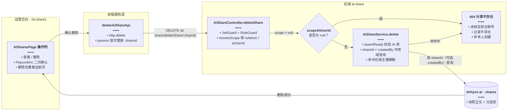

# 运营后台分享记录删除

> **延伸阅读**：[分享落库与快照回退.md](../chat/分享落库与快照回退.md)（分享数据模型与快照机制）、[分享链接过期时间.md](../chat/分享链接过期时间.md)（链接有效期）。本文只讲后台「删除分享记录」这一项能力。

## 1. 背景与目标

运营后台的 **分享列表**（`/ai-shares`）此前只能「查看」：能翻页、按类型/标题筛选、进入详情页，但无法清理脏数据与无效分享。运营遇到测试分享、违规内容、或占用空间的异常记录时，只能进数据库手工删。

本轮新增 **删除分享记录**：

- 管理员（超级管理员 / 具备 ADMIN 角色）可以删除**任意**分享；普通后台账号只能删除**自己前台账号**创建的分享。
- 删除是**硬删除**：按 `shareId` 删掉 `shares` 整行，快照正文与元信息一并消失，链接立即不可访问，**不可恢复**。
- 这与产品前台「撤销分享」是两条通道：前台撤销写 `revoked_at` 做软删、保留记录；后台删除是运营清理，直接移除记录。

## 2. 改动范围

| 模块 | 文件 | 改动 |
|------|------|------|
| 后端控制器 | `apps/backend/src/services/ai-share/ai-share.controller.ts` | 新增 `DELETE /ai-share/deleteShare/:shareId` 路由与 `deleteShare` 方法 |
| 后端服务 | `apps/backend/src/services/ai-share/ai-share.service.ts` | 新增 `delete(shareId, scopeAiUserId)`：连接校验 + 作用域查询 + 硬删除 |
| 前端接口表 | `apps/frontend/src/service/api.ts` | 新增 `deleteAiShare` 常量 |
| 前端服务 | `apps/frontend/src/service/index.ts` | 新增 `deleteAiShareApi` |
| 前端页面 | `apps/frontend/src/views/ai-shares/AiSharesPage.tsx` | 操作列新增「删除」+ `Popconfirm` 二次确认，删除后按需回退页码 |

仅格式化/无逻辑变化的部分（不展开对比）：`ai-learning-note.controller.ts` 的换行、`ai-share.entity.ts` 装饰器换行、`ai-share.module.ts` 文件末尾补换行、`router/index.tsx` 删除空行。

## 3. 实现思路

### 3.1 作用域：先判身份，再缩小删除范围

后台账号与前台业务用户的关联是 `admin 用户 → aiUserId`（绑定关系存于后台库）。控制器统一走 `resolveScope`：

- **管理员**：`scopeAiUserId = undefined` → 服务层不加 `createdBy` 条件，可删全站分享。
- **非管理员且已绑定前台账号**：`scopeAiUserId = aiUserId` → 服务层追加 `s.createdBy = :uid`，只能删自己的。
- **非管理员且未绑定**：`scopeAiUserId = null` → 服务层直接抛 404，不查库。

用 404 而不是 403 是有意为之：不暴露「该 `shareId` 是否存在」，避免越权探测。

### 3.2 为什么「先查再删」而不是直接 `delete`

`Repository.delete({ shareId })` 本身不校验影响行数：删不存在的记录也会静默成功，前端就无法区分「删成功」与「本来就没有 / 无权限」。因此先 `getOne()` 拿到目标行，命中后再按主键删除，保证：

1. 不存在 → 404，前端气泡报错；
2. 越权（非管理员且非本人创建）→ 查不到 → 404；
3. 命中 → `delete({ shareId: target.shareId })`，范围仍是单行。

### 3.3 数据流



### 3.4 删除后的列表一致性

- 删除成功后 `load(nextPage, pageSize)` 重新拉列表，`total` 与分页同步刷新。
- 若当前页**只剩 1 条**且 `pageNo > 1`，自动回退到上一页，避免删完后停在空白页。

## 4. 关键代码对比与注释

### 4.1 控制器导入块 `@nestjs/common`

**对比范围**：`ai-share.controller.ts` 顶部 `@nestjs/common` 导入语句（摘录，其余 import 未改动）。

**改动前** · `apps/backend/src/services/ai-share/ai-share.controller.ts`（基线，约 L1–L9）

```typescript
// 从 Nest 公共模块导入控制器与请求装饰器，供路由声明使用
import {
	// 声明类为 HTTP 控制器，配合 @Controller('ai-share') 生成路由前缀
	Controller,
	// 声明 GET 查询接口（分享列表与分享详情）
	Get,
	// 声明路径参数读取，用于 :shareId 这类动态段
	Param,
	// 声明查询串参数，用于分页与类型/标题筛选
	Query,
	// 声明原始请求对象，用于读取 JWT 守卫挂载的 req.user
	Req,
	// 声明守卫组合，执行 JWT 校验与角色校验
	UseGuards,
	// 声明响应拦截器，统一包装接口返回值
	UseInterceptors,
// 结束导入列表，依赖均来自 @nestjs/common
} from '@nestjs/common';
```

**改动后** · `apps/backend/src/services/ai-share/ai-share.controller.ts`（当前，约 L1–L10）

```typescript
// 从 Nest 公共模块导入控制器与请求装饰器，供路由声明使用
import {
	// 声明类为 HTTP 控制器，配合 @Controller('ai-share') 生成路由前缀
	Controller,
	// 新增：声明 DELETE 路由，用于删除分享记录
	Delete,
	// 声明 GET 查询接口（分享列表与分享详情）
	Get,
	// 声明路径参数读取，用于 :shareId 这类动态段
	Param,
	// 声明查询串参数，用于分页与类型/标题筛选
	Query,
	// 声明原始请求对象，用于读取 JWT 守卫挂载的 req.user
	Req,
	// 声明守卫组合，执行 JWT 校验与角色校验
	UseGuards,
	// 声明响应拦截器，统一包装接口返回值
	UseInterceptors,
// 结束导入列表，依赖均来自 @nestjs/common
} from '@nestjs/common';
```

**变更摘要**：仅新增 `Delete` 装饰器导入，其余符号与顺序不变。

### 4.2 `AiShareController.deleteShare` 方法（新增）

**对比范围**：控制器中新增的 `deleteShare` 方法；基线文件不存在该方法（纯新增，只展示改动后）。

**改动后（新增）** · `apps/backend/src/services/ai-share/ai-share.controller.ts`（当前，约 L87–L97）

```typescript
// 删除分享：路由带 :shareId；类级 JwtGuard + RoleGuard 已保证登录与后台角色
	@Delete('/deleteShare/:shareId')
	// 删除方法：接收当前请求与分享 ID，返回删除结果
	async deleteShare(
		// 读取当前请求；req.user 由 JwtGuard 在鉴权通过后写入
		@Req() req: Request & { user?: { userId?: number } },
		// 读取路径中的分享 ID，作为唯一删除入口
		@Param('shareId') shareId: string,
	// 参数声明结束，进入方法体
	) {
		// 解析当前后台账号是否管理员，以及可访问的前台数据作用域
		const { isAdmin, scopeAiUserId } = await this.resolveScope(req);
		// 管理员传 undefined 表示不限制创建者；非管理员传自身 aiUserId 或 null
		return this.shareService.delete(
			// 目标分享 ID 原样透传给服务层
			shareId,
			// 作用域透传：服务层据此决定是否追加 createdBy 条件
			isAdmin ? undefined : scopeAiUserId,
		);
	}
```

**变更摘要**：新增一个 `DELETE` 路由；权限解析与列表/详情接口完全一致，避免三处逻辑漂移。

### 4.3 `AiShareService.delete` 方法（新增）

**对比范围**：服务类中新增的 `delete` 方法；基线文件不存在该方法（纯新增，只展示改动后）。

**改动后（新增）** · `apps/backend/src/services/ai-share/ai-share.service.ts`（当前，约 L122–L136）

```typescript
	// 删除单条分享：直接移除整行，属运营清理，不做软删
	async delete(shareId: string, scopeAiUserId?: number | null) {
		// AI 业务库未初始化时直接 503，避免在未连接的数据源上执行删除
		this.assertReady();
		// null 表示当前账号未绑定前台账号，无法对应任何分享
		if (scopeAiUserId === null) {
			// 统一按「不存在」处理，避免向调用方泄露权限差异
			throw new NotFoundException('分享不存在');
		}
		// 以 shareId 为唯一命中条件构造查询，避免前端伪造其它字段造成误删
		const qb = this.shareRepo
			// 建立别名 s，后续条件统一写成 s.xxx
			.createQueryBuilder('s')
			// 只按分享 ID 精确匹配，保证删除范围最小
			.where('s.shareId = :shareId', { shareId });
		// 非管理员（作用域有值）时再叠加创建者过滤，阻止删他人分享
		if (scopeAiUserId != null) {
			// 要求该行 createdBy 等于当前账号绑定的前台 aiUserId
			qb.andWhere('s.createdBy = :uid', { uid: scopeAiUserId });
		}
		// 先取出目标行：既能判定存在性，也能区分「不存在 / 越权」
		const target = await qb.getOne();
		// 查不到即 404；此处同时覆盖「记录不存在」与「非本人创建」
		if (!target) throw new NotFoundException('分享不存在');
		// 按主键删除整行：快照正文、有效期、打开次数一并移除且不可恢复
		await this.shareRepo.delete({ shareId: target.shareId });
	}
```

**变更摘要**：与 `findOne` 复用同一套作用域写法；删除前先查一次，换来明确的 404 语义。

### 4.4 前端接口常量 `API`

**对比范围**：`API` 常量末尾的分享/知识库/健康检查段（摘录，前面各业务常量未改动）。

**改动前** · `apps/frontend/src/service/api.ts`（基线，约 L40–L44）

```typescript
// 日志导出：统一维护后端路由，组件层不硬编码字符串
export const API = {
	// ... 登录、用户、角色、菜单、日志、电子书、知识库、笔记等常量未改动
	// 分享列表：后台表格分页查询
	aiShares: '/ai-share/getShares',
	// 分享详情：按 shareId 读取快照正文
	aiShare: '/ai-share/getShare',
	// 知识库详情：知识详情页读取单条知识
	aiKnowledgeDetail: '/ai-knowledge/getKnowledge',
	// 健康检查：用于连通性探测
	health: '/health',
// 常量对象结束，as const 保留字面量类型供调用处推导
} as const;
```

**改动后** · `apps/frontend/src/service/api.ts`（当前，约 L40–L45）

```typescript
// 日志导出：统一维护后端路由，组件层不硬编码字符串
export const API = {
	// ... 登录、用户、角色、菜单、日志、电子书、知识库、笔记等常量未改动
	// 分享列表：后台表格分页查询
	aiShares: '/ai-share/getShares',
	// 分享详情：按 shareId 读取快照正文
	aiShare: '/ai-share/getShare',
	// 新增：删除分享，路径尾部由 params 替换为 shareId
	deleteAiShare: '/ai-share/deleteShare',
	// 知识库详情：知识详情页读取单条知识
	aiKnowledgeDetail: '/ai-knowledge/getKnowledge',
	// 健康检查：用于连通性探测
	health: '/health',
// 常量对象结束，as const 保留字面量类型供调用处推导
} as const;
```

**变更摘要**：新增 `deleteAiShare` 常量，其余不变。

### 4.5 `deleteAiShareApi`

**对比范围**：新增的服务函数（纯新增，只展示改动后）。

**改动后（新增）** · `apps/frontend/src/service/index.ts`（当前，约 L144–L145）

```typescript
// 删除分享：按 shareId 调用后台删除接口
export const deleteAiShareApi = (shareId: string) =>
	// http.delete 会把 params 依次替换路由中的 :shareId；失败由 http 层统一提示
	http.delete(API.deleteAiShare, { params: [shareId] });
```

### 4.6 `AiSharesPage` 导入块

**对比范围**：`AiSharesPage.tsx` 顶部 antd 与服务导入（摘录，其余 import 未改动）。

**改动前** · `apps/frontend/src/views/ai-shares/AiSharesPage.tsx`（基线，约 L1–L7）

```typescript
// 从 antd 引入表格页所需组件：按钮、输入框、下拉、间距、表格、标签、标题文本
import { Button, Input, Select, Space, Table, Tag, Typography } from 'antd';
// 用 observer 包裹组件，订阅 MobX store（登录态/页面 loading）
import { observer } from 'mobx-react';
// React 基础 Hook：初始化列表与筛选状态
import { useEffect, useState } from 'react';
// 路由 Hook：跳转分享详情页
import { useNavigate } from 'react-router';
// 表格分页常量与统一分页配置，避免各页参数不一致
import { DEFAULT_PAGE_SIZE, tablePagination } from '@/lib/table-pagination';
// 只引入列表查询接口，删除能力尚未接入
import { getAiSharesApi } from '@/service';
// 全局状态：鉴权信息与页面级 loading/notice
import { useStore } from '@/store';
```

**改动后** · `apps/frontend/src/views/ai-shares/AiSharesPage.tsx`（当前，约 L1–L17）

```typescript
// 从 antd 引入表格页所需组件：按钮、输入框、消息提示、确认气泡、下拉、间距、表格、标签、标题文本
import {
	// 表格行内与筛选区使用的按钮
	Button,
	// 标题筛选输入框
	Input,
	// 删除成功后的轻提示
	message,
	// 删除前的二次确认气泡，防止误删
	Popconfirm,
	// 类型筛选下拉
	Select,
	// 操作列与筛选区的横向间距容器
	Space,
	// 分享列表表格
	Table,
	// 类型/状态标签
	Tag,
	// 说明与标题文本
	Typography,
// 结束 antd 具名导入
} from 'antd';
// 用 observer 包裹组件，订阅 MobX store（登录态/页面 loading）
import { observer } from 'mobx-react';
// React 基础 Hook：初始化列表与筛选状态
import { useEffect, useState } from 'react';
// 路由 Hook：跳转分享详情页
import { useNavigate } from 'react-router';
// 表格分页常量与统一分页配置，避免各页参数不一致
import { DEFAULT_PAGE_SIZE, tablePagination } from '@/lib/table-pagination';
// 同时引入列表查询与删除接口：删除后需要重新拉列表
import { deleteAiShareApi, getAiSharesApi } from '@/service';
// 全局状态：鉴权信息与页面级 loading/notice
import { useStore } from '@/store';
```

**变更摘要**：新增 `message`、`Popconfirm` 与 `deleteAiShareApi` 导入；`antd` 由单行改为多行以便阅读。

### 4.7 `AiSharesPage` 表格 `columns` 操作列

**对比范围**：`columns` 常量的操作列对象（首尾 `const columns = [` / `];` 保留，中间前八列用对称 `// ...` 摘录）。

**改动前** · `apps/frontend/src/views/ai-shares/AiSharesPage.tsx`（基线，约 L85–L158）

```tsx
	// 表格列定义：每项对应一列，最后一项为操作列
	const columns = [
		// ... 标题 / 类型 / 资源 ID / 打开次数 / 创建者 / 状态 / 创建时间 / 过期时间 八列未改动
		{
			// 列头文案
			title: '操作',
			// 该列不走 dataIndex，用 key 区分
			key: 'action',
			// 宽度 80，只容纳一个「查看」链接按钮
			width: 80,
			// 固定在右侧，表格横向滚动时仍可见
			fixed: 'right' as const,
			// 每行渲染：用当前分享行生成操作按钮
			render: (_: unknown, r: ShareRow) => (
				// 仅提供「查看」，进入分享详情页
				<Button
					// link 形态：无边框，贴合表格行内操作
					type="link"
					// 小尺寸，避免撑高表格行
					size="small"
					// 去掉默认左内边距，与列头视觉对齐
					className="px-0!"
					// 点击跳转到该分享详情路由
					onClick={() => navigate(`/ai-shares/${r.shareId}`)}
				>
					// 按钮文案
					查看
				// 结束查看按钮
				</Button>
			),
		},
	];
```

**改动后** · `apps/frontend/src/views/ai-shares/AiSharesPage.tsx`（当前，约 L95–L184）

```tsx
	// 表格列定义：每项对应一列，最后一项为操作列
	const columns = [
		// ... 标题 / 类型 / 资源 ID / 打开次数 / 创建者 / 状态 / 创建时间 / 过期时间 八列未改动
		{
			// 列头文案
			title: '操作',
			// 该列不走 dataIndex，用 key 区分
			key: 'action',
			// 加宽到 120：容纳「查看 + 删除」两个链接按钮
			width: 120,
			// 固定在右侧，表格横向滚动时仍可见
			fixed: 'right' as const,
			// 每行渲染两个操作：查看与删除
			render: (_: unknown, r: ShareRow) => (
				// 横向排布两个按钮；不做换行，保持行高稳定
				<Space>
					// 查看保持原有行为，进入分享详情页
					<Button
						// link 形态：无边框，贴合表格行内操作
						type="link"
						// 小尺寸，避免撑高表格行
						size="small"
						// 去掉默认左内边距，与列头视觉对齐
						className="px-0!"
						// 点击跳转到该分享详情路由
						onClick={() => navigate(`/ai-shares/${r.shareId}`)}
					>
						// 按钮文案
						查看
					// 结束查看按钮
					</Button>
					// 二次确认气泡：删除不可恢复，必须先确认
					<Popconfirm
						// 文案明确「不可恢复」，与后端硬删语义一致
						title="确认删除？不可恢复"
						// 确认后执行删除并刷新列表
						onConfirm={async () => {
							// 调用删除接口；异常会抛出，气泡保持打开便于重试
							await deleteAiShareApi(r.shareId);
							// 成功后给出即时反馈
							message.success('已删除');
							// 当前页只剩这一条且不在第一页时，回退一页，避免停在空白页
							const nextPage =
								// 是最后一条且 pageNo > 1 就减一页，否则保持当前页
								list.length === 1 && pageNo > 1 ? pageNo - 1 : pageNo;
							// 用目标页码重新拉取，保持 total 与分页同步
							load(nextPage, pageSize);
						}}
					>
						// 危险色链接按钮作为确认触发器
						<Button danger type="link" size="small" className="px-0!">
							// 按钮文案
							删除
						// 结束删除按钮
						</Button>
					// 结束二次确认气泡
					</Popconfirm>
				// 结束按钮组
				</Space>
			),
		},
	];
```

**变更摘要**：操作列宽度 80 → 120；新增 `Space` 容器、`Popconfirm` 与删除按钮；`onConfirm` 内完成「调用删除 → 成功提示 → 页码回退 → 重载列表」。

## 5. 兼容性与影响

- **新增接口，无破坏性**：`/ai-share/getShares`、`/ai-share/getShare/:shareId` 行为不变。
- **数据不可恢复**：硬删会连同快照正文（`content_snapshot`）一起删除；产品前台已打开的分享页下次请求会 404。
- **权限语义**：与列表/详情一致沿用 `Role.ADMIN` / `Role.USER` + `resolveScope`；普通账号的可见与可删范围都由 `createdBy` 约束。
- **未绑定前台账号**：列表接口返回空、删除接口返回 404（不会误删他人数据）。
- **产品前台「撤销」**：走 `revoked_at` 软删，与本后台删除互不影响。

## 6. 风险与回归

建议覆盖：

1. 管理员删除任意分享 → 列表少一条、`total` 减 1；分享链接打开返回不存在。
2. 普通账号删除**自己**创建的分享 → 成功。
3. 普通账号删除**他人**分享 → 404「分享不存在」。
4. 未绑定前台账号的后台账号点删除 → 404。
5. 同一 shareId 并发/重复删除 → 第二次 404。
6. 当前页仅 1 条且 `pageNo > 1` → 删除后回到上一页并加载数据。
7. AI 业务库未连接 → 503，并提示检查 `AI_DB_*` 与 MySQL。

## 7. 相关源码路径

| 说明 | 路径 |
|------|------|
| 后端路由 | `apps/backend/src/services/ai-share/ai-share.controller.ts` |
| 后端删除逻辑 | `apps/backend/src/services/ai-share/ai-share.service.ts` |
| 前端路由常量 | `apps/frontend/src/service/api.ts` |
| 前端请求封装 | `apps/frontend/src/service/index.ts` |
| 分享列表页 | `apps/frontend/src/views/ai-shares/AiSharesPage.tsx` |

---

（若与仓库最新源码不一致，以源码为准）
