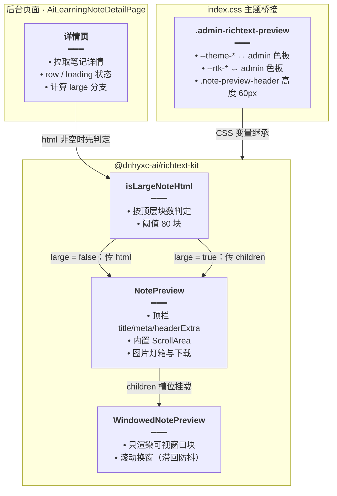

# 笔记详情富文本预览

> **延伸阅读**：[长文窗口化渲染.md](../tools/长文窗口化渲染.md)（`richtext-kit` 窗口化算法与 `WINDOW_SIZE` 策略）、[富文本预览与图片灯箱.md](../tools/富文本预览与图片灯箱.md)（`NotePreview` 三态与图片预览）、[长内容横向溢出修复.md](./长内容横向溢出修复.md)（同一轮的后台宽度约束修复）。

## 1. 背景与目标

后台「学习笔记详情」页此前是这样渲染的：后端返回 TipTap 生成的 HTML，页面用 `dangerouslySetInnerHTML` 塞进一个 `div`，再靠 `index.css` 里手写的一整套 `.admin-rich-text` 规则模拟排版，外层套 Radix `ScrollArea`。

这带来三个问题：

1. **排版与产品端不一致**：标题字号、段落间距、代码块/表格样式都是后台单独维护的第二套，和产品端笔记预览经常对不上。
2. **长笔记卡顿**：一篇几百个块的笔记会一次性挂载整篇 DOM，进入详情页时白屏与滚动都明显变慢。
3. **图片预览缺失**：后台没有产品端「点图放大、下载」的灯箱能力。

本轮改为直接消费团队内的 **`@dnhyxc-ai/richtext-kit`**：

- 短文走 `NotePreview`（`html` 属性），排版、空段落处理、图片灯箱全部由包提供；
- 长文（`isLargeNoteHtml` 判定为真，包内阈值为 **80 块**）改用 `WindowedNotePreview` 作为 `NotePreview` 的 `children`，只渲染可视窗口附近的块；
- 新增 `loading` 状态区分「加载中」与「暂无数据」，避免首屏闪烁；
- 用 `.admin-richtext-preview` 把包的 `--theme-*` / `--rtk-*` 变量绑到后台主题色板。

## 2. 改动范围

| 文件 | 改动 |
|------|------|
| `apps/frontend/src/views/ai-learning-note/AiLearningNoteDetailPage.tsx` | 重写详情页渲染：引入 `NotePreview` / `WindowedNotePreview` / `isLargeNoteHtml`，增加 `loading`，抽出 `meta` 与 `headerExtra` |
| `apps/frontend/src/index.css` | 删除 `.admin-rich-text` 第二套排版，改为 `.admin-richtext-preview` 主题变量桥接；新增 `.note-preview-header` 高度覆盖 |
| `apps/frontend/package.json` | 新增依赖 `@dnhyxc-ai/richtext-kit@0.0.3` |
| `apps/frontend/vite.config.ts` | `optimizeDeps.include` 预打包 `preview` / `windowed` 两个子入口 |

## 3. 实现思路

### 3.1 分支选择：短文静态预览、长文窗口化



### 3.2 关键决策

- **只读预览复用 `NotePreview`，不自建标题栏**：包顶栏支持 `title` / `meta` / `headerExtra`，正好承载后台原有「标题 + 公开状态 + 返回列表」。标题、元信息从页面数据派生后传入，拓扑更简单。
- **长文不再手写虚拟列表**：`isLargeNoteHtml` 与 `WindowedNotePreview` 已在产品端验证过换窗策略（窗口 100 块、origin 滞回 24 块），后台直接复用，避免第二套实现。
- **`key={row?.id}` 强制重挂载**：`WindowedNotePreview` 内部持有窗口 `origin`，切换笔记时若不重挂载会沿用上一篇的起点。
- **`loading` 与 `row` 分离**：首屏请求期间 `row` 为 `null`，如果只看 `row` 会先渲染「暂无数据」；增加 `loading` 后，加载中交给 `NotePreview` 的骨架态。
- **主题桥接放 CSS 而非包内改样式**：后台色板由 `html.dark` 与 CSS 变量驱动，包只认 `--theme-*` / `--rtk-*`；用一层 class 映射即可，升级包不影响后台主题。
- **Vite 预打包两个子入口**：`preview` / `windowed` 是条件导出子路径，加入 `optimizeDeps.include` 可避免首次进入详情页时「依赖发现 → 页面重载 → 绑定丢失」。

### 3.3 数据流与状态

1. `useParams` 取 `id` → `useEffect` 请求 `getAiLearningNoteApi(id)`；
2. 成功写入 `row`，失败清空并 `message.error`；
3. `finally` 同时关闭页面 `loading` 与整页遮罩；
4. 渲染时由 `row` 派生 `title` / `html` / `meta` / `headerExtra`；
5. `html` 非空才调用 `isLargeNoteHtml`，避免空串走无意义解析。

## 4. 关键代码对比与注释

### 4.1 `AiLearningNoteDetailPage` 导入块

**对比范围**：文件顶部 import（此处为全量，未改动部分一并保留）。

**改动前** · `apps/frontend/src/views/ai-learning-note/AiLearningNoteDetailPage.tsx`（基线，约 L1–L7）

```tsx
// 从 antd 引入按钮、标签、标题文本与轻提示
import { Button, Tag, Typography, message } from 'antd';
// 用 observer 包裹页面，订阅 MobX 全局状态
import { observer } from 'mobx-react';
// React 基础 Hook：详情数据与副作用
import { useEffect, useState } from 'react';
// 路由 Hook：读取笔记 id、返回列表
import { useNavigate, useParams } from 'react-router';
// Radix 滚动容器：旧版由页面自己包住 HTML 正文
import { ScrollArea } from '@/components/ui';
// 后台笔记详情接口
import { getAiLearningNoteApi } from '@/service';
// 全局状态：页面级 loading
import { useStore } from '@/store';
```

**改动后** · `apps/frontend/src/views/ai-learning-note/AiLearningNoteDetailPage.tsx`（当前，约 L1–L12）

```tsx
// 引入只读笔记预览组件：负责顶栏、正文排版、图片灯箱
import { NotePreview } from '@dnhyxc-ai/richtext-kit/preview';
// 引入长文判定与窗口化预览：超阈值时只渲染可视区附近的块
import {
	// 按 HTML 块数判断是否属于长文，阈值由包内常量控制
	isLargeNoteHtml,
	// 长文窗口化预览，作为 NotePreview 的 children 使用
	WindowedNotePreview,
// 结束 windowed 具名导入
} from '@dnhyxc-ai/richtext-kit/windowed';
// 引入包内样式：工具栏/正文/灯箱排版都依赖它，缺了会裸排
import '@dnhyxc-ai/richtext-kit/styles.css';
// 从 antd 引入按钮、消息、标签、标题文本（顺序由格式化统一）
import { Button, message, Tag, Typography } from 'antd';
// 用 observer 包裹页面，订阅 MobX 全局状态
import { observer } from 'mobx-react';
// React 基础 Hook：详情数据、加载态与副作用
import { useEffect, useState } from 'react';
// 路由 Hook：读取笔记 id、返回列表
import { useNavigate, useParams } from 'react-router';
// 后台笔记详情接口
import { getAiLearningNoteApi } from '@/service';
// 全局状态：页面级 loading
import { useStore } from '@/store';
```

**变更摘要**：新增 richtext-kit 的 `preview` / `windowed` / `styles.css` 三个入口；删除页面级 `ScrollArea`（滚动改由 `NotePreview` 内置容器负责）。

### 4.2 `AiLearningNoteDetailPage` 组件

**对比范围**：`observer(...)` 包裹的整个页面组件，从 `export const` 到末尾 `);`。`formatTime` 与 `LearningNoteDetail` 类型未改动，不在摘录内。

**改动前** · `apps/frontend/src/views/ai-learning-note/AiLearningNoteDetailPage.tsx`（基线，约 L28–L99）

```tsx
// 导出详情页组件；observer 让 noticeStore 的 pageLoading 变化驱动重渲染
export const AiLearningNoteDetailPage = observer(
	// 页面函数：读取 id、拉取详情、只读渲染
	function AiLearningNoteDetailPage() {
		// 读取路由里的笔记 id，决定请求哪一条
		const { id } = useParams<{ id: string }>();
		// 返回列表按钮需要用路由跳转
		const navigate = useNavigate();
		// 取全局 noticeStore，控制整页 loading 遮罩
		const { noticeStore } = useStore();
		// 保存笔记详情；null 表示尚未加载或加载失败
		const [row, setRow] = useState<LearningNoteDetail | null>(null);

		// id 变化时重新拉取详情
		useEffect(() => {
			// 没有 id 时不发请求，避免无意义调用
			if (!id) return;
			// 打开整页 loading，覆盖首屏空窗期
			noticeStore.setPageLoading(true);
			// 调用后台笔记详情接口
			getAiLearningNoteApi(id)
				// 成功：写入 row，驱动标题与正文渲染
				.then((res) => setRow(res.data as LearningNoteDetail))
				// 失败：清空 row 并提示，避免残留上一篇内容
				.catch((e: any) => {
					// 清空数据，让页面落到「暂无数据」
					setRow(null);
					// 优先使用后端文案，兜底「笔记不存在」
					message.error(e?.message || '笔记不存在');
				})
				// 无论成败都关闭整页 loading
				.finally(() => noticeStore.setPageLoading(false));
			// 卸载或切篇时兜底关闭 loading，防止遮罩残留
			return () => noticeStore.setPageLoading(false);
		// id 变化需要重新请求
		}, [id]);

		// 渲染页面：头部固定，正文区占满剩余高度
		return (
			// 外层纵向布局：头部不滚，正文区内部滚动
			<div className="h-full flex flex-col">
				// 头部区：返回按钮、标题、公开标签与元信息
				<div className="shrink-0 px-6 pt-6 pb-4">
					// 标题行：按钮与标题同行，空间不足时换行
					<div className="flex items-center gap-3 flex-wrap">
						// 返回笔记列表
						<Button onClick={() => navigate('/ai-learning-note')}>
							// 按钮文案
							返回列表
						// 结束返回按钮
						</Button>
						// 标题：优先笔记标题，缺失时用「笔记详情」
						<Typography.Title level={4} className="!m-0 truncate">
							// 标题文本
							{row?.title || '笔记详情'}
						// 结束标题
						</Typography.Title>
						// 拿到数据后才展示公开/私有状态
						{row ? (
							// 公开笔记用成功色标签
							row.isPublic ? (
								// 绿色标签表示公开
								<Tag color="success">公开</Tag>
							// 私有笔记用默认标签
							) : (
								// 默认色标签表示私有
								<Tag>私有</Tag>
							)
						// 未加载完成时不渲染标签，避免占位跳动
						) : null}
					// 结束标题行
					</div>
					// 元信息：作者、创建时间、更新时间
					{row ? (
						// 次要文本样式，弱化辅助信息
						<Typography.Text type="secondary" className="mt-2 block text-sm">
							// 作者与创建时间
							{row.author} · 创建 {formatTime(row.createdAt)} · 更新{' '}
							// 更新时间
							{formatTime(row.updatedAt)}
						// 结束元信息文本
						</Typography.Text>
					// 未加载完成时不渲染元信息
					) : null}
				// 结束头部区
				</div>

				// 正文区：撑满剩余高度，防止正文把页面顶开
				<div className="flex-1 min-h-0 overflow-hidden px-6 pb-6">
					// 白底卡片：边框 + 圆角 + 裁剪内容
					<div className="h-full min-h-0 rounded border border-[color:var(--color-border)] bg-[color:var(--color-card)] overflow-hidden">
						// 有数据才渲染正文，否则分别走空态/加载态
						{row ? (
							// 正文非空时用 ScrollArea 包住 HTML
							row.content?.trim() ? (
								// Radix 滚动容器：整页内容一次性挂载
								<ScrollArea className="h-full min-h-0 w-full">
									// 手写富文本样式类 + 原始 HTML 注入
									<div
										// .admin-rich-text 提供第二套排版规则
										className="admin-rich-text p-6"
										// 直接注入 TipTap HTML，不经过任何解析
										dangerouslySetInnerHTML={{ __html: row.content }}
									/>
								// 结束正文容器
								</ScrollArea>
							// 正文为空时提示「内容为空」
							) : (
								// 空态容器
								<div className="p-6">
									// 次要文案
									<Typography.Text type="secondary">内容为空</Typography.Text>
								// 结束空态容器
								</div>
							)
						// 没有数据时提示「暂无数据」
						) : (
							// 空态容器
							<div className="p-6">
								// 次要文案
								<Typography.Text type="secondary">暂无数据</Typography.Text>
							// 结束空态容器
							</div>
						)}
					// 结束白底卡片
					</div>
				// 结束正文区
				</div>
			// 结束外层布局
			</div>
		);
	// 结束页面函数
	},
// 结束 observer 包裹
);
```

**改动后** · `apps/frontend/src/views/ai-learning-note/AiLearningNoteDetailPage.tsx`（当前，约 L33–L118）

```tsx
// 导出详情页组件；observer 让 noticeStore 的 pageLoading 变化驱动重渲染
export const AiLearningNoteDetailPage = observer(
	// 页面函数：读取 id、拉取详情、按长度选择预览方式
	function AiLearningNoteDetailPage() {
		// 读取路由里的笔记 id，决定请求哪一条
		const { id } = useParams<{ id: string }>();
		// 返回列表按钮需要用路由跳转
		const navigate = useNavigate();
		// 取全局 noticeStore，控制整页 loading 遮罩
		const { noticeStore } = useStore();
		// 保存笔记详情；null 表示尚未加载或加载失败
		const [row, setRow] = useState<LearningNoteDetail | null>(null);
		// 独立加载态：区分「请求中」与「确实没有数据」，避免首屏闪暂无数据
		const [loading, setLoading] = useState(true);

		// id 变化时重新拉取详情
		useEffect(() => {
			// 没有 id 时不发请求，避免无意义调用
			if (!id) return;
			// 每次进入/切篇先置为加载中，驱动 NotePreview 骨架态
			setLoading(true);
			// 打开整页 loading，覆盖首屏空窗期
			noticeStore.setPageLoading(true);
			// 调用后台笔记详情接口
			getAiLearningNoteApi(id)
				// 成功：写入 row，驱动标题、元信息与正文
				.then((res) => setRow(res.data as LearningNoteDetail))
				// 失败：清空 row 并提示，避免残留上一篇内容
				.catch((e: any) => {
					// 清空数据，让页面落到「暂无数据」
					setRow(null);
					// 优先使用后端文案，兜底「笔记不存在」
					message.error(e?.message || '笔记不存在');
				})
				// 无论成败都收敛两个 loading，避免遮罩与骨架卡住
				.finally(() => {
					// 关闭页面内加载态：正文/骨架切到真实内容
					setLoading(false);
					// 关闭整页 loading 遮罩
					noticeStore.setPageLoading(false);
				});
			// 卸载或切篇时兜底关闭 loading，防止遮罩残留
			return () => noticeStore.setPageLoading(false);
		// id 变化需要重新请求
		}, [id]);

		// 顶栏标题：去空格后为空则回退「无标题」
		const title = row?.title?.trim() || '无标题';
		// 正文 HTML：缺失时给空串，交给 NotePreview 的空态处理
		const html = row?.content || '';
		// 长文判定：空内容不参与解析，长度超阈值才走窗口化
		const large = Boolean(html && isLargeNoteHtml(html));

		// 元信息：作者、公开状态、创建/更新时间，放在标题下方
		const meta = row ? (
			// 次要文本：随主题变量变色
			<span className="text-sm text-muted-foreground">
				// 作者与可见性
				{row.author} · {row.isPublic ? '公开' : '私有'} · 创建{' '}
				// 创建与更新时间
				{formatTime(row.createdAt)} · 更新 {formatTime(row.updatedAt)}
			// 结束元信息
			</span>
		// 没有数据时不渲染元信息
		) : null;

		// 顶栏右侧操作：公开/私有标签 + 返回列表
		const headerExtra = (
			// 横向排布，垂直居中
			<div className="flex items-center gap-2 py-2">
				// 有数据才展示可见性标签
				{row ? (
					// 公开用成功色
					row.isPublic ? (
						// m-0! 压掉 Tag 默认外边距，避免顶栏高度抖动
						<Tag color="success" className="m-0!">
							// 标签文案
							公开
						// 结束公开标签
						</Tag>
					// 私有用默认色
					) : (
						// 同样压掉外边距
						// 默认色标签表示私有
						<Tag className="m-0!">私有</Tag>
					)
				// 无数据时不占位
				) : null}
				// 返回列表：小尺寸，放进预览顶栏
				<Button size="small" onClick={() => navigate('/ai-learning-note')}>
					// 按钮文案
					返回列表
				// 结束返回按钮
				</Button>
			// 结束顶栏操作区
			</div>
		);

		// 渲染页面：整屏容器 + 富文本预览
		return (
			// absolute 铺满父级：确保预览区拿到确定高度，内部滚动才生效
			<div className="absolute inset-0 flex flex-col overflow-hidden px-6 py-6">
				// 主题桥接容器：把 richtext-kit 变量绑到后台色板，并裁掉圆角外溢
				<div className="admin-richtext-preview flex min-h-0 flex-1 flex-col overflow-hidden rounded border border-(--color-border)">
					// 加载完成且无数据：展示页面级空态
					{!row && !loading ? (
						// 空态容器
						<div className="p-6">
							// 次要文案
							<Typography.Text type="secondary">暂无数据</Typography.Text>
						// 结束空态容器
						</div>
					// 长文：NotePreview 外壳 + 窗口化正文
					) : large ? (
						// key 用 id：切篇时重挂载，重置窗口 origin
						<NotePreview
							// 切篇重挂载，避免沿用上一篇的窗口起点
							key={row?.id}
							// 顶栏标题
							title={title}
							// 标题下方元信息
							meta={meta}
							// 顶栏右侧操作
							headerExtra={headerExtra}
							// 加载态交给包内骨架，避免自定义闪烁
							loading={loading}
							// 占满父级剩余高度，内部 ScrollArea 才能滚动
							className="min-h-0 flex-1"
						>
							// children 槽位：只渲染可视窗口附近的块
							<WindowedNotePreview html={html} />
						// 结束长文预览
						</NotePreview>
					// 短文：直接把 HTML 交给 NotePreview
					) : (
						// 与长文共享同一套顶栏与主题
						<NotePreview
							// 切篇重挂载，避免正文残留
							key={row?.id}
							// 顶栏标题
							title={title}
							// 正文 HTML：包内负责去标题、补空段落、图片懒加载
							html={html}
							// 标题下方元信息
							meta={meta}
							// 顶栏右侧操作
							headerExtra={headerExtra}
							// 加载态交给包内骨架
							loading={loading}
							// 占满父级剩余高度
							className="min-h-0 flex-1"
						/>
					)}
				// 结束主题桥接容器
				</div>
			// 结束页面容器
			</div>
		);
	// 结束页面函数
	},
// 结束 observer 包裹
);
```

**变更摘要**：

- 删除 `ScrollArea` + `dangerouslySetInnerHTML` + `.admin-rich-text` 的旧预览；
- 增加 `loading` 状态，`finally` 中与整页遮罩一起关闭；
- 新增 `title` / `html` / `large` / `meta` / `headerExtra` 派生值；
- 渲染分支改为「无数据 → 长文窗口化 → 短文静态」；
- 空正文不再单独提示「内容为空」，交由 `NotePreview` 的空态文案处理。

### 4.3 `package.json` 依赖

**对比范围**：`dependencies` 中 `markdown-kit` 与相邻 Radix 依赖（摘录，其余依赖未改动）。

**改动前** · `apps/frontend/package.json`（基线，约 L14–L17）

```jsonc
{
	// 依赖清单：后台运行时需要的第三方包
	"dependencies": {
		// ... 前面的依赖未改动
		// Markdown 渲染工具包：对话/分享/知识预览使用
		"@dnhyxc-ai/markdown-kit": "1.0.3",
		// 下拉菜单原语：后台顶栏主题/菜单使用
		"@radix-ui/react-dropdown-menu": "^2.1.24",
		// ... 其余依赖未改动
	}
}
```

**改动后** · `apps/frontend/package.json`（当前，约 L14–L19）

```jsonc
{
	// 依赖清单：后台运行时需要的第三方包
	"dependencies": {
		// ... 前面的依赖未改动
		// Markdown 渲染工具包：对话/分享/知识预览使用
		"@dnhyxc-ai/markdown-kit": "1.0.3",
		// 富文本工具包：学习笔记详情改用其 NotePreview / WindowedNotePreview
		"@dnhyxc-ai/richtext-kit": "0.0.3",
		// 下拉菜单原语：后台顶栏主题/菜单使用
		"@radix-ui/react-dropdown-menu": "^2.1.24",
		// ... 其余依赖未改动
	}
}
```

**变更摘要**：新增 `@dnhyxc-ai/richtext-kit@0.0.3`；锁文件同步更新（`pnpm-lock.yaml`）。

### 4.4 `vite.config.ts` 预打包入口

**对比范围**：`optimizeDeps` 配置块（摘录，上下文为 `plugins` / `resolve`）。

**改动前** · `apps/frontend/vite.config.ts`（基线，约 L23–L25）

```typescript
// Vite 预打包配置：把常用大依赖提前转成 ESM，减少首屏请求瀑布
		optimizeDeps: {
			// 预打包 antd、图标与日期库，避免开发态反复发现依赖
			include: ['antd', '@ant-design/icons', 'dayjs'],
		// 结束预打包配置
		},
```

**改动后** · `apps/frontend/vite.config.ts`（当前，约 L23–L30）

```typescript
// Vite 预打包配置：把常用大依赖提前转成 ESM，减少首屏请求瀑布
		optimizeDeps: {
			// 预打包列表：逐个列出，新增条目也必须在此登记
			include: [
				// antd 组件库
				'antd',
				// antd 图标
				'@ant-design/icons',
				// 日期库
				'dayjs',
				// richtext-kit 预览入口：避免首次进详情页触发依赖发现与整页重载
				'@dnhyxc-ai/richtext-kit/preview',
				// richtext-kit 窗口化入口：同上，长文分支首次使用时不掉绑定
				'@dnhyxc-ai/richtext-kit/windowed',
			// 结束预打包列表
			],
		// 结束预打包配置
		},
```

**变更摘要**：`include` 从 3 个条目扩为 5 个；新增两个 richtext-kit 子路径预打包。

### 4.5 `index.css` 富文本预览样式

**对比范围**：`index.css` 中旧 `.admin-rich-text` 整套规则（基线）与新 `.admin-richtext-preview` + `.note-preview-header`（当前）。

**改动前** · `apps/frontend/src/index.css`（基线，约 L229–L291）

```css
/* TipTap / 学习笔记富文本 HTML 预览：后台自己维护的第二套排版 */
.admin-rich-text {
	/* 正文跟随后台前景色，深色主题自动切换 */
	color: var(--color-foreground);
	/* 行高 1.7：长文阅读更松散 */
	line-height: 1.7;
	/* 长单词/URL 强制换行，避免撑宽容器 */
	word-break: break-word;
}
/* 段落、列表、引用、代码块、表格与标题统一上下间距 */
.admin-rich-text :where(p, ul, ol, blockquote, pre, table, h1, h2, h3, h4) {
	/* 0.75em 上下间距，保持文档节奏 */
	margin: 0.75em 0;
}
/* 各级标题共用字重与紧凑行高 */
.admin-rich-text :where(h1, h2, h3, h4) {
	/* 600 字重让标题与正文区分 */
	font-weight: 600;
	/* 1.35 行高，避免标题多行时过散 */
	line-height: 1.35;
}
/* 一级标题字号 */
.admin-rich-text h1 {
	/* 1.5rem 对应后台大标题尺度 */
	font-size: 1.5rem;
}
/* 二级标题字号 */
.admin-rich-text h2 {
	/* 1.25rem，层级递减 */
	font-size: 1.25rem;
}
/* 三级标题字号 */
.admin-rich-text h3 {
	/* 1.1rem，接近正文但仍可辨识 */
	font-size: 1.1rem;
}
/* 列表左内边距，保证项目符号不贴边 */
.admin-rich-text :where(ul, ol) {
	/* 1.5em 与常见富文本编辑器默认一致 */
	padding-left: 1.5em;
}
/* 链接样式 */
.admin-rich-text a {
	/* 使用主题主色，保持品牌一致 */
	color: var(--color-primary);
	/* 下划线提示可点击 */
	text-decoration: underline;
}
/* 图片自适应容器宽度 */
.admin-rich-text img {
	/* 最大宽度 100%，防止大图撑破卡片 */
	max-width: 100%;
	/* 高度按比例自适应 */
	height: auto;
}
/* 引用块样式 */
.admin-rich-text blockquote {
	/* 左侧 3px 描边标记引用范围 */
	border-left: 3px solid var(--color-border);
	/* 左内边距与描边留白 */
	padding-left: 0.75em;
	/* 引用文字降低对比度，弱化次要内容 */
	color: color-mix(in srgb, var(--color-foreground) 72%, transparent);
}
/* 行内代码样式 */
.admin-rich-text :where(code) {
	/* 等宽字体，区分类正文 */
	font-family: ui-monospace, SFMono-Regular, Menlo, Monaco, Consolas, monospace;
	/* 略小于正文，避免跳动 */
	font-size: 0.875em;
	/* 少量内边距形成胶囊底 */
	padding: 0.1em 0.35em;
	/* 小圆角 */
	border-radius: 4px;
	/* 前景色 8% 混合作底色，深浅主题都可见 */
	background: color-mix(in srgb, var(--color-foreground) 8%, transparent);
}
/* 代码块容器 */
.admin-rich-text pre {
	/* 超宽代码横向滚动，不撑破页面 */
	overflow-x: auto;
	/* 内边距让代码不贴边 */
	padding: 0.75em 1em;
	/* 6px 圆角 */
	border-radius: 6px;
	/* 前景色 6% 混合作底色 */
	background: color-mix(in srgb, var(--color-foreground) 6%, transparent);
}
/* 代码块内的 code 重置背景，避免双层底色 */
.admin-rich-text pre code {
	/* 去掉内边距，交给 pre 统一控制 */
	padding: 0;
	/* 透明背景，只保留 pre 的底色 */
	background: transparent;
}
/* 表格容器 */
.admin-rich-text table {
	/* 占满容器宽度 */
	width: 100%;
	/* 合并相邻边框，视觉更整齐 */
	border-collapse: collapse;
}
/* 表格单元格 */
.admin-rich-text :where(th, td) {
	/* 单元格描边，区分数据格 */
	border: 1px solid var(--color-border);
	/* 内边距，避免文字贴线 */
	padding: 0.4em 0.6em;
}
```

**改动后** · `apps/frontend/src/index.css`（当前，约 L229–L245）

```css
/* richtext-kit：把 --theme-* / --rtk-* 绑到 admin 主题变量 */
.admin-richtext-preview {
	/* 包内主色（按钮、链接、强调线）跟随后台主题主色 */
	--theme-color: var(--color-primary);
	/* 包内卡片/正文底色跟随后台卡片色 */
	--theme-background: var(--color-card);
	/* 包内文字色跟随后台前景色 */
	--theme-textcolor: var(--color-foreground);
	/* 包内描边色跟随后台边框色 */
	--theme-border: var(--color-border);
	/* 新版强调色变量：与 --theme-color 同源 */
	--rtk-accent: var(--color-primary);
	/* 新版背景变量：与 --theme-background 同源 */
	--rtk-bg: var(--color-card);
	/* 新版文字变量：与 --theme-textcolor 同源 */
	--rtk-text: var(--color-foreground);
	/* 新版边框变量：与 --theme-border 同源 */
	--rtk-border: var(--color-border);
	/* 容器底色显式声明，避免圆角处透出页面背景 */
	background: var(--color-card);
	/* 容器文字色兜底，包内未覆盖到的节点也跟随主题 */
	color: var(--color-foreground);
}
/* 预览顶栏高度覆盖：包内默认 40px，后台详情页统一为 60px */
.note-preview-header {
	/* 与后台详情页头部视觉对齐 */
	height: 60px;
}
```

**变更摘要**：删除约 60 行手写排版规则，改为 8 个主题变量映射 + 2 个容器声明；新增顶栏高度覆盖。`richtext-kit/styles.css` 负责排版本身，后台不再维护第二套。

## 5. 兼容性与影响

- **只读语义不变**：后台详情页本来就不提供编辑，`NotePreview` / `WindowedNotePreview` 只做静态渲染，无需保存 API。
- **标题不重复**：笔记正文 HTML 内含 TipTap 的 title 节点，包内 `preparePreviewBody` 会剥掉它；页面顶栏展示 `row.title`，避免出现两个标题。
- **空正文**：旧页面提示「内容为空」，新页面走 `NotePreview` 的 `emptyContent` 文案（默认「暂无内容」），文案有细微变化。
- **长文阈值**：`isLargeNoteHtml` 为包内固定阈值（80 块），后台不做二次可配置；少于阈值的笔记仍一次性渲染。
- **样式依赖**：必须保留 `import '@dnhyxc-ai/richtext-kit/styles.css'`，否则顶栏、正文、灯箱都会裸排。
- **旧类名清理**：仓库内已无 `.admin-rich-text` 引用，删除该类安全（其他页面统一用 `Markdown` 组件）。

## 6. 风险与回归

1. 短文 / 长文（79 块与 80 块边界）分别进入详情页，确认排版与滚动正常。
2. 长文快速上下滚动，确认换窗时不闪烁、不丢内容。
3. 从一篇长文切到另一篇长文（`key` 变更），确认窗口从头开始。
4. 深浅主题切换：正文、代码块、表格、引用颜色跟随后台主题。
5. 图片点击：灯箱打开、下载按钮可用。
6. 首屏加载：请求期间显示骨架而非「暂无数据」；请求失败显示「暂无数据」+ 错误提示。
7. 空正文笔记：展示包内空态文案，不出现空白卡片。

## 7. 相关源码路径

| 说明 | 路径 |
|------|------|
| 详情页 | `apps/frontend/src/views/ai-learning-note/AiLearningNoteDetailPage.tsx` |
| 主题桥接样式 | `apps/frontend/src/index.css` |
| 依赖声明 | `apps/frontend/package.json` |
| Vite 预打包 | `apps/frontend/vite.config.ts` |
| 包使用说明（安装侧） | `apps/frontend/node_modules/@dnhyxc-ai/richtext-kit/README.md` |

---

（若与仓库最新源码不一致，以源码为准）
