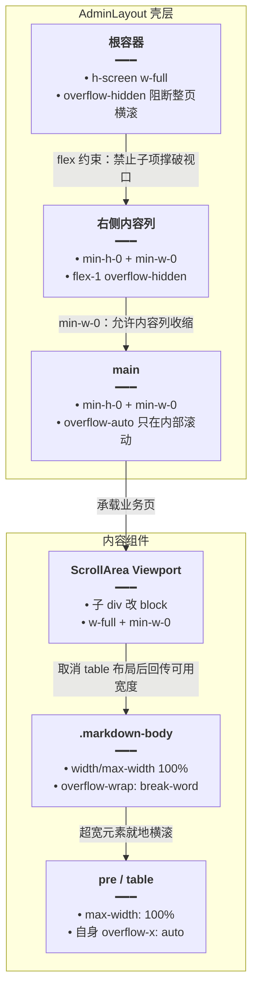

# 长内容横向溢出修复

> **延伸阅读**：[笔记详情富文本预览.md](./笔记详情富文本预览.md)（同一轮的笔记详情改造，依赖本文的宽度约束才能正常滚动）、[聊天.md](../chat/聊天机器人.md) 中的分享详情页排版说明。

## 1. 背景与目标

后台详情类页面（分享详情、学习笔记详情、知识详情）会渲染 Markdown 或富文本 HTML。当正文出现**宽表格**或**超长代码行**时，页面会被撑出横向滚动条，甚至右侧内容被裁掉：

- Radix `ScrollArea` 的 **Viewport 内容层**由组件内联样式设为 `display: table; min-width: 100%`，表格布局会按「最长一行」计算宽度；
- flex 布局的父项默认 `min-width: auto`，不会自动收缩，长内容会一路把外层撑破；
- `main` 与内容列缺少 `min-w-0`，导致内部滚动容器失效，横滚落到整页。

本轮从**容器 → 滚动层 → 正文 → 超宽元素**四层收敛宽度，目标：

1. 整页不再出现横向滚动条（根容器 `overflow-hidden`）；
2. 滚动发生在正文容器内部，而不是页面级；
3. 表格、代码块保持自身 `overflow-x: auto`，内容再宽也只在原地横滚。

## 2. 改动范围

| 文件 | 改动 |
|------|------|
| `apps/frontend/src/components/layout/AdminLayout.tsx` | 根容器加 `overflow-hidden`；内容列 / `main` 加 `min-h-0 min-w-0` |
| `apps/frontend/src/components/ui/scroll-area.tsx` | Viewport 内层 `div` 覆写为 `block / w-full / min-w-0`，抵消 Radix 的 `display: table` |
| `apps/frontend/src/components/Markdown.tsx` | `.markdown-body` 增加 `w-full / max-w-full`，移除 `overflow-x-auto` 的页面级横滚 |
| `apps/frontend/src/index.css` | `.markdown-body` 增加宽度约束；新增 ScrollArea 内容层、`pre` / `table` 兜底规则 |
| `apps/frontend/src/views/ai-shares/AiShareDetailPage.tsx` | 页面根与正文容器补 `min-w-0`；Tailwind 任意值语法收敛为 `(--color-*)` 简写 |

仅格式化/无行为变化（不展开对比）：`routes` 空行、`AiKnowledgeDetailPage` 导入排序、`AiShareDetailPage` 中 `text-[color:var(--color-muted-foreground)]` → `text-muted-foreground` 等类名等价替换，以及 `!!message.attachments?.length` → `message.attachments?.length` 的表达式简化。

## 3. 实现思路

### 3.1 撑宽链路



### 3.2 为什么四处都要改

| 层级 | 问题 | 处理 |
|------|------|------|
| `AdminLayout` 根 | 任何子项超宽都会把整页推出视口 | `overflow-hidden` 直接裁掉页面级横滚 |
| 内容列 / `main` | flex 子项 `min-width: auto`，不会收缩 | `min-w-0` 允许收缩；`min-h-0` 保证纵向滚动也生效 |
| `ScrollArea` Viewport | Radix 内联 `display: table; min-width: 100%`，按最长行算宽 | 用 `[&>div]` + `!` 覆写为 `block`、`w-full`、`min-w-0` |
| Markdown / `pre` / `table` | `.markdown-body` 自身没锁宽度；表格默认占满最长行 | 锁 `width/max-width`，表格改 `display:block` 并 `overflow-x:auto` |

### 3.3 CSS 兜底的必要性

Tailwind 的 `[&>div]` 选择器只能命中 **Viewport 的直接子元素**，且优先级受工具类顺序影响；而 Markdown 预览里的 ScrollArea 结构可能来自 `markdown-kit`（宿主 class 不同）。因此 `index.css` 再对 `.admin-md-preview [data-radix-scroll-area-viewport] > div` 做一次 `!important` 兜底，保证两种入口都生效。

## 4. 关键代码对比与注释

### 4.1 `AdminLayout` 壳层三段容器

**对比范围**：组件 `return` 中的根容器、右侧内容列、`main` 三个 JSX 片段（其余头部/侧栏未改动）。

**改动前** · `apps/frontend/src/components/layout/AdminLayout.tsx`（基线，约 L95–L96、L242、L346）

```tsx
	// 渲染壳层：左侧栏 + 右侧内容区
	return (
		// 根容器：整屏高度 + 横向两列布局
		<div className="flex h-screen w-full bg-background">
			// ... 左侧栏与右侧内容列之间的大段 JSX 未改动
			// 右侧内容列：纵向排列头部与正文
			<div className="flex flex-1 flex-col overflow-hidden">
				// ... 头部 header 未改动
				// 正文主区：仅在内部滚动
				<main className="relative flex-1 overflow-auto">
```

**改动后** · `apps/frontend/src/components/layout/AdminLayout.tsx`（当前，约 L95–L96、L242、L346）

```tsx
	// 渲染壳层：左侧栏 + 右侧内容区
	return (
		// 根容器：整屏高度 + 横向两列；overflow-hidden 阻断整页横向滚动
		<div className="flex h-screen w-full overflow-hidden bg-background">
			// ... 左侧栏与右侧内容列之间的大段 JSX 未改动
			// 右侧内容列：min-h-0/min-w-0 允许被长内容收缩，滚动交给子级
			<div className="flex min-h-0 min-w-0 flex-1 flex-col overflow-hidden">
				// ... 头部 header 未改动
				// 正文主区：min-w-0 后内部滚动才生效，长表格不会把页面撑宽
				<main className="relative min-h-0 min-w-0 flex-1 overflow-auto">
```

**变更摘要**：三处只加工具类：根 `overflow-hidden`，内容列与 `main` 各加 `min-h-0 min-w-0`；无逻辑变更。

### 4.2 `ScrollArea` 组件

**对比范围**：`ScrollArea` 完整 `forwardRef` 组件（`ScrollBar` 未改动）。

**改动前** · `apps/frontend/src/components/ui/scroll-area.tsx`（基线，约 L5–L27）

```tsx
// 基于 Radix ScrollArea 封装的滚动容器；forwardRef 透传根节点引用
const ScrollArea = React.forwardRef<
	// 引用类型与 Radix Root 一致，方便外部测量/聚焦
	React.ElementRef<typeof ScrollAreaPrimitive.Root>,
	// 透传 Radix Root 的全部 props
	React.ComponentPropsWithoutRef<typeof ScrollAreaPrimitive.Root>
// 解构 className / children，其余 props 原样下发
>(({ className, children, ...props }, ref) => (
	// 根节点：relative + overflow-hidden，裁掉滚动条溢出
	<ScrollAreaPrimitive.Root
		// 透传外部 ref
		ref={ref}
		// 合并外部 className，保持默认定位与裁剪
		className={cn('relative overflow-hidden', className)}
		// 展开其余 Radix props
		{...props}
	>
		// Viewport：真正承载内容的滚动视口
		<ScrollAreaPrimitive.Viewport className="h-full w-full rounded-[inherit]">
			// 渲染业务内容
			{children}
		// 结束视口
		</ScrollAreaPrimitive.Viewport>
		// 默认渲染纵向滚动条
		<ScrollBar />
		// 渲染右下角转角占位
		<ScrollAreaPrimitive.Corner />
	// 结束根节点
	</ScrollAreaPrimitive.Root>
// 结束组件
));
// 设置 displayName，便于 React DevTools 识别
ScrollArea.displayName = ScrollAreaPrimitive.Root.displayName;
```

**改动后** · `apps/frontend/src/components/ui/scroll-area.tsx`（当前，约 L5–L28）

```tsx
// 基于 Radix ScrollArea 封装的滚动容器；forwardRef 透传根节点引用
const ScrollArea = React.forwardRef<
	// 引用类型与 Radix Root 一致，方便外部测量/聚焦
	React.ElementRef<typeof ScrollAreaPrimitive.Root>,
	// 透传 Radix Root 的全部 props
	React.ComponentPropsWithoutRef<typeof ScrollAreaPrimitive.Root>
// 解构 className / children，其余 props 原样下发
>(({ className, children, ...props }, ref) => (
	// 根节点：relative + overflow-hidden，裁掉滚动条溢出
	<ScrollAreaPrimitive.Root
		// 透传外部 ref
		ref={ref}
		// 合并外部 className，保持默认定位与裁剪
		className={cn('relative overflow-hidden', className)}
		// 展开其余 Radix props
		{...props}
	>
		// Viewport：真正承载内容的滚动视口
		<ScrollAreaPrimitive.Viewport
			// 基础高度/宽度继承父级，圆角沿用根节点
			className={cn(
				// 高度/宽度撑满视口，圆角继承根节点
				'h-full w-full rounded-[inherit]',
				// Radix 内容层默认 display:table，会按最长一行撑开页面
				'[&>div]:block! [&>div]:min-w-0! [&>div]:w-full!',
			// 结束视口 className 合并
			)}
		>
			// 渲染业务内容
			{children}
		// 结束视口
		</ScrollAreaPrimitive.Viewport>
		// 默认渲染纵向滚动条
		<ScrollBar />
		// 渲染右下角转角占位
		<ScrollAreaPrimitive.Corner />
	// 结束根节点
	</ScrollAreaPrimitive.Root>
// 结束组件
));
// 设置 displayName，便于 React DevTools 识别
ScrollArea.displayName = ScrollAreaPrimitive.Root.displayName;
```

**变更摘要**：Viewport 的 className 由单值改为 `cn(...)`，新增三条带 `!` 的子元素覆写规则；其它结构完全不变。影响面是所有使用该 `ScrollArea` 的后台页面（侧栏导航也包含在内）。

### 4.3 `Markdown` 预览根节点

**对比范围**：`MarkdownInner` 中的 `previewHtmlRoot` 常量（摘录自 `const` 声明到闭合）。

**改动前** · `apps/frontend/src/components/Markdown.tsx`（基线，约 L118–L131）

```tsx
	// 预览根节点：承载 markdown-kit 生成的 HTML，并挂载主题/图表 hook
	const previewHtmlRoot = (
		// 通过 ref 让 Mermaid / 代码高亮等 hook 找到容器
		<div
			// 注入预览根引用，供图表渲染与滚动定位使用
			ref={previewHtmlRootRef}
			// data-theme 决定包内 CSS token 的深浅主题
			data-theme={preferDark ? 'dark' : 'light'}
			// 合并预览主题类与 Markdown 宽度/换行工具类
			className={cn(
				// 字色/背景跟随 admin `.dark`，不跟系统 prefers-color-scheme（见 index.css .admin-md-preview）
				'admin-md-preview',
				// 旧规则：允许整页横向滚动，长表格会把页面撑宽
				'[&_.markdown-body]:min-w-0 [&_.markdown-body]:max-w-none [&_.markdown-body]:wrap-break-word [&_.markdown-body]:overflow-x-auto [&_.markdown-body]:bg-transparent! [&_.markdown-body]:text-[color:var(--color-foreground)]! [&_.markdown-body_pre]:max-w-full [&_.markdown-body_pre]:overflow-x-auto [&_.markdown-body_table]:block [&_.markdown-body_table]:max-w-full [&_.markdown-body_table]:overflow-x-auto',
				// Mermaid 开启时追加光标缩放类
				enableMermaid && MARKDOWN_MERMAID_TAILWIND_CURSOR_ZOOM_IN_CLASS,
			// 结束 className 合并
			)}
		>
			// 注入已转换的 HTML
			<div dangerouslySetInnerHTML={{ __html: html }} />
		// 结束预览根节点
		</div>
	);
```

**改动后** · `apps/frontend/src/components/Markdown.tsx`（当前，约 L118–L131）

```tsx
	// 预览根节点：承载 markdown-kit 生成的 HTML，并挂载主题/图表 hook
	const previewHtmlRoot = (
		// 通过 ref 让 Mermaid / 代码高亮等 hook 找到容器
		<div
			// 注入预览根引用，供图表渲染与滚动定位使用
			ref={previewHtmlRootRef}
			// data-theme 决定包内 CSS token 的深浅主题
			data-theme={preferDark ? 'dark' : 'light'}
			// 合并预览主题类与 Markdown 宽度/换行工具类
			className={cn(
				// 字色/背景跟随 admin `.dark`，不跟系统 prefers-color-scheme（见 index.css .admin-md-preview）
				'admin-md-preview',
				// 新规则：锁死正文宽度（w-full/max-w-full），去掉页面级横滚，交给 pre/table 自己滚
				'[&_.markdown-body]:w-full [&_.markdown-body]:min-w-0 [&_.markdown-body]:max-w-full [&_.markdown-body]:wrap-break-word [&_.markdown-body]:bg-transparent! [&_.markdown-body]:text-[color:var(--color-foreground)]! [&_.markdown-body_pre]:max-w-full [&_.markdown-body_pre]:overflow-x-auto [&_.markdown-body_table]:block [&_.markdown-body_table]:max-w-full [&_.markdown-body_table]:overflow-x-auto',
				// Mermaid 开启时追加光标缩放类
				enableMermaid && MARKDOWN_MERMAID_TAILWIND_CURSOR_ZOOM_IN_CLASS,
			// 结束 className 合并
			)}
		>
			// 注入已转换的 HTML
			<div dangerouslySetInnerHTML={{ __html: html }} />
		// 结束预览根节点
		</div>
	);
```

**变更摘要**：`max-w-none` → `max-w-full`，并新增 `w-full`；`overflow-x-auto` 从 `.markdown-body` 上移除（改由 `pre` / `table` 承担）。

### 4.4 `index.css` 预览宽度约束

**对比范围**：`.admin-md-preview .markdown-body` 规则（完整），以及其后新增的 ScrollArea / `pre` / `table` 兜底规则。

**改动前** · `apps/frontend/src/index.css`（基线，约 L298–L312）

```css
/* markdown-kit 的字色 token 绑在 prefers-color-scheme，这里改绑到后台变量 */
.admin-md-preview .markdown-body {
	/* 先按浅色方案解析，避免系统深色覆盖后台浅色 */
	color-scheme: light;
	/* 正文默认色跟随后台前景色 */
	--fgColor-default: var(--color-foreground);
	/* 次要文字色 */
	--fgColor-muted: var(--color-muted-foreground);
	/* 强调/链接色 */
	--fgColor-accent: var(--color-primary);
	/* 正文背景透明，交给卡片底色 */
	--bgColor-default: transparent;
	/* 弱化背景（行内代码等）跟随后台 muted */
	--bgColor-muted: var(--color-muted);
	/* 中性弱背景：muted 混 55% 透明 */
	--bgColor-neutral-muted: color-mix(in srgb, var(--color-muted) 55%, transparent);
	/* 默认描边色 */
	--borderColor-default: var(--color-border);
	/* 弱化描边色 */
	--borderColor-muted: var(--color-border);
	/* 中性描边色 */
	--borderColor-neutral-muted: var(--color-border);
	/* 强调描边色（当前与主色同源） */
	--borderColor-accent-emphasis: var(--color-primary);
	/* 正文文字色 */
	color: var(--color-foreground);
	/* 背景透明，避免与卡片底色叠加 */
	background-color: transparent;
}
```

**改动后** · `apps/frontend/src/index.css`（当前，约 L247–L299）

```css
/* markdown-kit 的字色 token 绑在 prefers-color-scheme，这里改绑到后台变量 */
.admin-md-preview .markdown-body {
	/* 先按浅色方案解析，避免系统深色覆盖后台浅色 */
	color-scheme: light;
	/* 正文默认色跟随后台前景色 */
	--fgColor-default: var(--color-foreground);
	/* 次要文字色 */
	--fgColor-muted: var(--color-muted-foreground);
	/* 强调/链接色 */
	--fgColor-accent: var(--color-primary);
	/* 正文背景透明，交给卡片底色 */
	--bgColor-default: transparent;
	/* 弱化背景（行内代码等）跟随后台 muted */
	--bgColor-muted: var(--color-muted);
	/* 中性弱背景：muted 混 55% 透明（多行格式化后语义不变） */
	--bgColor-neutral-muted: color-mix(in srgb, var(--color-muted) 55%, transparent);
	/* 默认描边色 */
	--borderColor-default: var(--color-border);
	/* 弱化描边色 */
	--borderColor-muted: var(--color-border);
	/* 中性描边色 */
	--borderColor-neutral-muted: var(--color-border);
	/* 强调描边色（当前与主色同源） */
	--borderColor-accent-emphasis: var(--color-primary);
	/* 正文文字色 */
	color: var(--color-foreground);
	/* 背景透明，避免与卡片底色叠加 */
	background-color: transparent;
	/* 新增：占满可用宽度，避免正文按内容宽度收缩 */
	width: 100%;
	/* 新增：最大不超过容器，防止长行把页面撑宽 */
	max-width: 100%;
	/* 新增：允许在 flex 中被压缩，是内部横滚生效的前提 */
	min-width: 0;
	/* 新增：超长单词/URL 在容器内换行而不是溢出 */
	overflow-wrap: break-word;
}

/*
 * Radix ScrollArea 内容层是 inline style display:table + min-width:100%。
 * 表格会按代码里最长的一行撑开，正文跟着变宽，再被外层裁到页面外面。
 */
/* 兜底：直接命中 Radix Viewport 的直接子元素，覆盖其内联 table 布局 */
.admin-md-preview [data-radix-scroll-area-viewport] > div {
	/* 改回块级布局，宽度由容器决定而非最长内容 */
	display: block !important;
	/* 强制占满可用宽度 */
	width: 100% !important;
	/* 允许被压缩到 0，配合父级 min-w-0 */
	min-width: 0 !important;
	/* 含边框尺寸计入宽度，避免算宽多出 1px */
	box-sizing: border-box;
}

/* 代码块与表格最大不超过容器 */
.admin-md-preview .markdown-body pre,
/* 表格同样限制在容器内 */
.admin-md-preview .markdown-body table {
	/* 限制最大宽度，超宽内容改走自身滚动 */
	max-width: 100%;
}

/* 代码块横向滚动，保留原始排版不换行 */
.admin-md-preview .markdown-body pre {
	/* 只在代码块内部横滚 */
	overflow-x: auto;
}

/* 表格横向滚动 */
.admin-md-preview .markdown-body table {
	/* 改块级布局，避免 table 按内容最小宽度撑开父级 */
	display: block;
	/* 超宽表格就地横滚 */
	overflow-x: auto;
}
```

**变更摘要**：`.markdown-body` 增加 `width/max-width/min-width/overflow-wrap` 四个约束；新增 Radix 内容层覆写与 `pre` / `table` 横滚规则。

### 4.5 `AiShareDetailPage` 页面容器

**对比范围**：页面根容器与正文卡片两层（中间头部区未改动，对称省略）。

**改动前** · `apps/frontend/src/views/ai-shares/AiShareDetailPage.tsx`（基线，约 L372–L397）

```tsx
	// 渲染分享详情：头部信息 + 正文卡片
	return (
		// 页面根：纵向布局，撑满可用高度
		<div className="h-full flex flex-col">
			// ... 头部标题/状态/元信息区未改动
			// 正文区：占满剩余高度，内部滚动
			<div className="flex-1 min-h-0 overflow-hidden px-6 pb-6">
				// 正文卡片：边框 + 卡片底色 + 裁剪
				<div className="h-full min-h-0 rounded border border-[color:var(--color-border)] bg-[color:var(--color-card)] overflow-hidden">
```

**改动后** · `apps/frontend/src/views/ai-shares/AiShareDetailPage.tsx`（当前，约 L368–L393）

```tsx
	// 渲染分享详情：头部信息 + 正文卡片
	return (
		// 页面根：min-w-0 允许整页被超宽正文压缩，避免把外层撑破
		<div className="flex h-full min-w-0 flex-col">
			// ... 头部标题/状态/元信息区未改动
			// 正文区：min-w-0 后内部 ScrollArea 才能拿到真实可用宽度
			<div className="min-h-0 min-w-0 flex-1 overflow-hidden px-6 pb-6">
				// 正文卡片：补 min-w-0；颜色改用 (--color-*) 简写，效果等价
				<div className="h-full min-h-0 min-w-0 overflow-hidden rounded border border-(--color-border) bg-(--color-card)">
```

**变更摘要**：三层容器补 `min-w-0`；Tailwind 颜色任意值由 `[color:var(--x)]` 改为 `(--x)` 简写（编译结果等价）。

## 5. 兼容性与影响

- **全局组件影响**：`ScrollArea` 是公共组件，侧栏导航、表格页、详情页都会用到。子内容层改为 `block + w-full` 后，原本依赖 `display: table` 做「内容自适应宽度」的场景需要确认：后台目前没有横向多列自适应需求，影响可控。
- **滚动位置变化**：横滚从页面级下移到 `pre` / `table` 自身，用户滚轮在表格上时只滚表格。
- **主题无影响**：只改布局属性，未触碰颜色 token 语义。
- **Tailwind 版本**：`(--color-border)` 简写要求 Tailwind 4 语法；本项目已升级，旧的 `[color:var(...)]` 写法仍可用但不推荐。

## 6. 风险与回归

1. `/ai-shares/:shareId` 打开含宽表格/长代码的分享 → 页面无横滚，表格自身横滚。
2. `/ai-learning-note/:id` 长文笔记 → 正文内部纵向滚动，无页面横滚。
3. 知识库详情页 Markdown 预览 → 同上。
4. 侧栏导航（`AdminLayout` 内 `ScrollArea`）→ 菜单宽度正常、无意外横向滚动。
5. 窄窗口（约 1024px）→ 内容列可收缩，头部标题省略号生效。
6. 深浅主题切换 → 表格/代码块底色与描边正常。

## 7. 相关源码路径

| 说明 | 路径 |
|------|------|
| 后台壳层 | `apps/frontend/src/components/layout/AdminLayout.tsx` |
| 通用滚动容器 | `apps/frontend/src/components/ui/scroll-area.tsx` |
| Markdown 预览组件 | `apps/frontend/src/components/Markdown.tsx` |
| 预览宽度样式 | `apps/frontend/src/index.css` |
| 分享详情页 | `apps/frontend/src/views/ai-shares/AiShareDetailPage.tsx` |

---

（若与仓库最新源码不一致，以源码为准）
