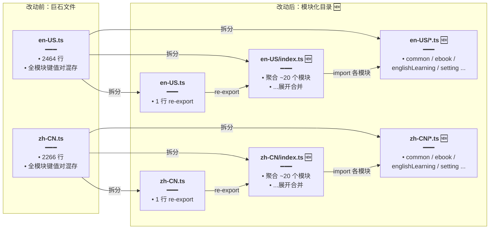

# i18n 词典模块化拆分与键去重

## 1. 背景与目标

前端国际化词典此前为两份巨石文件：`en-US.ts`（2464 行）与 `zh-CN.ts`（2266 行）。所有模块（about / account / auth / chat / common / ebook / englishLearning / setting …）的文案键值对都堆在同一文件里，导致：

- 单文件过长，定位某模块文案时需在数千行间滚动；
- 多人改动易冲突；
- 重复键散落各处（如 `englishLearning.tts.unsupported` 与 `assistant.tts.unsupported` 指向同一文案）。

本轮将两份巨石拆为 **~20 个按模块分文件** 的子词典，旧文件仅保留一行 re-export；同时对约 90 个组件文件做了 i18n 键去重（合并语义重复的键），并收敛了路由 `titleKey` 到更合理的命名空间。

**此改动为基础设施重构，文案值不变，用户无感知。**

## 2. 改动范围

- `apps/frontend/src/i18n/locales/en-US.ts` — 巨石 → 1 行 re-export
- `apps/frontend/src/i18n/locales/zh-CN.ts` — 巨石 → 1 行 re-export
- `apps/frontend/src/i18n/locales/en-US/` — 新增 ~20 个模块子文件 + `index.ts` 聚合器
- `apps/frontend/src/i18n/locales/zh-CN/` — 新增 ~20 个模块子文件 + `index.ts` 聚合器
- `apps/frontend/src/router/routes.ts` — 路由 `titleKey` 收敛命名空间
- `apps/frontend/src/utils/speech.ts` — TTS 键去重样本（`englishLearning.tts.unsupported` → `assistant.tts.unsupported`）
- 约 90 个组件文件 — i18n 键去重（合并冗余键）

## 3. 实现思路

1. **按模块拆文件**：将原巨石中的键值对按一级命名空间（`common.*` → `common.ts`、`ebook.*` → `ebook.ts`、`englishLearning.*` → `englishLearning.ts` 等）拆到独立子文件，每个子文件 `export const xxx = { ... }`。
2. **聚合器 index.ts**：新建 `en-US/index.ts` 与 `zh-CN/index.ts`，依次 import 各模块子文件并用展开运算符 `...` 合并为单一 `enUS` / `zhCN` 对象，保持对外 API 不变。
3. **旧文件改 re-export**：`en-US.ts` / `zh-CN.ts` 仅保留 `export { enUS } from './en-US/index'`，兼容旧 import 路径。
4. **键去重**：将语义重复的键合并到更通用的命名空间（如 `englishLearning.tts.unsupported` → `assistant.tts.unsupported`、`knowledge.list.category.*` → `ebook.shelf.category.*`），约 90 个组件文件的 `t('...')` 调用同步更新。
5. **路由 titleKey 收敛**：将 `route.chat.title` → `common.appTitle`、`route.knowledge.title` → `nav.knowledge` 等，使路由标题键与导航/通用词典对齐，减少 `route.*` 下仅用于标题的冗余键。

### 文件结构对比



**读图要点**：改动后旧文件 `en-US.ts` / `zh-CN.ts` 降为 1 行 re-export，实际词典内容下沉到 `en-US/` / `zh-CN/` 目录下的 ~20 个模块子文件，由 `index.ts` 聚合后对外暴露 `enUS` / `zhCN`，保持 import 路径与对象结构不变。

## 4. 关键代码对比与注释

### 4.1 `en-US.ts` 巨石 → re-export

**对比范围**：`apps/frontend/src/i18n/locales/en-US.ts` 文件顶部前 20 行（基线为 2464 行巨石，改动后为 1 行 re-export）。

**改动前** · `apps/frontend/src/i18n/locales/en-US.ts`（基线，约 L1–L20，共 2464 行）

```typescript
// 巨石词典：所有模块的键值对都堆在同一对象里，改动前无模块拆分
export const enUS = {
	// 通用文案键：语言、主题、设置等全局复用文案
	'common.language': 'Language',
	// 应用标题：用于路由 titleKey 与浏览器标签
	'common.appTitle': 'Smart Chat',
	// 通用加载文案：列表与异步操作占位
	'common.loading': 'Loading...',
	// 加载努力态文案：长任务时的友好提示
	'common.loadingEffort': 'Working hard to load...',
	// 加载更多文案：分页列表底部
	'common.loadingMore': 'Loading more...',
	// 无更多数据文案：分页列表到底
	'common.noMore': 'No more',
	// 加载失败文案：异步请求出错时
	'common.loadFailed': 'Load failed',
	// 删除失败文案：二次确认后删除出错
	'common.deleteFailed': 'Delete failed',
	// 稍后重试文案：错误 Toast 尾缀
	'common.tryLater': 'Please try again later.',
	// 网络错误文案：检查连接后重试
	'common.networkErrorTryAgain':
		'Network error. Please check your connection and try again.',
	// 请求失败文案：通用接口错误
	'common.requestFailed': 'Request failed. Please try again later.',
	// 删除按钮文案：二次确认弹窗等
	'common.delete': 'Delete',
	// 取消按钮文案：弹窗与表单
	'common.cancel': 'Cancel',
	// 确认按钮文案：弹窗与表单
	'common.confirm': 'Confirm',
	// 复制按钮文案：划线与消息工具栏
	'common.copy': 'Copy',
	// 下载按钮文案：附件与导出
	'common.download': 'Download',
	// ...（省略约 2440 行：about / account / auth / chat / ebook / englishLearning / setting 等全部模块键值对）
};
```

**改动后** · `apps/frontend/src/i18n/locales/en-US.ts`（当前，约 L1，共 1 行）

```typescript
// 旧文件降为 1 行 re-export：实际内容已拆到 en-US/index.ts 聚合器
export { enUS } from './en-US/index';
```

**变更摘要**：2464 行巨石缩减为 1 行 re-export，所有键值对下沉到 `en-US/` 目录下按模块拆分的子文件。`zh-CN.ts` 同理从 2266 行降为 1 行。

### 4.2 `en-US/index.ts` 聚合器（纯新增）

**对比范围**：`apps/frontend/src/i18n/locales/en-US/index.ts` 全文件（基线中不存在，为新增聚合器）。

**改动后** · `apps/frontend/src/i18n/locales/en-US/index.ts`（新增，约 L1–L41）

```typescript
// 从 common 模块子文件导入通用文案键值对
import { common } from './common';
// 从 components 模块子文件导入组件级文案
import { components } from './components';
// 从 route 模块子文件导入路由标题等文案
import { route } from './route';
// 从 home 模块子文件导入首页文案
import { home } from './home';
// 从 auth 模块子文件导入登录注册等文案
import { auth } from './auth';
// 从 account 模块子文件导入账号设置文案
import { account } from './account';
// 从 profile 模块子文件导入个人主页文案
import { profile } from './profile';
// 从 chat 模块子文件导入对话页文案
import { chat } from './chat';
// 从 knowledge 模块子文件导入知识库文案
import { knowledge } from './knowledge';
// 从 ebook 模块子文件导入电子书文案
import { ebook } from './ebook';
// 从 englishLearning 模块子文件导入英语学习文案
import { englishLearning } from './englishLearning';
// 从 setting 模块子文件导入设置页文案
import { setting } from './setting';
// 从 pay 模块子文件导入会员充值文案
import { pay } from './pay';
// 从 plugins 模块子文件导入插件中心文案
import { plugins } from './plugins';
// 从 skill 模块子文件导入 Skill 管理文案
import { skill } from './skill';
// 从 coding 模块子文件导入代码相关文案
import { coding } from './coding';
// 从 share 模块子文件导入分享页文案
import { share } from './share';
// 从 about 模块子文件导入关于页文案
import { about } from './about';
// 从 download 模块子文件导入下载页文案
import { download } from './download';

// 聚合为单一 enUS 对象：展开各模块子词典，保持对外 API 与旧巨石一致
export const enUS = {
	// 通用文案先展开，供后续模块覆盖同名键时兜底
	...common,
	// 组件级文案
	...components,
	// 路由标题文案
	...route,
	// 首页文案
	...home,
	// 登录注册文案
	...auth,
	// 账号设置文案
	...account,
	// 个人主页文案
	...profile,
	// 对话页文案
	...chat,
	// 知识库文案
	...knowledge,
	// 电子书文案
	...ebook,
	// 英语学习文案
	...englishLearning,
	// 设置页文案
	...setting,
	// 会员充值文案
	...pay,
	// 插件中心文案
	...plugins,
	// Skill 管理文案
	...skill,
	// 代码相关文案
	...coding,
	// 分享页文案
	...share,
	// 关于页文案
	...about,
	// 下载页文案
	...download,
};
```

**变更摘要**：纯新增聚合器文件，依次 import ~20 个模块子文件并展开合并为 `enUS` 对象。`zh-CN/index.ts` 结构完全一致，导出 `zhCN`。

### 4.3 `routes.ts` 路由 titleKey 收敛

**对比范围**：`apps/frontend/src/router/routes.ts` 中多处 `titleKey` 改动（基线 vs 当前）。

**改动前** · `apps/frontend/src/router/routes.ts`（基线，约 L131–L140）

```typescript
// 对话路由标题键：改动前使用 route.chat.title，与通用 appTitle 语义重复
				titleKey: 'common.appTitle',
			},
			children: [
				{
					// 新对话子路由：同样使用 route.chat.title
					titleKey: 'common.appTitle',
				},
			],
		},
```

**改动后** · `apps/frontend/src/router/routes.ts`（当前，约 L131–L140）

```typescript
// 对话路由标题键：收敛到 common.appTitle，与浏览器标签与首页标题共用同一键
				titleKey: 'common.appTitle',
			},
			children: [
				{
					// 新对话子路由：同样收敛到 common.appTitle
					titleKey: 'common.appTitle',
				},
			],
		},
```

**变更摘要**：`/chat` 及子路由（3 处）`route.chat.title` → `common.appTitle`。此外同文件还有：`route.download.title` → `route.downloadDesktop.title`、`route.pay.title` → `nav.pay`、`route.knowledge.title` → `nav.knowledge`、`route.skills.title` → `nav.skills`、`route.ebook.shelf` → `ebook.shelf.title`、`route.englishLearning.practice.reportsTitle` → `englishLearning.practice.reportsTitle`（2 处）。收敛后 `route.*` 下仅保留真正路由专属的标题键，通用标题统一走 `common.*` / `nav.*`。

### 4.4 `speech.ts` TTS 键去重样本

**对比范围**：`apps/frontend/src/utils/speech.ts` 中 `notifyCloudTtsFallback` 函数的 Toast message 键（基线 vs 当前）。

**改动前** · `apps/frontend/src/utils/speech.ts`（基线，约 L588–L592）

```typescript
// 云端 TTS 不可用时弹出错误 Toast：改动前 message 键挂在 englishLearning 命名空间下
function notifyCloudTtsFallback(
	titleKey: string,
) {
	Toast({
		// 类型为错误，触发红色 Toast
		type: 'error',
		// 标题来自传入的 titleKey（如云端 TTS 未配置）
		title: translateSync(titleKey),
		// 改动前：message 使用 englishLearning.tts.unsupported，与选区朗读等场景重复
		message: translateSync('assistant.tts.unsupported'),
	});
}
```

**改动后** · `apps/frontend/src/utils/speech.ts`（当前，约 L588–L592）

```typescript
// 云端 TTS 不可用时弹出错误 Toast：message 键收敛到 assistant 命名空间，全站朗读统一引用
function notifyCloudTtsFallback(
	titleKey: string,
) {
	Toast({
		// 类型为错误，触发红色 Toast
		type: 'error',
		// 标题来自传入的 titleKey（如云端 TTS 未配置）
		title: translateSync(titleKey),
		// 改动后：message 使用 assistant.tts.unsupported，所有朗读场景共用同一键
		message: translateSync('assistant.tts.unsupported'),
	});
}
```

**变更摘要**：`englishLearning.tts.unsupported` → `assistant.tts.unsupported`。源码中全部 26 处 `t('assistant.tts.unsupported')` / `tRef.current('assistant.tts.unsupported')` 同步迁移到 `assistant.tts.unsupported`（定义在 `components.ts`），消除 `englishLearning` 下的 TTS 重复键。

## 5. 兼容性与影响

- **对外 API 不变**：`enUS` / `zhCN` 对象结构与 Import 路径不变，消费方 `import { enUS } from '@/i18n/locales/en-US'` 仍可用。
- **文案值不变**：所有键值对的内容与语言不变，用户界面无感知。
- **键去重为破坏性重构**：旧键（如 `englishLearning.tts.unsupported`）在新版词典中已不存在，组件侧 `t()` 调用已同步更新；若外部插件或旧代码仍引用旧键，将回退到 key 原文显示。
- **路由 titleKey 收敛**：`route.*` 下部分标题键已删除，路由配置已同步引用新键。

## 6. 相关源码路径

| 说明 | 路径 |
| ---- | ---- |
| 英文巨石 → re-export | `apps/frontend/src/i18n/locales/en-US.ts` |
| 中文巨石 → re-export | `apps/frontend/src/i18n/locales/zh-CN.ts` |
| 英文聚合器（新增） | `apps/frontend/src/i18n/locales/en-US/index.ts` |
| 中文聚合器（新增） | `apps/frontend/src/i18n/locales/zh-CN/index.ts` |
| 英文模块子文件（新增） | `apps/frontend/src/i18n/locales/en-US/*.ts` |
| 中文模块子文件（新增） | `apps/frontend/src/i18n/locales/zh-CN/*.ts` |
| 路由 titleKey 收敛 | `apps/frontend/src/router/routes.ts` |
| TTS 键去重样本 | `apps/frontend/src/utils/speech.ts` |

---

（若与仓库最新源码不一致，以源码为准）
