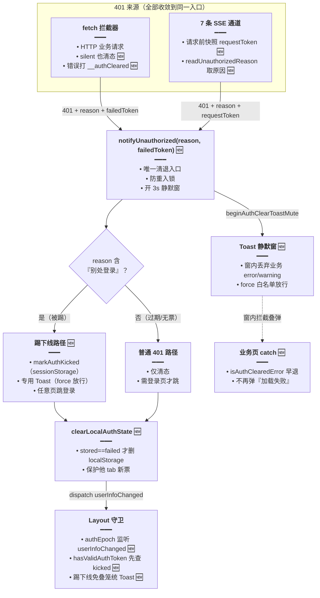
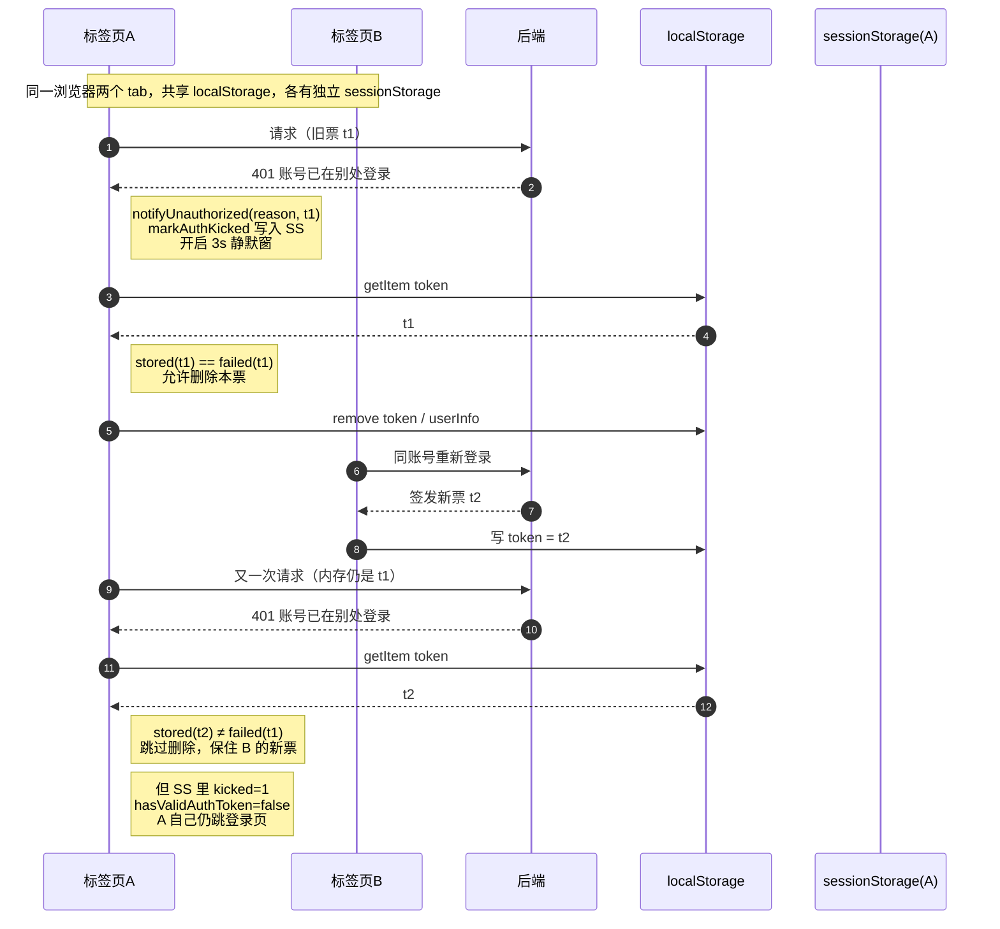

# 401 清退链路与多 Tab 保护（reason 透传 + kicked 标记 + Toast 静默窗）

> 文档角色：本篇是**前端 401 清退链路**的当前主文档——任何通道（HTTP / SSE / 路由守卫）收到 401 后如何收敛到单一入口、如何识别「被踢下线」、如何在多标签页场景下不误删他 tab 的新票、以及如何避免多条 Toast 叠弹。
>
> 延伸阅读：
> - 后端为何能返回「账号已在别处登录」（sid/cli 会话槽、`/auth/logout`）：[登录单端互踢.md](./登录单端互踢.md)
> - 前端两层鉴权总览（路由守卫 + 401 收敛）：[路由认证.md](./路由认证.md)
> - 主动登出入口（`performLogout` 的调用方与主题同步）：[登出统一主题同步.md](./登出统一主题同步.md)
> - 登出/切号时的业务状态清理（`resetUserState`）：[用户切换状态重置.md](./用户切换状态重置.md)

## 1. 背景与目标

改动前，前端对 401 的处理散在各层，互相不知道对方干了什么，典型故障有四类：

- **silent 请求 401 不清态**：`fetch.ts` 里写着 `if (isUnauthorized && !finalConfig.silent)` 才清票——带 `silent: true` 的静默轮询拿到 401 时既不清登录态也不跳转，业务 `catch` 再把错误盖成「加载失败」，本地残票还会继续发请求。
- **一次 401 多条 Toast 叠弹**：`fetch` 弹「请先登录后再试」、Layout 守卫弹「请先登录后再访问」、业务页面 `catch` 再弹「加载失败」——被踢一次连看三条。
- **多 tab 互相误伤**：`localStorage` 跨 tab 共享。tab A 因「别处登录」被踢时无条件 `removeItem('token')`；若 tab B 刚用同账号重新登录写入新票，A 会把 B 的新票一并删掉，B 被「连坐」登出。
- **SSE 拿不到 401 原因**：7 条 SSE 通道各自手写 `Authorization` 头，401 时只调无参 `notifyUnauthorized()`，前端无从区分「被踢下线」与「普通过期」，给不出「账号已在别处登录」的明确提示。

本轮目标：

1. **单点收敛**：HTTP / SSE 的 401 统一进 `notifyUnauthorized(reason, failedToken)`，提示与跳转由它决定，其它层不再各自弹窗。
2. **踢下线可感知**：识别后端透传的「别处登录」文案 → 本 tab 打 kicked 标记、弹专用 Toast、任意页面（除登录页）都跳登录。
3. **多 tab 安全**：kicked 存 `sessionStorage`（tab 级生命周期）；删 `localStorage` 前先比对「失效票是否仍是当前票」，不删他 tab 新票。
4. **不再叠弹**：3 秒 Toast 静默窗吞掉窗口内的业务 error/warning；业务页 `catch` 用 `isAuthClearedError` 早退；踢下线时 Layout 守卫不再补刀「请先登录」。

## 2. 改动范围

| 文件 | 改动 | 角色 |
| --- | --- | --- |
| `apps/frontend/src/router/authSession.ts` | 重写 | 清退中枢：`notifyUnauthorized(reason, failedToken)`、多 tab 条件删票、踢下线专用 Toast、`performLogout` 先调 `/auth/logout` |
| `apps/frontend/src/router/authPaths.ts` | 修改 | 新增 sessionStorage 踢下线标记（`AUTH_KICKED_KEY` / `isAuthKicked` / `markAuthKicked` / `clearAuthKicked`）；`hasValidAuthToken` 先查标记 |
| `apps/frontend/src/router/authToastMute.ts` | **新增** | 清退静默窗：`beginAuthClearToastMute` / `shouldMuteAuthClearToast`，供 Toast 与清退中枢共用 |
| `apps/frontend/src/components/ui/sonner.tsx` | 修改 | `Toast` 新增 `force` 参数；静默窗内丢弃非 `force` 的 error/warning |
| `apps/frontend/src/utils/fetch.ts` | 修改 | 新增 `getAuthToken()`；401 收敛（silent 也清态、不再弹笼统 Toast、抛出错误打 `__authCleared` 标记） |
| `apps/frontend/src/layout/index.tsx` | 修改 | `authEpoch` 监听 `userInfoChanged` 重读票走 SPA 跳转；踢下线时守卫免叠笼统 Toast；守卫 Toast 走 `force: true` |
| `apps/frontend/src/views/login/login-form.tsx`、`login-by-email-form.tsx` | 修改 | 登录成功 `clearAuthKicked()` 复位本 tab 踢下线标记 |
| `apps/frontend/src/utils/sse.ts`、`agentSse.ts`、`assistantSse.ts`、`dailyReadingSse.ts`、`englishLearningPackSse.ts`、`annotateClassicSourceSse.ts`、`knowledgeRagQaSse.ts` | 修改 | 7 条 SSE 统一：请求前快照 `requestToken`，401 时 `readUnauthorizedReason` 取原因透传给 `notifyUnauthorized` |
| `apps/frontend/src/views/englishLearning/` 下 5 处（dailyReading `List.tsx`、`ReadingList.tsx`、`hooks/useEnglishLearningList.ts`、practice `reports/Detail.tsx`、`reports/index.tsx`） | 修改 | 列表/详情 `catch` 内 `isAuthClearedError` 早退或包裹业务 Toast |
| `apps/frontend/src/service/api.ts` | 修改 | 新增 `LOGOUT = '/auth/logout'` 常量（预置，暂未引用；`performLogout` 目前直接写字面量） |

## 3. 实现思路

1. **唯一清退入口**：所有通道的 401 只调 `notifyUnauthorized`，模块级防重入锁 `handlingUnauthorized` 保证并发 401（页面常同时发出多个请求）只清一次；提示文案与跳转时机集中一处，天然免疫「各处各弹」。
2. **reason 驱动分支**：后端踢人文案（`账号已在别处登录`）经 Guard 原文透传（见 [登录单端互踢.md](./登录单端互踢.md)），前端用 `reason.includes('别处登录')` 判定踢下线。字符串契约简单直接，代价是与后端文案耦合——故后端已把该文案常量化，前后端只有这一个对齐点。
3. **kicked 存 sessionStorage 而非 localStorage**：`sessionStorage` 是 tab 级生命周期——A 被踢只影响 A 自己；`localStorage` 里可能已是他 tab 的新票，绝不能以它为判据。`hasValidAuthToken` 先查 kicked 再查票，让被踢 tab 在自己的视角里「未登录」，从而触发守卫跳转。
4. **条件删除 localStorage**：`clearLocalAuthState(failedToken)` 只在「storage 里的票 == 本次 401 实际带的票」时才删；他 tab 已写新票时跳过删除。内存态（`http` 内存 token、userStore）是本 tab 私有的，照清不误。
5. **SSE 先快照再请求**：`const requestToken = readToken()` 在发请求前锁定本次要用的票，401 时作为 `failedToken` 传入。若等响应到达时再 `readToken()`，可能读到他 tab 刚换的新票，导致「该删的不删」或「不该删的误删」。
6. **静默窗 + force 白名单**：`beginAuthClearToastMute(3000)` 开窗，`Toast` 层丢弃窗内非 `force` 的 error/warning——即使某个业务页忘接 `isAuthClearedError`，也被 Toast 层兜底；踢下线 / 守卫提示显式 `force: true` 放行，静默窗不会误伤鉴权专用提示。
7. **错误对象打标记**：`fetch` 抛出 401 错误前 `Object.assign(thrown, { __authCleared: true, code: 401, message })`，业务 `catch` 用 `isAuthClearedError` 一处识别（同时兼容 `code` / `status` / `message` 等历史错误形态），早退不再弹「加载失败」。
8. **守卫改走 SPA 重渲染**：Layout 新增 `authEpoch` state，监听 `userInfoChanged` 自增触发重渲染，`hasValidAuthToken` 重读后走 `navigate('/login')` SPA 跳转；`notifyUnauthorized` 里的 `setTimeout(location.replace)` 降级为兜底，且踢下线场景多等 400ms 让专用 Toast 先绘制出来。





## 4. 关键代码对比与注释

### 4.1 清退中枢 `authSession.ts` 重构

#### 4.1.1 新增辅助函数（纯新增）

以下模块状态与 4 个辅助函数均为**本轮新增**，无「改动前」对照（纯新增例外，不再贴空块）。

**改动后（纯新增）** · `apps/frontend/src/router/authSession.ts`（当前，约 L10–L73）

```typescript
// 防重入锁（原有，随重构保留）：一次清退未结束时，并发的后续 401 直接忽略
let handlingUnauthorized = false;
// 源码注释：标志用途——踢下线专用 Toast 已弹时，Layout 不再补「请先登录后再访问」
/** 踢下线已弹专用 Toast 时，抑制 Layout 再弹「请先登录后再访问」 */
// 一次性抑制标志：notifyUnauthorized 置位、Layout 守卫消费，形成「踢下线免叠弹」握手
let suppressAuthRedirectToast = false;

// 源码注释：供 Layout 守卫在弹笼统登录 Toast 前调用
/** Layout 鉴权拦截前调用：若刚踢下线则消费标志并跳过笼统登录 Toast */
// 消费型读取：返回 true 表示刚发生过踢下线，同时复位保证只抑制一次、不污染后续普通 401
export function consumeSuppressAuthRedirectToast(): boolean {
	// 未置位：正常走守卫提示
	if (!suppressAuthRedirectToast) return false;
	// 复位：标志只用一次
	suppressAuthRedirectToast = false;
	// 告知调用方本次跳过笼统 Toast
	return true;
}

// 源码注释：从 401 响应体取后端文案
/** 从 401 响应体取出 message，供踢下线 Toast 识别 */
// SSE 通道专用：fetch 拦截器外的地方拿不到归一化错误，需自行解析响应体取 reason
export async function readUnauthorizedReason(
	// 原始 Response（clone 后解析，不影响后续可能的再读）
	response: Response,
): Promise<string> {
	// 解析失败（非 JSON 体）落到 catch，返回空串按普通 401 处理
	try {
		// clone 后读 JSON：response body 只能消费一次，clone 避免影响调用方
		const body = (await response.clone().json()) as { message?: unknown };
		// NestJS 常规形态：message 是字符串，直接作为 reason
		if (typeof body?.message === 'string') return body.message;
		// class-validator 形态：message 是字符串数组，拼接成一句
		if (Array.isArray(body?.message)) {
			// 只保留字符串元素，用中文分号连成一句提示
			return body.message.filter((x) => typeof x === 'string').join('；');
		}
	} catch {
		// 非 JSON 体忽略
	}
	// 取不到文案时返回空串：调用方按「普通 401」处理，不影响主流程
	return '';
}

// 源码注释：业务 catch 用它识别「鉴权已清退」，别再弹「加载失败」
/** 鉴权已清退（含踢下线）：业务 catch 勿再弹「加载失败」类笼统 Toast */
// 统一识别 401 系错误：兼容 fetch 打的 __authCleared 标记与 code/status/message 等历史形态
export function isAuthClearedError(err: unknown): boolean {
	// 非对象（null/字符串等）直接排除
	if (!err || typeof err !== 'object') return false;
	// 收窄出可能携带的几种标记字段
	const e = err as {
		// fetch 本轮新增的清退标记
		__authCleared?: boolean;
		// 归一化错误的业务码
		code?: number;
		// 部分通道透传的 HTTP 状态码
		status?: number;
		// 兜底：文案匹配
		message?: unknown;
	};
	// fetch 在抛出前打的显式标记：最可信，优先命中
	if (e.__authCleared === true) return true;
	// 历史形态：业务码或 HTTP 状态码为 401
	if (e.code === 401 || e.status === 401) return true;
	// 文案兜底：踢下线或笼统登录提示都算清退
	if (typeof e.message === 'string') {
		// 与后端踢人文案对齐（后端已常量化）
		if (e.message.includes('别处登录')) return true;
		// 笼统「请先登录」同样视为清退，不再二次提示
		if (e.message.includes('请先登录')) return true;
	}
	// 都不是：普通业务错误，照常提示
	return false;
}

// 源码注释：本函数只清「本 tab」的登录态
/**
 * 清本 tab 内存登录态。
 * localStorage 跨 tab 共享：仅当 storage 里仍是「这张失效票」时才删，避免误删他 tab 新登录的 token。
 */
// 多 tab 保护核心：删共享存储前先比对票，内存态（本 tab 私有）无条件清
function clearLocalAuthState(failedToken?: string): void {
	// 当前共享存储里的票（可能是他 tab 刚换的新票）
	const stored = (localStorage.getItem('token') || '').trim();
	// 本次 401 实际携带的失效票
	const failed = (failedToken || '').trim();
	// 三个条件任一成立即可删：没传票（主动登出）/ 存储已空 / 存储的正是这张失效票
	const clearStorage = !failed || !stored || stored === failed;

	// 满足条件才动共享存储：他 tab 已写新票时跳过，避免连坐登出
	if (clearStorage) {
		// 删票
		localStorage.removeItem('token');
		// 删缓存的用户信息
		localStorage.removeItem('userInfo');
	}

	// 清业务内存态（本 tab 私有，无条件清）
	resetUserState();
	// 广播登录态变化：Layout 的 authEpoch 监听它触发重渲染与守卫跳转
	window.dispatchEvent(new Event('userInfoChanged'));
	// 动态 import 防循环依赖：清 fetch 内存 token
	void import('@/utils/fetch').then(({ http }) => http.setAuthToken(''));
	// 动态 import 防循环依赖：清用户 store
	void import('@/store/user').then((m) => m.default.clearUserInfo());
}
```

**变更摘要**：新增「读原因 / 判清退 / 条件删票 / 免叠弹」四件套，供 HTTP、SSE、守卫与业务页共用；`clearLocalAuthState` 的「stored==failed 才删」是多 tab 保护的最后一道闸。

#### 4.1.2 `notifyUnauthorized`：无参清退 → reason 驱动分支（对比）

**对比范围**：`notifyUnauthorized` 完整函数（前后对称）。

**改动前** · `apps/frontend/src/router/authSession.ts`（基线，约 L30–L55）

```typescript
// 源码注释：旧版只负责清态 + 需登录页硬跳
/**
 * token 失效（如 401）：清理本地登录态；若当前在需登录页则整页跳转登录（刷新后同样生效）。
 */
// 无参：拿不到 401 原因，无法区分踢下线与过期；也拿不到失效票，无法保护多 tab
export function notifyUnauthorized(): void {
	// SSR 或重入直接返回
	if (typeof window === 'undefined' || handlingUnauthorized) return;
	// 上锁，防并发 401 重复清理
	handlingUnauthorized = true;

	// 源码注释：同步清理是为了让随后的 location.replace 不丢失清理动作
	// 须同步清理，避免随后 location.replace 导致异步任务未执行完
	// 无条件删共享存储：他 tab 新票会被连坐删掉（本次修复点）
	localStorage.removeItem('token');
	// 无条件删用户信息
	localStorage.removeItem('userInfo');
	// 清业务内存态
	resetUserState();
	// 广播登录态变化
	window.dispatchEvent(new Event('userInfoChanged'));

	// 动态 import 清 fetch 内存 token
	void import('@/utils/fetch').then(({ http }) => http.setAuthToken(''));
	// 动态 import 清用户 store
	void import('@/store/user').then((m) => m.default.clearUserInfo());

	// 取当前路径判断是否要跳登录
	const path = window.location.pathname;
	// 仅需登录页才硬跳；踢下线场景在公共页就不会跳（本次修复点）
	if (requiresAuthForPath(path) && path !== '/login') {
		// 整页替换跳转
		window.location.replace('/login');
	}

	// 1.5s 后解锁：期间重复 401 被吞
	window.setTimeout(() => {
		// 解锁
		handlingUnauthorized = false;
	}, 1500);
}
```

**改动后** · `apps/frontend/src/router/authSession.ts`（当前，约 L106–L158）

```typescript
// 源码注释：新签名说明
/**
 * token 失效（如 401）：清理本 tab 登录态；若当前在需登录页则跳转登录。
 * @param reason 后端 401 message；含「别处登录」时提示踢下线
 * @param failedToken 本次 401 请求实际带的票；用于判断是否可安全改 localStorage
 */
// reason 驱动「踢下线/普通」分支；failedToken 驱动多 tab 条件删票
export function notifyUnauthorized(
	// 后端 401 文案（fetch 归一化 / SSE 读响应体两种来源）
	reason?: string,
	// 本次 401 实际携带的票（SSE 为请求前快照）
	failedToken?: string,
): void {
	// SSR 或重入直接返回
	if (typeof window === 'undefined' || handlingUnauthorized) return;
	// 上锁，防并发 401 重复清理
	handlingUnauthorized = true;

	// 与后端常量化的踢人文案对齐：命中即被踢
	const kicked = Boolean(reason?.includes('别处登录'));
	// 开 3 秒静默窗：窗内业务 error/warning Toast 一律丢弃，防叠弹
	beginAuthClearToastMute(3000);

	// 源码注释：标记只写本 tab 的 sessionStorage
	// 本 tab 标记踢下线（sessionStorage）：Layout 会视未登录并跳转，且不删他 tab 的 localStorage 票
	// 仅踢下线才打标记：普通 401 不影响 hasValidAuthToken
	if (kicked) {
		// 写 tab 级标记
		markAuthKicked();
		// 置一次性标志：Layout 守卫据此跳过笼统 Toast
		suppressAuthRedirectToast = true;
	}

	// 条件删票 + 清本 tab 内存态 + 广播（详见 4.1.1）
	clearLocalAuthState(failedToken);

	// 踢下线专属提示：force 穿透静默窗，保证用户必见
	if (kicked) {
		// 专用 Toast，文案与后端 reason 呼应
		Toast({
			// error 级别
			type: 'error',
			// 明确告知「别处登录」而非笼统失败
			title: '账号已在别处登录，请重新登录',
			// 静默窗内仍要展示
			force: true,
		});
	}

	// 取当前路径判断跳转策略
	const path = window.location.pathname;
	// 源码注释：两条路径的跳转范围不同
	// 踢下线：任意页（除已在登录页）都跳登录；普通 401：仅需登录页才跳
	// 被踢时用户在公共页（如首页）也要请回登录页——票已废，留在原地只会继续 401
	const shouldRedirect =
		path !== '/login' && (kicked || requiresAuthForPath(path));

	// 不跳：当场解锁返回（公共页普通 401，原地清态即可）
	if (!shouldRedirect) {
		// 解锁
		handlingUnauthorized = false;
		// 留在当前页
		return;
	}

	// 源码注释：主跳走 SPA，硬跳只是兜底
	// userInfoChanged 已派发 → Layout 应 SPA navigate；短延迟硬跳兜底，并给踢下线 Toast 绘制时间
	// 兜底硬跳：Layout 因故未 SPA 跳转时，延迟后整页替换；踢下线多等 400ms 让专用 Toast 先渲染
	window.setTimeout(
		() => {
			// Layout 已完成 SPA 跳转时不再硬跳，直接解锁
			if (window.location.pathname !== '/login') {
				// 仍未跳：整页替换兜底
				window.location.replace('/login');
				// 跳走后页面卸载，无需解锁
				return;
			}
			// 已在登录页：解锁
			handlingUnauthorized = false;
		},
		// 踢下线留 400ms 绘制提示；普通 401 立即检查
		kicked ? 400 : 0,
	);
}
```

**变更摘要**：签名从 `()` 变为 `(reason?, failedToken?)`；新增踢下线分支（标记 + 专用 Toast + 任意页跳登录）、静默窗开启、兜底硬跳替代原来的固定 1.5s 解锁。

#### 4.1.3 `performLogout`：先清服务端会话槽（对比）

**对比范围**：`performLogout` 完整函数（改动后连同新抽出的 `goLogin` 一并展示）。

**改动前** · `apps/frontend/src/router/authSession.ts`（基线，约 L5–L28）

```typescript
// 源码注释：旧版只做本地清理
/** 主动退出登录（含 Tauri 菜单）：清登录态并跳转登录页 */
// 旧版不通知服务端：旧票在 7 天有效期内仍可用（本次修复点）
export function performLogout(
	// 可选 SPA 跳转函数；不传则整页替换
	navigate?: (to: string) => void | Promise<void>,
): void {
	// SSR 直接返回
	if (typeof window === 'undefined') return;

	// 源码注释：同步清是为避免循环依赖（userStore 不能静态 import 进这里）
	// 同步清 storage，避免 userStore 静态 import 造成 utils↔authSession 循环依赖
	// 无条件删共享存储
	localStorage.removeItem('token');
	// 删用户信息
	localStorage.removeItem('userInfo');
	// 清业务内存态
	resetUserState();
	// 广播登录态变化
	window.dispatchEvent(new Event('userInfoChanged'));

	// 动态 import 清 fetch 内存 token
	void import('@/utils/fetch').then(({ http }) => http.setAuthToken(''));
	// 动态 import 清用户 store
	void import('@/store/user').then((m) => m.default.clearUserInfo());
	// 有 SPA 跳转函数优先用
	if (navigate) {
		// SPA 跳登录页
		void navigate('/login');
		// 结束
		return;
	}
	// 否则整页替换兜底
	if (window.location.pathname !== '/login') {
		// 硬跳登录页
		window.location.replace('/login');
	}
}
```

**改动后** · `apps/frontend/src/router/authSession.ts`（当前，约 L75–L104）

```typescript
// 从 performLogout 抽出的跳转段：供登出与其它场景复用，逻辑不变
function goLogin(navigate?: (to: string) => void | Promise<void>): void {
	// 有 SPA 跳转函数优先用
	if (navigate) {
		// SPA 跳登录页
		void navigate('/login');
		// 结束
		return;
	}
	// 已在登录页不重复跳
	if (window.location.pathname !== '/login') {
		// 整页替换兜底
		window.location.replace('/login');
	}
}

// 源码注释：新版先清服务端槽再清本地
/** 主动退出登录（含 Tauri 菜单）：先清服务端本槽会话，再清本地并跳转登录页 */
// 先调 /auth/logout 删服务端会话槽（姊妹篇），再清本地；任何一步失败都要保证本地清干净
export function performLogout(
	// 可选 SPA 跳转函数
	navigate?: (to: string) => void | Promise<void>,
): void {
	// SSR 直接返回
	if (typeof window === 'undefined') return;

	// 包成 async 自执行：函数签名保持 void，调用方无需改
	void (async () => {
		// 记录登出前内存里的票：接口失败后仍要用它做条件删票
		let usedToken = '';
		// 请求失败（断网/已 401）也要继续清本地
		try {
			// 动态 import 防循环依赖
			const { http } = await import('@/utils/fetch');
			// 取内存票（多 tab 时可能与 localStorage 不同）
			usedToken = http.getAuthToken();
			// 通知服务端删本通道会话槽；silent 避免登出本身再弹错误 Toast
			await http.post('/auth/logout', undefined, { silent: true });
		} catch {
			// 失败仍清本地
		}
		// 复位本 tab 踢下线标记：主动登出后就是干净状态
		clearAuthKicked();
		// 条件删票：优先用内存票比对，退化为 storage 当前票
		clearLocalAuthState(usedToken || localStorage.getItem('token') || '');
		// 跳登录页
		goLogin(navigate);
	})();
}
```

**变更摘要**：登出从「纯本地清理」变为「先服务端清槽、再条件删本地票」；跳转段原样抽为 `goLogin`；`http.post('/auth/logout', …)` 走 `silent`，登出接口失败不打扰用户。

### 4.2 `authPaths.ts`：tab 级踢下线标记（新增 + 对比）

#### 4.2.1 kicked 标记四件套（纯新增）

**改动后（纯新增）** · `apps/frontend/src/router/authPaths.ts`（当前，约 L31–L59）

```typescript
// 源码注释：标记存 sessionStorage 的原因
/** 本 tab 被踢下线标记（sessionStorage，不影响其他 tab 的 localStorage token） */
// sessionStorage 是 tab 级：A 被踢不污染 B；关 tab 自动失效，不留残标
export const AUTH_KICKED_KEY = 'auth-kicked';

// 读标记：SSR / 隐私模式异常都按「未踢」处理，宁可放行不可误判
export function isAuthKicked(): boolean {
	// SSR 无 window，按未踢
	if (typeof window === 'undefined') return false;
	// sessionStorage 在隐私模式可能抛异常
	try {
		// '1' 即被踢
		return sessionStorage.getItem(AUTH_KICKED_KEY) === '1';
	} catch {
		// 异常按未踢
		return false;
	}
}

// 写标记：notifyUnauthorized 判定踢下线时调用
export function markAuthKicked(): void {
	// SSR 不写
	if (typeof window === 'undefined') return;
	// 隐私模式写失败可忽略：最坏情况是退化为普通 401 行为
	try {
		// 置 '1'
		sessionStorage.setItem(AUTH_KICKED_KEY, '1');
	} catch {
		// 隐私模式等忽略
	}
}

// 清标记：登录成功 / 主动登出时复位，让本 tab 回到正常态
export function clearAuthKicked(): void {
	// SSR 不清
	if (typeof window === 'undefined') return;
	// 异常忽略
	try {
		// 移除标记
		sessionStorage.removeItem(AUTH_KICKED_KEY);
	} catch {
		// ignore
	}
}
```

**变更摘要**：新增 tab 级 kicked 标记的读 / 写 / 清三个操作与 key 常量；全部带 SSR 与隐私模式防御。

#### 4.2.2 `hasValidAuthToken`：先查 kicked 再查票（对比）

**对比范围**：`hasValidAuthToken` 完整函数（前后对称）。

**改动前** · `apps/frontend/src/router/authPaths.ts`（基线，约 L31–L34）

```typescript
// 守卫唯一判据：localStorage 有票即视为已登录
export function hasValidAuthToken(): boolean {
	// SSR 按未登录
	if (typeof window === 'undefined') return false;
	// 只看共享存储：他 tab 新票会让被踢 tab 误以为已登录（本次修复点）
	return Boolean(localStorage.getItem('token')?.trim());
}
```

**改动后** · `apps/frontend/src/router/authPaths.ts`（当前，约 L61–L66）

```typescript
// 守卫判据：本 tab 被踢时即使有票（他 tab 的）也视为未登录
export function hasValidAuthToken(): boolean {
	// SSR 按未登录
	if (typeof window === 'undefined') return false;
	// 源码注释：kicked 优先于票
	// 本 tab 已踢下线：即使 localStorage 仍有他 tab 新票，也视为未登录以便跳转登录页
	// 先查 tab 级标记：被踢 tab 走自己的登录流程，不蹭他 tab 的新票
	if (isAuthKicked()) return false;
	// 再查共享存储的票
	return Boolean(localStorage.getItem('token')?.trim());
}
```

**变更摘要**：守卫判据从「只看 localStorage」变为「kicked 一票否决」——这是多 tab 场景下被踢 tab 能正确跳登录、又不删他 tab 新票的关键配合。

### 4.3 静默窗模块 `authToastMute.ts`（纯新增）

整个文件为**本轮新增**，无「改动前」对照（纯新增例外）。刻意不 import 任何业务模块：`sonner.tsx`（UI 层）与 `authSession.ts`（路由层）都能引它，不构成循环依赖。

**改动后（纯新增）** · `apps/frontend/src/router/authToastMute.ts`（当前，全文）

```typescript
// 源码注释：模块用途与无依赖设计
/**
 * 鉴权清退（401 / 踢下线）期间抑制业务 error/warning Toast，
 * 避免与「别处登录 / 请先登录」叠弹。无业务 import，供 Toast 与 authSession 共用。
 */
// 静默截止时刻（时间戳毫秒）；0 表示未开窗
let muteUntil = 0;

// 源码注释：开窗可叠加延长
/** 开启静默窗口（可被更晚的清退再次延长） */
// 清退入口调用：默认 3 秒；连续多次 401 只延长不缩短
export function beginAuthClearToastMute(ms = 3000): void {
	// 算出新截止时刻
	const until = Date.now() + ms;
	// 只延长不缩短：并发清退不会把已有窗口截短
	if (until > muteUntil) muteUntil = until;
}

// 源码注释：Toast 层查询口
/** Toast 层：是否应丢弃本次 error/warning（force 除外） */
// 纯查询：不消费、不修改窗口
export function shouldMuteAuthClearToast(): boolean {
	// 当前时刻仍在窗内即应静默
	return Date.now() < muteUntil;
}
```

**变更摘要**：6 行有效代码撑起「防叠弹」兜底——即使业务页漏接 `isAuthClearedError`，静默窗也能在 Toast 层把「加载失败」吞掉。

### 4.4 `sonner.tsx`：Toast 新增 `force` 白名单（对比）

**对比范围**：`Toast` 组件的参数解构与函数体开头的静默守卫（前后对称摘录；后续渲染逻辑未改动，以 `// ...` 对称省略）。

**改动前** · `apps/frontend/src/components/ui/sonner.tsx`（基线，`Toast` 开头段）

```tsx
// Toast 便捷调用组件：参数即一条 Toast 的全部配置
const Toast = ({
	// 类型（success/error/warning/info）
	type,
	// 标题
	title,
	// 副文案
	message,
	// 展示时长
	duration,
	// 位置
	position,
	// 展开开关（未用，下划线占位）
	expand: _expand,
	// 偏移
	offset,
// 参数类型契约
}: {
	// 类型
	type: ToastType;
	// 标题
	title: string;
	// 可选副文案
	message?: string;
	// 可选时长
	duration?: number;
	// 可选位置
	position?: ToastPosition;
	// 可选展开
	expand?: boolean;
	// 可选偏移
	offset?: ToastOffset;
}) => {
	// ...（后续渲染逻辑未改动）
```

**改动后** · `apps/frontend/src/components/ui/sonner.tsx`（当前，约 L74–L102）

```tsx
// Toast 便捷调用组件：新增 force 白名单
const Toast = ({
	// 类型
	type,
	// 标题
	title,
	// 副文案
	message,
	// 展示时长
	duration,
	// 位置
	position,
	// 展开开关（未用，下划线占位）
	expand: _expand,
	// 偏移
	offset,
	// 默认不穿透静默窗；鉴权专用提示显式传 true
	force = false,
// 参数类型契约
}: {
	// 类型
	type: ToastType;
	// 标题
	title: string;
	// 可选副文案
	message?: string;
	// 可选时长
	duration?: number;
	// 可选位置
	position?: ToastPosition;
	// 可选展开
	expand?: boolean;
	// 可选偏移
	offset?: ToastOffset;
	// 源码注释：白名单用途
	/** 鉴权清退静默窗口内仍要展示（踢下线 / Layout 请先登录） */
	// 可选：穿透静默窗
	force?: boolean;
}) => {
	// 源码注释：为什么静默——401 后业务 catch 的「加载失败」会与鉴权提示叠弹
	// 401/踢下线后业务 catch 常再弹「加载失败」；静默 error/warning，force 放行鉴权专用提示
	// 三个条件同时满足才丢弃：非 force、是 error/warning、仍在静默窗内
	if (
		// force 白名单直接放行
		!force &&
		// 只静默负面提示；success/info 不影响
		(type === 'error' || type === 'warning') &&
		// 查询静默窗
		shouldMuteAuthClearToast()
	) {
		// 静默：本次 Toast 直接不创建
		return;
	}

	// ...（后续渲染逻辑未改动）
```

**变更摘要**：`Toast` 获得「静默窗内丢弃业务负面提示 + `force` 白名单放行」能力；这是防叠弹的最后一道兜底（业务层漏判时由 UI 层接住）。

### 4.5 `fetch.ts`：401 收敛（对比 + 纯新增）

#### 4.5.1 `getAuthToken`（纯新增）

**改动后（纯新增）** · `apps/frontend/src/utils/fetch.ts`（当前，约 L210–L215）

```typescript
	// 源码注释：内存票与 localStorage 可能不一致（多 tab）
	/** 当前内存里的 Bearer token（多 tab 时可能与 localStorage 不一致） */
	// 暴露内存票：登出 / 401 时拿它做「失效票」比对，而不是信 localStorage
	public getAuthToken(): string {
		// 读默认头里的 Authorization
		const auth = this.defaultConfig.headers?.Authorization || '';
		// 剥掉 'Bearer ' 前缀返回纯票；不是 Bearer 格式返回空串
		return auth.startsWith('Bearer ') ? auth.slice(7).trim() : '';
	}
```

**变更摘要**：提供读取内存票的唯一公开口，供 `performLogout` 与 401 处理做精确比对。

#### 4.5.2 请求 `catch` 段的 401 处理（对比）

**对比范围**：`HttpClient.request` 重试循环 `catch` 段内，自 `isUnauthorized` 判定至 `throw` 的完整 401 处理段（前后对称摘录；上文 `requestError` 归一化逻辑未改动，以 `// ...` 对称省略）。

**改动前** · `apps/frontend/src/utils/fetch.ts`（基线，约 L578–L605）

```typescript
				// ...（上文：requestError 归一化，未改动）
				// 判定 401：HTTP 状态码或归一化业务码任一命中
				const isUnauthorized =
					response?.status === 401 || requestError.code === 401;

				// silent 请求竟不清态：静默轮询 401 后本地残票继续残留（本次修复点）
				if (isUnauthorized && !finalConfig.silent) {
					// 清内存票
					this.setAuthToken('');
					// 无参清退：无 reason 判不了踢下线、无 failedToken 保不了多 tab
					notifyUnauthorized();
				}

				// 可重试：还有次数、无响应（网络层失败）、非 401、且为瞬断错误
				const canRetry =
					attempt < maxAttempts - 1 &&
					!isUnauthorized &&
					(isTransientNetworkError(error) ||
						isTransientNetworkError(requestError.message));

				// 满足重试条件：退避后进入下一次循环
				if (canRetry) {
					// 线性退避 400ms/800ms…
					await new Promise((resolve) =>
						setTimeout(resolve, 400 * (attempt + 1)),
					);
					// 进入下一次尝试
					continue;
				}

				// 非 silent 统一弹笼统错误：401 也会再弹一条，与清退提示叠弹（本次修复点）
				if (!finalConfig.silent) {
					// 业务错误 Toast
					Toast({
						// error 级别
						type: 'error',
						// 笼统文案
						title: resolveRequestErrorToastTitle(requestError),
					});
				}

				// 原样抛出：业务 catch 拿不到「这是 401 清退」的任何标记（本次修复点）
				throw requestError.data?.data || requestError;
```

**改动后** · `apps/frontend/src/utils/fetch.ts`（当前，约 L584–L637）

```typescript
				// ...（上文：requestError 归一化，未改动）
				// 判定 401：HTTP 状态码或归一化业务码任一命中
				const isUnauthorized =
					response?.status === 401 || requestError.code === 401;
				// 取 401 原因：fetch 内 message 已是归一化结果，直接取用
				const unauthorizedReason =
					typeof requestError.message === 'string'
						? requestError.message
						: normalizeErrorMessage(
								requestError.message as UnknownErrorMessage,
							) || '';

				// 源码注释：silent 只禁 Toast 不清态是旧缺陷
				// silent 只禁业务 Toast；401 仍须清登录态（否则业务 catch 会盖成「加载失败」）
				// 去掉 !silent 条件：任何 401 都要清退
				if (isUnauthorized) {
					// 优先用本次请求头里实际带的票（比内存票更准）
					const authHdr = finalConfig.headers?.Authorization || '';
					// 剥 Bearer 前缀；自定义头缺失时退化为内存票
					const failedToken = authHdr.startsWith('Bearer ')
						? authHdr.slice(7).trim()
						: this.getAuthToken();
					// 清内存票
					this.setAuthToken('');
					// 带原因与失效票清退：踢下线识别 + 多 tab 保护
					notifyUnauthorized(unauthorizedReason, failedToken);
				}

				// 可重试：还有次数、无响应（网络层失败）、非 401、且为瞬断错误
				const canRetry =
					attempt < maxAttempts - 1 &&
					!isUnauthorized &&
					(isTransientNetworkError(error) ||
						isTransientNetworkError(requestError.message));

				// 满足重试条件：退避后进入下一次循环
				if (canRetry) {
					// 线性退避
					await new Promise((resolve) =>
						setTimeout(resolve, 400 * (attempt + 1)),
					);
					// 进入下一次尝试
					continue;
				}

				// 源码注释：401 的提示由清退入口负责
				// 401 由 notifyUnauthorized 负责提示/跳转，此处不再弹笼统错误
				// 非 401 且非 silent 才弹业务错误 Toast
				if (!finalConfig.silent && !isUnauthorized) {
					// 业务错误 Toast
					Toast({
						// error 级别
						type: 'error',
						// 笼统文案
						title: resolveRequestErrorToastTitle(requestError),
					});
				}

				// 取出要抛的错误对象
				const thrown = requestError.data?.data || requestError;
				// 401 时给抛出对象打清退标记：业务 catch 用 isAuthClearedError 识别
				if (isUnauthorized && thrown && typeof thrown === 'object') {
					// 原地打标：不改错误形态，只附加字段
					Object.assign(thrown, {
						// 显式清退标记：最可信
						__authCleared: true,
						// 补业务码：兼容按 code 判断的历史 catch
						code: 401,
						// 补文案：优先 401 原因，其次原 message，兜底「请先登录后再试」
						message:
							unauthorizedReason ||
							(typeof (thrown as { message?: unknown }).message === 'string'
								? (thrown as { message: string }).message
								: '请先登录后再试'),
					});
				}
				// 抛出（401 时已带 __authCleared 标记）
				throw thrown;
```

**变更摘要**：401 处理从「非 silent 才清 + 笼统 Toast + 原样抛」变为「一律清退（带 reason/failedToken）+ 不再弹笼统 Toast + 抛前打 `__authCleared` 标记」；重试与 silent 语义对非 401 完全不变。

### 4.6 Layout 守卫：重读票 + 免叠弹（对比）

**对比范围**：`Layout` 组件内守卫相关段——`needAuth` 之后至鉴权 `useLayoutEffect` 结束（前后对称摘录；上文 demo 登录提示的 `useLayoutEffect` 未改动，以 `// ...` 对称省略）。

**改动前** · `apps/frontend/src/layout/index.tsx`（基线，约 L47–L72）

```tsx
	// ...（上文：demo 登录提示 effect，未改动）
	// 当前路径是否需登录
	const needAuth = requiresAuthForPath(location.pathname);
	// 渲染期读一次票：token 变化不会触发重渲染，守卫可能拿到旧值（本次修复点）
	const authed = hasValidAuthToken();

	// 鉴权守卫：未登录访问需登录页时提示并跳登录
	useLayoutEffect(() => {
		// 已登录时复位「已提示」标志，下次未登录可再提示
		if (authed) {
			// 复位
			authRedirectToastShownRef.current = false;
		}
		// 公共页或已登录：放行
		if (!needAuth || authed) return;
		// 每次未登录只提示一次
		if (!authRedirectToastShownRef.current) {
			// 置「已提示」
			authRedirectToastShownRef.current = true;
			// 笼统登录提示：踢下线时与专用 Toast 叠弹（本次修复点）
			Toast({
				// warning 级别
				type: 'warning',
				// 「请先登录」标题
				title: t('route.guard.needLoginTitle'),
				// 带页面名的引导文案
				message: t('route.guard.needLoginMessage', {
					page: formatRoutePageLabel(location.pathname, t, locale),
				}),
			});
		}
		// SPA 跳登录，记录来源路径
		navigate('/login', {
			// 替换历史栈
			replace: true,
			// 登录成功可跳回
			state: { from: `${location.pathname}${location.search}` },
		});
	// 依赖：路径/登录态/导航/i18n
	}, [
		// 是否需登录
		needAuth,
		// 是否有票
		authed,
		// 路径
		location.pathname,
		// query
		location.search,
		// 导航函数
		navigate,
		// i18n
		t,
		// 语言
		locale,
	]);
```

**改动后** · `apps/frontend/src/layout/index.tsx`（当前，约 L49–L90）

```tsx
	// ...（上文：demo 登录提示 effect，未改动）
	// 当前路径是否需登录
	const needAuth = requiresAuthForPath(location.pathname);
	// authEpoch：只用于触发重渲染，值本身不读
	const [, setAuthEpoch] = useState(0);
	// 源码注释：为什么要监听——token 变化后必须重读，否则守卫拿旧值
	// userInfoChanged / 踢下线后重读 token，避免仍停在需登录页
	// 监听登录态广播：清退/登录后自增 epoch 触发重渲染，hasValidAuthToken 读到最新值
	useEffect(() => {
		// 自增触发重渲染
		const bump = () => setAuthEpoch((n) => n + 1);
		// 订阅广播
		window.addEventListener('userInfoChanged', bump);
		// 卸载退订
		return () => window.removeEventListener('userInfoChanged', bump);
	// 只挂一次
	}, []);
	// 重渲染时重读：kicked 标记与最新票都生效
	const authed = hasValidAuthToken();

	// 鉴权守卫：未登录访问需登录页时提示并跳登录
	useLayoutEffect(() => {
		// 已登录时复位「已提示」标志
		if (authed) {
			// 复位
			authRedirectToastShownRef.current = false;
		}
		// 公共页或已登录：放行
		if (!needAuth || authed) return;
		// 每次未登录只提示一次
		if (!authRedirectToastShownRef.current) {
			// 置「已提示」
			authRedirectToastShownRef.current = true;
			// 源码注释：踢下线已弹过专用 Toast
			// 踢下线已由 notifyUnauthorized 提示，此处勿再叠「请先登录后再访问」
			// 消费一次性标志：刚踢下线则跳过笼统提示
			if (!consumeSuppressAuthRedirectToast()) {
				// 笼统登录提示
				Toast({
					// warning 级别
					type: 'warning',
					// 「请先登录」标题
					title: t('route.guard.needLoginTitle'),
					// 带页面名的引导文案
					message: t('route.guard.needLoginMessage', {
						page: formatRoutePageLabel(location.pathname, t, locale),
					}),
					// 守卫提示属鉴权专用：穿透静默窗（防业务 401 的静默窗把它吞掉）
					force: true,
				});
			}
		}
		// SPA 跳登录，记录来源路径
		navigate('/login', {
			// 替换历史栈
			replace: true,
			// 登录成功可跳回
			state: { from: `${location.pathname}${location.search}` },
		});
	// 依赖：路径/登录态/导航/i18n
	}, [
		// 是否需登录
		needAuth,
		// 是否有票
		authed,
		// 路径
		location.pathname,
		// query
		location.search,
		// 导航函数
		navigate,
		// i18n
		t,
		// 语言
		locale,
	]);
```

**变更摘要**：新增 `authEpoch` 监听让守卫在清退后走 SPA 重渲染跳转（硬跳降级为兜底）；守卫 Toast 加 `force: true` 防被静默窗误吞，同时用 `consumeSuppressAuthRedirectToast` 避免与踢下线专用 Toast 叠弹。

### 4.7 登录成功复位 kicked 标记（对比）

**对比范围**：两个登录表单 `onSubmit` 成功分支头部（前后对称摘录）。

**改动前** · `apps/frontend/src/views/login/login-form.tsx`（基线，约 L155 起）

```tsx
				// 登录接口成功
				if (res.success) {
					// 写票到共享存储
					setStorage('token', res.data.access_token);
					// 写 fetch 内存票
					http.setAuthToken(res.data.access_token);
					// 写用户信息
					userStore.setUserInfo(res.data);
					// ...（后续跳转逻辑未改动）
```

**改动后** · `apps/frontend/src/views/login/login-form.tsx`（当前，约 L156 起）

```tsx
				// 登录接口成功
				if (res.success) {
					// 复位本 tab 踢下线标记：被踢后重新登录即恢复正常
					clearAuthKicked();
					// 写票到共享存储
					setStorage('token', res.data.access_token);
					// 写 fetch 内存票
					http.setAuthToken(res.data.access_token);
					// 写用户信息
					userStore.setUserInfo(res.data);
					// ...（后续跳转逻辑未改动）
```

**改动前** · `apps/frontend/src/views/login/login-by-email-form.tsx`（基线，约 L68 起）

```tsx
			// 登录接口成功
			if (res.success) {
				// 写票到共享存储
				setStorage('token', res.data.access_token);
				// 写 fetch 内存票
				http.setAuthToken(res.data.access_token);
				// 写用户信息
				userStore.setUserInfo(res.data);
				// ...（后续跳转逻辑未改动）
```

**改动后** · `apps/frontend/src/views/login/login-by-email-form.tsx`（当前，约 L69 起）

```tsx
			// 登录接口成功
			if (res.success) {
				// 复位本 tab 踢下线标记：被踢后重新登录即恢复正常
				clearAuthKicked();
				// 写票到共享存储
				setStorage('token', res.data.access_token);
				// 写 fetch 内存票
				http.setAuthToken(res.data.access_token);
				// 写用户信息
				userStore.setUserInfo(res.data);
				// ...（后续跳转逻辑未改动）
```

**变更摘要**：两个登录入口（账密 / 邮箱验证码）在写票前复位 kicked 标记——没有这个复位，被踢 tab 重新登录后 `hasValidAuthToken` 仍返回 false，会立刻又被守卫弹回登录页。

### 4.8 SSE 通道统一透传 reason（对比 + 汇总表）

7 条 SSE 改法完全一致，此处贴 `sse.ts`（聊天主流）与 `dailyReadingSse.ts`（回调形态略有差异）两组对比，其余 5 条见文末汇总表。

#### 4.8.1 `streamFetch`（`utils/sse.ts`）

**对比范围**：`streamFetch` 内「发请求 → 401 分支」段（前后对称摘录）。

**改动前** · `apps/frontend/src/utils/sse.ts`（基线，约 L49–L66）

```typescript
		// ...（上文：onStart 回调，未改动）
		// 取平台 fetch（Tauri 走原生）
		const platformFetch = await getPlatformFetch();
		// 发流式请求
		const response = await platformFetch(BASE_URL + api, {
			// POST
			method: 'POST',
			// 请求头
			headers: {
				// 发请求时现读票：响应到达时票可能已被他 tab 换掉（本次修复点）
				Authorization: `Bearer ${readToken()}`,
				// JSON 体
				'Content-Type': 'application/json',
			},
			// 透传调用方选项
			...options,
		});

		// 非 2xx 统一处理
		if (!response.ok) {
			// 401 分支
			if (response.status === 401) {
				// 清内存票
				http.setAuthToken('');
				// 无参清退：拿不到后端文案，弹不出「别处登录」（本次修复点）
				notifyUnauthorized();
				// 抛错给业务
				throw new Error('请先登录后再试');
			} else {
				// ...（其它状态码处理未改动）
```

**改动后** · `apps/frontend/src/utils/sse.ts`（当前，约 L50–L72）

```typescript
		// ...（上文：onStart 回调，未改动）
		// 取平台 fetch（Tauri 走原生）
		const platformFetch = await getPlatformFetch();
		// 请求前快照本次要用的票：401 时作为 failedToken 精确比对
		const requestToken = readToken();
		// 发流式请求
		const response = await platformFetch(BASE_URL + api, {
			// POST
			method: 'POST',
			// 请求头
			headers: {
				// 用快照票，保证与 failedToken 一致
				Authorization: `Bearer ${requestToken}`,
				// JSON 体
				'Content-Type': 'application/json',
			},
			// 透传调用方选项
			...options,
		});

		// 非 2xx 统一处理
		if (!response.ok) {
			// 401 分支
			if (response.status === 401) {
				// 清内存票
				http.setAuthToken('');
				// 读响应体取后端文案（含「别处登录」），连同快照票一起清退
				notifyUnauthorized(
					// 解析 401 响应体取 reason
					await readUnauthorizedReason(response),
					// 本次请求实际带的票
					requestToken,
				);
				// 抛错给业务（带 __authCleared 等价信息：文案含「请先登录」）
				throw new Error('请先登录后再试');
			} else {
				// ...（其它状态码处理未改动）
```

**变更摘要**：请求前快照票 + 401 时读响应体取 reason；`readUnauthorizedReason` 用 `response.clone()` 解析，不影响响应体后续读取。

#### 4.8.2 `failOpen`（`utils/dailyReadingSse.ts`）

**对比范围**：`failOpen` 的 401 分支与调用点（前后对称摘录；`failOpen` 的其它状态码分支未改动，以 `// ...` 对称省略）。

**改动前** · `apps/frontend/src/utils/dailyReadingSse.ts`（基线，约 L49–L56）

```typescript
	// 打开失败统一处理：只传状态码
	const failOpen = (status: number) => {
		// 401 分支
		if (status === 401) {
			// 无参清退：无 reason、无 failedToken（本次修复点）
			notifyUnauthorized();
			// 以帧形式告知页面显示登录提示
			options.onFrame({ type: 'reading.error', message: '请先登录后再试' });
			// 结束
			return;
		}
		// ...（其它状态码处理未改动）
```

**改动后** · `apps/frontend/src/utils/dailyReadingSse.ts`（当前，约 L52–L60）

```typescript
	// 打开失败统一处理：改传完整 Response 与快照票，供读 reason 与比对
	const failOpen = async (response: Response, requestToken: string) => {
		// 状态码从 Response 取
		const status = response.status;
		// 401 分支
		if (status === 401) {
			// 读响应体取后端文案，连同快照票清退
			notifyUnauthorized(
				// 解析 401 响应体取 reason
				await readUnauthorizedReason(response),
				// 本次请求实际带的票
				requestToken,
			);
			// 以帧形式告知页面显示登录提示
			options.onFrame({ type: 'reading.error', message: '请先登录后再试' });
			// 结束
			return;
		}
		// ...（其它状态码处理未改动）
```

调用点同步改为快照票 + `await failOpen(response, requestToken)`：

**改动前** · `apps/frontend/src/utils/dailyReadingSse.ts`（基线，约 L66–L78）

```typescript
		// 取平台 fetch
		const platformFetch = await getPlatformFetch();
		// 发流式请求
		const response = await platformFetch(BASE_URL + options.path, {
			// POST
			method: 'POST',
			// 请求头
			headers: {
				// 发请求时现读票（本次修复点）
				Authorization: `Bearer ${readToken()}`,
				// JSON 体
				'Content-Type': 'application/json',
			},
			// 请求体
			body: JSON.stringify(options.body),
			// 中断信号
			signal: controller.signal,
		});
		// 非 2xx 走失败处理
		if (!response.ok) {
			// 只传状态码，取不了 reason
			failOpen(response.status);
```

**改动后** · `apps/frontend/src/utils/dailyReadingSse.ts`（当前，约 L73–L85）

```typescript
		// 取平台 fetch
		const platformFetch = await getPlatformFetch();
		// 请求前快照本次要用的票
		const requestToken = readToken();
		// 发流式请求
		const response = await platformFetch(BASE_URL + options.path, {
			// POST
			method: 'POST',
			// 请求头
			headers: {
				// 用快照票
				Authorization: `Bearer ${requestToken}`,
				// JSON 体
				'Content-Type': 'application/json',
			},
			// 请求体
			body: JSON.stringify(options.body),
			// 中断信号
			signal: controller.signal,
		});
		// 非 2xx 走失败处理
		if (!response.ok) {
			// 传完整 Response 与快照票
			await failOpen(response, requestToken);
```

**变更摘要**：`failOpen` 签名从 `(status: number)` 变为 `async (response, requestToken)`；调用点先快照票再发请求。

#### 4.8.3 其余 5 条 SSE 汇总

| 文件 | 改动（与 4.8.1 同构） |
| --- | --- |
| `apps/frontend/src/utils/agentSse.ts` | `const requestToken = readToken()` 快照；401 时 `notifyUnauthorized(await readUnauthorizedReason(response), requestToken)` |
| `apps/frontend/src/utils/assistantSse.ts` | 同上 |
| `apps/frontend/src/utils/englishLearningPackSse.ts` | 同上 |
| `apps/frontend/src/utils/annotateClassicSourceSse.ts` | 同上 |
| `apps/frontend/src/utils/knowledgeRagQaSse.ts` | 同上 |

### 4.9 业务页静默：`isAuthClearedError` 早退（对比 + 汇总表）

5 处业务页改法分两种形态：`catch` 头部一行早退（列表页），或用 `if (!isAuthClearedError(err))` 包裹业务 Toast（hook / 详情页）。各贴一组代表，其余见汇总表。

#### 4.9.1 头部早退代表：`dailyReading/List.tsx`

**对比范围**：首屏加载 `catch` 头部（前后对称摘录）。

**改动前** · `apps/frontend/src/views/englishLearning/dailyReading/List.tsx`（基线，约 L94 起）

```typescript
			// 加载失败
			} catch (e) {
				// 无差别弹「加载失败」：401 清退时与清退提示叠弹（本次修复点）
				const message =
					e instanceof Error
						? e.message
						: t('englishLearning.dailyReading.loadFailed');
				// ...（后续 Toast 未改动）
```

**改动后** · `apps/frontend/src/views/englishLearning/dailyReading/List.tsx`（当前，约 L94 起）

```typescript
			// 加载失败
			} catch (e) {
				// 鉴权已清退：清退链路已弹提示，这里直接静默返回
				if (isAuthClearedError(e)) return;
				// 普通错误才组文案
				const message =
					e instanceof Error
						? e.message
						: t('englishLearning.dailyReading.loadFailed');
				// ...（后续 Toast 未改动）
```

**变更摘要**：一行早退，清退场景下业务页完全闭嘴。

#### 4.9.2 包裹 Toast 代表：`useEnglishLearningList.ts` 加载更多

**对比范围**：`loadMore` 的完整 `catch` 子句（前后对称）。

**改动前** · `apps/frontend/src/views/englishLearning/hooks/useEnglishLearningList.ts`（基线，约 L401–L409）

```typescript
		// 加载更多失败
		} catch {
			// 复位「上次更多偏移」：允许重试
			lastMoreOffsetRef.current = -1;
			// 过期代次直接丢弃
			if (gen !== loadGenRef.current) return;
			// 无差别弹错误 Toast：401 清退时叠弹（本次修复点）
			Toast({
				// error 级别
				type: 'error',
				// 「加载更多失败」文案
				title: tRef.current('englishLearning.library.wordsLoadMoreFailed'),
			});
		} finally {
			// ...（loading 复位未改动）
```

**改动后** · `apps/frontend/src/views/englishLearning/hooks/useEnglishLearningList.ts`（当前，约 L404–L415）

```typescript
		// 加载更多失败：接住错误对象用于判清退
		} catch (err) {
			// 复位「上次更多偏移」：允许重试
			lastMoreOffsetRef.current = -1;
			// 过期代次直接丢弃
			if (gen !== loadGenRef.current) return;
			// 非清退错误才弹业务 Toast
			if (!isAuthClearedError(err)) {
				// 业务错误 Toast
				Toast({
					// error 级别
					type: 'error',
					// 「加载更多失败」文案
					title: tRef.current('englishLearning.library.wordsLoadMoreFailed'),
				});
			}
		} finally {
			// ...（loading 复位未改动）
```

**变更摘要**：`catch` 从空绑定改为 `(err)`，业务 Toast 被 `!isAuthClearedError(err)` 包裹；hook 内另一处首屏加载 `catch`（约 L343–L356）同构改造。

#### 4.9.3 其余 3 处汇总

| 文件 | 形态 | 位置 |
| --- | --- | --- |
| `apps/frontend/src/views/englishLearning/dailyReading/components/ReadingList.tsx` | `catch` 头部 `if (isAuthClearedError(e)) return;` | 约 L77 |
| `apps/frontend/src/views/englishLearning/practice/reports/Detail.tsx` | `if (!isAuthClearedError(err))` 包裹 warning Toast | 约 L73–L81 |
| `apps/frontend/src/views/englishLearning/practice/reports/index.tsx` | `if (!isAuthClearedError(err))` 包裹 warning Toast | 约 L89–L95 |

### 4.10 `service/api.ts`：登出常量（纯新增）

**改动后（纯新增）** · `apps/frontend/src/service/api.ts`（当前，约 L7–L8）

```typescript
// 源码注释：说明该接口会清服务端会话槽
// 主动登出（清服务端本通道会话槽）
// 预置常量：本轮 performLogout 直接写字面量 '/auth/logout'，后续接口层收编时可切换到此常量
export const LOGOUT = '/auth/logout';
```

**变更摘要**：仅登记常量，无行为变化。

## 5. 行为变化与兼容性

- **silent 请求 401 现在也会清登录态**（原来不动）：这是有意的行为修正——silent 的本义是「不弹业务 Toast」，而非「不清退」。
- **被踢下线的提示文案**从笼统「请先登录后再试」变为「账号已在别处登录，请重新登录」，且任意页面（除登录页）都会跳登录；普通 401 维持「仅需登录页才跳」。
- **Toast 静默窗**：清退后 3 秒内，全站非 `force` 的 error/warning Toast 会被丢弃——理论上可能吞掉窗口内一条「真实」的业务报错，但 3 秒窗口短、且清退瞬间用户首要信息是「重新登录」，收益大于代价。
- **多 tab 语义变化**：tab A 被踢后不再删除他 tab 的新票；A 通过本 tab 的 kicked 标记维持「未登录」视角直至重新登录或关闭 tab。
- **无接口 / 配置 breaking change**：`notifyUnauthorized` 新参数均为可选；业务页不接 `isAuthClearedError` 也不会出错（静默窗在 Toast 层兜底），但建议新页面默认接上以获得明确语义。
- 后端配套（踢人文案透传、会话槽、`/auth/logout`）见 [登录单端互踢.md](./登录单端互踢.md)；旧版 token（无 sid/cli）在后端上线瞬间被硬拒一次，前端会按「别处登录」走踢下线流程——用户看到的是一条专用 Toast + 回登录页。

## 6. 风险与回归建议

建议覆盖以下路径再发布：

1. **同端互踢主路径**：同账号在浏览器 A、B 先后登录 → A 任意操作触发 401 → A 只弹**一条**「账号已在别处登录」并跳登录页；无「加载失败」「请先登录后再访问」叠弹。
2. **SSE 流式中被踢**：聊天 / 每日阅读流式进行中另端登录 → 流中断，只弹踢下线专用 Toast。
3. **多 tab 保护**：tab A 被踢（不跳登录页停留观察）→ tab B 重新登录 → 回 A 再触发一次 401 → B 的登录态不受影响（localStorage 新票未被删），A 仍因 kicked 标记跳登录。
4. **被踢 tab 重新登录**：登录成功后 kicked 标记复位，正常进站，不再被守卫弹回。
5. **主动登出**：网络正常时服务端会话槽被清（后端日志 / Redis 可验）；断网登出也能清本地并跳登录，不弹错误 Toast。
6. **普通 401（过期）**：公共页（如 `/knowledge`）触发 silent 请求 401 → 不跳登录、不弹 Toast；需登录页触发 → 弹一次「请先登录」并跳转。
7. **英语学习五个页面**：无票 / 被踢状态直接访问列表与报告详情 → 只出清退提示，不出「加载失败」。

## 7. 相关路径

| 层 | 路径 |
| --- | --- |
| 清退中枢 | `apps/frontend/src/router/authSession.ts` |
| 路由判据 + kicked 标记 | `apps/frontend/src/router/authPaths.ts` |
| 静默窗 | `apps/frontend/src/router/authToastMute.ts` |
| Toast 组件 | `apps/frontend/src/components/ui/sonner.tsx` |
| HTTP 拦截 | `apps/frontend/src/utils/fetch.ts` |
| 守卫 | `apps/frontend/src/layout/index.tsx` |
| 登录复位 | `apps/frontend/src/views/login/login-form.tsx`、`login-by-email-form.tsx` |
| SSE | `apps/frontend/src/utils/{sse,agentSse,assistantSse,dailyReadingSse,englishLearningPackSse,annotateClassicSourceSse,knowledgeRagQaSse}.ts` |
| 业务页静默 | `apps/frontend/src/views/englishLearning/`（见 §4.9 汇总） |
| 接口常量 | `apps/frontend/src/service/api.ts` |
| 后端配套 | 见 [登录单端互踢.md](./登录单端互踢.md) §2 |

> 若与仓库最新源码不一致，以源码为准。
