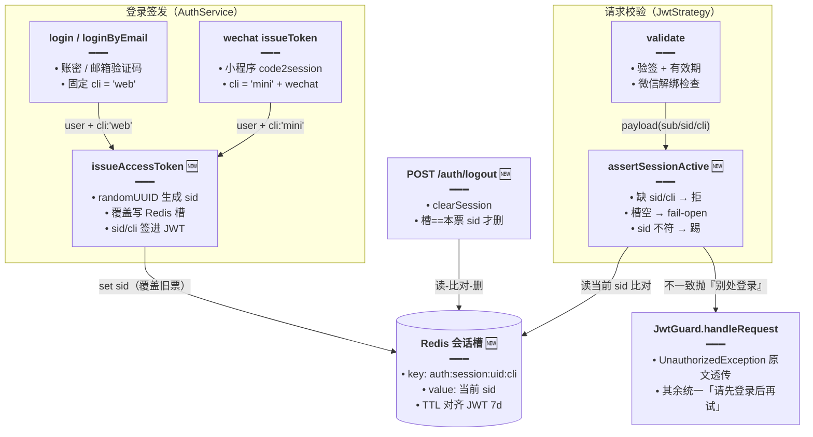
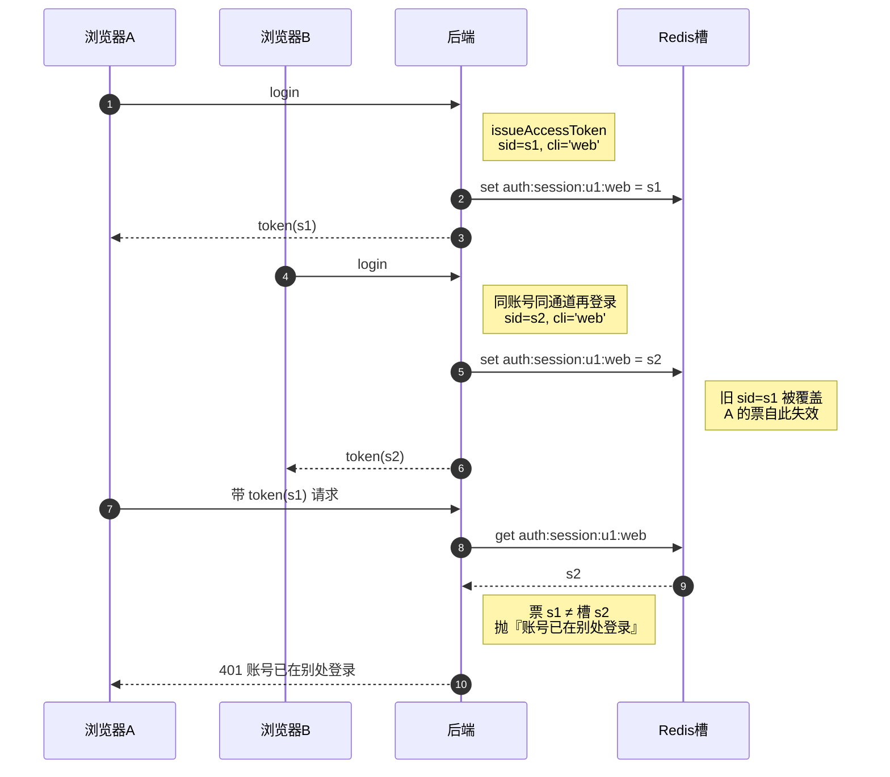

# 登录单端互踢（sid/cli 会话槽 + 主动登出清槽）

> 文档角色：本篇是**登录会话唯一性**的当前主文档——同一账号在**同一端**（Web/桌面 或 微信小程序）再次登录后，旧凭证立即失效（互踢）；主动登出会同步清掉服务端会话槽。
>
> 延伸阅读：
> - 前端如何识别踢下线、清退与提示（`notifyUnauthorized(reason, failedToken)`、Toast 静默窗）：[401清退链路与多Tab保护.md](./401清退链路与多Tab保护.md)
> - 前端两层鉴权总览（路由守卫 + 401 收敛）：[路由认证.md](./路由认证.md)
> - 微信解绑踢下线（`wechat-unbind` 旧机制，与本文 sid 机制并存）：[微信小程序登录绑定.md](./微信小程序登录绑定.md)
> - 登出入口统一（`performLogout` 的调用方）：[登出统一主题同步.md](./登出统一主题同步.md)

## 1. 背景与目标

改动前，登录态只有一个事实来源：**JWT 本身有效即可用**。由此带来三个问题：

- **同端不互踢**：同一账号在 A 电脑登录后，又在 B 电脑登录，A 的旧 token 在 7 天有效期内照常可用——无法在「别处登录」时让旧端下线。
- **主动登出不彻底**：前端登出只删本地 `localStorage` token，服务端无从知晓；旧 token 若被复制走，在过期前依然能调通接口。
- **401 文案被吞**：`JwtStrategy.validate` 里抛出的业务化文案（如微信解绑「微信关联已解除，请重新登录」）被 `JwtGuard.handleRequest` 统一改写成「请先登录后再试」，前端拿不到「为什么被踢」，无法区分「普通过期」与「被踢下线」。

本轮目标：

1. **同端互踢**：登录时为每张票签发 `sid`（会话 id）+ `cli`（通道：`web` / `mini`），Redis 按 `用户 × 通道` 分槽存当前 `sid`；同通道新登录覆盖旧 `sid`，旧票下次请求即被判失效。
2. **双端互不干扰**：Web/桌面 与 微信小程序各占一个槽——手机小程序登录不会把电脑 Web 踢下线，反之亦然。
3. **主动登出清槽**：新增 `POST /auth/logout`，登出时删除本通道会话槽；只有「槽里仍是本票 sid」才删，避免误删别处新登录的会话。
4. **401 文案保真**：Guard 对 `UnauthorizedException` 原文透传，前端得以区分「被踢下线」与「普通未登录」，分别给出「账号已在别处登录」与「请先登录」两种提示。

## 2. 改动范围

| 文件 | 改动 | 角色 |
| --- | --- | --- |
| `apps/backend/src/services/auth/auth-session.ts` | **新增** | `AuthClient` 类型、会话槽 key、TTL、`assertSessionActive` 踢人判定 |
| `apps/backend/src/services/auth/auth.service.ts` | 修改 | 新增 `issueAccessToken`（签 sid/cli 票 + 覆盖槽）与 `clearSession`（登出清槽）；`login` / `loginByEmail` 改走统一签发 |
| `apps/backend/src/services/auth/auth.controller.ts` | 修改 | 新增 `POST /auth/logout`；`AuthedRequest` 扩展 `sid` / `cli` |
| `apps/backend/src/services/auth/auth.strategy.ts` | 修改 | `validate` 接入 `assertSessionActive`；返回体带 `sid` / `cli` |
| `apps/backend/src/guards/jwt.guard.ts` | 修改 | `handleRequest` 保留 `UnauthorizedException` 原文案（踢下线 / 微信解绑） |
| `apps/backend/src/services/auth/wechat/wechat-auth.service.ts` | 修改 | `issueToken` 改调 `AuthService.issueAccessToken`（`cli: 'mini'` + `wechat: true`），不再自行 `jwt.signAsync` |

## 3. 实现思路

1. **会话槽 = `用户 × 通道`**：`authSessionCacheKey(userId, cli)` 产出 `auth:session:{userId}:{cli}`，`web` 与 `mini` 两槽互不覆盖。同端互踢、跨端共存，正好符合「电脑登录不应把手机小程序踢掉」的直觉。
2. **签发即覆盖**：`issueAccessToken` 先 `randomUUID()` 生成 `sid`、写槽（TTL 与 JWT 全局 `expiresIn=7d` 对齐），再把 `sid` / `cli` 签进 JWT。同通道第二次登录会覆盖槽里的旧 `sid`——旧票还在 7 天有效期内，但 `sid` 已对不上。
3. **每次请求比对**：`JwtStrategy.validate` 在校验签名/有效期之后调 `assertSessionActive`——槽里当前 `sid` 与票里 `sid` 不一致即抛 `账号已在别处登录`。
4. **fail-open 兜底**：槽里**没有** key（Redis 重启 / 槽被清）时直接放行，避免因缓存抖动把全站用户踢出；代价是「登出后槽被删，同一张旧票在过期前仍能用」——安全性与可用性之间选择可用性，踢人靠「覆盖」而非「删除」达成。
5. **旧票硬拒**：票里缺 `sid` 或 `cli` 非法（本轮上线前签发的历史 token）一律拒绝。效果是**发布瞬间所有在线旧票失效一次**，用户重新登录后即进入新机制。
6. **登出只删本票**：`clearSession` 先读槽再比对 `sid`，相等才 `del`——A 端登出不会误删 B 端新登录写入的 `sid`。
7. **文案分层**：`assertSessionActive` / 微信解绑抛的 `UnauthorizedException` 原文案经 Guard 透传给前端（前端据此识别「别处登录」）；其余失败（无票、签名错、过期）仍统一「请先登录后再试」，不泄露更多细节。
8. **微信通道复用统一签发**：`WechatAuthService.issueToken` 不再自己签票，改调 `AuthService.issueAccessToken({ cli: 'mini', wechat: true })`——微信票同时带 `wechat: true`（供解绑踢人旧逻辑）与 `sid/cli`（供互踢新逻辑），两套机制叠加生效。





## 4. 关键代码对比与注释

### 4.1 新模块 `auth-session.ts`（纯新增）

整个文件为**本轮新增**，无「改动前」对照（纯新增例外，不再贴空块）。

**改动后（纯新增）** · `apps/backend/src/services/auth/auth-session.ts`（当前，全文）

```typescript
// 鉴权失败专用异常：踢人/解绑文案经 Guard 原样透传给前端识别
import { UnauthorizedException } from '@nestjs/common';
// 缓存类型：会话槽落在 Redis（cache-manager 抽象）
import type { Cache } from 'cache-manager';

// 通道联合类型：Web/桌面 与 小程序分槽，同端互踢但跨端互不干扰
export type AuthClient = 'web' | 'mini';

// 槽 TTL 与 JWT 全局 expiresIn=7d 对齐：票到期槽也同时消失，不留孤儿槽
export const AUTH_SESSION_TTL_MS = 7 * 24 * 60 * 60 * 1000;

// 踢人文案常量：前端靠「别处登录」子串识别踢下线，集中定义避免两处写串
export const AUTH_SESSION_KICKED_MESSAGE = '账号已在别处登录';

// 会话槽 key：用户 × 通道一槽，同通道新登录覆盖旧 sid 即完成互踢
export const authSessionCacheKey = (userId: number, cli: AuthClient) =>
        `auth:session:${userId}:${cli}`;

// 收窄未知值为合法通道：token payload 里 cli 是 string，须校验后才敢当 AuthClient 用
export function isAuthClient(value: unknown): value is AuthClient {
        return value === 'web' || value === 'mini';
}

// 每次请求调用的踢人判定：只比对本票通道；缺 sid/cli 一律拒绝；本槽无 key 则 fail-open
export async function assertSessionActive(
        cache: Cache,
        payload: { sub: number; sid?: string; cli?: string },
): Promise<void> {
        // 历史旧票（本轮上线前签发）没有 sid/cli：硬拒，让其重新登录进入新机制
        if (!payload.sid || !isAuthClient(payload.cli)) {
                throw new UnauthorizedException(AUTH_SESSION_KICKED_MESSAGE);
        }
        // 读本通道槽里的当前 sid
        const current = await cache.get<string>(
                authSessionCacheKey(payload.sub, payload.cli),
        );
        // 槽为空（Redis 重启/登出已清）：fail-open 放行，避免缓存抖动踢出全站用户；互踢靠「覆盖」而非「删除」
        if (current == null || current === '') return;
        // 槽里 sid 已被同端新登录覆盖：本票是被踢的旧票
        if (current !== payload.sid) {
                throw new UnauthorizedException(AUTH_SESSION_KICKED_MESSAGE);
        }
}
```

**变更摘要**：新增「用户 × 通道」会话槽模型与唯一的踢人判定函数；踢人文案常量化供前后端对齐。

### 4.2 统一签发与登出清槽（`apps/backend/src/services/auth/auth.service.ts`）

#### 4.2.1 `issueAccessToken` + `clearSession`（纯新增）

**改动后（纯新增）** · `apps/backend/src/services/auth/auth.service.ts`（当前，约 L45–L78）

```typescript
// 签发含 sid/cli 的 JWT，并覆盖本通道 Redis 当前会话槽
async issueAccessToken(
        user: User,
        opts: { cli: AuthClient; wechat?: boolean },
) {
        // 每张票一个随机会话 id：同端再次登录生成新 sid，旧票 sid 即被顶掉
        const sid = randomUUID();
        // 覆盖写「用户 × 通道」槽：互踢的本质就是这一句覆盖
        await this.cache.set(
                authSessionCacheKey(user.id, opts.cli),
                sid,
                AUTH_SESSION_TTL_MS,
        );
        // 剥掉密码字段，避免随响应体泄露
        const { password: _pw, ...userInfo } = user;
        // 签 JWT：sid/cli 进 payload 供 validate 比对；微信票额外带 wechat 标记供解绑踢人旧逻辑
        const access_token = await this.jwt.signAsync({
                username: userInfo.username,
                sub: user.id,
                sid,
                cli: opts.cli,
                ...(opts.wechat ? { wechat: true } : {}),
        });
        // 与旧版响应结构一致（token + 用户字段平铺），前端登录页无需改解析
        return { access_token, ...userInfo };
}

// 主动登出：仅当 Redis 本槽仍是本票 sid 时删除，避免误删同端别处新会话
async clearSession(userId: number, sid: string, cli: AuthClient) {
        // 旧票无 sid/cli 走不到这里，但防御一下：直接报成功即可
        if (!isAuthClient(cli) || !sid) {
                return { success: true };
        }
        // 定位本通道槽
        const key = authSessionCacheKey(userId, cli);
        // 先读再比对：A 端登出时若槽里已是 B 端新登录的 sid，绝不能删
        const current = await this.cache.get<string>(key);
        // 槽里仍是本票才删——删的是「自己的会话」，不是「别人的新会话」
        if (current === sid) {
                await this.cache.del(key);
        }
        // 无论是否真删都报成功：登出是幂等操作，前端拿到结果即清本地态
        return { success: true };
}
```

**变更摘要**：新增统一签发入口与「读-比对-删」的登出清槽；签发时覆盖槽是同端互踢的唯一动作。

#### 4.2.2 `login` 签发段（对比）

**对比范围**：`login` 方法内「密码校验通过后签票」片段（前后对称摘录）。

**改动前** · `apps/backend/src/services/auth/auth.service.ts`（基线，`login` 内签发段）

```typescript
// 密码比对通过
if (isPasswordValid) {
        // 解构剥掉密码
        const { password, ...userInfo } = user; // 使用解构赋值排除password
        // 直接签票：payload 只有 username/sub，无会话概念，任何有效票都能用
        const token = await this.jwt.signAsync(
                {
                        username: userInfo.username,
                        sub: userInfo.id,
                },
        );
        // 返回 token + 用户信息
        return {
                access_token: token,
                ...userInfo,
        };
}
```

**改动后** · `apps/backend/src/services/auth/auth.service.ts`（当前，约 L96–L97，`login` 内签发段）

```typescript
// 密码比对通过
if (isPasswordValid) {
        // 改走统一签发：生成 sid、覆盖 web 槽、签进 JWT，一行完成互踢闭环
        return this.issueAccessToken(user, { cli: 'web' });
}
```

**变更摘要**：`login` / `loginByEmail` 两处手写签票（payload 仅 `username/sub`）统一替换为 `issueAccessToken(user, { cli: 'web' })`，响应结构不变；`loginByEmail` 改动与之完全相同（当前约 L113–L114），不再重复贴块。

### 4.3 登出接口（`apps/backend/src/services/auth/auth.controller.ts`，纯新增）

**改动后（纯新增）** · `apps/backend/src/services/auth/auth.controller.ts`（当前，约 L64–L74）

```typescript
// 登出接口需登录态：走 JwtGuard 拿到 userId/sid/cli
@Post('/logout')
@UseGuards(JwtGuard)
async logout(@Req() req: AuthedRequest) {
        // 无 userId 直接 400（requireUserId 内部抛异常），正常票不会走到
        const userId = requireUserId(req);
        // 从 validate 返回体取本票 sid
        const sid = req.user?.sid;
        // 从 validate 返回体取本票通道
        const cli = req.user?.cli;
        // 旧票（无 sid/cli）调登出：没有槽可清，直接报成功让前端清本地即可
        if (!sid || !isAuthClient(cli)) {
                return { success: true };
        }
        // 交给 service 做「读-比对-删」
        return await this.authService.clearSession(userId, sid, cli);
}
```

配套类型扩展（同文件，当前约 L32–L34）：

```typescript
// validate 返回体现在带 sid/cli（见 §4.4），请求类型同步扩展供登出接口取用
type AuthedRequest = Request & {
        user?: { userId?: number; sid?: string; cli?: AuthClient };
};
```

**变更摘要**：新增 `POST /auth/logout`（需登录），把「清服务端会话槽」从纯前端动作变成前后端闭环。

### 4.4 逐请求踢人判定（`apps/backend/src/services/auth/auth.strategy.ts` · `validate`）

**对比范围**：`validate` 全方法（前后对称）。

**改动前** · `apps/backend/src/services/auth/auth.strategy.ts`（基线，`validate` 全方法）

```typescript
// validate 只认 JWT 签名与有效期：payload 即真理
async validate(payload: { sub: number; username: string; wechat?: boolean }) {
        // 微信票先查解绑撤销标记
        if (payload.wechat) {
                const revoked = await this.cache.get(wechatUnbindCacheKey(payload.sub));
                if (revoked) {
                        throw new UnauthorizedException('微信关联已解除，请重新登录');
                }
        }

        // 直接信任 payload：同端多处登录的旧票照常放行（本轮要解决的问题）
        return {
                userId: payload.sub,
                username: payload.username,
        };
}
```

**改动后** · `apps/backend/src/services/auth/auth.strategy.ts`（当前，约 L31–L57，`validate` 全方法）

```typescript
// payload 类型扩展：新签发的票带 sid/cli；旧票没有，交给 assertSessionActive 硬拒
async validate(payload: {
        sub: number;
        username: string;
        wechat?: boolean;
        sid?: string;
        cli?: string;
}) {
        // 微信解绑撤销检查保持在前：解绑后的微信票连互踢判定都不必进
        if (payload.wechat) {
                const revoked = await this.cache.get(wechatUnbindCacheKey(payload.sub));
                if (revoked) {
                        throw new UnauthorizedException('微信关联已解除，请重新登录');
                }
        }

        // 新增：比对本票 sid 与本通道 Redis 槽，不一致即抛「账号已在别处登录」
        await assertSessionActive(this.cache, payload);

        // 收窄 cli：payload 里是裸 string，校验后才是 AuthClient，供控制器安全取用
        const cli: AuthClient | undefined = isAuthClient(payload.cli)
                ? payload.cli
                : undefined;

        // 返回体带上 sid/cli：/auth/logout 需要它们定位并清掉本票对应的槽
        return {
                userId: payload.sub,
                username: payload.username,
                sid: payload.sid,
                cli,
        };
}
```

**变更摘要**：校验链在「验签 → 微信解绑」之后插入互踢判定；返回体新增 `sid` / `cli` 供登出清槽。

### 4.5 Guard 保留 401 原文案（`apps/backend/src/guards/jwt.guard.ts` · `handleRequest`）

**对比范围**：`handleRequest` 全方法（前后对称）。

**改动前** · `apps/backend/src/guards/jwt.guard.ts`（基线，`handleRequest` 全方法）

```typescript
handleRequest(err: any, user: any) {
        // 任何失败（含 validate 主动抛的踢人/解绑文案）统一改写成「请先登录后再试」
        if (err || !user) {
                // 这里直接抛出异常，由全局过滤器处理
                throw new UnauthorizedException('请先登录后再试');
        }
        return user;
}
```

**改动后** · `apps/backend/src/guards/jwt.guard.ts`（当前，`handleRequest` 全方法）

```typescript
// 保留 validate 抛出的原文案（踢下线 / 微信解绑），其余统一「请先登录」
handleRequest(err: any, user: any) {
        // validate 主动抛的 UnauthorizedException（别处登录 / 微信解绑）：原文透传，前端据此区分踢下线与普通未登录
        if (err instanceof UnauthorizedException) {
                throw err;
        }
        // 其余失败（无票、签名错、过期）：仍统一笼统文案，不向外泄露失败细节
        if (err || !user) {
                throw new UnauthorizedException('请先登录后再试');
        }
        return user;
}
```

**变更摘要**：401 响应文案由「一律笼统」改为「业务化文案透传 + 其余笼统」，是前端能弹出「账号已在别处登录」的后端前提。

### 4.6 微信通道接入统一签发（`apps/backend/src/services/auth/wechat/wechat-auth.service.ts` · `issueToken`）

**对比范围**：私有方法 `issueToken` 全方法（前后对称）。

**改动前** · `apps/backend/src/services/auth/wechat/wechat-auth.service.ts`（基线，`issueToken` 全方法）

```typescript
// 微信登录自行签票：payload 只有 username/sub/wechat，无 sid，不参与互踢
private issueToken(user: User, webLinked: boolean) {
        // 剥掉密码
        const { password, ...userInfo } = user;
        // 直接调 JwtService 签票
        return this.jwt
                .signAsync({
                        username: userInfo.username,
                        sub: userInfo.id,
                        wechat: true,
                })
                .then((token) => ({
                        access_token: token,
                        web_linked: webLinked,
                        ...userInfo,
                }));
}
```

**改动后** · `apps/backend/src/services/auth/wechat/wechat-auth.service.ts`（当前，约 L227–L234，`issueToken` 全方法）

```typescript
// 改走 AuthService 统一签发：mini 槽 + wechat 标记，小程序同端互踢立即生效
private async issueToken(user: User, webLinked: boolean) {
        // 统一签发：覆盖 mini 槽、签 sid/cli/wechat 进 JWT
        const issued = await this.authService.issueAccessToken(user, {
                cli: 'mini',
                wechat: true,
        });
        // 在统一返回结构上附加小程序特有的 web_linked 字段，响应形状对前端不变
        return { ...issued, web_linked: webLinked };
}
```

**变更摘要**：微信签票收口到统一入口（构造器注入由 `JwtService` 换为 `AuthService`）；小程序通道获得与 Web 一致的互踢能力，且与既有「解绑踢人」机制叠加。

## 5. 兼容性与影响

- **破坏性（一次性）**：上线瞬间所有**旧 token**（无 `sid/cli`）被 `assertSessionActive` 拒绝——全站用户需重新登录一次，且前端会把这次 401 识别为「别处登录」而弹踢下线提示（见姊妹篇 [401清退链路与多Tab保护.md](./401清退链路与多Tab保护.md)）。属预期行为，发布时宜选低峰。
- **同端互踢是默认行为**：同一账号在两个浏览器/两台电脑（同为 `web`）只能保留**最后登录**的一端；Web 与小程序（`mini`）互不影响。
- **fail-open 边界**：Redis 槽丢失（重启/flush）时旧票不会被踢，退化为改动前行为；不视为安全事故，只视为互踢能力短暂降级。
- **登出语义变化**：登出后本通道槽被删，同一张旧票在槽重建前（同端重新登录）处于 fail-open 窗口内仍可用——要彻底失效仍依赖 JWT 7 天过期或同端再登录覆盖。

## 6. 风险与回归建议

- Web 端：A 浏览器登录 → B 浏览器同账号登录 → A 发起任意请求，应收到 401「账号已在别处登录」并跳登录页。
- 双端共存：Web 登录后小程序再登录，Web 端请求**不应**被踢。
- 主动登出：A 端登出后，B 端（同账号同端新登录）应不受影响；登出接口在旧票（无 sid）下应返回成功。
- 微信：小程序登录 → 另一端小程序同账号登录 → 前者被踢；Web 解绑微信后原微信票仍按旧文案「微信关联已解除」失效。
- 普通失败：错误密码、过期票、伪造票的 401 文案仍应为「请先登录后再试」。

## 7. 相关源码路径

| 说明 | 路径 |
| --- | --- |
| 会话槽模型与踢人判定 | `apps/backend/src/services/auth/auth-session.ts` |
| 统一签发 / 登出清槽 | `apps/backend/src/services/auth/auth.service.ts` |
| 登出接口 | `apps/backend/src/services/auth/auth.controller.ts` |
| 逐请求互踢校验 | `apps/backend/src/services/auth/auth.strategy.ts` |
| 401 文案透传 | `apps/backend/src/guards/jwt.guard.ts` |
| 微信通道接入 | `apps/backend/src/services/auth/wechat/wechat-auth.service.ts` |
| 前端踢下线识别与清退 | `apps/frontend/src/router/authSession.ts`（见姊妹篇） |

---

（若与仓库最新源码不一致，以源码为准）
