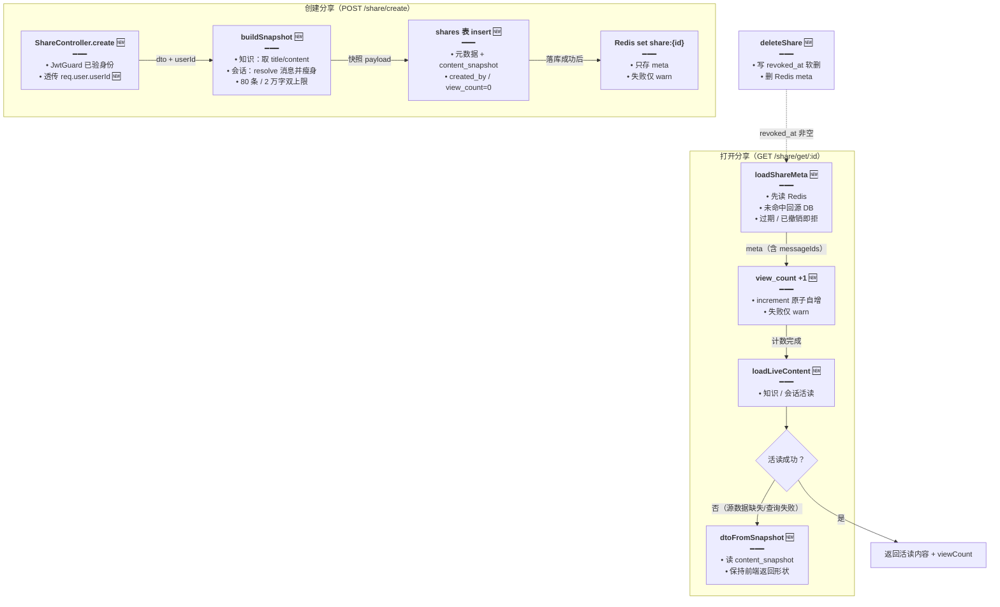
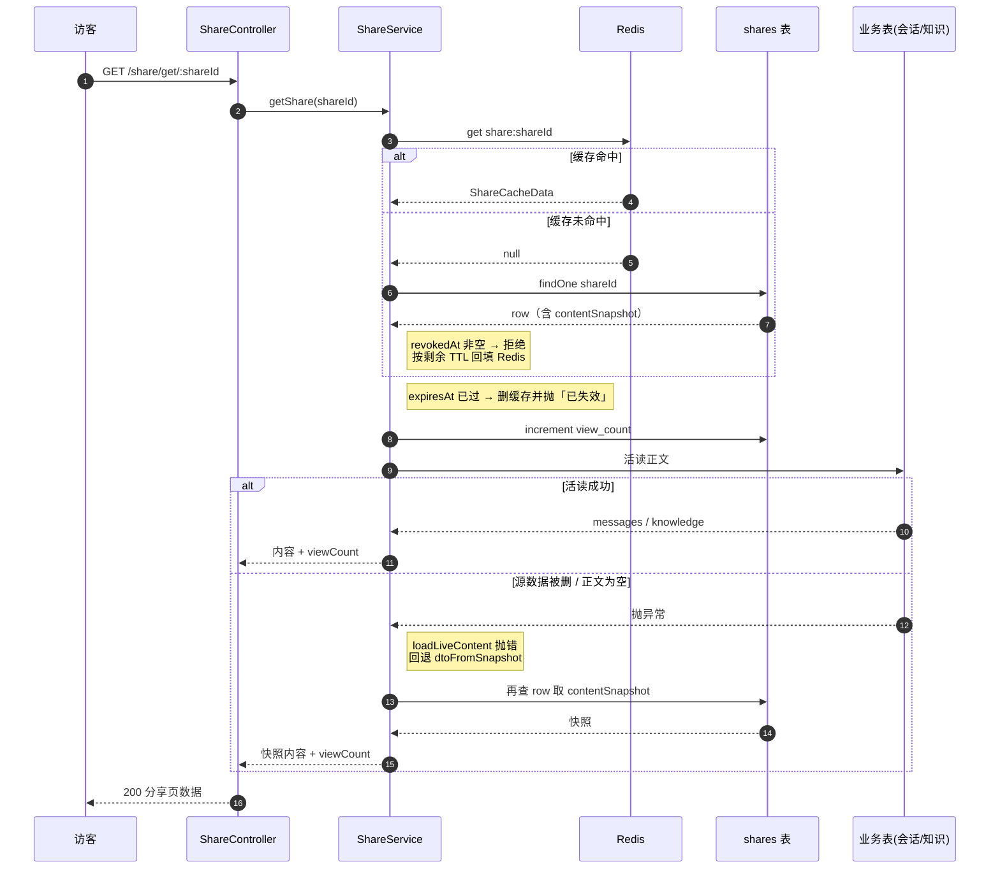

# 分享落库与快照回退（shares 权威表 + Redis 旁路 + view_count）

> 文档角色：本篇是**分享数据持久化**的当前主文档——分享从「只存 Redis」改为「`shares` 表权威 + Redis 旁路 meta」，创建时写入正文快照，公开读优先活读、失败回退快照，并累计打开次数、删除改软删除。
>
> 延伸阅读：
> - 分享会话消息顺序、附件、排版问题：[分享.md](./分享.md)
> - 分享链接可选有效期（1h～30d）与其时区处理：[分享链接过期时间.md](./分享链接过期时间.md)、[分享知识时区.md](./分享知识时区.md)
> - 知识文章分享的正文预览与工具栏：[分享.md](./分享.md) §三

## 1. 背景与目标

改动前，分享是**纯 Redis 结构**：`createShare` 只把「会话 id + 消息 id 列表 + 过期时间」写进 `share:{id}` 键，`getShare` 再按这份参数去业务表活读正文。由此有四类问题：

- **数据不持久**：Redis 重启、被淘汰或运维误删 key，分享链接即刻全量失效（`分享不存在或已过期`），而业务表里其实什么都不缺。
- **无台账**：没有「谁在什么时候创建了哪条分享、打开了几次、是否被撤销」的记录，运营与排障都只能靠翻 Redis。
- **正文会「变空」**：分享只是参数引用——原会话被删除、知识文章被清空内容后，分享页直接报「知识文章不存在 / 内容为空」，用户先前看到的分享内容无处可寻。
- **删除不可追溯**：`deleteShare` 直接 `del` 缓存键，删掉即无痕；也没有撤销时间。

本轮目标：

1. **落库权威**：新增 `shares` 表（元数据 + 创建时快照 + 打开次数 + 撤销时间），Redis 降级为可丢失的旁路缓存。
2. **创建即定格**：创建分享时 resolve 一次正文并落快照（最多 80 条消息、单条 2 万字），保证后续源数据变化不影响分享可读性。
3. **读路径双保险**：先活读（内容更新能反映），活读失败或为空时回退快照，分享页不再因源数据缺失而白屏。
4. **打开次数**：每次公开读 `view_count + 1`，失败只记日志不影响分享内容返回。
5. **软删除**：删除只写 `revoked_at`，保留台账；同时删掉 Redis meta，使后续读取立即拒绝。

## 2. 改动范围

| 文件 | 改动 | 角色 |
| --- | --- | --- |
| `apps/backend/src/services/share/share.entity.ts` | 重写（原本是空占位类） | `shares` 表实体：主键 `share_id`、`content_snapshot` JSON、`view_count`、`revoked_at` 等 |
| `apps/backend/src/services/share/share.service.ts` | 重写核心读写 | 新增 `buildSnapshot` / `loadShareMeta` / `loadLiveContent` / `dtoFromSnapshot`；`createShare` 先落库再缓存；`getShare` 计数 + 活读 + 快照回退；`deleteShare` 改软删除 |
| `apps/backend/src/services/share/share.controller.ts` | 修改 | `create` 注入 `@Req()`，把登录用户 `userId` 作为 `createdBy` 透传 |
| `apps/backend/src/services/share/share.module.ts` | 修改 | `TypeOrmModule.forFeature` 注册 `Share` 实体 |
| `apps/backend/tsconfig.json` | 修改 | 关闭 `strictPropertyInitialization`，让 TypeORM 列字段的「无初始化」写法通过编译 |
| `apps/backend/src/migrations/1793770755596-share_list.ts` | **新增** | 空壳迁移（`up`/`down` 均为空），只占位迁移序号、避免对已存在的 `shares` 表重复 `CREATE` |

## 3. 实现思路

1. **权威与缓存分层**：`shares` 表是唯一权威；Redis 只缓存「读多写少」的 meta（会话 id / 消息 id / 时间戳）。缓存读写全部包 `try/catch`，只 warn 不抛——缓存失效不能阻断分享主流程。
2. **meta 回源 + 回填**：`loadShareMeta` 先读 Redis；未命中则查表，把行转换成原有 `ShareCacheData` 形状并**按剩余 TTL 回填**。这样缓存被清空后分享仍可访问，且不需要重写前端契约。
3. **撤销即失效**：回源时若 `revoked_at != null` 直接按「不存在或已过期」拒绝；软删同时删缓存键，让已缓存的分享立刻不可用。
4. **创建时 resolve 一次**：`buildSnapshot` 复用原有 `resolveShareMessagesBySessionId`（保持消息顺序、附件解析等既有行为），把结果裁成「id / chatId / role / content / timestamp」的瘦身结构落 `json` 列。
5. **双上限截断**：最多 `80` 条消息、单条 `20_000` 字；触发任一上限即 `snapshotTruncated = true`，便于后续排查「为什么快照比原会话短」。
6. **活读优先、快照兜底**：`getShare` 先 `loadLiveContent`；抛出任何异常（源会话被删、知识正文为空、查询失败）都走 `dtoFromSnapshot`。只有连快照都没有时才报「分享不存在或已过期」——宁可给旧内容，也不给白屏。
7. **计数旁路**：`viewCount` 用 `increment` 原子自增，随后单独 `select('viewCount')` 取回最新值；计数失败只 warn，返回值保持 0，绝不影响正文返回。
8. **keep 前端契约**：快照分支同样返回 `shareId / shareType / title / createdAt / expiresAt / viewCount`（知识分享还带 `knowledge`），前端分享页无需改动；`viewCount` 目前仅后端返回，前端尚未展示，供后续运营面板使用。
9. **编译配置的代价**：TypeORM 实体的列字段不写初始化器，开启 `strictPropertyInitialization` 会报 TS1240（strictPropertyInitialization 与 `!` 断言/构造赋值冲突），故在 `apps/backend/tsconfig.json` 关闭该项；该配置作用于整个后端，换来实体写法与官方示例一致。





## 4. 关键代码对比与注释

### 4.1 实体：从空占位类到 `shares` 权威表

**改动前** · `apps/backend/src/services/share/share.entity.ts`（HEAD，约 L1）

```typescript
// 改动前整个实体文件只有这一行空类：属性一个都没有
// 之所以能编译，是因为当时没有任何模块 import 它，分享数据全部落在 Redis
export class Share {}
```

**改动后** · `apps/backend/src/services/share/share.entity.ts`（当前，约 L1–L52）

```typescript
// 引入 TypeORM 的列、实体、索引、主键装饰器：本轮要把分享从「Redis 唯一」升级成「表权威」
import { Column, Entity, Index, PrimaryColumn } from 'typeorm';

// 源码注释：公开分享权威行——说明这张表存的是分享的「权威副本」，不是缓存
/** 公开分享权威行：元数据 + 创建时快照 + 打开次数（Redis 仅旁路） */
// 声明映射到数据库表 shares；后续所有查询都以此表为准
@Entity({ name: 'shares' })
// 过期时间索引：便于按 expires_at 扫过期数据做清理或运营统计
@Index('IDX_shares_expires_at', ['expiresAt'])
// 创建人索引：便于按用户维度做分享台账查询
@Index('IDX_shares_created_by', ['createdBy'])
// 会话索引：便于「某个会话被分享了几次」这类反查
@Index('IDX_shares_chat_session', ['chatSessionId'])
// 实体类：字段与表列一一对应（列名用 snake_case，属性名用 camelCase）
export class Share {
	// 主键用分享 id 本身：分享 id 由服务端 randomUUID 生成，天然唯一，避免再加自增主键
	@PrimaryColumn({ name: 'share_id', type: 'varchar', length: 64 })
	// 分享 id（URL 中的那段字符串），与 Redis 键 share:{id} 共用同一个值
	shareId: string;

	// 会话 id 列：会话分享存 chat/assistant/agent/ebook 会话 id，知识分享复用为 knowledge id
	@Column({ name: 'chat_session_id', type: 'varchar', length: 64 })
	// 被分享对象 id（沿用原有字段名，保持接口与历史数据兼容）
	chatSessionId: string;

	// 分享目标类型列：靠它区分「分享会话」还是「分享知识文章」，默认会话
	@Column({
		// 列名 snake_case，与项目其它表命名风格一致
		name: 'share_type',
		// 用字符串而不是 enum 类型：MySQL enum 改值需要 DDL，字符串更易扩展
		type: 'varchar',
		// 32 长度足够容纳 session / knowledge 及未来新类型
		length: 32,
		// 老调用方不传 shareType 时落到 session，保证默认行为不变
		default: 'session',
	})
	// 分享类型：session=会话分享，knowledge=知识文章分享
	shareType: 'session' | 'knowledge';

	// 会话细分类型列：会话分享时用于决定从哪张业务表活读正文
	@Column({ name: 'session_type', type: 'varchar', length: 32, nullable: true })
	// 四类会话：主聊天 / 知识库助手 / Agent 专项 / 电子书助手；知识分享为 null
	sessionType: 'chat' | 'assistant' | 'agent' | 'ebook' | null;

	// 消息 id 列表列：用 json 存数组，保留前端传入的展示顺序（顺序本身有业务含义）
	@Column({ name: 'message_ids', type: 'json', nullable: true })
	// 被分享消息 id 数组；不传时为 null，表示「整个会话」
	messageIds: string[] | null;

	// 标题列：列表/运营台账展示用，取值来自快照构建结果
	@Column({ type: 'varchar', length: 500, nullable: true })
	// 分享标题；实体限长 500，写入时会再 slice(0, 500) 做兜底
	title: string | null;

	// 正文快照列：创建时一次性写入，读路径的兜底数据源
	@Column({ name: 'content_snapshot', type: 'json', nullable: true })
	// 快照体：{ kind:'session', messages: [...] } 或 { kind:'knowledge', title, content }
	contentSnapshot: Record<string, unknown> | null;

	// 截断标记列：记录快照是否因条数/字数上限而被裁剪
	@Column({ name: 'snapshot_truncated', type: 'boolean', default: false })
	// true 表示快照内容少于原会话（命中 80 条或单条 2 万字上限）
	snapshotTruncated: boolean;

	// 创建人列：登录用户 id，匿名或旧数据为 null
	@Column({ name: 'created_by', type: 'int', nullable: true })
	// 创建者用户 id；由 controller 从 JWT 请求上下文透传
	createdBy: number | null;

	// 创建时间列：用 bigint 存毫秒字符串，避免 MySQL 时间类型与时区转换漂移
	@Column({ name: 'created_at_ms', type: 'bigint' })
	// 创建时间（毫秒）。bigint 在 TypeORM 中映射为 string，故声明成 string
	createdAt: string;

	// 过期时间列：与 created_at 同样存毫秒字符串，读写都走 this.ms() 转数字
	@Column({ name: 'expires_at_ms', type: 'bigint' })
	// 过期时间（毫秒字符串）；权威有效期由此列决定，Redis TTL 只是旁路
	expiresAt: string;

	// 撤销时间列：软删除语义，非空即视为已删除
	@Column({ name: 'revoked_at_ms', type: 'bigint', nullable: true })
	// 撤销时间（毫秒字符串）；null 表示仍有效
	revokedAt: string | null;

	// 打开次数列：每次公开读自增，失败不影响分享内容返回
	@Column({ name: 'view_count', type: 'int', default: 0 })
	// 累计打开次数；前端暂未展示，供运营/后台台账使用
	viewCount: number;
}
```

**变更摘要**：空占位类被替换成完整的 `shares` 表映射——新增主键、快照 JSON 列、创建人、毫秒时间戳、撤销时间与打开次数，并加三条查询索引。

### 4.2 模块注册：`forFeature` 加入 `Share`

**改动前** · `apps/backend/src/services/share/share.module.ts`（HEAD，约 L18–L29）

```typescript
// 引入控制器：模块对外暴露分享接口
import { ShareController } from './share.controller';
// 引入服务：分享业务逻辑本体
import { ShareService } from './share.service';

// 模块装饰器：声明 import / controller / provider 三部分
@Module({
	// imports 里声明本模块依赖
	imports: [
		// 导入 ChatModule 以使用 MessageService
		ChatModule,
		// 注册 TypeORM 实体（改动前只注册业务实体，没有 Share）
		TypeOrmModule.forFeature([
			// 主聊天消息表仓储
			ChatMessages,
			// 主聊天会话表仓储
			ChatSessions,
			// 附件表仓储（分享消息带附件时要用）
			Attachments,
			// ...（其余 Assistant / Agent / 英语 / Skill / 电子书 / 知识 仓储，未改动，省略）
		]),
	],
```

**改动后** · `apps/backend/src/services/share/share.module.ts`（当前，约 L18–L43）

```typescript
// 引入控制器：模块对外暴露分享接口
import { ShareController } from './share.controller';
// 新增：引入 shares 实体，让本模块能注入它的 Repository
import { Share } from './share.entity';
// 引入服务：分享业务逻辑本体
import { ShareService } from './share.service';

// 模块装饰器：声明 import / controller / provider 三部分
@Module({
	// imports 里声明本模块依赖
	imports: [
		// 导入 ChatModule 以使用 MessageService
		ChatModule,
		// 注册 TypeORM 实体：forFeature 里的实体才能用 @InjectRepository 注入
		TypeOrmModule.forFeature([
			// 新增：shares 表仓储，供 ShareService 落库/回源/计数/软删
			Share,
			// 主聊天消息表仓储
			ChatMessages,
			// 主聊天会话表仓储
			ChatSessions,
			// 附件表仓储（分享消息带附件时要用）
			Attachments,
			// ...（其余 Assistant / Agent / 英语 / Skill / 电子书 / 知识 仓储，未改动，省略）
		]),
	],
```

**变更摘要**：只在 `forFeature` 列表首项加入 `Share`，并补对应 import；其余仓储与依赖顺序不变。

### 4.3 服务头部：常量与依赖注入

**改动前** · `apps/backend/src/services/share/share.service.ts`（HEAD，约 L1–L5、L18–L23、L43–L47）

```typescript
// 文件头注释：说明改动前分享是「NestJS + Redis」，过期靠 Redis 自动清理
/**
 * 分享服务 - NestJS + Redis
 * 使用 Cache (Redis) 存储分享数据，过期自动清理
 * 根据 chat_session_id 和 message_ids 从数据库查询消息
 */

// ...（import 区未改动，省略）

// 默认过期时间：7天（毫秒）
const DEFAULT_EXPIRES_IN = 7 * 24 * 60 * 60 * 1000;
// 最短 1 小时；0 在部分 Redis 客户端会被当成永不过期
const MIN_EXPIRES_IN = 60 * 60 * 1000;
// 最长 30 天，避免分享键一直占着
const MAX_EXPIRES_IN = 30 * 24 * 60 * 60 * 1000;

// ...（resolveExpiresIn 与类头未改动，省略）

// 构造函数：改动前只注入缓存、日志、消息服务与各业务表仓储
constructor(
	// Redis 缓存实例：唯一的数据存放处
	private cache: Cache,
	// 注入 winston 日志实现（Nest 提供者 token）
	@Inject(WINSTON_MODULE_NEST_PROVIDER)
	// 日志服务：创建/删除分享时打点
	private readonly logger: LoggerService,
	// 消息服务：按 sessionId + messageIds 解析会话消息
	private readonly messageService: MessageService,
	// ...（其余业务表 Repository 注入，未改动，省略）
```

**改动后** · `apps/backend/src/services/share/share.service.ts`（当前，约 L1–L3、L38、L40–L49、L69–L75）

```typescript
// 文件头注释改为「表权威 + Redis 旁路」，点明快照与回退两个新职责
/**
 * 分享服务：AI 库 shares 权威 + Redis 旁路；创建时写正文快照；公开读可活读回退快照。
 */

// ...（import 区，省略）

// 新增：引入 shares 实体类型，供 @InjectRepository 与 dtoFromSnapshot 的参数类型
import { Share } from './share.entity';

// 默认过期时间：7天（毫秒）
const DEFAULT_EXPIRES_IN = 7 * 24 * 60 * 60 * 1000;
// 最短 1 小时；0 在部分 Redis 客户端会被当成永不过期
const MIN_EXPIRES_IN = 60 * 60 * 1000;
// 最长 30 天，避免分享键一直占着
const MAX_EXPIRES_IN = 30 * 24 * 60 * 60 * 1000;
// 快照最多 80 条消息：控制 json 体积，避免单行几 MB 拖慢读写
/** 快照最多保留消息条数，避免 json 过大 */
const MAX_SNAPSHOT_MESSAGES = 80;
// 单条正文最多 2 万字：防止一条超长消息把整行快照撑爆
/** 单条消息正文截断上限 */
const MAX_SNAPSHOT_CONTENT_CHARS = 20_000;

// ...（resolveExpiresIn 与类头未改动，省略）

// 构造函数：新增注入 shares 仓储，位置紧跟 messageService（保持既有依赖顺序不变）
constructor(
	// Redis 缓存实例：现在只负责缓存 meta，可丢失
	private cache: Cache,
	// 注入 winston 日志实现（Nest 提供者 token）
	@Inject(WINSTON_MODULE_NEST_PROVIDER)
	// 日志服务：缓存失败、计数失败、回退快照等降级路径打点
	private readonly logger: LoggerService,
	// 消息服务：按 sessionId + messageIds 解析会话消息
	private readonly messageService: MessageService,
	// 新增：shares 表仓储，承载落库、回源、计数与软删除
	@InjectRepository(Share)
	// 分享实体仓储实例
	private readonly shareRepo: Repository<Share>,
	// ...（其余业务表 Repository 注入，未改动，省略）
```

**变更摘要**：文件职责从「Redis 唯一」改为「表权威 + 旁路」；新增快照双上限常量与 `shareRepo` 注入，原有常量与仓储顺序保持不变。

### 4.4 时间戳归一 `ms()`

**改动后（纯新增）** · `apps/backend/src/services/share/share.service.ts`（当前，约 L417–L421）

```typescript
// 私有工具函数：把 bigint 列读出的字符串、或缓存里的数字统一成 number 毫秒
private ms(v: string | number | null | undefined): number {
	// null / undefined 统一归零，避免调用方到处判空
	if (v == null) return 0;
	// bigint 列在 TypeORM 中返回 string，这里按类型分流转成 number
	const n = typeof v === 'number' ? v : Number(v);
	// NaN / Infinity 兜底归零：脏数据不能污染过期判断
	return Number.isFinite(n) ? n : 0;
}
```

**变更摘要**：新增单一时间戳归一入口，供回源、快照回退、快照构建一致使用。

### 4.5 创建时构建正文快照 `buildSnapshot()`

**改动后（纯新增）** · `apps/backend/src/services/share/share.service.ts`（当前，约 L423–L486）

```typescript
// 源码注释：创建时 resolve 一次，产物落 shares 表，同时供 Admin 台账与公开读回退
/** 创建时 resolve 一次，供 Admin 台账与公开回退 */
// 返回三件套：标题（列表展示）、payload（写 json 列）、truncated（是否被裁剪）
private async buildSnapshot(dto: CreateShareDto): Promise<{
	// 标题：从会话首条用户消息或知识文章标题推导
	title: string;
	// 快照正文：session 为消息数组，knowledge 为标题+正文
	payload: Record<string, unknown>;
	// 是否触发条数/字数上限，落 snapshot_truncated 列
	truncated: boolean;
}> {
	// 未传类型按会话分享处理，与既有默认行为一致
	const shareType = dto.shareType ?? 'session';
	// 知识文章分支：快照取文章标题与正文，不走会话消息链路
	if (shareType === 'knowledge') {
		// 知识分享复用 chatSessionId 字段存 knowledge id，先 trim 防空格脏数据
		const id = (dto.chatSessionId ?? '').trim();
		// 只查快照需要的三列，减少大字段以外的传输成本
		const row = await this.knowledgeRepo.findOne({
			// 按知识 id 定位
			where: { id },
			// 只取 id/标题/正文，避免把无关列读回内存
			select: ['id', 'title', 'content'],
		});
		// 文章不存在直接报错：创建时就失败，好过用户点开分享才发现空白
		if (!row) throw new NotFoundException('知识文章不存在');
		// 正文缺省空串，保持后续截断与写入逻辑无需判空
		let content = row.content ?? '';
		// 截断标记初始为 false，命中上限时置 true
		let truncated = false;
		// 正文超过 2 万字上限则切片，避免单行 json 过大
		if (content.length > MAX_SNAPSHOT_CONTENT_CHARS) {
			// 只保留前 2 万字
			content = content.slice(0, MAX_SNAPSHOT_CONTENT_CHARS);
			// 标记「快照不完整」，便于事后解释内容变短
			truncated = true;
		}
		// 标题优先用文章标题并 trim；为空时给默认「知识分享」
		const title = row.title?.trim() || '知识分享';
		// 返回知识快照三件套
		return {
			// 标题用于 shares.title 列与列表展示
			title,
			// 透传截断标记
			truncated,
			// 快照体：kind 用于读取时区分分支
			payload: {
				// 固定的类型标识，读取端据此走知识分支
				kind: 'knowledge',
				// 知识 id：回退时用于返回知识对象
				id: row.id,
				// 原标题：可能为 null，回退时再兜底
				title: row.title,
				// 已截断（或完整）的正文
				content,
			},
		};
	}

	// 会话分支：复用既有 resolve 逻辑，保证消息顺序/附件解析行为与改动前一致
	const resolved = await this.resolveShareMessagesBySessionId({
		// 会话 id
		sessionId: dto.chatSessionId,
		// 会话细分类型，缺省 chat
		sessionType: dto.sessionType ?? 'chat',
		// 指定消息 id 时保留前端展示顺序
		messageIds: dto.messageIds,
	});
	// 截断标记初始为 false
	let truncated = false;
	// 先取全量消息，再按上限裁剪
	let messages = resolved.messages;
	// 超过 80 条时只留前面部分：分享页以「对话开头」为主，也控制体积
	if (messages.length > MAX_SNAPSHOT_MESSAGES) {
		// 保留前 80 条
		messages = messages.slice(0, MAX_SNAPSHOT_MESSAGES);
		// 标记内容被裁剪
		truncated = true;
	}
	// 瘦身映射：只留渲染必要字段，去掉附件等大对象
	const slim = messages.map((m) => {
		// 正文缺省空串
		let content = m.content ?? '';
		// 单条超 2 万字时截断
		if (content.length > MAX_SNAPSHOT_CONTENT_CHARS) {
			// 保留前 2 万字
			content = content.slice(0, MAX_SNAPSHOT_CONTENT_CHARS);
			// 标记快照不完整
			truncated = true;
		}
		// 返回单条消息的瘦身结构
		return {
			// 消息主键
			id: m.id,
			// 前端生成的消息 uuid，用于对齐展示顺序
			chatId: m.chatId,
			// 角色：user / assistant
			role: m.role,
			// 已截断（或完整）的正文
			content,
			// 消息时间戳，前端展示时间用
			timestamp: m.timestamp,
		};
	});
	// 返回会话快照三件套
	return {
		// 标题沿用原 resolve 结果（首条用户消息）
		title: resolved.title,
		// 透传截断标记
		truncated,
		// 快照体：kind 固定 session，messages 为瘦身后的消息数组
		payload: { kind: 'session', messages: slim },
	};
}
```

**变更摘要**：新增快照构建器，知识与会话两条分支各自产出 `{title, payload, truncated}`；复用既有 resolve 逻辑，仅做瘦身与双上限截断。

### 4.6 元数据读取与回源 `loadShareMeta()`

**改动前** · `apps/backend/src/services/share/share.service.ts`（HEAD，`getShare` 前段，约 L455–L467）

```typescript
// 直接拼缓存键：改动前 meta 只能从 Redis 拿，没有数据库回源概念
const key = this.getCacheKey(shareId);
// 读取 meta；读取结果为 null 时即刻判定分享不存在
const cacheData = await this.cache.get<ShareCacheData>(key);

// 缓存缺失（含 Redis 重启/被淘汰/误删）直接报「不存在或已过期」
if (!cacheData) {
	// 抛 400：前端分享页据此显示失效提示
	throw new HttpException('分享不存在或已过期', HttpStatus.BAD_REQUEST);
}

// 检查过期：只信 meta 里的 expiresAt
if (cacheData.expiresAt && Date.now() > cacheData.expiresAt) {
	// 顺手删掉过期键，避免继续占内存
	await this.cache.del(key);
	// 抛「已失效」，与「不存在」文案区分
	throw new HttpException('分享已失效', HttpStatus.BAD_REQUEST);
}
```

**改动后** · `apps/backend/src/services/share/share.service.ts`（当前，约 L488–L519）

```typescript
// 私有方法：读取分享 meta，缓存未命中时回源 shares 表并按剩余 TTL 回填
private async loadShareMeta(shareId: string): Promise<ShareCacheData> {
	// 计算缓存键，与创建时写入用同一个拼接规则
	const key = this.getCacheKey(shareId);
	// 先尝试缓存：读多写少的 meta 命中缓存可省一次 DB 查询
	let meta = await this.cache.get<ShareCacheData>(key);
	// 缓存未命中：走数据库回源，保证 Redis 抖动不影响分享可用性
	if (!meta) {
		// 按 id 查权威行（含快照，读取正文时可能还要用）
		const row = await this.shareRepo.findOne({ where: { shareId } });
		// 行不存在或已软删（revokedAt 非空）都视为不可用
		if (!row || row.revokedAt != null) {
			// 与历史文案保持一致，前端无需新增分支
			throw new HttpException('分享不存在或已过期', HttpStatus.BAD_REQUEST);
		}
		// 把实体行转换成原有 ShareCacheData 形状，保持读路径下游代码不变
		meta = {
			// 分享 id
			shareId: row.shareId,
			// 被分享对象 id（知识分享时为 knowledge id）
			chatSessionId: row.chatSessionId,
			// 分享类型
			shareType: row.shareType,
			// 会话细分类型：null 转 undefined，贴合 ShareCacheData 的可选语义
			sessionType: row.sessionType ?? undefined,
			// 消息 id 列表：null 转 undefined，表示「整个会话」
			messageIds: row.messageIds ?? undefined,
			// 毫秒时间戳统一转 number（bigint 列读出来是 string）
			createdAt: this.ms(row.createdAt),
			// 同上，过期时间转 number 供比较
			expiresAt: this.ms(row.expiresAt),
		};
	}
	// 过期判断：以 meta.expiresAt（回源后即表里的权威值）为准
	if (meta.expiresAt && Date.now() > meta.expiresAt) {
		// 删掉过期缓存，避免后续继续命中
		await this.cache.del(key);
		// 抛「已失效」：过期与不存在是两种不同提示
		throw new HttpException('分享已失效', HttpStatus.BAD_REQUEST);
	}
	// 计算剩余有效期：回填时用剩余时间，不能再用完整 TTL 把过期时间延长
	const remain = Math.max(0, (meta.expiresAt ?? 0) - Date.now());
	// 仍有剩余时间才回填
	if (remain > 0) {
		// 缓存写入包 try/catch：缓存故障不得影响分享主流程
		try {
			// 按剩余 TTL 回填，保证缓存里的过期时刻与表一致
			await this.cache.set(key, meta, remain);
		} catch (e) {
			// 只 warn：分享仍可继续返回
			this.logger.warn(`分享缓存回填失败 ${shareId}: ${String(e)}`);
		}
	}
	// 返回 meta 供上层计数与活读
	return meta;
}
```

**变更摘要**：把「只读 Redis」升级为「读 Redis → 未命中回源 DB → 按剩余 TTL 回填」，并把「已软删」与「已过期」纳入同一处判定。

### 4.7 正文活读 `loadLiveContent()`

**改动前** · `apps/backend/src/services/share/share.service.ts`（HEAD，`getShare` 正文分支，约 L469–L514）

```typescript
// 1) 分享知识文章：chatSessionId 复用为 knowledgeId（保持接口兼容）
if ((cacheData.shareType ?? 'session') === 'knowledge') {
	// 取知识 id 并 trim
	const id = (cacheData.chatSessionId ?? '').trim();
	// 活读知识文章：正文、时间都读当前值
	const row = await this.knowledgeRepo.findOne({
		// 按 id 定位
		where: { id },
		// 只取展示需要的列
		select: ['id', 'title', 'content', 'createdAt', 'updatedAt'],
	});
	// 文章被删除时直接 404，没有兜底内容
	if (!row) {
		// 抛「知识文章不存在」：分享页显示错误而不是旧内容
		throw new NotFoundException('知识文章不存在');
	}
	// 返回知识分享响应
	return {
		// 分享 id
		shareId: cacheData.shareId,
		// 固定类型标识
		shareType: 'knowledge',
		// 标题兜底「知识分享」
		title: row.title?.trim() || '知识分享',
		// 创建时间取分享创建时刻
		createdAt: cacheData.createdAt,
		// 过期时间取分享过期时刻
		expiresAt: cacheData.expiresAt,
		// 知识对象：与知识库列表保持一致的结构
		knowledge: {
			// 文章 id
			id: row.id,
			// 原标题（可能为 null）
			title: row.title,
			// 正文，缺省空串
			content: row.content ?? '',
			// 与知识库列表一致：JSON 序列化 Date → ISO 字符串，前端 formatDate 按本地时区展示
			createdAt: row.createdAt,
			// 更新时间同理
			updatedAt: row.updatedAt,
		},
	} as any;
}

// 2) 分享会话（chat / assistant）
const resolved = await this.resolveShareMessagesBySessionId({
	// 会话 id
	sessionId: cacheData.chatSessionId,
	// 会话细分类型，缺省 chat
	sessionType: cacheData.sessionType ?? 'chat',
	// 分享的消息 id 列表
	messageIds: cacheData.messageIds,
});

// 返回会话分享响应
return {
	// chat 分支透传会话实体字段（标题、附件等）
	...(resolved.session ? resolved.session : {}),
	// assistant 回退分支没有 chat session 实体，这里直接透传 messages 即可
	messages: resolved.messages,
	// 与创建分享时 ChatBot getDisplayMessages 顺序一致（前端按此对齐展示）
	shareMessageIds: cacheData.messageIds,
	// 分享 id
	shareId: cacheData.shareId,
	// 固定类型标识
	shareType: 'session',
	// 标题来自 resolve 结果
	title: resolved.title,
	// 创建时间
	createdAt: cacheData.createdAt,
	// 过期时间
	expiresAt: cacheData.expiresAt,
} as any;
```

**改动后** · `apps/backend/src/services/share/share.service.ts`（当前，约 L521–L566）

```typescript
// 私有方法：按 meta 活读正文；任何异常都交给上层回退快照
private async loadLiveContent(meta: ShareCacheData): Promise<GetShareResponseDto> {
	// 知识分支：与改动前一致，但新增「正文为空」判定，让上层能触发快照兜底
	if ((meta.shareType ?? 'session') === 'knowledge') {
		// 取知识 id 并 trim
		const id = (meta.chatSessionId ?? '').trim();
		// 活读知识文章当前内容
		const row = await this.knowledgeRepo.findOne({
			// 按 id 定位
			where: { id },
			// 只取展示需要的列
			select: ['id', 'title', 'content', 'createdAt', 'updatedAt'],
		});
		// 文章不存在抛错：交给上层回退快照
		if (!row) throw new NotFoundException('知识文章不存在');
		// 正文被清空同样抛错：比返回空白页更合理
		if (!(row.content ?? '').trim()) {
			// 「内容为空」是新增判定，确保能用创建时快照兜底
			throw new NotFoundException('知识文章内容为空');
		}
		// 返回活读结果（形状与改动前完全一致，前端无感）
		return {
			// 分享 id
			shareId: meta.shareId,
			// 固定类型标识
			shareType: 'knowledge',
			// 标题兜底「知识分享」
			title: row.title?.trim() || '知识分享',
			// 创建时间来自 meta
			createdAt: meta.createdAt,
			// 过期时间来自 meta
			expiresAt: meta.expiresAt,
			// 知识对象：与知识库列表结构一致
			knowledge: {
				// 文章 id
				id: row.id,
				// 原标题
				title: row.title,
				// 正文
				content: row.content ?? '',
				// 创建时间：Date 序列化为 ISO 字符串，前端按本地时区格式化
				createdAt: row.createdAt,
				// 更新时间同理
				updatedAt: row.updatedAt,
			},
		} as unknown as GetShareResponseDto;
	}

	// 会话分支：复用既有 resolve，保持消息顺序与附件解析不变
	const resolved = await this.resolveShareMessagesBySessionId({
		// 会话 id
		sessionId: meta.chatSessionId,
		// 会话细分类型，缺省 chat
		sessionType: meta.sessionType ?? 'chat',
		// 分享的消息 id 列表
		messageIds: meta.messageIds,
	});
	// 消息为空抛错：原会话被删或消息全被清掉时，改走快照
	if (!resolved.messages?.length) {
		// 「分享消息为空」同样是新增判定
		throw new NotFoundException('分享消息为空');
	}
	// 返回活读结果
	return {
		// chat 分支透传会话实体字段
		...(resolved.session ? resolved.session : {}),
		// 空分支已在上方拦截，这里一定是非空消息
		messages: resolved.messages,
		// 保留创建时的展示顺序
		shareMessageIds: meta.messageIds,
		// 分享 id
		shareId: meta.shareId,
		// 固定类型标识
		shareType: 'session',
		// 标题来自 resolve 结果
		title: resolved.title,
		// 创建时间
		createdAt: meta.createdAt,
		// 过期时间
		expiresAt: meta.expiresAt,
	} as unknown as GetShareResponseDto;
}
```

**变更摘要**：正文活读抽成独立方法，并新增「知识正文为空」「分享消息为空」两处抛错点——把「返回空白」改成「可由上层回退快照」。

### 4.8 快照回退 `dtoFromSnapshot()`

**改动后（纯新增）** · `apps/backend/src/services/share/share.service.ts`（当前，约 L568–L602）

```typescript
// 私有方法：用 shares 行里的 content_snapshot 组装响应，形状对齐活读分支
private dtoFromSnapshot(
	// 已软删/过期判断通过的权威行
	row: Share,
	// 本次已累计的打开次数，透传给前端
	viewCount: number,
	// 返回与活读一致的前端 DTO
): GetShareResponseDto {
	// 快照体：历史数据可能为 null，统一兜成空对象
	const snap = row.contentSnapshot ?? {};
	// 取类型标识：决定走知识还是会话分支
	const kind = snap.kind as string | undefined;
	// 知识分支：kind 命中或行上 shareType 为 knowledge 时都按知识分享返回
	if (kind === 'knowledge' || row.shareType === 'knowledge') {
		// 返回知识分享响应
		return {
			// 分享 id
			shareId: row.shareId,
			// 固定类型标识
			shareType: 'knowledge',
			// 标题：优先行标题，缺失给默认值
			title: row.title || '知识分享',
			// 创建时间转 number
			createdAt: this.ms(row.createdAt),
			// 过期时间转 number
			expiresAt: this.ms(row.expiresAt),
			// 打开次数：快照分支同样返回，保持响应一致
			viewCount,
			// 知识对象：用快照内容重建
			knowledge: {
				// 知识 id 复用 chatSessionId 列
				id: row.chatSessionId,
				// 快照里的原标题优先，缺失回落到行标题
				title: (snap.title as string | null) ?? row.title,
				// 快照正文：确保是字符串，避免 null 让前端渲染崩
				content: String(snap.content ?? ''),
				// 快照未存原始创建时间，用分享创建时间近似
				createdAt: this.ms(row.createdAt),
				// 更新时间同理，用创建时间兜底
				updatedAt: this.ms(row.createdAt),
			},
		} as unknown as GetShareResponseDto;
	}
	// 会话分支：快照里应是消息数组，非数组时退化为空数组
	const messages = Array.isArray(snap.messages) ? snap.messages : [];
	// 返回会话分享响应
	return {
		// 快照消息数组（已瘦身：id/chatId/role/content/timestamp）
		messages,
		// 消息 id 列表：null 转 undefined，与活读分支语义一致
		shareMessageIds: row.messageIds ?? undefined,
		// 分享 id
		shareId: row.shareId,
		// 固定类型标识
		shareType: 'session',
		// 标题：优先行标题，缺失给「对话分享」
		title: row.title || '对话分享',
		// 创建时间
		createdAt: this.ms(row.createdAt),
		// 过期时间
		expiresAt: this.ms(row.expiresAt),
		// 打开次数
		viewCount,
	} as unknown as GetShareResponseDto;
}
```

**变更摘要**：新增快照组装方法，知识/会话两分支都补齐 `viewCount` 与空值兜底，保证「活读」与「回退」两种返回对前端完全等价。

### 4.9 `createShare`：先落库再写缓存

**改动前** · `apps/backend/src/services/share/share.service.ts`（HEAD，约 L416–L448）

```typescript
// 源码注释：只存储参数到 Redis，不查询数据库
/**
 * 创建分享
 * 只存储参数到 Redis，不查询数据库
 */
// 创建入口：只需 dto，无法记录创建人
async createShare(dto: CreateShareDto): Promise<CreateShareResponseDto> {
	// 生成 32 位无横线 uuid 作为分享 id（同时是 Redis 键的一部分）
	const shareId = randomUUID().replace(/-/g, '');
	// 当前毫秒时间戳：创建时间
	const now = Date.now();
	// 解析有效期：缺省 7 天，越界抛 400
	const ttl = resolveExpiresIn(dto.expiresInMs);
	// 过期时间 = 现在 + 有效期
	const expiresAt = now + ttl;
	// 分享类型，缺省会话分享
	const shareType = dto.shareType ?? 'session';

	// 存储到 Redis
	const cacheData: ShareCacheData = {
		// 分享 id
		shareId,
		// 被分享对象 id
		chatSessionId: dto.chatSessionId,
		// 分享类型
		shareType,
		// 会话细分类型
		sessionType: dto.sessionType,
		// 消息 id 列表
		messageIds: dto.messageIds,
		// 创建时间
		createdAt: now,
		// 过期时间
		expiresAt,
	};

	// 写入 Redis，TTL 与 expiresAt 同源（缓存过期即分享失效）
	await this.cache.set(this.getCacheKey(shareId), cacheData, ttl);

	// 打日志：便于按会话排查创建行为
	this.logger.log(
		// 日志正文包含分享 id、会话 id、可选的消息条数
		`创建分享: ${shareId}, 会话: ${dto.chatSessionId} ${dto?.messageIds?.length ? `, 消息: ${dto?.messageIds?.length} 条` : ''}`,
	);

	// 返回创建结果给前端弹窗展示
	return {
		// 分享 id
		shareId,
		// 分享链接：有 baseUrl 拼绝对地址，否则给站内相对路径
		shareUrl: dto.baseUrl
			// 绝对地址 + 分享路径，知识分享追加 type 参数
			? `${dto.baseUrl}/share/${shareId}${shareType === 'knowledge' ? '?type=knowledge' : ''}`
			// 未传 baseUrl 时返回相对路径，由前端拼接
			: `/share/${shareId}${shareType === 'knowledge' ? '?type=knowledge' : ''}`,
		// 创建时间
		createdAt: now,
		// 过期时间，前端用于顶栏倒计时
		expiresAt,
	};
}
```

**改动后** · `apps/backend/src/services/share/share.service.ts`（当前，约 L604–L661）

```typescript
// 源码注释：先 DB（含快照）再 Redis meta——顺序决定「即使缓存写失败，分享也已存在」
/**
 * 创建分享：先 DB（含快照）再 Redis meta
 */
// 创建入口：新增可选 userId，用于记录创建人
async createShare(
	// 创建参数：会话 id、消息 id、有效期等
	dto: CreateShareDto,
	// 登录用户 id（由 controller 从 JWT 上下文透传），匿名/内部调用时可缺省
	userId?: number,
	// 返回分享 id、链接与时间
): Promise<CreateShareResponseDto> {
	// 生成 32 位无横线 uuid 作为分享 id
	const shareId = randomUUID().replace(/-/g, '');
	// 当前毫秒时间戳
	const now = Date.now();
	// 解析有效期：缺省 7 天，越界抛 400
	const ttl = resolveExpiresIn(dto.expiresInMs);
	// 过期时间 = 现在 + 有效期
	const expiresAt = now + ttl;
	// 分享类型，缺省会话分享
	const shareType = dto.shareType ?? 'session';
	// 构建正文快照：这一步会 resolve 消息或读知识文章，失败则整个创建失败
	const snap = await this.buildSnapshot(dto);

	// 落库：shares 行是权威数据，后续所有读取都能回源到这里
	await this.shareRepo.insert({
		// 分享 id（主键）
		shareId,
		// 被分享对象 id
		chatSessionId: dto.chatSessionId,
		// 分享类型
		shareType,
		// 会话细分类型：未传落 null，与实体的 nullable 对应
		sessionType: dto.sessionType ?? null,
		// 消息 id 列表：未传落 null
		messageIds: dto.messageIds ?? null,
		// 标题再兜底截断 500，避免超长标题写库报错
		title: snap.title.slice(0, 500),
		// 快照体写入 json 列（类型上收窄为 any，避免 Record 与 json 列类型摩擦）
		contentSnapshot: snap.payload as any,
		// 记录是否被截断，便于排查内容变短
		snapshotTruncated: snap.truncated,
		// 创建人：无登录上下文时落 null
		createdBy: userId ?? null,
		// 创建时间存 bigint 字符串，避免时间类型时区漂移
		createdAt: String(now),
		// 过期时间同理存毫秒字符串
		expiresAt: String(expiresAt),
		// 新建即未撤销
		revokedAt: null,
		// 打开次数从 0 开始
		viewCount: 0,
	});

	// 组织旁路缓存数据：与改动前结构完全一致，读路径可无缝使用
	const cacheData: ShareCacheData = {
		// 分享 id
		shareId,
		// 被分享对象 id
		chatSessionId: dto.chatSessionId,
		// 分享类型
		shareType,
		// 会话细分类型
		sessionType: dto.sessionType,
		// 消息 id 列表
		messageIds: dto.messageIds,
		// 创建时间
		createdAt: now,
		// 过期时间
		expiresAt,
	};
	// 缓存写入包 try/catch：Redis 故障不能让创建接口失败
	try {
		// 按完整 TTL 写入：创建这一刻剩余期就是 ttl
		await this.cache.set(this.getCacheKey(shareId), cacheData, ttl);
	} catch (e) {
		// 只 warn：权威数据已落库，缓存缺失时读路径会回源
		this.logger.warn(`分享缓存写入失败 ${shareId}: ${String(e)}`);
	}

	// 打创建日志（含分享 id、会话 id、可选消息条数）
	this.logger.log(
		// 日志格式与改动前保持一致，便于既有检索习惯不受影响
		`创建分享: ${shareId}, 会话: ${dto.chatSessionId} ${dto?.messageIds?.length ? `, 消息: ${dto?.messageIds?.length} 条` : ''}`,
	);

	// 返回创建结果
	return {
		// 分享 id
		shareId,
		// 分享链接拼装规则与改动前一致（知识分享追加 type 参数）
		shareUrl: dto.baseUrl
			// 绝对地址分支
			? `${dto.baseUrl}/share/${shareId}${shareType === 'knowledge' ? '?type=knowledge' : ''}`
			// 相对路径分支
			: `/share/${shareId}${shareType === 'knowledge' ? '?type=knowledge' : ''}`,
		// 创建时间
		createdAt: now,
		// 过期时间
		expiresAt,
	};
}
```

**变更摘要**：创建流程新增「构建快照 → 写 `shares` 表」两步，Redis 写入降级为 `try/catch` 旁路；链接拼装与返回结构与改动前一致。

### 4.10 `getShare`：计数 → 活读 → 快照回退

**改动后** · `apps/backend/src/services/share/share.service.ts`（当前，约 L663–L694）

> 改动前实现见 §4.6 与 §4.7 的两块「改动前」代码——旧 `getShare` 的「读 Redis + 过期判断」与「知识/会话正文分支」已被拆进 `loadShareMeta` 与 `loadLiveContent`，此处只展示新的编排逻辑，避免重复粘贴。

```typescript
// 源码注释：meta 回源 → 计数 → 活读，空则快照回退
/**
 * 获取分享：meta 回源 → 计数 → 活读，空则快照回退
 */
// 公开读入口：无鉴权，任何拿到链接的人都能访问
async getShare(shareId: string): Promise<GetShareResponseDto> {
	// 第一步：解析 meta（缓存命中或回源 DB），同时完成「不存在/已撤销/已过期」判定
	const meta = await this.loadShareMeta(shareId);

	// 打开次数初值 0：计数失败时仍能正常返回内容
	let viewCount = 0;
	// 计数属于旁路能力，任何异常都不应影响分享可读性
	try {
		// 原子自增：并发访问不会互相覆盖
		await this.shareRepo.increment({ shareId }, 'viewCount', 1);
		// 自增后单独取回最新值：increment 不返回更新后的行
		const counted = await this.shareRepo.findOne({
			// 按分享 id 定位
			where: { shareId },
			// 只取计数列，避免把大快照一起读回
			select: ['viewCount'],
		});
		// 取到值则使用，取不到保持 0
		viewCount = counted?.viewCount ?? 0;
	} catch (e) {
		// 只 warn：计数失败不影响分享内容
		this.logger.warn(`分享计数失败 ${shareId}: ${String(e)}`);
	}

	// 第二步：优先活读，保证源内容更新能反映到分享页
	try {
		// 活读正文（知识/会话两类分支在方法内部处理）
		const live = await this.loadLiveContent(meta);
		// 活读成功：合并计数后返回
		return { ...live, viewCount };
	} catch (e) {
		// 活读失败（源会话被删、知识正文为空、查询异常）→ 记 warn 并回退
		this.logger.warn(
			// 日志带上分享 id 与失败原因，便于排查是「数据缺失」还是「查询故障」
			`分享活读失败，回退快照 ${shareId}: ${e instanceof Error ? e.message : String(e)}`,
		);
		// 再查一次权威行：需要它的 content_snapshot
		const row = await this.shareRepo.findOne({ where: { shareId } });
		// 连快照都没有时才真正失败：说明这条分享从未成功落快照
		if (!row?.contentSnapshot) {
			// 与历史文案一致，前端无需新增错误分支
			throw new HttpException('分享不存在或已过期', HttpStatus.BAD_REQUEST);
		}
		// 用快照组装响应（已带上最新 viewCount）
		return this.dtoFromSnapshot(row, viewCount);
	}
}
```

**变更摘要**：读路径由「一次活读，失败即报错」改为「先计数、再活读、失败回退快照」；错误语义收敛到「连快照都没有才算不存在」。

### 4.11 `deleteShare`：软删除 + 删缓存

**改动前** · `apps/backend/src/services/share/share.service.ts`（HEAD，约 L515–L525）

```typescript
// 源码注释：删除分享
/**
 * 删除分享
 */
// 删除入口：只有 shareId
async deleteShare(shareId: string): Promise<void> {
	// 缓存键：改动前判断「是否存在」只能看 Redis
	const key = this.getCacheKey(shareId);
	// 读取键值：用来判断是否存在
	const exists = await this.cache.get(key);
	// 键不存在即 404：Redis 被清过之后，已删分享与从未存在无法区分
	if (!exists) throw new NotFoundException('分享不存在');
	// 直接删除缓存键：删掉即彻底无痕，没有撤销时间
	await this.cache.del(key);
	// 打删除日志
	this.logger.log(`删除分享: ${shareId}`);
}
```

**改动后** · `apps/backend/src/services/share/share.service.ts`（当前，约 L696–L707）

```typescript
// 删除入口：改为软删除，保留台账；不再依赖 Redis 判断存在性
async deleteShare(shareId: string): Promise<void> {
	// 查权威行：存在性判断改由数据库负责
	const row = await this.shareRepo.findOne({ where: { shareId } });
	// 行不存在或已撤销都按「不存在」处理，重复删除不再报成功
	if (!row || row.revokedAt != null) {
		// 404 文案保持与改动前一致
		throw new NotFoundException('分享不存在');
	}
	// 软删除：只写撤销时间，元数据与快照仍留在表里可供审计
	await this.shareRepo.update(
		// 按分享 id 定位
		{ shareId },
		// 撤销时间存毫秒字符串，与其它时间列同规则
		{ revokedAt: String(Date.now()) },
	);
	// 删除缓存键：让已缓存的 meta 立刻失效，无需等 TTL 自然过期
	await this.cache.del(this.getCacheKey(shareId));
	// 打删除日志
	this.logger.log(`删除分享: ${shareId}`);
}
```

**变更摘要**：删除从「删缓存键」改为「写 `revoked_at` + 删缓存键」；重复删除仍报 404，行为对前端不变。

### 4.12 `existsShare`：统一走 `loadShareMeta`

**改动前** · `apps/backend/src/services/share/share.service.ts`（HEAD，约 L527–L539）

```typescript
// 源码注释：检查分享是否存在
/**
 * 检查分享是否存在
 */
// 返回布尔值，供前端预检链接
async existsShare(shareId: string): Promise<boolean> {
	// 缓存键
	const key = this.getCacheKey(shareId);
	// 只从 Redis 读 meta
	const data = await this.cache.get<ShareCacheData>(key);
	// 读不到即视为不存在（含 Redis 重启后的误判）
	if (!data) return false;
	// 过期则删键并返回 false
	if (data.expiresAt && Date.now() > data.expiresAt) {
		// 顺手清理过期键
		await this.cache.del(key);
		// 过期视为不存在
		return false;
	}
	// 其余情况视为存在
	return true;
}
```

**改动后** · `apps/backend/src/services/share/share.service.ts`（当前，约 L709–L716）

```typescript
// 检查分享是否存在：复用 loadShareMeta，保证与 getShare 同一套判定
async existsShare(shareId: string): Promise<boolean> {
	// meta 解析成功即视为存在（含回源 DB、撤销与过期判定）
	try {
		// 解析成功不抛错，说明可访问
		await this.loadShareMeta(shareId);
		// 存在
		return true;
	} catch {
		// 任何失败（不存在/已撤销/已过期/DB 异常）都按不存在返回
		return false;
	}
}
```

**变更摘要**：预检逻辑与 `getShare` 共用 `loadShareMeta`，避免两处判定标准漂移；Redis 被清后不再误判「不存在」。

### 4.13 控制器：把登录用户记为创建人

**改动前** · `apps/backend/src/services/share/share.controller.ts`（HEAD，约 L50–L53）

```typescript
// 创建接口：只接收 body，无法记录创建人
async create(@Body() dto: CreateShareDto): Promise<CreateShareResponseDto> {
	// 直接调用 service，不传任何用户上下文
	return this.shareService.createShare(dto);
}
```

**改动后** · `apps/backend/src/services/share/share.controller.ts`（当前，约 L30、L43–L60）

```typescript
// 新增请求类型：在 express Request 上补 user 字段，形状与 JwtGuard 注入的一致
type AuthedRequest = Request & { user?: { userId?: number } };

// ...（其余 import 与装饰器，省略）

// 源码注释：创建分享
/**
 * 创建分享
 * POST /api/share/create
 */
// 创建接口：JwtGuard 已校验登录态，此处才能拿到 user
@Post('/create')
// 鉴权守卫：无有效 token 直接 401
@UseGuards(JwtGuard)
// Swagger 描述同步改为「落库 + 旁路缓存」
@ApiOperation({
	// 接口摘要
	summary: '创建分享',
	// 接口说明：点明 shares 表是权威存储
	description: '创建分享链接：写入 shares 表（含快照）并旁路缓存 Redis',
})
// 成功响应声明
@ApiResponse({
	// 201 创建成功
	status: HttpStatus.CREATED,
	// 描述
	description: '创建成功',
	// 响应结构
	type: CreateShareResponseDto,
})
// 参数错误声明
@ApiResponse({ status: HttpStatus.BAD_REQUEST, description: '参数错误' })
// 创建方法：签名新增 @Req 形参，用于取 JWT 解出的用户 id
async create(
	// 注入请求对象：新增参数，用于取 JWT 解出的用户
	@Req() req: AuthedRequest,
	// 请求体：与原实现一致
	@Body() dto: CreateShareDto,
	// 返回分享 id、链接与时间
): Promise<CreateShareResponseDto> {
	// 把 userId 作为 createdBy 透传；取不到时为 undefined，落库为 null
	return this.shareService.createShare(dto, req.user?.userId);
}
```

**变更摘要**：`create` 新增 `@Req()` 注入与 `userId` 透传，同时更新 Swagger 描述；接口路径、鉴权与响应结构不变。

### 4.14 编译配置：关闭 `strictPropertyInitialization`

**改动前** · `apps/backend/tsconfig.json`（HEAD，约 L9–L11）

```jsonc
// 删除注释：编译产物里不保留注释，减小体积
"removeComments": true,
// 让 TS 为装饰器生成元数据（TypeORM 依赖它推断列类型）
"emitDecoratorMetadata": true,
// 启用旧式装饰器语法（Nest/TypeORM 均基于此）
"experimentalDecorators": true,
```

**改动后** · `apps/backend/tsconfig.json`（当前，约 L9–L14）

```jsonc
// 删除注释：编译产物里不保留注释，减小体积
"removeComments": true,
// 让 TS 为装饰器生成元数据（TypeORM 依赖它推断列类型）
"emitDecoratorMetadata": true,
// 启用旧式装饰器语法（Nest/TypeORM 均基于此）
"experimentalDecorators": true,
// 新增注释说明原因：实体字段不写初始化器，strict 模式下会报 TS1240
// Nest/TypeORM 旧式装饰器：esnext 默认 strictPropertyInitialization=true 会触发 TS1240
// 关闭该严格项：让 Share 等实体的「仅声明字段」写法通过编译
"strictPropertyInitialization": false,
```

**变更摘要**：新增一行编译选项并附原因注释；该选项对后端全局生效，换取 TypeORM 实体与官方示例一致的写法。

### 4.15 迁移脚本：只占位、不重复建表

**改动后（纯新增）** · `apps/backend/src/migrations/1793770755596-share_list.ts`（当前，约 L1–L13）

```typescript
// 引入迁移接口与查询器类型：TypeORM 迁移的标准签名
import { MigrationInterface, QueryRunner } from 'typeorm';

// 源码注释：说明为什么是空壳——建表由既有迁移/同步机制完成，这里只占位
/**
 * 空壳由 migration:create 生成；真实建表见 1793200000000-shares.ts。
 * 保留空 up/down，避免重复 CREATE（库中 shares 已存在时 generate 也会报 no changes）。
 */
// 迁移类：类名带时间戳后缀，TypeORM 按它排序执行
export class ShareList1793770755596 implements MigrationInterface {
	// 迁移名：与类名保持一致，便于在 migrations 表里对照
	name = 'ShareList1793770755596';

	// 升级钩子：故意留空，不重复建表
	public async up(_queryRunner: QueryRunner): Promise<void> {}

	// 回滚钩子：同样留空，避免误删已被使用的 shares 表
	public async down(_queryRunner: QueryRunner): Promise<void> {}
}
```

**变更摘要**：新增迁移文件但 `up`/`down` 均为空，仅占位；实体注册后由既有的建表/同步机制负责创建 `shares` 表。

## 5. 行为变化

| 场景 | 改动前 | 改动后 |
| --- | --- | --- |
| Redis 重启 / key 被淘汰 | 分享立即全部失效 | 回源 `shares` 表，分享照常可读，并按剩余 TTL 回填缓存 |
| 原会话被删除 / 消息被清空 | 分享页报错或空白 | 回退创建时快照，展示当时内容（`viewCount` 照常累计） |
| 知识文章内容被清空 | 返回空正文 | 抛错后回退快照正文 |
| 知识文章标题/正文更新 | 分享页随源更新 | 仍然随源更新（活读优先）；仅在源不可用时才用快照 |
| 打开分享 | 无任何统计 | `view_count` 每次 +1；计数失败只 warn |
| 删除分享 | 删 Redis 键，无痕 | 写 `revoked_at` 软删 + 删缓存，台账保留 |
| 重复删除同一条分享 | 404 | 仍 404（`revoked_at` 非空按不存在） |
| 创建接口 | 匿名创建，无创建者 | 记录 JWT 中的 `userId` 到 `created_by` |
| 分享 id / 链接 / 返回结构 | — | 不变，前端分享页与弹窗零改动 |
| 快照内容长度 | 无上限 | 最多 80 条、单条 2 万字，超出置 `snapshot_truncated = true` |

**破坏性说明**：本轮之前的分享只存在 Redis 中，没有 `shares` 行。上线后这些老链接走 `loadShareMeta` 时 Redis 仍能命中（TTL 未到之前行为不变）；一旦缓存过期或被清，因无表行会按「不存在或已过期」返回——不会静默产生错误数据，但**旧分享无法被回源兜底**，属预期内的一次性代价。

## 6. 风险与回归清单

- **缓存与库的一致性**：`createShare` 若库写入成功、缓存写入异常，只影响首读性能（会回源），不得报 500。
- **计数爆炸**：频繁刷新分享页会让 `view_count` 快速增长；当前无去重（同一访客多次打开各计一次），属既定口径。
- **快照体积**：`80 × 2万` 字的上限需在极端数据下验证单行 json 读写耗时（尤其 MySQL `max_allowed_packet`）。
- **软删后的缓存**：确认删除接口返回后立即访问链接，走的是「删缓存 → 回源 → `revoked_at` 非空 → 拒绝」链路。
- **知识正文首尾空白**：`content.trim()` 为空判定的边界（如正文只有空白字符）应回退快照，而不是返回空白页。
- **`bigint` 列读写**：确认 `createdAt` / `expiresAt` / `revokedAt` 读出均为字符串且 `ms()` 归一正确（含 `null`）。
- **鉴权透传**：确认 `req.user.userId` 在 `JwtGuard` 下确实存在，`created_by` 不为恒定 null。
- **编译**：`strictPropertyInitialization: false` 为全局选项，确认后端其它实体的编译行为未被意外放开（该选项只关「属性必须初始化」检查）。
- **迁移**：本次迁移为空壳，确认部署环境 `shares` 表确实已存在（否则需补真实建表迁移）。

## 7. 涉及文件速查

| 关注点 | 位置 |
| --- | --- |
| 表结构与索引 | `apps/backend/src/services/share/share.entity.ts` |
| 快照构建 / 双上限 | `share.service.ts` `buildSnapshot`、`MAX_SNAPSHOT_*` |
| meta 缓存与回源 | `share.service.ts` `loadShareMeta` |
| 活读与回退 | `share.service.ts` `loadLiveContent`、`dtoFromSnapshot`、`getShare` |
| 创建人透传 | `share.controller.ts` `create` |
| 实体注册 | `share.module.ts` `TypeOrmModule.forFeature` |
| 编译选项 | `apps/backend/tsconfig.json` `strictPropertyInitialization` |
| 迁移占位 | `apps/backend/src/migrations/1793770755596-share_list.ts` |

若与仓库最新源码不一致，以源码为准。
