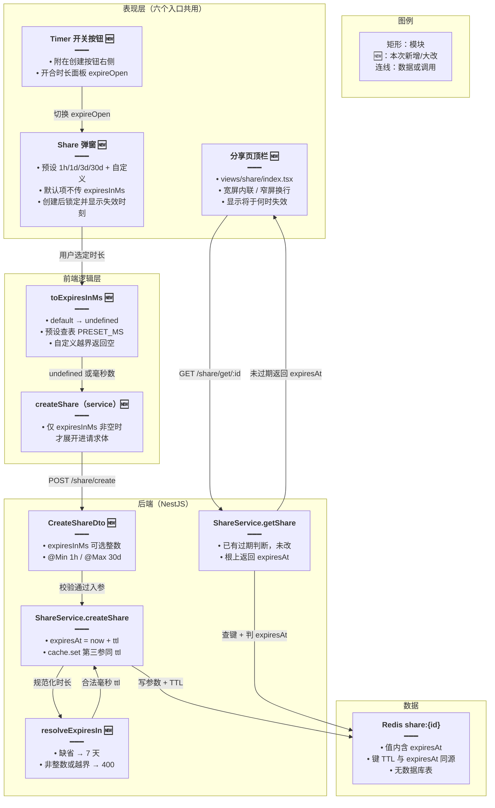
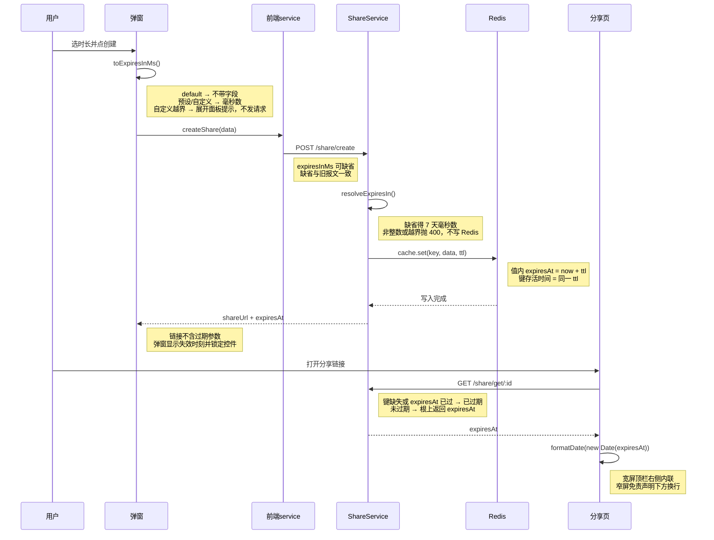

# 分享链接过期时间

> 文档角色：本篇是「分享链接过期时间」实现专题，覆盖创建分享时可选有效时长（1 小时～30 天，默认 7 天）：后端 `CreateShareDto` 新增可选 `expiresInMs`、新增 `resolveExpiresIn` 收口缺省与上下限、`createShare` 用同一 TTL 写 `expiresAt` 与 Redis 键存活时间；前端六个入口共用的 `design/Share` 弹窗新增预设 + 自定义时长面板（Timer 按钮开合、创建后锁定、关闭重置）、创建成功后展示失效时刻；分享落地页顶栏按响应式布局显示「将于 {time} 失效」；中英文案同步补键。
> 姊妹篇：分享链路总览（消息顺序、附件、排版）见 [分享.md](./分享.md)；知识文章分享「更新时间」时区见 [分享知识时区.md](./分享知识时区.md)；助手分享底栏统一见 [助手分享栏.md](./助手分享栏.md)；本功能的规划态方案（用户故事、备选方案、验收清单）见 [ideas/分享链接过期时间.md](../ideas/分享链接过期时间.md)。

## 一、要解决什么问题

1. **有效期写死 7 天，用户没有选择权**：`createShare` 把 `expiresAt` 与 Redis TTL 都写死为 `DEFAULT_EXPIRES_IN`（7 天），想临时发一个「1 小时后失效」的链接、或给客户发「30 天内有效」的链接都做不到。
2. **TTL 与 expiresAt 必须同源**：分享数据只存 Redis（`share:{shareId}`），若只把值里的 `expiresAt` 改成 30 天而键 TTL 仍是 7 天，第 8 天键就被 Redis 回收，「30 天」形同虚设；两处必须用同一次计算的毫秒数。
3. **「没设置」要与旧行为等价**：旧客户端与未改动默认项的用户都不应感知协议变化——不传字段时后端继续按 7 天处理，不能把「7 天」写死在每个前端入口里到处传。
4. **越界不能静默夹取**：0 在部分 Redis 客户端语义是「永不过期」，不设上限又会让分享键无限堆积；越界请求要直接拒绝（400），而不是悄悄改成另一个时长让用户误以为生效。
5. **访客应能看到何时失效**：打开分享链接的人需要知道这条链接的有效期；`getShare` 响应根上本就有 `expiresAt`，缺的只是分享页顶栏的展示与创建弹窗里的回执。

## 二、核心思路

1. **控件只加在共用弹窗 `design/Share`**：主聊天、知识文章、知识库助手、英语 Agent、电子书助手、Skill 试跑六个入口都渲染同一个 `Share` 组件，改一处即全覆盖，入口文件零改动。**权衡——不在各入口各做一套**：入口还会增加，分叉后默认值与校验规则容易不一致。
2. **传相对时长、不传绝对时间戳**：请求只带 `expiresInMs`（毫秒），过期时刻由服务端 `Date.now()` 现算，避免用户本机时钟偏差导致链接提前或延后失效。
3. **默认项 = 省略字段**：弹窗初始选中「7 天（默认）」，此时请求体不带 `expiresInMs`，与旧客户端报文完全一致；只有用户改过默认项才附带毫秒数。后端 `resolveExpiresIn` 对缺省返回 7 天，是默认值的唯一真相。
4. **双端同范围校验，前端先挡、后端兜底**：前端 `toExpiresInMs` 对自定义越界返回 `undefined` 并阻止发请求（弹窗提示范围）；后端 DTO 用 `@Min/@Max` 声明 1 小时～30 天，`resolveExpiresIn` 再拦一次非整数与越界并抛 400——直接调接口也绕不过。**权衡——拒绝而非夹取**：夹取会让用户以为存了 60 天实际只有 30 天。
5. **同一 TTL 写两处**：`createShare` 里 `expiresAt = now + ttl` 与 `cache.set(..., ttl)` 使用 `resolveExpiresIn` 的同一次返回值，从根上消除「值说 30 天、键 7 天就没了」的不一致。
6. **创建后锁定、关闭重置**：链接一旦生成，时长控件 `disabled`（TTL 已写进 Redis，没有更新接口）；弹窗关闭时所有时长状态复位到默认，不记住上次选择——否则「打开弹窗」就不再等价于「当前默认 7 天」。
7. **失效时刻两端展示、不进链接**：创建成功后弹窗在链接行上方显示「将于 {本地时间} 失效」；分享页顶栏宽屏内联、窄屏换行显示同一文案（取 `getShare` 响应根上的 `expiresAt`）。过期时间不拼进 URL query、不进剪贴板文案，与「标题不进参数」同一原则。

## 三、实现链路



主流程时序（创建 → 访客打开）：



## 四、改动前 / 改动后

### 4.1 后端 DTO：`CreateShareDto` 新增可选 `expiresInMs`

来源：`apps/backend/src/services/share/dto/share.dto.ts`，**改动前**，约 L13–L58（`CreateShareDto` 类；中间未改字段对称省略）

```ts
// 创建分享请求 DTO：本类描述 POST /share/create 的入参
export class CreateShareDto {
        // ...（chatSessionId / shareType / sessionType / messageIds 等字段未改动，对称省略）

        // baseUrl 可选：前端按环境传入站点域名，后端用它拼完整分享链接
        @IsString()
        @IsOptional()
        baseUrl?: string;
}
```

来源：`apps/backend/src/services/share/dto/share.dto.ts`，**改动后**，约 L20–L72（`CreateShareDto` 类；中间未改字段对称省略）

```ts
// 创建分享请求 DTO：本次新增可选 expiresInMs，其余字段不变
export class CreateShareDto {
        // ...（chatSessionId / shareType / sessionType / messageIds 等字段未改动，对称省略）

        // baseUrl 可选：前端按环境传入站点域名，后端用它拼完整分享链接
        @IsString()
        @IsOptional()
        baseUrl?: string;

        // Swagger 文档标注：可选字段，说明缺省 7 天与允许范围，供接口调用方查阅
        @ApiPropertyOptional({
                description: '有效时长（毫秒）。不传则 7 天。允许 1 小时～30 天',
        })
        // 可选：不传走默认 7 天，与旧客户端报文保持兼容
        @IsOptional()
        // 把查询/JSON 里的字符串数字转成 number，否则 @IsInt 会把 "3600000" 判为非法
        @Type(() => Number)
        // 必须是整数：毫秒时长不允许小数，避免 0.5 小时这类歧义值
        @IsInt()
        // 下限 1 小时：0 在部分 Redis 客户端会被当成永不过期，必须挡住
        @Min(60 * 60 * 1000)
        // 上限 30 天：避免分享键在 Redis 里无限堆积
        @Max(30 * 24 * 60 * 60 * 1000)
        // 有效时长（毫秒）；缺省即「用户没改默认项」，由后端补 7 天
        expiresInMs?: number;
}
```

变更摘要：类尾部新增可选 `expiresInMs` 字段，带 Swagger 说明与 class-validator 的整数 + 上下限校验；同时 import 区新增 `Type`（class-transformer）与 `IsInt`/`Min`/`Max`（class-validator）。

### 4.2 后端：时长常量与 `resolveExpiresIn`（纯新增）

来源：`apps/backend/src/services/share/share.service.ts`，**改动后**，约 L41–L59（纯新增；`DEFAULT_EXPIRES_IN` 为既有常量，一并贴出保持上下文）

```ts
// 默认过期时间：7 天（毫秒）——既有常量，本次继续作为缺省值复用
const DEFAULT_EXPIRES_IN = 7 * 24 * 60 * 60 * 1000;
// 最短 1 小时；0 在部分 Redis 客户端会被当成永不过期
const MIN_EXPIRES_IN = 60 * 60 * 1000;
// 最长 30 天，避免分享键一直占着
const MAX_EXPIRES_IN = 30 * 24 * 60 * 60 * 1000;

/** 缺省 7 天；越界拒绝，避免静默改成另一个时长 */
// 把「可选时长 → 最终 TTL」的决策收成一个纯函数，createShare 只调用不判断
function resolveExpiresIn(expiresInMs?: number): number {
        // 未传 = 用户没改默认项（含旧客户端），返回既有 7 天
        if (expiresInMs == null) return DEFAULT_EXPIRES_IN;
        // 三重拦截：非整数、小于 1 小时、大于 30 天，任一命中即拒绝
        if (
                // JSON 反序列化或手工调用可能带小数，统一按非法处理
                !Number.isInteger(expiresInMs) ||
                // 低于下限：防 0（永不过期语义）与过短链接
                expiresInMs < MIN_EXPIRES_IN ||
                // 高于上限：防分享键无限堆积
                expiresInMs > MAX_EXPIRES_IN
        ) {
                // 抛 400 而不是夹取：宁可创建失败，也不让用户以为保存了另一个时长
                throw new HttpException('过期时间超出允许范围', HttpStatus.BAD_REQUEST);
        }
        // 合法时长原样返回，供 expiresAt 与 Redis TTL 共用同一份毫秒数
        return expiresInMs;
}
```

变更摘要：纯新增。两个边界常量 + 一个收口函数；缺省走 7 天，越界抛 400 且不写 Redis。

### 4.3 后端：`createShare` 用同一 TTL 写 `expiresAt` 与 Redis 键

来源：`apps/backend/src/services/share/share.service.ts`，**改动前**，约 L398–L432（`createShare` 方法）

```ts
        // 创建分享：只存储参数到 Redis，不查询数据库
        async createShare(dto: CreateShareDto): Promise<CreateShareResponseDto> {
                // 分享 id 用 UUID 去掉横线，URL 更短
                const shareId = randomUUID().replace(/-/g, '');
                // 创建时刻：expiresAt 的基准点
                const now = Date.now();
                // 过期时刻写死为 7 天后：用户无法选择时长（本次要改的点）
                const expiresAt = now + DEFAULT_EXPIRES_IN;
                // 分享目标类型缺省为会话分享
                const shareType = dto.shareType ?? 'session';

                // 存储到 Redis
                // 组装缓存值：创建时只存参数，读取时再按参数查库
                const cacheData: ShareCacheData = {
                        shareId,
                        chatSessionId: dto.chatSessionId,
                        shareType,
                        sessionType: dto.sessionType,
                        messageIds: dto.messageIds,
                        createdAt: now,
                        expiresAt,
                };

                // 写 Redis：键 TTL 同样写死 7 天
                await this.cache.set(
                        this.getCacheKey(shareId),
                        cacheData,
                        DEFAULT_EXPIRES_IN,
                );

                // 打日志便于排查：分享 id、会话 id、消息条数
                this.logger.log(
                        `创建分享: ${shareId}, 会话: ${dto.chatSessionId} ${dto?.messageIds?.length ? `, 消息: ${dto?.messageIds?.length} 条` : ''}`,
                );

                // 返回创建结果：shareUrl 按 baseUrl 与 shareType 拼接，knowledge 带 ?type=knowledge
                return {
                        shareId,
                        shareUrl: dto.baseUrl
                                ? `${dto.baseUrl}/share/${shareId}${shareType === 'knowledge' ? '?type=knowledge' : ''}`
                                : `/share/${shareId}${shareType === 'knowledge' ? '?type=knowledge' : ''}`,
                        createdAt: now,
                        expiresAt,
                };
        }
```

来源：`apps/backend/src/services/share/share.service.ts`，**改动后**，约 L416–L446（`createShare` 方法）

```ts
        // 创建分享：只存储参数到 Redis，不查询数据库
        async createShare(dto: CreateShareDto): Promise<CreateShareResponseDto> {
                // 分享 id 用 UUID 去掉横线，URL 更短
                const shareId = randomUUID().replace(/-/g, '');
                // 创建时刻：expiresAt 的基准点（服务端现算，不信客户端时钟）
                const now = Date.now();
                // 规范化时长：缺省 7 天；非法值在此抛 400，后面的写库不会执行
                const ttl = resolveExpiresIn(dto.expiresInMs);
                // 过期时刻 = 创建时刻 + ttl，与下面的键 TTL 同源
                const expiresAt = now + ttl;
                // 分享目标类型缺省为会话分享
                const shareType = dto.shareType ?? 'session';

                // 存储到 Redis
                // 组装缓存值：创建时只存参数，读取时再按参数查库
                const cacheData: ShareCacheData = {
                        shareId,
                        chatSessionId: dto.chatSessionId,
                        shareType,
                        sessionType: dto.sessionType,
                        messageIds: dto.messageIds,
                        createdAt: now,
                        expiresAt,
                };

                // 写 Redis：第三参 ttl 与 expiresAt 用同一次计算结果，杜绝「值说 30 天、键 7 天没了」
                await this.cache.set(this.getCacheKey(shareId), cacheData, ttl);

                // 打日志便于排查：分享 id、会话 id、消息条数
                this.logger.log(
                        `创建分享: ${shareId}, 会话: ${dto.chatSessionId} ${dto?.messageIds?.length ? `, 消息: ${dto?.messageIds?.length} 条` : ''}`,
                );

                // 返回创建结果：expiresAt 随响应回前端，弹窗用它显示失效时刻
                return {
                        shareId,
                        shareUrl: dto.baseUrl
                                ? `${dto.baseUrl}/share/${shareId}${shareType === 'knowledge' ? '?type=knowledge' : ''}`
                                : `/share/${shareId}${shareType === 'knowledge' ? '?type=knowledge' : ''}`,
                        createdAt: now,
                        expiresAt,
                };
        }
```

变更摘要：`expiresAt` 由「now + 写死 7 天」改为「now + resolveExpiresIn(dto.expiresInMs)」；`cache.set` 第三参由 `DEFAULT_EXPIRES_IN` 改为同一 `ttl`；日志与返回结构不变。

### 4.4 前端请求：`createShare` 仅在非空时带 `expiresInMs`

来源：`apps/frontend/src/service/index.ts`，**改动前**，约 L3100–L3115（`createShare` 封装）

```ts
// 创建分享：params 聚合会话 id、消息 id 列表、baseUrl 与分享类型
export const createShare = async (params: {
        // 会话 id（必传）
        chatSessionId: string;
        // 要分享的消息 id 列表
        messageIds?: string[];
        // 会话类型：主聊天 / 知识库助手 / Agent / 电子书
        sessionType?: 'chat' | 'assistant' | 'agent' | 'ebook';
        /** session=会话分享（默认）；knowledge=知识文章分享 */
        shareType?: 'session' | 'knowledge';
}) => {
        // POST 创建分享，泛型 ShareInfo 含 shareId/shareUrl/createdAt/expiresAt
        return await http.post<ShareInfo>(CREATE_SHARE, {
                chatSessionId: params.chatSessionId,
                sessionType: params.sessionType,
                messageIds: params.messageIds,
                baseUrl: params.baseUrl,
                shareType: params.shareType,
        });
};
```

来源：`apps/frontend/src/service/index.ts`，**改动后**，约 L3100–L3118（`createShare` 封装）

```ts
// 创建分享：params 聚合会话 id、消息 id 列表、baseUrl、分享类型与可选时长
export const createShare = async (params: {
        // 会话 id（必传）
        chatSessionId: string;
        // 要分享的消息 id 列表
        messageIds?: string[];
        // 会话类型：主聊天 / 知识库助手 / Agent / 电子书
        sessionType?: 'chat' | 'assistant' | 'agent' | 'ebook';
        /** session=会话分享（默认）；knowledge=知识文章分享 */
        shareType?: 'session' | 'knowledge';
        /** 不传则后端按 7 天；仅在用户改过默认项时带上 */
        expiresInMs?: number;
}) => {
        // POST 创建分享，泛型 ShareInfo 含 shareId/shareUrl/createdAt/expiresAt
        return await http.post<ShareInfo>(CREATE_SHARE, {
                chatSessionId: params.chatSessionId,
                sessionType: params.sessionType,
                messageIds: params.messageIds,
                baseUrl: params.baseUrl,
                shareType: params.shareType,
                // 条件展开：null/undefined 时请求体根本没有这个键，与旧报文逐字节一致
                ...(params.expiresInMs != null ? { expiresInMs: params.expiresInMs } : {}),
        });
};
```

变更摘要：参数类型加可选 `expiresInMs`，请求体用条件展开——只有非空才出现该键，「默认 7 天」的报文与旧版完全一致。

### 4.5 弹窗：时长常量与 `toExpiresInMs`（纯新增）

来源：`apps/frontend/src/components/design/Share/index.tsx`，**改动后**，约 L28–L62（纯新增，位于组件外顶部）

```ts
// 一小时的毫秒数：预设 1h 与自定义「小时」单位的基础换算量
const HOUR_MS = 60 * 60 * 1000;
// 一天的毫秒数：预设 1d/3d/30d 与自定义「天」单位的基础换算量
const DAY_MS = 24 * HOUR_MS;
// 前端下限与后端一致：1 小时；先挡住必然 400 的请求
const MIN_EXPIRES_IN = HOUR_MS;
// 前端上限与后端一致：30 天
const MAX_EXPIRES_IN = 30 * DAY_MS;

// 时长选项：default=不改默认（不传字段）；custom=数字+单位自由填
type ExpireChoice = 'default' | '1h' | '1d' | '3d' | '30d' | 'custom';
// 自定义的单位只有小时/天两档：再细（分钟）易踩下限，再粗（周/月）不直观
type ExpireUnit = 'hour' | 'day';

// 下拉选项顺序：默认项在最上，预设按时长递增，自定义压轴
const EXPIRE_CHOICES: ExpireChoice[] = [
        'default',
        '1h',
        '1d',
        '3d',
        '30d',
        'custom',
];

// 预设档 → 毫秒 的映射表：排除 default（不传）与 custom（要算）两档
const PRESET_MS: Record<Exclude<ExpireChoice, 'default' | 'custom'>, number> = {
        // 1 小时
        '1h': HOUR_MS,
        // 1 天
        '1d': DAY_MS,
        // 3 天
        '3d': 3 * DAY_MS,
        // 30 天即上限本身，两档共用一个常量防漂移
        '30d': MAX_EXPIRES_IN,
};

/** 默认不传字段；自定义越界返回空，调用方不发请求 */
// 把当前选项收成「undefined 或毫秒数」：调用方只认这两种结果，不接触选项细节
function toExpiresInMs(
        choice: ExpireChoice,
        amount: number,
        unit: ExpireUnit,
): number | undefined {
        // 默认项：返回 undefined，请求体不带 expiresInMs，后端走 7 天
        if (choice === 'default') return undefined;
        // 预设项：直接查表，避免输入框与预设各算各的
        if (choice !== 'custom') return PRESET_MS[choice];
        // 自定义：数字 × 单位换算成毫秒；Math.round 兜住小数输入（如 1.5 天）
        const ms = Math.round(amount * (unit === 'hour' ? HOUR_MS : DAY_MS));
        // 与后端同一上下限比较：越界返回 undefined，由调用方展开面板提示、不发请求
        return ms >= MIN_EXPIRES_IN && ms <= MAX_EXPIRES_IN ? ms : undefined;
}
```

变更摘要：纯新增。常量、两个类型、选项数组、预设映射与一个纯函数；「默认 = undefined」的语义在此定义。

### 4.6 弹窗：时长相关状态与关闭重置

来源：`apps/frontend/src/components/design/Share/index.tsx`，**改动前**，约 L58–L60（组件内 state 摘录）

```ts
        // 创建成功的分享信息（含 shareUrl/expiresAt）；undefined 表示尚未创建
        const [shareInfo, setShareInfo] = useState<ShareInfo>();
        // 复制按钮的「已复制」反馈态
        const [copied, setCopied] = useState(false);
        // 创建请求的加载态
        const [loading, setLoading] = useState(false);
```

来源：`apps/frontend/src/components/design/Share/index.tsx`，**改动前**，约 L88–L92（`useEffect` 清理）

```ts
        // 弹窗开合变化时重置：关掉再开不残留上一次创建的链接
        useEffect(() => {
                return () => {
                        // 清空已创建的分享信息，回到「创建并复制链接」按钮态
                        setShareInfo(undefined);
                };
        }, [open]);
```

来源：`apps/frontend/src/components/design/Share/index.tsx`，**改动后**，约 L102–L109（组件内 state 摘录）

```ts
        // 创建成功的分享信息（含 shareUrl/expiresAt）；undefined 表示尚未创建
        const [shareInfo, setShareInfo] = useState<ShareInfo>();
        // 复制按钮的「已复制」反馈态
        const [copied, setCopied] = useState(false);
        // 创建请求的加载态
        const [loading, setLoading] = useState(false);
        // 时长选项：初始 default，即「7 天（默认）」不传字段
        const [expireChoice, setExpireChoice] = useState<ExpireChoice>('default');
        // 自定义数字输入是字符串态：受控 Input 需要原样回显（含中间态 "1."）
        const [expireAmount, setExpireAmount] = useState('1');
        // 自定义单位：默认「天」，比「小时」更贴近分享场景
        const [expireUnit, setExpireUnit] = useState<ExpireUnit>('day');
        // 时长面板开合：由创建按钮右侧的 Timer 按钮切换，默认收起保持弹窗简洁
        const [expireOpen, setExpireOpen] = useState(false);
        // 自定义越界的错误提示态：true 时显示范围说明
        const [rangeError, setRangeError] = useState(false);
```

来源：`apps/frontend/src/components/design/Share/index.tsx`，**改动后**，约 L137–L147（`useEffect` 清理）

```ts
        // 弹窗开合变化时重置：关掉再开不残留上一次创建与上一次的时长选择
        useEffect(() => {
                return () => {
                        // 清空已创建的分享信息，回到创建按钮态
                        setShareInfo(undefined);
                        // 时长选项回默认：不记住上次选择，打开即「7 天（默认）」
                        setExpireChoice('default');
                        // 自定义数字回 1
                        setExpireAmount('1');
                        // 自定义单位回天
                        setExpireUnit('day');
                        // 收起时长面板
                        setExpireOpen(false);
                        // 清掉越界提示
                        setRangeError(false);
                        // 一并复位复制反馈，避免重开时按钮短暂显示「已复制」
                        setCopied(false);
                };
        }, [open]);
```

变更摘要：新增 5 个时长相关 state；清理函数从只清 `shareInfo` 扩为全量复位（含新增的 `copied` 复位），保证「重开即默认」。

### 4.7 弹窗：`onCreateShare` 接入时长

来源：`apps/frontend/src/components/design/Share/index.tsx`，**改动前**，约 L94–L163（`onCreateShare`；中间 messageIds 排序段未改动，对称省略）

```ts
        // 点「创建并复制链接」：组装参数 → 调接口 → 拼主题/语言参数 → 自动复制
        const onCreateShare = useCallback(async () => {
                // 进入加载态，按钮防重复点击
                setLoading(true);
                // 会话 id 优先取外部注入（助手分享），否则取路由参数
                const chatSessionId = sessionId ?? params?.id;
                // 没有会话 id 直接返回，不发请求
                if (!chatSessionId) {
                        setLoading(false);
                        return;
                }
                // 请求体类型：不含 expiresInMs（本次新增）
                const data: {
                        chatSessionId: string;
                        sessionType?: 'chat' | 'assistant' | 'agent' | 'ebook';
                        messageIds?: string[];
                        baseUrl?: string;
                        shareType?: 'session' | 'knowledge';
                } = {
                        chatSessionId,
                        sessionType,
                        shareType,
                        // 按环境取站点域名，供后端拼完整链接
                        baseUrl: import.meta.env.DEV
                                ? import.meta.env.VITE_DEV_WEB_DOMAIN
                                : import.meta.env.VITE_PROD_WEB_DOMAIN, // http://localhost:9226
                };
                // ...（checkedMessages → messageIds 的排序段未改动，对称省略）
                try {
                        // 调创建接口
                        const res = await createShare(data);
                        setLoading(false);
                        if (res.success) {
                                // 以 store 为准，避免 useTheme 异步未完成时主题仍是默认值
                                const stored = (await getValue('themeType')) as ThemeName;
                                // store 值非法时回退当前 theme
                                const themeName = THEMES.some((t) => t.name === stored)
                                        ? stored
                                        : theme;
                                // 拼主题与语言参数，让打开链接的人看到一致的主题/语言
                                const shareUrl = withAppLangInSearch(
                                        appendShareThemeQuery(res.data.shareUrl, themeName),
                                        locale,
                                );
                                // 落创建结果，界面切到链接行
                                setShareInfo({ ...res.data, shareUrl });
                                // 创建成功即自动复制；知识文章追加两个空格 + 标题
                                void onCopy(
                                        shareType === 'knowledge'
                                                ? sharePasteText(shareUrl, articleTitle)
                                                : shareUrl,
                                );
                        }
                } finally {
                        // 无论成败都退出加载态
                        setLoading(false);
                }
        }, [
                params?.id,
                checkedMessages,
                orderedMessageIds,
                theme,
                locale,
                sessionId,
                sessionType,
                shareType,
                articleTitle,
                onCopy,
        ]);
```

来源：`apps/frontend/src/components/design/Share/index.tsx`，**改动后**，约 L149–L235（`onCreateShare`；中间 messageIds 排序段未改动，对称省略）

```ts
        // 点「创建并复制链接」：先收口时长 → 组装参数 → 调接口 → 拼参数 → 自动复制
        const onCreateShare = useCallback(async () => {
                // 把当前选项收成 undefined（默认）或毫秒数；自定义越界时也是 undefined
                const expiresInMs = toExpiresInMs(
                        expireChoice,
                        Number(expireAmount),
                        expireUnit,
                );
                // 用户改过默认项但算不出合法毫秒（即自定义越界）：展开面板、亮提示、不发请求
                if (expireChoice !== 'default' && expiresInMs == null) {
                        // 面板可能是收起状态（预设改回 custom 后直接点创建），强制展开让用户看到错误
                        setExpireOpen(true);
                        // 显示「请填写 1 小时到 30 天之间的时长」
                        setRangeError(true);
                        return;
                }
                // 走到这里时长合法（或就是默认项），清掉可能残留的错误提示
                setRangeError(false);
                // 进入加载态，按钮防重复点击
                setLoading(true);
                // 会话 id 优先取外部注入（助手分享），否则取路由参数
                const chatSessionId = sessionId ?? params?.id;
                // 没有会话 id 直接返回，不发请求
                if (!chatSessionId) {
                        setLoading(false);
                        return;
                }
                // 请求体类型：新增可选 expiresInMs
                const data: {
                        chatSessionId: string;
                        sessionType?: 'chat' | 'assistant' | 'agent' | 'ebook';
                        messageIds?: string[];
                        baseUrl?: string;
                        shareType?: 'session' | 'knowledge';
                        expiresInMs?: number;
                } = {
                        chatSessionId,
                        sessionType,
                        shareType,
                        // 按环境取站点域名，供后端拼完整链接
                        baseUrl: import.meta.env.DEV
                                ? import.meta.env.VITE_DEV_WEB_DOMAIN
                                : import.meta.env.VITE_PROD_WEB_DOMAIN, // http://localhost:9226
                };
                // 只有非默认项才把时长写进请求体；默认项保持报文与旧版一致
                if (expiresInMs != null) data.expiresInMs = expiresInMs;
                // ...（checkedMessages → messageIds 的排序段未改动，对称省略）
                try {
                        // 调创建接口
                        const res = await createShare(data);
                        setLoading(false);
                        if (res.success) {
                                // 以 store 为准，避免 useTheme 异步未完成时主题仍是默认值
                                const stored = (await getValue('themeType')) as ThemeName;
                                // store 值非法时回退当前 theme
                                const themeName = THEMES.some((t) => t.name === stored)
                                        ? stored
                                        : theme;
                                // 拼主题与语言参数，让打开链接的人看到一致的主题/语言
                                const shareUrl = withAppLangInSearch(
                                        appendShareThemeQuery(res.data.shareUrl, themeName),
                                        locale,
                                );
                                // 落创建结果，界面切到链接行并显示失效时刻
                                setShareInfo({ ...res.data, shareUrl });
                                // 创建成功后收起时长面板，视觉焦点让给链接行
                                setExpireOpen(false);
                                // 创建成功即自动复制；知识文章追加两个空格 + 标题
                                void onCopy(
                                        shareType === 'knowledge'
                                                ? sharePasteText(shareUrl, articleTitle)
                                                : shareUrl,
                                );
                        }
                } finally {
                        // 无论成败都退出加载态
                        setLoading(false);
                }
        }, [
                params?.id,
                checkedMessages,
                orderedMessageIds,
                theme,
                locale,
                sessionId,
                sessionType,
                shareType,
                articleTitle,
                // 三个时长 state 进依赖：选项变化后回调拿到最新值
                expireChoice,
                expireAmount,
                expireUnit,
                onCopy,
        ]);
```

变更摘要：函数头新增时长收口与越界拦截（不发请求）；请求体类型与赋值各加一处 `expiresInMs`；成功分支补 `setExpireOpen(false)`；deps 补三个时长 state。

### 4.8 弹窗：过期时间选择面板（纯新增 JSX）

来源：`apps/frontend/src/components/design/Share/index.tsx`，**改动后**，约 L267–L346（纯新增，位于免责声明与链接行之间）

```tsx
                {/* 时长面板默认收起，由 Timer 按钮或越界拦截展开 */}
                {expireOpen ? (
                // 面板容器：纵向排布「标签行 + 控件行 + 错误提示」
                <div className="flex flex-col gap-5">
                        // 面板标题：「过期时间」
                        <span className="text-sm text-textcolor/80">
                                {tt('share.modal.expire.label')}
                        </span>
                        // 控件行：预设下拉 + （自定义时）数字输入与单位下拉
                        <div className="flex items-center gap-2">
                                // 预设下拉容器：自定义时与数字/单位三等分，否则独占整行
                                <div
                                        className={
                                                expireChoice === 'custom' ? 'min-w-0 flex-1' : 'w-full'
                                        }
                                >
                                        // 预设/自定义选择器
                                        <Select
                                                value={expireChoice}
                                                // 已创建链接后锁定：TTL 已写入 Redis，改选项无意义
                                                disabled={locked}
                                                onValueChange={(next) => {
                                                        // 切选项即清错误：新选择可能合法
                                                        setExpireChoice(next as ExpireChoice);
                                                        setRangeError(false);
                                                }}
                                        >
                                                // 触发器：与数字输入同高（h-9），去默认阴影
                                                <SelectTrigger className="h-9 w-full border-theme/20 shadow-none">
                                                        <SelectValue />
                                                </SelectTrigger>
                                                // 下拉内容：六个选项文案全部走 i18n
                                                <SelectContent>
                                                        {EXPIRE_CHOICES.map((choice) => (
                                                                // 键名与选项值一一对应：share.modal.expire.{choice}
                                                                <SelectItem key={choice} value={choice}>
                                                                        {tt(`share.modal.expire.${choice}`)}
                                                                </SelectItem>
                                                        ))}
                                                </SelectContent>
                                        </Select>
                                </div>
                                // 仅自定义档出现数字与单位两个控件
                                {expireChoice === 'custom' ? (
                                        <>
                                                // 数字输入容器：与预设下拉等宽
                                                <div className="min-w-0 flex-1">
                                                        // 自定义数字：字符串受控，最小 1，小数由 toExpiresInMs 四舍五入兜底
                                                        <Input
                                                                type="number"
                                                                min={1}
                                                                inputMode="decimal"
                                                                value={expireAmount}
                                                                // 已创建后同样锁定
                                                                disabled={locked}
                                                                onChange={(e) => {
                                                                        // 原样存字符串，中间态（如 "1."）不会被 Number 吃掉
                                                                        setExpireAmount(e.target.value);
                                                                        // 继续输入即清错误提示
                                                                        setRangeError(false);
                                                                }}
                                                                // 无可见 label，用 aria-label 补可访问性
                                                                aria-label={tt('share.modal.expire.custom')}
                                                                // 高度对齐 SelectTrigger，聚焦态不改边框色、不出光圈，保持整行风格统一
                                                                className="h-9 w-full border-theme/20 shadow-none focus-visible:border-theme/20 focus-visible:ring-0"
                                                        />
                                                </div>
                                                // 单位选择容器：与数字输入等宽
                                                <div className="min-w-0 flex-1">
                                                        // 小时/天单位选择
                                                        <Select
                                                                value={expireUnit}
                                                                disabled={locked}
                                                                onValueChange={(next) => {
                                                                        // 切单位即清错误：同一数字换单位可能落回范围内
                                                                        setExpireUnit(next as ExpireUnit);
                                                                        setRangeError(false);
                                                                }}
                                                        >
                                                                <SelectTrigger className="h-9 w-full border-theme/20 shadow-none">
                                                                        <SelectValue />
                                                                </SelectTrigger>
                                                                <SelectContent>
                                                                        // 小时
                                                                        <SelectItem value="hour">
                                                                                {tt('share.modal.expire.unit.hour')}
                                                                        </SelectItem>
                                                                        // 天
                                                                        <SelectItem value="day">
                                                                                {tt('share.modal.expire.unit.day')}
                                                                        </SelectItem>
                                                                </SelectContent>
                                                        </Select>
                                                </div>
                                        </>
                                ) : null}
                        </div>
                        // 越界提示：仅 rangeError 时显示，文案说明合法范围
                        {rangeError ? (
                                <p className="text-sm text-orange-500">
                                        {tt('share.modal.expire.range')}
                                </p>
                        ) : null}
                </div>
                ) : null}
```

变更摘要：纯新增。整块面板只在 `expireOpen` 时渲染；自定义档额外出现数字输入与单位下拉；所有控件在已创建（`locked`）后禁用。

### 4.9 弹窗：创建按钮行挂 Timer 开关

来源：`apps/frontend/src/components/design/Share/index.tsx`，**改动前**，约 L234–L245（未创建态的按钮行）

```tsx
                        // 未创建态：整行就是一个渐变「创建并复制链接」按钮
                        <div className="relative border border-theme/20 rounded-md flex items-center h-9.5">
                                <Button
                                        variant="dynamic"
                                        // 渐变背景写在按钮上，外层容器只负责边框
                                        className="h-9.5 text-white border-textcolor/30 w-full bg-transparent hover:bg-transparent bg-linear-to-r from-teal-500/80 to-cyan-600/80 hover:from-teal-500 hover:to-cyan-600"
                                        disabled={loading}
                                        onClick={onCreateShare}
                                >
                                        // 加载中显示转圈
                                        {loading ? <Spinner className="text-white" /> : null}
                                        {tt('share.modal.createAndCopy') ?? '创建并复制链接'}
                                </Button>
                        </div>
```

来源：`apps/frontend/src/components/design/Share/index.tsx`，**改动后**，约 L397–L419（未创建态的按钮行）

```tsx
                        // 未创建态：渐变背景上移到外层容器，行内是「创建按钮 + Timer 开关」两颗按钮
                        <div className="flex h-9.5 items-center overflow-hidden rounded-md bg-linear-to-r from-teal-500/80 to-cyan-600/80 text-white hover:from-teal-500 hover:to-cyan-600">
                                <Button
                                        variant="dynamic"
                                        // 按钮自身透明铺满左侧，让外层渐变透出来；min-w-0 防文案顶爆 flex 布局
                                        className="h-9.5 min-w-0 flex-1 rounded-none border-none bg-transparent text-white shadow-none hover:bg-transparent"
                                        disabled={loading}
                                        onClick={onCreateShare}
                                >
                                        // 加载中显示转圈
                                        {loading ? <Spinner className="text-white" /> : null}
                                        {tt('share.modal.createAndCopy') ?? '创建并复制链接'}
                                </Button>
                                // Timer 开关：开合时长面板；纯开关不提交，type=button 防表单语义
                                <Button
                                        type="button"
                                        variant="ghost"
                                        size="icon"
                                        // 屏幕阅读器播报「过期时间」
                                        aria-label={tt('share.modal.expire.label')}
                                        // 播报面板开合状态
                                        aria-expanded={expireOpen}
                                        // 左侧白色分隔线划出独立点击区；面板展开时加深底色作按下态
                                        className={`h-9.5 w-9.5 shrink-0 rounded-none border-y-0 border-r-0 border-l border-white/40 bg-black/10 text-white shadow-none hover:bg-black/20 focus-visible:ring-0 ${expireOpen ? 'bg-black/25' : ''}`}
                                        // 取反开合时长面板
                                        onClick={() => setExpireOpen((open) => !open)}
                                >
                                        // 时钟图标，语义即「有效期」
                                        <Timer />
                                </Button>
                        </div>
```

变更摘要：外层容器由「边框盒子」改为「渐变背景行」；原渐变从按钮移到容器；右侧新增 `Timer` 图标开关（含 aria 标注与按下态），创建按钮改为透明铺满。

### 4.10 弹窗：创建后展示失效时刻（纯新增）

来源：`apps/frontend/src/components/design/Share/index.tsx`，**改动后**，约 L242–L248（`locked` 与 `expiresLabel` 计算，纯新增）

```tsx
        // 已创建判定：有 shareUrl 即锁定全部时长控件
        const locked = Boolean(shareInfo?.shareUrl);
        // 失效时刻文案：创建响应带 expiresAt 才拼，否则空串不渲染
        const expiresLabel =
                shareInfo?.expiresAt != null
                        ? // formatDate 只收 string|Date，数字时间戳先包一层 new Date
                          tt('share.header.expiresAt', {
                                        time: formatDate(new Date(shareInfo.expiresAt)),
                                })
                        : '';
```

来源：`apps/frontend/src/components/design/Share/index.tsx`，**改动后**，约 L347–L349（失效时刻展示行，纯新增）

```tsx
                {/* 失效时刻：右对齐显示在链接行上方，创建成功后才出现 */}
                {expiresLabel ? (
                        <p className="text-right text-sm text-textcolor/70">{expiresLabel}</p>
                ) : null}
```

变更摘要：纯新增。`locked` 供 4.8/4.9 的控件禁用；`expiresLabel` 复用分享页同款文案键 `share.header.expiresAt`，两处文案一致。

### 4.11 分享页：`expiresAt` 状态与读取

来源：`apps/frontend/src/views/share/index.tsx`，**改动前**，约 L82–L89（组件内 state 摘录）

```tsx
        // 会话分享数据
        const [chatData, setChatData] = useState<ShareSessionPayload>();
        // 知识文章分享数据
        const [knowledgeData, setKnowledgeData] = useState<{
                id: string;
                title: string | null;
                content: string;
                createdAt: string | number;
                updatedAt: string | number;
        } | null>(null);
```

来源：`apps/frontend/src/views/share/index.tsx`，**改动前**，约 L144–L183（`getShareData`；中间 knowledge/chat 分支未改动，对称省略）

```tsx
        // 拉取分享：按 ?type 区分知识文章与会话两条渲染路径
        const getShareData = async (id: string) => {
                // 从 URL 取分享类型
                const type = new URLSearchParams(location.search).get('type');
                // 调 getShare；Record<string, unknown> 容许响应带额外字段
                const res = await getShare<ShareSessionPayload & Record<string, unknown>>(
                        id,
                );
                if (res.success) {
                        // ...（knowledge / chat 两个分支的落数逻辑未改动，对称省略）
                }
        };
```

来源：`apps/frontend/src/views/share/index.tsx`，**改动后**，约 L83–L90（组件内 state 摘录）

```tsx
        // 会话分享数据
        const [chatData, setChatData] = useState<ShareSessionPayload>();
        // 知识文章分享数据
        const [knowledgeData, setKnowledgeData] = useState<{
                id: string;
                title: string | null;
                content: string;
                createdAt: string | number;
                updatedAt: string | number;
        } | null>(null);
        // 失效时刻：独立于 chatData/knowledgeData 单存，两种分享类型共用
        const [expiresAt, setExpiresAt] = useState<number | null>(null);
```

来源：`apps/frontend/src/views/share/index.tsx`，**改动后**，约 L145–L196（`getShareData`；中间 knowledge/chat 分支未改动，对称省略）

```tsx
        // 拉取分享：按 ?type 区分知识文章与会话两条渲染路径，并提取根上的 expiresAt
        const getShareData = async (id: string) => {
                // 从 URL 取分享类型
                const type = new URLSearchParams(location.search).get('type');
                // 调 getShare；Record<string, unknown> 容许响应带额外字段
                const res = await getShare<ShareSessionPayload & Record<string, unknown>>(
                        id,
                );
                if (res.success) {
                        // 根上的 expiresAt：知识分支只留了 data.knowledge，根字段必须在此单独取
                        const raw = res.data?.expiresAt;
                        // 兼容数字与数字字符串两种返回形态，其它一律视为无
                        const at =
                                typeof raw === 'number'
                                        ? raw
                                        : typeof raw === 'string'
                                                ? Number(raw)
                                                : NaN;
                        // NaN/Infinity 落成 null，顶栏不渲染该行
                        setExpiresAt(Number.isFinite(at) ? at : null);
                        // ...（knowledge / chat 两个分支的落数逻辑未改动，对称省略）
                } else {
                        // 请求失败（含已过期被 400）时清空，避免残留上一条链接的失效时刻
                        setExpiresAt(null);
                }
        };
```

变更摘要：新增 `expiresAt` state；`getShareData` 成功分支开头先提取并归一化根上的 `expiresAt`（数字/字符串兼容），失败分支清空。

### 4.12 分享页：顶栏展示失效时刻

来源：`apps/frontend/src/views/share/index.tsx`，**改动前**，约 L256–L268（顶栏）

```tsx
                        // 顶栏：固定高 h-12.5，左标题右免责声明，单行不换行
                        <div className="flex items-center justify-between px-2.5 h-12.5 border border-b-theme/15">
                                // 标题：知识文章 / 对话 两种文案
                                <div className="text-base font-bold">
                                        {knowledgeData
                                                ? t('share.header.knowledgeTitle')
                                                : t('share.header.chatTitle')}
                                </div>
                                // 免责声明：图标 + 文案
                                <div className="flex items-center gap-1 text-sm text-textcolor/80">
                                        <CircleAlert size={17} className="text-textcolor/65" />
                                        {knowledgeData
                                                ? t('share.header.knowledgeDisclaimer')
                                                : t('share.header.chatDisclaimer')}
                                </div>
                        </div>
```

来源：`apps/frontend/src/views/share/index.tsx`，**改动后**，约 L267–L297（顶栏）

```tsx
                        // 顶栏：改 min-h 允许撑高，为窄屏第二行的失效时刻腾位置
                        <div className="border border-b-theme/15 px-2.5 py-2 min-h-12.5">
                                // 第一行：标题与右侧信息组
                                <div className="flex items-center justify-between gap-3">
                                        // 标题 shrink-0：不被右侧挤压换行
                                        <div className="shrink-0 text-base font-bold">
                                                {knowledgeData
                                                        ? t('share.header.knowledgeTitle')
                                                        : t('share.header.chatTitle')}
                                        </div>
                                        // 右侧组：免责声明 + 失效时刻（宽屏）；min-w-0 允许整体收缩
                                        <div className="flex min-w-0 items-center justify-end gap-3">
                                                // 免责声明：图标 shrink-0 防被压扁
                                                <div className="flex items-center gap-1 text-sm text-textcolor/80">
                                                        <CircleAlert size={17} className="shrink-0 text-textcolor/65" />
                                                        {knowledgeData
                                                                ? t('share.header.knowledgeDisclaimer')
                                                                : t('share.header.chatDisclaimer')}
                                                </div>
                                                // 宽屏（md+）内联失效时刻；窄屏隐藏改由第二行承担
                                                {expiresAt != null ? (
                                                        <span className="hidden text-sm text-textcolor/70 md:inline">
                                                                {t('share.header.expiresAt', {
                                                                        // 数字时间戳先包 new Date 再交给 formatDate
                                                                        time: formatDate(new Date(expiresAt)),
                                                                })}
                                                        </span>
                                                ) : null}
                                        </div>
                                </div>
                                // 窄屏（md 以下）第二行居中显示失效时刻，避免第一行被裁切
                                {expiresAt != null ? (
                                        <p className="mt-1 text-center text-sm text-textcolor/70 md:hidden">
                                                {t('share.header.expiresAt', {
                                                        time: formatDate(new Date(expiresAt)),
                                                })}
                                        </p>
                                ) : null}
                        </div>
```

变更摘要：固定高 `h-12.5` 改 `min-h-12.5` + `py-2`；失效时刻按断点双形态——宽屏内联在免责声明后，窄屏独占第二行居中；两种形态共用同一 `expiresAt` 与文案键。

### 4.13 i18n 文案

来源：`apps/frontend/src/i18n/locales/zh-CN/share.ts`，**改动前**，约 L1–L12（文件头部摘录，与改动后对称）

```ts
/** zh-CN · share */
// 分享相关中文文案
export const share = {
        // 对话分享页免责声明
        'share.header.chatDisclaimer': '该分享内容由 AI 生成，请仔细甄别',
        // 对话分享页标题
        'share.header.chatTitle': '分享对话内容',
        // 知识分享页免责声明
        'share.header.knowledgeDisclaimer': '该文章来自分享，请仔细甄别',
        // 知识分享页标题
        'share.header.knowledgeTitle': '分享文章内容',
        // 创建按钮
        'share.modal.createAndCopy': '创建并复制链接',
        // ...（其余键未改动，对称省略）
};
```

来源：`apps/frontend/src/i18n/locales/zh-CN/share.ts`，**改动后**，约 L1–L23（文件头部摘录）

```ts
/** zh-CN · share */
// 分享相关中文文案
export const share = {
        // 对话分享页免责声明
        'share.header.chatDisclaimer': '该分享内容由 AI 生成，请仔细甄别',
        // 对话分享页标题
        'share.header.chatTitle': '分享对话内容',
        // 失效时刻：{time} 为 formatDate 格式化后的本地时间；弹窗与分享页共用此键
        'share.header.expiresAt': '将于 {time} 失效',
        // 知识分享页免责声明
        'share.header.knowledgeDisclaimer': '该文章来自分享，请仔细甄别',
        // 知识分享页标题
        'share.header.knowledgeTitle': '分享文章内容',
        // 创建按钮
        'share.modal.createAndCopy': '创建并复制链接',
        // 预设：1 天
        'share.modal.expire.1d': '1 天',
        // 预设：1 小时
        'share.modal.expire.1h': '1 小时',
        // 预设：30 天
        'share.modal.expire.30d': '30 天',
        // 预设：3 天
        'share.modal.expire.3d': '3 天',
        // 自定义档名
        'share.modal.expire.custom': '自定义',
        // 默认档名：与后端缺省 7 天对应，文案里写明「默认」
        'share.modal.expire.default': '7 天（默认）',
        // 面板标题 / Timer 按钮 aria-label
        'share.modal.expire.label': '过期时间',
        // 自定义越界提示
        'share.modal.expire.range': '请填写 1 小时到 30 天之间的时长',
        // 自定义单位：天
        'share.modal.expire.unit.day': '天',
        // 自定义单位：小时
        'share.modal.expire.unit.hour': '小时',
        // ...（其余键未改动，对称省略）
};
```

来源：`apps/frontend/src/i18n/locales/en-US/share.ts`，**改动后**，约 L1–L26（文件头部摘录；改动前仅少同样 11 个键，结构同中文，不再单列）

```ts
/** en-US · share */
// 分享相关英文文案
export const share = {
        // 对话分享页免责声明
        'share.header.chatDisclaimer':
                'This shared content is generated by AI. Please verify carefully.',
        // 对话分享页标题
        'share.header.chatTitle': 'Shared conversation',
        // 失效时刻：与中文同键同参数
        'share.header.expiresAt': 'Expires at {time}',
        // 知识分享页免责声明
        'share.header.knowledgeDisclaimer':
                'This article is shared content. Please verify carefully.',
        // 知识分享页标题
        'share.header.knowledgeTitle': 'Shared article',
        // 创建按钮
        'share.modal.createAndCopy': 'Create & copy link',
        // 预设：1 天
        'share.modal.expire.1d': '1 day',
        // 预设：1 小时
        'share.modal.expire.1h': '1 hour',
        // 预设：30 天
        'share.modal.expire.30d': '30 days',
        // 预设：3 天
        'share.modal.expire.3d': '3 days',
        // 自定义档名
        'share.modal.expire.custom': 'Custom',
        // 默认档名
        'share.modal.expire.default': '7 days (default)',
        // 面板标题 / Timer 按钮 aria-label
        'share.modal.expire.label': 'Expires in',
        // 自定义越界提示
        'share.modal.expire.range': 'Enter a duration between 1 hour and 30 days',
        // 自定义单位：天
        'share.modal.expire.unit.day': 'Days',
        // 自定义单位：小时
        'share.modal.expire.unit.hour': 'Hours',
        // ...（其余键未改动，对称省略）
};
```

变更摘要：中英文各新增 11 个键（1 个失效时刻 + 10 个面板相关）；键名按字母序插入既有位置；`share.header.expiresAt` 被弹窗与分享页两处复用。

## 五、行为变化

1. **默认行为完全不变**：不改选项直接创建，请求体不含 `expiresInMs`，后端按 7 天写 `expiresAt` 与 Redis TTL——与旧版逐字节等价。
2. **可选时长生效**：预设（1 小时/1 天/3 天/30 天）或自定义（数字 + 小时/天）创建后，链接在对应时长后失效；Redis 键存活时间与 `expiresAt` 一致，不会出现「键先没了」或「键还在但已过期」的错位。
3. **越界双端拦截**：自定义填 0、负数、超过 30 天，前端展开面板提示且不发请求；绕过前端直接调接口会被 DTO 校验与 `resolveExpiresIn` 各拦一次，返回 400 且不写 Redis。
4. **创建后不可改**：链接生成后时长控件禁用；想要不同时长须关闭弹窗重新创建（得到新 `shareId`）。弹窗重开所有选项回到「7 天（默认）」。
5. **失效时刻可见**：创建成功后弹窗链接行上方显示「将于 {本地时间} 失效」；分享页顶栏宽屏内联、窄屏换行显示同一时刻（知识文章与对话分享都有）。已过期链接仍走既有「分享不存在或已过期」，不显示该行。
6. **链接与剪贴板不受污染**：过期时间不进 URL query、不进复制文案；知识文章复制仍是「链接 + 两个空格 + 标题」。

## 六、风险与回归

1. **TTL 单位错用**：`cache.set` 第三参语义为毫秒，与 `DEFAULT_EXPIRES_IN` 同源常量保证单位一致；若未来换缓存库（秒语义），`resolveExpiresIn` 返回值须同步换算。回归点：创建一个 1 小时链接，1 小时后确认键消失、`getShare` 报已过期。
2. **自定义中间态字符串**：`expireAmount` 是字符串态，`Number('')` 为 0、会被下限挡住并提示；`Number('1.')` 为 1，合法。回归点：清空输入框直接点创建 → 提示范围；输入 0.4 小时 → 提示越界；输入 0.5 天（=12 小时）→ 可创建。
3. **知识分支根字段丢失**：`getShareData` 的知识分支只把 `data.knowledge` 落 state，根上 `expiresAt` 必须在分支前单独提取（本次正是这样做的）；若日后重构合并分支逻辑，注意别把该提取挪进会话分支。回归点：知识文章分享页顶栏同样显示失效时刻。
4. **`formatDate` 只收 `string | Date`**：数字时间戳必须先 `new Date(...)`，直接 `String(expiresAt)` 会得到非法日期。弹窗与分享页两处均已包 `new Date`。回归点：中英文界面各创建一次，确认两处时间格式正常。
5. **`locked` 依赖 shareUrl 非空**：创建失败时 `shareInfo` 不落，控件保持可改——这是预期（允许修正后重试）。回归点：断网点创建 → 控件仍可操作，再选时长重试成功。
6. **存量链接兼容**：旧链接的 Redis 值里本就有 `expiresAt`（7 天档），分享页顶栏对存量链接同样生效——属体验增强而非破坏。回归点：打开一条升级前创建的链接，顶栏显示其失效时刻。

若与仓库最新源码不一致，以源码为准。
