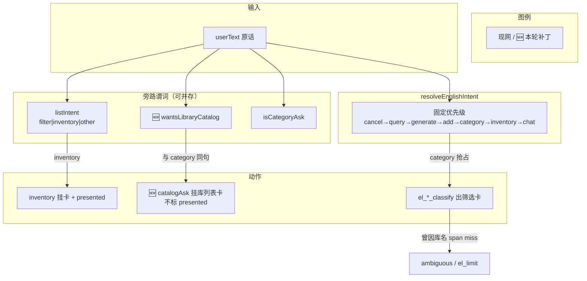
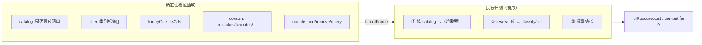

# Agent 复合意图通用化

> **文档角色**：本轮 **M0 落地归档**（改动前/后代码对照）；**IntentFrame 通用化规划以** [复合意图槽位化](../ideas/english/复合意图槽位化.md) **为准**（已与本文比对合并）  
> **日期**：2026-10-31  
> **延伸阅读**：[规划主文：复合意图槽位化](../ideas/english/复合意图槽位化.md)、[语境意图总路由](./语境意图总路由.md)、[整库问法稳定出卡](./整库问法稳定出卡.md)、[筛选卡续答与整类收藏](./筛选卡续答与整类收藏.md)、[收藏意图总闸](./收藏意图总闸.md)、[Agent大结果旁路展示](./Agent大结果旁路展示.md)

## 1. 背景与目标

英语学习 Agent 的语境识别目前是 **「一轮一个主意图」**（`resolveEnglishIntent` 固定优先级）。真实用户常把多件事写在一句里，例如：

- 「错题集有哪些资源？」→ 要 **盘点挂卡**，却对不上旧 inventory 正则；
- 「我有哪些语句库，其中三年级语句库有哪些关于问候的语句」→ 要 **库列表卡 + 分类卡**，但主意图被 `category_filter` 独占，且「我有哪些语句库」被当成失败的库名线索，`el_classic_classify` 报 `ambiguous`。

**本轮目标**：先用最小补丁修掉已暴露的复合/盘点洞，再给出可落地的 **槽位化意图（IntentFrame）** 通用方案，避免继续堆正则与互斥闸。

## 2. 改动范围

本轮已落地（意图与出卡）：

- `apps/backend/src/services/agent/tools/english/spill.ts`
- `apps/backend/src/services/agent/tools/english/domain-tools.ts`
- `apps/backend/src/services/agent/agent.prompt.ts`
- `apps/backend/src/services/agent/agent.service.ts`（剥假 `[[el:]]` 锚点）

未改但构成现状的关键文件：

- `apps/backend/src/services/agent/tools/english/english-intent.ts`

## 3. 实现思路

### 3.1 现状：单意图优先级表



**读图要点**：主路由仍互斥；本轮用 `wantsLibraryCatalog` 做 **可叠加副作用**，用 `isCatalogAskSpan` 修库名解析，避免再为「一句两事」硬改优先级表顺序。

### 3.2 本轮决策与权衡

| 问题 | 不采用 | 采用 |
|------|--------|------|
| 错题「有哪些资源」不出卡 | 把「有哪些」一律当 inventory（误伤筛选） | 扩展错题专用 inventory 短语 |
| 复合句只要分类不要库卡 | 把整句改成 inventory（挡住 classify） | `wantsLibraryCatalog` + 挂卡不设 `presented` |
| 「我有哪些语句库」导致 ambiguous | 模型重试 / 放宽全部 miss | 忽略盘点前缀 span；唯一命中即 `one` |
| 模型手写假 `[[el:]]` | 仅靠提示词 | 收尾按 `turnElResources` 剥孤儿锚点 |

### 3.3 通用化最佳方案（下一阶段）：IntentFrame 槽位

> **规划细节、候选比对与 M1–M3 以** [../ideas/english/复合意图槽位化.md](../ideas/english/复合意图槽位化.md) **为唯一维护源**；本节保留摘要，避免双份漂移。

单 `kind` 无法表达「盘点库 ∪ 分类筛选 ∪ 收藏」等组合。建议把主路由从 **互斥枚举** 升级为 **槽位帧**：



**原则**：

1. **确定性优先**：槽位仍用规则/目录匹配；LLM `decide` 只补「抽不出的库名线索」。
2. **副作用与主闸解耦**：出卡、`presented`、是否允许 classify 由计划步骤声明，不再用单一 `kind` 隐式推导。
3. **短语表数据化**：`INVENTORY_RE` / `wantsLibraryCatalog` 等收成可测表，按域（错题/库/收藏）分桶，禁止再写「万能有哪些」。
4. **假卡防护**：凡声称「卡片已列出」必须对应本轮 `turnElResources`；孤儿 `[[el:]]` 一律剥掉（本轮已做）。

### 3.4 推荐落地阶段

| 阶段 | 内容 | 验收 |
|------|------|------|
| **M0（本轮）** | inventory 短语、catalogAsk、库名 span、剥假锚点 | 错题盘点出卡；「有哪些库+关于问候」双卡 |
| **M1** | `IntentFrame` 类型 + `resolveIntentFrame`；`resolveEnglishIntent` 适配为读 frame 的 primary | 旧 kind 调用方可渐进迁移 |
| **M2** | 执行计划器：按 frame 顺序挂卡/classify；去掉 wrap 内零散 `if (catalogAsk)` | 新增复合句只加短语表行 |
| **M3** | 跨轮槽位继承（prior catalog / prior filter）进 frame，替代散落的 `shouldFilterContinue` 特例 | 长对话「那本库再筛家庭」稳定 |

## 4. 关键实现（改动前 / 改动后对比 + 注释）

### 4.1 `listIntent` / `INVENTORY_RE`（`apps/backend/src/services/agent/tools/english/spill.ts`）

**对比范围**：盘点正则与 `listIntent` 全函数。

**改动前** · `apps/backend/src/services/agent/tools/english/spill.ts`（基线，约 L27–L44）

```typescript
// 列表意图三态：整表盘点 / 筛选 / 其它
export type ListIntent = 'inventory' | 'filter' | 'other';

// 筛选优先：含「相关/有关/主题」等时不当整库盘点
const FILTER_RE = /找出|筛|相关|有关|哪些是|属于|人体|挑出|主题/;
// 整库/错题盘点短语；「有哪些错」盖不住「有哪些资源」
const INVENTORY_RE =
	/全部|所有单词|所有词|整个库|导出|列出全部|哪些错题|有哪些错|错题库|我的错题|列出错题|重新练习/;
/** 「所有英语四级单词库中的单词」：库名隔在「所有」和「单词」之间 */
const ALL_WORDS_RE = /所有.{0,16}(单词|词条|的词)/;

/** 只看用户原话。筛选词优先于「列出 / 全部」。 */
export function listIntent(userText: string): ListIntent {
	// 先筛：避免「找出…全部」被 inventory 抢走
	if (FILTER_RE.test(userText)) return 'filter';
	// 再盘点：命中则走 index 挂卡 / inventoryFallback
	if (INVENTORY_RE.test(userText) || ALL_WORDS_RE.test(userText))
		return 'inventory';
	// 默认 other：list 可能只建 artifact 不出卡
	return 'other';
}
```

**改动后** · `apps/backend/src/services/agent/tools/english/spill.ts`（当前，约 L27–L44）

```typescript
// 列表意图三态：整表盘点 / 筛选 / 其它
export type ListIntent = 'inventory' | 'filter' | 'other';

// 筛选优先：含「相关/有关/主题」等时不当整库盘点
const FILTER_RE = /找出|筛|相关|有关|哪些是|属于|人体|挑出|主题/;
/**
 * 整表/盘点问法。须盖住「错题集有哪些资源」这类：旧式「有哪些错」对不上「有哪些资源」。
 */
const INVENTORY_RE =
	/全部|所有单词|所有词|整个库|导出|列出全部|哪些错题|有哪些错|错题集|错题库|我的错题|列出错题|错题.{0,12}(有哪些|哪些|资源)|有哪些.{0,12}错题|重新练习/;
/** 「所有英语四级单词库中的单词」：库名隔在「所有」和「单词」之间 */
const ALL_WORDS_RE = /所有.{0,16}(单词|词条|的词)/;

/** 只看用户原话。筛选词优先于「列出 / 全部」。 */
export function listIntent(userText: string): ListIntent {
	// 先筛：避免「找出…全部」被 inventory 抢走
	if (FILTER_RE.test(userText)) return 'filter';
	// 再盘点：错题集/资源类问法现可命中，触发 index 挂卡
	if (INVENTORY_RE.test(userText) || ALL_WORDS_RE.test(userText))
		return 'inventory';
	// 默认 other：复合「有哪些库」另由 wantsLibraryCatalog 处理
	return 'other';
}
```

**变更摘要**：补「错题集 / 错题…资源 / 有哪些…错题」，专治错题盘点问法；不把泛「有哪些」并入 inventory，以免挡筛选。

---

### 4.2 `resolveMentionedLibrary` / `wantsLibraryCatalog`（`spill.ts`）

**对比范围**：库名提及解析全函数；新增盘点前缀与 catalog 谓词。

**改动前** · `apps/backend/src/services/agent/tools/english/spill.ts`（基线，约 L367–L413）

```typescript
/**
 * 原话点了「X + 库后缀」时先在目录里对，不再交给「所有」去扫全部库。
 * 不传后缀时仍认词汇库。语句工具传入语句后缀。「所有词汇库」没有具体库名，返回 absent。
 */
export function resolveMentionedLibrary(
	text: string,
	libs: { id: string; title: string }[],
	markSource: RegExp = VOCAB_LIBRARY_MARK,
): NamedLibrary | { kind: 'absent' } {
	// 收集每个「…库」后缀前的前缀 span
	const spans: string[] = [];
	// 全局匹配库后缀
	const mark = new RegExp(markSource.source, 'gu');
	// 防止向前扩时跨过上一个库后缀
	const tail = new RegExp(`(?:${markSource.source})$`, 'u');
	for (const match of text.matchAll(mark)) {
		const end = match.index ?? 0;
		let start = end;
		while (start > 0 && end - start < 32) {
			const ch = text[start - 1] ?? '';
			if (!/[A-Za-z0-9\u4e00-\u9fff]/u.test(ch)) break;
			if (tail.test(text.slice(0, start))) break;
			start -= 1;
		}
		const span = text.slice(start, end);
		if (span.length < 2 || !usableCue(`${span}词库`)) continue;
		spans.push(span);
	}
	if (!spans.length) return { kind: 'absent' };
	const picked: { id: string; title: string }[] = [];
	// 任一 span 对不上目录就记 miss，后面唯一命中也会变 ambiguous
	let missed = false;
	for (const span of spans) {
		const stem = stemInCatalog(span, libs);
		if (!stem) {
			missed = true;
			continue;
		}
		const named = resolveNamedLibrary(stem, libs);
		if (named.kind === 'one') picked.push(named.lib);
		else if (named.kind === 'ambiguous') return named;
		else missed = true;
	}
	const uniq: { id: string; title: string }[] = [];
	for (const lib of picked) {
		if (!uniq.some((row) => row.id === lib.id)) uniq.push(lib);
	}
	// 唯一命中但另有 miss（如「我有哪些」）→ 错误变成 ambiguous
	if (uniq.length === 1 && !missed) return { kind: 'one', lib: uniq[0] };
	if (uniq.length > 0)
		return { kind: 'ambiguous', candidates: uniq.slice(0, 10) };
	return { kind: 'none' };
}
```

**改动后** · `apps/backend/src/services/agent/tools/english/spill.ts`（当前，约 L367–L428）

```typescript
/**
 * 「我有哪些语句库」里的「我有哪些」不是库名；若当 miss 会把后面的「三年级语句库」误判成 ambiguous。
 */
function isCatalogAskSpan(span: string): boolean {
	const s = span.trim();
	if (s.length < 2) return true;
	if (/^(我)?(有)?(哪些|什么|所有|全部|各个)$/u.test(s)) return true;
	if (/^(我有)?(哪些|什么)/u.test(s) && !/[年级册级四五六]/.test(s)) return true;
	return false;
}

/**
 * 原话点了「X + 库后缀」时先在目录里对，不再交给「所有」去扫全部库。
 * 不传后缀时仍认词汇库。语句工具传入语句后缀。「所有词汇库」没有具体库名，返回 absent。
 */
export function resolveMentionedLibrary(
	text: string,
	libs: { id: string; title: string }[],
	markSource: RegExp = VOCAB_LIBRARY_MARK,
): NamedLibrary | { kind: 'absent' } {
	const spans: string[] = [];
	const mark = new RegExp(markSource.source, 'gu');
	const tail = new RegExp(`(?:${markSource.source})$`, 'u');
	for (const match of text.matchAll(mark)) {
		const end = match.index ?? 0;
		let start = end;
		while (start > 0 && end - start < 32) {
			const ch = text[start - 1] ?? '';
			if (!/[A-Za-z0-9\u4e00-\u9fff]/u.test(ch)) break;
			if (tail.test(text.slice(0, start))) break;
			start -= 1;
		}
		const span = text.slice(start, end);
		if (span.length < 2 || !usableCue(`${span}词库`)) continue;
		// 盘点前缀不参与点名，避免复合句误 ambiguous
		if (isCatalogAskSpan(span)) continue;
		spans.push(span);
	}
	if (!spans.length) return { kind: 'absent' };
	const picked: { id: string; title: string }[] = [];
	for (const span of spans) {
		const stem = stemInCatalog(span, libs);
		if (!stem) continue;
		const named = resolveNamedLibrary(stem, libs);
		if (named.kind === 'one') picked.push(named.lib);
		else if (named.kind === 'ambiguous') return named;
	}
	const uniq: { id: string; title: string }[] = [];
	for (const lib of picked) {
		if (!uniq.some((row) => row.id === lib.id)) uniq.push(lib);
	}
	// 只点中一本即 one，不再被无关 miss 拖成 ambiguous
	if (uniq.length === 1) return { kind: 'one', lib: uniq[0] };
	if (uniq.length > 0)
		return { kind: 'ambiguous', candidates: uniq.slice(0, 10) };
	return { kind: 'none' };
}

/** 用户还要看「有哪些库」清单（可与关于类筛选同句，不走 inventory 独占）。 */
export function wantsLibraryCatalog(userText: string): boolean {
	return /有哪些.{0,8}(语句库|语料库|词汇库|单词库|词库)|我有哪些.{0,8}库|所有语句库|所有词汇库|所有单词库|列出.{0,6}(语句库|语料库|词汇库|单词库)|需要的是所有(语句库|词汇库)/u.test(
		userText,
	);
}
```

**变更摘要**：忽略盘点前缀；唯一库命中即成功；新增 `wantsLibraryCatalog` 表达「要库清单」副作用，不抢 `category_filter` 主意图。

---

### 4.3 `wrap` 内 `catalogAsk` 挂卡（`domain-tools.ts`）

**对比范围**：`spillListResult` 调用参数与 inventory 分支后的挂卡逻辑（摘录同一段）。

**改动前** · `apps/backend/src/services/agent/tools/english/domain-tools.ts`（基线，约 L1086–L1175）

```typescript
					const hideCard = isIndexOp(name, op) || isSearchOp(name, op);
					const noteOpen = name === 'el_notes' && op === 'get';
					const inventory =
						hideCard &&
						isIndexOp(name, op) &&
						listIntent(deps.surface.userText) === 'inventory';
					const spilled = await spillListResult(
						name,
						env,
						(row) => deps.artifacts.put(deps.userId, row),
						{
							slim: hideCard || noteOpen,
							always: hideCard || noteOpen,
							inventory,
						},
					);
					if (spilled) {
						// ... noteOpen / packs / items_search inventory 分支未改 ...
						if (inventory) {
							deps.surface.libraryLists.push(spilled.full);
							if ((spilled.full.items?.length ?? 0) > 0) {
								deps.surface.presented = true;
							}
							deps.surface.shownLibraryIds.add(
								spilled.full.libraryId ?? spilled.full.artifactId,
							);
							deps.onResourceList?.(spilled.full);
						} else if (isIndexOp(name, op)) {
							deps.surface.libraryLists.push(spilled.full);
						} else if (!hideCard) deps.onResourceList?.(spilled.full);
						return stringifyEnvelope(spilled.model);
					}
```

**改动后** · `apps/backend/src/services/agent/tools/english/domain-tools.ts`（当前，约 L1086–L1193）

```typescript
					const hideCard = isIndexOp(name, op) || isSearchOp(name, op);
					const noteOpen = name === 'el_notes' && op === 'get';
					const inventory =
						hideCard &&
						isIndexOp(name, op) &&
						listIntent(deps.surface.userText) === 'inventory';
					/** 复合问「有哪些库 + 关于类」：挂库列表卡，但不标 presented，以免挡住后续 classify */
					const catalogAsk =
						name === 'el_libraries' &&
						op === 'list' &&
						wantsLibraryCatalog(deps.surface.userText);
					const spilled = await spillListResult(
						name,
						env,
						(row) => deps.artifacts.put(deps.userId, row),
						{
							slim: hideCard || noteOpen,
							// 库清单条数常 < spill 阈值，必须 always 才能落 artifact
							always: hideCard || noteOpen || catalogAsk,
							inventory,
						},
					);
					if (spilled) {
						// ... noteOpen / packs / items_search inventory 分支未改 ...
						if (inventory) {
							deps.surface.libraryLists.push(spilled.full);
							if ((spilled.full.items?.length ?? 0) > 0) {
								deps.surface.presented = true;
							}
							deps.surface.shownLibraryIds.add(
								spilled.full.libraryId ?? spilled.full.artifactId,
							);
							deps.onResourceList?.(spilled.full);
						} else if (catalogAsk) {
							deps.surface.libraryLists.push(spilled.full);
							deps.surface.shownLibraryIds.add(spilled.full.artifactId);
							// 推 SSE 卡；不设 presented，classify 仍可跑
							deps.onResourceList?.(spilled.full);
							spilled.model.message = [
								spilled.model.message,
								'库列表卡片已列出。禁止用 Markdown 表复述库名。若还要按类别筛选，继续 classify，不要声称库卡未列出。',
							]
								.filter(Boolean)
								.join(' ');
						} else if (isIndexOp(name, op)) {
							deps.surface.libraryLists.push(spilled.full);
						} else if (!hideCard) deps.onResourceList?.(spilled.full);
						return stringifyEnvelope(spilled.model);
					}
```

**变更摘要**：`el_libraries` list 在 catalog 问法下强制外溢并 `onResourceList`；与 inventory 不同，**不**置 `presented`。


### 4.4 `artifactTitle`（`apps/backend/src/services/agent/tools/english/spill.ts`）

**对比范围**：`artifactTitle` 全函数（含可选 `kind`）。

**改动前** · `apps/backend/src/services/agent/tools/english/spill.ts`（基线，约 L638–L647）

```typescript
// 从工具名与首条 libraryTitle 推导卡片标题
function artifactTitle(tool: string, items: unknown[]): string {
	// 取列表首条，可能带 libraryTitle
	const first = items[0];
	// 对象行优先读库标题，避免错题/收藏共用泛名「清单」
	if (first && typeof first === 'object') {
		// 抽出 libraryTitle 文本字段
		const title = textOf((first as { libraryTitle?: unknown }).libraryTitle);
		// 有库名则直接用，与资源库列表一致
		if (title) return title;
	}
	// 回退工具默认中文名；无映射则「清单」
	return TOOL_TITLE[tool] ?? '清单';
}
```

**改动后** · `apps/backend/src/services/agent/tools/english/spill.ts`（当前，约 L655–L682）

```typescript
// 增加可选 kind，区分词/句错题、收藏与库列表卡标题
function artifactTitle(
	// 触发外溢的工具名，决定标题族
	tool: string,
	// 列表项，用于优先读 libraryTitle
	items: unknown[],
	// 内容种类：vocab/classic，由 spill 传入或从 record.kind 推断
	kind?: string,
): string {
	// 取首条尝试库标题
	const first = items[0];
	// 对象行优先 libraryTitle
	if (first && typeof first === 'object') {
		// 规范化标题字符串
		const title = textOf((first as { libraryTitle?: unknown }).libraryTitle);
		// 有库名则用库名，保持与点名库一致
		if (title) return title;
	}
	// 错题无 libraryTitle 时按 kind 分词/句，避免两张卡同名
	if (tool === 'el_mistakes') {
		// 语句错题卡标题
		if (kind === 'classic') return '语句错题';
		// 单词错题卡标题
		if (kind === 'vocab') return '单词错题';
	}
	// 收藏同理分词/句
	if (tool === 'el_favorites') {
		// 语句收藏标题
		if (kind === 'classic') return '语句收藏';
		// 单词收藏标题
		if (kind === 'vocab') return '单词收藏';
	}
	// 库列表卡：el_libraries list 常无单库 libraryTitle
	if (tool === 'el_libraries') {
		// 语句库清单
		if (kind === 'classic') return '语句库';
		// 词汇库清单
		if (kind === 'vocab') return '词汇库';
	}
	// 仍回退工具默认名
	return TOOL_TITLE[tool] ?? '清单';
}
```

**变更摘要**：错题/收藏/库列表按 `kind` 分标题，双卡并列时用户能区分「单词错题」与「语句错题」。

---

### 4.5 收尾剥假 `[[el:]]`（`apps/backend/src/services/agent/agent.service.ts`）

**对比范围**：英语 Agent 助手正文收尾、`placeCardHint` 之后的锚点清洗（纯新增，按 §4 只贴改动后并注明基线无此段）。

**改动前**：基线在 `placeCardHint` 后直接处理空正文回退，**无**按 `turnElResources` 校验 `[[el:]]` 的逻辑。

**改动后** · `apps/backend/src/services/agent/agent.service.ts`（当前，约 L968–L982）

```typescript
			// 先插入「见卡片」类提示，与既有出卡顺序一致
			text = placeCardHint(text, spilled, fullLibrary);
			// 模型常把手写 artifactId 写进 [[el:]]，但 index 未推 SSE → 前端空锚点
			if (spilled) {
				// 本轮真实推过的卡 id 集合，作为白名单
				const ids = new Set(turnElResources.map((row) => row.artifactId));
				// 只保留白名单内锚点，其余整段删掉
				text = text.replace(/\[\[el:([^\]]+)\]\]/g, (full, id: string) =>
					// 命中本轮资源则保留原文锚点
					ids.has(id) ? full : '',
				);
			} else {
				// 本轮无任何外溢卡时，正文里所有 [[el:]] 一律剥掉
				text = text.replace(/\[\[el:[^\]]+\]\]/g, '');
			}
```

**变更摘要**：收尾以 `turnElResources` 为真相源，杜绝「卡片已列出」假锚点。


## 5. 行为变化与兼容性

- **用户可见**：错题盘点问法会真正挂错题卡；「有哪些语句库 + 关于…」应同时出现库列表卡与分类卡，不再只剩 Markdown 表或假「已列出」。
- **兼容**：`resolveEnglishIntent` 优先级未改；旧单意图路径行为保持。
- **风险**：`wantsLibraryCatalog` 过宽可能对「有哪些词库相关题」误挂库卡——当前正则要求显式「语句库/词汇库」等后缀，可接受。

## 6. 测试与回归建议

| 用例 | 期望 |
|------|------|
| 错题集有哪些资源？ | inventory；两张错题卡（词/句）或按 kind 调用挂卡 |
| 我有哪些语句库 | catalogAsk；语句库列表卡；无 Markdown 复述要求 |
| 我有哪些语句库，其中三年级…关于问候 | 库列表卡 + 问候筛选卡；classify 非 ambiguous |
| 找出日常交流里关于家庭的句子 | 仍 filter/category；不因「有哪些」误 inventory |
| 模型手写无资源的 `[[el:uuid]]` | 收尾剥离，前端不空锚点 |

## 7. 相关文档与代码索引

| 说明 | 路径 |
|------|------|
| 总路由（单 kind） | `english/语境意图总路由.md` |
| 本篇（复合 + 通用化） | `english/Agent复合意图通用化.md` |
| 意图入口 | `apps/backend/src/services/agent/tools/english/english-intent.ts` |
| 谓词与挂卡 | `apps/backend/src/services/agent/tools/english/spill.ts` |
| wrap 出卡 | `apps/backend/src/services/agent/tools/english/domain-tools.ts` |

---

（若与仓库最新源码不一致，以源码为准）
