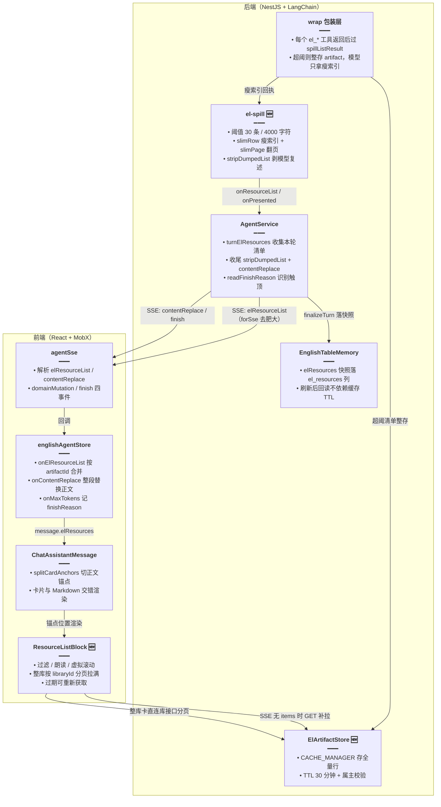
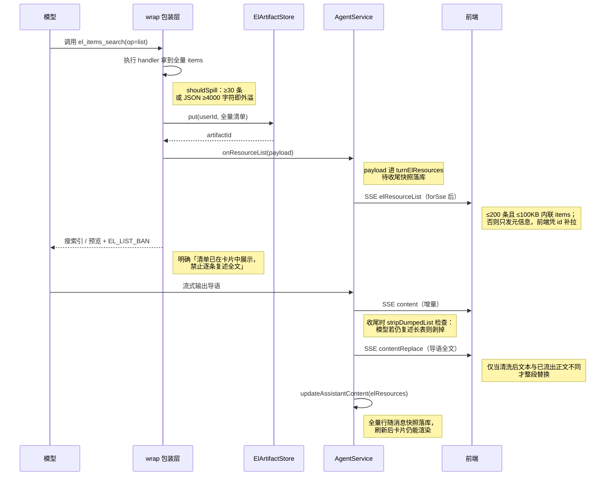

# Agent 大结果旁路展示（清单卡片）

> **路径**：`el-spill.ts`、`el-artifact.store.ts` 等已迁到 `apps/backend/src/services/agent/tools/english/`。下文代码块与行号对应迁前版本。
>
> 相关文档：
> - 规划稿：[Agent 大结果旁路展示](../../ideas/english/Agent大结果旁路展示.md)、[问答清单按需出卡](../../ideas/english/问答清单按需出卡.md)、[资源卡上下间距](../../ideas/english/资源卡上下间距.md)
> - 姊妹功能：[英语 Agent 领域工具](./英语Agent领域工具.md)、[整库问法稳定出卡](./整库问法稳定出卡.md)、[每日阅读 Agent 自选生成](./每日阅读Agent自选生成.md)
> - 已有专题：[英语 Agent 联网次数封顶](./英语Agent联网次数封顶.md)
> - 后继更新（2026-10-29）：[词句分类列出](./词句分类列出.md)、[筛选卡续答与整类收藏](./筛选卡续答与整类收藏.md)、[确认条按会话隔离](./确认条按会话隔离.md)

## 1. 背景与目标

英语侧栏 Agent 接入 `el_*` 领域工具后，一个突出的体验问题被放大：用户问「我收藏了哪些词」「列出英语四级单词库的所有单词」时，工具一返回几百上千条结果，模型就会把整张表逐条复述进正文——回答被超长清单刷屏、流式变慢、而且很容易在中途触顶截断。

本轮把「给模型看的数据」和「给用户看的数据」拆开：大列表**不进模型正文**，而是外溢成一张独立的**清单卡片**（artifact），走 SSE 旁路事件直接推到前端渲染；模型只拿到瘦索引或前 5 条预览，正文只写一两句导语。同时把外溢清单**快照进消息 JSON 列**，会话刷新后卡片仍能滚动查看，不依赖缓存 TTL。

目标：

- 大列表（≥30 条或 ≥4000 字符）不再回填模型上下文，模型上下文里只有瘦索引 / 预览，杜绝「模型复读整表」。
- 清单卡片走独立 SSE 事件 `elResourceList`，正文里用 `[[el:artifactId]]` 锚点决定卡片插入位置；没有锚点的卡统一排在正文之后。
- 卡片数据三路兜底：SSE 内联（小卡）→ `GET /agent/el-artifact/:id` 补拉（TTL 30 分钟）→ 消息快照 `el_resources` 列（刷新后仍在）。
- 整库卡片（词库 / 语料库）不依赖 artifact 快照，前端按 `libraryId` 直接分页拉满，几千条也能看。
- 模型若仍复述了长表，收尾时把复述段落剥掉并用 `contentReplace` 整体替换已流出的正文。
- completion 触顶（`finish_reason=length`）时发 `finish` 事件，前端展示「点击接着回答」；续写只补导语，清单仍在卡片里。

## 2. 改动范围

本轮该功能涉及以下文件（仓库相对路径）：

| 文件 | 改动 | 作用 |
| --- | --- | --- |
| `apps/backend/src/services/agent/el-artifact.store.ts` | 新增 | 旁路清单缓存（CACHE_MANAGER，TTL 30 分钟，属主校验） |
| `apps/backend/src/services/agent/el-spill.ts` | 新增 | 外溢阈值、清单载荷拼装、瘦索引、正文清洗 |
| `apps/backend/src/services/agent/agent.service.ts` | 修改 | 4 个新 SSE 事件、外溢回调、收尾替换正文、触顶 finish |
| `apps/backend/src/services/agent/agent.controller.ts` | 修改 | `GET /agent/el-artifact/:id` 补拉端点 + SSE 四分支透传 |
| `apps/backend/src/services/agent/agent-turn-memory.ts` | 修改 | `UpdateAssistantContentOpts` 增加 `elResources` |
| `apps/backend/src/services/english-learning/english-table-memory.ts` | 修改 | assistant 消息落库 / 回读时带上 `elResources` |
| `apps/backend/src/services/english-learning/entity/english-agent-message.entity.ts` | 修改 | 新增 `el_resources` JSON 列（消息快照） |
| `apps/backend/src/migrations/1792996503609-english_agent.ts` | 新增 | 迁移占位（up/down 为空，见 §4.14 说明） |
| `apps/frontend/src/types/chat.ts` | 修改 | `ElResourceBlock` 类型、`Message.elResources` |
| `apps/frontend/src/service/index.ts` | 修改 | `getElArtifact` 补拉 API、会话详情带 `elResources` |
| `apps/frontend/src/utils/agentSse.ts` | 修改 | 解析 4 个新 SSE 事件，新增 4 个回调 |
| `apps/frontend/src/store/englishAgent.ts` | 修改 | `onElResourceList / onContentReplace / onMaxTokens` 落 store |
| `apps/frontend/src/components/design/ChatAssistantMessage/cardEdges.ts` | 新增 | 正文锚点切分与卡片上下边距判定 |
| `apps/frontend/src/components/design/ChatAssistantMessage/index.tsx` | 修改 | 正文按锚点切段，卡片与 Markdown 交错渲染 |
| `apps/frontend/src/components/design/Assistant/ResourceListBlock.tsx` | 新增 | 清单卡片组件（过滤、朗读、整库拉满、过期重取） |
| `apps/frontend/src/components/design/Assistant/utils.ts` | 修改 | `buildMessageRev` 订阅 `elResources` 与触顶标记 |
| `apps/frontend/src/components/design/Assistant/types.ts` | 修改 | `onContinueAnswering` 透传类型 |
| `apps/frontend/src/components/design/Assistant/MessageRow.tsx` | 修改 | `onContinueAnswering` 透传 |
| `apps/frontend/src/views/englishLearning/agent/EnglishAgentMessageList.tsx` | 修改 | 触顶后续写导语的 `continueProse` |

## 3. 实现思路

### 3.1 总体架构



### 3.2 外溢与补拉时序



### 3.3 要点

- **两道体积闸**：`shouldSpill`（30 条 / 4000 字符）决定「是否外溢出卡」；`canInlineItems`（200 条 / 100000 字符）决定「SSE 帧是否内联 items」。外溢但可内联的清单前端无需补拉；外溢且超大的只发元信息。
- **模型侧永远拿不到全表**：外溢后回执只有三种形态——整库问法给前 5 条预览（`preview`）、索引类 op 给瘦字段整表或一页 80 条（`slim`）、其余给预览 + `EL_LIST_BAN` 禁令。
- **正文锚点决定卡片位置**：`el_present` 成功时后端把 `[[el:artifactId]]` 追加进正文流；前端 `splitCardAnchors` 按锚点把正文切成「Markdown 段 / 卡片段」交错渲染。没有锚点的卡（外溢自动卡、兜底卡）统一排在正文之后。
- **复述兜底清洗**：模型不听话复述整表时，`stripDumpedList` 统计正文中表格行与列表行数量，超过 `max(80, 卡片条数×0.8)` 即判定为复述，整段剥掉；剥完为空则生成「标题：共 N 条」兜底导语，再用 `contentReplace` 事件整段替换前端已流出的正文。
- **三路数据兜底**：SSE 内联（小卡直接可用）→ artifact 缓存补拉（30 分钟 TTL）→ 消息 `el_resources` 快照（永久，刷新后仍在）。整库卡例外：始终按 `libraryId` 直连库接口分页拉满，与快照无关。
- **触顶只续导语**：`readFinishReason` 从 chunk 元信息识别 `length/max_tokens`，流结束后发 `finish` 事件；前端置 `message.finishReason.maxTokensReached`，出现「点击接着回答」，点击后发送固定话术「从上次导语的断点接着写完，不要逐条复述清单」。

## 4. 关键代码与注释

### 4.1 旁路清单缓存（`el-artifact.store.ts`，新增）

旁路清单的统一载荷 `ElResourceListPayload` 同时服务于 SSE 事件、消息快照与 GET 补拉三个通道；缓存带 `userId` 属主校验，凭 `artifactId` 串号拿不到别人的清单。

> 来源：`apps/backend/src/services/agent/el-artifact.store.ts`（新增文件，约 L1-L63，全文）——改动后

```typescript
// 生成全局唯一的 artifactId，作为 SSE / 快照 / 补拉三通道的共同键
import { randomUUID } from 'node:crypto';
// 复用 Nest 缓存抽象，不直接绑死内存或 Redis 实现
import { CACHE_MANAGER } from '@nestjs/cache-manager';
// Injectable 供 AgentModule 注册为 Provider，Inject 取缓存管理器
import { Inject, Injectable } from '@nestjs/common';
// cache-manager 的 Cache 类型，构造注入用
import type { Cache } from 'cache-manager';

// 清单来源枚举：前端据此决定图标与「整库卡」直连拉取策略
export type ElResourceSource =
	// 词库 / 语料库（整库卡，前端按 libraryId 分页拉满）
	| 'library'
	// 收藏
	| 'favorites'
	// 错题
	| 'mistakes'
	// 今日记词
	| 'memo'
	// 每日阅读
	| 'reading'
	// 词包
	| 'pack'
	// 学习笔记
	| 'notes'
	// 兜底来源
	| 'other';

/** 旁路清单：SSE、消息快照、GET 补拉共用 */
export type ElResourceListPayload = {
	// put 时生成的唯一 id；前端锚点 [[el:id]] 与补拉都靠它
	artifactId: string;
	// 卡片标题（库名或工具默认名）
	title: string;
	// 来源枚举，前端区分整库卡与普通卡
	source: ElResourceSource;
	// 内容种类：整库卡据此选择词库接口还是语料库接口
	contentKind?: 'vocab' | 'classic';
	// 所属库 id；整库卡直连拉取的必填键
	libraryId?: string;
	// 全量条数（可能大于 items.length，截断时用户要知道真实总量）
	totalCount: number;
	// 是否已达硬顶未穷尽，卡片标题据此提示「未穷尽」
	truncated: boolean;
	/** 全量行；SSE 超阈时省略，由 GET 补拉 */
	items?: unknown[];
};

// 缓存内部形态：多带一个 userId 用于属主校验，get 返回前剥掉
type StoredArtifact = ElResourceListPayload & { userId: number };

// 缓存键前缀，避免与其它业务键冲突
const KEY_PREFIX = 'el_artifact:';
/** 30 分钟。ponytail: 内存 TTL，过期靠消息快照或重新提问；要跨进程改 Redis 同一 key。 */
const TTL_MS = 30 * 60 * 1000;

// NestJS 可注入装饰器，store 注册进 DI 容器供 AgentService 使用
@Injectable()
// 清单旁路缓存：put 存全量载荷，get 校验属主后返回
export class ElArtifactStore {
	// 注入 cache-manager，上层无需关心内存还是 Redis
	constructor(@Inject(CACHE_MANAGER) private readonly cache: Cache) {}

	// 统一拼缓存键，put/get 保持一致
	private key(id: string): string {
		// 前缀 + id 拼出完整缓存键
		return `${KEY_PREFIX}${id}`;
	}

	// 写入全量清单并返回新 artifactId
	async put(
		// 属主用户 id，get 时据此校验
		userId: number,
		// 清单载荷（id 由本方法生成，故 Omit 掉）
		row: Omit<ElResourceListPayload, 'artifactId'>,
	// 返回新生成的 artifactId 给调用方
	): Promise<string> {
		// 每次 put 生成新 id，调用方不能用旧 id 预测或复用
		const artifactId = randomUUID();
		// 落缓存时夹带 userId，get 时校验属主
		const stored: StoredArtifact = { ...row, artifactId, userId };
		// 写入并设置 TTL，过期自动清除
		await this.cache.set(this.key(artifactId), stored, TTL_MS);
		// 只把 id 还给调用方，payload 由调用方自行持有
		return artifactId;
	}

	/** 属主不符或过期返回 null，避免凭 id 串号 */
	async get(
		// 请求方用户 id，用于属主校验
		userId: number,
		// 待读取的清单 id
		artifactId: string,
	// 命中返回清单，过期或非属主返回 null
	): Promise<ElResourceListPayload | null> {
		// 读缓存，miss（过期 / 不存在）直接为 undefined
		const row = await this.cache.get<StoredArtifact>(this.key(artifactId));
		// 不存在或属主不符都按 null 处理，不区分提示，防探测
		if (!row || row.userId !== userId) return null;
		// 剥掉内部字段 userId 再返回，外部不需要知道属主
		const { userId: _userId, ...payload } = row;
		// 返回剥掉 userId 的清单载荷
		return payload;
	}
}
```

### 4.2 外溢阈值与内联判定（`el-spill.ts`，新增）

两道闸分离的原因：外溢阈值服务「模型上下文不能被打爆」，内联阈值服务「单帧 SSE 不能过大」——一个 500 条的清单必须外溢，但若瘦身到 100KB 内仍可直接随 SSE 内联，省一次补拉。

> 来源：`apps/backend/src/services/agent/el-spill.ts`（新增文件，约 L1-L21、L84-L99）——改动后

```typescript
// 清单载荷与来源类型：spill 的产物就是 ElResourceListPayload
import type { ElResourceListPayload, ElResourceSource } from './el-artifact.store';
// elOk 拼统一信封；fitItemsByChars 给整库兜底卡做字符截断；ElEnvelope 为入参类型
import { elOk, fitItemsByChars, type ElEnvelope } from './el-envelope';

/** 条数达到则外溢，不再把全表塞进模型上下文 */
export const EL_SPILL_MIN_ITEMS = 30;
/** 模型可见 JSON 达到则外溢 */
export const EL_SPILL_MIN_CHARS = 4_000;
/** 单帧 SSE 内联上限（条） */
export const EL_SSE_INLINE_MAX_ITEMS = 200;
/** 单帧 SSE 内联上限（字符） */
export const EL_SSE_INLINE_MAX_CHARS = 100_000;

// 外溢后给模型的禁令文案：防止模型把清单逐条复述进正文
export const EL_LIST_BAN =
	// 禁令正文：只许写导语，禁止复述与长表
	'清单已在卡片中展示，禁止逐条复述全文或输出 Markdown 长表；只用一两句导语说明范围与条数。不要写见上方或见下方。';

/** 瘦索引放不下时，单页行数 */
export const EL_SLIM_PAGE = 80;
/** 词库 list 不自动出卡时，瘦字段仍整表给模型的条数上限 */
export const EL_SLIM_MAX_ITEMS = 400;
/** 瘦字段 JSON 上限；超过则只给 preview */
export const EL_SLIM_MAX_CHARS = 12_000;
```

```typescript
// 任一条件命中即外溢：条数防长表，字符数防「条数少但每条很长」
export function shouldSpill(items: unknown[]): boolean {
	// 条数闸
	if (items.length >= EL_SPILL_MIN_ITEMS) return true;
	// 字符闸：直接量序列化长度，与模型可见体积同口径
	return JSON.stringify(items).length >= EL_SPILL_MIN_CHARS;
}

// SSE 帧能否内联：两个上限都不超才内联，省去前端补拉
export function canInlineItems(items: unknown[]): boolean {
	// 条数上限
	if (items.length > EL_SSE_INLINE_MAX_ITEMS) return false;
	// 字符上限
	return JSON.stringify(items).length <= EL_SSE_INLINE_MAX_CHARS;
}

/** SSE 帧：过大则去掉 items，前端凭 artifactId 再拉 */
export function forSse(row: ElResourceListPayload): ElResourceListPayload {
	// 有 items 且能内联：原样发，前端零补拉
	if (row.items && canInlineItems(row.items)) return row;
	// 否则剥掉 items 只发元信息；用解构剔除而非 delete，保持不可变
	const { items: _items, ...rest } = row;
	// 返回只含元信息的帧
	return rest;
}
```

### 4.3 清单载荷拼装：来源 / 标题 / 预览（`el-spill.ts`，新增）

`ElResourceListPayload` 的 `source` 与 `title` 不由模型填写，而是后端按工具名与首行数据推导，保证卡片标题稳定、不受模型措辞影响。

> 来源：`apps/backend/src/services/agent/el-spill.ts`（新增文件，约 L101-L177）——改动后

```typescript
// 预览只取前 5 条，模型据此知道「表里大概是什么」而无法复述全文
export function toPreview(
	// 全量条目数组
	items: unknown[],
// 返回词面 / 释义对数组
): Array<{ en: string; zh?: string }> {
	// 截前 5 条并逐条抽词面 / 释义
	return items.slice(0, 5).map((item) => {
		// 抽出该条的双语面
		const row = previewOf(item);
		// 无中文释义时不带 zh 键，保持预览 JSON 紧凑
		return row.zh ? row : { en: row.en };
	});
}

// 统一取字符串字段并去空白；非字符串一律视为空，避免 toString 出 [object Object]
function textOf(v: unknown): string {
	// 字符串去空白返回，非字符串给空串
	return typeof v === 'string' ? v.trim() : '';
}

// 从形态各异的条目里抽「英文面 + 中文面」，兼容词条 / 阅读 / 笔记 / 词包
export function previewOf(item: unknown): { en: string; zh?: string } {
	// 非对象条目（如纯字符串）直接截断返回
	if (!item || typeof item !== 'object') {
		// 转字符串并截断作为英文面
		return { en: String(item ?? '').slice(0, 200) };
	}
	// 转为键值对象以便按字段取值
	const o = item as Record<string, unknown>;
	// 按已知字段优先级取英文面；都落空时退化为整个对象的截断 JSON
	const en =
		// 优先取英文句字段
		textOf(o.english) ||
		// 其次取词面字段
		textOf(o.word) ||
		// 再取通用标题字段
		textOf(o.title) ||
		// 再取阅读英文标题
		textOf(o.titleEn) ||
		// 再取词包主题
		textOf(o.topic) ||
		// 最后取正文字段
		textOf(o.text) ||
		// 全部落空时退化为对象截断 JSON
		JSON.stringify(o).slice(0, 180);
	// 中文面同样按优先级取，允许为空
	const zh =
		// 优先取释义字段
		textOf(o.translationZh) ||
		// 其次取中文字段
		textOf(o.zh) ||
		// 再取含义字段
		textOf(o.meaning) ||
		// 最后取中文标题字段
		textOf(o.titleZh);
	// 双侧各截 200 字符，防止单条超宽字段撑爆预览
	return { en: en.slice(0, 200), ...(zh ? { zh: zh.slice(0, 200) } : {}) };
}

// 工具名 → 来源枚举，卡片渲染策略（尤其整库卡）完全由它驱动
function sourceOf(tool: string): ElResourceSource {
	// 词条搜索与库列表都归为库来源
	if (tool === 'el_items_search' || tool === 'el_libraries') return 'library';
	// 收藏工具归 favorites
	if (tool === 'el_favorites') return 'favorites';
	// 错题工具归 mistakes
	if (tool === 'el_mistakes') return 'mistakes';
	// 每日记词归 memo
	if (tool === 'el_daily_memo') return 'memo';
	// 每日阅读归 reading
	if (tool === 'el_daily_reading') return 'reading';
	// 词包工具归 pack
	if (tool === 'el_packs') return 'pack';
	// 笔记工具归 notes
	if (tool === 'el_notes') return 'notes';
	// 未识别工具兜底为 other
	return 'other';
}

// 工具名 → 默认卡片标题；库清单会被首行 libraryTitle 覆盖
const TOOL_TITLE: Record<string, string> = {
	// 词条搜索的默认标题
	el_items_search: '词条',
	// 库列表的默认标题
	el_libraries: '库列表',
	// 收藏的默认标题
	el_favorites: '收藏',
	// 错题的默认标题
	el_mistakes: '错题',
	// 每日记词的默认标题
	el_daily_memo: '记词',
	// 每日阅读的默认标题
	el_daily_reading: '每日阅读',
	// 词包的默认标题
	el_packs: '单词资料',
	// 学习笔记的默认标题
	el_notes: '学习笔记',
};

/** 顶层 items，或日推 origin=all 的 system/manual.items */
function collectItems(record: Record<string, unknown>): unknown[] | null {
	// 常规情况：data.items 就是全量数组
	if (Array.isArray(record.items)) return record.items;
	// 日推 origin=all：全量分散在 system / manual 两个子对象里，需要合并
	const nested: unknown[] = [];
	// 遍历两个子对象收集条目
	for (const key of ['system', 'manual']) {
		// 取当前子对象
		const child = record[key];
		// 子对象缺失、非对象或本身是数组都跳过，防类型混乱
		if (!child || typeof child !== 'object' || Array.isArray(child)) continue;
		// 取子对象的 items 字段
		const items = (child as { items?: unknown }).items;
		// 收集子对象的 items 数组
		if (Array.isArray(items)) nested.push(...items);
	}
	// 两个子对象都没有 items 时返回 null，让调用方判定「这不是清单」
	return nested.length ? nested : null;
}

// 卡片标题推导：优先用首行自带的库名，否则用工具默认名
function artifactTitle(tool: string, items: unknown[]): string {
	// 取首行探测库名
	const first = items[0];
	// 首行是对象才可能带 libraryTitle
	if (first && typeof first === 'object') {
		// 词库 list 每行都带 libraryTitle，取首行即库名
		const title = textOf((first as { libraryTitle?: unknown }).libraryTitle);
		// 有库名直接用库名
		if (title) return title;
	}
	// 否则用工具默认名，再兜底「清单」
	return TOOL_TITLE[tool] ?? '清单';
}
```

### 4.4 瘦索引与翻页（`el-spill.ts`，新增）

外溢后模型仍需「知道表里有什么」才能回答筛选类追问。瘦索引（`slimRow`）把每条压成词面 / 标题 + 释义 + id，中等体积（≤400 条且 ≤12000 字符）整表留在回执里；放不下则只给一页 80 条并附 `nextOffset`，模型可用同一 `artifactId` 翻页。

> 来源：`apps/backend/src/services/agent/el-spill.ts`（新增文件，约 L214-L271）——改动后

```typescript
// 把任意条目压成瘦索引行：只留筛选与定位所需的最小字段集
export function slimRow(item: unknown): Record<string, string> {
	// 非对象条目退化为 word 字段截断
	if (!item || typeof item !== 'object') return { word: String(item ?? '').slice(0, 120) };
	// 转为键值对象按字段取
	const o = item as Record<string, unknown>;
	// 词包行：有 topic 字段，保留 topic / id / targetCount / count
	const topic = textOf(o.topic).slice(0, 80);
	// 命中词包形态
	if (topic) {
		// 词包瘦行以 topic 起手
		const row: Record<string, string> = { topic };
		// id 供后续 el_present 按篇定位
		if (textOf(o.id)) row.id = textOf(o.id);
		// targetCount 是词包目标条数，模型做条数判断要用
		if (o.targetCount != null && String(o.targetCount) !== '') {
			// 写入目标条数
			row.targetCount = String(o.targetCount);
		}
		// wordCount / quoteCount 二选一落入 count，统一口径
		const n = o.wordCount ?? o.quoteCount;
		// 有有效数量才写 count
		if (n != null && String(n) !== '') row.count = String(n);
		// 返回词包瘦行
		return row;
	}
	// 阅读行：有 titleEn / titleZh，保留双标题 + 日期 + 来源 + 导语
	const titleEn = textOf(o.titleEn).slice(0, 80);
	// 中文标题截 40 字
	const titleZh = textOf(o.titleZh).slice(0, 40);
	// 命中阅读形态
	if (titleEn || titleZh) {
		// 导语只留 24 字，帮助模型判断主题又不占体积
		const lead = (textOf(o.lead) || textOf(o.bodyZh) || textOf(o.bodyEn)).slice(0, 24);
		// 组装阅读瘦行
		return {
			// 有 id 才带 id，保持行紧凑
			...(textOf(o.id) ? { id: textOf(o.id) } : {}),
			// 有英文标题才带
			...(titleEn ? { titleEn } : {}),
			// 有中文标题才带
			...(titleZh ? { titleZh } : {}),
			// 发布日期：用户常按日期追问日推
			...(textOf(o.publishDate) ? { publishDate: textOf(o.publishDate) } : {}),
			// system / manual 来源标记
			...(textOf(o.origin) ? { origin: textOf(o.origin) } : {}),
			// 是否我生成的
			...(textOf(o.mine) ? { mine: textOf(o.mine) } : {}),
			// 有更新时间才带，截 40 字
			...(textOf(o.updatedAt) ? { updatedAt: textOf(o.updatedAt).slice(0, 40) } : {}),
			// 有导语才带
			...(lead ? { lead } : {}),
		};
	}
	// 词条 / 收藏 / 错题行：词面 + 释义 + 最近一次对错
	const zh = textOf(o.translationZh).slice(0, 80);
	// 取词面字段
	const word = textOf(o.word);
	// 英文句截 120 字
	const english = textOf(o.english).slice(0, 120);
	// 空行起步，按字段存在性填充
	const row: Record<string, string> = {};
	// 有 id 才写 id
	if (textOf(o.id)) row.id = textOf(o.id);
	// 中文词用 word，英文句用 english，二者取一
	if (word) row.word = word;
	// 无词面时退而用英文句
	else if (english) row.english = english;
	// 有释义才写释义
	if (zh) row.translationZh = zh;
	// 错题行的最近一次对错，模型答「哪些还错着」要用
	if (typeof o.lastCorrect === 'boolean') row.lastCorrect = o.lastCorrect ? 'true' : 'false';
	// 全部字段落空时退化为字符串截断，保证行不为空对象
	return Object.keys(row).length ? row : { word: String(item).slice(0, 120) };
}

/** 放不下整表索引时的一页。nextOffset 用同一 artifact 接着翻。 */
export function slimPage(
	// 全量条目数组
	items: unknown[],
	// 起始偏移，默认从头开始
	offset = 0,
// 返回一页瘦行与可选 nextOffset
): { rows: Record<string, string>[]; nextOffset?: number } {
	// 先把全量压成瘦行，再切片；先压后切保证字符口径一致
	const all = items.map(slimRow);
	// 非法 offset 归零，防模型传负数或 NaN
	const start = Number.isFinite(offset) && offset > 0 ? Math.floor(offset) : 0;
	// 切出一页 80 条
	const rows = all.slice(start, start + EL_SLIM_PAGE);
	// 计算下一页的起始偏移
	const next = start + rows.length;
	// 还有剩余才带 nextOffset；模型据此知道「还没翻完」
	return next < all.length ? { rows, nextOffset: next } : { rows };
}

/** 中等词库把词面+释义留在回执里，供模型做语义筛选 */
export function slimFits(items: unknown[]): boolean {
	// 条数上限
	if (items.length > EL_SLIM_MAX_ITEMS) return false;
	// 瘦化后的字符上限，与原表口径不同，须重新序列化
	return JSON.stringify(items.map(slimRow)).length <= EL_SLIM_MAX_CHARS;
}
```

### 4.5 外溢主流程 `spillListResult`（`el-spill.ts`，新增）

每个 `el_*` 工具返回后都要过这一关。返回 `null` 表示「清单不大，原信封直接给模型」；否则返回 `{ model, full }`——`model` 是给模型的瘦回执，`full` 是挂卡片的全量载荷。三个分支对应三种产品形态：**整库问法**（`inventory`，只给预览，卡片兜底由 `inventoryFallback` 负责，见 [整库问法稳定出卡](./整库问法稳定出卡.md)）、**未超阈但强制出卡**（`always`，如 `el_present`）、**普通外溢**（瘦索引 / 预览）。

> 来源：`apps/backend/src/services/agent/el-spill.ts`（新增文件，约 L376-L500，完整符号）——改动后

```typescript
/**
 * 大 list 外溢。返回 null 表示仍把原信封交给模型。
 * put 由调用方注入，避免本文件依赖 Nest。
 * slim：词库 list 不自动出卡，中等体积把瘦字段留在回执里。
 */
// 模型若把上下文页说成用户看到的条数，用此正则识别并改回资源原名
const PARTIAL_TITLE = /前\s*\d+|尚未|没有展示|未展示|没展示/;

/** 模型标题若把上下文页说成用户看到的条数，改回资源原名。 */
export function shownTitle(raw: string, full: boolean, fallback: string): string {
	// 标题先去空白
	const title = raw.trim();
	// 空标题、或全量已展示却写着「前 N 条 / 未展示」的标题，都改回兜底名
	if (!title || (full && PARTIAL_TITLE.test(title))) return fallback;
	// 通过校验，原样返回
	return title;
}

// 大 list 外溢主入口
export async function spillListResult(
	// 触发清单的工具名
	tool: string,
	// 工具返回的统一信封
	env: ElEnvelope,
	// 注入的缓存写入函数，返回 artifactId
	put: (row: Omit<ElResourceListPayload, 'artifactId'>) => Promise<string>,
	// 三种出卡形态开关：瘦索引 / 强制出卡 / 整库问法
	opts?: { slim?: boolean; always?: boolean; inventory?: boolean },
// 返回瘦回执 + 全量载荷；null 表示不外溢
): Promise<{ model: ElEnvelope; full: ElResourceListPayload } | null> {
	// 取信封数据体
	const data = env.data;
	// 失败信封、无 data、data 是数组（顶层数组无法带标题等元信息）都不外溢
	if (!env.ok || !data || typeof data !== 'object' || Array.isArray(data)) {
		// 不外溢，原信封直接给模型
		return null;
	}
	// 转键值对象读取元信息
	const record = data as Record<string, unknown>;
	// 收集全量行：顶层 items 或日推 system/manual 嵌套 items
	const items = collectItems(record);
	// 是否超阈：条数或字符数任一命中
	const spill = !!items && shouldSpill(items);
	// 没有清单、或（未超阈且调用方没要求强制出卡）时，原信封直接给模型
	if (!items || (!spill && !opts?.always)) return null;
	// 信封里显式标了 vocab / classic 才带 contentKind，整库卡直连拉取要用
	const contentKind =
		// 只认 classic / vocab 两个合法种类
		record.kind === 'classic' || record.kind === 'vocab'
			// 合法则保留该种类
			? record.kind
			// 否则不带 contentKind
			: undefined;
	// 库 id 同理，只认字符串
	const libraryId =
		// 只认字符串形式的库 id
		typeof record.libraryId === 'string' ? record.libraryId : undefined;
	// 优先信工具自报的 totalCount（可能大于 items.length，如截断场景）
	const totalCount =
		// 非数字时用实际条数兜底
		typeof record.totalCount === 'number' ? record.totalCount : items.length;
	// 信封 meta 里的截断标记透传到卡片，前端显示「未穷尽」
	const truncated = env.meta?.truncated === true;
	// 工具自报标题（如库名）优先，为空则按首行 / 工具默认名推导
	const named = textOf(record.title);
	// 拼出待缓存的清单草稿（尚无 artifactId）
	const draft: Omit<ElResourceListPayload, 'artifactId'> = {
		// 工具自报标题优先，否则按首行 / 默认名推导
		title: named || artifactTitle(tool, items),
		// 按工具名推导来源枚举
		source: sourceOf(tool),
		// 可选字段有值才带，保持快照紧凑
		...(contentKind ? { contentKind } : {}),
		// 有库 id 才带上
		...(libraryId ? { libraryId } : {}),
		// 写入全量条数
		totalCount,
		// 写入截断标记
		truncated,
		// 写入全量行
		items,
	};
	// 整存缓存，拿回 artifactId；put 由 AgentService 注入 ElArtifactStore.put
	const artifactId = await put(draft);
	// 挂卡片用的全量载荷 = 草稿 + id
	const full: ElResourceListPayload = { ...draft, artifactId };
	// 分支一：整库问法。只给前 5 条预览，卡片由收尾 inventoryFallback 兜底挂出
	if (opts?.inventory) {
		// 生成前 5 条预览
		const preview = toPreview(items);
		// 返回整库分支结果
		return {
			// 全量载荷用于挂卡片
			full,
			// 拼给模型的瘦回执
			model: elOk(
				{
					// 清单 id，模型翻页与前端锚点都用它
					artifactId,
					// 卡片标题
					title: full.title,
					// 内容种类
					kind: contentKind,
					// 所属库 id
					libraryId,
					// 全量条数
					totalCount,
					// returned 是预览条数而非全量，防模型把 5 说成用户可见条数
					returned: preview.length,
					// 截断标记透传
					truncated,
					// 前 5 条预览
					preview,
				},
				{
					// 文案明确「卡片已列出全部」，堵模型说「只给了前若干条」
					message: truncated
						// 截断版文案：明示卡片条数与总量
						? `已达硬顶，卡片列出 ${items.length} / 共 ${totalCount} 条。禁止说只给了前若干条。`
						// 全量版文案：堵「只给前 N 条」与「再调 el_present」
						: `卡片已列出全部 ${totalCount} 条。不要写见上方或见下方。禁止把预览条数说成用户能看到的条数，禁止再调用 el_present，禁止逐条复述。`,
					// 元信息：总量 / 截断 / 本次条数
					meta: { total: totalCount, truncated, limit: items.length },
					// 透传信封 ui 字段
					ui: env.ui,
				},
			),
		};
	}
	// 分支二：未超阈但调用方强制出卡（el_present）。原数据 + artifactId 给模型
	if (!spill) {
		// 返回强制出卡分支结果
		return {
			// 全量载荷用于挂卡片
			full,
			// 原数据加 id 给模型
			model: elOk(
				// 原数据附带 artifactId
				{ ...record, artifactId },
				{
					// 提醒模型卡片已出，别再用工具拉一遍
					message: '未出卡片，要看再 el_present。',
					// 透传原 meta
					meta: env.meta,
					// 透传信封 ui 字段
					ui: env.ui,
				},
			),
		};
	}
	// 分支三：普通外溢。slim 模式优先尝试瘦字段整表留回执
	const keepSlim = opts?.slim === true && slimFits(items);
	// 瘦表也放不下时只给第一页 80 条
	const page = slimPage(items, 0);
	// 瘦表整留时的提示：可按 id / 词面继续定位，但禁止成组复述
	const slimNote =
		// 瘦表整留时的提示文案：可定位但禁止成组复述
		'未出卡片，要看再 el_present。阅读传 id，词条传词面。成组列出只写组标题，禁止顿号或逗号词表。';
	// 分页时的提示：强调「这 80 条不是用户看到的条数」，防模型误导
	const pageNote = `上下文只有前 ${page.rows.length} 条供筛选，不是用户看到的条数。全量 ${totalCount} 在该 artifact。要给人看用 el_present mode=subset。禁止把这 ${page.rows.length} 条说成尚未展示。`;
	// 拼普通外溢的瘦回执
	const model = elOk(
		{
			// 清单 id
			artifactId,
			// 卡片标题
			title: full.title,
			// 内容种类
			kind: contentKind,
			// 所属库 id
			libraryId,
			// 全量条数
			totalCount,
			// returned 如实告知模型拿到了多少条（瘦表整留 or 一页 or 全量）
			returned: opts?.slim ? (keepSlim ? items.length : page.rows.length) : items.length,
			// slim 放不下的情况把 truncated 也置真，模型知道「上下文不完整」
			truncated: truncated || (opts?.slim === true && !keepSlim),
			// slim 模式给瘦行 / 一页；非 slim 只给 5 条预览
			...(opts?.slim
				// slim 分支的载荷
				? {
						// 整留瘦行或一页瘦行
						items: keepSlim ? items.map(slimRow) : page.rows,
						// 还有下一页才带 nextOffset，模型可翻页
						...(keepSlim || page.nextOffset === undefined
							// 整留或无下一页时不带 nextOffset
							? {}
							// 有下一页时带上 nextOffset 供翻页
							: { nextOffset: page.nextOffset }),
					}
				// 非 slim 分支只给 5 条预览
				: { preview: toPreview(items) }),
		},
		{
			// 按形态选文案：截断 / 瘦表整留 / 需翻页 / 纯预览各一套话术
			message: opts?.slim
				// slim 且截断的场景
				? truncated
					// 截断时按整留 / 分页选提示
					? `已达硬顶，未穷尽。${keepSlim ? slimNote : pageNote}`
					// slim 未截断再看是否整留
					: keepSlim
						// 整留用瘦表提示
						? slimNote
						// 放不下时教模型用 nextOffset 翻页
						: `索引一次放不下。用同一 artifactId 与 offset=nextOffset 翻页。${pageNote}`
				// 非 slim 看是否截断
				: truncated
					// 截断文案加禁令
					? `已达硬顶，未穷尽。${EL_LIST_BAN}`
					// 未截断只给禁令
					: EL_LIST_BAN,
			// 元信息：truncated 合并 slim 放不下的场景
			meta: { total: totalCount, truncated: truncated || (opts?.slim === true && !keepSlim), limit: items.length },
		},
	);
	// 返回瘦回执与全量载荷
	return { model, full };
}
```

### 4.6 正文清洗：剥复述、修方位词（`el-spill.ts`，新增）

模型收到禁令后仍可能复述。收尾时对已流出的正文做两道清洗：`stripDumpedList` 剥掉「几乎整卡复述」的表格 / 列表段落与成组顿号词表；`placeCardHint` 修掉「见上方 / 见下方」这类与卡片实际位置不符的方位词。

> 来源：`apps/backend/src/services/agent/el-spill.ts`（新增文件，约 L502-L558，完整符号）——改动后

```typescript
/**
 * 本轮已把整表放进卡片时，只剥「几乎整卡复述」的长列表。
 * 成组顿号/逗号词表（至少 8 个英文词）一并去掉，卡片已经在锚点上。
 */
// 卡片锚点格式：独立成段的 [[el:id]]，前端 splitCardAnchors 据此切分
export function elCardAnchor(artifactId: string): string {
	// 拼出独立成段的锚点文本
	return `\n\n[[el:${artifactId}]]\n\n`;
}

// 判定「成组顿号 / 逗号词表」行：至少 8 个纯英文词，模型常用它复述词库
function isCommaWordLine(line: string): boolean {
	// 对当前行切分并清洗
	const words = line
		// 按中英文逗号、顿号切分
		.split(/[、,，]/)
		// 每段去空白
		.map((part) => part.trim())
		// 只留纯英文词（允许撇号与连字符，如 don't、well-known）
		.filter((part) => /^[A-Za-z][A-Za-z'’-]*$/.test(part));
	// 8 个及以上纯英文词判定为词表行
	return words.length >= 8;
}

// 剥除整卡复述的主函数
export function stripDumpedList(
	// 已流出的正文
	content: string,
	// 本轮是否有外溢清单
	spilled: boolean,
	// 卡片条数，用于算复述阈值
	cardItems = 0,
// 返回清洗后的正文
): string {
	// 本轮没有外溢清单时不做任何剥离，避免误伤正常列表
	if (!spilled) return content;
	// 拆行后逐行处理
	const lines = content
		// 按换行切分
		.split('\n')
		// 先无条件剥掉成组词表行：卡片已在，词表行必是复述
		.filter((line) => !isCommaWordLine(line));
	// 统计 Markdown 表格行数
	const tables = lines.filter((l) => l.trim().startsWith('|')).length;
	// 统计有序 / 无序列表行数
	const bullets = lines.filter((l) => /^\s*(\d+\.|[-*])\s+\S/.test(l)).length;
	// 列表总行数 = 表格行 + 列表行
	const listLines = tables + bullets;
	// 复述阈值：卡片条数×0.8 与 80 取大，小列表的正常引用不误剥
	const dumpAt =
		// 有卡片按条数 ×0.8 与 80 取大，否则固定 80
		cardItems > 0 ? Math.max(80, Math.floor(cardItems * 0.8)) : 80;
	// 列表行数未达阈值：不是复述，原样返回（仅去掉词表行）
	if (listLines < dumpAt) return lines.join('\n');
	// 达阈值：剥掉所有表格行与列表行，只留散文
	const kept = lines.filter((l) => {
		// 去空白后判定行型
		const t = l.trim();
		// 剥掉表格行
		if (t.startsWith('|')) return false;
		// 剥掉有序 / 无序列表行
		if (/^\d+\.\s/.test(t) || /^[-*]\s/.test(t)) return false;
		// 散文行保留
		return true;
	});
	// 合并剥出的连续空行，保持排版干净
	const text = kept.join('\n').replace(/\n{3,}/g, '\n\n').trim();
	// 剥完为空则给兜底导语，避免助手消息整段空白
	return text || '完整清单在卡片中。';
}

/** 卡片不靠上下方位说明。整库卡去掉裁剪条数；无锚点时去掉「见上方 / 见下方」。 */
export function placeCardHint(
	// 已流出的正文
	content: string,
	// 卡片是否挂在正文末尾
	cardAtEnd: boolean,
	// 是否含整库卡
	fullLibrary = false,
// 返回修正后的正文
): string {
	// 用可变量承载多刀清洗
	let text = content;
	// 整库卡已是全量，正文里的「本次列出 N 条 / 已列出 N/M / 未穷尽」都是误导，剥掉
	if (fullLibrary) {
		// 链式剥掉裁剪类文案
		text = text
			// 剥「本次列出 N 条（…）」
			.replace(/，?\s*本次列出\s*\d+\s*条（[^）]*）/g, '')
			// 剥「（已列出 N/M）」
			.replace(/（已列出\s*\d+\s*\/\s*\d+）/g, '')
			// 剥「（未穷尽，已达硬顶）」
			.replace(/（未穷尽，已达硬顶）/g, '');
	}
	// 卡片在正文末尾（无锚点）或正文里已有锚点时，「见上方 / 见下方」才有意义或不需处理
	if (!cardAtEnd || text.includes('[[el:')) return text;
	// 卡片在末尾且无锚点：剥掉方位词，用户滚动自然能看到卡片
	return text.replace(/见[上下]方[，,]?\s*/g, '');
}
```

### 4.7 SSE 新事件与触顶识别（`agent.service.ts`）

`AgentSseChunk` 联合类型新增 4 个事件；`readFinishReason` 从流式 chunk 的元信息里识别「触顶」，是「触顶继续」链路的后端起点。

> 来源：`apps/backend/src/services/agent/agent.service.ts`（基线 `AgentSseChunk` 类型，约 L165-L186）——改动前

```typescript
// SSE 事件联合类型：前端按 type 分发
export type AgentSseChunk =
	// 正文增量
	| { type: 'content'; data: string }
	// ...（思考、工具、联网、消息 id 等既有成员未改动）
	/** 本轮强制应用的 Skill 标题 */
	| {
			// 事件类型字面量
			type: 'skillsApplied';
			// 携带本轮应用的 Skill 列表
			data: { skills: Array<{ id: string; title: string }> };
	  }
	/** 业务失败：须 next+complete，勿 subscriber.error（Nest SSE 中途 error 常丢帧） */
	| { type: 'error'; data: string };
```

> 来源：`apps/backend/src/services/agent/agent.service.ts`（当前 `AgentSseChunk` 类型，约 L197-L220）——改动后

```typescript
// SSE 事件联合类型：新增四个英语旁路事件
export type AgentSseChunk =
	// 正文增量（既有）
	| { type: 'content'; data: string }
	// ...（思考、工具、联网、消息 id 等既有成员未改动）
	/** 本轮强制应用的 Skill 标题 */
	| {
			// 事件类型字面量
			type: 'skillsApplied';
			// 携带本轮应用的 Skill 列表
			data: { skills: Array<{ id: string; title: string }> };
	  }
	/** 英语领域写成功后通知前端刷新侧栏/列表 */
	| { type: 'domainMutation'; data: { domain: ElDomainMutation } }
	/** 大列表旁路：全量不进模型正文 */
	| { type: 'elResourceList'; data: ElResourceListPayload }
	/** 剥掉模型复述的长表后，用导语替换已流出的正文 */
	| { type: 'contentReplace'; data: string }
	/** 最后一轮 completion 触顶：只续散文，清单仍在旁路 */
	| {
			// 事件类型字面量
			type: 'finish';
			// 结束原因与是否触顶
			data: { reason: 'length' | 'stop'; maxTokensReached: boolean };
	  }
	/** 业务失败：须 next+complete，勿 subscriber.error（Nest SSE 中途 error 常丢帧） */
	| { type: 'error'; data: string };
```

> 来源：`apps/backend/src/services/agent/agent.service.ts`（新增函数，约 L107-L120）——改动后

```typescript
// 从流式 chunk 元信息读 finish_reason：不同模型字段名不一（蛇形 / 驼峰），都兼容
function readFinishReason(
	// 流式 chunk，可能为空
	chunk: AIMessageChunk | undefined,
// 返回归一化的结束原因
): 'length' | 'stop' | undefined {
	// 取响应元信息
	const meta = chunk?.response_metadata;
	// 无元信息直接判空
	if (!meta || typeof meta !== 'object') return undefined;
	// 两种命名都试，先蛇形后驼峰
	const raw =
		// 先试蛇形命名 finish_reason
		(meta as { finish_reason?: unknown }).finish_reason ??
		// 再试驼峰命名 finishReason
		(meta as { finishReason?: unknown }).finishReason;
	// length / max_tokens 都归一为 length（触顶）
	if (raw === 'length' || raw === 'max_tokens') return 'length';
	// 正常收尾
	if (raw === 'stop') return 'stop';
	// 其它取值不识别，归 undefined
	return undefined;
}
```

### 4.8 本轮清单的收集与正文决议（`agent.service.ts`，新增段）

`streamChat` 内新增三个闭包：`turnElResources` 收集本轮所有外溢清单；`pushInventoryCard` 在收尾时把整库问法漏挂的卡补上（规则详见 [整库问法稳定出卡](./整库问法稳定出卡.md)）；`resolvedAssistantText` 决定最终落库与展示的正文。

> 来源：`apps/backend/src/services/agent/agent.service.ts`（`streamChat` 内新增闭包，约 L678-L745）——改动后

```typescript
/** 本轮外溢清单（含全量行，落库快照） */
const turnElResources: ElResourceListPayload[] = [];
// 整库问法判定所需的会话级表面状态，传给领域工具 wrap 持续更新
const elSurface: ElListSurface = {
	// 用户原话：listIntent / matchLibraries 的判定输入
	userText: dto.content,
	// 本轮所有外溢的库清单，收尾兜底挂卡用
	libraryLists: [],
	// 本轮是否已有卡片挂出（el_present 成功置真）
	presented: false,
	// 已挂过的库 id，同一库一轮只挂一张卡
	shownLibraryIds: new Set(),
	// 库名清单，el_libraries 调用后填充，用于原话包含匹配
	catalog: [],
};
// 收尾兜底：整库问法下还没挂出的清单各补一张卡
const pushInventoryCard = async () => {
	// inventoryFallback 只做判定与挑选，规则集中在 el-spill
	const rows = inventoryFallback(
		// 传入用户原话
		elSurface.userText,
		// 传入本轮库清单
		elSurface.libraryLists,
		// 传入已挂库 id 集合
		elSurface.shownLibraryIds,
	);
	// 逐个补挂挑中的清单
	for (const picked of rows) {
		// 标记本轮已出卡，后续 stripDumpedList 据此剥复述
		elSurface.presented = true;
		// 取待挂载荷；可能要换 id 故用 let
		let payload = picked.payload;
		// 被截尾的清单必须另存新 artifact：原 artifact 里是全量，卡片只能给截断版
		if (picked.restash) {
			// 剥掉旧 id 再 put，生成新 artifactId
			const { artifactId: _old, ...rest } = payload;
			// 另存新 artifact，拿回新 id
			const artifactId = await this.elArtifactStore.put(userId, rest);
			// 换成带新 id 的载荷
			payload = { ...rest, artifactId };
		}
		// 记录已挂，同一 id 不再重复出卡
		elSurface.shownLibraryIds.add(payload.libraryId ?? payload.artifactId);
		// 进本轮清单，收尾随消息快照落库
		turnElResources.push(payload);
		// 立即推 SSE；forSse 按体积决定是否内联 items
		subscriber.next({ type: 'elResourceList', data: forSse(payload) });
	}
};

// 决议最终正文：剥复述 + 修方位词 + 空文案兜底
const resolvedAssistantText = (): string => {
	// 本轮有外溢清单才需要清洗
	const spilled = turnElResources.length > 0;
	// 取最大卡片条数算复述阈值，多卡场景按最大的卡算
	const cardItems = turnElResources.reduce(
		// 累计最大的卡片条数
		(max, row) => Math.max(max, row.totalCount ?? 0),
		// 初始值 0
		0,
	);
	// 第一刀：剥掉几乎整卡复述的表格 / 列表段落
	let text = stripDumpedList(accumulated, spilled, cardItems);
	// 是否含整库卡：决定要不要剥「本次列出 N 条」类裁剪文案
	const fullLibrary = turnElResources.some(
		// 逐卡判定是否整库卡
		(row) =>
			// 来源必须是库
			row.source === 'library' &&
			// 必须带库 id
			Boolean(row.libraryId) &&
			// 必须是词库 / 语料库种类
			(row.contentKind === 'vocab' || row.contentKind === 'classic'),
	);
	// 第二刀：整库卡剥裁剪文案；无锚点卡剥「见上方 / 见下方」
	text = placeCardHint(text, spilled, fullLibrary);
	// 清洗后为空但有卡片：生成「标题：共 N 条」兜底导语，防助手消息空白
	if (!text.trim() && spilled) {
		// 用各卡标题拼兜底导语
		text = turnElResources
			// 每卡生成一行「标题：共 N 条」
			.map((r) => `${r.title}：共 ${r.totalCount} 条，完整内容在清单卡片中。`)
			// 多卡导语换行连接
			.join('\n');
	}
	// 返回最终正文
	return text;
};
// 落库选项统一拼装：联网热点 / 应用 Skill / 清单快照
const assistantSaveOpts = () => ({
	// 联网热点字段
	searchOrganic:
		// 有热点才写
		turnSearchOrganic.length > 0
			// 补位置编号后写入
			? withAgentOrganicPositions(turnSearchOrganic)
			// 无热点显式置 null 清旧值
			: null,
	// 有应用 Skill 才带该列
	...(turnAppliedSkills?.length
		// 有应用 Skill 才带该字段
		? { appliedSkills: turnAppliedSkills }
		: {}),
	// 有外溢清单才快照 elResources 列，普通问答不浪费空间
	...(turnElResources.length ? { elResources: turnElResources } : {}),
});
```

### 4.9 收尾：`finalizeTurn` 前后对比

改动核心：先补整库兜底卡、再决议正文；若清洗后正文与已流出内容不同，先发 `contentReplace` 事件让前端整段替换，再落库（含 `elResources` 快照）。

> 来源：`apps/backend/src/services/agent/agent.service.ts`（基线 `finalizeTurn`，约 L619-L645）——改动前

```typescript
/**
 * 当前turn完成时的存储收尾，更新内容/清理无回复
 */
// 定义收尾闭包
const finalizeTurn = async () => {
	// 无会话 id / 无 assistant 行 / 已删轮时不收尾
	if (
		// 缺会话 id
		!businessSessionId ||
		// 缺 assistant 行 id
		!assistantMessageId ||
		// 缺轮次 id
		!activeTurnId
	) {
		// 任一缺失直接不收尾
		return;
	}
	// 若assistant回复为空，删掉本轮消息
	if (!accumulated.trim()) {
		// 删除本轮问答对
		await turnMemory.deleteTurnPair(businessSessionId, activeTurnId);
		// 删完即返回
		return;
	}
	// 正常则补全 assistant 正文与联网胶囊数据源
	const organicToSave =
		// 有热点才处理
		turnSearchOrganic.length > 0
			// 补位置编号
			? withAgentOrganicPositions(turnSearchOrganic)
			// 无热点置 null
			: null;
	// 更新 assistant 行内容
	await turnMemory.updateAssistantContent(
		// 会话 id
		businessSessionId,
		// assistant 行 id
		assistantMessageId,
		// 累计正文
		accumulated,
		{
			// 写入联网热点
			searchOrganic: organicToSave,
			// 有应用 Skill 才展开
			...(turnAppliedSkills?.length
				// 写入 Skill 列表
				? { appliedSkills: turnAppliedSkills }
				: {}),
		},
	);
};
```

> 来源：`apps/backend/src/services/agent/agent.service.ts`（当前 `finalizeTurn`，约 L746-L770）——改动后

```typescript
/**
 * 当前turn完成时的存储收尾，更新内容/清理无回复
 */
// 定义收尾闭包
const finalizeTurn = async () => {
	// 无会话 id / 无 assistant 行 / 已删轮时不收尾（既有守卫）
	if (
		// 缺会话 id
		!businessSessionId ||
		// 缺 assistant 行 id
		!assistantMessageId ||
		// 缺轮次 id
		!activeTurnId
	) {
		// 任一缺失直接不收尾
		return;
	}
	// 先补整库兜底卡：必须在决议正文前，卡片条数影响复述阈值
	await pushInventoryCard();
	// 决议最终正文（剥复述 + 修方位词 + 空兜底）
	const text = resolvedAssistantText();
	// 清洗改变了已流出内容：先发整段替换事件，前端直接覆盖显示
	if (text !== accumulated) {
		// 推整段替换事件给前端
		subscriber.next({ type: 'contentReplace', data: text });
		// 同步本地累计值，后续落库与判空都用清洗后文本
		accumulated = text;
	}
	// 若assistant回复为空，删掉本轮消息（既有逻辑，此刻用的是清洗后文本）
	if (!accumulated.trim()) {
		// 删除本轮问答对
		await turnMemory.deleteTurnPair(businessSessionId, activeTurnId);
		// 删完即返回
		return;
	}
	// 落库：统一走 assistantSaveOpts，elResources 快照随此行写入
	await turnMemory.updateAssistantContent(
		// 会话 id
		businessSessionId,
		// assistant 行 id
		assistantMessageId,
		// 清洗后的正文
		accumulated,
		// 统一落库选项（含清单快照）
		assistantSaveOpts(),
	);
};
```

变更摘要：收尾从「直接落库 accumulated」变为「补卡 → 清洗 → 必要时 contentReplace → 带快照落库」四步；联网热点与 Skill 的拼装收敛进 `assistantSaveOpts`。

### 4.10 中断收尾与模型上限（`agent.service.ts`）

用户中途停止时也要走同一套「补卡 + 清洗 + 落库」，只是不发 `contentReplace`（流已断，前端以落库内容为准）；另外英语模式把主模型 `maxTokens` 默认上限从 4096 抬到 8192——清单不靠 completion 输出后，导语需要更长的安全余量。

> 来源：`apps/backend/src/services/agent/agent.service.ts`（基线中断收尾段，约 L656-L685）——改动前

```typescript
// 中断收尾：用户 stop 时把已流出的部分落库
try {
	// 有流出内容才落库
	if (accumulated.trim()) {
		// 拼装联网热点
		const organicToSave =
			// 有热点才处理
			turnSearchOrganic.length > 0
				// 补位置编号
				? withAgentOrganicPositions(turnSearchOrganic)
				// 无热点置 null
				: null;
		// 落库已流出正文
		await turnMemory.updateAssistantContent(
			// 会话 id
			businessSessionId,
			// assistant 行 id
			assistantMessageId,
			// 已流出的正文
			accumulated,
			{
				// 写入联网热点
				searchOrganic: organicToSave,
				// 有应用 Skill 才展开
				...(turnAppliedSkills?.length
					// 写入 Skill 列表
					? { appliedSkills: turnAppliedSkills }
					: {}),
			},
		);
	// 无内容的分支
	} else {
		// 什么都没流出：删掉本轮
		await turnMemory.deleteTurnPair(businessSessionId, activeTurnId);
	}
// try 块收尾
} // ...（catch 与后续未改动）
```

> 来源：`apps/backend/src/services/agent/agent.service.ts`（当前中断收尾段，约 L779-L800）——改动后

```typescript
// 中断收尾：与正常收尾同一套补卡 + 清洗，保证停止后落库的也是干净导语
try {
	// 停止时同样先补整库兜底卡
	await pushInventoryCard();
	// 清洗已流出的正文（剥复述 + 修方位词）
	const text = resolvedAssistantText();
	// 清洗改变了内容才本地替换
	if (text !== accumulated) {
		// 流已断，不发 contentReplace，仅本地替换后落库
		accumulated = text;
	}
	// 有内容才落库
	if (accumulated.trim()) {
		// 落库清洗后正文与清单快照
		await turnMemory.updateAssistantContent(
			// 会话 id
			businessSessionId,
			// assistant 行 id
			assistantMessageId,
			// 清洗后的正文
			accumulated,
			// 统一落库选项
			assistantSaveOpts(),
		);
	// 无内容的分支
	} else {
		// 什么都没流出：删掉本轮（既有逻辑）
		await turnMemory.deleteTurnPair(businessSessionId, activeTurnId);
	}
// try 块收尾
} // ...（catch 与后续未改动）
```

> 来源：`apps/backend/src/services/agent/agent.service.ts`（`buildModels` 选项与默认上限，约 L599-L620）——改动前 / 改动后对比

```typescript
// 改动前：options 无 english 标记
options: {
	// 改动前已有：token 上限
	maxTokens?: number;
	// 改动前已有：温度
	temperature?: number;
	// 改动前已有：中断信号
	signal?: AbortSignal;
},
// ...
			// 改动前：所有模式统一 4096 默认上限
			defaultMaxTokens: 4096,
```

```typescript
// 改动后：新增 english 标记，英语模式抬高导语上限
options: {
	// token 上限（保持）
	maxTokens?: number;
	// 温度（保持）
	temperature?: number;
	// 中断信号（保持）
	signal?: AbortSignal;
	/** 英语学习：抬高导语上限，清单本身不靠 completion */
	english?: boolean;
},
// ...
			// 改动后：英语模式默认 8192，其它模式维持 4096
			defaultMaxTokens: options.english ? 8192 : 4096,
```

调用侧在 `streamChat` 里按 `dto.assistMode === 'english_learning'` 传入 `english: true`（约 L951）。

### 4.11 工具回调：挂卡与插锚点（`agent.service.ts`，新增段）

拼装工具集时传给 `buildEnglishLearningDomainTools` 的两个回调决定卡片的两种落位方式：外溢自动卡（`onResourceList`）排在正文之后；`el_present` 主动展示卡（`onPresented`）在正文流里插入锚点，卡片随正文位置渲染。

> 来源：`apps/backend/src/services/agent/agent.service.ts`（`buildEnglishLearningDomainTools` 入参回调，约 L984-L1020）——改动后

```typescript
// 仅英语模式才拼领域工具
...(dto.assistMode === 'english_learning'
	// 英语模式才拼领域工具集
	? buildEnglishLearningDomainTools({
			// ...（userId / 各 Service / Store / logger 注入略，见《英语 Agent 领域工具》）
			// 外溢自动卡：直接推 SSE，卡片排在正文之后
			onResourceList: (payload) => {
				// 进本轮清单，收尾快照落库
				turnElResources.push(payload);
				// 推清单 SSE 事件
				subscriber.next({
					// 事件类型：大列表旁路
					type: 'elResourceList',
					// 超 200 条 / 100KB 时剥掉 items，前端凭 artifactId 补拉
					data: forSse(payload),
				});
			},
			// el_present 主动展示卡：正文插锚点，卡片随正文位置渲染
			onPresented: (payload) => {
				// 进本轮清单，收尾快照落库
				turnElResources.push(payload);
				// 锚点格式 \n\n[[el:id]]\n\n，前端 splitCardAnchors 切分
				const anchor = elCardAnchor(payload.artifactId);
				// 锚点计入 accumulated，落库正文里保留位置信息
				accumulated += anchor;
				// 锚点也随正文流推出，前端流式期间就能定位卡片
				subscriber.next({ type: 'content', data: anchor });
				// 再推清单 SSE 事件挂卡片
				subscriber.next({
					// 事件类型：大列表旁路
					type: 'elResourceList',
					// 超阈时剥掉 items，前端凭 id 补拉
					data: forSse(payload),
				});
			},
			// 工具白名单透传
			whitelist: elWhitelist,
			// 会话级表面状态透传
			surface: elSurface,
			// 领域写成功：推 domainMutation，前端刷新侧栏 / 列表
			onMutation: (domain) => {
				// 推领域写事件
				subscriber.next({
					// 事件类型：领域写成功
					type: 'domainMutation',
					// 携带变更领域
					data: { domain },
				});
			},
		})
	: []),
```

### 4.12 补拉端点与 SSE 透传（`agent.controller.ts`）

> 来源：`apps/backend/src/services/agent/agent.controller.ts`（新增端点，约 L75-L88）——改动后

```typescript
/** 大列表旁路补拉；属主不符或 TTL 过期为 404 */
@Get('el-artifact/:id')
// 补拉端点：按 id 取清单
async getElArtifact(@Req() req: AuthedRequest, @Param('id') id: string) {
	// 登录态校验：未登录直接失败
	const userId = req.user?.userId;
	// 未登录直接失败
	if (userId == null) {
		// 返回未登录错误
		return { success: false, message: '未登录' };
	}
	// Store 内部已做属主校验，串号 / 过期都返回 null
	const data = await this.agentService.getElArtifact(userId, id);
	// 清单不存在或过期
	if (!data) {
		// 统一提示，不区分「过期」与「不存在」，防探测
		return { success: false, message: '清单已过期或不存在' };
	}
	// 命中则返回清单数据
	return { success: true, data };
}
```

> 来源：`apps/backend/src/services/agent/agent.controller.ts`（SSE map 新增四分支，约 L183-L220）——改动后

```typescript
// 领域写事件：剥成扁平结构推给前端
if (chunk.type === 'domainMutation') {
	// 包装为 SSE 帧
	return {
		// 帧数据体
		data: {
			// 帧类型：领域写
			type: 'domainMutation',
			// 透传变更领域
			domain: chunk.data.domain,
			// 流未结束标记
			done: false,
		},
	};
}
// 清单事件：payload 全字段展开平铺，前端按 artifactId 识别
if (chunk.type === 'elResourceList') {
	// 包装为 SSE 帧
	return {
		// 帧数据体
		data: {
			// 帧类型：大列表旁路
			type: 'elResourceList',
			// 清单字段全量平铺
			...chunk.data,
			// 流未结束标记
			done: false,
		},
	};
}
// 正文替换事件：data 是整段新正文
if (chunk.type === 'contentReplace') {
	// 包装为 SSE 帧
	return {
		// 帧数据体
		data: {
			// 帧类型：正文替换
			type: 'contentReplace',
			// 整段新正文
			content: chunk.data,
			// 流未结束标记
			done: false,
		},
	};
}
// 触顶事件：reason 与触顶标记平铺
if (chunk.type === 'finish') {
	// 包装为 SSE 帧
	return {
		// 帧数据体
		data: {
			// 帧类型：结束
			type: 'finish',
			// 透传结束原因
			reason: chunk.data.reason,
			// 透传触顶标记
			maxTokensReached: chunk.data.maxTokensReached,
			// 流未结束标记
			done: false,
		},
	};
}
```

### 4.13 消息快照落库：实体与记忆层前后对比

清单全量行随 assistant 消息落入 `el_resources` JSON 列——这是「刷新会话后卡片仍可滚动」的根基，不再依赖 30 分钟的缓存 TTL。

> 来源：`apps/backend/src/services/english-learning/entity/english-agent-message.entity.ts`（基线字段区，约 L44-L52）——改动前

```typescript
// 联网热点快照列（既有）
@Column({ name: 'search_organic', type: 'json', nullable: true })
// 联网热点列类型（既有）
searchOrganic: SerperOrganicItem[] | null;

// 创建时间（既有）
@CreateDateColumn({ name: 'created_at', type: 'timestamp' })
// 创建时间列（既有）
createdAt: Date;
```

> 来源：`apps/backend/src/services/english-learning/entity/english-agent-message.entity.ts`（当前字段区，约 L44-L56）——改动后

```typescript
// 联网热点快照列（既有）
@Column({ name: 'search_organic', type: 'json', nullable: true })
// 联网热点列类型（既有）
searchOrganic: SerperOrganicItem[] | null;

/** 大列表旁路快照；刷新后不依赖 artifact TTL */
@Column({ name: 'el_resources', type: 'json', nullable: true })
// 旁路清单快照列类型（新增）
elResources: ElResourceListPayload[] | null;

// 创建时间（既有）
@CreateDateColumn({ name: 'created_at', type: 'timestamp' })
// 创建时间列（既有）
createdAt: Date;
```

> 来源：`apps/backend/src/services/english-learning/english-table-memory.ts`（基线 `updateAssistantContent` 片段，约 L188-L198）——改动前

```typescript
// 更新补丁：正文必更，联网热点按需
const patch: {
	// 正文必更
	content: string;
	// 联网热点按需
	searchOrganic?: UpdateAssistantContentOpts['searchOrganic'];
// 初始补丁只含正文
} = { content };
// undefined 表示不改列，null 表示清空
if (opts?.searchOrganic !== undefined) {
	// 写入热点补丁
	patch.searchOrganic = opts.searchOrganic;
}
// 两个更新并行执行
await Promise.all([
	// 更新 assistant 行
	this.messageRepo.update({ id: assistantMessageId }, patch),
	// 顺手刷会话 updatedAt 排序
	this.sessionRepo.update({ id: sessionId }, { updatedAt: now }),
]);
```

> 来源：`apps/backend/src/services/english-learning/english-table-memory.ts`（当前 `updateAssistantContent` 片段，约 L188-L206）——改动后

```typescript
// 更新补丁：新增 elResources 可选列
const patch: {
	// 正文必更
	content: string;
	// 联网热点按需
	searchOrganic?: UpdateAssistantContentOpts['searchOrganic'];
	// 清单快照按需（新增）
	elResources?: UpdateAssistantContentOpts['elResources'];
// 初始补丁只含正文
} = { content };
// undefined 表示不改列，null 表示清空（既有）
if (opts?.searchOrganic !== undefined) {
	// 写入热点补丁
	patch.searchOrganic = opts.searchOrganic;
}
// 同样语义：undefined 不改列，数组落快照
if (opts?.elResources !== undefined) {
	// 写入清单快照补丁
	patch.elResources = opts.elResources;
}
// 两个更新并行执行
await Promise.all([
	// JSON 列里的 unknown[] 过不了 TypeORM 的 DeepPartial
	this.messageRepo.update(
		// 按 assistant 行 id 定位
		{ id: assistantMessageId },
		// 补丁断言为 update 入参类型
		patch as Parameters<Repository<EnglishAgentMessage>['update']>[1],
	),
	// 顺手刷会话 updatedAt 排序（既有）
	this.sessionRepo.update({ id: sessionId }, { updatedAt: now }),
]);
```

> 来源：`apps/backend/src/services/english-learning/english-table-memory.ts`（`listMessages` 的 select 列表，约 L220-L232）——改动前 / 改动后对比

```typescript
// 改动前：回读不带 elResources
select: ['id', 'turnId', 'role', 'content', 'searchOrganic', 'createdAt'],
```

```typescript
// 改动后：select 加 elResources，会话详情接口才能把快照带回前端
select: [
	// 消息 id
	'id',
	// 轮次 id
	'turnId',
	// 角色
	'role',
	// 正文
	'content',
	// 联网热点
	'searchOrganic',
	// 清单快照（新增）
	'elResources',
	// 创建时间
	'createdAt',
],
```

`AgentTurnMemory` 接口的 `UpdateAssistantContentOpts` 同步增加 `elResources?: ElResourceListPayload[] | null`（`apps/backend/src/services/agent/agent-turn-memory.ts` 约 L11-L16）；`AgentService.getSessionDetail` 的返回映射同步带上 `elResources: m.elResources ?? null`（约 L508）。

### 4.14 迁移文件说明

本轮新增两个迁移文件，状态需要在交接时说明：

- `apps/backend/src/migrations/1792996503609-english_agent.ts`：已被 git 跟踪，但 `up/down` 均为空，是迁移生成时的占位错位产物。
- `apps/backend/src/migrations/src/migrations/1792996514086-english_agent.ts`：真实 DDL 所在（`ALTER TABLE english_agent_messages ADD el_resources json NULL`），但因生成时工作目录错位落在了嵌套 `src/migrations/` 下，**当前未被 git 跟踪**。

部署前需要把真实 DDL 合并进被跟踪的迁移文件并清理嵌套目录，否则新环境的 `english_agent_messages` 表会缺 `el_resources` 列。本文按「快照列存在」描述目标行为。

### 4.15 前端类型与补拉 API（`types/chat.ts`、`service/index.ts`）

> 来源：`apps/frontend/src/types/chat.ts`（新增类型，约 L74-L88）——改动后

```typescript
// 前端消息类型
export interface Message {
	// ...（既有字段略）
	/** 联网搜索 Serper organic 热点（助手消息） */
	searchOrganic?: SearchOrganicItem[] | null;
	/** 本轮 Agent 强制应用的 Skill（SSE skillsApplied） */
	appliedSkills?: Array<{ id: string; title: string }> | null;
	/** 英语 Agent 大列表旁路清单 */
	elResources?: ElResourceBlock[] | null;
}

/** 英语 Agent 外溢清单（SSE / 消息快照） */
export interface ElResourceBlock {
	// 旁路清单 id：锚点匹配与补拉键
	artifactId: string;
	// 卡片标题
	title: string;
	// 来源枚举：决定整库卡直连策略
	source: 'library' | 'favorites' | 'mistakes' | 'memo' | 'reading' | 'pack' | 'notes' | 'other';
	// 内容种类：整库卡选词库 / 语料库接口
	contentKind?: 'vocab' | 'classic';
	// 所属库 id
	libraryId?: string;
	// 全量条数（可能大于 items.length）
	totalCount: number;
	// 是否未穷尽
	truncated: boolean;
	// SSE 内联或快照恢复时有值；超阈 SSE 帧无值，需补拉
	items?: unknown[];
}
```

> 来源：`apps/frontend/src/service/index.ts`（新增 API 与会话详情字段，约 L657-L702）——改动后

```typescript
// 会话详情返回类型
export type AgentSessionDetailPayload = {
	// ...（会话级字段略）
	messages: Array<{
		// 消息 id
		id: string;
		// 角色
		role: string;
		// 正文
		content: string;
		// 联网热点快照
		searchOrganic?: SearchOrganicItem[] | null;
		// 本轮应用的 Skill
		appliedSkills?: Array<{ id: string; title: string }> | null;
		// 消息快照：刷新会话后卡片数据源
		elResources?: import('@/types/chat').ElResourceBlock[] | null;
		// 创建时间
		createdAt: string;
	}>;
};

// ...（getAgentSessionDetail 等既有函数略）

/** 大列表旁路补拉（TTL 内）；过期时 success=false */
export const getElArtifact = async (artifactId: string) => {
	// 发起 GET 请求，返回清单块
	return await http.get<import('@/types/chat').ElResourceBlock>(
		// 路径参数由 http 层 params 拼到 /agent/el-artifact/:id
		'/agent/el-artifact',
		// 路径参数拼到 /:id
		{ params: [artifactId] },
	);
};
```

### 4.16 SSE 解析：四个新回调（`utils/agentSse.ts`）

`AgentSseCallbacks` 新增 4 个回调，并在解包白名单里补 `domain` 键；`onTool` 事件顺带透出 `output`（提案确认条解析要用，见 [英语 Agent 领域工具](./英语Agent领域工具.md)）。

> 来源：`apps/frontend/src/utils/agentSse.ts`（基线回调接口与 onTool 分支，约 L41-L60、L174-L190）——改动前

```typescript
// SSE 回调集合（改动前）
export interface AgentSseCallbacks {
	// 正文增量回调
	onDelta: (text: string) => void;
	/** 工具开始/结束（用于轻量状态条） */
	onTool?: (ev: { phase: 'start' | 'end'; name?: string }) => void;
	// 流开始回调
	onStart?: () => void;
	// 流完成回调
	onComplete?: (error?: string) => void;
	// 流错误回调
	onError?: (err: Error) => void;
	// ...（onSearchOrganic / onSkillsApplied / onMessageIds 等既有成员略）
}

// 事件循环里 onTool 的解析分支
if (parsed.type === 'tool') {
	// raw 断言为工具事件形态
	const rawTool = parsed.raw as
		// 工具事件的可能字段
		| { phase?: string; name?: string }
		// raw 可能缺省
		| undefined;
	// 取阶段字段
	const phase = rawTool?.phase;
	// 只处理开始 / 结束两个阶段
	if (phase === 'start' || phase === 'end') {
		// 回调工具事件
		onTool?.({
			// 透传阶段
			phase,
			// 工具名做类型收窄
			name:
				// 是字符串才取
				typeof rawTool?.name === 'string'
					// 取工具名
					? rawTool.name
					// 否则为 undefined
					: undefined,
		});
	}
}
```

> 来源：`apps/frontend/src/utils/agentSse.ts`（当前回调接口与新事件分支，约 L42-L70、L215-L290）——改动后

```typescript
// SSE 回调集合（改动后）
export interface AgentSseCallbacks {
	// 正文增量回调
	onDelta: (text: string) => void;
	/** 工具开始/结束（用于轻量状态条） */
	onTool?: (ev: {
		// 阶段：开始或结束
		phase: 'start' | 'end';
		// 工具名可选
		name?: string;
		// 工具输出原样透出，store 解析 confirm_proposal 提案
		output?: unknown;
	// 回调结束
	}) => void;
	// 流开始回调
	onStart?: () => void;
	// 流完成回调
	onComplete?: (error?: string) => void;
	// 流错误回调
	onError?: (err: Error) => void;
	// ...（onSearchOrganic / onSkillsApplied / onMessageIds 等既有成员略）
	/** 英语领域写成功：刷新侧栏/收藏等 */
	onDomainMutation?: (domain: string) => void;
	/** 大列表旁路卡片 */
	onElResourceList?: (block: ElResourceBlock) => void;
	/** 用导语替换已流出的长表正文 */
	onContentReplace?: (text: string) => void;
	/** 最后一轮 completion 触顶，清单不靠续写补 */
	onMaxTokens?: () => void;
}

// 事件循环新增四个分支（放在 tool 分支之前，优先匹配）
// 整段正文替换：后端剥掉模型复述后下发
if (
	// 类型与字段双重校验
	parsed.type === 'contentReplace' &&
	// content 必须是字符串
	typeof parsed.content === 'string'
) {
	// 回调整段替换
	onContentReplace?.(parsed.content);
	// 已处理，跳过后续分支
	continue;
}
// 触顶事件：只在 maxTokensReached 为真时通知，stop 正常收尾不打扰
if (parsed.type === 'finish' && parsed.maxTokensReached === true) {
	// 通知触顶
	onMaxTokens?.();
	// 已处理，跳过后续分支
	continue;
}
// 清单事件：逐字段校验后再回调，防脏数据进 store
if (
	// 类型校验
	parsed.type === 'elResourceList' &&
	// artifactId 必须是字符串
	typeof parsed.artifactId === 'string' &&
	// title 必须是字符串
	typeof parsed.title === 'string'
) {
	// 回调清单事件
	onElResourceList?.({
		// 清单 id
		artifactId: parsed.artifactId,
		// 卡片标题
		title: parsed.title,
		// source 白名单收窄，未知值归 other
		source:
			// 库来源
			parsed.source === 'library' ||
			// 收藏来源
			parsed.source === 'favorites' ||
			// 错题来源
			parsed.source === 'mistakes' ||
			// 记词来源
			parsed.source === 'memo' ||
			// 阅读来源
			parsed.source === 'reading' ||
			// 词包来源
			parsed.source === 'pack' ||
			// 笔记来源
			parsed.source === 'notes'
				// 白名单内原样保留
				? parsed.source
				// 未知来源归 other
				: 'other',
		// contentKind 只认 vocab / classic
		contentKind:
			// 词库种类
			parsed.contentKind === 'vocab' ||
			// 语料库种类
			parsed.contentKind === 'classic'
				// 合法种类保留
				? parsed.contentKind
				// 否则不带 contentKind
				: undefined,
		// 库 id 字段收窄
		libraryId:
			// 只认字符串
			typeof parsed.libraryId === 'string'
				// 取库 id
				? parsed.libraryId
				// 否则为 undefined
				: undefined,
		// 总条数收窄
		totalCount:
			// 只认数字
			typeof parsed.totalCount === 'number'
				// 取总条数
				? parsed.totalCount
				// 否则兜底 0
				: 0,
		// truncated 只认真值 true
		truncated: parsed.truncated === true,
		// items 只在是数组时透传；省略时为 undefined，触发补拉
		items: Array.isArray(parsed.items)
			// 是数组则透传
			? parsed.items
			// 否则 undefined 触发补拉
			: undefined,
	});
	// 已处理，跳过后续分支
	continue;
}
// 领域写事件：domain 非空字符串才通知
if (
	// 类型校验
	parsed.type === 'domainMutation' &&
	// domain 必须是字符串
	typeof parsed.domain === 'string' &&
	// 且非空
	parsed.domain
) {
	// 回调领域写事件
	onDomainMutation?.(parsed.domain);
	// 已处理，跳过后续分支
	continue;
}
// onTool 分支：rawTool 类型加 output 并原样透传（提案解析用）
if (parsed.type === 'tool') {
	// raw 断言为工具事件形态
	const rawTool = parsed.raw as
		// 工具事件字段（含 output）
		| { phase?: string; name?: string; output?: unknown }
		// raw 可能缺省
		| undefined;
	// 取阶段字段
	const phase = rawTool?.phase;
	// 只处理开始 / 结束两个阶段
	if (phase === 'start' || phase === 'end') {
		// 回调工具事件
		onTool?.({
			// 透传阶段
			phase,
			// 工具名做类型收窄
			name:
				// 是字符串才取
				typeof rawTool?.name === 'string'
					// 取工具名
					? rawTool.name
					// 否则为 undefined
					: undefined,
			// 原样透出工具输出
			output: rawTool?.output,
		});
	}
}
```

另外解包函数 `unwrapAgentPayload` 的识别白名单新增 `'domain' in o` 分支（约 L33），保证 `domainMutation` 这类无 `type` 外壳字段的帧也能被正确拆包。

### 4.17 store：清单合并与正文替换（`store/englishAgent.ts`，新增回调段）

> 来源：`apps/frontend/src/store/englishAgent.ts`（`sendMessage` 的 callbacks 内新增回调，约 L716-L760）——改动后

```typescript
// 触顶：给 assistant 行挂上 finishReason，消息底部出现「点击接着回答」
onMaxTokens: () => {
	// mobx action 内改状态
	runInAction(() => {
		// 按行 id 找回当前流式中的 assistant 消息
		const idx = st.messages.findIndex(
			// 按行 id 匹配
			(m) => m.chatId === assistantRowId,
		);
		// 找不到行直接返回
		if (idx < 0) return;
		// 取当前消息
		const prev = st.messages[idx] as Message;
		// 整体替换该行
		st.messages[idx] = {
			// 保留既有字段
			...prev,
			// 写入触顶标记
			finishReason: {
				// 结束事件类型
				type: 'finish',
				// 触顶原因 length
				reason: 'length',
				// 标记触顶
				maxTokensReached: true,
				// 记录会话 id，跨会话切换时不串台
				sessionId: sid,
			},
		};
	});
},
// 正文整段替换：后端剥复述后下发，前端直接覆盖
onContentReplace: (text) => {
	// 本地累计值同步替换，后续 onDelta 不会再追加（流已近尾声）
	accumulated = text;
	// 先把节流调度器里排队的增量冲刷掉，避免旧增量覆盖新全文
	assistantPatchScheduler.flush();
	// mobx action 内改状态
	runInAction(() => {
		// 按行 id 定位消息
		const idx = st.messages.findIndex(
			// 按行 id 匹配
			(m) => m.chatId === assistantRowId,
		);
		// 找不到行直接返回
		if (idx < 0) return;
		// 取当前消息
		const prev = st.messages[idx] as Message;
		// 整段覆盖正文
		st.messages[idx] = { ...prev, content: text };
	});
},
// 清单卡片：按 artifactId 合并进消息的 elResources
onElResourceList: (block) => {
	// mobx action 内改状态
	runInAction(() => {
		// 按行 id 定位消息
		const idx = st.messages.findIndex(
			// 按行 id 匹配
			(m) => m.chatId === assistantRowId,
		);
		// 找不到行直接返回
		if (idx < 0) return;
		// 取当前消息
		const prev = st.messages[idx] as Message;
		// 取既有清单数组
		const list = prev.elResources ?? [];
		// 同一 artifactId 重复推帧时合并而非追加；后到的 items 缺省则保留旧 items
		const next = list.some((x) => x.artifactId === block.artifactId)
			// 已有同 id 卡则走合并
			? list.map((x) =>
					// 定位同 id 卡
					x.artifactId === block.artifactId
						// 合并新帧；items 缺省保留旧值
						? { ...x, ...block, items: block.items ?? x.items }
						// 其它卡不动
						: x,
				)
			// 无同 id 卡则追加
			: [...list, block];
		// 写回消息的 elResources
		st.messages[idx] = { ...prev, elResources: next };
	});
},
```

历史消息映射 `mapApiMessagesToUi` 同步透传 `elResources: m.elResources ?? undefined`（约 L89），刷新会话后卡片从快照恢复。

### 4.18 锚点切分与卡片边距（`cardEdges.ts`，新增）

正文里的 `[[el:id]]` 锚点把一条 assistant 消息切成「Markdown 段」与「卡片段」的交错序列；两个边距函数决定每张卡是否需要上 / 下外边距，避免卡片与正文、卡片与卡片之间粘连或留白过多。

> 来源：`apps/frontend/src/components/design/ChatAssistantMessage/cardEdges.ts`（新增文件，约 L1-L59，全文）——改动后

```typescript
// 切分产物：Markdown 段或卡片段（卡片只记 artifactId，渲染时再找数据）
export type CardPart = { type: 'md'; text: string } | { type: 'card'; id: string };

// 按锚点切分正文
export function splitCardAnchors(text: string): CardPart[] {
	// 切分产物累积数组
	const parts: CardPart[] = [];
	// 锚点正则：[[el:artifactId]]，id 内不允许出现 ]
	const re = /\[\[el:([^\]]+)\]\]/g;
	// 上一段切到哪儿了
	let last = 0;
	// 逐个匹配锚点
	for (const match of text.matchAll(re)) {
		// 锚点起始位置
		const index = match.index ?? 0;
		// 锚点前的正文段先入列（空段不入，防多余空白）
		if (index > last) parts.push({ type: 'md', text: text.slice(last, index) });
		// 捕获组取 artifactId
		const id = match[1];
		// 卡片段只记 id
		if (id) parts.push({ type: 'card', id });
		// 推进切割游标到锚点之后
		last = index + match[0].length;
	}
	// 收尾：尾部剩余正文入列；全文无锚点时整个正文作为唯一 md 段
	if (last < text.length || !parts.length) {
		// 尾部剩余正文入列
		parts.push({ type: 'md', text: text.slice(last) });
	}
	// 返回切分序列
	return parts;
}

// 判定某段是否「有内容」：md 段看非空白，卡片段看资源是否到位
function partHasContent(
	// 待判定的段
	part: CardPart,
	// 已到达的清单资源
	resources: { artifactId: string }[] | null | undefined,
// 返回该段是否有可见内容
): boolean {
	// md 段看是否有非空白字符
	if (part.type === 'md') return part.text.trim().length > 0;
	// 锚点存在但资源还没到（SSE 时序差）时按无内容处理，不预留空白
	return Boolean(resources?.some((row) => row.artifactId === part.id));
}

/** 正文锚点上的卡：空白段不算内容；后面还有未锚点的卡也算下方有内容。 */
export function anchoredCardEdges(
	// 全部切分段
	parts: CardPart[],
	// 当前卡片段下标
	index: number,
	// 已到达的清单资源
	resources: { artifactId: string }[] | null | undefined,
	// 尾部散卡数量
	looseAfter: number,
// 返回上下边距标记
): { hasAbove: boolean; hasBelow: boolean } {
	// 段可见性判定闭包
	const visible = (part: CardPart) => partHasContent(part, resources);
	// 组装边距结果
	return {
		// 上方任意可见段即需上边距
		hasAbove: parts.slice(0, index).some(visible),
		// 下方可见段或尾部散卡都算下方有内容
		hasBelow: parts.slice(index + 1).some(visible) || looseAfter > 0,
	};
}

/** 落在正文后面的卡：前面有正文或更早的卡才留上边距。 */
export function looseCardEdges(
	// 当前散卡下标
	index: number,
	// 散卡总数
	count: number,
	// 正文是否有内容
	bodyHasContent: boolean,
// 返回上下边距标记
): { hasAbove: boolean; hasBelow: boolean } {
	// 组装边距结果
	return {
		// 首张散卡只有正文有内容时才留上边距
		hasAbove: index > 0 || bodyHasContent,
		// 非最后一张才留下边距
		hasBelow: index < count - 1,
	};
}

// 正文整体是否有内容：决定首张散卡的上边距
export function bodyHasContent(
	// 全部切分段
	parts: CardPart[],
	// 已到达的清单资源
	resources: { artifactId: string }[] | null | undefined,
// 返回正文整体是否有内容
): boolean {
	// 任一可见段即算有内容
	return parts.some((part) => partHasContent(part, resources));
}
```

### 4.19 消息体渲染：锚点交错渲染（`ChatAssistantMessage/index.tsx`）

渲染从「整段 Markdown 一次性渲染」改为「按锚点切段、卡片与 Markdown 交错渲染」；未被锚点引用的卡（散卡）统一排在正文之后。同时流式 / 快照场景下若消息带整库卡，正文先过一遍 `calmFullLibraryCopy` 去掉「已列出 N/M」类裁剪文案（与后端 `placeCardHint` 同规则，覆盖历史快照正文）。

> 来源：`apps/frontend/src/components/design/ChatAssistantMessage/index.tsx`（基线正文渲染段，约 L565-L585）——改动前

```tsx
// 改动前：整条消息正文一个 StreamingMarkdownBody 渲染
<StreamingMarkdownBody
	// 容器 ref 透传
	containerRef={bodyMarkdownRef}
	// 整段正文
	markdown={bodyText}
	// Markdown 解析器
	parser={chatMdParser}
	// 深色主题标记
	preferDark={appTheme === 'black'}
	// 流式态标记
	isStreaming={!!message.isStreaming}
	// i18n 函数
	t={t}
	// 渲染后 HTML 后处理钩子
	renderedMarkdownHtmlPostProcess={
		// 有联网热点才注入锚点
		isSearchOrganicEnabled && message.searchOrganic?.length
			// 注入热点锚点的后处理
			? injectSearchOrganicAnchorsHtml
			// 否则不做后处理
			: undefined
	}
	// 合并类名
	className={cn(
		// 正文文字色
		`[&_.markdown-body]:text-textcolor/90!`,
		// 热点开启的标记类
		isSearchOrganicEnabled && '__md-search-enabled__',
		// 外部传入类名
		className,
	)}
// 组件收尾
/>
```

> 来源：`apps/frontend/src/components/design/ChatAssistantMessage/index.tsx`（当前正文渲染段，约 L598-L640）——改动后

```tsx
// 改动后：bodyMarkdownRef 上移到包裹 div，内部按锚点切段
<div ref={bodyMarkdownRef} className="w-full">
	// 逐段渲染
	{cardParts.map((part, i) => {
		// 卡片段：按 artifactId 找资源，找不到（时序差）则不渲染
		if (part.type === 'card') {
			// 按 artifactId 找清单资源
			const block = resources?.find((row) => row.artifactId === part.id);
			// 资源未到（时序差）不渲染
			if (!block) return null;
			// 计算上下边距：空白段不算内容
			const edge = anchoredCardEdges(
				// 传入全部段
				cardParts,
				// 当前段下标
				i,
				// 传入清单资源
				resources,
				// 传入散卡数量
				looseResources.length,
			);
			// 渲染锚点卡
			return (
				// 清单卡片组件
				<ResourceListBlock
					// 以 artifactId 作 key
					key={part.id}
					// 清单数据
					block={block}
					// 上边距标记
					hasAbove={edge.hasAbove}
					// 下边距标记
					hasBelow={edge.hasBelow}
				// 组件收尾
				/>
			);
		}
		// 空 Markdown 段不渲染，防多余空白
		if (!part.text.trim()) return null;
		// Markdown 段：复用既有 StreamingMarkdownBody，参数与改动前一致
		return (
			// Markdown 段渲染组件
			<StreamingMarkdownBody
				// 段下标作 key
				key={`md-${i}`}
				// 该段正文
				markdown={part.text}
				// Markdown 解析器
				parser={chatMdParser}
				// 深色主题标记
				preferDark={appTheme === 'black'}
				// 流式态标记
				isStreaming={!!message.isStreaming}
				// i18n 函数
				t={t}
				// 渲染后 HTML 后处理钩子
				renderedMarkdownHtmlPostProcess={
					// 有联网热点才注入锚点
					isSearchOrganicEnabled && message.searchOrganic?.length
						// 注入热点锚点的后处理
						? injectSearchOrganicAnchorsHtml
						// 否则不做后处理
						: undefined
				}
				// 合并类名
				className={cn(
					// 正文文字色
					`[&_.markdown-body]:text-textcolor/90!`,
					// 热点开启的标记类
					isSearchOrganicEnabled && '__md-search-enabled__',
					// 外部传入类名
					className,
				)}
			// 组件收尾
			/>
		);
	})}
// 包裹 div 收尾
</div>
```

> 来源：`apps/frontend/src/components/design/ChatAssistantMessage/index.tsx`（正文尾部新增散卡渲染，约 L700-L711）——改动后

```tsx
// 散卡：未被正文锚点引用的清单统一排在正文之后
{looseResources.map((block, i) => {
	// 散卡边距：首张看正文是否有内容，其余看位置
	const edge = looseCardEdges(i, looseResources.length, bodyHas);
	// 渲染散卡
	return (
		// 清单卡片组件
		<ResourceListBlock
			// artifactId 作 key
			key={block.artifactId}
			// 清单数据
			block={block}
			// 上边距标记
			hasAbove={edge.hasAbove}
			// 下边距标记
			hasBelow={edge.hasBelow}
		// 组件收尾
		/>
	);
})}
```

支撑这段渲染的三个 `useMemo`（约 L259-L275，新增）：`cardParts = splitCardAnchors(bodyText)` 切锚点；`anchoredIds` 收集已被锚点引用的卡 id；`looseResources = elResources.filter(不在 anchoredIds)` 得到散卡。`bodyText` 计算里新增整库卡文案清洗（约 L244-L250）：

> 来源：`apps/frontend/src/components/design/ChatAssistantMessage/index.tsx`（`bodyText` useMemo 内新增段，约 L244-L250）——改动后

```tsx
// 消息带整库卡时，正文里的「已列出 N/M / 未穷尽」类文案是误导
const liveLibrary = message.elResources?.some(
	// 逐卡判定
	(row) =>
		// 来源必须是库
		row.source === 'library' &&
		// 必须带库 id
		Boolean(row.libraryId) &&
		// 必须是词库 / 语料库种类
		(row.contentKind === 'vocab' || row.contentKind === 'classic'),
);
// 与后端 placeCardHint 同规则清洗，覆盖历史快照正文
if (liveLibrary) raw = calmFullLibraryCopy(raw);
```

`areChatAssistantMessageMemoPropsEqual` 比较器新增 `pm.elResources === nm.elResources`（约 L862），清单到达 / 更新时消息体重渲染。

### 4.20 清单卡片组件（`ResourceListBlock.tsx`，新增）

卡片组件承担四种数据来源的统一渲染：SSE 内联、artifact 补拉、消息快照、整库直连分页。内置过滤框、逐行朗读、过期重取。

> 来源：`apps/frontend/src/components/design/Assistant/ResourceListBlock.tsx`（新增文件，约 L1-L413，全文）——改动后

```tsx
// UI 基础件：按钮 / 输入框 / 滚动区 / 加载圈 / 轻提示
import { Button, Input, ScrollArea, Spinner, Toast } from '@ui/index';
// 搜索 / 停止 / 喇叭三个图标
import { Search, Square, Volume2 } from 'lucide-react';
// React hooks
import { useCallback, useEffect, useMemo, useState } from 'react';
// 虚拟滚动：整库几千条只画可见行
import { Virtuoso } from 'react-virtuoso';
// i18n
import { useI18n } from '@/hooks';
// className 合并
import { cn } from '@/lib/utils';
// 统一朗读入口与停止
import { playPreferred, stopAllPlayback } from '@/utils/speech';
// 补拉 artifact 与整库直连两个库接口
import {
	// artifact 补拉接口
	getElArtifact,
	// 语料库分页接口
	listEnglishClassicQuotesLibraryItems,
	// 词库分页接口
	listEnglishVocabularyLibraryItems,
// 来自 service 层
} from '@/service';
// 清单块类型
import type { ElResourceBlock } from '@/types/chat';

// 整库直连分页页大小：一次 1000 条，几千条的库几次拉满
const PAGE = 1000;

// 判定「整库卡」：library 来源 + 有 libraryId + 标了 vocab/classic
function isLiveLibrary(block: ElResourceBlock): boolean {
	// 三个条件同时成立
	return (
		// 来源必须是库
		block.source === 'library' &&
		// 必须带库 id
		Boolean(block.libraryId) &&
		// 种类必须是词库 / 语料库
		(block.contentKind === 'vocab' || block.contentKind === 'classic')
	);
}

/** 条数单独显示，标题里的「全部 66 条 / 已列出」去掉。 */
function shownTitle(title: string): string {
	// 链式清洗标题
	return title
		// 剥「（已列出 N/M）」
		.replace(/（已列出\s*\d+\s*\/\s*\d+）/g, '')
		// 剥「（全部 / 共 / 前 N …）」
		.replace(/（(?:全部|共|前)\s*\d+[^）]*）/g, '')
		// 剥「（未穷尽…）」
		.replace(/（未穷尽[^）]*）/g, '')
		// 连续空白合并为单空格
		.replace(/\s{2,}/g, ' ')
		// 首尾去空白
		.trim();
}

/** 与 el-spill placeCardHint 同一条：整库卡已经是全量，去掉裁剪条数。 */
export function calmFullLibraryCopy(text: string): string {
	// 链式剥裁剪文案
	return text
		// 剥「本次列出 N 条（…）」
		.replace(/，?\s*本次列出\s*\d+\s*条（[^）]*）/g, '')
		// 剥「（已列出 N/M）」
		.replace(/（已列出\s*\d+\s*\/\s*\d+）/g, '')
		// 剥「（未穷尽，已达硬顶）」
		.replace(/（未穷尽，已达硬顶）/g, '');
}

/** 只朗读词面或英文句子，库名、标题不播。 */
function speakOf(item: unknown): { text: string; sentence: boolean } | null {
	// 非对象条目不可读
	if (!item || typeof item !== 'object') return null;
	// 转键值对象按字段取
	const o = item as Record<string, unknown>;
	// 局部取字符串帮助函数
	const text = (v: unknown) => (typeof v === 'string' ? v.trim() : '');
	// 词条：读词面，按单词处理（TTS 语种 / 语速策略不同）
	const word = text(o.word);
	// 词面按单词朗读
	if (word) return { text: word, sentence: false };
	// 语料：读整句，按句子处理
	const english = text(o.english);
	// 英文句按句子朗读
	if (english) return { text: english, sentence: true };
	// 都无可读内容返回 null
	return null;
}

// 行展示模型：英文面必有，中文面可选
function rowOf(item: unknown): { en: string; zh?: string } {
	// 非对象条目直接字符串化
	if (!item || typeof item !== 'object') {
		// 直接字符串化作英文面
		return { en: String(item ?? '') };
	}
	// 转键值对象按字段取
	const o = item as Record<string, unknown>;
	// 局部取字符串帮助函数
	const text = (v: unknown) => (typeof v === 'string' ? v.trim() : '');
	// 英文面按已知字段优先级取，兜底为截断 JSON
	const en =
		// 优先英文句字段
		text(o.english) ||
		// 其次词面字段
		text(o.word) ||
		// 再取通用标题
		text(o.title) ||
		// 再取英文标题
		text(o.titleEn) ||
		// 再取主题字段
		text(o.topic) ||
		// 再取正文字段
		text(o.text) ||
		// 兜底为对象截断 JSON
		JSON.stringify(o).slice(0, 180);
	// 中文面允许为空
	const zh =
		// 中文面按字段优先级取
		text(o.translationZh) || text(o.zh) || text(o.meaning) || text(o.titleZh);
	// 有中文面才带 zh
	return zh ? { en, zh } : { en };
}

// 单行渲染：序号 + 双语 + 朗读按钮
function ListRow({
	// 行序号
	index,
	// 行数据
	item,
	// 是否末行
	last,
	// 正在朗读的文本键
	playingKey,
	// 朗读回调
	onPlay,
	// 播单词无障碍文案
	playWordLabel,
	// 播句子无障碍文案
	playQuoteLabel,
	// 停止无障碍文案
	stopLabel,
}: {
	// 行序号类型
	index: number;
	// 行数据类型
	item: unknown;
	// 末行不画分隔线
	last: boolean;
	// 当前正在朗读的文本键，匹配则显示停止图标
	playingKey: string | null;
	// 朗读回调类型
	onPlay: (text: string) => void;
	// 播单词文案类型
	playWordLabel: string;
	// 播句子文案类型
	playQuoteLabel: string;
	// 停止文案类型
	stopLabel: string;
}) {
	// 抽行展示模型
	const row = rowOf(item);
	// 抽朗读模型
	const speak = speakOf(item);
	// 当前行是否正在朗读
	const playing = speak != null && playingKey === speak.text;
	// 渲染行
	return (
		// 行容器
		<div
			// 合并类名
			className={cn(
				// 行布局基础类
				'flex items-center gap-3 px-2 py-1.5',
				// 非末行底部细分隔线
				!last && 'border-b border-theme/10',
			)}
		>
			{/* 序号列固定宽， digits 对齐 */}
			<span className="w-12 shrink-0 text-textcolor/40">{index + 1}</span>
			// 文本区自适应宽度
			<span className="min-w-0 flex-1">
				{/* 英文面 */}
				<span className="block">{row.en}</span>
				{/* 中文面可选，弱化色 */}
				{row.zh ? (
					// 中文面弱色显示
					<span className="block text-textcolor/60">{row.zh}</span>
				// 无中文面不渲染
				) : null}
			// 文本区收尾
			</span>
			{/* 有可读文本才出朗读按钮 */}
			{speak ? (
				// 朗读按钮
				<Button
					// 防触发表单提交
					type="button"
					// 幽灵样式
					variant="ghost"
					// 小尺寸
					size="sm"
					// 合并类名
					className={cn(
						// 固定小方块按钮
						'size-6 shrink-0 rounded-md p-0 shadow-none',
						// 去掉聚焦外框
						'focus-visible:border-transparent focus-visible:ring-0',
						// 播放中高亮 teal，未播放弱色 hover 高亮
						playing ? 'text-teal-500' : 'text-textcolor/55 hover:text-teal-400',
					)}
					// 无障碍标签按状态切换
					aria-label={
						// 播放中 / 句子 / 单词三套文案
						playing ? stopLabel : speak.sentence ? playQuoteLabel : playWordLabel
					}
					// 点击朗读该文本
					onClick={() => onPlay(speak.text)}
				>
					// 按播放态切换图标
					{playing ? (
						// 播放中显示停止方块
						<Square className="size-3.5 fill-current" aria-hidden />
					) : (
						// 未播放显示喇叭
						<Volume2 className="size-3.5" aria-hidden />
					)}
				// 按钮收尾
				</Button>
			// 无可读文本不出按钮
			) : null}
		// 行容器收尾
		</div>
	);
}

/** 英语 Agent 大列表：整库按 libraryId 分页，子集仍用块内行 */
export function ResourceListBlock({
	// 清单数据
	block,
	// 上边距标记，默认无
	hasAbove = false,
	// 下边距标记，默认无
	hasBelow = false,
}: {
	// 清单数据类型
	block: ElResourceBlock;
	/** 卡片上方还有正文或另一张卡 */
	hasAbove?: boolean;
	/** 卡片下方还有正文或另一张卡 */
	hasBelow?: boolean;
}) {
	// 取 i18n 函数
	const { t } = useI18n();
	// 是否整库卡：决定数据源策略
	const live = isLiveLibrary(block);
	// 标题去掉条数后缀，条数由徽标单独展示
	const title = shownTitle(block.title);
	// 正在朗读的文本键；null 表示无播放
	const [playing, setPlaying] = useState<string | null>(null);
	// 清单行：整库卡初始为 null 等分页拉取；普通卡优先用块内 items
	const [items, setItems] = useState<unknown[] | null>(
		// 整库卡初始空等分页；普通卡用块内 items
		live ? null : (block.items ?? null),
	);
	// 加载相位：ready 可渲染 / loading 转圈 / expired 过期可重取
	const [phase, setPhase] = useState<'ready' | 'loading' | 'expired'>(
		// 整库卡先转圈；普通卡有 items 即就绪
		live ? 'loading' : block.items ? 'ready' : 'loading',
	);
	// 整库是否已拉满：未拉满时底部显示「继续加载」
	const [filled, setFilled] = useState(!live);
	// 过期重取触发器：+1 重跑整库拉取 effect
	const [reload, setReload] = useState(0);
	// 过滤关键字
	const [q, setQ] = useState('');
	// ScrollArea 的视口元素，供 Virtuoso 挂载 customScrollParent
	const [scrollParent, setScrollParent] = useState<HTMLDivElement | null>(null);

	// 普通卡数据源：块内 items 优先，缺省则 GET 补拉 artifact
	useEffect(() => {
		// 整库卡不走本 effect
		if (live) return;
		// 块内自带 items（SSE 内联 / 快照恢复）：直接就绪
		if (block.items) {
			// 写入块内行
			setItems(block.items);
			// 置就绪
			setPhase('ready');
			// 不再补拉
			return;
		}
		// 卸载标记
		let cancelled = false;
		// 置加载中
		setPhase('loading');
		// 发起 artifact 补拉
		void getElArtifact(block.artifactId)
			// 补拉成功分支
			.then((res) => {
				// 已卸载丢弃结果
				if (cancelled) return;
				// 过期 / 串号 / 无行都按过期处理，展示重取入口
				if (!res.success || !res.data?.items) {
					// 置过期
					setPhase('expired');
					// 结束处理
					return;
				}
				// 写入补拉的行
				setItems(res.data.items);
				// 置就绪
				setPhase('ready');
			})
			// 补拉失败分支
			.catch(() => {
				// 未卸载才置过期
				if (!cancelled) setPhase('expired');
			});
		// effect 清理函数
		return () => {
			// 置卸载标记
			cancelled = true;
		};
	// 依赖：来源形态 / id / 块内行
	}, [live, block.artifactId, block.items]);

	// 整库卡数据源：按 libraryId 直连库接口循环分页拉满
	useEffect(() => {
		// 非整库卡不走本 effect
		if (!live || !block.libraryId) return;
		// 锁定库 id
		const libraryId = block.libraryId;
		// 锁定内容种类
		const kind = block.contentKind;
		// 卸载标记
		let cancelled = false;
		// 置加载中
		setPhase('loading');
		// 清空行重新拉
		setItems([]);
		// 重置拉满标记
		setFilled(false);
		// 异步循环拉取
		void (async () => {
			// 累计已拉行
			const acc: unknown[] = [];
			// 分页偏移
			let offset = 0;
			// 捕获接口异常
			try {
				// 循环直到拉满或卸载
				while (!cancelled) {
					// 按内容种类选接口：语料库或词库
					const res =
						// 按种类选接口
						kind === 'classic'
							// 语料库分页拉取
							? await listEnglishClassicQuotesLibraryItems(libraryId, {
									// 页大小 1000
									limit: PAGE,
									// 当前偏移
									offset,
									// 静默不弹错误
									silent: true,
								})
							// 词库分页拉取
							: await listEnglishVocabularyLibraryItems(libraryId, {
									// 页大小 1000
									limit: PAGE,
									// 当前偏移
									offset,
									// 静默不弹错误
									silent: true,
								});
					// 已卸载丢弃本页
					if (cancelled) return;
					// 取本页行
					const page = res.data?.items;
					// 接口失败按过期处理
					if (!res.success || !page) {
						// 置过期
						setPhase('expired');
						// 结束拉取
						return;
					}
					// 累计本页行
					acc.push(...page);
					// 推进分页偏移
					offset += page.length;
					// 每页到达即刷新一次，用户能边拉边看
					setItems([...acc]);
					// 置就绪
					setPhase('ready');
					// 拉满判定：空页 / 不足一页 / 达到 totalCount
					const done =
						// 空页即拉满
						page.length === 0 ||
						// 不足一页即拉满
						page.length < PAGE ||
						// 达到 totalCount 即拉满
						(block.totalCount > 0 && acc.length >= block.totalCount);
					// 拉满分支
					if (done) {
						// 标记已拉满
						setFilled(true);
						// 退出循环
						break;
					}
				}
			// 接口异常分支
			} catch {
				// 未卸载置过期
				if (!cancelled) setPhase('expired');
			}
		})();
		// effect 清理函数
		return () => {
			// 置卸载标记
			cancelled = true;
		};
	// 依赖：形态 / 库 id / 种类 / 总量 / 重取计数
	}, [live, block.libraryId, block.contentKind, block.totalCount, reload]);

	// 朗读开关：再点同一行停止，否则停旧的播新的
	const onPlay = useCallback(
		// 入参为待朗读文本
		(text: string) => {
			// 点同一行：停止并清状态
			if (playing === text) {
				// 停旧音
				stopAllPlayback();
				// 清播放态
				setPlaying(null);
				// 结束
				return;
			}
			// 切行先停旧的，防叠音
			stopAllPlayback();
			// 标记当前行播放中
			setPlaying(text);
			// 发起朗读
			void playPreferred(text)
				// 朗读失败分支
				.catch(() => {
					// 播放失败：仅当仍是当前行才提示并复位
					setPlaying((current) => {
						// 已切走则不动
						if (current !== text) return current;
						// 提示朗读不可用
						Toast({ type: 'warning', title: t('assistant.tts.unsupported') });
						// 复位播放态
						return null;
					});
				})
				// 播完收尾
				.finally(() => {
					// 播完自然复位；已被切走则不动
					setPlaying((current) => (current === text ? null : current));
				});
		},
		// 依赖播放态与 i18n
		[playing, t],
	);

	// 过滤：英文面与中文面都做包含匹配，大小写不敏感
	const filtered = useMemo(() => {
		// 空行兜底为空数组
		const rows = items ?? [];
		// 关键字小写化
		const needle = q.trim().toLowerCase();
		// 空关键字返回全部
		if (!needle) return rows;
		// 逐行过滤
		return rows.filter((item) => {
			// 抽行展示模型
			const row = rowOf(item);
			// 双语任一命中即保留
			return (
				// 英文面命中
				row.en.toLowerCase().includes(needle) ||
				// 中文面命中
				(row.zh ?? '').toLowerCase().includes(needle)
			);
		});
	// 依赖行与关键字
	}, [items, q]);

	// 渲染卡片
	return (
		// 卡片容器
		<div
			// 合并类名
			className={cn(
				// 卡片基础样式
				'w-full overflow-hidden rounded-md border border-theme/15 bg-theme/5 text-sm text-textcolor',
				// 上方有内容留 mt-4，下方有内容留 mb-4
				hasAbove && 'mt-4',
				// 下方有内容留下边距
				hasBelow && 'mb-4',
			)}
		>
			{/* 头行：标题 + 条数徽标 + 过滤框 */}
			<div className="mb-1 flex items-center gap-3 border-b border-theme/10 px-2 pt-2 pb-2">
				// 标题与徽标行
				<div className="flex min-w-0 flex-1 items-baseline gap-2">
					// 标题超长省略
					<span className="truncate text-base font-medium">{title}</span>
					{/* 过滤时显示「命中 / 总量」，未过滤只显示总量 */}
					<span className="shrink-0 text-xs tabular-nums text-textcolor/45">
						// 过滤时显示「命中 / 总量」
						{q.trim() ? `${filtered.length} / ${block.totalCount}` : block.totalCount}{' '}
						// 条数单位
						条
						{/* 截断卡提示未穷尽；整库卡直连拉满无此问题 */}
						{!live && block.truncated ? '（未穷尽）' : ''}
					// 徽标收尾
					</span>
				// 标题行收尾
				</div>
				{/* 过滤框 */}
				<div className="relative w-44 shrink-0">
					// 搜索图标
					<Search
						// 图标绝对定位不挡输入
						className="pointer-events-none absolute top-1/2 left-2 size-3.5 -translate-y-1/2 text-textcolor/40"
						// 图标不对读屏暴露
						aria-hidden
					// 图标收尾
					/>
					// 过滤输入框
					<Input
						// 受控值
						value={q}
						// 占位文案
						placeholder="过滤"
						// 无障碍标签
						aria-label="过滤"
						// 输入框样式
						className="h-7 border-theme/15! bg-transparent pl-7 text-sm shadow-none focus-visible:border-theme/30 focus-visible:ring-1 focus-visible:ring-theme/20"
						// 更新过滤关键字
						onChange={(e) => setQ(e.target.value)}
					// 输入框收尾
					/>
				// 过滤框容器收尾
				</div>
			// 头行收尾
			</div>
			{/* 加载中 */}
			{phase === 'loading' ? (
				// 加载行容器
				<div className="flex items-center gap-2 px-2 py-4 text-textcolor/60">
					// 转圈
					<Spinner className="size-4" />
					// 加载文案
					加载清单
				// 加载行收尾
				</div>
			// 非加载相位不渲染
			) : null}
			{/* 过期：可重取；整库卡 reload +1 重拉，普通卡重试 GET */}
			{phase === 'expired' ? (
				// 过期行容器
				<div className="flex items-center gap-2 px-2 py-3 text-textcolor/70">
					// 按卡类型选提示文案
					<span>{live ? '库不可用。' : '清单已过期。'}</span>
					// 重取按钮
					<Button
						// 防触发表单提交
						type="button"
						// 小尺寸
						size="sm"
						// 描边样式
						variant="outline"
						// 点击重取
						onClick={() => {
							// 整库卡分支
							if (live) {
								// 整库卡：触发重拉 effect
								setReload((n) => n + 1);
								// 结束
								return;
							}
							// 普通卡：重试 artifact 补拉
							setPhase('loading');
							// 重试 artifact 补拉
							void getElArtifact(block.artifactId)
								// 成功分支
								.then((res) => {
									// 仍失败
									if (!res.success || !res.data?.items) {
										// 保持过期
										setPhase('expired');
										// 结束
										return;
									}
									// 写入补拉的行
									setItems(res.data.items);
									// 置就绪
									setPhase('ready');
								})
								// 异常置过期
								.catch(() => setPhase('expired'));
						}}
					>
						// 按钮文案
						重新获取
					// 按钮收尾
					</Button>
				// 过期行收尾
				</div>
			// 非过期相位不渲染
			) : null}
			{/* 整库卡：固定高 + Virtuoso 虚拟滚动 */}
			{phase === 'ready' && live ? (
				// 过滤为空分支
				filtered.length === 0 ? (
					// 空态文案
					<div className="px-2 py-3 text-textcolor/60">没有匹配的条目</div>
				) : (
					// 片段包裹列表与提示
					<>
						// 滚动容器
						<ScrollArea
							// 拿视口元素给 Virtuoso
							ref={setScrollParent}
							// 固定高度
							className="h-80"
							// 视口样式：关滚动锚定防跳动
							viewportClassName="h-full [overflow-anchor:none] [&>div]:block! [&>div]:h-auto! [&>div]:min-h-0! [&>div]:w-full!"
							// 滚动条样式
							scrollbarClassName="border-0 p-0"
						>
							// 视口就绪才挂虚拟滚动
							{scrollParent ? (
								// ponytail: 滚动条用 ScrollArea；Virtuoso 仍只画可见行。整库到几千条时再换窗口化会卡。
								<Virtuoso
									// 用 ScrollArea 视口作滚动父
									customScrollParent={scrollParent}
									// 渲染过滤后的行
									data={filtered}
									// 每行渲染函数
									itemContent={(i, item) => (
										// 单行组件
										<ListRow
											// 行序号
											index={i}
											// 行数据
											item={item}
											// 末行标记
											last={i === filtered.length - 1}
											// 播放中的文本键
											playingKey={playing}
											// 朗读回调
											onPlay={onPlay}
											// 播单词文案
											playWordLabel={t('englishLearning.vocab.playWord')}
											// 播句子文案
											playQuoteLabel={t('englishLearning.classic.playQuote')}
											// 停止文案
											stopLabel={t('englishLearning.tts.stop')}
										// 行组件收尾
										/>
									)}
								// Virtuoso 收尾
								/>
							// 视口未就绪不渲染
							) : null}
						// 滚动容器收尾
						</ScrollArea>
						{/* 未拉满时底部提示继续加载 */}
						{filled ? null : (
							// 继续加载提示行
							<div className="flex items-center gap-2 px-2 py-2 text-textcolor/60">
								// 小转圈
								<Spinner className="size-3.5" />
								// 提示文案
								继续加载
							// 提示行收尾
							</div>
						)}
					// 片段收尾
					</>
				)
			// 非整库就绪相位不渲染
			) : null}
			{/* 普通卡：内容自适应高、上限 80，行数少时不开虚拟滚动 */}
			{phase === 'ready' && !live ? (
				// 普通卡滚动容器
				<ScrollArea
					// 最大高度
					className="max-h-80"
					// 视口最大高度
					viewportClassName="max-h-80"
					// 滚动条样式
					scrollbarClassName="border-0 p-0"
				>
					// 过滤为空分支
					{filtered.length === 0 ? (
						// 空态文案
						<div className="px-2 py-3 text-textcolor/60">没有匹配的条目</div>
					) : (
						// 逐行渲染
						filtered.map((item, i) => (
							// 单行组件
							<ListRow
								// id + 下标作 key
								key={`${block.artifactId}-${i}`}
								// 行序号
								index={i}
								// 行数据
								item={item}
								// 末行标记
								last={i === filtered.length - 1}
								// 播放中的文本键
								playingKey={playing}
								// 朗读回调
								onPlay={onPlay}
								// 播单词文案
								playWordLabel={t('englishLearning.vocab.playWord')}
								// 播句子文案
								playQuoteLabel={t('englishLearning.classic.playQuote')}
								// 停止文案
								stopLabel={t('englishLearning.tts.stop')}
							// 行组件收尾
							/>
						))
					)}
				// 滚动容器收尾
				</ScrollArea>
			// 非普通卡就绪相位不渲染
			) : null}
		// 卡片容器收尾
		</div>
	);
}
```

### 4.21 触顶继续：只续导语不补清单

链路：后端 `readFinishReason` 在流式 chunk 里识别 `length/max_tokens` → 流结束后发 `finish` 事件 → 前端 `onMaxTokens` 给消息挂 `finishReason.maxTokensReached` → `ChatAssistantMessage` 底部出现「超出最大输出长度，点击接着回答」（该按钮为既有组件能力，本轮接入英语 Agent）→ 点击触发 `EnglishAgentMessageList` 的 `continueProse`，发送固定话术明确「接着写导语、不复述清单」。

> 来源：`apps/frontend/src/views/englishLearning/agent/EnglishAgentMessageList.tsx`（新增 `continueProse` 与透传，约 L45-L72）——改动前 / 改动后对比

```tsx
// 改动前：只透传消息与朗读回调，没有触顶续写
const messages = englishAgentStore.messages;

// 逐消息渲染
return messages.map((m, index) => (
	// 消息行组件
	<AssistantMessageRow
		// ...（既有 props 略）
		onSpeakContent={onSpeakContent}
	// 组件收尾
	/>
));
```

```tsx
// 改动后：useCallback 固定续写话术，避免每次渲染新建函数
const messages = englishAgentStore.messages;
/** 继续回答：从上次导语的断点接着写完，不要逐条复述清单，完整条目在下方卡片。 */
const continueProse = useCallback(() => {
	// 发续写消息
	void englishAgentStore.sendMessage(
		// 固定续写话术：只续导语不复述清单
		'继续回答。请从上次导语的断点接着写完，不要逐条复述清单，完整条目在下方卡片。',
	);
}, []);

// 逐消息渲染
return messages.map((m, index) => (
	// 消息行组件
	<AssistantMessageRow
		// ...（既有 props 略）
		onSpeakContent={onSpeakContent}
		// 触顶按钮点击后走 continueProse
		onContinueAnswering={continueProse}
	// 组件收尾
	/>
));
```

透传链上的类型与组件改动（均为参数透传，无逻辑）：

- `apps/frontend/src/components/design/Assistant/types.ts`：`AssistantMessageRowProps` 与 `AssistantMessageBubbleProps` 各加一行 `onContinueAnswering?: (message?: Message) => void`（约 L133、L157），注释「输出触顶后接着写导语；清单卡片不靠这次续写」。
- `apps/frontend/src/components/design/Assistant/MessageRow.tsx`：`AssistantMessageBubble` 解构并透传给 `ChatAssistantMessage`（约 L38、L67）。
- `apps/frontend/src/components/design/ChatAssistantMessage/index.tsx`：`message?.finishReason?.maxTokensReached` 为真时渲染提示与「点击接着回答」（约 L688-L699），点击调 `onContinueAnswering?.(message)`；该渲染块为既有代码，本轮通过 props 接通。

流式订阅 revision 也要把这两个新字段纳入，否则 `elResources` 到达或触顶标记置位时消息行不重渲：

> 来源：`apps/frontend/src/components/design/Assistant/utils.ts`（`buildMessageRev`，约 L7-L11）——改动前 / 改动后对比

```typescript
/** 单条消息流式订阅 revision（正文 + 思考区 + 流式态 + 已应用 Skill） */
export function buildMessageRev(message: Message): string {
	// 按角色分口径
	return message.role === 'assistant'
		// 改动前：只订阅正文 / 思考 / 流式 / Skill 四项
		? `${message.content.length}:${message.thinkContent?.length ?? 0}:${message.isStreaming ? 1 : 0}:${message.appliedSkills?.length ?? 0}`
		// 用户消息只看正文长度
		: `${message.content.length}`;
}
```

```typescript
/** 单条消息流式订阅 revision（正文 + 思考区 + 流式态 + 已应用 Skill + 清单数 + 触顶标记） */
export function buildMessageRev(message: Message): string {
	// 按角色分口径
	return message.role === 'assistant'
		// 改动后：追加 elResources 条数与触顶标记，卡片到达 / 触顶时消息行重渲
		? `${message.content.length}:${message.thinkContent?.length ?? 0}:${message.isStreaming ? 1 : 0}:${message.appliedSkills?.length ?? 0}:${message.elResources?.length ?? 0}:${message.finishReason?.maxTokensReached ? 1 : 0}`
		// 用户消息只看正文长度
		: `${message.content.length}`;
}
```

## 5. 行为变化

- **模型上下文**：大列表不再回填，模型只看到瘦索引 / 预览 + 禁令文案；上下文占用大幅下降，长清单场景的流式速度与稳定性提升。
- **用户视角**：清单类回答变为「一两句导语 + 可滚动卡片」；卡片支持过滤、逐行朗读；整库卡直接拉满全库；过期卡片可一键重取。
- **会话刷新**：清单随消息 `el_resources` 快照恢复，30 分钟缓存过期后历史卡片仍可滚动查看（整库卡本就与快照无关）。
- **触顶**：触顶时导语可续写，清单不丢；续写话术明确禁止复述。
- **兼容**：`el_resources` 为可空新列，历史消息为 `NULL`，前端 `elResources ?? undefined` 兼容；非英语模式（`assistMode` 其它值）不注册领域工具、无新事件，行为不变。
- **已知遗留**：迁移文件错位（见 §4.14），部署前需手工合并 DDL。

## 6. 风险与回归测试点

- **阈值边界**：29 条（不外溢）/ 30 条（外溢）/ 200 条（内联上限）/ 201 条（补拉）四档各验一次；字符闸用「10 条但每条 500 字」的数据验证 4000 字符外溢。
- **复述清洗**：构造模型不听话复述整表的场景，验证 `contentReplace` 后正文只剩导语、卡片完好；正常短列表引用（<80 行）不被误剥。
- **锚点位置**：`el_present` 卡必须出现在正文锚点处而非消息末尾；散卡（外溢自动卡）在正文之后，首张散卡上边距正确。
- **整库卡**：几千条词库拉取过程边拉边渲染、拉满后「继续加载」消失；过滤在已拉到的全集上生效。
- **过期重取**：等 TTL 过期或清缓存后点「重新获取」；属主串号（拿别人 artifactId）必须 404。
- **快照恢复**：刷新页面重进会话，历史卡片完整可滚动；`truncated` 徽标「未穷尽」正确显示。
- **触顶**：人为压小 `maxTokens` 触发 length，验证「点击接着回答」出现且续写不复述清单。
- **跨会话串台**：A 会话流式中切到 B 会话再切回，`finishReason` 与卡片不串会话。

---

若与仓库最新源码不一致，以源码为准。
