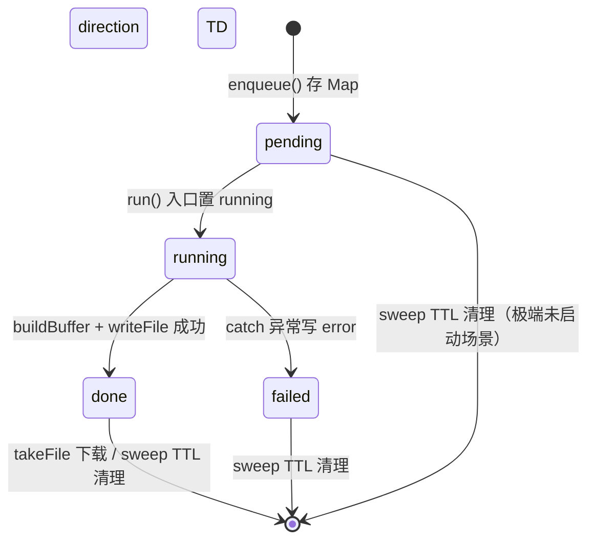
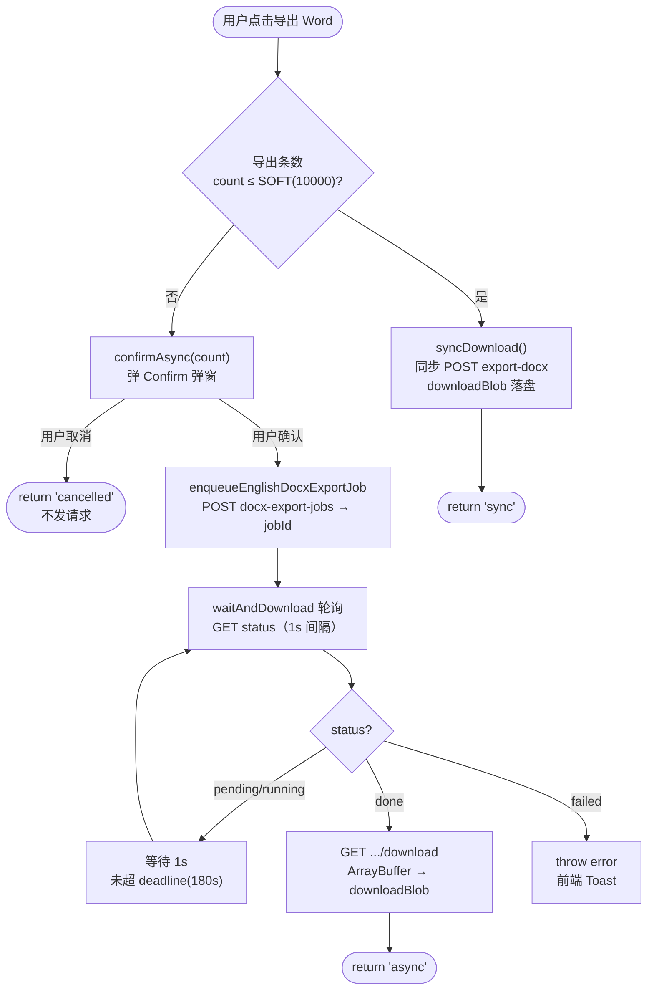

# 大集合 DOCX 异步导出 Job 系统

## 延伸阅读

- [词库整库DOCX导出.md](./词库整库DOCX导出.md)：词库 / 语句库**整库同步**导出为 Word（`Export` 下拉菜单 + 3 分钟超时）；大集合（>1 万条）现已改走本文的异步 Job
- [收藏错题DOCX导出.md](./收藏错题DOCX导出.md)：四类收藏 / 错题 DOCX 同步导出（`exportXxxDocxBuffer`）；大集合现由异步 Job 调度
- [单词库导出.md](./单词库导出.md)：单词库 JSON 导出
- [下拉菜单项对齐.md](./下拉菜单项对齐.md)：导出下拉菜单项文字的居中与宽度统一（纯样式专题）

---

## 1. 背景与目标

收藏、错题、复习等「大集合」（>10000 条）此前通过同步 HTTP 请求导出 Word，存在两个痛点：

1. **超时**：同步请求即使把超时拉到 3 分钟，上万条数据的 Packer 构建与网络往返仍可能超时，前端直接报错。
2. **OOM / 阻塞**：同步路径在一次请求内完成「查库 → Packer → 响应」，大集合内存尖峰高、阻塞工作线程，影响其它请求。

本轮引入**后台异步 Job + 临时文件 + 轮询下载**机制：

- 条数 ≤ `ENGLISH_DOCX_SYNC_SOFT`（10000）时仍走**同步**导出（体验即时）；
- 条数 > 10000 时，前端弹 **Confirm** 确认后台生成，后端 `enqueue` 立即返回 `jobId`，`run` 在后台 `buildBuffer → writeFile`，前端轮询 `getStatus`，`done` 后拉 `/download` 下载。
- 服务端 Job 存在**进程内存**（不上 Bull），临时文件落 OS `tmpdir`，TTL 30 分钟由 sweep 清理；多实例不共享、重启丢失是已知取舍。

## 2. 改动范围

**后端** `apps/backend/src/services/english-learning/`

- `english-docx-export-job.service.ts` — **纯新增**（307 行）：`EnglishDocxExportJobService`（enqueue / getStatus / takeFile / run / buildBuffer / sweep）
- `dto/english-docx-export-job.dto.ts` — **纯新增**：`CreateEnglishDocxExportJobDto`
- `english-learning.controller.ts` — 新增 3 个端点：`POST docx-export-jobs`、`GET docx-export-jobs/:jobId`、`GET docx-export-jobs/:jobId/download`
- `english-learning.module.ts` — providers 加 `EnglishDocxExportJobService`
- `english-learning.service.ts` — `clipExportDocxIds` → `normalizeExportDocxIds`；新增 `loadDocxRowsPaged` / `loadDocxRowsByIdsBatched` / `formatDocxExportSubtitle`；各 `export*DocxBuffer` 改用分页装载 + 硬顶 20000

**前端** `apps/frontend/src/`

- `service/api.ts` — 新增 `ENGLISH_LEARNING_DOCX_EXPORT_JOBS`、`ENGLISH_LEARNING_VOCABULARY_LIBRARY_EXPORT_DOCX`、`ENGLISH_LEARNING_CLASSIC_QUOTES_LIBRARY_EXPORT_DOCX`
- `service/index.ts` — 新增 `ENGLISH_DOCX_SYNC_SOFT`、`EnglishDocxExportJobKind`、`enqueueEnglishDocxExportJob`、`waitAndDownloadEnglishDocxExportJob`、`exportEnglishDocxSmart`；`downloadEnglishAuthorizedDocx` 加 `timeout`；各 `download*Docx` 加 `fileName` 入参
- `views/englishLearning/hooks/useDocxExportConfirm.tsx` — **纯新增**：Confirm 弹窗 Hook
- `views/englishLearning/utils/exportFileName.ts` — **纯新增**：`safeExportBaseName` / `exportDocxFileName`
- `views/englishLearning/components/export/Export.tsx` + `ExportMenu.tsx` — **纯新增**（替换 `classic/Export.tsx` + `vocab/Export.tsx`）
- `favorites/vocabulary/index.tsx`、`favorites/classic/index.tsx`、`mistakes/vocabulary/VocabularyMistakesPanel.tsx`、`mistakes/classic/ClassicQuoteMistakesPanel.tsx` — 接入 `useDocxExportConfirm` + `exportEnglishDocxSmart`

## 3. 实现思路

1. **同步软顶 + 异步硬顶**：`DOCX_EXPORT_SYNC_SOFT = 10_000`（前后端常量对齐）。≤ 1 万条同步即时下载，> 1 万条走异步；服务端硬顶 `DOCX_EXPORT_HARD_MAX = 20_000`，超则截断并在副标题明示。
2. **进程内 Job，不上 Bull**：当前规模单机足够，进程内 `Map<jobId, JobRec>` + `setInterval(sweep, 60s)` 即可；多实例不共享 / 重启丢任务是已知取舍，后续若需集群化再上 Bull。
3. **临时文件落 OS tmpdir**：`join(tmpdir(), 'dnhyxc-el-docx-export')`，不写仓库 `uploads/`；`takeFile` 只读已 `done` 的文件，`sweep` 按 30 分钟 TTL 删文件 + 踢 Map。
4. **归属校验防越权**：`requireJob` 校验 `job.userId === userId`，防止知道 UUID 就下载他人导出。
5. **前端分流函数 `exportEnglishDocxSmart`**：`count <= SOFT` 走 `syncDownload`；`count > SOFT` 先 `confirmAsync`，确认后 `enqueue → waitAndDownload`。`waitAndDownload` 每秒轮询 `getStatus`，`done` 后 `get download` 走 `downloadBlob`。
6. **Confirm Hook 用 resolverRef**：`useDocxExportConfirm` 返回 `{ confirmAsync, confirmNode }`；`confirmAsync` 返回 `Promise<boolean>`，resolver 存 ref，Confirm `onConfirm` / 关闭时 settle。
7. **导出文件名统一**：`exportDocxFileName(title)` 去非法字符 + 截 80 字符 + 保证 `.docx` 结尾。
8. **Export 组件合并**：原 `classic/Export.tsx` + `vocab/Export.tsx` 合并为共享 `components/export/Export.tsx` + `ExportMenu.tsx`（通用下拉菜单，每项独立 busy，hover 打开、160ms 延迟关）。

### 3.1 后端 Job 状态机



**状态说明**：
- `pending`：`enqueue` 写入 Map 后的极短窗口，`run` 入口立即改 `running`。
- `running`：`buildBuffer`（调同步导出）+ `writeFile` 写临时文件。
- `done`：`filePath` 已就绪，`takeFile` 可读；`getStatus` 返回 `done` 供前端拉下载。
- `failed`：`run` catch 异常，`error` 字段存 message，前端轮询见 `failed` 抛错。
- **sweep**：每 60s 遍历 Map，`now - createdAt > JOB_TTL_MS(30min)` 则 `unlink(filePath)` + `Map.delete`，后续 `getStatus` 返回 404。

### 3.2 前端 `exportEnglishDocxSmart` 分流流程



**读图要点**：`count` 取勾选数或全量总数；同步路径复用原有 `download*Docx`；异步路径 `deadline = now + 180s` 兜底超时；`done` 后用 `saveName` 走 `downloadBlob`（Tauri 弹系统提示、浏览器弹成功 Toast）。

## 4. 关键代码对比与注释

### 4.1 后端 `EnglishDocxExportJobService`（纯新增）

**对比范围**：`english-docx-export-job.service.ts` 全文件。基线中不存在，为纯新增。

**改动后** · `apps/backend/src/services/english-learning/english-docx-export-job.service.ts`（新增，约 L1–L307）

```typescript
// 顶部块注释说明：收藏 / 错题 / 复习大集合走进程内 Job + 临时文件；不上 Bull、多实例不共享
/**
 * 收藏 / 错题 / 复习大集合 DOCX 异步导出（进程内 Job + 临时文件）。
 * ponytail: 不上 Bull；多实例不共享 Job；天花板与同步硬顶同为 20000。
 *
 * 说明：Job 存在当前进程内存，多实例不共享；重启会丢未完成任务。若以后要集群化再上 Bull。
 */
// 从 node:crypto 导入 randomUUID，生成 Job 主键，避免与时间戳冲突
import { randomUUID } from 'node:crypto';
// 导入 existsSync / mkdirSync，构造函数里同步探测并创建临时目录
import { existsSync, mkdirSync } from 'node:fs';
// 导入 readFile / unlink / writeFile，异步读写删临时 .docx 文件
import { readFile, unlink, writeFile } from 'node:fs/promises';
// 导入 tmpdir，取 OS 临时根路径，避免写进仓库 uploads
import { tmpdir } from 'node:os';
// 导入 join，拼接 Job 目录与单文件路径
import { join } from 'node:path';
// 从 @nestjs/common 导入异常与 DI 装饰器：参数校验失败 / 鉴权失败 / 可注入 / 任务不存在 / 模块销毁清定时器
import {
	BadRequestException,
	ForbiddenException,
	Injectable,
	NotFoundException,
	OnModuleDestroy,
} from '@nestjs/common';
// 导入 EnglishLearningService，复用已落地的同步导出 Buffer 逻辑，Job 只负责任务调度与落盘
import { EnglishLearningService } from './english-learning.service';

// 块注释说明：超过此条数前端走异步 Job，须与前端 ENGLISH_DOCX_SYNC_SOFT 一致；取 10000 是因为同步超时已拉到 180s
/**
 * 超过此条数前端走异步 Job（须与前端 ENGLISH_DOCX_SYNC_SOFT 一致）。
 * 取 10000：同步超时已拉到 180s，多数收藏/错题可免 Confirm；再大仍走 Job，硬顶仍为 20000。
 */
// 导出常量 DOCX_EXPORT_SYNC_SOFT = 10000，前端 exportEnglishDocxSmart 与此对齐；≤ 此值仍走同步 POST
export const DOCX_EXPORT_SYNC_SOFT = 10_000;

// 导出类型 EnglishDocxExportKind，决定调用 EnglishLearningService 哪条 export*DocxBuffer
export type EnglishDocxExportKind =
	// 单词收藏全量或勾选导出
	| 'vocabulary-favorites'
	// 经典句收藏全量或勾选导出
	| 'classic-quote-favorites'
	// 单词错题全量或勾选导出
	| 'vocabulary-mistakes'
	// 经典句错题全量或勾选导出
	| 'classic-quote-mistakes'
	// 今日待复习导出，须配合 contentKind
	| 'practice-review';

// 导出类型 EnglishDocxExportJobStatus，任务生命周期，供轮询接口与 takeFile 门禁
export type EnglishDocxExportJobStatus =
	// 已入队、run 尚未改写状态的极短窗口
	| 'pending'
	// 正在 buildBuffer 或写盘
	| 'running'
	// 临时文件已就绪，可下载
	| 'done'
	// build 或写盘失败，error 字段有原因
	| 'failed';

// 定义私有类型 JobRec，内存中单条任务记录；不落库，进程重启即失
type JobRec = {
	// id 与 Map 键、临时文件名一致
	id: string;
	// 创建者 userId；轮询 / 下载时必须匹配，防止扫任务
	userId: number;
	// 当前状态机值
	status: EnglishDocxExportJobStatus;
	// 导出种类，供 buildBuffer 分支使用
	kind: EnglishDocxExportKind;
	// 仅 practice-review 使用，取值 vocab 或 classic
	contentKind?: 'vocab' | 'classic';
	// 勾选 id 快照；undefined 表示全量
	ids?: string[];
	// done 后本地绝对路径；未完成则为 undefined
	filePath?: string;
	// Content-Disposition 用的下载文件名
	filename: string;
	// failed 时写入的可读错误信息
	error?: string;
	// 入队时间戳，供 sweep 按 TTL 回收
	createdAt: number;
};

// 定义常量 JOB_TTL_MS = 30 分钟，任务与临时文件保留 30 分钟，超时由 sweep 删文件并踢出 Map
const JOB_TTL_MS = 30 * 60 * 1000;

// 装饰器 @Injectable()，注册为 Nest provider；实现 OnModuleDestroy 以清 setInterval
@Injectable()
// 导出类 EnglishDocxExportJobService，进程内异步导出编排：enqueue → run → takeFile；sweep 做 TTL
export class EnglishDocxExportJobService implements OnModuleDestroy {
	// 私有只读 jobs Map，jobId → 任务记录；多实例互不可见
	private readonly jobs = new Map<string, JobRec>();
	// 私有只读 dir，OS tmp 下专用子目录，隔离其它进程临时文件
	private readonly dir = join(tmpdir(), 'dnhyxc-el-docx-export');
	// 私有 cleanupTimer，每分钟触发 sweep 的句柄；destroy 时 clear
	private cleanupTimer?: ReturnType<typeof setInterval>;

	// 构造函数，注入同步导出服务；构造时确保目录存在并启动清理心跳
	constructor(private readonly englishLearning: EnglishLearningService) {
		// 冷启动时若目录不存在则创建，recursive 兼容父路径缺失
		if (!existsSync(this.dir)) {
			// 同步 mkdir，避免首个 Job 写盘竞态
			mkdirSync(this.dir, { recursive: true });
		}
		// 每 60s 扫一次过期 Job，避免 tmp 与 Map 无限涨
		this.cleanupTimer = setInterval(() => {
			// fire-and-forget：sweep 失败不应拖垮定时器回调
			void this.sweep();
			// 间隔 60_000 ms
		}, 60_000);
	}

	// 实现 onModuleDestroy，Nest 模块销毁（热重载 / 进程退出）时停掉清理定时器，防泄漏
	onModuleDestroy(): void {
		// 仅在已启动过 interval 时 clear
		if (this.cleanupTimer) clearInterval(this.cleanupTimer);
	}

	// enqueue 方法，Controller POST docx-export-jobs 调用：登记任务并立即异步跑，马上返回 jobId
	enqueue(
		// 入参 userId，当前登录用户，写入 JobRec 供后续鉴权
		userId: number,
		// 入参 input，种类 + 可选勾选 + 复习 contentKind
		input: {
			kind: EnglishDocxExportKind;
			ids?: string[] | null;
			contentKind?: 'vocab' | 'classic';
		},
		// 返回 { jobId, status }，立刻返回，不等待 DOCX 生成完
	): { jobId: string; status: EnglishDocxExportJobStatus } {
		// 复习导出缺 contentKind 时无法选 vocab / classic Buffer 分支
		if (input.kind === 'practice-review' && !input.contentKind) {
			// 抛 400，让前端补齐 body，避免 Job 跑到一半才失败
			throw new BadRequestException('practice-review 须指定 contentKind');
		}
		// 生成新任务全局唯一 id，兼作临时文件名
		const id = randomUUID();
		// 计算下载时的友好文件名：种类前缀 + 时间戳
		const filename = `${input.kind}-${Date.now()}.docx`;
		// 组装内存记录；status 初始 pending，run 入口会改成 running
		const job: JobRec = {
			// id 与 Map key、落盘文件名共用
			id,
			// userId 绑定创建者，防止他人用 jobId 下载
			userId,
			// status 入队瞬间尚未进入 try 块
			status: 'pending',
			// kind 复制种类供 buildBuffer switch
			kind: input.kind,
			// contentKind 复习用；其它种类可空
			contentKind: input.contentKind,
			// ids 有勾选则浅拷贝数组，避免调用方后续 mutate 影响 Job
			ids: input.ids?.length ? [...input.ids] : undefined,
			// filename 供 takeFile 返回 Content-Disposition
			filename,
			// createdAt TTL 起点
			createdAt: Date.now(),
		};
		// 挂入内存表，供 getStatus / takeFile / sweep 查找
		this.jobs.set(id, job);
		// 不 await：HTTP 立即返回；错误在 run 内写成 failed
		void this.run(job);
		// 返回前端轮询用 jobId；status 此时多为 pending（run 可能已抢先改为 running）
		return { jobId: id, status: job.status };
	}

	// getStatus 方法，Controller GET docx-export-jobs/:jobId 调用：轮询用精简视图
	getStatus(
		// 入参 userId，必须与 Job 创建者一致
		userId: number,
		// 入参 jobId，路径参数中的任务 id
		jobId: string,
		// 返回精简视图，含 jobId / status / 可选 error
	): {
		jobId: string;
		status: EnglishDocxExportJobStatus;
		error?: string;
	} {
		// 鉴权 + 存在性；过期 / 他人任务在此抛错
		const job = this.requireJob(userId, jobId);
		// 不暴露 filePath，仅给前端状态机
		return {
			// jobId 回显 id，便于客户端对账
			jobId: job.id,
			// status 返回 pending|running|done|failed
			status: job.status,
			// error 仅 failed 时有值，便于 Toast
			error: job.error,
		};
	}

	// takeFile 方法，Controller GET …/download 调用：仅 done 且文件仍在时读盘返回 Buffer
	async takeFile(
		// 入参 userId，同样走归属校验
		userId: number,
		// 入参 jobId
		jobId: string,
		// 返回 { buffer, filename }
	): Promise<{ buffer: Buffer; filename: string }> {
		// 取 Job 并校验归属
		const job = this.requireJob(userId, jobId);
		// 未完成或写盘失败时没有可读路径
		if (job.status !== 'done' || !job.filePath) {
			// 抛 400，前端应继续轮询或提示失败，而非当文件下载
			throw new BadRequestException('导出尚未完成');
		}
		// 将临时 DOCX 整文件读入内存（单文件体积受同步导出硬顶约束）
		const buffer = await readFile(job.filePath);
		// filename 给 Content-Disposition；buffer 给 res.end
		return { buffer, filename: job.filename };
	}

	// 私有 requireJob，统一拉取 Job 并校验归属；找不到或非本人则抛 Nest HTTP 异常
	private requireJob(userId: number, jobId: string): JobRec {
		// 从内存 Map 取；sweep 删掉后即为 undefined
		const job = this.jobs.get(jobId);
		// 不存在：可能过期、错误 id、或进程重启丢状态
		if (!job) {
			throw new NotFoundException('导出任务不存在或已过期');
		}
		// 防水平越权：知道 UUID 也不能下别人的包
		if (job.userId !== userId) {
			throw new ForbiddenException('无权访问该导出任务');
		}
		// 校验通过，返回可变引用（run 会原地改 status）
		return job;
	}

	// 私有 run，后台执行：生成 Buffer → 写临时文件 → 更新状态；捕获异常写 failed
	private async run(job: JobRec): Promise<void> {
		// 标记进行中，轮询可见
		job.status = 'running';
		try {
			// 按 kind 调同步导出，可能较慢 / 占内存
			const buf = await this.buildBuffer(job);
			// 临时文件路径：目录 + jobId.docx，避免文件名冲突
			const filePath = join(this.dir, `${job.id}.docx`);
			// 原子性足够：整包写入后再标 done
			await writeFile(filePath, buf);
			// 供 takeFile readFile
			job.filePath = filePath;
			// 前端轮询见 done 后拉 download
			job.status = 'done';
		} catch (e) {
			// 任意抛错进入失败态，不留下半截「成功」状态
			job.status = 'failed';
			// Error 取 message；其它类型给兜底文案
			job.error = e instanceof Error ? e.message : '导出失败';
		}
	}

	// 私有 buildBuffer，按 Job.kind 分发到 EnglishLearningService 已有同步导出（含分页 / 硬顶）
	private async buildBuffer(job: JobRec): Promise<Buffer> {
		// 取勾选快照；undefined 表示全量
		const ids = job.ids;
		// 穷尽五种业务导出入口
		switch (job.kind) {
			case 'vocabulary-favorites':
				// 单词收藏 DOCX Buffer
				return this.englishLearning.exportVocabularyFavoritesDocxBuffer(
					job.userId,
					ids,
				);
			case 'classic-quote-favorites':
				// 经典句收藏 DOCX Buffer
				return this.englishLearning.exportClassicQuoteFavoritesDocxBuffer(
					job.userId,
					ids,
				);
			case 'vocabulary-mistakes':
				// 单词错题 DOCX Buffer
				return this.englishLearning.exportVocabularyMistakesDocxBuffer(
					job.userId,
					ids,
				);
			case 'classic-quote-mistakes':
				// 经典句错题 DOCX Buffer
				return this.englishLearning.exportClassicQuoteMistakesDocxBuffer(
					job.userId,
					ids,
				);
			case 'practice-review':
				// 今日复习：contentKind 缺省按 vocab，避免 undefined 传入
				return this.englishLearning.exportPracticeReviewDueDocxBuffer(
					job.userId,
					job.contentKind === 'classic' ? 'classic' : 'vocab',
					ids,
				);
			default:
				// 理论上被 TS 穷尽；运行时脏 kind 仍 400
				throw new BadRequestException('未知导出类型');
		}
	}

	// 私有 sweep，TTL 清理：超时任务删临时文件并移出 Map，释放磁盘与内存
	private async sweep(): Promise<void> {
		// 取当前时刻，与 createdAt 比较
		const now = Date.now();
		// 遍历所有进行中 / 已完成任务
		for (const [id, job] of this.jobs) {
			// 未满 TTL 则跳过，保留可下载窗口
			if (now - job.createdAt < JOB_TTL_MS) continue;
			// 若已落盘则尝试删除临时文件
			if (job.filePath) {
				// unlink 失败（文件已删）忽略，避免 sweep 整体中断
				await unlink(job.filePath).catch(() => undefined);
			}
			// 从内存表移除，后续 getStatus 将 404
			this.jobs.delete(id);
		}
	}
}
```

### 4.2 后端 `CreateEnglishDocxExportJobDto`（纯新增）

**对比范围**：`dto/english-docx-export-job.dto.ts` 全文件。基线中不存在，为纯新增。

**改动后** · `apps/backend/src/services/english-learning/dto/english-docx-export-job.dto.ts`（新增，约 L1–L38）

```typescript
// 从 class-validator 导入校验装饰器：数组上限、数组校验、枚举校验、可选、UUID、条件校验
import {
	ArrayMaxSize,
	IsArray,
	IsIn,
	IsOptional,
	IsUUID,
	ValidateIf,
} from 'class-validator';

// 导出常量 ENGLISH_DOCX_EXPORT_KINDS，五种合法导出种类，供 @IsIn 校验与前端对齐
export const ENGLISH_DOCX_EXPORT_KINDS = [
	// 单词收藏
	'vocabulary-favorites',
	// 经典句收藏
	'classic-quote-favorites',
	// 单词错题
	'vocabulary-mistakes',
	// 经典句错题
	'classic-quote-mistakes',
	// 今日复习
	'practice-review',
] as const;

// 导出类型 EnglishDocxExportKindDto，由常量数组推导
export type EnglishDocxExportKindDto =
	(typeof ENGLISH_DOCX_EXPORT_KINDS)[number];

// 块注释：创建大集合 DOCX 异步导出任务
/** 创建大集合 DOCX 异步导出任务 */
// 导出类 CreateEnglishDocxExportJobDto
export class CreateEnglishDocxExportJobDto {
	// kind 必须属于 ENGLISH_DOCX_EXPORT_KINDS
	@IsIn(ENGLISH_DOCX_EXPORT_KINDS)
	// kind 字段，导出种类
	kind!: EnglishDocxExportKindDto;

	// 块注释：practice-review 必填
	/** practice-review 必填 */
	// contentKind 仅当 kind === 'practice-review' 时才校验
	@ValidateIf(
		(o: CreateEnglishDocxExportJobDto) => o.kind === 'practice-review',
	)
	// contentKind 必须是 vocab 或 classic
	@IsIn(['vocab', 'classic'])
	// contentKind 字段，仅复习导出使用
	contentKind?: 'vocab' | 'classic';

	// ids 可选
	@IsOptional()
	// ids 必须是数组
	@IsArray()
	// ids 最多 20000 条，对齐服务端硬顶
	@ArrayMaxSize(20000)
	// 每个元素必须是 UUID v4
	@IsUUID('4', { each: true })
	// ids 字段，勾选的条目 id；空或不传表示全量
	ids?: string[];
}
```

### 4.3 后端 `EnglishLearningController`：新增 3 个异步导出端点（纯新增）

**对比范围**：controller 中 `docx-export-jobs` 相关 3 个方法。基线中不存在，为纯新增。

**改动后** · `apps/backend/src/services/english-learning/english-learning.controller.ts`（新增方法，约 L1128–L1186）

```typescript
		// 块注释：大集合 DOCX 异步导出，创建任务（收藏 / 错题 / 复习）
		/** 大集合 DOCX 异步导出：创建任务（收藏/错题/复习） */
		// 装饰器 @Post('docx-export-jobs')，路由 POST /english-learning/docx-export-jobs
		@Post('docx-export-jobs')
		// 异步方法 createDocxExportJob
		async createDocxExportJob(
			// 取 AuthedRequest
			@Req() req: AuthedRequest,
			// 取请求体并校验为 CreateEnglishDocxExportJobDto
			@Body() dto: CreateEnglishDocxExportJobDto,
		) {
			// 从 req.user 取 userId
			const userId = req.user?.userId;
			// userId 为空抛 401 未授权
			if (userId == null) {
				throw new UnauthorizedException('未授权');
			}
			// 调用 docxExportJobService.enqueue 登记任务，传 kind / ids / contentKind
			const data = this.docxExportJobService.enqueue(userId, {
				kind: dto.kind,
				ids: dto.ids,
				contentKind: dto.contentKind,
			});
			// 返回成功包装
			return { success: true, data };
		}

		// 块注释：查询异步导出任务状态
		/** 查询异步导出任务状态 */
		// 装饰器 @Get('docx-export-jobs/:jobId')，路由 GET /english-learning/docx-export-jobs/:jobId
		@Get('docx-export-jobs/:jobId')
		// 异步方法 getDocxExportJob
		async getDocxExportJob(
			// 取 AuthedRequest
			@Req() req: AuthedRequest,
			// 取路径参数 jobId
			@Param('jobId') jobId: string,
		) {
			// 从 req.user 取 userId
			const userId = req.user?.userId;
			// userId 为空抛 401
			if (userId == null) {
				throw new UnauthorizedException('未授权');
			}
			// 调用 getStatus 获取任务状态
			const data = this.docxExportJobService.getStatus(userId, jobId);
			// 返回成功包装
			return { success: true, data };
		}

		// 块注释：下载已完成的异步导出 DOCX
		/** 下载已完成的异步导出 DOCX */
		// 装饰器 @Get('docx-export-jobs/:jobId/download')
		@Get('docx-export-jobs/:jobId/download')
		// 异步方法 downloadDocxExportJob，返回 void（直接写响应）
		async downloadDocxExportJob(
			// 取 AuthedRequest
			@Req() req: AuthedRequest,
			// 取路径参数 jobId
			@Param('jobId') jobId: string,
			// 取 Response 用于直接写流
			@Res() res: Response,
		): Promise<void> {
			// 从 req.user 取 userId
			const userId = req.user?.userId;
			// userId 为空抛 401
			if (userId == null) {
				throw new UnauthorizedException('未授权');
			}
			// 调用 takeFile 读取已完成的 Buffer 与 filename
			const { buffer, filename } = await this.docxExportJobService.takeFile(
				userId,
				jobId,
			);
			// 设置 Content-Type 为 DOCX MIME
			res.setHeader(
				'Content-Type',
				'application/vnd.openxmlformats-officedocument.wordprocessingml.document',
			);
			// 设置 Content-Disposition 为附件下载，filename 用 Job 记录的文件名
			res.setHeader('Content-Disposition', `attachment; filename="${filename}"`);
			// 设置 Content-Length 为 buffer 字节数
			res.setHeader('Content-Length', String(buffer.length));
			// 结束响应，输出 buffer
			res.end(buffer);
		}
```

### 4.4 后端 `english-learning.service.ts`：`clipExportDocxIds` → `normalizeExportDocxIds` + 分页辅助

**对比范围**：`clipExportDocxIds` 方法（删除）与 `normalizeExportDocxIds` / `loadDocxRowsPaged` / `loadDocxRowsByIdsBatched` 方法（新增）。

**改动前** · `apps/backend/src/services/english-learning/english-learning.service.ts`（基线，约 L4956–L4964）

```typescript
		// 块注释：导出收藏为 DOCX 时单次最多行数，避免超大文档占用内存
		/** 导出收藏为 DOCX 时单次最多行数，避免超大文档占用内存 */
		// 私有静态常量 FAVORITES_DOCX_EXPORT_MAX = 3000，旧硬顶
		private static readonly FAVORITES_DOCX_EXPORT_MAX = 3000;

		// 块注释：去重并截断导出 ids；空则返回 undefined 表示全量
		/** 去重并截断导出 ids；空则返回 undefined 表示全量 */
		// 私有方法 clipExportDocxIds，入参 ids 可选
		private clipExportDocxIds(ids?: string[] | null): string[] | undefined {
			// ids 为空或长度为 0 时返回 undefined，表示全量
			if (!ids?.length) return undefined;
			// 去重：trim、过滤空串、Set 去重
			const unique = [...new Set(ids.map((id) => id.trim()).filter(Boolean))];
			// 去重后仍为空返回 undefined
			if (unique.length === 0) return undefined;
			// 截断到 FAVORITES_DOCX_EXPORT_MAX(3000) 条
			return unique.slice(0, EnglishLearningService.FAVORITES_DOCX_EXPORT_MAX);
		}
```

**改动后** · `apps/backend/src/services/english-learning/english-learning.service.ts`（当前，约 L4956–L5050）

```typescript
		// 块注释：收藏 / 错题 / 复习导出安全硬顶（明示截断）；无生成上限须有天花板，更大集合再上异步 Job
		/**
		 * 收藏 / 错题 / 复习导出安全硬顶（明示截断）。
		 * ponytail: 无生成上限须有天花板；更大集合再上异步 Job（见 ideas 收藏错题全量导出Word）。
		 */
		// 私有静态常量 DOCX_EXPORT_HARD_MAX = 20000，新硬顶（旧 3000）
		private static readonly DOCX_EXPORT_HARD_MAX = 20_000;

		// 块注释：分页装载导出 rows，词库 / 收藏等同用，对齐 items API 上限
		/** 分页装载导出 rows（词库 / 收藏等同用；对齐 items API 上限） */
		// 私有静态常量 LIBRARY_DOCX_PAGE_SIZE = 1000，分页大小
		private static readonly LIBRARY_DOCX_PAGE_SIZE = 1000;

		// 块注释：去重导出 ids；空则 undefined=全量；超过硬顶则截断并标记
		/** 去重导出 ids；空则 undefined=全量；超过硬顶则截断并标记 */
		// 私有方法 normalizeExportDocxIds，返回 { ids?, idsTruncated }
		private normalizeExportDocxIds(ids?: string[] | null): {
			ids?: string[];
			idsTruncated: boolean;
		} {
			// ids 为空或长度为 0 时返回 idsTruncated=false，ids 省略表示全量
			if (!ids?.length) return { idsTruncated: false };
			// 去重：trim、过滤空串、Set 去重
			const unique = [...new Set(ids.map((id) => id.trim()).filter(Boolean))];
			// 去重后为空返回 idsTruncated=false
			if (unique.length === 0) return { idsTruncated: false };
			// 取硬顶常量
			const hardMax = EnglishLearningService.DOCX_EXPORT_HARD_MAX;
			// 超过硬顶则截断前 hardMax 条并标记 idsTruncated=true
			if (unique.length > hardMax) {
				return { ids: unique.slice(0, hardMax), idsTruncated: true };
			}
			// 未超硬顶返回全量去重 ids，idsTruncated=false
			return { ids: unique, idsTruncated: false };
		}

		// 块注释：按 skip/take 分页装载至硬顶；触顶且仍有下一行则 truncated
		/** 按 skip/take 分页装载至硬顶；触顶且仍有下一行则 truncated */
		// 私有泛型方法 loadDocxRowsPaged，入参 fetchPage(take, skip)
		private async loadDocxRowsPaged<T>(
			fetchPage: (take: number, skip: number) => Promise<T[]>,
			// 返回 { rows, truncated }
		): Promise<{ rows: T[]; truncated: boolean }> {
			// 取硬顶
			const hardMax = EnglishLearningService.DOCX_EXPORT_HARD_MAX;
			// 取分页大小
			const pageSize = EnglishLearningService.LIBRARY_DOCX_PAGE_SIZE;
			// 初始化 rows 数组
			const rows: T[] = [];
			// 初始化 offset
			let offset = 0;
			// 循环直到 rows 达到硬顶
			while (rows.length < hardMax) {
				// take 取 pageSize 与剩余额度的较小值
				const take = Math.min(pageSize, hardMax - rows.length);
				// 调 fetchPage 取一页
				const page = await fetchPage(take, offset);
				// 页为空则 break（无更多数据）
				if (!page.length) break;
				// 追加到 rows
				rows.push(...page);
				// offset 推进页长度
				offset += page.length;
				// 页长度 < take 说明已到末尾，break
				if (page.length < take) break;
			}
			// 初始化 truncated=false
			let truncated = false;
			// rows 达到硬顶时，再取 1 条探测是否还有更多
			if (rows.length >= hardMax) {
				// 取硬顶位置的下一条
				const more = await fetchPage(1, hardMax);
				// 有更多则 truncated=true
				truncated = more.length > 0;
			}
			// 返回 rows 与 truncated
			return { rows, truncated };
		}

		// 块注释：按 ids 分批 In 查询（每批 ≤ pageSize），避免单次 IN 过大
		/** 按 ids 分批 In 查询（每批 ≤ pageSize），避免单次 IN 过大 */
		// 私有泛型方法 loadDocxRowsByIdsBatched
		private async loadDocxRowsByIdsBatched<T>(
			// 入参 ids
			ids: string[],
			// 入参 fetchChunk(chunkIds)
			fetchChunk: (chunkIds: string[]) => Promise<T[]>,
			// 返回 rows
		): Promise<T[]> {
			// 取分页大小作为批次大小
			const pageSize = EnglishLearningService.LIBRARY_DOCX_PAGE_SIZE;
			// 初始化 rows
			const rows: T[] = [];
			// 按 pageSize 切片循环
			for (let i = 0; i < ids.length; i += pageSize) {
				// 切出当前批次
				const chunk = ids.slice(i, i + pageSize);
				// 调 fetchChunk 查本批
				const page = await fetchChunk(chunk);
				// 追加到 rows
				rows.push(...page);
			}
			// 返回 rows
			return rows;
		}
```

**变更摘要**：硬顶从 3000 提升到 20000；`clipExportDocxIds` 升级为 `normalizeExportDocxIds`（返回是否截断）；新增 `loadDocxRowsPaged`（全量分页装载 + 触顶探测）与 `loadDocxRowsByIdsBatched`（按 ids 分批 IN 查询），解决大集合一次性 `find` 撑爆内存 / IN 子句过大问题。

### 4.5 后端 `exportVocabularyFavoritesDocxBuffer`：改用分页 + 截断标记

**对比范围**：`exportVocabularyFavoritesDocxBuffer` 方法。其它 `export*DocxBuffer` 同构，以单词收藏为代表。

**改动前** · `apps/backend/src/services/english-learning/english-learning.service.ts`（基线，约 L4984–L5012）

```typescript
		// 块注释：当前用户单词收藏导出为 Word（最多 FAVORITES_DOCX_EXPORT_MAX 条；有 ids 则仅导出这些）
		/** 当前用户单词收藏导出为 Word（最多 FAVORITES_DOCX_EXPORT_MAX 条；有 ids 则仅导出这些） */
		// 异步方法 exportVocabularyFavoritesDocxBuffer
		async exportVocabularyFavoritesDocxBuffer(
			// 入参 userId
			userId: number,
			// 入参 ids 可选
			ids?: string[] | null,
			// 返回 Buffer
		): Promise<Buffer> {
			// 调用 clipExportDocxIds 得到 idFilter（string[] | undefined）
			const idFilter = this.clipExportDocxIds(ids);
			// 一次性 find：有 idFilter 用 In，无则全量但 take=3000
			const rows = await this.vocabFavoriteRepo.find({
				where: idFilter ? { userId, id: In(idFilter) } : { userId },
				order: { createdAt: 'DESC' },
				take: idFilter
					? undefined
					: EnglishLearningService.FAVORITES_DOCX_EXPORT_MAX,
			});
			// map 成 Builder 需要的字段
			const list = rows.map((r) => ({
				word: r.word,
				ipa: r.ipa ?? '',
				// ... 其余字段（与改动后相同）
			}));
			// 调 buildVocabularyFavoritesDocxBuffer，有 idFilter 时 subtitle 标「已选」
			return buildVocabularyFavoritesDocxBuffer(
				list,
				idFilter
					? {
							title: '英语单词收藏',
							subtitle: `共 ${list.length} 条（已选）`,
						}
					: undefined,
			);
		}
```

**改动后** · `apps/backend/src/services/english-learning/english-learning.service.ts`（当前，约 L5184–L5225）

```typescript
		// 块注释：当前用户单词收藏导出为 Word（分页全量；有 ids 则仅导出这些；触硬顶明示截断）
		/** 当前用户单词收藏导出为 Word（分页全量；有 ids 则仅导出这些；触硬顶明示截断） */
		// 异步方法 exportVocabularyFavoritesDocxBuffer
		async exportVocabularyFavoritesDocxBuffer(
			// 入参 userId
			userId: number,
			// 入参 ids 可选
			ids?: string[] | null,
			// 返回 Buffer
		): Promise<Buffer> {
			// 调用 normalizeExportDocxIds 解构出 idFilter 与 idsTruncated
			const { ids: idFilter, idsTruncated } = this.normalizeExportDocxIds(ids);
			// 截断标记初始化为 idsTruncated（勾选超硬顶时已截断）
			let truncated = idsTruncated;
			// 声明 rows 类型
			let rows: Awaited<ReturnType<typeof this.vocabFavoriteRepo.find>>;
			// 有 idFilter 走按 ids 分批 IN 查询
			if (idFilter) {
				rows = await this.loadDocxRowsByIdsBatched(idFilter, (chunk) =>
					this.vocabFavoriteRepo.find({
						where: { userId, id: In(chunk) },
						order: { createdAt: 'DESC' },
					}),
				);
			} else {
				// 无 idFilter 走全量分页装载
				const page = await this.loadDocxRowsPaged((take, skip) =>
					this.vocabFavoriteRepo.find({
						where: { userId },
						order: { createdAt: 'DESC' },
						take,
						skip,
					}),
				);
				// 取分页结果 rows
				rows = page.rows;
				// 全量触顶时 truncated 取 page.truncated
				truncated = page.truncated;
			}
			// map 成 Builder 需要的字段
			const list = rows.map((r) => ({
				word: r.word,
				ipa: r.ipa ?? '',
				pos: r.pos ?? '',
				segmentation: r.segmentation ?? '',
				translationZh: r.translationZh ?? '',
				example: r.example ?? '',
			}));
			// 调 buildVocabularyFavoritesDocxBuffer，subtitle 由 formatDocxExportSubtitle 统一生成
			return buildVocabularyFavoritesDocxBuffer(list, {
				title: '英语单词收藏',
				subtitle: this.formatDocxExportSubtitle(list.length, {
					selected: Boolean(idFilter),
					truncated,
					orderHint: idFilter ? undefined : '按收藏时间倒序',
				}),
			});
		}
```

**变更摘要**：一次性 `find` 改为 `loadDocxRowsByIdsBatched`（勾选）或 `loadDocxRowsPaged`（全量）；硬顶 3000 → 20000；subtitle 统一走 `formatDocxExportSubtitle`，在截断时明示「前 N 条」。

### 4.6 前端 `service/index.ts`：异步 Job 相关类型与函数（纯新增）

**对比范围**：`ENGLISH_DOCX_SYNC_SOFT`、`EnglishDocxExportJobKind`、`enqueueEnglishDocxExportJob`、`waitAndDownloadEnglishDocxExportJob`、`exportEnglishDocxSmart`。基线中不存在，为纯新增。

**改动后** · `apps/frontend/src/service/index.ts`（新增，约 L2613–L2745）

```typescript
	// 块注释：英语学习大 DOCX 导出（收藏/错题/复习/词库）生成较慢，拉长超时
	/** 英语学习大 DOCX 导出（收藏/错题/复习/词库）：生成较慢，拉长超时 */
	// 常量 ENGLISH_DOCX_TIMEOUT_MS = 180_000，DOCX 导出超时 3 分钟
	const ENGLISH_DOCX_TIMEOUT_MS = 180_000;

	// 块注释：超过此条数走异步 Job，与后端 DOCX_EXPORT_SYNC_SOFT=10000 对齐
	/** 超过此条数走异步 Job（与后端 DOCX_EXPORT_SYNC_SOFT=10000 对齐） */
	// 导出常量 ENGLISH_DOCX_SYNC_SOFT = 10_000
	export const ENGLISH_DOCX_SYNC_SOFT = 10_000;

	// 导出类型 EnglishDocxExportJobKind，五种导出种类
	export type EnglishDocxExportJobKind =
		// 单词收藏
		| 'vocabulary-favorites'
		// 经典句收藏
		| 'classic-quote-favorites'
		// 单词错题
		| 'vocabulary-mistakes'
		// 经典句错题
		| 'classic-quote-mistakes'
		// 今日复习
		| 'practice-review';

	// 类型 DocxExportJobStatus，任务状态机
	type DocxExportJobStatus = 'pending' | 'running' | 'done' | 'failed';

	// 块注释：创建大集合 DOCX 异步导出任务
	/** 创建大集合 DOCX 异步导出任务 */
	// 导出异步函数 enqueueEnglishDocxExportJob
	export async function enqueueEnglishDocxExportJob(input: {
		// 入参 kind
		kind: EnglishDocxExportJobKind;
		// 入参 ids 可选
		ids?: string[];
		// 入参 contentKind 可选
		contentKind?: 'vocab' | 'classic';
		// 返回 jobId 字符串
	}): Promise<string> {
		// POST 创建任务，取 data
		const { data } = await http.post<{
			jobId: string;
			status: DocxExportJobStatus;
		}>(ENGLISH_LEARNING_DOCX_EXPORT_JOBS, {
			kind: input.kind,
			ids: input.ids,
			contentKind: input.contentKind,
		});
		// 取 jobId 并 trim
		const jobId = data?.jobId?.trim();
		// jobId 为空抛错
		if (!jobId) throw new Error('创建导出任务失败');
		// 返回 jobId
		return jobId;
	}

	// 块注释：轮询异步导出任务直至完成，再下载文件
	/** 轮询异步导出任务直至完成，再下载文件 */
	// 导出异步函数 waitAndDownloadEnglishDocxExportJob
	export async function waitAndDownloadEnglishDocxExportJob(
		// 入参 jobId
		jobId: string,
		// 入参 fileName 可选
		fileName?: string,
		// 返回 void
	): Promise<void> {
		// trim jobId
		const id = jobId.trim();
		// id 为空抛错
		if (!id) throw new Error('jobId required');
		// 计算 deadline = now + 180s
		const deadline = Date.now() + ENGLISH_DOCX_TIMEOUT_MS;
		// 计算 saveName，fileName 为空则用默认名
		const saveName =
			fileName?.trim() || `english-export-${Date.now()}.docx`;
		// 轮询循环，未超 deadline 则继续
		while (Date.now() < deadline) {
			// GET 任务状态，silent 不弹错误
			const { data } = await http.get<{
				jobId: string;
				status: DocxExportJobStatus;
				error?: string;
			}>(`${ENGLISH_LEARNING_DOCX_EXPORT_JOBS}/${encodeURIComponent(id)}`, {
				silent: true,
			});
			// 取 status
			const status = data?.status;
			// status 为 done 时下载文件
			if (status === 'done') {
				// GET download 取 ArrayBuffer
				const { data: file } = await http.get<ArrayBuffer>(
					`${ENGLISH_LEARNING_DOCX_EXPORT_JOBS}/${encodeURIComponent(id)}/download`,
					{ silent: true, timeout: ENGLISH_DOCX_TIMEOUT_MS },
				);
				// file 不是 ArrayBuffer 抛错
				if (!(file instanceof ArrayBuffer)) {
					throw new Error('导出文件无效');
				}
				// 构造 Blob，MIME 为 DOCX
				const blob = new Blob([file], {
					type: 'application/vnd.openxmlformats-officedocument.wordprocessingml.document',
				});
				// 调 downloadBlob 落盘
				const result = await downloadBlob(
					{
						file_name: saveName,
						id: `english-docx-job-${Date.now()}`,
						overwrite: true,
					},
					blob,
				);
				// 下载失败处理
				if (result.success !== 'success') {
					// Tauri 已弹系统提示，直接 return
					if (isTauriRuntime()) return;
					// 浏览器抛错
					throw new Error(result.message || '下载失败');
				}
				// 下载成功 return
				return;
			}
			// status 为 failed 时抛错，带后端 error
			if (status === 'failed') {
				throw new Error(data?.error || '导出失败');
			}
			// pending / running 时等待 1s 再轮询
			await new Promise((r) => setTimeout(r, 1000));
		}
		// 超 deadline 抛超时错
		throw new Error('导出超时，请稍后重试');
	}

	// 块注释：小集合同步下载；超过 ENGLISH_DOCX_SYNC_SOFT 则 Confirm 后异步生成再下载；confirmAsync 返回 false 表示取消
	/**
	 * 小集合同步下载；超过 {@link ENGLISH_DOCX_SYNC_SOFT} 则 Confirm 后异步生成再下载。
	 * `confirmAsync` 返回 false 表示用户取消。
	 */
	// 导出异步函数 exportEnglishDocxSmart
	export async function exportEnglishDocxSmart(opts: {
		// 导出条数
		exportCount: number;
		// 确认弹窗回调
		confirmAsync: (count: number) => Promise<boolean>;
		// 同步下载回调
		syncDownload: () => Promise<void>;
		// 导出种类
		kind: EnglishDocxExportJobKind;
		// 勾选 ids 可选
		ids?: string[];
		// 复习 contentKind 可选
		contentKind?: 'vocab' | 'classic';
		// 异步落盘建议文件名（同步路径由 syncDownload 自行指定）
		fileName?: string;
		// 异步开始回调可选
		onAsyncStart?: () => void;
		// 返回 'sync' | 'async' | 'cancelled'
	}): Promise<'sync' | 'async' | 'cancelled'> {
		// count 取非负值
		const count = Math.max(0, opts.exportCount);
		// count ≤ SOFT 走同步下载
		if (count <= ENGLISH_DOCX_SYNC_SOFT) {
			await opts.syncDownload();
			return 'sync';
		}
		// count > SOFT 弹 Confirm
		const ok = await opts.confirmAsync(count);
		// 用户取消返回 'cancelled'
		if (!ok) return 'cancelled';
		// 调 onAsyncStart 回调（如 Toast 提示）
		opts.onAsyncStart?.();
		// 入队异步任务
		const jobId = await enqueueEnglishDocxExportJob({
			kind: opts.kind,
			ids: opts.ids,
			contentKind: opts.contentKind,
		});
		// 轮询并下载
		await waitAndDownloadEnglishDocxExportJob(jobId, opts.fileName);
		// 返回 'async'
		return 'async';
	}
```

### 4.7 前端 `downloadEnglishAuthorizedDocx` + 各 `download*Docx`：加 `timeout` 与 `fileName`

**对比范围**：`downloadEnglishAuthorizedDocx` 签名与 `downloadEnglishVocabularyFavoritesDocx`（其它三个收藏 / 错题 + review 同构，以单词收藏为代表）。

**改动前** · `apps/frontend/src/service/index.ts`（基线，约 L2648–L2670）

```typescript
		// 块注释：带鉴权拉取英语学习导出 DOCX；body.ids 非空时仅导出这些条目，否则全量（至多 3000）
		/**
		 * 带鉴权拉取英语学习导出 DOCX：`http.post` 取 `ArrayBuffer` 后统一走 {@link downloadBlob}。
		 * body.ids 非空时仅导出这些条目；否则全量（至多 3000）。
		 */
		// 异步函数 downloadEnglishAuthorizedDocx
		async function downloadEnglishAuthorizedDocx(
			// 入参 path
			path: string,
			// 入参 filename
			filename: string,
			// 入参 body 可选
			body?: Record<string, unknown>,
			// 返回 void
		): Promise<void> {
			// POST 取 ArrayBuffer，silent 不弹错
			const { data } = await http.post<ArrayBuffer>(path, body ?? {}, {
				silent: true,
			});
			// data 不是 ArrayBuffer 抛错
			if (!(data instanceof ArrayBuffer)) {
				throw new Error('导出文件无效');
			}
			// ... 后续 downloadBlob（与改动后相同）
		}

		// 块注释：下载当前用户单词收藏 Word（有 ids 仅导出所选，否则全量至多 3000）
		/** 下载当前用户单词收藏 Word（有 ids 仅导出所选，否则全量至多 3000） */
		// 导出异步函数 downloadEnglishVocabularyFavoritesDocx
		export async function downloadEnglishVocabularyFavoritesDocx(
			// 入参 ids 可选
			ids?: string[],
			// 返回 void
		): Promise<void> {
			// 调 downloadEnglishAuthorizedDocx，文件名固定 vocabulary-${Date.now()}.docx
			await downloadEnglishAuthorizedDocx(
				ENGLISH_LEARNING_VOCABULARY_FAVORITES_EXPORT_DOCX,
				`vocabulary-${Date.now()}.docx`,
				exportDocxBody(ids),
			);
		}
```

**改动后** · `apps/frontend/src/service/index.ts`（当前，约 L2748–L2790）

```typescript
		// 块注释：带鉴权拉取英语学习导出 DOCX；body.ids 非空时仅导出这些条目，否则全量（服务端硬顶 20000）
		/**
		 * 带鉴权拉取英语学习导出 DOCX：`http.post` 取 `ArrayBuffer` 后统一走 {@link downloadBlob}。
		 * body.ids 非空时仅导出这些条目；否则全量（服务端硬顶 20000）。
		 */
		// 异步函数 downloadEnglishAuthorizedDocx，新增 opts.timeout
		async function downloadEnglishAuthorizedDocx(
			// 入参 path
			path: string,
			// 入参 filename
			filename: string,
			// 入参 body 可选
			body?: Record<string, unknown>,
			// 新增入参 opts，可选 timeout
			opts?: { timeout?: number },
			// 返回 void
		): Promise<void> {
			// POST 取 ArrayBuffer，若有 timeout 则透传
			const { data } = await http.post<ArrayBuffer>(path, body ?? {}, {
				silent: true,
				...(opts?.timeout != null ? { timeout: opts.timeout } : {}),
			});
			// data 不是 ArrayBuffer 抛错
			if (!(data instanceof ArrayBuffer)) {
				throw new Error('导出文件无效');
			}
			// ... 后续 downloadBlob（未改动）
		}

		// 块注释：下载当前用户单词收藏 Word（有 ids 仅导出所选，否则全量）
		/** 下载当前用户单词收藏 Word（有 ids 仅导出所选，否则全量） */
		// 导出异步函数 downloadEnglishVocabularyFavoritesDocx，新增 fileName 入参
		export async function downloadEnglishVocabularyFavoritesDocx(
			// 入参 ids 可选
			ids?: string[],
			// 新增入参 fileName 可选
			fileName?: string,
			// 返回 void
		): Promise<void> {
			// 调 downloadEnglishAuthorizedDocx，fileName 优先，回退默认名；传 timeout
			await downloadEnglishAuthorizedDocx(
				ENGLISH_LEARNING_VOCABULARY_FAVORITES_EXPORT_DOCX,
				fileName?.trim() || `vocabulary-${Date.now()}.docx`,
				exportDocxBody(ids),
				{ timeout: ENGLISH_DOCX_TIMEOUT_MS },
			);
		}
```

**变更摘要**：`downloadEnglishAuthorizedDocx` 新增可选 `opts.timeout`；各 `download*Docx` 新增 `fileName` 入参并传 `ENGLISH_DOCX_TIMEOUT_MS`（3 分钟），使大集合同步路径也能撑到完成；注释中「至多 3000」改为「服务端硬顶 20000」。

### 4.8 前端 `useDocxExportConfirm` Hook（纯新增）

**对比范围**：`useDocxExportConfirm.tsx` 全文件。基线中不存在，为纯新增。

**改动后** · `apps/frontend/src/views/englishLearning/hooks/useDocxExportConfirm.tsx`（新增，约 L1–L47）

```tsx
	// 块注释：大集合 Word 导出 Confirm 后台生成，返回 Promise<boolean>
	/** 大集合 Word 导出：Confirm 后台生成（返回 Promise<boolean>）。 */
	// 导入 Confirm 组件
	import Confirm from '@design/Confirm';
	// 导入 React hooks
	import { useCallback, useRef, useState } from 'react';
	// 导入 useI18n
	import { useI18n } from '@/hooks';
	// 导入 ENGLISH_DOCX_SYNC_SOFT，弹窗描述里展示软顶条数
	import { ENGLISH_DOCX_SYNC_SOFT } from '@/service';

	// 导出函数 useDocxExportConfirm
	export function useDocxExportConfirm() {
		// 取 i18n t
		const { t } = useI18n();
		// open 状态控制 Confirm 显隐
		const [open, setOpen] = useState(false);
		// count 状态存当前导出条数，用于描述文案
		const [count, setCount] = useState(0);
		// resolverRef 存 Promise resolve，Confirm 关闭时调用
		const resolverRef = useRef<((ok: boolean) => void) | null>(null);

		// settle 回调，resolve Promise 并关弹窗
		const settle = useCallback((ok: boolean) => {
			// 调 resolver
			resolverRef.current?.(ok);
			// 清空 resolver
			resolverRef.current = null;
			// 关弹窗
			setOpen(false);
		}, []);

		// confirmAsync 回调，弹 Confirm 并返回 Promise<boolean>
		const confirmAsync = useCallback((exportCount: number) => {
			// 存 count
			setCount(exportCount);
			// 返回 Promise，resolve 存 ref
			return new Promise<boolean>((resolve) => {
				resolverRef.current = resolve;
				setOpen(true);
			});
		}, []);

		// confirmNode 渲染 Confirm 组件
		const confirmNode = (
			<Confirm
				// open 控制显隐
				open={open}
				// onOpenChange：关闭时 settle(false)，打开时 setOpen(true)
				onOpenChange={(next) => {
					if (!next) settle(false);
					else setOpen(true);
				}}
				// title 用 asyncConfirmTitle
				title={t('englishLearning.export.asyncConfirmTitle')}
				// description 用 asyncConfirmDesc，传 count 与 soft
				description={t('englishLearning.export.asyncConfirmDesc', {
					count,
					soft: ENGLISH_DOCX_SYNC_SOFT,
				})}
				// descriptionClassName 左对齐
				descriptionClassName="text-left"
				// confirmText 用 asyncConfirmAction
				confirmText={t('englishLearning.export.asyncConfirmAction')}
				// cancelText 用 common.cancel
				cancelText={t('common.cancel')}
				// onConfirm settle(true)
				onConfirm={() => settle(true)}
			/>
		);

		// 返回 confirmAsync 与 confirmNode
		return { confirmAsync, confirmNode };
	}
```

### 4.9 前端 `exportFileName` 工具（纯新增）

**对比范围**：`exportFileName.ts` 全文件。基线中不存在，为纯新增。

**改动后** · `apps/frontend/src/views/englishLearning/utils/exportFileName.ts`（新增，约 L1–L20）

```typescript
	// 块注释：导出落盘名，去掉路径非法字符，空则用 fallback
	/** 导出落盘名：去掉路径非法字符，空则用 fallback */
	// 导出函数 safeExportBaseName
	export function safeExportBaseName(
		// 入参 title
		title: string,
		// 入参 fallback 默认 'export'
		fallback = 'export',
		// 返回字符串
	): string {
		// trim、替换非法字符为下划线、截断到 80 字符
		const s = title
			.trim()
			.replace(/[\\/:*?"<>|]/g, '_')
			.slice(0, 80);
		// s 为空返回 fallback
		return s || fallback;
	}

	// 块注释：保证以 .docx 结尾
	/** 保证以 .docx 结尾 */
	// 导出函数 exportDocxFileName
	export function exportDocxFileName(
		// 入参 title
		title: string,
		// 入参 fallback 默认 'export'
		fallback = 'export',
		// 返回字符串
	): string {
		// 取安全 baseName
		const base = safeExportBaseName(title, fallback);
		// 已以 .docx 结尾则原样返回，否则补 .docx
		return /\.docx$/i.test(base) ? base : `${base}.docx`;
	}
```

### 4.10 前端 `Export` + `ExportMenu` 共享组件（纯新增，替换 classic/vocab Export）

**对比范围**：`components/export/Export.tsx` 与 `ExportMenu.tsx`。基线中 `classic/Export.tsx` + `vocab/Export.tsx` 已删除，改为共享组件。

**改动后** · `apps/frontend/src/views/englishLearning/components/export/ExportMenu.tsx`（新增，约 L1–L170）

```tsx
	// 块注释：通用导出菜单，hover 打开；多格式可并行，busy 落在对应项；触发图标有 loading 但不因导出禁用
	/**
	 * 通用导出菜单：hover 打开；多格式可并行，busy 落在对应项；
	 * 触发图标有 loading 但不因导出禁用。业务侧只声明 items。
	 */
	// 导入 Button
	import { Button } from '@ui/button';
	// 导入 DropdownMenu 相关组件
	import {
		DropdownMenu,
		DropdownMenuContent,
		DropdownMenuItem,
		DropdownMenuTrigger,
	} from '@ui/dropdown-menu';
	// 导入 FileDown 图标
	import { FileDown } from 'lucide-react';
	// 导入 React 类型与 hooks
	import {
		type MouseEvent,
		type ReactNode,
		useEffect,
		useRef,
		useState,
	} from 'react';
	// 导入 Spinner
	import { Spinner } from '@/components/ui';
	// 导入 useI18n
	import { useI18n } from '@/hooks';
	// 导入 cn
	import { cn } from '@/lib/utils';

	// 导出类型 ExportMenuItem
	export type ExportMenuItem = {
		// id，并行 busy 的稳定键
		id: string;
		// label，菜单项文案
		label: ReactNode;
		// when，默认 true；false 时不渲染
		when?: boolean;
		// disabled 可选
		disabled?: boolean;
		// onSelect 回调
		onSelect: () => void | Promise<void>;
	};

	// 导出类型 ExportMenuProps
	export type ExportMenuProps = {
		// items 菜单项数组
		items: ExportMenuItem[];
		// disabled 可选
		disabled?: boolean;
		// triggerDisabled，无有效资源 id 等时禁用触发器
		triggerDisabled?: boolean;
		// menuLabel 可选
		menuLabel?: string;
		// onBeforeClick 可选
		onBeforeClick?: (e: MouseEvent<HTMLButtonElement>) => void;
		// className 可选
		className?: string;
		// contentClassName 可选
		contentClassName?: string;
	};

	// 导出函数 ExportMenu
	export function ExportMenu({
		// 解构 items
		items,
		// 解构 disabled
		disabled,
		// 解构 triggerDisabled
		triggerDisabled,
		// 解构 menuLabelProp
		menuLabel: menuLabelProp,
		// 解构 onBeforeClick
		onBeforeClick,
		// 解构 className
		className,
		// 解构 contentClassName
		contentClassName,
	}: ExportMenuProps) {
		// 取 i18n t
		const { t } = useI18n();
		// menuLabel 默认用 export.menu
		const menuLabel = menuLabelProp ?? t('englishLearning.export.menu');
		// busyIds 状态，Set 存正在导出的 item id
		const [busyIds, setBusyIds] = useState<ReadonlySet<string>>(
			() => new Set(),
		);
		// menuOpen 状态
		const [menuOpen, setMenuOpen] = useState(false);
		// closeTimerRef 存延迟关闭定时器
		const closeTimerRef = useRef<ReturnType<typeof setTimeout> | null>(null);
		// busyRef 同步 busyIds，避免闭包过期
		const busyRef = useRef(busyIds);
		// 每次渲染更新 busyRef
		busyRef.current = busyIds;

		// visible 过滤 when !== false 的项
		const visible = items.filter((it) => it.when !== false);
		// anyBusy 任一 item 在导出
		const anyBusy = busyIds.size > 0;

		// useEffect cleanup 清除 closeTimer
		useEffect(
			() => () => {
				if (closeTimerRef.current) clearTimeout(closeTimerRef.current);
			},
			[],
		);

		// openMenu 打开菜单，先清关闭定时器
		const openMenu = () => {
			if (closeTimerRef.current) {
				clearTimeout(closeTimerRef.current);
				closeTimerRef.current = null;
			}
			setMenuOpen(true);
		};

		// scheduleCloseMenu 160ms 后关闭菜单
		const scheduleCloseMenu = () => {
			if (closeTimerRef.current) clearTimeout(closeTimerRef.current);
			closeTimerRef.current = setTimeout(() => setMenuOpen(false), 160);
		};

		// setBusy 更新 busyIds 中某 id 的状态
		const setBusy = (id: string, on: boolean) => {
			setBusyIds((prev) => {
				const next = new Set(prev);
				if (on) next.add(id);
				else next.delete(id);
				return next;
			});
		};

		// runItem 执行某 item 的 onSelect，期间置 busy
		const runItem = (item: ExportMenuItem) => {
			// 已禁用或正在导出则跳过
			if (item.disabled || busyRef.current.has(item.id)) return;
			// 置 busy
			setBusy(item.id, true);
			// 执行 onSelect，finally 清 busy
			void Promise.resolve()
				.then(() => item.onSelect())
				.finally(() => setBusy(item.id, false));
		};

		// 返回 DropdownMenu
		return (
			<DropdownMenu open={menuOpen} onOpenChange={setMenuOpen}>
				<DropdownMenuTrigger asChild>
					<Button
						type="button"
						variant="ghost"
						size="sm"
						disabled={disabled || triggerDisabled}
						aria-label={menuLabel}
						aria-busy={anyBusy}
						title={menuLabel}
						className={cn(
							'h-7 w-7 shrink-0 rounded-md p-0 transition-colors',
							'text-textcolor/65 hover:border hover:border-teal-500/15 hover:bg-teal-500/10 hover:text-teal-500',
							className,
						)}
						onClick={(e) => {
							// 触发 onBeforeClick
							onBeforeClick?.(e);
							// 阻止冒泡
							e.stopPropagation();
						}}
						// hover 打开
						onMouseEnter={openMenu}
						// 离开延迟关闭
						onMouseLeave={scheduleCloseMenu}
					>
						{/* 任一 busy 显示 Spinner，否则 FileDown */}
						{anyBusy ? (
							<Spinner className="size-3.5 text-textcolor" aria-hidden />
						) : (
							<FileDown className="size-3.5" aria-hidden />
						)}
					</Button>
				</DropdownMenuTrigger>
				<DropdownMenuContent
					align="end"
					sideOffset={6}
					scrollable={false}
					className={cn('min-w-34', contentClassName)}
					onCloseAutoFocus={(e) => e.preventDefault()}
					// content hover 也打开
					onMouseEnter={openMenu}
					// content 离开延迟关闭
					onMouseLeave={scheduleCloseMenu}
					onClick={(e) => e.stopPropagation()}
				>
					{/* 遍历 visible 渲染 DropdownMenuItem */}
					{visible.map((item) => {
						const busy = busyIds.has(item.id);
						return (
							<DropdownMenuItem
								key={item.id}
								className="justify-center gap-1.5"
								disabled={item.disabled || busy}
								onSelect={(e) => {
									e.preventDefault();
									setMenuOpen(false);
									runItem(item);
								}}
							>
								{/* busy 时显示 Spinner */}
								{busy ? (
									<Spinner
										className="size-3.5 shrink-0 text-textcolor"
										aria-hidden
									/>
								) : null}
								{item.label}
							</DropdownMenuItem>
						);
					})}
				</DropdownMenuContent>
			</DropdownMenu>
		);
	}
```

### 4.11 前端收藏 / 错题面板：接入 `exportEnglishDocxSmart`

**对比范围**：以 `favorites/vocabulary/index.tsx` 的 `handleExportDocx` 为代表（classic 收藏、vocab/classic 错题同构）。

**改动前** · `apps/frontend/src/views/englishLearning/favorites/vocabulary/index.tsx`（基线，约 L337–L365）

```typescript
		// ... 空 entries 判断与 Toast
		// ids 取勾选或 undefined（全量）
		const ids = selectedIds.size > 0 ? Array.from(selectedIds) : undefined;
		// 置 exportingDocx
		setExportingDocx(true);
		try {
			// 直接调同步下载
			await downloadEnglishVocabularyFavoritesDocx(ids);
			// 非 Tauri 弹成功 Toast
			if (!isTauriRuntime()) {
				Toast({
					type: 'success',
					title: t('englishLearning.vocab.exportDocxSuccess'),
				});
			}
		} catch (e) {
			// 失败 Toast
			Toast({
				type: 'error',
				title:
					e instanceof Error
						? e.message
						: t('englishLearning.vocab.exportDocxFail'),
			});
		} finally {
			setExportingDocx(false);
		}
```

**改动后** · `apps/frontend/src/views/englishLearning/favorites/vocabulary/index.tsx`（当前，约 L342–L385）

```typescript
		// ... 空 entries 判断与 Toast
		// ids 取勾选或 undefined（全量）
		const ids = selectedIds.size > 0 ? Array.from(selectedIds) : undefined;
		// exportCount 取勾选数或全量总数
		const exportCount = ids?.length ?? totalCount;
		// fileName 用导航名生成安全文件名
		const fileName = exportDocxFileName(
			t('englishLearning.favorites.vocab.nav'),
		);
		// 置 exportingDocx
		setExportingDocx(true);
		try {
			// 调 exportEnglishDocxSmart 分流
			const mode = await exportEnglishDocxSmart({
				// 导出条数
				exportCount,
				// Confirm 回调
				confirmAsync,
				// 同步下载回调，传 ids 与 fileName
				syncDownload: () =>
					downloadEnglishVocabularyFavoritesDocx(ids, fileName),
				// 导出种类
				kind: 'vocabulary-favorites',
				// 勾选 ids
				ids,
				// 异步文件名
				fileName,
				// 异步开始时 Toast 提示后台生成
				onAsyncStart: () => {
					Toast({
						type: 'info',
						title: t('englishLearning.export.asyncStarted'),
					});
				},
			});
			// 用户取消则直接 return（不清 exportingDocx 在 finally 处理）
			if (mode === 'cancelled') return;
			// 非 Tauri 弹成功 Toast
			if (!isTauriRuntime()) {
				Toast({
					type: 'success',
					title: t('englishLearning.vocab.exportDocxSuccess'),
				});
			}
		} catch (e) {
			// 失败 Toast，文案统一用 export.failed
			Toast({
				type: 'error',
				title:
					e instanceof Error ? e.message : t('englishLearning.export.failed'),
			});
		} finally {
			setExportingDocx(false);
		}
```

**变更摘要**：直接 `download*Docx` 改为 `exportEnglishDocxSmart` 分流；`exportCount` 取勾选数或全量总数；`fileName` 用 `exportDocxFileName`；`mode === 'cancelled'` 提前 return；`onAsyncStart` 弹「后台生成中」Toast。错题面板额外处理 `isReview` 分支（kind 取 `practice-review` / `vocabulary-mistakes`，contentKind 取 `vocab`）。

## 5. 兼容性与影响

- **行为变化**：条数 > 10000 的收藏 / 错题 / 复习导出不再同步阻塞，改为后台生成 + 轮询下载；用户会先看到 Confirm 弹窗，确认后弹「后台生成中」Toast，完成后自动下载。
- **硬顶提升**：同步导出硬顶从 3000 提升到 20000（`DOCX_EXPORT_HARD_MAX`），副标题会明示「前 N 条」截断。
- **超时放宽**：所有 DOCX 同步导出超时统一拉到 180s（`ENGLISH_DOCX_TIMEOUT_MS`）。
- **已知取舍**：Job 存进程内存，多实例不共享、进程重启丢未完成任务；临时文件 30 分钟 TTL 后 sweep 清理。后续若需集群化再上 Bull。
- **越权防护**：`requireJob` 校验 `userId` 归属，防止 UUID 遍历下载。

## 6. 相关源码路径

| 说明 | 路径 |
|------|------|
| 异步导出 Job 服务 | `apps/backend/src/services/english-learning/english-docx-export-job.service.ts` |
| 创建 Job DTO | `apps/backend/src/services/english-learning/dto/english-docx-export-job.dto.ts` |
| 异步导出 3 端点 | `apps/backend/src/services/english-learning/english-learning.controller.ts` |
| 分页导出辅助 | `apps/backend/src/services/english-learning/english-learning.service.ts` |
| 前端 API 常量 | `apps/frontend/src/service/api.ts` |
| 前端分流与轮询 | `apps/frontend/src/service/index.ts` |
| Confirm Hook | `apps/frontend/src/views/englishLearning/hooks/useDocxExportConfirm.tsx` |
| 文件名工具 | `apps/frontend/src/views/englishLearning/utils/exportFileName.ts` |
| 共享 Export 组件 | `apps/frontend/src/views/englishLearning/components/export/Export.tsx` + `ExportMenu.tsx` |

---

（若与仓库最新源码不一致，以源码为准）
