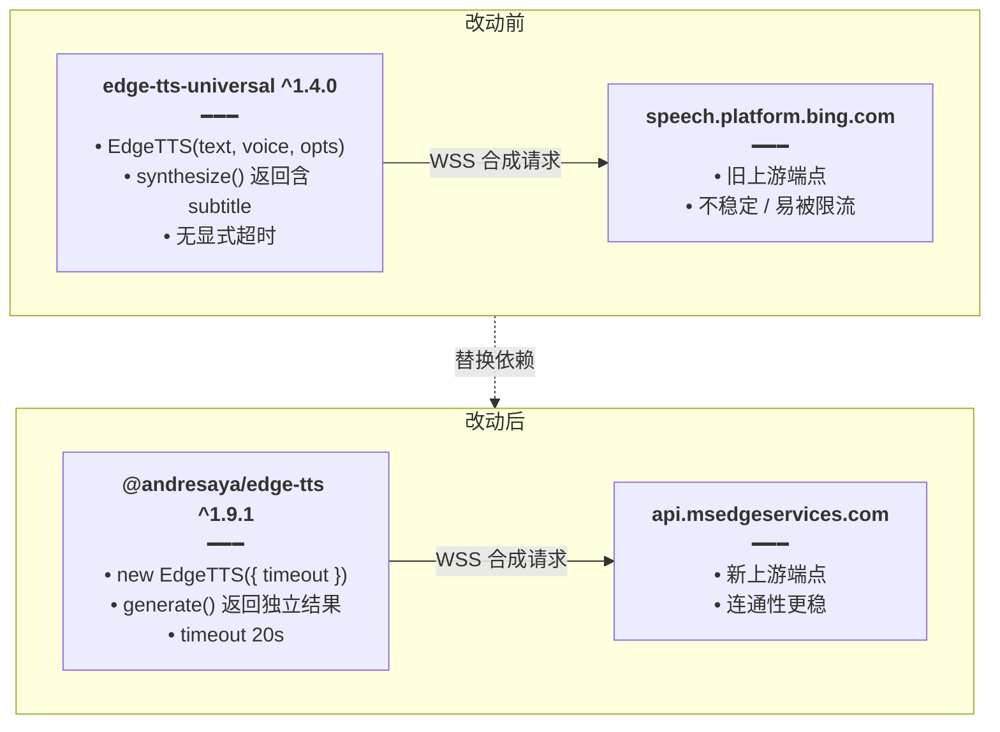

# Edge TTS 依赖迁移与超时加固 — 实现说明

## 延伸阅读

- [EdgeTTS统一流式.md](./EdgeTTS统一流式.md) — Edge stream endpoint 三端统一（仅传输形态，不改合成语义）
- [云端TTS边缘语音.md](./云端TTS边缘语音.md) — Edge 选路、分模式 prosody、设置页
- 规划态方案：[EdgeTTS端点迁移.md](../ideas/tts/EdgeTTS端点迁移.md) — 依赖迁移与端点稳定性规划

## 1. 背景与目标

后端 Edge 在线朗读原依赖 `edge-tts-universal`，其上游走 `speech.platform.bing.com`，长期存在不稳定、易被限流的问题；且单次合成没有显式超时，上游卡住会让请求一直挂起。本轮把依赖迁移到 `@andresaya/edge-tts`（上游 `api.msedgeservices.com`），并为单次合成加 20s 超时与空音频防御，让个别卡住/空响应的请求尽快以 502 结束，而不是长时间无响应。

目标：**换上游更稳的包 + 合成失败尽快返回**，对外接口、缓存与返回结构保持不变。

## 2. 改动范围

| 路径 | 说明 |
|------|------|
| `apps/backend/package.json` | 依赖替换：删 `edge-tts-universal`，加 `@andresaya/edge-tts` |
| `apps/backend/src/services/speech-transcription/edge-tts.service.ts` | import、超时常量、类文档注释、`synthesize()` 重写 |
| `apps/backend/src/services/speech-transcription/dto/edge-tts.dto.ts` | 类注释文案 |
| `apps/backend/src/services/speech-transcription/speech-transcription.controller.ts` | 方法注释文案 |
| `apps/frontend/src/service/api.ts` | `SPEECH_EDGE_TTS` 常量注释文案 |
| `pnpm-lock.yaml` | 锁文件随之更新（不展开） |

## 3. 实现思路

迁移前后的「包 → 上游域名」链路对比：



**权衡点：**

- **为何换包**：旧包 `edge-tts-universal` 走 `speech.platform.bing.com`，长期不稳定、易被限流；新包 `@andresaya/edge-tts` 走 `api.msedgeservices.com`，连通性更稳。两者同为「免费、无需 API Key」的 Edge 语音通道，故对外行为（音色、prosody、返回结构）基本不变。
- **为何用 `generate()` 而非 `synthesize()`**：`generate()` 返回**独立结果对象**（音频 + `wordBoundaries`），不依赖实例上的 `protected word_boundaries` 字段，适合 Nest 并发（同一实例可能被多请求复用）；同时避免读取 `protected` 字段带来的耦合。
- **为何 20s 超时 + 空音频防御**：上游卡住时到点即抛错，尽快以 502 结束请求，而不是挂死；上游若返回空音频，主动抛错，避免把空文件下发或落库。

## 4. 关键代码对比与注释

### 4.1 `package.json` 依赖替换

**改动前** · `apps/backend/package.json`（基线，约 L37、L65）

```jsonc
"dependencies": {
	// 旧依赖：仍使用 edge-tts-universal（上游 speech.platform.bing.com）
	"edge-tts-universal": "^1.4.0",
	// ...（其余依赖未改动）
}
```

**改动后** · `apps/backend/package.json`（当前源码，约 L37、L64）

```jsonc
"dependencies": {
	// 新依赖：改为 @andresaya/edge-tts（上游 api.msedgeservices.com，更稳）
	"@andresaya/edge-tts": "^1.9.1",
	// ...（其余依赖未改动）
}
```

**变更摘要**：`dependencies` 中删除 `edge-tts-universal`，新增 `@andresaya/edge-tts ^1.9.1`；`pnpm-lock.yaml` 随之更新。

### 4.2 `edge-tts.service.ts` 顶部 import

**改动前** · `apps/backend/src/services/speech-transcription/edge-tts.service.ts`（基线，约 L8）

```typescript
// 旧包：从 edge-tts-universal 起笔引入聚合入口导出的 EdgeTTS 类
import { EdgeTTS } from 'edge-tts-universal';
```

**改动后** · `apps/backend/src/services/speech-transcription/edge-tts.service.ts`（当前源码，约 L1）

```typescript
// 新包：改为从 @andresaya/edge-tts 引入 EdgeTTS（上游切到 api.msedgeservices.com）
import { EdgeTTS } from '@andresaya/edge-tts';
```

**变更摘要**：import 来源从 `edge-tts-universal` 换成 `@andresaya/edge-tts`，并上移到文件首行。

### 4.3 新增常量 `EDGE_TTS_TIMEOUT_MS`

**改动后** · `apps/backend/src/services/speech-transcription/edge-tts.service.ts`（当前源码，纯新增，约 L22–L23）

```typescript
// 新增常量：单次合成超时上限，上游卡住时到点即抛错，避免请求挂死
/** 单次合成超时：上游卡住时尽快 502，避免请求挂死 */
const EDGE_TTS_TIMEOUT_MS = 20_000;
```

**变更摘要**：基线无此常量；新增后同时用于 `new EdgeTTS({ timeout })` 与 `generate()` 的 `timeout` 选项（双保险）。

### 4.4 `synthesize()` 完整符号

**改动前** · `apps/backend/src/services/speech-transcription/edge-tts.service.ts`（基线，约 L128–L144）

```typescript
// 旧实现：完整 synthesize 私有方法（合成 → 读音频 → 边界 DTO → 502 兜底）
private async synthesize(resolved: EdgeTtsResolved): Promise<CachedSpeech> {
	// 旧包构造：把文本、音色与 prosody 一并传入构造函数
	const tts = new EdgeTTS(resolved.text, resolved.voice, {
		// 语速：resolveOptions 已换算好的 rate 字符串
		rate: resolved.rate,
		// 音量：resolveOptions 已换算好的 volume
		volume: resolved.volume,
		// 音高：resolveOptions 已换算好的 pitch
		pitch: resolved.pitch,
	});
	// 包住合成与音频读取：任何失败统一转 502
	try {
		// 触发合成；旧包返回含 audio(Blob) 与 subtitle 的结果
		const result = await tts.synthesize();
		// 把 audio Blob 读成 ArrayBuffer 再包成 Node Buffer
		const buffer = Buffer.from(await result.audio.arrayBuffer());
		// 旧包用 subtitle 数组表示词/字边界；缺省给空数组
		const boundaries = this.toBoundaryDto(result.subtitle ?? []);
		// 返回缓存结构：音频 buffer + 边界
		return { buffer, boundaries };
	} catch (err) {
		// 把任意抛错收窄成可读 message（unknown → string）
		const detail = err instanceof Error ? err.message : String(err);
		// 统一抛 502，交由上层返回可读错误
		throw new HttpException(
			// 带上游失败详情，便于排查
			`Edge 语音合成失败：${detail}`,
			HttpStatus.BAD_GATEWAY,
		);
	}
}
```

**改动后** · `apps/backend/src/services/speech-transcription/edge-tts.service.ts`（当前源码，约 L131–L154）

```typescript
// 新实现：完整 synthesize 私有方法（构造注入超时 → generate → 空音频防御 → 502 兜底）
private async synthesize(resolved: EdgeTtsResolved): Promise<CachedSpeech> {
	// 与基线差异：不再把文本/音色传入构造函数，改为构造即注入超时；结果经 generate() 获取
	// generate() 返回独立结果，适合 Nest 并发；勿读 protected word_boundaries
	const tts = new EdgeTTS({ timeout: EDGE_TTS_TIMEOUT_MS });
	// 包住合成与音频读取：任何失败统一转 502
	try {
		// 新包用 generate(text, voice, opts) 触发合成，返回独立结果
		const result = await tts.generate(resolved.text, resolved.voice, {
			// 语速：resolveOptions 已换算好的 rate 字符串
			rate: resolved.rate,
			// 音量：resolveOptions 已换算好的 volume
			volume: resolved.volume,
			// 音高：resolveOptions 已换算好的 pitch
			pitch: resolved.pitch,
			// 单次合成超时：与构造层一致，确保到点中止
			timeout: EDGE_TTS_TIMEOUT_MS,
		});
		// 新包直接给出 Node Buffer 形式的音频，无需再读 Blob
		const buffer = Buffer.from(result.audio);
		// 空音频防御：上游返回空则立即报错，避免下发/落库空文件
		if (!buffer.length) {
			// 抛出可读错误，交由下方 catch 转成 502
			throw new Error('未收到音频数据');
		}
		// 新包用 wordBoundaries 数组表示词/字边界；缺省给空数组
		const boundaries = this.toBoundaryDto(result.wordBoundaries ?? []);
		// 返回缓存结构：音频 buffer + 边界
		return { buffer, boundaries };
	} catch (err) {
		// 把任意抛错收窄成可读 message（unknown → string）
		const detail = err instanceof Error ? err.message : String(err);
		// 统一抛 502，交由上层返回可读错误
		throw new HttpException(
			// 带上游失败详情，便于排查
			`Edge 语音合成失败：${detail}`,
			HttpStatus.BAD_GATEWAY,
		);
	}
}
```

**变更摘要**：构造从「传 text/voice + prosody」改为「传 `{ timeout }`」；合成从 `synthesize()` 改为 `generate(text, voice, { ...prosody, timeout })`；音频从 `await result.audio.arrayBuffer()` 改为直接 `result.audio`；新增空音频防御；边界字段从 `subtitle` 改为 `wordBoundaries`。`catch` 的 502 兜底与 `toBoundaryDto` 换算均未变。

### 4.5 注释类文案改动（无逻辑变化）

**来源**：以下仅改注释文案，行为不变。

| 路径 | 改动前注释 | 改动后注释 |
|------|-----------|-----------|
| `apps/backend/src/services/speech-transcription/edge-tts.service.ts`（类文档注释） | `Microsoft Edge 在线语音合成（edge-tts-universal）：免费、无需 API Key。` | `Microsoft Edge 在线语音合成（@andresaya/edge-tts → api.msedgeservices.com）：免费、无需 API Key。勿用仍走 speech.platform.bing.com 的旧包。` |
| `apps/backend/src/services/speech-transcription/dto/edge-tts.dto.ts`（`EdgeTtsDto` 类注释） | `Microsoft Edge 在线语音合成（edge-tts-universal）请求体` | `Microsoft Edge 在线语音合成（@andresaya/edge-tts）请求体` |
| `apps/backend/src/services/speech-transcription/speech-transcription.controller.ts`（`edgeSpeechStream` 方法注释） | `Microsoft Edge 在线语音合成（edge-tts-universal）：免费、无需 API Key。` | `Microsoft Edge 在线语音合成（@andresaya/edge-tts）：免费、无需 API Key。` |
| `apps/frontend/src/service/api.ts`（`SPEECH_EDGE_TTS` 常量注释） | `Microsoft Edge 在线语音合成（edge-tts-universal，免费无需 API Key）` | `Microsoft Edge 在线语音合成（后端 @andresaya/edge-tts，免费无需 API Key）` |

## 5. 兼容性与影响

| 项 | 说明 |
|----|------|
| 对外接口 | `POST /speech-transcription/edge/speech`、`/edge/speech/stream`、`/edge/speech/timed` 路由与出入参不变 |
| 返回结构 | `CachedSpeech` / `EdgeTtsTimedResult` 不变（音频 Buffer + 边界数组） |
| 音色 / prosody | 换算函数（`edgeRateFromSpeed` 等）与缓存键均未变，音色与语速分档不受影响 |
| 失败表现 | 上游卡住或空响应时更快返回 502（原先可能挂起） |
| 缓存 | L1 进程缓存 / L2 文件缓存键值不变，已缓存音频继续命中 |

## 6. 相关源码与文档

| 说明 | 路径 |
|------|------|
| 合成服务 | `apps/backend/src/services/speech-transcription/edge-tts.service.ts` |
| 请求体 DTO | `apps/backend/src/services/speech-transcription/dto/edge-tts.dto.ts` |
| 控制器 | `apps/backend/src/services/speech-transcription/speech-transcription.controller.ts` |
| 前端 API 常量 | `apps/frontend/src/service/api.ts` |
| 依赖声明 | `apps/backend/package.json` |
| endpoint 统一 | [EdgeTTS统一流式.md](./EdgeTTS统一流式.md) |
| Edge 选路 / prosody | [云端TTS边缘语音.md](./云端TTS边缘语音.md) |

---

**若与仓库最新源码不一致，以源码为准。**
