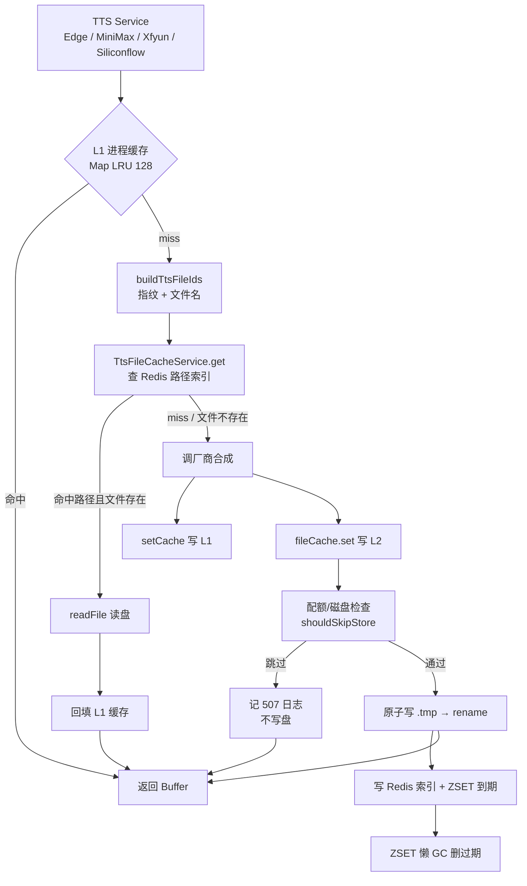
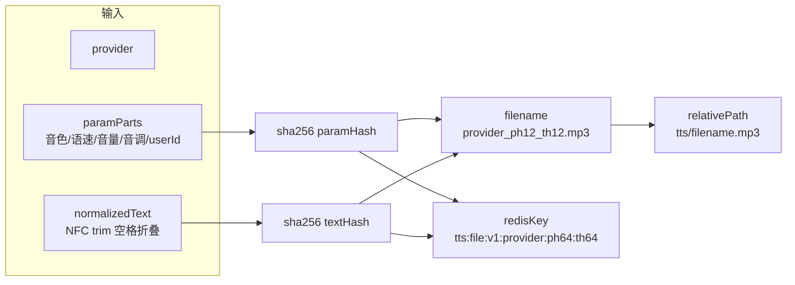
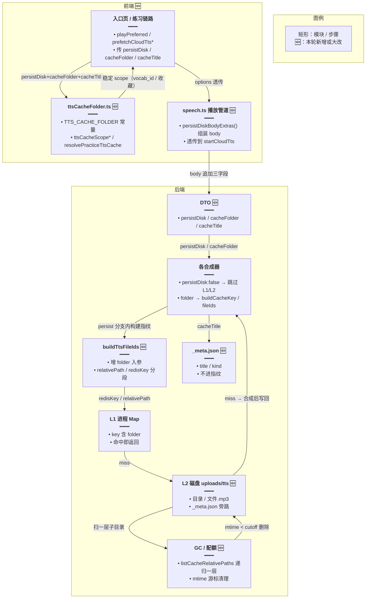

> **⚠️ 路径索引 / GC / Redis 连接以定稿文为准**：[TTS缓存复用全局Cache.md](./TTS缓存复用全局Cache.md)（去掉专用 ioredis + ZSET，改走全局 `CACHE_MANAGER` + 磁盘 mtime GC）。**下文保留首版 L2 落盘与四厂商接入的历史叙述；文中「ZSET / 专用 Redis」描述已过时，请勿按本文实现连接层。**
>
> **文档角色（更新：TTS 缓存目录化 + opt-in 落盘；TTL 180 天）**：本篇是 `tts-file-cache.service.ts` 的**主稿**。本轮把 L2 从「单层平铺目录」升级为**按作用域目录化**（`uploads/tts/<folder>/` + `_meta.json`），并把「是否落盘」改为**调用方 opt-in**（`persistDisk:false` 完全跳过 L1/L2），TTL 由 30 天上调为 **180 天**。§1–§7 为首版 / 定稿历史叙述，**本轮目录化与 opt-in 的改动以 §8 为准**。

## 延伸阅读

- **定稿（连接与 GC）**：[TTS缓存复用全局Cache.md](./TTS缓存复用全局Cache.md)
- 前端 TTS 缓存一致性：[`英语TTS缓存一致性.md`](./英语TTS缓存一致性.md) · [`练习TTS批量预取管道.md`](./练习TTS批量预取管道.md)
- 云端 TTS 厂商接入：[`MiniMax云端TTS.md`](./MiniMax云端TTS.md) · [`讯飞云TTS.md`](./讯飞云TTS.md) · [`云端TTS边缘语音.md`](./云端TTS边缘语音.md)
- 规划态方案：[`ideas/tts/TTS本地文件缓存.md`](../ideas/tts/TTS本地文件缓存.md) · [`ideas/tts/TTS按资源库分目录.md`](../ideas/tts/TTS按资源库分目录.md) · [`ideas/tts/TTS仅英语学习落盘.md`](../ideas/tts/TTS仅英语学习落盘.md)
- 产品使用说明：[`项目指南.md`](../项目指南.md) §13.32
- 用户向更新条目：[`项目更新信息.md`](../项目更新信息.md)

---

## 1. 背景与目标

云端 TTS 合成（MiniMax / 讯飞 / Edge / 硅基）原有两层缓存：

- **L1 进程内存**：`Map<string, Buffer>` LRU，进程重启即丢；
- **厂商侧限制**：CosyVoice 等神经 TTS 无 seed，同句两次合成发音漂移。

进程内缓存只在单次部署生命周期内有效，**重启 / 多副本** 后同一句话必须重新花钱合成，且发音可能漂移。

本次新增 **L2 磁盘文件缓存**：合成成功的 MP3 落盘到 `uploads/tts/`。**首版**曾用「Redis 路径索引 + ZSET 到期表」；**定稿**改为全局 `CACHE_MANAGER` 路径索引 + **mtime 游标 GC**（见定稿文）。命中顺序仍为：**L1 进程缓存 → L2 磁盘文件 → 调厂商合成并写回**。

核心目标：

- **跨重启 / 跨副本复用**：同一 `provider + 参数 + 文本` 组合只合成一次，磁盘持久化；
- **配额与磁盘保护**：超预算 / 磁盘不足时**不落盘、不删旧文件**，记日志，音频仍在内存返回；
- **懒 GC**：定稿为 mtime 分批删（非 ZSET）；
- **不影响现有逻辑**：未启用或读盘失败时透明回退到「调厂商合成」。

---

## 2. 改动范围

| 路径 | 说明 |
|------|------|
| `apps/backend/src/enum/tts-file-cache.enum.ts` | **新建**：环境变量枚举（开关 / TTL / 预算） |
| `apps/backend/src/services/speech-transcription/tts-file-cache.keys.ts` | **新建**：provider 类型、Redis key、ZSET key、文本归一化、指纹与文件名生成 |
| `apps/backend/src/services/speech-transcription/tts-file-cache.keys.self-check.ts` | **新建**：指纹自检脚本（ponytail） |
| `apps/backend/src/services/speech-transcription/tts-file-cache.service.ts` | **新建**：L2 缓存服务（get / set / GC / 配额 / 磁盘检查） |
| `apps/backend/src/services/speech-transcription/speech-transcription.module.ts` | 注册 `TtsFileCacheService` 到 providers 与 exports |
| `apps/backend/src/utils/upload-paths.ts` | 新增 `getUploadTtsDir()` 返回 `uploads/tts/` |
| `apps/backend/src/services/speech-transcription/edge-tts.service.ts` | 接入 L2 缓存 + JSON sidecar（boundaries） |
| `apps/backend/src/services/speech-transcription/minimax-tts.service.ts` | 接入 L2 缓存（同步 + 流式两条路径） |
| `apps/backend/src/services/speech-transcription/xfyun-tts.service.ts` | 接入 L2 缓存（同步 + 流式两条路径） |
| `apps/backend/src/services/speech-transcription/siliconflow-transcription.service.ts` | 接入 L2 缓存 |
| `apps/backend/package.json` | 新增 `ioredis@5.10.0` 依赖（ZSET / 配额计数用） |
| `apps/backend/src/enum/tts-file-cache.enum.ts` | **本轮**：TTL 默认文案 30 天 → 180 天（仅注释） |
| `apps/backend/src/services/speech-transcription/tts-file-cache.keys.ts` | **本轮**：新增 `TTS_CACHE_FOLDER_FALLBACK` / `sanitizeTtsCacheFolder`；`buildTtsFileIds` 增 `folder` → 分目录 `relativePath` / `redisKey` |
| `apps/backend/src/services/speech-transcription/tts-file-cache.service.ts` | **本轮**：TTL 180 天；新增 `writeScopeMeta` / `listCacheRelativePaths`；`toAbsolute` 路径越界防护；`gcExpired` 递归一层子目录 |
| `apps/backend/src/services/speech-transcription/dto/{edge,minimax,xfyun}-tts.dto.ts` | **本轮**：各新增 `persistDisk` / `cacheFolder` / `cacheTitle` 三字段 |
| `apps/backend/src/services/speech-transcription/{edge,minimax,xfyun}-tts.service.ts` | **本轮**：`buildCacheKey` / `fileIds` 增 `folder`；`persistDisk:false` **完全跳过 L1/L2**（不读也不写） |
| `apps/backend/src/services/speech-transcription/siliconflow-transcription.service.ts` | **本轮**：**删除**进程内 `ttsSpeechCache` 与文件缓存写入，改为不落盘 |
| `apps/backend/src/services/english-learning/english-learning.service.ts` | **本轮**：注入 `TtsFileCacheService`，建库后写 `_meta.json` 作用域元数据 |
| `apps/backend/src/services/english-learning/english-learning.module.ts` | **本轮**：import `SpeechTranscriptionModule` |
| `apps/frontend/src/views/englishLearning/utils/ttsCacheFolder.ts` | **本轮·新增**：目录常量、scope 解析、`resolvePracticeTtsCache` |
| `apps/frontend/src/utils/speech.ts` | **本轮**：`PlayPreferredOptions` 等增 3 参；新增 `persistDiskBodyExtras()`；全链路透传 |
| `apps/frontend/src/views/englishLearning/**`（入口页 / 练习链路） | **本轮**：各入口透传 `cacheFolder` / `cacheTitle` |

---

## 3. 实现思路

### 3.1 关键决策

1. **三级命中顺序 L1 → L2 → 厂商**：L1 命中直接返回（最快，零 IO）；L1 miss 才查 L2 磁盘；L2 miss 才调厂商并写回 L1 + L2。
2. **指纹设计**：
   - **Redis key 用完整 SHA-256**（参数 hash + 文本 hash），保证唯一性；
   - **文件名用 12 位短缀**（`${provider}_${paramHash12}_${textHash12}.mp3`），防止路径过长（部分 FS 限制 255 字节）；
   - **GC 靠 ZSET member=相对路径**，不依赖文件名反推 key。
3. **跨用户 vs 按用户**：
   - **Edge**：`paramParts` 不含 `userId`（Edge 音色与用户无关，跨用户共享）；
   - **MiniMax / 讯飞**：`paramParts` 含 `userIdPart(userId)`（用户可能配置了自定义音色 / 凭据，需隔离）；
   - **硅基**：固定参数 `[model, voice, '1', '0']`，跨用户共享。
4. **配额策略：只跳过、不驱逐**：超出 `maxBytes` 或磁盘不足时，**跳过当前写入、不删旧文件**（避免误删活跃文件），通过 `logsService.createSafe` 记 507。到期文件由 TTL + 懒 GC 清理。
5. **原子写盘**：先写 `${abs}.${pid}.tmp`，再 `rename` 到目标路径，避免并发读半成品。
6. **JSON sidecar**：Edge 有 `boundaries`（WordBoundary 时间戳），用同名 `.json` 文件伴随 `.mp3` 存储；读盘时 `getJson` 读取。
7. **懒 GC 节流**：`GC_MIN_INTERVAL_MS = 60_000`，每次 `get` / `set` 后 `scheduleGc`，但 60s 内只跑一次；`gcExpired` 从 ZSET 取 `score <= now` 的前 32 条批量删。

### 3.2 架构与数据流



### 3.3 指纹生成与 key 结构



---

## 4. 关键代码对比与注释

> 本节 4.1–4.6 为**首版落盘 / 定稿连接层**的代码摘录（TTL 默认 30 天、指纹无 `folder`、硅基进程内缓存等）。这些点**已在本轮更新中调整**，历史摘录仅作对照；**本轮改动以 §8 为准**（§8 提供改动前 / 改动后成对代码与逐行注释）。

### 4.1 环境变量枚举（新增）

**改动后** · `apps/backend/src/enum/tts-file-cache.enum.ts`（当前，全文）

```typescript
/** TTS 本地文件缓存（uploads/tts + Redis 路径索引 + ZSET 懒 GC） */
export enum TtsFileCacheEnum {
	// 总开关：是否启用 L2 磁盘缓存
	TTS_FILE_CACHE_ENABLED = 'TTS_FILE_CACHE_ENABLED',
	/**
	 * tts 文件缓存过期时间（秒）。
	 * 0 = 不限制 TTL；默认 30 天（以定稿 [TTS缓存复用全局Cache.md](./TTS缓存复用全局Cache.md) 为准；下文代码摘录若仍写 7 天属历史）。
	 */
	TTS_FILE_CACHE_TTL_SEC = 'TTS_FILE_CACHE_TTL_SEC',
	/**
	 * tts 目录缓存预算（MB）。超出则跳过落盘（不删旧文件）。
	 * 0 = 不限制体积；默认 2048。
	 */
	TTS_FILE_CACHE_MAX_MB = 'TTS_FILE_CACHE_MAX_MB',
}
```

---

### 4.2 指纹与 key 生成（新增）

**改动后** · `apps/backend/src/services/speech-transcription/tts-file-cache.keys.ts`（当前，全文）

```typescript
// 用 node:crypto 的 sha256 生成参数与文本指纹
import { createHash } from 'node:crypto';

// 支持的 TTS 厂商，与各服务 fileIds() 的 provider 一一对应
export type TtsFileProvider =
	| 'minimax'
	| 'xfyun'
	| 'edge'
	| 'siliconflow';

/** ZSET：score=过期 unix 秒，member=相对路径（大文件量 GC 用） */
export const TTS_FILE_EXPIRY_ZSET = 'tts:file:v1:expiry';

/** 缓存占用字节计数（近似；删/写时增减） */
export const TTS_FILE_BYTES_KEY = 'tts:file:v1:bytes';

// 文本归一化：NFC 统一码点、trim 首尾、连续空白折叠为单空格
export function normalizeTtsText(text: string): string {
	return text
		.normalize('NFC')
		.trim()
		.replace(/\s+/g, ' ');
}

// 计算输入的 SHA-256 十六进制摘要
function sha256Hex(input: string): string {
	return createHash('sha256').update(input, 'utf8').digest('hex');
}

// userId 转字符串：无 userId 时用 '0'，避免 undefined 导致 key 不一致
export function userIdPart(userId?: number): string {
	return userId != null && userId > 0 ? String(userId) : '0';
}

/**
 * Redis key 用完整 hash；文件名用 12 位短缀（防路径过长）。
 * GC 主路径靠 ZSET member=相对路径，不依赖文件名反推 key。
 */
export function buildTtsFileIds(input: {
	provider: TtsFileProvider;
	paramParts: string[];
	normalizedText: string;
}): { redisKey: string; relativePath: string; filename: string } {
	// 参数数组用 \u0001 分隔后哈希，避免参数值互相渗透
	const paramHash = sha256Hex(input.paramParts.join('\u0001'));
	// 文本单独哈希
	const textHash = sha256Hex(input.normalizedText);
	// 文件名：provider + 参数前12位 + 文本前12位，防路径过长
	const filename = `${input.provider}_${paramHash.slice(0, 12)}_${textHash.slice(0, 12)}.mp3`;
	return {
		// Redis key 用完整 64 位 hash，保证唯一性
		redisKey: `tts:file:v1:${input.provider}:${paramHash}:${textHash}`,
		// 相对路径：uploads/tts/<filename>
		relativePath: `tts/${filename}`,
		filename,
	};
}
```

---

### 4.3 L2 缓存服务：`get` / `set` / `gcExpired`（新增）

**改动后** · `apps/backend/src/services/speech-transcription/tts-file-cache.service.ts`（当前，L72–L208，核心方法）

```typescript
@Injectable()
export class TtsFileCacheService implements OnModuleInit, OnModuleDestroy {
	// 日志上下文标记
	private static readonly CTX = TtsFileCacheService.name;
	// 是否已执行 ensureReady
	private ready = false;
	// 总开关，默认 false
	private enabled = false;
	// TTL 秒数，默认 7 天
	private ttlSec = 604_800;
	// TTL 毫秒，ttlSec * 1000
	private ttlMs = 604_800_000;
	// 缓存预算字节数，≤0 表示不限制体积，默认 2048 MB
	private maxBytes = 2048 * 1024 * 1024;
	// uploads/tts 绝对路径
	private ttsDir = '';
	// uploads 根目录绝对路径
	private uploadsRoot = '';
	// ioredis 实例（ZSET / 配额计数用）
	private redis: InstanceType<typeof Redis> | null = null;
	// 上次 GC 时间戳，用于节流
	private lastGcAt = 0;
	// 是否已打印「未启用跳过」日志，避免重复刷屏
	private loggedDisabledSkip = false;

	// 注入 ConfigService、CACHE_MANAGER、LogsService、nest-winston Logger
	constructor(
		private readonly config: ConfigService,
		@Inject(CACHE_MANAGER) private readonly cache: Cache,
		private readonly logsService: LogsService,
		@Inject(WINSTON_MODULE_NEST_PROVIDER)
		private readonly logger: LoggerService,
	) {}

	// 模块初始化时确保 ready
	onModuleInit(): void {
		this.ensureReady();
	}

	/** .env ← .env.$NODE_ENV；get/set 也会调，避免 onModuleInit 未跑导致永远 enabled=false */
	private ensureReady(): void {
		// 已初始化则直接返回，幂等
		if (this.ready) return;
		this.ready = true;

		// 读环境配置（与 upload-paths 同源）
		const env = getEnvConfig();
		const raw = env[TtsFileCacheEnum.TTS_FILE_CACHE_ENABLED];
		this.enabled = this.parseBool(raw, false);
		// 未启用则只记日志，不连接 Redis
		if (!this.enabled) {
			this.logger.log(
				`TTS 文件缓存关闭（TTS_FILE_CACHE_ENABLED=${String(raw)}）`,
				TtsFileCacheService.CTX,
			);
			return;
		}

		// 解析 TTL 与预算
		this.ttlSec = this.parseNum(env[TtsFileCacheEnum.TTS_FILE_CACHE_TTL_SEC], 604_800);
		this.ttlMs = this.ttlSec * 1000;
		const maxMb = this.parseNum(env[TtsFileCacheEnum.TTS_FILE_CACHE_MAX_MB], 2048);
		this.maxBytes = maxMb > 0 ? maxMb * 1024 * 1024 : 0;
		// 计算目录并确保存在
		this.uploadsRoot = getUploadsRoot();
		this.ttsDir = getUploadTtsDir();
		ensureUploadDir(this.ttsDir);
		this.logger.log(
			`TTS 文件缓存已启用 dir=${this.ttsDir} ttlSec=${this.ttlSec} maxMB=${maxMb}`,
			TtsFileCacheService.CTX,
		);

		// 连接 ioredis（复用 bullmq 连接配置）
		try {
			this.redis = new Redis(
				createBullRedisConnectionOptions(this.config) as Record<
					string,
					unknown
				>,
			);
			this.redis.on('error', (err) => {
				this.logger.warn(
					`TTS ZSET Redis: ${err.message}`,
					TtsFileCacheService.CTX,
				);
			});
			this.logger.log('TTS ZSET Redis 已连接', TtsFileCacheService.CTX);
		} catch (err) {
			// Redis 连接失败不阻断服务，配额/GC 降级
			this.logger.error(
				`TTS Redis 连接失败，配额/到期 GC 将受限: ${
					err instanceof Error ? err.message : String(err)
				}`,
				undefined,
				TtsFileCacheService.CTX,
			);
			this.redis = null;
		}
	}

	// 模块销毁时断开 Redis
	async onModuleDestroy(): Promise<void> {
		if (this.redis) {
			await this.redis.quit().catch(() => undefined);
			this.redis = null;
		}
	}

	// 对外暴露是否启用
	isEnabled(): boolean {
		this.ensureReady();
		return this.enabled;
	}

	// 读 L2 缓存：先查 Redis 路径索引，再读文件
	async get(redisKey: string, relativePath: string): Promise<Buffer | null> {
		this.ensureReady();
		// 未启用直接返回 null（只打印一次日志）
		if (!this.enabled) {
			if (!this.loggedDisabledSkip) {
				this.loggedDisabledSkip = true;
				this.logger.log(
					`TTS 文件缓存未启用，跳过读盘（后续同类请求不再重复打印）`,
					TtsFileCacheService.CTX,
				);
			}
			return null;
		}
		try {
			// 先从 CACHE_MANAGER 取路径索引
			let relative = (await this.cache.get<string>(redisKey))?.trim();
			// 索引缺失时回退到入参 relativePath（兼容）
			if (!relative) relative = relativePath;

			// 转绝对路径
			const abs = this.toAbsolute(relative);
			try {
				// 检查文件是否存在
				await access(abs);
			} catch {
				// 文件不存在：删索引，回退到厂商合成
				await this.cache.del(redisKey).catch(() => undefined);
				this.logger.log(
					`TTS file miss path=${relative}，将调用厂商合成`,
					TtsFileCacheService.CTX,
				);
				// 触发一次懒 GC
				this.scheduleGc();
				return null;
			}

			// 读文件内容
			const buf = await readFile(abs);
			// 刷新路径索引 TTL
			void this.indexPath(redisKey, relative);
			this.logger.log(
				`TTS file hit path=${relative} bytes=${buf.byteLength}`,
				TtsFileCacheService.CTX,
			);
			// 触发一次懒 GC
			this.scheduleGc();
			return buf;
		} catch (err) {
			// 读盘异常：记日志，回退到厂商合成
			this.logger.warn(
				`TTS file miss(error) path=${relativePath}: ${err instanceof Error ? err.message : String(err)}，将调用厂商合成`,
				TtsFileCacheService.CTX,
			);
			return null;
		}
	}

	// 读 JSON sidecar（Edge boundaries 等）
	async getJson<T>(_redisKey: string, relativePath: string): Promise<T | null> {
		this.ensureReady();
		if (!this.enabled) return null;
		try {
			// 把 .mp3 换成 .json 读 sidecar
			const abs = `${this.toAbsolute(relativePath).replace(/\.mp3$/i, '')}.json`;
			const raw = await readFile(abs, 'utf8');
			return JSON.parse(raw) as T;
		} catch {
			// sidecar 不存在或解析失败返回 null
			return null;
		}
	}

	// 写 L2 缓存：配额/磁盘检查 → 原子写盘 → 更新索引与配额
	async set(
		redisKey: string,
		relativePath: string,
		audio: Buffer,
		jsonSide?: unknown,
	): Promise<void> {
		this.ensureReady();
		// 未启用或空 buffer 直接返回
		if (!this.enabled || !audio.byteLength) return;
		const abs = this.toAbsolute(relativePath);
		// 临时文件名带 pid，避免多进程冲突
		const tmp = `${abs}.${process.pid}.tmp`;
		try {
			ensureUploadDir(this.ttsDir);
			// 统计旧文件大小（用于 net 变化计算）
			let oldBytes = 0;
			try {
				oldBytes = (await stat(abs)).size;
			} catch {
				// 新文件
			}
			// sidecar 的旧大小也算上
			const jsonAbs = abs.replace(/\.mp3$/i, '.json');
			try {
				oldBytes += (await stat(jsonAbs)).size;
			} catch {
				// 无 sidecar
			}
			// sidecar 新大小
			const sideBytes =
				jsonSide !== undefined
					? Buffer.byteLength(JSON.stringify(jsonSide), 'utf8')
					: 0;
			const newSize = audio.byteLength + sideBytes;
			const net = newSize - oldBytes;

			// 配额/磁盘检查：跳过则不写盘
			const skip = await this.shouldSkipStore(newSize, net, relativePath);
			if (skip) return;

			// 原子写：先写临时文件
			await writeFile(tmp, audio);
			// rename 到目标路径（原子）
			await rename(tmp, abs);
			// 写 sidecar
			if (jsonSide !== undefined) {
				await writeFile(jsonAbs, JSON.stringify(jsonSide), 'utf8');
			}
			// 更新配额计数
			await this.adjustBytes(net);
			// 更新路径索引 + ZSET 到期
			await this.indexPath(redisKey, relativePath);
			this.logger.log(
				`TTS file write path=${relativePath} bytes=${audio.byteLength}`,
				TtsFileCacheService.CTX,
			);
			// 触发懒 GC
			this.scheduleGc();
		} catch (err) {
			// 写盘失败：清理临时文件，记日志
			await unlink(tmp).catch(() => undefined);
			this.logger.warn(
				`TTS 文件缓存 set 失败: ${err instanceof Error ? err.message : String(err)}`,
				TtsFileCacheService.CTX,
			);
		}
	}

	/** 到期文件清理（不因磁盘紧张删文件） */
	async gcExpired(limit = GC_BATCH): Promise<number> {
		this.ensureReady();
		// 未启用或无 Redis 则不 GC
		if (!this.enabled || !this.redis) return 0;
		const now = Math.floor(Date.now() / 1000);
		let paths: string[];
		try {
			// 从 ZSET 取 score 在 [0, now] 的前 limit 条（已过期）
			paths = await this.redis.zrangebyscore(
				TTS_FILE_EXPIRY_ZSET,
				0,
				now,
				'LIMIT',
				0,
				limit,
			);
		} catch (err) {
			this.logger.warn(
				`TTS ZSET GC 查询失败: ${err instanceof Error ? err.message : String(err)}`,
				TtsFileCacheService.CTX,
			);
			return 0;
		}
		// 删除过期文件并更新配额
		const n = await this.unlinkPaths(paths);
		if (n > 0) {
			this.logger.log(
				`TTS 文件 GC 删除 ${n} 个过期文件`,
				TtsFileCacheService.CTX,
			);
		}
		return n;
	}
```

---

### 4.4 Edge TTS 接入 L2 缓存（改动前 / 改动后）

**改动前** · `apps/backend/src/services/speech-transcription/edge-tts.service.ts`（基线，`synthesizeCached` 全方法）

```typescript
	private async synthesizeCached(
		dto: EdgeTtsDto,
		userId?: number,
	): Promise<CachedSpeech> {
		// 解析参数（文本、音色、语速等）
		const resolved = this.resolveOptions(dto);
		// 构建 L1 缓存 key
		const cacheKey = this.buildCacheKey(resolved, userId);
		// 查 L1 进程缓存
		const cached = this.getFromCache(cacheKey);
		// L1 命中直接返回
		if (cached) {
			return {
				buffer: Buffer.from(cached.buffer),
				boundaries: cached.boundaries.map((b) => ({ ...b })),
			};
		}

		// L1 miss：调 Edge 合成
		const entry = await this.synthesize(resolved);
		// 写回 L1 缓存
		this.setCache(cacheKey, entry);
		// 返回结果
		return {
			buffer: Buffer.from(entry.buffer),
			boundaries: entry.boundaries.map((b) => ({ ...b })),
		};
	}
```

**改动后** · `apps/backend/src/services/speech-transcription/edge-tts.service.ts`（当前，`synthesizeCached` 全方法）

```typescript
	private async synthesizeCached(
		dto: EdgeTtsDto,
		userId?: number,
	): Promise<CachedSpeech> {
		// 解析参数（文本、音色、语速等）
		const resolved = this.resolveOptions(dto);
		// 构建 L1 缓存 key
		const cacheKey = this.buildCacheKey(resolved, userId);
		// 查 L1 进程缓存
		const cached = this.getFromCache(cacheKey);
		// L1 命中直接返回，不查 L2
		if (cached) {
			this.logger.log('TTS 命中进程缓存(L1)，未查文件缓存', EdgeTtsService.name);
			return {
				buffer: Buffer.from(cached.buffer),
				boundaries: cached.boundaries.map((b) => ({ ...b })),
			};
		}

		// 构建 L2 指纹（Edge 跨用户共享，不含 userId）
		const ids = this.fileIds(resolved);
		// 查 L2 磁盘缓存
		const fileHit = await this.fileCache.get(ids.redisKey, ids.relativePath);
		// L2 命中：回填 L1 并返回
		if (fileHit?.length) {
			// 读 JSON sidecar 取 boundaries
			const boundaries =
				(await this.fileCache.getJson<EdgeTtsBoundaryDto[]>(
					ids.redisKey,
					ids.relativePath,
				)) ?? [];
			const entry: CachedSpeech = { buffer: fileHit, boundaries };
			// 回填 L1 缓存，下次直接命中
			this.setCache(cacheKey, entry);
			return {
				buffer: Buffer.from(entry.buffer),
				boundaries: entry.boundaries.map((b) => ({ ...b })),
			};
		}

		// L1 + L2 都 miss：调 Edge 合成
		const entry = await this.synthesize(resolved);
		// 写回 L1 缓存
		this.setCache(cacheKey, entry);
		// 写回 L2 磁盘缓存（buffer + boundaries sidecar）
		await this.fileCache.set(
			ids.redisKey,
			ids.relativePath,
			entry.buffer,
			entry.boundaries,
		);
		// 返回结果
		return {
			buffer: Buffer.from(entry.buffer),
			boundaries: entry.boundaries.map((b) => ({ ...b })),
		};
	}
```

**变更摘要**：L1 miss 后新增 L2 磁盘查找；L2 miss 后合成完成时写回 L2（含 JSON sidecar）；L1 命中时记日志表明未查 L2。

---

### 4.5 MiniMax TTS 接入 L2 缓存（同步 + 流式）

**改动前** · `apps/backend/src/services/speech-transcription/minimax-tts.service.ts`（基线，`synthesizeSpeech` 全方法）

```typescript
	async synthesizeSpeech(dto: MinimaxTtsDto, userId?: number): Promise<Buffer> {
		// 解析参数
		const resolved = this.resolveOptions(dto);
		// 构建 L1 key
		const cacheKey = this.buildCacheKey(resolved, userId);
		// 查 L1
		const cached = this.getFromCache(cacheKey);
		// L1 命中返回
		if (cached) return Buffer.from(cached);

		// 调 MiniMax 合成
		const res = await this.requestMiniMax(resolved, false, userId);
		// ...（解析响应、合并 chunks，略）
		const buffer = Buffer.concat(parts);
		// 写回 L1
		this.setCache(cacheKey, buffer);
		return buffer;
	}
```

**改动后** · `apps/backend/src/services/speech-transcription/minimax-tts.service.ts`（当前，`synthesizeSpeech` 全方法）

```typescript
	async synthesizeSpeech(dto: MinimaxTtsDto, userId?: number): Promise<Buffer> {
		// 解析参数
		const resolved = this.resolveOptions(dto);
		// 构建 L1 key
		const cacheKey = this.buildCacheKey(resolved, userId);
		// 查 L1
		const cached = this.getFromCache(cacheKey);
		// L1 命中返回，不查 L2
		if (cached) {
			this.logger.log('TTS 命中进程缓存(L1)，未查文件缓存', MinimaxTtsService.name);
			return Buffer.from(cached);
		}

		// 构建 L2 指纹（MiniMax 含 userId，隔离用户自定义配置）
		const ids = this.fileIds(resolved, userId);
		// 查 L2 磁盘缓存
		const fileHit = await this.fileCache.get(ids.redisKey, ids.relativePath);
		// L2 命中：回填 L1 并返回
		if (fileHit?.length) {
			this.setCache(cacheKey, fileHit);
			return Buffer.from(fileHit);
		}

		// L1 + L2 miss：调 MiniMax 合成
		const res = await this.requestMiniMax(resolved, false, userId);
		// ...（解析响应、合并 chunks，略）
		const buffer = Buffer.concat(parts);
		// 写回 L1
		this.setCache(cacheKey, buffer);
		// 写回 L2 磁盘缓存
		await this.fileCache.set(ids.redisKey, ids.relativePath, buffer);
		return buffer;
	}
```

**变更摘要**：同步路径与 Edge 一致（L1 → L2 → 厂商 + 写回 L2）；流式 `streamSpeech` 同样在 L1 miss 后查 L2，合成后写回 L2。讯飞 `synthesizeSpeech` / `streamSpeech` 模式相同（含 userId + credTag 隔离凭据）。

---

### 4.6 配额与磁盘保护（`shouldSkipStore`）

**改动后** · `apps/backend/src/services/speech-transcription/tts-file-cache.service.ts`（当前，L313–L352）

```typescript
	/**
	 * 空间不够 → 不落盘、不删旧文件，记库。
	 * @returns true 表示应跳过存储
	 */
	private async shouldSkipStore(
		newSize: number,
		netBytes: number,
		relativePath: string,
	): Promise<boolean> {
		// 单文件超预算：跳过
		if (this.maxBytes > 0 && newSize > this.maxBytes) {
			this.recordSkip('over_budget_file', {
				relativePath,
				newSize,
				maxBytes: this.maxBytes,
			});
			return true;
		}
		// 总量超预算：跳过（只跳过，不驱逐）
		if (this.maxBytes > 0 && netBytes > 0) {
			const used = await this.usedBytes();
			if (used + netBytes > this.maxBytes) {
				this.recordSkip('over_budget_total', {
					relativePath,
					newSize,
					netBytes,
					used,
					maxBytes: this.maxBytes,
				});
				return true;
			}
		}

		// 磁盘剩余不足（留 64MB headroom）：跳过
		const free = await this.diskFreeBytes();
		if (free != null && free < newSize + DISK_HEADROOM_BYTES) {
			this.recordSkip('disk_insufficient', {
				relativePath,
				newSize,
				free,
				need: newSize + DISK_HEADROOM_BYTES,
				headroom: DISK_HEADROOM_BYTES,
			});
			return true;
		}
		return false;
	}
```

---

## 5. 兼容性与影响

- **默认关闭**：`TTS_FILE_CACHE_ENABLED` 默认 false，不配置时行为与改动前完全一致（只走 L1 进程缓存）。
- **读盘失败透明回退**：文件不存在 / 读盘异常 / Redis 连接失败均回退到「调厂商合成」，用户无感知。
- **配额只跳不删**：超预算时不落盘，不删旧文件，避免误删活跃文件；到期文件由 TTL + 懒 GC 清理。
- **跨进程**：Redis 索引 + ZSET 跨进程共享，多副本部署时 L2 缓存可复用。
- **ioredis 新增依赖**：`package.json` 新增 `ioredis@5.10.0`，通过 `createRequire` 从 `bullmq` 解析，避免版本冲突。
- **落盘改为 opt-in（本轮）**：`persistDisk` 默认 false；仅英语学习入口显式传 `persistDisk:true` 才读写 L1/L2，听书 / 划词 / 试听等**不再落盘**。
- **缓存目录化（本轮）**：`uploads/tts/<folder>/<provider>_<param>_<text>.mp3`；`folder` 经 `sanitizeTtsCacheFolder` 消毒；`_meta.json` 旁路存库标题，不进指纹。
- **TTL 180 天（本轮）**：`ttlSec` 默认 `15_552_000`，配额计数 key TTL 同步 180 天。
- **路径越界防护（本轮）**：`toAbsolute` 解析后必须落在 `uploads/tts` 之内，防 `..` 穿越。
- **硅基不再落盘（本轮）**：删除进程内 `ttsSpeechCache` 与磁盘写入，只保留在线合成。

---

## 6. 建议回归

1. **开关关闭**：不设 `TTS_FILE_CACHE_ENABLED`，确认 TTS 行为不变（无 `uploads/tts/` 写入）。
2. **开关开启**：设 `TTS_FILE_CACHE_ENABLED=true`，首次合成后检查 `uploads/tts/` 出现 `.mp3` 文件，第二次同参数合成命中 L2（日志 `TTS file hit`）。
3. **跨重启**：合成一句后重启后端，再次合成同句应命中 L2（不调厂商）。
4. **JSON sidecar**：Edge 合成后检查同名 `.json` 文件存在且含 boundaries。
5. **配额跳过**：设 `TTS_FILE_CACHE_MAX_MB=1`，合成大文件应跳过落盘（日志 `over_budget_file`，result 507），但音频仍正常返回。
6. **懒 GC**：设 `TTS_FILE_CACHE_TTL_SEC=1`，等 2 秒后再次合成触发 GC，检查过期文件被删除。
7. **四厂商覆盖**：MiniMax / 讯飞 / Edge / 硅基各合成一句，确认均能写盘与命中。
8. **指纹唯一性**：改 voice / 语速 / 文本任一项，确认生成不同文件名（self-check 脚本已验证）。

---

## 7. 相关源码路径

| 说明 | 路径 |
|------|------|
| 环境变量枚举 | `apps/backend/src/enum/tts-file-cache.enum.ts` |
| 指纹与 key | `apps/backend/src/services/speech-transcription/tts-file-cache.keys.ts` |
| L2 缓存服务 | `apps/backend/src/services/speech-transcription/tts-file-cache.service.ts` |
| 自检脚本 | `apps/backend/src/services/speech-transcription/tts-file-cache.keys.self-check.ts` |
| Edge 接入 | `apps/backend/src/services/speech-transcription/edge-tts.service.ts` |
| MiniMax 接入 | `apps/backend/src/services/speech-transcription/minimax-tts.service.ts` |
| 讯飞接入 | `apps/backend/src/services/speech-transcription/xfyun-tts.service.ts` |
| 硅基接入 | `apps/backend/src/services/speech-transcription/siliconflow-transcription.service.ts` |
| 模块注册 | `apps/backend/src/services/speech-transcription/speech-transcription.module.ts` |
| 上传路径 | `apps/backend/src/utils/upload-paths.ts` |
| 目录消毒 / 常量（本轮） | `apps/backend/src/services/speech-transcription/tts-file-cache.keys.ts` |
| 落盘服务 / GC / 越界防护（本轮） | `apps/backend/src/services/speech-transcription/tts-file-cache.service.ts` |
| 三个 TTS DTO（本轮） | `apps/backend/src/services/speech-transcription/dto/{edge-tts,minimax-tts,xfyun-tts}.dto.ts` |
| 英语学习注入（本轮） | `apps/backend/src/services/english-learning/english-learning.service.ts` · `apps/backend/src/services/english-learning/english-learning.module.ts` |
| 前端目录常量（本轮·新增） | `apps/frontend/src/views/englishLearning/utils/ttsCacheFolder.ts` |
| 前端播放透传（本轮） | `apps/frontend/src/utils/speech.ts` |

---

## 8. 本轮更新：TTS 缓存目录化 + 各合成器 opt-in 落盘

> 本章代码块默认**改动前 / 改动后**成对（纯新增 / 纯删除按规则只给一侧）；每块内非空、非纯花括号源码均有上方中文注释。图中 🆕 为本轮新增或大改节点。

### 8.1 变更概览

- **目录化**：L2 从单层平铺 `uploads/tts/<file>.mp3` 升级为 `uploads/tts/<folder>/<file>.mp3`。`folder` 是「稳定作用域键」（如 `vocab_<id>` / `收藏`），由调用方 opt-in 传入，后端经 `sanitizeTtsCacheFolder` 消毒后并入 `relativePath` 与 `redisKey`。
- **opt-in 落盘**：新增 DTO 字段 `persistDisk`（默认 false）。为 false 时各合成器**完全跳过 L1 与 L2**（不读也不写）；为 true 时才走 `L1 → L2 → 厂商` 并写回。硅基入口无此字段，固定不落盘。
- **作用域元数据**：`_meta.json` 旁路记录库标题（`title` / `kind` / `updatedAt`），只在建库 / 改名时写，**不进音频 Redis 指纹**，改名无需搬盘。
- **TTL 180 天**：`ttlSec` 默认 `15_552_000`；配额计数 key TTL 常量 `BYTES_KEY_TTL_MS` 同步 180 天。
- **GC 递归一层子目录**：新增 `listCacheRelativePaths()`（顶层文件 + 一层子目录内文件），`gcExpired` 与配额扫盘改用它，覆盖目录化后的新布局。
- **路径越界防护**：`toAbsolute` 解析后强制校验落在 `uploads/tts` 之内，防 `..` 穿越。

### 8.2 本轮架构与数据流



**读图要点**：本轮新增「目录」维度并贯穿前后端——前端用 `ttsCacheFolder.ts` 产出稳定 scope，后端用 `buildTtsFileIds(folder)` 把它编进 `relativePath` / `redisKey`。`persistDisk` 是**总闸**：false 时合成器直接绕过 L1/L2，true 时才走 `L1 → L2 → 厂商` 并把 `cacheTitle` 旁路写入 `_meta.json`。GC / 配额扫盘改为递归一层子目录，覆盖新布局。

### 8.3 `sanitizeTtsCacheFolder` 与 `TTS_CACHE_FOLDER_FALLBACK`（新增）

**改动后** · `apps/backend/src/services/speech-transcription/tts-file-cache.keys.ts`（当前，约 L8–L38）

```typescript
// ...（前方 normalizeTtsText / sha256Hex / userIdPart 未改动，略）
/** persistDisk 未传 cacheFolder 时的保留目录名 */
export const TTS_CACHE_FOLDER_FALLBACK = '未归类';

/**
 * 目录名消毒（信任边界）：单层合法段。
 * 稳定 scope 如 `vocab_<uuid>` / 保留中文名如 `收藏`。
 */
export function sanitizeTtsCacheFolder(
	raw: string,
	fallback = TTS_CACHE_FOLDER_FALLBACK,
): string {
	// 归一化 + 去首尾空白，避免同名目录因空白 / 码点差异重复
	const s = raw
		.normalize('NFC')
		.trim()
		// 把路径分隔符与跨平台非法字符替换为 '_'，确保只产生单层目录段
		.replace(/[\\/:*?"<>|\0]/g, '_')
		// 前导 '.' 归一为 '_'，规避 '.' / '..' 与隐藏目录语义
		.replace(/^\.+/, '_')
		// 限长 120，避免单段目录名超出部分文件系统限制
		.slice(0, 120);
	// 空串或退化为 '.' / '..' 时回退兜底名，保证目录始终有效
	return s && s !== '.' && s !== '..' ? s : fallback;
}
```

**变更摘要**：新增常量与消毒函数；作为「目录」维度的信任边界，保证 `cacheFolder` 落到单层、合法、限长的目录段。

### 8.4 `buildTtsFileIds` 增 `folder` 入参（改动前 / 改动后）

**改动前** · `apps/backend/src/services/speech-transcription/tts-file-cache.keys.ts`（基线，约 L27–L46）

```typescript
/**
 * redisKey → CACHE_MANAGER 路径索引；文件名用 12 位短缀。
 * 与验证码等同用全局 Cache Redis，不另开连接。
 */
export function buildTtsFileIds(input: {
	provider: TtsFileProvider;
	paramParts: string[];
	normalizedText: string;
}): { redisKey: string; relativePath: string; filename: string } {
	// 参数数组用 \u0001 分隔后哈希，避免参数值互相渗透
	const paramHash = sha256Hex(input.paramParts.join('\u0001'));
	// 文本单独哈希，作为指纹的文本维度
	const textHash = sha256Hex(input.normalizedText);
	// 文件名：provider + 参数前 12 位 + 文本前 12 位，防路径过长
	const filename = `${input.provider}_${paramHash.slice(0, 12)}_${textHash.slice(0, 12)}.mp3`;
	return {
		// Redis key 用完整 64 位 hash，保证索引唯一
		redisKey: `tts:file:v1:${input.provider}:${paramHash}:${textHash}`,
		// 相对路径平铺在 tts 根，与 folder 无关
		relativePath: `tts/${filename}`,
		// 文件名随三元组返回，供调用方复用
		filename,
	};
}
```

**改动后** · `apps/backend/src/services/speech-transcription/tts-file-cache.keys.ts`（当前，约 L44–L60）

```typescript
/**
 * redisKey → CACHE_MANAGER 路径索引；文件名用 12 位短缀。
 * folder = 稳定 scope（如 vocab_<id>），勿用可变库标题。
 */
export function buildTtsFileIds(input: {
	provider: TtsFileProvider;
	paramParts: string[];
	normalizedText: string;
	/** 已消毒的单层目录名；persist 场景应始终传入 */
	folder?: string;
}): { redisKey: string; relativePath: string; filename: string } {
	// 参数数组用 \u0001 分隔后哈希，避免参数值互相渗透
	const paramHash = sha256Hex(input.paramParts.join('\u0001'));
	// 文本单独哈希，作为指纹的文本维度
	const textHash = sha256Hex(input.normalizedText);
	// 文件名：provider + 参数前 12 位 + 文本前 12 位，防路径过长
	const filename = `${input.provider}_${paramHash.slice(0, 12)}_${textHash.slice(0, 12)}.mp3`;
	// folder 去空白后作为可选目录段；空则退回平铺
	const folder = input.folder?.trim();
	// 有 folder 时嵌一层目录，否则保持旧的平铺相对路径
	const relativePath = folder ? `tts/${folder}/${filename}` : `tts/${filename}`;
	// redisKey 同步纳入 folder，避免不同目录同名文件互相覆盖索引
	const redisKey = folder
		? `tts:file:v1:${folder}:${input.provider}:${paramHash}:${textHash}`
		: `tts:file:v1:${input.provider}:${paramHash}:${textHash}`;
	// 返回三元组：Redis 索引、相对路径、文件名
	return { redisKey, relativePath, filename };
}
```

**变更摘要**：入参增可选 `folder`；`relativePath` 与 `redisKey` 均按目录分段，使同参数音频可落在不同作用域目录且索引互不覆盖；不传 `folder` 时行为与改动前一致。

### 8.5 枚举 TTL 文案（改动前 / 改动后）

**改动前** · `apps/backend/src/enum/tts-file-cache.enum.ts`（基线，全文）

```typescript
/** TTS 本地文件缓存（uploads/tts + Redis 路径索引 + ZSET 懒 GC） */
export enum TtsFileCacheEnum {
	// 总开关：是否启用 L2 磁盘缓存
	TTS_FILE_CACHE_ENABLED = 'TTS_FILE_CACHE_ENABLED',
	/**
	 * tts 文件缓存过期时间（秒）。
	 * 0 = 不限制 TTL；默认 30 天（2_592_000）。
	 */
	TTS_FILE_CACHE_TTL_SEC = 'TTS_FILE_CACHE_TTL_SEC',
	/**
	 * tts 目录缓存预算（MB）。超出则跳过落盘（不删旧文件）。
	 * 0 = 不限制体积；默认 2048。
	 */
	TTS_FILE_CACHE_MAX_MB = 'TTS_FILE_CACHE_MAX_MB',
}
```

**改动后** · `apps/backend/src/enum/tts-file-cache.enum.ts`（当前，全文）

```typescript
/** TTS 本地文件缓存（uploads/tts + Redis 路径索引 + ZSET 懒 GC） */
export enum TtsFileCacheEnum {
	// 总开关：是否启用 L2 磁盘缓存
	TTS_FILE_CACHE_ENABLED = 'TTS_FILE_CACHE_ENABLED',
	/**
	 * tts 文件缓存过期时间（秒）。
	 * 0 = 不限制 TTL；默认 6 个月 / 180 天（15_552_000）。
	 */
	TTS_FILE_CACHE_TTL_SEC = 'TTS_FILE_CACHE_TTL_SEC',
	/**
	 * tts 目录缓存预算（MB）。超出则跳过落盘（不删旧文件）。
	 * 0 = 不限制体积；默认 2048。
	 */
	TTS_FILE_CACHE_MAX_MB = 'TTS_FILE_CACHE_MAX_MB',
}
```

**变更摘要**：仅注释文案；默认 TTL 由 30 天改为 180 天，与 `service` 缺省值对齐。

### 8.6 `tts-file-cache.service.ts` TTL 三处（改动前 / 改动后）

**改动前** · `apps/backend/src/services/speech-transcription/tts-file-cache.service.ts`（基线，约 L37–L38 / L49–L50 / L90–L92）

```typescript
// 摘录：仅列本次改动的 TTL 三处，其余以 // ... 对称省略
/** 写盘后至少再留这么多可用空间 */
const DISK_HEADROOM_BYTES = 64 * 1024 * 1024;
/** 配额计数 TTL：与文件缓存同量级（默认 30 天），到期可再扫盘校准 */
const BYTES_KEY_TTL_MS = 30 * 24 * 60 * 60 * 1000;
// ...（class 装饰器 / 声明未改动，略）
	// 缓存秒数缺省 30 天
	private ttlSec = 2_592_000;
	// 缓存毫秒同量级
	private ttlMs = 2_592_000_000;
// ...（maxBytes / ttsDir 等字段未改动，略）
	// ensureReady 内：从环境读 TTL，缺省 30 天
	this.ttlSec = this.parseNum(
		env[TtsFileCacheEnum.TTS_FILE_CACHE_TTL_SEC],
		2_592_000,
	);
// ...（maxMb 解析等未改动，略）
```

**改动后** · `apps/backend/src/services/speech-transcription/tts-file-cache.service.ts`（当前，约 L39–L40 / L52–L53 / L91–L93）

```typescript
// 摘录：仅列本次改动的 TTL 三处，其余以 // ... 对称省略
/** 写盘后至少再留这么多可用空间 */
const DISK_HEADROOM_BYTES = 64 * 1024 * 1024;
/** 配额计数 TTL：与文件缓存同量级（默认 180 天），到期可再扫盘校准 */
const BYTES_KEY_TTL_MS = 180 * 24 * 60 * 60 * 1000;
// ...（class 装饰器 / 声明未改动，略）
	// 缓存秒数缺省 180 天
	private ttlSec = 15_552_000;
	// 缓存毫秒同量级
	private ttlMs = 15_552_000_000;
// ...（maxBytes / ttsDir 等字段未改动，略）
	// ensureReady 内：从环境读 TTL，缺省 180 天
	this.ttlSec = this.parseNum(
		env[TtsFileCacheEnum.TTS_FILE_CACHE_TTL_SEC],
		15_552_000,
	);
// ...（maxMb 解析等未改动，略）
```

**变更摘要**：`BYTES_KEY_TTL_MS` / `ttlSec` / `ttlMs` 及 `ensureReady` 缺省值统一由 30 天 → 180 天（`15_552_000` 秒）。

### 8.7 `writeScopeMeta`（新增）

**改动后** · `apps/backend/src/services/speech-transcription/tts-file-cache.service.ts`（当前，L283–L308）

```typescript
/**
 * 旁路写目录元数据（当前库标题等）；失败只打日志。
 * 不进音频 Redis 指纹；改名时调用即可，无需搬盘。
 */
async writeScopeMeta(
	folderRaw: string,
	// 元数据：标题必填，kind 可选
	meta: { title: string; kind?: string },
): Promise<void> {
	// 幂等触发一次初始化，确保 enabled 已最新
	this.ensureReady();
	// 未启用缓存则直接跳过，避免无谓建目录
	if (!this.enabled) return;
	// 标题去空白并限长 200，防超长 / 脏数据写入元数据
	const title = meta.title.trim().slice(0, 200);
	// 空标题无意义，直接返回
	if (!title) return;
	// 目录名按信任边界消毒，与音频落盘目录保持一致
	const folder = sanitizeTtsCacheFolder(folderRaw);
	// 相对路径固定在目录下的 _meta.json
	const relative = `tts/${folder}/_meta.json`;
	try {
		// 转绝对路径（含越界校验）
		const abs = this.toAbsolute(relative);
		// 确保目标目录存在，首次建库时该目录可能尚不存在
		ensureUploadDir(dirname(abs));
		// 序列化元数据：标题、可选 kind、更新时间
		const body = JSON.stringify({
			// 展示标题（已限制长度）
			title,
			// kind 去空白后为空则写 undefined，JSON 序列化时省略该键
			kind: meta.kind?.trim() || undefined,
			// 记录写入时间，便于排查改名历史
			updatedAt: new Date().toISOString(),
		});
		// utf8 写入，异常由下方 catch 兜底
		await writeFile(abs, body, 'utf8');
	} catch (err) {
		// 元数据非关键路径：失败只告警，不阻断业务
		this.logger.warn(
			`TTS _meta.json 写入失败 folder=${folder}: ${err instanceof Error ? err.message : String(err)}`,
			TtsFileCacheService.CTX,
		);
	}
}
```

**变更摘要**：新增旁路元数据写入；把可变「库标题」与不可变「目录 scope」解耦，改名不影响音频指纹。

### 8.8 `listCacheRelativePaths`（新增）

**改动后** · `apps/backend/src/services/speech-transcription/tts-file-cache.service.ts`（当前，L353–L378）

```typescript
/** 顶层文件 + 一层子目录内文件（相对 uploads 的路径） */
private async listCacheRelativePaths(): Promise<string[]> {
	// 收集结果，元素形如 tts/<file> 或 tts/<dir>/<file>
	const out: string[] = [];
	// 带类型读取 tts 根目录，区分文件与子目录
	const entries = await readdir(this.ttsDir, { withFileTypes: true });
	// 逐个判断条目类型
	for (const ent of entries) {
		// 顶层文件：只收 .mp3 / .json
		if (ent.isFile()) {
			// 命中音频或 sidecar 后缀才纳入，避免统计无关文件
			if (ent.name.endsWith('.mp3') || ent.name.endsWith('.json')) {
				out.push(`tts/${ent.name}`);
			}
			continue;
		}
		// 既非文件也非目录（如符号链接）跳过
		if (!ent.isDirectory()) continue;
		// 子目录绝对路径，用于读取其下文件
		const subDir = join(this.ttsDir, ent.name);
		let children: string[];
		try {
			// 列出子目录内文件名
			children = await readdir(subDir);
		} catch {
			// 无权限或竞态消失：跳过该子目录
			continue;
		}
		// 子目录内逐个文件按后缀过滤
		for (const name of children) {
			// 只纳入音频 / sidecar，形成 tts/<dir>/<file> 相对路径
			if (name.endsWith('.mp3') || name.endsWith('.json')) {
				out.push(`tts/${ent.name}/${name}`);
			}
		}
	}
	// 返回所有候选相对路径
	return out;
}
```

**变更摘要**：新增扫盘辅助；覆盖「顶层平铺」与「一层作用域子目录」两种布局，供 GC 与配额校准复用。

### 8.9 `gcExpired` 递归一层子目录（改动前 / 改动后）

**改动前** · `apps/backend/src/services/speech-transcription/tts-file-cache.service.ts`（基线，约 L142–L182）

```typescript
/** 按 mtime 分批清理；游标轮询，不在请求热路径上 */
async gcExpired(limit = GC_BATCH): Promise<number> {
	// 幂等初始化
	this.ensureReady();
	// 未启用则无需 GC
	if (!this.enabled) return 0;
	// 计算过期阈值：mtime 早于该值视为过期
	const cutoff = Date.now() - this.ttlMs;
	let names: string[];
	try {
		// 仅扫 tts 根目录的 .mp3，子目录不在覆盖范围
		names = (await readdir(this.ttsDir)).filter((n) => n.endsWith('.mp3'));
	} catch {
		// 目录不可读则本轮放弃
		return 0;
	}
	// 无文件直接返回，避免除零
	if (names.length === 0) return 0;

	// 本轮命中过期的相对路径
	const expired: string[] = [];
	// 从游标位置开始轮询，避免总扫目录头
	const start = this.gcCursor % names.length;
	let checked = 0;
	// 达到批量上限或扫完一圈即停
	while (expired.length < limit && checked < names.length) {
		// 环形取第 (start+checked) 个文件名
		const name = names[(start + checked) % names.length]!;
		checked += 1;
		// 拼绝对路径
		const abs = join(this.ttsDir, name);
		try {
			// 读 mtime 判断是否过期
			const st = await stat(abs);
			if (st.mtimeMs < cutoff) {
				// 过期则登记相对路径（含 tts 前缀）
				expired.push(`tts/${name}`);
			}
		} catch {
			// missing
		}
	}
	// 游标前移到本轮结束位置，下一轮续扫
	this.gcCursor = (start + checked) % names.length;

	// 批量删除并回收配额
	const n = await this.unlinkPaths(expired);
	if (n > 0) {
		// 有删除才打印，避免刷屏
		this.logger.log(
			`TTS 文件 GC 删除 ${n} 个过期文件`,
			TtsFileCacheService.CTX,
		);
	}
	return n;
}
```

**改动后** · `apps/backend/src/services/speech-transcription/tts-file-cache.service.ts`（当前，L311–L350）

```typescript
/** 按 mtime 分批清理；游标轮询，不在请求热路径上 */
async gcExpired(limit = GC_BATCH): Promise<number> {
	// 幂等初始化
	this.ensureReady();
	// 未启用则无需 GC
	if (!this.enabled) return 0;
	// 计算过期阈值：mtime 早于该值视为过期
	const cutoff = Date.now() - this.ttlMs;
	let relatives: string[];
	try {
		// 走 listCacheRelativePaths，覆盖顶层 + 一层子目录
		relatives = (await this.listCacheRelativePaths()).filter((p) =>
			p.endsWith('.mp3'),
		);
	} catch {
		// 目录不可读则本轮放弃
		return 0;
	}
	// 无文件直接返回，避免除零
	if (relatives.length === 0) return 0;

	// 本轮命中过期的相对路径
	const expired: string[] = [];
	// 从游标位置开始轮询，避免总扫目录头
	const start = this.gcCursor % relatives.length;
	let checked = 0;
	// 达到批量上限或扫完一圈即停
	while (expired.length < limit && checked < relatives.length) {
		// 环形取第 (start+checked) 个相对路径
		const relative = relatives[(start + checked) % relatives.length]!;
		checked += 1;
		try {
			// 转绝对路径（含越界校验）并读 mtime
			const st = await stat(this.toAbsolute(relative));
			if (st.mtimeMs < cutoff) {
				// 过期则登记该相对路径
				expired.push(relative);
			}
		} catch {
			// missing
		}
	}
	// 游标前移到本轮结束位置，下一轮续扫
	this.gcCursor = (start + checked) % relatives.length;

	// 批量删除并回收配额
	const n = await this.unlinkPaths(expired);
	if (n > 0) {
		// 有删除才打印，避免刷屏
		this.logger.log(
			`TTS 文件 GC 删除 ${n} 个过期文件`,
			TtsFileCacheService.CTX,
		);
	}
	return n;
}
```

**变更摘要**：文件来源由「根目录 `readdir`」改为 `listCacheRelativePaths()`；过期集合直接用相对路径，mtime 判断与删除统一走 `toAbsolute(relative)`，从而清理作用域子目录内的过期音频。

### 8.10 目录化适配：`set()` 建目录 与 `seedUsedBytes()` 扫盘（改动前 / 改动后）

**改动前** · `apps/backend/src/services/speech-transcription/tts-file-cache.service.ts`（基线，`set` 内约 L189 / `seedUsedBytes` 内约 L110–L125）

```typescript
// 摘录：两处「目录化适配」的改动行，其余以 // ... 省略
		// set()：写盘前确保 tts 根目录存在（子目录尚未支持）
		ensureUploadDir(this.ttsDir);
// ...（oldBytes / 配额检查等未改动，略）
		// seedUsedBytes()：只扫 tts 根目录，统计 .mp3 / .json
		const names = await readdir(this.ttsDir);
		let total = 0;
		for (const name of names) {
			// 只统计音频与 sidecar
			if (!name.endsWith('.mp3') && !name.endsWith('.json')) continue;
			try {
				// 累加文件大小（根目录平铺）
				total += (await stat(join(this.ttsDir, name))).size;
			} catch {
				// missing
			}
		}
// ...（写回 Cache 等未改动，略）
```

**改动后** · `apps/backend/src/services/speech-transcription/tts-file-cache.service.ts`（当前，`set` 内 L239 / `seedUsedBytes` 内 L136–L144）

```typescript
// 摘录：两处「目录化适配」的改动，其余以 // ... 省略
		// set()：按目标文件的父目录建目录，天然支持子目录
		ensureUploadDir(dirname(abs));
// ...（oldBytes / 配额检查等未改动，略）
		// seedUsedBytes()：改用 listCacheRelativePaths，覆盖子目录
		const paths = await this.listCacheRelativePaths();
		let total = 0;
		for (const relative of paths) {
			try {
				// 经 toAbsolute 转绝对路径后累加大小（含子目录）
				total += (await stat(this.toAbsolute(relative))).size;
			} catch {
				// missing
			}
		}
// ...（写回 Cache 等未改动，略）
```

**变更摘要**：写盘建目录从「固定 tts 根」改为「目标文件父目录」，扫盘统计从「根目录 `readdir`」改为 `listCacheRelativePaths()`，两者都适配目录化后的一层子目录。

### 8.11 `toAbsolute` 路径越界防护（改动前 / 改动后）

**改动前** · `apps/backend/src/services/speech-transcription/tts-file-cache.service.ts`（基线，约 L245–L248）

```typescript
private toAbsolute(relativePath: string): string {
	// 去掉前导 '/'，避免 join 时被当作绝对路径覆盖
	const cleaned = relativePath.replace(/^\/+/, '');
	// 直接拼到 uploads 根下，无越界校验
	return join(this.uploadsRoot, cleaned);
}
```

**改动后** · `apps/backend/src/services/speech-transcription/tts-file-cache.service.ts`（当前，L523–L532）

```typescript
private toAbsolute(relativePath: string): string {
	// 去掉前导 '/'，避免 join 时被当作绝对路径覆盖
	const cleaned = relativePath.replace(/^\/+/, '');
	// 解析为规范绝对路径（消解 .. 与 . 等）
	const abs = resolve(join(this.uploadsRoot, cleaned));
	// 规范化 tts 根，作为白名单前缀基准
	const ttsRoot = resolve(this.ttsDir);
	// 前缀补分隔符，避免 /tts-evil 被误判为 /tts 的子路径
	const prefix = ttsRoot.endsWith(sep) ? ttsRoot : `${ttsRoot}${sep}`;
	// 结果必须正好等于 tts 根或以 tts 根 + 分隔符开头，否则抛错
	if (abs !== ttsRoot && !abs.startsWith(prefix)) {
		throw new Error(`TTS 路径越界: ${relativePath}`);
	}
	// 通过校验后返回绝对路径
	return abs;
}
```

**变更摘要**：新增 `..` 越界校验（同时把 `import { join }` 改名为 `import { dirname, join, resolve, sep }`）；任何解析后落在 `uploads/tts` 之外的相对路径都会抛错，阻断路径穿越式写入 / 删除。

### 8.12 TTS DTO 新增三字段（新增）

**改动后** · `apps/backend/src/services/speech-transcription/dto/edge-tts.dto.ts`（当前，全文；`minimax-tts.dto.ts` / `xfyun-tts.dto.ts` 同构）

```typescript
import {
	// 布尔校验：persistDisk 需要
	IsBoolean,
	// 整数校验：speed / pitch
	IsInt,
	// 非空校验：text 必填
	IsNotEmpty,
	// 数字校验：speed / vol
	IsNumber,
	// 可选校验：除 text 外所有字段
	IsOptional,
	// 字符串校验：voice / cacheFolder / cacheTitle
	IsString,
	// 数值上限：speed / vol
	Max,
	// 字符串长度上限：text / voice / cacheFolder / cacheTitle
	MaxLength,
	// 数值下限：speed / vol / pitch
	Min,
} from 'class-validator';

/** Microsoft Edge 在线语音合成（@andresaya/edge-tts）请求体 */
export class EdgeTtsDto {
	// 待合成文本；必填，最长 10000 字
	@IsString()
	@IsNotEmpty()
	@MaxLength(10_000)
	text!: string;

	/** Edge 发音人 ShortName，如 zh-CN-XiaoxiaoNeural */
	@IsOptional()
	@IsString()
	@MaxLength(128)
	voice?: string;

	// 语速倍率
	@IsOptional()
	@IsNumber()
	@Min(0.5)
	@Max(2)
	speed?: number;

	// 音量倍率
	@IsOptional()
	@IsNumber()
	@Min(0.01)
	@Max(10)
	vol?: number;

	// 音调（半音）
	@IsOptional()
	@IsInt()
	@Min(-12)
	@Max(12)
	pitch?: number;

	/** 为 true 时写读 Redis/uploads/tts；默认 false（听书等不落盘） */
	@IsOptional()
	@IsBoolean()
	persistDisk?: boolean;

	/**
	 * 稳定落盘目录键（如 vocab_<libraryId> / 收藏）；勿传可变库标题。
	 * persistDisk 时落盘到 uploads/tts/<消毒后目录>/
	 */
	@IsOptional()
	@IsString()
	@MaxLength(120)
	cacheFolder?: string;

	/** 当前展示标题；仅写 _meta.json，不进路径/Redis 指纹 */
	@IsOptional()
	@IsString()
	@MaxLength(200)
	cacheTitle?: string;
}
```

**变更摘要**：新增 `persistDisk`（opt-in 落盘总闸）、`cacheFolder`（稳定作用域目录，限长 120）、`cacheTitle`（展示标题，限长 200）。`minimax-tts.dto.ts` / `xfyun-tts.dto.ts` 追加完全相同的三字段与 `IsBoolean` import。

### 8.13 `edge-tts.service.ts` 接入目录化 + opt-in（改动前 / 改动后）

**改动前** · `apps/backend/src/services/speech-transcription/edge-tts.service.ts`（基线，`buildCacheKey` 约 L92–L104 / `fileIds` 约 L158–L172）

```typescript
private buildCacheKey(resolved: EdgeTtsResolved, userId?: number): string {
	return [
		// 用户维度：未登录记 '0'
		userId != null && userId > 0 ? String(userId) : '0',
		// ...（音色 / 语速 / 音量 / 音调 / 文本 未改动，略）
		resolved.voice,
		resolved.rate,
		resolved.volume,
		resolved.pitch,
		resolved.text,
	].join('\u0001');
}

/** L2 指纹：Edge 跨用户共享（不含 userId，与文档一致） */
private fileIds(resolved: EdgeTtsResolved) {
	return buildTtsFileIds({
		provider: 'edge',
		// Edge 音色与用户无关，参数不含 userId
		paramParts: [
			resolved.voice,
			resolved.rate,
			resolved.volume,
			resolved.pitch,
		],
		normalizedText: normalizeTtsText(resolved.text),
	});
}
```

**改动后** · `apps/backend/src/services/speech-transcription/edge-tts.service.ts`（当前，`buildCacheKey` L96–L110 / `fileIds` L166–L178）

```typescript
private buildCacheKey(
	resolved: EdgeTtsResolved,
	// 用户维度：未登录记 '0'
	userId: number | undefined,
	// 目录维度：把 folder 编进 L1 key，避免跨目录同名撞车
	folder: string,
): string {
	return [
		// 用户维度：未登录记 '0'
		userId != null && userId > 0 ? String(userId) : '0',
		// 目录维度紧随用户维度，保证 key 分段稳定
		folder,
		// ...（音色 / 语速 / 音量 / 音调 / 文本 未改动，略）
		resolved.voice,
		resolved.rate,
		resolved.volume,
		resolved.pitch,
		resolved.text,
	].join('\u0001');
}

/** L2 指纹：Edge 跨用户共享（不含 userId，与文档一致） */
private fileIds(resolved: EdgeTtsResolved, folder: string) {
	return buildTtsFileIds({
		provider: 'edge',
		// Edge 音色与用户无关，参数不含 userId
		paramParts: [
			resolved.voice,
			resolved.rate,
			resolved.volume,
			resolved.pitch,
		],
		normalizedText: normalizeTtsText(resolved.text),
		// 传入目录，交给 buildTtsFileIds 编进路径与索引
		folder,
	});
}
```

**变更摘要**：`buildCacheKey` / `fileIds` 签名增 `folder`，L1 key 与 L2 指纹同时纳入目录维度；import 追加 `sanitizeTtsCacheFolder`。

**改动前** · `apps/backend/src/services/speech-transcription/edge-tts.service.ts`（基线，`synthesizeCached` 全方法，约 L172–L200）

```typescript
private async synthesizeCached(
	dto: EdgeTtsDto,
	userId?: number,
): Promise<CachedSpeech> {
	// 解析参数（文本、音色、语速等）
	const resolved = this.resolveOptions(dto);
	// 构建 L1 缓存 key
	const cacheKey = this.buildCacheKey(resolved, userId);
	// 查 L1 进程缓存
	const cached = this.getFromCache(cacheKey);
	// L1 命中直接返回，不查 L2
	if (cached) {
		this.logger.log('TTS 命中进程缓存(L1)，未查文件缓存', EdgeTtsService.name);
		return {
			buffer: Buffer.from(cached.buffer),
			boundaries: cached.boundaries.map((b) => ({ ...b })),
		};
	}
	// 构建 L2 指纹（Edge 跨用户共享，不含 userId）
	const ids = this.fileIds(resolved);
	// 查 L2 磁盘缓存
	const fileHit = await this.fileCache.get(ids.redisKey, ids.relativePath);
	// L2 命中：读 sidecar 后回填 L1
	if (fileHit?.length) {
		// 读 JSON sidecar 取 boundaries
		const boundaries =
			(await this.fileCache.getJson<EdgeTtsBoundaryDto[]>(
				ids.redisKey,
				ids.relativePath,
			)) ?? [];
		const entry: CachedSpeech = { buffer: fileHit, boundaries };
		// 回填 L1 缓存，下次直接命中
		this.setCache(cacheKey, entry);
		return {
			buffer: Buffer.from(entry.buffer),
			boundaries: entry.boundaries.map((b) => ({ ...b })),
		};
	}
	// L1 + L2 都 miss：调 Edge 合成
	const entry = await this.synthesize(resolved);
	// 写回 L1 缓存
	this.setCache(cacheKey, entry);
	// 写回 L2 磁盘缓存（buffer + boundaries sidecar）
	await this.fileCache.set(
		ids.redisKey,
		ids.relativePath,
		entry.buffer,
		entry.boundaries,
	);
	// 返回结果
	return {
		buffer: Buffer.from(entry.buffer),
		boundaries: entry.boundaries.map((b) => ({ ...b })),
	};
}
```

**改动后** · `apps/backend/src/services/speech-transcription/edge-tts.service.ts`（当前，`synthesizeCached` 全方法，L180–L240）

```typescript
private async synthesizeCached(
	dto: EdgeTtsDto,
	userId?: number,
): Promise<CachedSpeech> {
	// 解析参数（文本、音色、语速等）
	const resolved = this.resolveOptions(dto);
	// 读出 opt-in 开关：默认 false（不落盘）
	const persist = dto.persistDisk === true;
	// 仅在 persist 时才读写 L1/L2，否则完全绕过缓存
	if (persist) {
		// 目录名消毒（信任边界），与落盘目录一致
		const folder = sanitizeTtsCacheFolder(dto.cacheFolder ?? '');
		// 构建含目录的 L1 key
		const cacheKey = this.buildCacheKey(resolved, userId, folder);
		// 查 L1 进程缓存
		const cached = this.getFromCache(cacheKey);
		// L1 命中直接返回，不查 L2
		if (cached) {
			this.logger.log(
				'TTS 命中进程缓存(L1)，未查文件缓存',
				EdgeTtsService.name,
			);
			return {
				buffer: Buffer.from(cached.buffer),
				boundaries: cached.boundaries.map((b) => ({ ...b })),
			};
		}

		// 构建含目录的 L2 指纹
		const ids = this.fileIds(resolved, folder);
		// 查 L2 磁盘缓存
		const fileHit = await this.fileCache.get(ids.redisKey, ids.relativePath);
		// L2 命中：读 sidecar 后回填 L1
		if (fileHit?.length) {
			// 读 JSON sidecar 取 boundaries
			const boundaries =
				(await this.fileCache.getJson<EdgeTtsBoundaryDto[]>(
					ids.redisKey,
					ids.relativePath,
				)) ?? [];
			const entry: CachedSpeech = { buffer: fileHit, boundaries };
			// 回填 L1 缓存，下次直接命中
			this.setCache(cacheKey, entry);
			return {
				buffer: Buffer.from(entry.buffer),
				boundaries: entry.boundaries.map((b) => ({ ...b })),
			};
		}

		// L1 + L2 都 miss：调 Edge 合成
		const entry = await this.synthesize(resolved);
		// 写回 L1 缓存
		this.setCache(cacheKey, entry);
		// 写回 L2 磁盘缓存（buffer + boundaries sidecar）
		await this.fileCache.set(
			ids.redisKey,
			ids.relativePath,
			entry.buffer,
			entry.boundaries,
		);
		// 标题可选：有则旁路写 _meta.json
		const cacheTitle = dto.cacheTitle?.trim();
		if (cacheTitle) {
			void this.fileCache.writeScopeMeta(folder, { title: cacheTitle });
		}
		// 返回结果
		return {
			buffer: Buffer.from(entry.buffer),
			boundaries: entry.boundaries.map((b) => ({ ...b })),
		};
	}

	// 非 persist：只调厂商合成，既不读也不写缓存
	const entry = await this.synthesize(resolved);
	return {
		buffer: Buffer.from(entry.buffer),
		boundaries: entry.boundaries.map((b) => ({ ...b })),
	};
}
```

**变更摘要**：整个方法包上 `if (persist)` 分支——为 true 时走带目录的 `L1 → L2 → 合成 + 写回 + _meta`；为 false 时直接合成返回，**完全跳过 L1/L2**。

### 8.14 `minimax-tts.service.ts` 接入目录化 + opt-in（改动前 / 改动后）

**改动前** · `apps/backend/src/services/speech-transcription/minimax-tts.service.ts`（基线，`buildCacheKey` 约 L176–L190 / `fileIds` 约 L420–L432）

```typescript
/**
 * @param resolved TTS 参数
 * @param userId 登录用户 id，避免同设备多账号共用 LRU 条目
 */
private buildCacheKey(resolved: MinimaxTtsResolved, userId?: number): string {
	return [
		// 用户维度：未登录记 '0'
		userId != null && userId > 0 ? String(userId) : '0',
		// ...（model / voiceId / speed 等参数项未改动，略）
	].join('\u0001');
}

private fileIds(resolved: MinimaxTtsResolved, userId?: number) {
	return buildTtsFileIds({
		provider: 'minimax',
		// ...（含 userIdPart / voiceId / speed 等参数项未改动，略）
		paramParts: [],
		normalizedText: normalizeTtsText(resolved.text),
	});
}
```

**改动后** · `apps/backend/src/services/speech-transcription/minimax-tts.service.ts`（当前，`buildCacheKey` L179–L193 / `fileIds` L422–L444）

```typescript
/**
 * @param resolved TTS 参数
 * @param userId 登录用户 id，避免同设备多账号共用 LRU 条目
 */
private buildCacheKey(
	resolved: MinimaxTtsResolved,
	// 用户维度
	userId: number | undefined,
	// 目录维度：编进 L1 key，避免跨目录同名撞车
	folder: string,
): string {
	return [
		// 用户维度：未登录记 '0'
		userId != null && userId > 0 ? String(userId) : '0',
		// 目录维度紧随其后
		folder,
		// ...（model / voiceId / speed 等参数项未改动，略）
	].join('\u0001');
}

private fileIds(
	resolved: MinimaxTtsResolved,
	// 用户维度
	userId: number | undefined,
	// 目录维度
	folder: string,
) {
	return buildTtsFileIds({
		provider: 'minimax',
		// ...（含 userIdPart / voiceId / speed 等参数项未改动，略）
		paramParts: [],
		normalizedText: normalizeTtsText(resolved.text),
		// 传入目录，编进 L2 路径与索引
		folder,
	});
}
```

**变更摘要**：`buildCacheKey` / `fileIds` 增 `folder`（`paramParts` 中间项与基线相同，用 `// ...` 对称省略）；import 追加 `sanitizeTtsCacheFolder`。

**改动前** · `apps/backend/src/services/speech-transcription/minimax-tts.service.ts`（基线，`synthesizeSpeech` 全方法）

```typescript
async synthesizeSpeech(dto: MinimaxTtsDto, userId?: number): Promise<Buffer> {
	// 解析参数
	const resolved = this.resolveOptions(dto);
	// 构建 L1 key
	const cacheKey = this.buildCacheKey(resolved, userId);
	// 查 L1
	const cached = this.getFromCache(cacheKey);
	// L1 命中返回
	if (cached) {
		this.logger.log(
			'TTS 命中进程缓存(L1)，未查文件缓存',
			MinimaxTtsService.name,
		);
		return Buffer.from(cached);
	}

	// 构建 L2 指纹（MiniMax 含 userId，隔离用户自定义配置）
	const ids = this.fileIds(resolved, userId);
	// 查 L2 磁盘缓存
	const fileHit = await this.fileCache.get(ids.redisKey, ids.relativePath);
	// L2 命中：回填 L1 并返回
	if (fileHit?.length) {
		this.setCache(cacheKey, fileHit);
		return Buffer.from(fileHit);
	}

	// 调 MiniMax 合成（非流式）
	const res = await this.requestMiniMax(resolved, false, userId);
	// ...（解析响应、合并 chunks，略）
	const buffer = Buffer.concat(parts); // 合并所有音频片段
	// 写回 L1
	this.setCache(cacheKey, buffer);
	// 写回 L2 磁盘缓存
	await this.fileCache.set(ids.redisKey, ids.relativePath, buffer);
	return buffer;
}
```

**改动后** · `apps/backend/src/services/speech-transcription/minimax-tts.service.ts`（当前，`synthesizeSpeech` 全方法，L453–L524）

```typescript
async synthesizeSpeech(dto: MinimaxTtsDto, userId?: number): Promise<Buffer> {
	// 解析参数
	const resolved = this.resolveOptions(dto);
	// opt-in 开关：默认 false
	const persist = dto.persistDisk === true;
	// 非 persist 时 folder 置空，同时 cacheKey 也不构建
	const folder = persist ? sanitizeTtsCacheFolder(dto.cacheFolder ?? '') : '';
	// 仅 persist 时才构建含目录的 L1 key
	const cacheKey = persist
		? this.buildCacheKey(resolved, userId, folder)
		: '';
	// 仅在 persist 时读写 L1/L2
	if (persist) {
		// 查 L1
		const cached = this.getFromCache(cacheKey);
		// L1 命中返回
		if (cached) {
			this.logger.log(
				'TTS 命中进程缓存(L1)，未查文件缓存',
				MinimaxTtsService.name,
			);
			return Buffer.from(cached);
		}
		// 构建含目录的 L2 指纹
		const ids = this.fileIds(resolved, userId, folder);
		// 查 L2 磁盘缓存
		const fileHit = await this.fileCache.get(ids.redisKey, ids.relativePath);
		// L2 命中：回填 L1 并返回
		if (fileHit?.length) {
			this.setCache(cacheKey, fileHit);
			return Buffer.from(fileHit);
		}
	}

	// 调 MiniMax 合成（非流式）
	const res = await this.requestMiniMax(resolved, false, userId);
	// ...（解析响应、合并 chunks，略）
	const buffer = Buffer.concat(parts); // 合并所有音频片段
	// 仅在 persist 时写回 L1/L2 与元数据
	if (persist) {
		// 构建含目录的指纹用于写回
		const ids = this.fileIds(resolved, userId, folder);
		// 写回 L1
		this.setCache(cacheKey, buffer);
		// 写回 L2 磁盘缓存
		await this.fileCache.set(ids.redisKey, ids.relativePath, buffer);
		// 标题可选：有则旁路写 _meta.json
		const cacheTitle = dto.cacheTitle?.trim();
		if (cacheTitle) {
			void this.fileCache.writeScopeMeta(folder, { title: cacheTitle });
		}
	}
	return buffer;
}
```

**变更摘要**：`persistDisk:false` 时 L1/L2 全跳过；为 true 时把 `folder` 带入 L1/L2 并在写回时补 `_meta.json`。

**改动前** · `apps/backend/src/services/speech-transcription/minimax-tts.service.ts`（基线，`streamSpeech` 全方法）

```typescript
async *streamSpeech(
	dto: MinimaxTtsDto,
	userId?: number,
): AsyncGenerator<Buffer> {
	// 解析参数
	const resolved = this.resolveOptions(dto);
	// 构建 L1 key
	const cacheKey = this.buildCacheKey(resolved, userId);
	// 查 L1
	const cached = this.getFromCache(cacheKey);
	// L1 命中：整块 yield
	if (cached?.length) {
		this.logger.log(
			'TTS 命中进程缓存(L1)，未查文件缓存',
			MinimaxTtsService.name,
		);
		yield cached;
		return;
	}

	// 构建 L2 指纹
	const ids = this.fileIds(resolved, userId);
	// 查 L2
	const fileHit = await this.fileCache.get(ids.redisKey, ids.relativePath);
	// L2 命中：回填 L1 并整块 yield
	if (fileHit?.length) {
		this.setCache(cacheKey, fileHit);
		yield fileHit;
		return;
	}

	// 调 MiniMax 流式合成
	const res = await this.requestMiniMax(resolved, true, userId);
	// ...（逐块解析并 yield，略）
	// 收齐全部片段后写回缓存
	if (parts.length > 0) {
		const buffer = Buffer.concat(parts);
		this.setCache(cacheKey, buffer);
		await this.fileCache.set(ids.redisKey, ids.relativePath, buffer);
	}
}
```

**改动后** · `apps/backend/src/services/speech-transcription/minimax-tts.service.ts`（当前，`streamSpeech` 全方法，L533–L590）

```typescript
async *streamSpeech(
	dto: MinimaxTtsDto,
	userId?: number,
): AsyncGenerator<Buffer> {
	// 解析参数
	const resolved = this.resolveOptions(dto);
	// opt-in 开关：默认 false
	const persist = dto.persistDisk === true;
	// 非 persist 时 folder 置空
	const folder = persist ? sanitizeTtsCacheFolder(dto.cacheFolder ?? '') : '';
	// 仅 persist 时才构建含目录的 L1 key
	const cacheKey = persist
		? this.buildCacheKey(resolved, userId, folder)
		: '';
	// 仅在 persist 时读写 L1/L2
	if (persist) {
		// 查 L1
		const cached = this.getFromCache(cacheKey);
		// L1 命中：整块 yield
		if (cached?.length) {
			this.logger.log(
				'TTS 命中进程缓存(L1)，未查文件缓存',
				MinimaxTtsService.name,
			);
			yield cached;
			return;
		}
		// 构建含目录的 L2 指纹
		const ids = this.fileIds(resolved, userId, folder);
		// 查 L2
		const fileHit = await this.fileCache.get(ids.redisKey, ids.relativePath);
		// L2 命中：回填 L1 并整块 yield
		if (fileHit?.length) {
			this.setCache(cacheKey, fileHit);
			yield fileHit;
			return;
		}
	}

	// 调 MiniMax 流式合成
	const res = await this.requestMiniMax(resolved, true, userId);
	// ...（逐块解析并 yield，略）
	// 仅在 persist 且收到片段时写回 L1/L2 与元数据
	if (persist && parts.length > 0) {
		const buffer = Buffer.concat(parts);
		// 构建含目录的指纹用于写回
		const ids = this.fileIds(resolved, userId, folder);
		// 写回 L1
		this.setCache(cacheKey, buffer);
		// 写回 L2
		await this.fileCache.set(ids.redisKey, ids.relativePath, buffer);
		// 标题可选：有则旁路写 _meta.json
		const cacheTitle = dto.cacheTitle?.trim();
		if (cacheTitle) {
			void this.fileCache.writeScopeMeta(folder, { title: cacheTitle });
		}
	}
}
```

**变更摘要**：流式路径与同步同构——`persistDisk:false` 全跳过；为 true 时查 L1/L2、收齐全片后写回并补 `_meta.json`。

### 8.15 `xfyun-tts.service.ts` 接入目录化 + opt-in（改动前 / 改动后）

**改动前** · `apps/backend/src/services/speech-transcription/xfyun-tts.service.ts`（基线，`buildCacheKey` 约 L139–L152 / `fileIds` 约 L325–L340）

```typescript
private buildCacheKey(
	resolved: XfyunTtsResolved,
	userId?: number,
	// 凭据标签：env / user 自定义；默认 'env'
	credTag = 'env',
): string {
	return [
		// 用户维度：未登录记 '0'
		userId != null && userId > 0 ? String(userId) : '0',
		// 凭据标签，隔离不同凭据配置
		credTag,
		// ...（vcn / speed / volume / pitch 等参数项未改动，略）
	].join('\u0001');
}

private fileIds(
	resolved: XfyunTtsResolved,
	userId: number | undefined,
	credTag: string,
) {
	return buildTtsFileIds({
		provider: 'xfyun',
		// ...（含 userIdPart / credTag / vcn 等参数项未改动，略）
		paramParts: [],
		normalizedText: normalizeTtsText(resolved.text),
	});
}
```

**改动后** · `apps/backend/src/services/speech-transcription/xfyun-tts.service.ts`（当前，`buildCacheKey` L140–L156 / `fileIds` L328–L345）

```typescript
private buildCacheKey(
	resolved: XfyunTtsResolved,
	// 用户维度
	userId: number | undefined,
	// 凭据标签：env / user 自定义（不再默认 'env'，由调用方传）
	credTag: string,
	// 目录维度：编进 L1 key
	folder: string,
): string {
	return [
		// 用户维度：未登录记 '0'
		userId != null && userId > 0 ? String(userId) : '0',
		// 目录维度紧随用户维度
		folder,
		// 凭据标签，隔离不同凭据配置
		credTag,
		// ...（vcn / speed / volume / pitch 等参数项未改动，略）
	].join('\u0001');
}

private fileIds(
	resolved: XfyunTtsResolved,
	// 用户维度
	userId: number | undefined,
	// 凭据标签
	credTag: string,
	// 目录维度
	folder: string,
) {
	return buildTtsFileIds({
		provider: 'xfyun',
		// ...（含 userIdPart / credTag / vcn 等参数项未改动，略）
		paramParts: [],
		normalizedText: normalizeTtsText(resolved.text),
		// 传入目录，编进 L2 路径与索引
		folder,
	});
}
```

**变更摘要**：`buildCacheKey` 的 `credTag` 由默认参数改为必传，并新增 `folder`；`fileIds` 增 `folder`（`paramParts` 中间项对称省略）。import 追加 `sanitizeTtsCacheFolder`。

**改动前** · `apps/backend/src/services/speech-transcription/xfyun-tts.service.ts`（基线，`synthesizeSpeech` 全方法）

```typescript
async synthesizeSpeech(dto: XfyunTtsDto, userId?: number): Promise<Buffer> {
	// 解析参数
	const resolved = this.resolveOptions(dto);
	// 解析凭据（含 credTag）
	const credentials = await this.resolveCredentials(userId);
	// 构建含 userId + credTag 的 L1 key
	const cacheKey = this.buildCacheKey(resolved, userId, credentials.credTag);
	// 查 L1
	const cached = this.getFromCache(cacheKey);
	// L1 命中返回
	if (cached) {
		this.logger.log(
			'TTS 命中进程缓存(L1)，未查文件缓存',
			XfyunTtsService.name,
		);
		return Buffer.from(cached);
	}

	// 构建 L2 指纹
	const ids = this.fileIds(resolved, userId, credentials.credTag);
	// 查 L2 磁盘缓存
	const fileHit = await this.fileCache.get(ids.redisKey, ids.relativePath);
	// L2 命中：回填 L1 并返回
	if (fileHit?.length) {
		this.setCache(cacheKey, fileHit);
		return Buffer.from(fileHit);
	}

	// 经 WebSocket 调讯飞合成
	const buffer = await this.synthesizeViaWebSocket(resolved, credentials);
	// 写回 L1 与 L2
	this.setCache(cacheKey, buffer);
	await this.fileCache.set(ids.redisKey, ids.relativePath, buffer);
	return buffer;
}
```

**改动后** · `apps/backend/src/services/speech-transcription/xfyun-tts.service.ts`（当前，`synthesizeSpeech` 全方法，L344–L390）

```typescript
async synthesizeSpeech(dto: XfyunTtsDto, userId?: number): Promise<Buffer> {
	// 解析参数
	const resolved = this.resolveOptions(dto);
	// 解析凭据（含 credTag）
	const credentials = await this.resolveCredentials(userId);
	// opt-in 开关：默认 false
	const persist = dto.persistDisk === true;
	// 仅在 persist 时才读写 L1/L2 与元数据
	if (persist) {
		// 目录名消毒
		const folder = sanitizeTtsCacheFolder(dto.cacheFolder ?? '');
		// 构建含目录的 L1 key
		const cacheKey = this.buildCacheKey(
			resolved,
			userId,
			credentials.credTag,
			folder,
		);
		// 查 L1
		const cached = this.getFromCache(cacheKey);
		// L1 命中返回
		if (cached) {
			this.logger.log(
				'TTS 命中进程缓存(L1)，未查文件缓存',
				XfyunTtsService.name,
			);
			return Buffer.from(cached);
		}
		// 构建含目录的 L2 指纹
		const ids = this.fileIds(resolved, userId, credentials.credTag, folder);
		// 查 L2 磁盘缓存
		const fileHit = await this.fileCache.get(ids.redisKey, ids.relativePath);
		// L2 命中：回填 L1 并返回
		if (fileHit?.length) {
			this.setCache(cacheKey, fileHit);
			return Buffer.from(fileHit);
		}
		// 经 WebSocket 调讯飞合成
		const buffer = await this.synthesizeViaWebSocket(resolved, credentials);
		// 写回 L1 与 L2
		this.setCache(cacheKey, buffer);
		await this.fileCache.set(ids.redisKey, ids.relativePath, buffer);
		// 标题可选：有则旁路写 _meta.json
		const cacheTitle = dto.cacheTitle?.trim();
		if (cacheTitle) {
			void this.fileCache.writeScopeMeta(folder, { title: cacheTitle });
		}
		return buffer;
	}
	// 非 persist：直接合成返回
	return this.synthesizeViaWebSocket(resolved, credentials);
}
```

**变更摘要**：`persistDisk:false` 时直接合成返回；为 true 时走含 `folder` 的 `L1 → L2 → 合成 + 写回 + _meta`。

**改动前** · `apps/backend/src/services/speech-transcription/xfyun-tts.service.ts`（基线，`streamSpeech` 全方法）

```typescript
async *streamSpeech(
	dto: XfyunTtsDto,
	userId?: number,
): AsyncGenerator<Buffer> {
	// 解析参数
	const resolved = this.resolveOptions(dto);
	// 解析凭据
	const credentials = await this.resolveCredentials(userId);
	// 构建含 userId + credTag 的 L1 key
	const cacheKey = this.buildCacheKey(resolved, userId, credentials.credTag);
	// 查 L1
	const cached = this.getFromCache(cacheKey);
	// L1 命中：整块 yield
	if (cached?.length) {
		this.logger.log(
			'TTS 命中进程缓存(L1)，未查文件缓存',
			XfyunTtsService.name,
		);
		yield cached;
		return;
	}

	// 构建 L2 指纹
	const ids = this.fileIds(resolved, userId, credentials.credTag);
	// 查 L2
	const fileHit = await this.fileCache.get(ids.redisKey, ids.relativePath);
	// L2 命中：回填 L1 并整块 yield
	if (fileHit?.length) {
		this.setCache(cacheKey, fileHit);
		yield fileHit;
		return;
	}

	// 合成后若有音频：写回 L1/L2 并 yield
	const buffer = await this.synthesizeViaWebSocket(resolved, credentials);
	if (buffer.length) {
		this.setCache(cacheKey, buffer);
		await this.fileCache.set(ids.redisKey, ids.relativePath, buffer);
		yield buffer;
	}
}
```

**改动后** · `apps/backend/src/services/speech-transcription/xfyun-tts.service.ts`（当前，`streamSpeech` 全方法，L392–L431）

```typescript
async *streamSpeech(
	dto: XfyunTtsDto,
	userId?: number,
): AsyncGenerator<Buffer> {
	// 解析参数
	const resolved = this.resolveOptions(dto);
	// 解析凭据
	const credentials = await this.resolveCredentials(userId);
	// opt-in 开关：默认 false
	const persist = dto.persistDisk === true;
	// 仅在 persist 时才读写 L1/L2 与元数据
	if (persist) {
		// 目录名消毒
		const folder = sanitizeTtsCacheFolder(dto.cacheFolder ?? '');
		// 构建含目录的 L1 key
		const cacheKey = this.buildCacheKey(
			resolved,
			userId,
			credentials.credTag,
			folder,
		);
		// 查 L1
		const cached = this.getFromCache(cacheKey);
		// L1 命中：整块 yield
		if (cached?.length) {
			this.logger.log(
				'TTS 命中进程缓存(L1)，未查文件缓存',
				XfyunTtsService.name,
			);
			yield cached;
			return;
		}
		// 构建含目录的 L2 指纹
		const ids = this.fileIds(resolved, userId, credentials.credTag, folder);
		// 查 L2
		const fileHit = await this.fileCache.get(ids.redisKey, ids.relativePath);
		// L2 命中：回填 L1 并整块 yield
		if (fileHit?.length) {
			this.setCache(cacheKey, fileHit);
			yield fileHit;
			return;
		}
		// 经 WebSocket 合成后写回并 yield
		const buffer = await this.synthesizeViaWebSocket(resolved, credentials);
		if (buffer.length) {
			this.setCache(cacheKey, buffer);
			await this.fileCache.set(ids.redisKey, ids.relativePath, buffer);
			// 标题可选：有则旁路写 _meta.json
			const cacheTitle = dto.cacheTitle?.trim();
			if (cacheTitle) {
				void this.fileCache.writeScopeMeta(folder, { title: cacheTitle });
			}
			yield buffer;
		}
		return;
	}
	// 非 persist：直接合成，有音频则 yield，不写缓存
	const buffer = await this.synthesizeViaWebSocket(resolved, credentials);
	if (buffer.length) yield buffer;
}
```

**变更摘要**：流式与同步同构，`persistDisk:false` 全跳过缓存。

### 8.16 `siliconflow-transcription.service.ts` 删除进程内缓存（改动前 / 改动后）

**改动前** · `apps/backend/src/services/speech-transcription/siliconflow-transcription.service.ts`（基线，类字段 + 私有方法 + `synthesizeSpeech`）

```typescript
/**
 * 硅基流动转写 + TTS（CosyVoice2 无 seed，缓存保证重复播放读音一致）。
 */
@Injectable()
export class SiliconflowTranscriptionService {
	/** 文本 + 模型/音色参数 → MP3，避免 CosyVoice 每次合成发音漂移 */
	private readonly ttsSpeechCache = new Map<string, Buffer>();

	constructor(
		private readonly config: ConfigService,
		private readonly fileCache: TtsFileCacheService,
		@Inject(WINSTON_MODULE_NEST_PROVIDER)
		private readonly logger: LoggerService,
	) {}

	// 文本 + 模型/音色 → L1 key
	private buildTtsSpeechCacheKey(plain: string): string {
		return [
			this.resolveTtsModel(),
			this.resolveTtsVoice(),
			// 固定 speed=1 / gain=0
			'1',
			'0',
			plain,
		].join('\u0001');
	}

	// 读 L1 并把命中项移到队尾（LRU）
	private getTtsSpeechFromCache(key: string): Buffer | null {
		const hit = this.ttsSpeechCache.get(key);
		if (!hit) return null;
		this.ttsSpeechCache.delete(key);
		this.ttsSpeechCache.set(key, hit);
		return hit;
	}

	// 写 L1，超过上限则淘汰最旧
	private setTtsSpeechCache(key: string, buffer: Buffer): void {
		if (this.ttsSpeechCache.has(key)) {
			this.ttsSpeechCache.delete(key);
		}
		this.ttsSpeechCache.set(key, buffer);
		while (this.ttsSpeechCache.size > TTS_SPEECH_CACHE_MAX) {
			const oldest = this.ttsSpeechCache.keys().next().value;
			if (oldest === undefined) break;
			this.ttsSpeechCache.delete(oldest);
		}
	}

	async synthesizeSpeech(text: string): Promise<Buffer> {
		// 截断到上限并去首尾空白
		const plain = text.trim().slice(0, TTS_INPUT_MAX_CHARS);
		if (!plain) {
			throw new HttpException('朗读文本为空', HttpStatus.BAD_REQUEST);
		}

		// 先查 L1
		const cacheKey = this.buildTtsSpeechCacheKey(plain);
		const cached = this.getTtsSpeechFromCache(cacheKey);
		if (cached) {
			this.logger.log(
				'TTS 命中进程缓存(L1)，未查文件缓存',
				SiliconflowTranscriptionService.name,
			);
			return Buffer.from(cached);
		}

		const model = this.resolveTtsModel();
		const voice = this.resolveTtsVoice();
		// 再查 L2
		const ids = buildTtsFileIds({
			provider: 'siliconflow',
			paramParts: [model, voice, '1', '0'],
			normalizedText: normalizeTtsText(plain),
		});
		const fileHit = await this.fileCache.get(ids.redisKey, ids.relativePath);
		if (fileHit?.length) {
			this.setTtsSpeechCache(cacheKey, fileHit);
			return Buffer.from(fileHit);
		}

		const apiKey = this.config.get<string>(ModelEnum.SILICONFLOW_API_KEY);
		// ...（校验 apiKey / baseUrl / fetch / 错误处理，略）
		// 合成成功后写回 L1 与 L2
		const buffer = Buffer.from(await res.arrayBuffer());
		this.setTtsSpeechCache(cacheKey, buffer);
		await this.fileCache.set(ids.redisKey, ids.relativePath, buffer);
		return buffer;
	}
}
```

**改动后** · `apps/backend/src/services/speech-transcription/siliconflow-transcription.service.ts`（当前，类头 + `synthesizeSpeech`，L40–L145）

```typescript
/**
 * 硅基流动转写 + TTS（CosyVoice2 无 seed；硅基入口不落盘，见下）。
 */
@Injectable()
export class SiliconflowTranscriptionService {
	// 已删除进程内 ttsSpeechCache 与 build/get/set 三个私有方法
	constructor(
		private readonly config: ConfigService,
		// 已删除 fileCache 依赖（不再读写磁盘缓存）
		@Inject(WINSTON_MODULE_NEST_PROVIDER)
		private readonly logger: LoggerService,
	) {}

	async synthesizeSpeech(text: string): Promise<Buffer> {
		// 截断到上限并去首尾空白
		const plain = text.trim().slice(0, TTS_INPUT_MAX_CHARS);
		if (!plain) {
			throw new HttpException('朗读文本为空', HttpStatus.BAD_REQUEST);
		}

		// 硅基入口无 persistDisk 字段：固定不落盘（与英语学习 opt-in 策略一致）
		const model = this.resolveTtsModel();
		const voice = this.resolveTtsVoice();

		const apiKey = this.config.get<string>(ModelEnum.SILICONFLOW_API_KEY);
		// ...（校验 apiKey / baseUrl / fetch / 错误处理，略）
		// 合成成功直接返回二进制，不再写 L1/L2
		return Buffer.from(await res.arrayBuffer());
	}
}
```

**变更摘要**：删除 `ttsSpeechCache`（L1，上限 256）、`buildTtsSpeechCacheKey` / `getTtsSpeechFromCache` / `setTtsSpeechCache` 及 `fileCache` 依赖；`synthesizeSpeech` 只保留在线合成。因无 `persistDisk`，硅基固定不落盘。

### 8.17 英语学习：注入服务并写作用域元数据（改动前 / 改动后）

**改动前** · `apps/backend/src/services/english-learning/english-learning.module.ts`（基线，约 L1–L40）

```typescript
import { Module } from '@nestjs/common';
import { TypeOrmModule } from '@nestjs/typeorm';
import { KnowledgeEmbeddingModule } from '../knowledge-embedding/knowledge-embedding.module';
import { KnowledgeQaModule } from '../knowledge-qa/knowledge-qa.module';
// ...（其余 import 未改动，略）
@Module({
	imports: [
		KnowledgeQaModule,
		KnowledgeEmbeddingModule,
		// ...（TypeOrmModule.forFeature 等未改动，略）
	],
	// ...（providers / exports 未改动，略）
})
export class EnglishLearningModule {}
```

**改动后** · `apps/backend/src/services/english-learning/english-learning.module.ts`（当前，约 L1–L40）

```typescript
import { Module } from '@nestjs/common';
import { TypeOrmModule } from '@nestjs/typeorm';
import { KnowledgeEmbeddingModule } from '../knowledge-embedding/knowledge-embedding.module';
import { KnowledgeQaModule } from '../knowledge-qa/knowledge-qa.module';
// 引入语音模块，取得 TtsFileCacheService 的 provider 可见性
import { SpeechTranscriptionModule } from '../speech-transcription/speech-transcription.module';
// ...（其余 import 未改动，略）
@Module({
	imports: [
		KnowledgeQaModule,
		KnowledgeEmbeddingModule,
		// 挂载语音模块，供 EnglishLearningService 注入 TtsFileCacheService
		SpeechTranscriptionModule,
		// ...（TypeOrmModule.forFeature 等未改动，略）
	],
	// ...（providers / exports 未改动，略）
})
export class EnglishLearningModule {}
```

**变更摘要**：import 并挂载 `SpeechTranscriptionModule`，使英语学习可注入 `TtsFileCacheService`。

**改动前** · `apps/backend/src/services/english-learning/english-learning.service.ts`（基线，构造函数 + 两处建库片段）

```typescript
// ...（前方 import 未改动，略）
export class EnglishLearningService {
	// ...（其余依赖未改动，略）
	constructor(
		// ...（webSearchService / knowledgeQaService 等未改动，略）
		private readonly knowledgeEmbedding: KnowledgeEmbeddingService,
		cache: Cache,
		@Inject(WINSTON_MODULE_NEST_PROVIDER)
		private readonly logger: LoggerService,
	) {}
	// ...（建库方法内，保存库后直接取 resume，无 _meta 写入）
	// const resume = await this.getLibraryItemsResumeOffset(userId, 'vocab', ...);
}
```

**改动后** · `apps/backend/src/services/english-learning/english-learning.service.ts`（当前，构造函数 + 建库片段 L361 / L2651 / L3045）

```typescript
// 引入落盘服务，用于写作用域元数据 _meta.json
import { TtsFileCacheService } from '../speech-transcription/tts-file-cache.service';
// ...（前方其它 import 未改动，略）
export class EnglishLearningService {
	// ...（其余依赖未改动，略）
	constructor(
		// ...（webSearchService / knowledgeQaService 等未改动，略）
		private readonly knowledgeEmbedding: KnowledgeEmbeddingService,
		// 注入落盘服务：建库后旁路写目录标题
		private readonly ttsFileCache: TtsFileCacheService,
		cache: Cache,
		@Inject(WINSTON_MODULE_NEST_PROVIDER)
		private readonly logger: LoggerService,
	) {}
	// ...（vocab 建库保存后）
	// 用稳定 scope「vocab_<libraryId>」写库标题，改名时重写即可
	void this.ttsFileCache.writeScopeMeta(`vocab_${libraryId}`, {
		title: t,
		kind: 'vocab',
	});
	// ...（classic 建库保存后）
	// 经典语录库同理，scope 为「classic_<libraryId>」
	void this.ttsFileCache.writeScopeMeta(`classic_${libraryId}`, {
		title: t,
		kind: 'classic',
	});
}
```

**变更摘要**：注入 `TtsFileCacheService`；vocab / classic 建库保存后各调用一次 `writeScopeMeta`，把可变标题落到稳定 scope 目录的 `_meta.json`。

### 8.18 前端：`ttsCacheFolder.ts`（纯新增，全文）

**改动后** · `apps/frontend/src/views/englishLearning/utils/ttsCacheFolder.ts`（当前，全文）

```typescript
// 引入练习来源/内容类型，用于按来源解析目录
import type { PracticeContentKind, PracticeSource } from '../practice/types';

/** 无实体 id 的保留目录（语义固定，可改名场景不适用） */
export const TTS_CACHE_FOLDER = {
	// 收藏页
	favorites: '收藏',
	// 错题页
	mistakes: '错题',
	// 今日记词
	daily: '今日记词',
	// 复习列表
	review: '复习',
	// 词根词缀参考
	morphology: '词根词缀',
} as const;

/** 稳定 scope：改库名不改目录 */
export function ttsCacheScopeVocab(libraryId: string): string {
	// 用 libraryId 而非库标题，保证改名后目录不变
	return `vocab_${libraryId.trim()}`;
}

/** 稳定 scope：经典语录库 */
export function ttsCacheScopeClassic(libraryId: string): string {
	// 前缀区分 vocab / classic 两类库
	return `classic_${libraryId.trim()}`;
}

/** 稳定 scope：生成批次（pack / live） */
export function ttsCacheScopePack(streamId: string): string {
	// 用 streamId 标识一次生成流，跨用户可复用
	return `pack_${streamId.trim()}`;
}

// 透传给 playPreferred / 预取的可选落盘参数
export type TtsDiskCacheOpts = {
	cacheFolder?: string;
	cacheTitle?: string;
};

/** 练习/结算：按来源解析稳定目录键 + 可选展示标题 */
export function resolvePracticeTtsCache(input: {
	// 内容类型：vocab / classic
	contentKind: PracticeContentKind;
	// 来源：library / pack / live / favorites / mistakes / review / dailyMemorize
	source: PracticeSource;
	// 资源库 id（library 来源用）
	libraryId?: string;
	// 生成流 id（pack / live 来源用）
	streamId?: string;
	// 展示标题（可选，写 _meta）
	sourceTitle?: string;
}): TtsDiskCacheOpts {
	// 标题去空白，空则 undefined，避免写空元数据
	const title = input.sourceTitle?.trim() || undefined;
	// 归一 libraryId / streamId，便于下方判空
	const libraryId = input.libraryId?.trim();
	const streamId = input.streamId?.trim();

	// 资源库来源：按内容类型给出 vocab / classic 的稳定 scope
	if (input.source === 'library' && libraryId) {
		return {
			// classic 用 classic 前缀，否则 vocab 前缀
			cacheFolder:
				input.contentKind === 'classic'
					? ttsCacheScopeClassic(libraryId)
					: ttsCacheScopeVocab(libraryId),
			cacheTitle: title,
		};
	}
	// pack / live 来源：用 streamId 作为批次 scope
	if ((input.source === 'pack' || input.source === 'live') && streamId) {
		return {
			cacheFolder: ttsCacheScopePack(streamId),
			cacheTitle: title,
		};
	}
	// 收藏来源：固定保留目录
	if (input.source === 'favorites') {
		return { cacheFolder: TTS_CACHE_FOLDER.favorites };
	}
	// 错题来源：固定保留目录
	if (input.source === 'mistakes') {
		return { cacheFolder: TTS_CACHE_FOLDER.mistakes };
	}
	// 复习来源：固定保留目录
	if (input.source === 'review') {
		return { cacheFolder: TTS_CACHE_FOLDER.review };
	}
	// 今日记词来源：固定保留目录
	if (input.source === 'dailyMemorize') {
		return { cacheFolder: TTS_CACHE_FOLDER.daily };
	}
	// 兜底：无目录，仅在标题存在时透传标题
	return title ? { cacheTitle: title } : {};
}
```

**变更摘要**：纯新增工具；集中定义保留目录常量与稳定 scope 生成函数，并提供 `resolvePracticeTtsCache` 统一把「练习来源」映射为落盘目录 + 展示标题。

### 8.19 前端：`speech.ts` 透传（改动前 / 改动后）

**改动前** · `apps/frontend/src/utils/speech.ts`（基线，`PlayPreferredOptions` 与 `CloudTtsPlaybackOptions` 摘录）

```typescript
export type PlayPreferredOptions = {
	// ...（preferLocal / cloudSingleUtterance 等未改动，略）
	cloudSingleUtterance?: boolean;
	// ...（onPlaybackStart 等回调未改动，略）
};

// 播放管道内部选项：局部库 + 单次话术 + 语速
type CloudTtsPlaybackOptions = CadencePlaybackHooks & {
	rate?: number;
	singleUtterance?: boolean;
};
```

**改动后** · `apps/frontend/src/utils/speech.ts`（当前，约 L511–L552）

```typescript
export type PlayPreferredOptions = {
	// ...（preferLocal / cloudSingleUtterance 等未改动，略）
	cloudSingleUtterance?: boolean;
	/**
	 * 为 true 时后端写读 Redis/uploads/tts（仅英语学习应传）。
	 * 听书/划词/试听勿传，默认不落盘。
	 */
	persistDisk?: boolean;
	/**
	 * 稳定落盘目录键（如 vocab_<libraryId> / 收藏）；勿传可变库标题。
	 * 未传则后端用「未归类」。
	 */
	cacheFolder?: string;
	/** 当前展示标题；仅写后端 _meta.json，不进路径指纹 */
	cacheTitle?: string;
	// ...（onPlaybackStart 等回调未改动，略）
};

// 播放管道内部选项：局部库 + 单次话术 + 语速
type CloudTtsPlaybackOptions = CadencePlaybackHooks & {
	rate?: number;
	singleUtterance?: boolean;
	// 透传落盘三参，最终进请求 body
	persistDisk?: boolean;
	cacheFolder?: string;
	cacheTitle?: string;
};
```

**变更摘要**：对外与内部选项类型各增 3 个可选字段，作为前端到请求 body 的类型通道。

**改动后** · `apps/frontend/src/utils/speech.ts`（当前，`persistDiskBodyExtras` 新增，约 L1635–L1651）

```typescript
function persistDiskBodyExtras(
	persistDisk?: boolean,
	cacheFolder?: string,
	cacheTitle?: string,
): Record<string, unknown> {
	// 非 true 直接返回空对象，保证不落盘时请求体与改动前一致
	if (persistDisk !== true) return {};
	// 打开落盘总闸
	const out: Record<string, unknown> = { persistDisk: true };
	// 目录去空白并限长 120（与后端 DTO 校验一致）
	const folder = cacheFolder?.trim().slice(0, 120);
	if (folder) out.cacheFolder = folder;
	// 标题去空白并限长 200，仅写 _meta
	const title = cacheTitle?.trim().slice(0, 200);
	if (title) out.cacheTitle = title;
	// 返回可直接展开进请求 body 的字段集
	return out;
}
```

**变更摘要**：新增 `persistDiskBodyExtras`；只在 `persistDisk:true` 时产出 body 附加字段，并对目录 / 标题做与后端一致的长度裁剪。

**改动前** · `apps/frontend/src/utils/speech.ts`（基线，`resolveCloudTtsReady` 全函数）

```typescript
async function resolveCloudTtsReady(
	chunkPlain: string,
	prefetched?: Promise<TtsSentencePrefetch> | null,
): Promise<CloudTtsReady> {
	// 有预取结果则直接复用（可能抛错）
	if (prefetched) {
		try {
			// 预取成功直接返回
			return await prefetched;
		} catch {
			// 预取失败则回退现场请求
		}
	}
	// 无预取或预取失败：现场启动云端合成
	return startCloudTts(chunkPlain);
}
```

**改动后** · `apps/frontend/src/utils/speech.ts`（当前，`resolveCloudTtsReady` 全函数，约 L1565–L1586）

```typescript
async function resolveCloudTtsReady(
	chunkPlain: string,
	prefetched?: Promise<TtsSentencePrefetch> | null,
	// 透传落盘三参到现场请求
	persistDisk?: boolean,
	cacheFolder?: string,
	cacheTitle?: string,
): Promise<CloudTtsReady> {
	// 有预取结果则直接复用（可能抛错）
	if (prefetched) {
		try {
			// 预取成功直接返回
			return await prefetched;
		} catch {
			// 预取失败则回退现场请求
		}
	}
	// 无预取或预取失败：现场启动云端合成，并带上落盘三参
	return startCloudTts(
		chunkPlain,
		undefined,
		persistDisk,
		cacheFolder,
		cacheTitle,
	);
}
```

**变更摘要**：`resolveCloudTtsReady` 增 3 参并转发给 `startCloudTts`。

**改动前** · `apps/frontend/src/utils/speech.ts`（基线，`prefetchCloudTtsBatch` 的请求 body 组装）

```typescript
// ...（函数签名与批量切块逻辑未改动，略）
await platformFetch(BASE_URL + endpoint, {
	method: 'POST',
	headers: {
		Authorization: `Bearer ${token}`,
		'Content-Type': 'application/json',
	},
	// 合并默认 body 附加项
	body: JSON.stringify({ texts: chunk, ...bodyExtras }),
	signal: options?.signal,
});
```

**改动后** · `apps/frontend/src/utils/speech.ts`（当前，`prefetchCloudTtsBatch` 的请求 body，约 L1713–L1725）

```typescript
// ...（函数签名与批量切块逻辑未改动，略）
await platformFetch(BASE_URL + endpoint, {
	method: 'POST',
	headers: {
		Authorization: `Bearer ${token}`,
		'Content-Type': 'application/json',
	},
	// 合并默认 body 附加项与落盘三字段
	body: JSON.stringify({
		texts: chunk,
		...bodyExtras,
		// 仅 persistDisk 为真时展开落盘三字段；否则保持与改动前完全一致
		...persistDiskBodyExtras(
			options?.persistDisk,
			options?.cacheFolder,
			options?.cacheTitle,
		),
	}),
	// 原样透传上游取消信号
	signal: options?.signal,
});
```

**变更摘要**：`prefetchCloudTtsBatch` 的批量请求体在厂商附加项后追加落盘三字段，落盘与否由 `persistDiskBodyExtras` 统一裁决。

**改动前** · `apps/frontend/src/utils/speech.ts`（基线，`startCloudTts` 签名与流式请求体）

```typescript
async function startCloudTts(
	plain: string,
	signal?: AbortSignal,
): Promise<CloudTtsReady> {
	// ...（缓存命中 / inflight 合并逻辑未改动，略）
	const res = await platformFetch(BASE_URL + endpoint, {
		method: 'POST',
		headers,
		// 请求体仅文本 + 厂商附加项，不落盘
		body: JSON.stringify({ text: plain, ...bodyExtras }),
		signal,
	});
	// ...（响应解析与缓存写入未改动，略）
}
```

**改动后** · `apps/frontend/src/utils/speech.ts`（当前，约 L1774–L1845）

```typescript
async function startCloudTts(
	plain: string,
	signal?: AbortSignal,
	// 新增落盘三参，最终并入请求 body
	persistDisk?: boolean,
	cacheFolder?: string,
	cacheTitle?: string,
): Promise<CloudTtsReady> {
	// ...（缓存命中 / inflight 合并逻辑未改动，略）
	const res = await platformFetch(BASE_URL + endpoint, {
		method: 'POST',
		headers,
		// 文本 + 厂商附加项 + 落盘三字段
		body: JSON.stringify({
			text: plain,
			...bodyExtras,
			// 仅 persistDisk 为真时产出落盘字段
			...persistDiskBodyExtras(persistDisk, cacheFolder, cacheTitle),
		}),
		signal,
	});
	// ...（响应解析与缓存写入未改动，略）
}
```

**变更摘要**：`startCloudTts` 增 3 参，把落盘三字段并入流式合成请求体。

**改动前** · `apps/frontend/src/utils/speech.ts`（基线，`playCloudTtsCadenceSegments` 的首段就绪与下一段预取）

```typescript
	// 首段就绪：仅传文本与预取结果
	const ready = await resolveCloudTtsReady(chunks[0].text, opts?.prefetchedCloud);
	// ...（中间逐段播放逻辑未改动，略）
	// 预取下一段：仅传文本
	pendingReady =
		i + 1 < chunks.length ? startCloudTts(chunks[i + 1].text) : null;
```

**改动后** · `apps/frontend/src/utils/speech.ts`（当前，约 L2048–L2112）

```typescript
	// 首段就绪：追加落盘三参
	const ready = await resolveCloudTtsReady(
		chunks[0].text,
		opts?.prefetchedCloud,
		opts?.persistDisk,
		opts?.cacheFolder,
		opts?.cacheTitle,
	);
	// ...（中间逐段播放逻辑未改动，略）
	// 预取下一段：追加落盘三参，保证每段写入同一目录
	pendingReady =
		i + 1 < chunks.length
			? startCloudTts(
					chunks[i + 1].text,
					undefined,
					opts?.persistDisk,
					opts?.cacheFolder,
					opts?.cacheTitle,
				)
			: null;
```

**变更摘要**：分段播放管道把落盘三参贯穿首段现场请求与后续段预取，避免段与段落到不同目录。

**改动前** · `apps/frontend/src/utils/speech.ts`（基线，`playCloudTtsSingleUtterance` 的单句就绪）

```typescript
	// 单句话术：仅传文本与预取结果
	const ready = await resolveCloudTtsReady(plain, opts?.prefetchedCloud);
```

**改动后** · `apps/frontend/src/utils/speech.ts`（当前，约 L2214–L2223）

```typescript
	// 单句话术：追加落盘三参
	const ready = await resolveCloudTtsReady(
		plain,
		opts?.prefetchedCloud,
		opts?.persistDisk,
		opts?.cacheFolder,
		opts?.cacheTitle,
	);
```

**变更摘要**：单句话术分支同样透传落盘三参，保证听写/练习单句也能落盘。

**改动前** · `apps/frontend/src/utils/speech.ts`（基线，`playPreferred` 组装的 `cloudPlayOpts`）

```typescript
	const cloudPlayOpts = {
		onCadenceChunk: options?.onCadenceChunk,
		onPlaybackProgress: options?.onPlaybackProgress,
		prefetchedCloud: options?.prefetchedCloud,
		onPlaybackStart: options?.onPlaybackStart,
		onAwaitingPlayback: options?.onAwaitingPlayback,
		rate: speakOpts?.rate,
		singleUtterance: options?.cloudSingleUtterance === true,
	};
```

**改动后** · `apps/frontend/src/utils/speech.ts`（当前，约 L2723–L2734）

```typescript
	const cloudPlayOpts = {
		onCadenceChunk: options?.onCadenceChunk,
		onPlaybackProgress: options?.onPlaybackProgress,
		prefetchedCloud: options?.prefetchedCloud,
		onPlaybackStart: options?.onPlaybackStart,
		onAwaitingPlayback: options?.onAwaitingPlayback,
		rate: speakOpts?.rate,
		singleUtterance: options?.cloudSingleUtterance === true,
		// 落盘总闸：仅显式 true 才落盘，其余（听书/划词/试听）保持默认不落盘
		persistDisk: options?.persistDisk === true,
		// 稳定目录键原样透传，未传则后端兜底「未归类」
		cacheFolder: options?.cacheFolder,
		// 展示标题原样透传，仅写 _meta
		cacheTitle: options?.cacheTitle,
	};
```

**变更摘要**：`playPreferred` 把对外选项的落盘三参收拢进 `cloudPlayOpts`，再经分段/单句管道落到请求体。

**§8.19 分组变更摘要**：`speech.ts` 在对外类型（`PlayPreferredOptions`）、内部类型（`CloudTtsPlaybackOptions`）各加 3 个可选字段；新增 `persistDiskBodyExtras` 统一组装请求体附加项；`resolveCloudTtsReady` / `startCloudTts` / `prefetchCloudTts` / `prefetchCloudTtsBatch` / `playCloudTtsCadenceSegments` / `playCloudTtsSingleUtterance` / `playPreferred` 全程透传三参，未开落盘时请求体与改动前逐字节一致。

---

### 8.20 入口页：`playPreferred` 透传落盘（改动前 / 改动后）

英语学习各入口页原来播放时只传 `cloudSingleUtterance` 之类的开关，本轮统一改为传 `persistDisk: true` 与稳定目录键 / 展示标题。下面取两个代表页给出成对对比，其余入口页同构，见本节末尾清单。

**8.20.1 结果面板** · `apps/frontend/src/views/englishLearning/components/result/Board.tsx`

**改动前** · `apps/frontend/src/views/englishLearning/components/result/Board.tsx`（基线）

```typescript
export type BoardProps = {
	// ...（emptyBody / footer 等未改动，略）
	cloudSingleUtterance?: boolean;
	// ...（withCard / className 未改动，略）
};

export function Board({
	// ...（其它解构未改动，略）
	cloudSingleUtterance = true,
	withCard = true,
	className,
}: BoardProps) {
	// ...（中间渲染逻辑未改动，略）
	const onPlay = useCallback(
		async (key: string, text: string) => {
			stopAllPlayback();
			setPlayingKey(key);
			try {
				// 仅传单次话术开关，默认不落盘
				await playPreferred(
					text,
					cloudSingleUtterance ? { cloudSingleUtterance: true } : undefined,
				);
			} catch {
				/* 略 */
			}
		},
		[cloudSingleUtterance, playingKey, t],
	);
```

**改动后** · `apps/frontend/src/views/englishLearning/components/result/Board.tsx`（当前，约 L52–L160）

```typescript
export type BoardProps = {
	// ...（emptyBody / footer 等未改动，略）
	cloudSingleUtterance?: boolean;
	/** TTS 稳定落盘目录键（如 vocab_<id> / 收藏） */
	cacheFolder?: string;
	/** 展示标题；仅写后端 _meta，不进路径 */
	cacheTitle?: string;
	// ...（withCard / className 未改动，略）
};

export function Board({
	// ...（其它解构未改动，略）
	cloudSingleUtterance = true,
	cacheFolder,
	cacheTitle,
	withCard = true,
	className,
}: BoardProps) {
	// ...（中间渲染逻辑未改动，略）
	const onPlay = useCallback(
		async (key: string, text: string) => {
			stopAllPlayback();
			setPlayingKey(key);
			try {
				// 常开落盘 + 透传目录键 / 标题；去掉空白防脏值
				await playPreferred(text, {
					persistDisk: true,
					cacheFolder: cacheFolder?.trim() || undefined,
					cacheTitle: cacheTitle?.trim() || undefined,
					// 需要时再追加单次话术开关
					...(cloudSingleUtterance ? { cloudSingleUtterance: true } : {}),
				});
			} catch {
				/* 略 */
			}
		},
		[cacheFolder, cacheTitle, cloudSingleUtterance, playingKey, t],
	);
```

**变更摘要**：`Board` 新增两个 props 并常开 `persistDisk`，由调用方（Summary / DailyDonePanel 等）负责传目录键。

**8.20.2 词库列表** · `apps/frontend/src/views/englishLearning/library/vocabulary/index.tsx`

**改动前** · `apps/frontend/src/views/englishLearning/library/vocabulary/index.tsx`（基线）

```typescript
import {
	// ...（其它 hook 未改动，略）
} from '../../hooks/useListCornerFab';
// ...（其余依赖未改动，略）

	const onPlay = useCallback(
		async (key: string, word: string) => {
			stopAllPlayback();
			setPlayingKey(key);
			try {
				// 直接播词，不带目录 / 标题
				await playPreferred(word);
			} catch {
				/* 略 */
			}
		},
		[playingKey, t],
	);
```

**改动后** · `apps/frontend/src/views/englishLearning/library/vocabulary/index.tsx`（当前，约 L35–L182）

```typescript
import {
	// ...（其它 hook 未改动，略）
} from '../../hooks/useListCornerFab';
// 引入稳定目录键工厂
import { ttsCacheScopeVocab } from '../../utils/ttsCacheFolder';
// ...（其余依赖未改动，略）

	const onPlay = useCallback(
		async (key: string, word: string) => {
			stopAllPlayback();
			setPlayingKey(key);
			try {
				// 当前库标题 → 仅写后端 _meta
				const title =
					(libraryMeta ?? resolvedLibrary)?.title?.trim() || undefined;
				// 稳定目录 vocab_<libraryId>，并带标题
				await playPreferred(word, {
					persistDisk: true,
					...(libraryId ? { cacheFolder: ttsCacheScopeVocab(libraryId) } : {}),
					...(title ? { cacheTitle: title } : {}),
				});
			} catch {
				/* 略 */
			}
		},
		[libraryId, libraryMeta, playingKey, resolvedLibrary, t],
	);
```

**变更摘要**：词库列表用 `ttsCacheScopeVocab(libraryId)` 生成稳定目录，并把库标题作为 `_meta` 写入。

**其余入口页同构一览**（均为「新增 `persistDisk: true` + 目录键 / 标题」的小改动）：

| 文件 | 目录键 / 说明 |
| --- | --- |
| `library/classic/index.tsx` | `ttsCacheScopeClassic(libraryId)` + 库标题，另保留 `cloudSingleUtterance` |
| `favorites/vocabulary/index.tsx` | `TTS_CACHE_FOLDER.favorites` |
| `favorites/classic/index.tsx` | `TTS_CACHE_FOLDER.favorites` + `cloudSingleUtterance` |
| `mistakes/vocabulary/VocabularyMistakesPanel.tsx` | `isReview ? TTS_CACHE_FOLDER.review : TTS_CACHE_FOLDER.mistakes` |
| `mistakes/classic/ClassicQuoteMistakesPanel.tsx` | 同上，另保留 `cloudSingleUtterance` |
| `daily/hooks/useDailyPlayback.ts` | `TTS_CACHE_FOLDER.daily` |
| `daily/records/index.tsx` | `TTS_CACHE_FOLDER.daily` |
| `daily/components/DailyDonePanel.tsx` | 给 `Board` 传 `cacheFolder=TTS_CACHE_FOLDER.daily` |
| `reference/morphology/index.tsx` | `TTS_CACHE_FOLDER.morphology` |
| `pack/vocabulary/index.tsx` | `ttsCacheScopePack(streamId)` + 真题标题 `topic` |
| `pack/classic/index.tsx` | `ttsCacheScopePack(streamId)` + 真题标题 `topic` |

注：`pack/*/index.tsx` 里 `liveStreamId` 回填练习配置对象的那段属于「草稿分槽」功能，不在本文范围。

---

### 8.21 练习链路：落盘目录解析与透传（改动前 / 改动后）

练习页通过 `resolvePracticeTtsCache` 统一算出目录键与标题，再沿 `Session → usePracticePlayback / practiceTtsPrefetchPipe → speech.ts` 一路透传。

**改动前** · `apps/frontend/src/views/englishLearning/practice/index.tsx`（基线，预取首句与 TTS 管道创建）

```typescript
	// 预取首句：仅 whole + signal
	useEffect(() => {
		prefetchMinimaxTtsUserPrefs();
		const first = getPracticeAnswerText(currentItem).trim();
		if (first) {
			prefetchCloudTts(first, { whole: true, signal: requestSignal });
		}
	}, [phase, currentItem, requestSignal]);

	// 创建 TTS 预取管道：仅 ahead + signal
	ttsPipeRef.current = createPracticeTtsPrefetchPipe(queueAnswerTexts, {
		ahead: 5,
		signal: requestScopeRef.current.signal,
	});
```

**改动后** · `apps/frontend/src/views/englishLearning/practice/index.tsx`（当前，约 L875–L948）

```typescript
// 引入练习落盘目录解析器
import { resolvePracticeTtsCache } from '../utils/ttsCacheFolder';
// ...（其余依赖未改动，略）

	// 由练习 config 解析出稳定目录键 / 标题；无 config 时返回空对象
	const practiceTtsDisk = useMemo(
		() =>
			config
				? resolvePracticeTtsCache({
						contentKind: config.contentKind,
						source: config.source,
						libraryId: config.libraryId,
						streamId: config.streamId,
						sourceTitle: config.sourceTitle,
					})
				: {},
		[config],
	);

	// 预取首句：whole + signal + 落盘三参
	useEffect(() => {
		prefetchMinimaxTtsUserPrefs();
		const first = getPracticeAnswerText(currentItem).trim();
		if (first) {
			prefetchCloudTts(first, {
				whole: true,
				signal: requestSignal,
				persistDisk: true,
				cacheFolder: practiceTtsDisk.cacheFolder,
				cacheTitle: practiceTtsDisk.cacheTitle,
			});
		}
	}, [
		phase,
		currentItem,
		requestSignal,
		practiceTtsDisk.cacheFolder,
		practiceTtsDisk.cacheTitle,
	]);

	// 创建 TTS 预取管道：追加落盘三参
	ttsPipeRef.current = createPracticeTtsPrefetchPipe(queueAnswerTexts, {
		ahead: 5,
		signal: requestScopeRef.current.signal,
		cacheFolder: practiceTtsDisk.cacheFolder,
		cacheTitle: practiceTtsDisk.cacheTitle,
	});

	// 传给 Session：目录键 / 标题由 Session 继续下传
	<Session
		// ...（其它 props 未改动，略）
		cacheFolder={practiceTtsDisk.cacheFolder}
		cacheTitle={practiceTtsDisk.cacheTitle}
		// ...（略）
	/>
```

**变更摘要**：练习页新增 `practiceTtsDisk` 解析结果，首句预取、批量预取管道、`Session` props 三处均带上目录键 / 标题。

注：同文件 `peekPracticeUnfinished({...})` 的入参改造属于「草稿分槽」功能，不在本文范围。

**改动后** · `apps/frontend/src/views/englishLearning/practice/types.ts`（当前，`SessionProps` 摘录）

```typescript
export type SessionProps = {
	// ...（其它字段未改动，略）
	/** 与 Setup 顶栏一致的来源标题 */
	sourceTitle?: string;
	/** TTS 稳定落盘目录键 */
	cacheFolder?: string;
	/** TTS 展示标题 → 后端 _meta */
	cacheTitle?: string;
	// ...（onTtsPipelineKick / requestSignal 等未改动，略）
};
```

**改动后** · `apps/frontend/src/views/englishLearning/practice/Session.tsx`（当前，约 L59–L147）

```typescript
export function Session({
	// ...（其它解构未改动，略）
	sourceTitle,
	// 接收父级下传的落盘目录键 / 标题
	cacheFolder,
	cacheTitle,
	onTtsPipelineKick,
	requestSignal,
	// ...（略）
}: SessionProps) {
	// ...（中间逻辑未改动，略）
	const playback = usePracticePlayback({
		// ...（其它入参未改动，略）
		signal: requestSignal,
		cacheFolder,
		// 标题缺省时退回来源标题，保证 _meta 有可读名
		cacheTitle: cacheTitle ?? (sourceTitle?.trim() || undefined),
		t,
	});
```

**变更摘要**：`SessionProps` 增两字段，`Session` 解构后下传，并让 `cacheTitle` 缺省回退到 `sourceTitle`。

**改动前** · `apps/frontend/src/views/englishLearning/practice/hooks/usePracticePlayback.ts`（基线，单句预取与播放）

```typescript
	// 单句预取：仅 whole + signal
	prefetchedCloudRef.current = prefetchCloudTts(text, {
		whole: true,
		signal,
	});
	// ...（拼写延迟 kick 逻辑未改动，略）

	// 播放：仅 cloudSingleUtterance + prefetchedCloud + onPlaybackStart
	await playPreferred(answerText, {
		cloudSingleUtterance: true,
		prefetchedCloud: i === 0 ? prefetchedCloudRef.current : null,
		onPlaybackStart: i === 0 ? kickPipeline : undefined,
	});
```

**改动后** · `apps/frontend/src/views/englishLearning/practice/hooks/usePracticePlayback.ts`（当前，约 L38–L170）

```typescript
export function usePracticePlayback(args: {
	// ...（其它入参未改动，略）
	signal?: AbortSignal;
	/** 稳定落盘目录键 */
	cacheFolder?: string;
	/** 展示标题 → 后端 _meta */
	cacheTitle?: string;
	t: (key: string) => string;
}) {
	// ...（其它解构未改动，略）
	const { mode, answerText, itemIndex, onPipelineKick, signal, cacheFolder, cacheTitle, t } =
		args;
	// ...（中间逻辑未改动，略）
	// 单句预取：追加落盘三参
	prefetchedCloudRef.current = prefetchCloudTts(text, {
		whole: true,
		signal,
		persistDisk: true,
		cacheFolder,
		cacheTitle,
	});
	// ...（拼写延迟 kick 逻辑未改动，略）

	// 播放：追加落盘三参
	await playPreferred(answerText, {
		cloudSingleUtterance: true,
		persistDisk: true,
		cacheFolder,
		cacheTitle,
		prefetchedCloud: i === 0 ? prefetchedCloudRef.current : null,
		onPlaybackStart: i === 0 ? kickPipeline : undefined,
	});
```

**变更摘要**：`usePracticePlayback` 接收并透传落盘三参到单句 `prefetchCloudTts` 与 `playPreferred`，同时把 `cacheFolder/cacheTitle` 补进相关 `useCallback` 依赖。

**改动前** · `apps/frontend/src/views/englishLearning/practice/utils/practiceTtsPrefetchPipe.ts`（基线，批量预取）

```typescript
export type PracticeTtsPipeOptions = {
	// ...（texts 之外字段未改动，略）
	ahead?: number;
	signal?: AbortSignal;
};
// ...（略）
	await prefetchCloudTtsBatch(payload, {
		signal: fetchAc.signal,
	});
```

**改动后** · `apps/frontend/src/views/englishLearning/practice/utils/practiceTtsPrefetchPipe.ts`（当前，约 L10–L108）

```typescript
export type PracticeTtsPipeOptions = {
	// ...（其它字段未改动，略）
	ahead?: number;
	signal?: AbortSignal;
	/** 稳定落盘目录键 */
	cacheFolder?: string;
	/** 展示标题 → 后端 _meta */
	cacheTitle?: string;
};
// ...（略）
	// 入参先去空白，避免脏值进请求体
	const cacheFolder = options?.cacheFolder?.trim() || undefined;
	const cacheTitle = options?.cacheTitle?.trim() || undefined;
	// ...（略）
	await prefetchCloudTtsBatch(payload, {
		signal: fetchAc.signal,
		persistDisk: true,
		cacheFolder,
		cacheTitle,
	});
```

**变更摘要**：批量预取管道接收并透传落盘三参，保证批次内所有句子写入同一目录。

**改动后** · `apps/frontend/src/views/englishLearning/practice/Summary.tsx`（当前，约 L18–L320）

```typescript
// 引入练习落盘目录解析器
import { resolvePracticeTtsCache } from '../utils/ttsCacheFolder';
// ...（其余依赖未改动，略）

	// 由练习结果 config 解析落盘目录键 / 标题
	const practiceTtsDisk = useMemo(
		() =>
			resolvePracticeTtsCache({
				contentKind: config.contentKind,
				source: config.source,
				libraryId: config.libraryId,
				streamId: config.streamId,
				sourceTitle: config.sourceTitle,
			}),
		[
			config.contentKind,
			config.libraryId,
			config.source,
			config.sourceTitle,
			config.streamId,
		],
	);

	// 结果面板带上目录键 / 标题，播放时落盘
	<Board
		// ...（其它 props 未改动，略）
		cacheFolder={practiceTtsDisk.cacheFolder}
		cacheTitle={practiceTtsDisk.cacheTitle}
	/>
```

**改动后** · `apps/frontend/src/views/englishLearning/practice/reports/Detail.tsx`（当前，约 L23–L386）

```typescript
// 引入练习落盘目录解析器与来源类型
import { resolvePracticeTtsCache } from '../../utils/ttsCacheFolder';
import type { PracticeSource } from '../types';
// ...（其余依赖未改动，略）

	// 由历史报告解析落盘目录键 / 标题（contentKind 归一为 vocab/classic）
	const practiceTtsDisk = useMemo(
		() =>
			report
				? resolvePracticeTtsCache({
						contentKind: report.contentKind === 'classic' ? 'classic' : 'vocab',
						source: report.source as PracticeSource,
						libraryId: report.sourceMeta?.libraryId,
						streamId: report.sourceMeta?.streamId,
						sourceTitle: report.sourceTitle,
					})
				: {},
		[report],
	);

	// 结果面板带上目录键 / 标题
	<Board
		// ...（其它 props 未改动，略）
		cacheFolder={practiceTtsDisk.cacheFolder}
		cacheTitle={practiceTtsDisk.cacheTitle}
	/>
```

**变更摘要**：练习结算页与历史报告详情页都通过 `resolvePracticeTtsCache` 解析目录键 / 标题，再交给 `Board` 播放时落盘。

**§8.21 分组变更摘要**：练习链路新增 `resolvePracticeTtsCache` 统一解析（目录键 `vocab_<id>` / `classic_<id>` / `pack_<streamId>` / 收藏等），沿 `index.tsx → Session → usePracticePlayback / practiceTtsPrefetchPipe → speech.ts` 逐层透传 `persistDisk / cacheFolder / cacheTitle`；结算页与报告详情页则把解析结果交给 `Board`。

---

若与仓库最新源码不一致，以源码为准。
