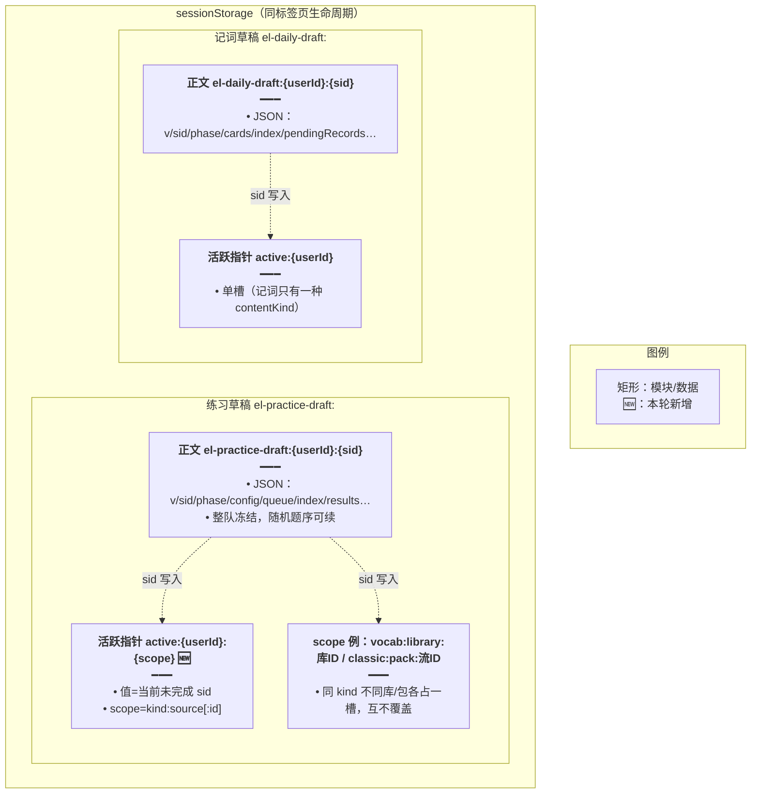
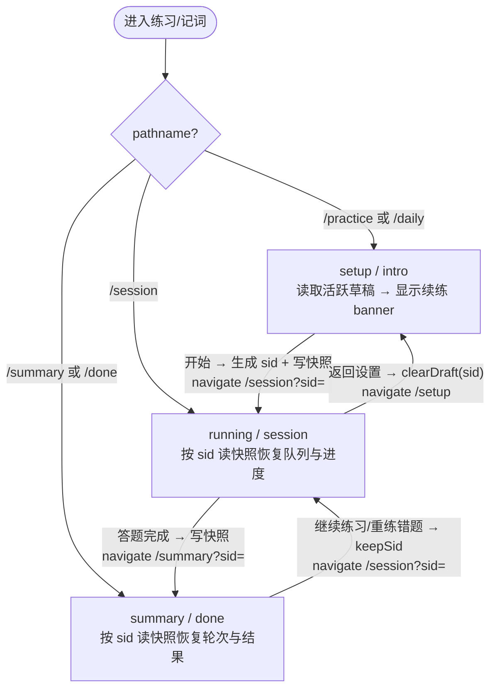
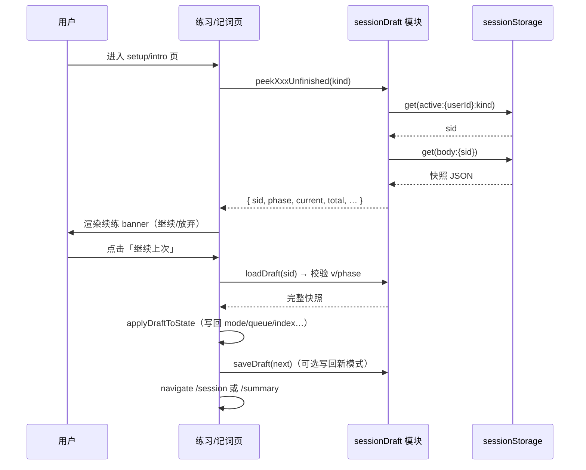
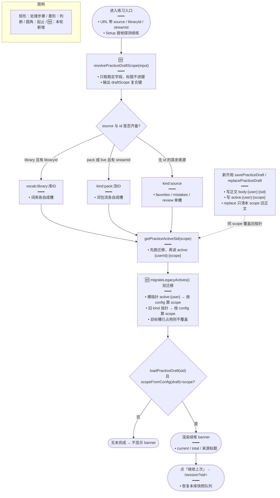

# 练习与今日记词会话草稿续练

> **文档角色**：本仓 `english` 功能域中「练习 / 今日记词会话草稿续练」的主稿，覆盖 `practiceSessionDraft.ts` 与相关入口的槽键、续练取槽与历史迁移。
> **延伸阅读**：今日记词侧单槽逻辑见本篇 §4.3；练习页 TTS 落盘目录**不在本篇范围**，另见 TTS 专题；规划态方案：[`练习草稿按库分槽.md`](../ideas/english/练习草稿按库分槽.md)。
> **（更新：草稿槽键升级为 kind:source[:id]，多库各留各的）**

## 1. 背景与目标

此前练习（`practice`）与今日记词（`daily`）的阶段（setup / running / summary 或 intro / session / done）由组件内 `useState` 持有，并用 URL query `run=1` 标记「正在作答」。这种设计下，**刷新页面或直接复制作答链接打开会丢失整队题目、进度与已答结果**，必须重新从设置页开始，体验割裂；同时随机题序在刷新后会重新洗牌，续练也对不上原队列。

本次改造把「练习会话 / 记词会话」整体序列化为 `sessionStorage` JSON 快照：

- 阶段由 **URL pathname**（`/session`、`/summary`、`/done`）决定，不再用内存 `useState`；
- 整队题目、当前下标、已答结果、轮次、配置等在每次状态变化时落盘到 `sessionStorage`；
- URL 携带 `sid`，刷新时按 sid 读快照恢复状态，做到**刷新不丢进度、随机题序可续**；
- 设置页/介绍页提供「继续上次 / 放弃续练」横幅，用户可显式选择续练或丢弃；
- 登出时按用户维度清空所有草稿，避免账号串号。

后续一次升级（本篇重点）把练习草稿的「活跃指针」槽键从**只按 `contentKind`**（`vocab` / `classic`）升级为按 **`draftScope = kind:source[:id]`** 的复合键：不同**词库/语句库**、不同**词包流**各自保留「未完成练习」，互不覆盖；点「继续上次」只会命中当前入口对应的那一个库，返回到对应库继续。为实现平滑升级，读取活跃指针时先做**双迁移**，把历史遗留的「裸指针」与「仅按 kind 分槽的指针」按草稿 `config` 重算 scope 后迁移到新槽。

## 2. 改动范围

| 类型 | 路径                                                                                        | 说明                                                                         |
| ---- | ------------------------------------------------------------------------------------------- | ---------------------------------------------------------------------------- |
| 新增 | `apps/frontend/src/views/englishLearning/utils/sessionDraftStorage.ts`                      | sessionStorage JSON 读写壳，按 userId 分作用域                               |
| 新增 | `apps/frontend/src/views/englishLearning/practice/utils/practiceSessionDraft.ts`            | 练习会话快照（v=1，按 contentKind 分 active 槽）                             |
| 新增 | `apps/frontend/src/views/englishLearning/daily/utils/dailySessionDraft.ts`                  | 今日记词会话快照（v=1，单 active 槽）                                        |
| 新增 | `apps/frontend/src/views/englishLearning/components/resume/Banner.tsx` + `index.ts`         | 续练横幅（描述 + 继续 + 丢弃）                                               |
| 新增 | `apps/frontend/src/views/englishLearning/daily/utils/paths.ts`、`…/practice/utils/paths.ts` | 路由路径常量、URL 构造、phaseFromPathname、mergeSearch                       |
| 修改 | `apps/frontend/src/router/routes.ts`                                                        | 为 practice/daily 加嵌套子路由，`EnglishLearningStageOutlet` 占位            |
| 修改 | `apps/frontend/src/components/design/Header/index.tsx`                                      | 面包屑适配 `/session`/`/summary`/`/done`，删除 `run=1` 判断                  |
| 修改 | `apps/frontend/src/store/resetUserState.ts`                                                 | 登出时 `clearAllPracticeDrafts` + `clearAllDailyDrafts`                      |
| 修改 | `apps/frontend/src/views/englishLearning/practice/index.tsx`                                | phase 由 URL 决定；boot 读快照；persistDraft；导航带 sid；接入 resume banner |
| 修改 | `apps/frontend/src/views/englishLearning/practice/Setup.tsx`                                | resume banner 集成；继续/丢弃；改题量/顺序确认替换                           |
| 修改 | `apps/frontend/src/views/englishLearning/practice/types.ts`                                 | 新增 `SetupResumeInfo`、`SetupProps` 增 resume 相关字段                      |
| 修改 | `apps/frontend/src/views/englishLearning/practice/reports/Detail.tsx`                       | 适配新路由（continue 走 session url）                                        |
| 修改 | `apps/frontend/src/views/englishLearning/daily/index.tsx`                                   | 同 practice：boot 读草稿、persistDraft、阶段路由导航、接入 banner            |
| 修改 | `apps/frontend/src/views/englishLearning/daily/components/DailyIntroPanel.tsx`              | 续练 banner 集成                                                             |
| 修改 | `apps/frontend/src/views/englishLearning/daily/components/DailyCardSession.tsx`             | 草稿适配（initialIndex / initialPendingRecords / onProgress）                |
| 修改 | `apps/frontend/src/i18n/locales/zh-CN.ts` + `en-US.ts`                                      | 新增续练文案 key                                                             |
| 修改 | `apps/frontend/src/views/englishLearning/practice/utils/practiceSessionDraft.ts`            | 槽键升级为 `draftScope=kind:source[:id]`；新增 `resolvePracticeDraftScope`、双迁移、全指针清理与自检（本篇重点） |
| 修改 | `apps/frontend/src/views/englishLearning/practice/index.tsx`                                | `peekPracticeUnfinished` 入参对象化（原按 contentKind 位置参数）             |
| 修改 | `apps/frontend/src/views/englishLearning/pack/classic/index.tsx`                            | `practiceParams` 为 `live` 来源补 `streamId`（草稿分槽必需）                 |
| 修改 | `apps/frontend/src/views/englishLearning/pack/vocabulary/index.tsx`                         | 同上（vocab 侧）                                                             |
| 类型 | `apps/frontend/src/views/englishLearning/practice/types.ts`                                 | 无实质改动：`PracticeDraftScopeInput` 复用既有 `PracticeSource` / `PracticeSetupConfig` 字段（见 §4.2.2 说明） |

## 3. 实现思路

### 3.1 存储结构

每个用户、每个会话用一条 `sessionStorage` 条目存完整快照，外加一条「活跃指针」指向当前未完成的 sid：



**读图要点**：正文按 `sid` 分键，活跃指针按 `userId[:kind]` 分键；`peekXxxUnfinished` 先读活跃指针拿到 sid，再读正文校验版本与 phase；`replaceXxxDraft` 会先清掉同槽旧正文再写新的。

### 3.2 状态机与路由

阶段由 URL pathname 唯一决定，组件内不再持有 `phase` state：



### 3.3 续练时序

用户在设置页看到未完成草稿、点「继续上次」的核心链路：



**读图要点**：续练不重新拉取题目，直接用快照里的 `queue`；`onContinueResume` 可把 Setup 当前选择的 `mode` 写回快照再进 session；切换题量/顺序会弹确认，确认后丢弃旧草稿开新局。

### 3.4 草稿槽键生成 · 续练取槽 · 历史迁移（本轮重点）

从「进入练习入口」到「点继续上次」的全链路，核心是**先算 scope 复合键，再按 scope 读写活跃指针，读取前先做历史迁移**：



**读图要点**：槽键由 `resolvePracticeDraftScope` 统一计算，`savePracticeDraft` / `peekPracticeUnfinished` 两侧都调它，保证「写哪槽」与「读哪槽」严格一致；`loadPracticeDraft` 后再用 `scopeFromConfig(draft) === scope` 二次校验，防止指针错位串槽；`migrateLegacyActives` 只在读活跃指针时触发一次，把两种历史指针迁移到新槽，且「目标槽非空不覆盖」以保证升级用户不丢草稿。

## 4. 关键代码对比与注释

### 4.1 `sessionDraftStorage.ts` 通用读写壳（纯新增）

**来源** · `apps/frontend/src/views/englishLearning/utils/sessionDraftStorage.ts`（新增，全文 L1–L51）

```typescript
// 顶部块注释：说明本模块是练习与今日记词草稿共用的 sessionStorage JSON 读写壳
/**
 * sessionStorage JSON 读写壳（练习 / 今日记词草稿共用）
 */
// 从登录态 store 取当前用户 id，用于把草稿按用户分作用域，避免同浏览器多账号串号
import { getLoggedInUserId } from '@/store/loggedInUserId';

// 导出：生成当前用户作用域字符串，未登录返回 'anon'
export function sessionDraftUserScope(): string {
	// 取登录用户 id（数字），未登录为 0 或非法
	const id = getLoggedInUserId();
	// id>0 转字符串作为作用域，否则用 'anon' 兜底，保证 key 永不空
	return id > 0 ? String(id) : 'anon';
}

// 导出：按 key 读并反序列化为 T，失败/无值返回 null
export function sessionDraftGet<T>(key: string): T | null {
	// SSR 或无 sessionStorage 环境直接返回 null，避免 ReferenceError
	if (typeof sessionStorage === 'undefined') return null;
	// 用 try/catch 包裹 JSON.parse，脏数据不影响页面
	try {
		// 从 sessionStorage 取原始字符串
		const raw = sessionStorage.getItem(key);
		// 空值直接返回 null，不进入 parse
		if (!raw) return null;
		// 反序列化为泛型 T 并断言返回
		return JSON.parse(raw) as T;
	} catch {
		// 解析失败（JSON 损坏）返回 null，调用方当作无草稿处理
		return null;
	}
}

// 导出：把 value 序列化为 JSON 写入 key，成功返回 true
export function sessionDraftSet(key: string, value: unknown): boolean {
	// 无 sessionStorage 环境返回 false，调用方据此跳过后续逻辑
	if (typeof sessionStorage === 'undefined') return false;
	// try/catch 捕获配额超限（QuotaExceededError）等写入异常
	try {
		// JSON 序列化后写入，日期等对象可被正确序列化
		sessionStorage.setItem(key, JSON.stringify(value));
		// 写入成功返回 true
		return true;
	} catch (e) {
		// 写入失败打印警告，便于排查配额或序列化问题
		console.warn('[sessionDraft] set failed', key, e);
		// 返回 false 通知调用方落盘失败
		return false;
	}
}

/**
 * 清除某前缀下全部键（登出用）。
 * sessionStorage 无按前缀删除 API，且草稿 key 含动态 sid，只能扫库匹配；
 * 须先收集再删：边遍历边 removeItem 会导致下标前移漏删；也不能 clear()（会清掉同页其它数据）。
 */
export function sessionDraftRemove(key: string): void {
	// 无 sessionStorage 环境直接 return，不报错
	if (typeof sessionStorage === 'undefined') return;
	// try/catch 防止私有模式等环境下 removeItem 抛异常
	try {
		// 按 key 删除条目
		sessionStorage.removeItem(key);
	} catch {
		/* 删除失败静默忽略，不影响主流程 */
	}
}

// 导出：清除某前缀下全部键，登出时按用户维度清空草稿
/** 清除某前缀下全部键（登出用） */
export function sessionDraftClearPrefix(prefix: string): void {
	// 无 sessionStorage 环境直接返回
	if (typeof sessionStorage === 'undefined') return;
	// 先收集待删 key，避免遍历中删除导致索引错乱
	const keys: string[] = [];
	// 遍历 sessionStorage 全部条目
	for (let i = 0; i < sessionStorage.length; i++) {
		// 取第 i 个 key（可能为 null）
		const k = sessionStorage.key(i);
		// 命中前缀才收集，空值跳过
		if (k?.startsWith(prefix)) keys.push(k);
	}
	// 逐个删除收集到的 key
	for (const k of keys) sessionDraftRemove(k);
}
```

### 4.2 `practiceSessionDraft.ts` 多库分槽改造（改动前/后）

本轮把练习草稿的活跃指针槽键由 `contentKind` 升级为 `draftScope = kind:source[:id]`。以下按符号成对展示；**未列出的** `PracticeSessionDraft` 类型、`normalizeKind`、`bodyKey`、`loadPracticeDraft`、`clearAllPracticeDrafts`、`PracticeUnfinishedInfo` 类型本次无实质改动。

#### 4.2.1 顶部块注释与类型 import

**对比范围**：文件顶部块注释 + `import type { … } from '../types';`（新增 `PracticeSource`）。

**改动前** · `apps/frontend/src/views/englishLearning/practice/utils/practiceSessionDraft.ts`（基线，约 L1–L24）

```typescript
// 块注释声明旧的活跃指针分槽方式：仅按 contentKind
/**
 * 练习会话 sessionStorage 快照（整队 queue 冻结，保证随机顺序可续）
 * active 按 contentKind（vocab / classic）分槽，互不覆盖
 */
// 从通用 sessionStorage 壳导入 5 个读写函数，练习侧不直接操作 sessionStorage
import {
	// 按前缀清理（登出用）
	sessionDraftClearPrefix,
	// 读并反序列化
	sessionDraftGet,
	// 删除单条
	sessionDraftRemove,
	// 序列化写入
	sessionDraftSet,
	// 用户作用域串
	sessionDraftUserScope,
} from '../../utils/sessionDraftStorage';
// 导入练习业务类型，保证快照字段与页面状态同源
import type {
	PracticeAttemptResult,
	PracticeContentKind,
	PracticeCountOption,
	PracticeItem,
	PracticeMode,
	PracticeOrder,
	PracticeReportSaveMode,
	PracticeSessionCursor,
	PracticeSessionRound,
	PracticeSetupConfig,
} from '../types';
```

**改动后** · `apps/frontend/src/views/englishLearning/practice/utils/practiceSessionDraft.ts`（当前，约 L1–L24）

```typescript
// 块注释改为声明新的复合槽键：kind:source[:id]，强调多库互不覆盖
/**
 * 练习会话 sessionStorage 快照（整队 queue 冻结，保证随机顺序可续）
 * active 按 draftScope（kind:source[:id]）分槽，多库互不覆盖
 */
// 同基线：导入通用壳的 5 个读写函数
import {
	// 按前缀清理（登出用）
	sessionDraftClearPrefix,
	// 读并反序列化
	sessionDraftGet,
	// 删除单条
	sessionDraftRemove,
	// 序列化写入
	sessionDraftSet,
	// 用户作用域串
	sessionDraftUserScope,
} from '../../utils/sessionDraftStorage';
// 导入练习业务类型；新增 PracticeSource 供 scope 计算入参使用
import type {
	PracticeAttemptResult,
	PracticeContentKind,
	PracticeCountOption,
	PracticeItem,
	PracticeMode,
	PracticeOrder,
	PracticeReportSaveMode,
	PracticeSessionCursor,
	PracticeSessionRound,
	PracticeSetupConfig,
	// 新增：来源枚举，resolvePracticeDraftScope 依赖它做分支
	PracticeSource,
} from '../types';
```

**变更摘要**：注释由「按 contentKind 分槽」更新为「按 draftScope 分槽」；`import type` 新增 `PracticeSource`，为 `resolvePracticeDraftScope` 的来源分支提供类型。

#### 4.2.2 `PracticeDraftScopeInput` / `resolvePracticeDraftScope` / `scopeFromConfig`（纯新增）

**对比范围**：新增「作用域入参类型 + scope 计算函数 + 从 config 反算」三件套（基线中不存在）。

**改动后** · `apps/frontend/src/views/englishLearning/practice/utils/practiceSessionDraft.ts`（当前，约 L44–L88）

```typescript
// 新增：算活跃槽的入参类型，只用稳定字段
/** 算活跃槽：只用稳定字段，标题永不进键 */
export type PracticeDraftScopeInput = {
	// 内容类型（vocab / classic），决定槽键前缀
	contentKind: PracticeContentKind;
	// 来源（library / pack / live / favorites …），决定二级键
	source: PracticeSource;
	// 词库 id，仅 library 来源使用
	libraryId?: string;
	// 词包流 id，仅 pack / live 来源使用
	streamId?: string;
};

// 新增：把入参映射为 draftScope 复合键，统一「写哪槽/读哪槽」的口径
export function resolvePracticeDraftScope(
	// 入参：由稳定字段组成的 scope 输入
	input: PracticeDraftScopeInput,
// 返回：draftScope 复合键字符串
): string {
	// 规整 kind，避免非法值导致槽键漂移
	const kind = normalizeKind(input.contentKind);
	// 词库 id 去空白，空白视为无 id
	const libraryId = input.libraryId?.trim();
	// 流 id 同样去空白
	const streamId = input.streamId?.trim();

	// library 且有 libraryId：按词库 id 分槽，多词库各留各的
	if (input.source === 'library' && libraryId) {
		return `${kind}:library:${libraryId}`;
	}
	// pack 或 live 且带 streamId：统一按流 id 分槽（历史与实时的同一词包同源）
	if ((input.source === 'pack' || input.source === 'live') && streamId) {
		return `${kind}:pack:${streamId}`;
	}
	// live 无流 id：退化为单 live 槽
	if (input.source === 'live') return `${kind}:live`;
	// pack 无流 id：退化为单 pack 槽
	if (input.source === 'pack') return `${kind}:pack`;
	// favorites：单槽（收藏集合无 id 维度）
	if (input.source === 'favorites') return `${kind}:favorites`;
	// mistakes：单槽
	if (input.source === 'mistakes') return `${kind}:mistakes`;
	// review：单槽
	if (input.source === 'review') return `${kind}:review`;
	// dailyMemorize：单槽（今日记词入口）
	if (input.source === 'dailyMemorize') return `${kind}:daily-memorize`;
	// library 无 libraryId：退化为单 library 槽
	if (input.source === 'library') return `${kind}:library`;
	// 兜底：未知来源合并到 unknown 槽，避免键为空
	return `${kind}:unknown`;
}

// 新增：从草稿 config 反算 scope，供迁移与二次校验使用
function scopeFromConfig(config: PracticeSetupConfig): string {
	// 复用 resolvePracticeDraftScope，保证与入口侧算法完全一致
	return resolvePracticeDraftScope({
		// config 里的 contentKind 先规整
		contentKind: normalizeKind(config.contentKind),
		// 透传来源
		source: config.source,
		// 透传词库 id
		libraryId: config.libraryId,
		// 透传流 id
		streamId: config.streamId,
	});
}
```

**变更摘要**：新增三件套。scope 统一只由稳定字段（kind / source / id）算出，**标题 `sourceTitle` 永不进键**——否则词库改名会生成新槽、旧草稿永远续不上；`scopeFromConfig` 让「写入侧」与「迁移/校验侧」共享同一算法。

#### 4.2.3 说明：`types.ts` 无实质改动

`practice/types.ts` 中 `PracticeSource`（`favorites | library | pack | live | mistakes | dailyMemorize | review`）与 `PracticeSetupConfig`（含可选 `libraryId` / `streamId`）本已存在；`PracticeDraftScopeInput` 直接复用这些既有字段，故 `types.ts` 对本功能**无实质改动**——该文件本轮 diff 仅涉及 TTS 落盘字段（`cacheFolder` / `cacheTitle`），属另一篇专题。

#### 4.2.4 `activeKey` / `legacyBareActiveKey` / `legacyKindActiveKey`

**对比范围**：活跃指针 key 构造函数（scope 化）+ 两代历史指针 key。

**改动前** · `apps/frontend/src/views/englishLearning/practice/utils/practiceSessionDraft.ts`（基线，约 L44–L52）

```typescript
// 旧的活跃指针 key：仅按 contentKind 分槽
function activeKey(kind: PracticeContentKind): string {
	// 拼前缀:active:用户域:kind，vocab 与 classic 各一槽
	return `${PRACTICE_DRAFT_KEY_PREFIX}:active:${sessionDraftUserScope()}:${kind}`;
}

// 旧版更早的裸指针 key（未分 kind）
/** M2 旧指针（未分 kind）；读时迁到 vocab/classic 槽后删除 */
function legacyActiveKey(): string {
	// 旧结构只有一条不分 kind 的活跃指针
	return `${PRACTICE_DRAFT_KEY_PREFIX}:active:${sessionDraftUserScope()}`;
}
```

**改动后** · `apps/frontend/src/views/englishLearning/practice/utils/practiceSessionDraft.ts`（当前，约 L94–L106）

```typescript
// 新活跃指针 key：按 scope 复合键分槽
function activeKey(scope: string): string {
	// 拼前缀:active:用户域:scope，同 kind 不同库各占一槽
	return `${PRACTICE_DRAFT_KEY_PREFIX}:active:${sessionDraftUserScope()}:${scope}`;
}

// 更早结构（未分 kind）的裸指针 key，仍用于迁移
/** 更早：未分 kind 的单指针 */
function legacyBareActiveKey(): string {
	// 与旧 legacyActiveKey 同形，仅改名以区分「两代历史」
	return `${PRACTICE_DRAFT_KEY_PREFIX}:active:${sessionDraftUserScope()}`;
}

// 中间结构（仅按 kind）的指针 key，仍用于迁移
/** M4：仅按 contentKind 分槽的指针 */
function legacyKindActiveKey(kind: PracticeContentKind): string {
	// 复刻上一代 key 形态，normalizeKind 保证与历史写入一致
	return `${PRACTICE_DRAFT_KEY_PREFIX}:active:${sessionDraftUserScope()}:${normalizeKind(kind)}`;
}
```

**变更摘要**：`activeKey` 入参由 `kind` 改为 `scope`；旧 `legacyActiveKey` 更名为 `legacyBareActiveKey`，并新增 `legacyKindActiveKey` 覆盖「M4 仅按 kind 分槽」这一代指针，供双迁移读取。

#### 4.2.5 `migrateLegacyActives`（双迁移）

**对比范围**：历史活跃指针迁移函数（由单迁移升级为双迁移）。

**改动前** · `apps/frontend/src/views/englishLearning/practice/utils/practiceSessionDraft.ts`（基线，约 L54–L67）

```typescript
// 旧版：只迁移「裸指针」一种历史结构
function migrateLegacyActive(): void {
	// 读旧裸指针里的 sid
	const legacySid = sessionDraftGet<string>(legacyActiveKey());
	// 无旧指针直接结束
	if (!legacySid) return;
	// 用旧 sid 加载正文草稿
	const draft = loadPracticeDraft(legacySid);
	// 迁移后删除旧裸指针，避免重复迁移
	sessionDraftRemove(legacyActiveKey());
	// 正文不存在则不迁移
	if (!draft) return;
	// 取草稿 config 的 kind
	const kind = normalizeKind(draft.config.contentKind);
	// 仅当目标 kind 槽为空才写，避免覆盖用户新草稿
	if (!sessionDraftGet<string>(activeKey(kind))) {
		// 把旧 sid 写入该 kind 槽
		sessionDraftSet(activeKey(kind), legacySid);
	}
}
```

**改动后** · `apps/frontend/src/views/englishLearning/practice/utils/practiceSessionDraft.ts`（当前，约 L108–L133）

```typescript
// 新版：一次迁移「裸指针 + M4 kind 指针」两代历史指针到 scope 槽
function migrateLegacyActives(): void {
	// 读更早的裸指针 sid
	const bareSid = sessionDraftGet<string>(legacyBareActiveKey());
	// 裸指针存在才处理
	if (bareSid) {
		// 用 sid 加载正文以拿 config
		const draft = loadPracticeDraft(bareSid);
		// 先删裸指针，保证只迁移一次
		sessionDraftRemove(legacyBareActiveKey());
		// 正文有效才继续迁移
		if (draft) {
			// 由 config 反算 scope（含 kind/source/id）
			const scope = scopeFromConfig(draft.config);
			// 目标槽为空才写，避免覆盖用户已开的新草稿
			if (!sessionDraftGet<string>(activeKey(scope))) {
				// 把裸指针 sid 迁到 scope 槽
				sessionDraftSet(activeKey(scope), bareSid);
			}
		}
	}

	// 遍历 M4 的两个 kind 槽，逐个迁移
	for (const kind of ['vocab', 'classic'] as const) {
		// 取该 kind 历史指针的 key
		const kindKey = legacyKindActiveKey(kind);
		// 读该槽的 sid
		const sid = sessionDraftGet<string>(kindKey);
		// 无 sid（该 kind 未用过）则跳过
		if (!sid) continue;
		// 用 sid 加载正文以拿 config
		const draft = loadPracticeDraft(sid);
		// 迁移前删除 kind 指针，保证只迁移一次
		sessionDraftRemove(kindKey);
		// 正文无效则跳过
		if (!draft) continue;
		// 由 config 反算 scope
		const scope = scopeFromConfig(draft.config);
		// 目标槽为空才写，避免覆盖
		if (!sessionDraftGet<string>(activeKey(scope))) {
			// 把 kind 指针 sid 迁到 scope 槽
			sessionDraftSet(activeKey(scope), sid);
		}
	}
}
```

**变更摘要**：函数更名为复数 `migrateLegacyActives`，覆盖两种历史——先迁「更早的裸指针」，再遍历 `vocab` / `classic` 迁「M4 的 kind 指针」；两次迁移都用 `scopeFromConfig(draft.config)` 反算目标 scope，且目标槽非空不覆盖。

#### 4.2.6 `getPracticeActiveSid` / `setPracticeActiveSid`

**对比范围**：活跃 sid 读写函数（入参 kind → scope）。

**改动前** · `apps/frontend/src/views/englishLearning/practice/utils/practiceSessionDraft.ts`（基线，约 L69–L90）

```typescript
// 导出：取某 contentKind 的活跃 sid
export function getPracticeActiveSid(kind: PracticeContentKind): string | null {
	// 先迁移旧指针，保证升级用户可续练
	migrateLegacyActive();
	// 读该 kind 槽
	return sessionDraftGet<string>(activeKey(normalizeKind(kind)));
}

// 导出：设置某 contentKind 的活跃 sid（null 清除）
export function setPracticeActiveSid(
	// 入参：内容类型
	kind: PracticeContentKind,
	// 入参：目标 sid（null 表示清除）
	sid: string | null,
// 返回：无（副作用写 / 删指针）
): void {
	// 计算目标 kind 槽 key
	const key = activeKey(normalizeKind(kind));
	// null 表示清除该槽
	if (!sid) {
		sessionDraftRemove(key);
		return;
	}
	// 非空则写入
	sessionDraftSet(key, sid);
}
```

**改动后** · `apps/frontend/src/views/englishLearning/practice/utils/practiceSessionDraft.ts`（当前，约 L135–L147）

```typescript
// 导出：取某 scope 的活跃 sid
export function getPracticeActiveSid(scope: string): string | null {
	// 先跑双迁移，兼容两代历史指针
	migrateLegacyActives();
	// 读该 scope 槽
	return sessionDraftGet<string>(activeKey(scope));
}

// 导出：设置某 scope 的活跃 sid（null 清除）
export function setPracticeActiveSid(scope: string, sid: string | null): void {
	// 计算目标 scope 槽 key
	const key = activeKey(scope);
	// null 表示清除该槽
	if (!sid) {
		sessionDraftRemove(key);
		return;
	}
	// 非空则写入
	sessionDraftSet(key, sid);
}
```

**变更摘要**：两函数入参由 `kind` 改为 `scope`；`getPracticeActiveSid` 改调 `migrateLegacyActives()`（复数新名）；函数内不再 `normalizeKind`，规整已下沉到 `resolvePracticeDraftScope`。

#### 4.2.7 `savePracticeDraft`

**对比范围**：保存草稿函数（活跃槽由 kind 改为 scopeFromConfig）。

**改动前** · `apps/frontend/src/views/englishLearning/practice/utils/practiceSessionDraft.ts`（基线，约 L92–L105）

```typescript
// 导出：保存草稿并同步活跃指针
export function savePracticeDraft(draft: PracticeSessionDraft): boolean {
	// 取草稿的 contentKind 定位活跃槽
	const kind = normalizeKind(draft.config.contentKind);
	// 写正文：补 v 与 updatedAt，用 satisfies 保证类型完整
	const ok = sessionDraftSet(bodyKey(draft.sid), {
		...draft,
		v: PRACTICE_DRAFT_VERSION,
		updatedAt: new Date().toISOString(),
	} satisfies PracticeSessionDraft);
	// 写入成功才更新活跃指针，避免指针指向不存在的正文
	if (ok) setPracticeActiveSid(kind, draft.sid);
	// 返回写入结果
	return ok;
}
```

**改动后** · `apps/frontend/src/views/englishLearning/practice/utils/practiceSessionDraft.ts`（当前，约 L159–L168）

```typescript
// 导出：保存草稿并同步活跃指针
export function savePracticeDraft(draft: PracticeSessionDraft): boolean {
	// 由 config 反算 scope，定位活跃槽（与入口读取同算法）
	const scope = scopeFromConfig(draft.config);
	// 写正文：补 v 与 updatedAt，用 satisfies 保证类型完整
	const ok = sessionDraftSet(bodyKey(draft.sid), {
		...draft,
		v: PRACTICE_DRAFT_VERSION,
		updatedAt: new Date().toISOString(),
	} satisfies PracticeSessionDraft);
	// 写入成功才更新活跃指针，避免指针指向不存在的正文
	if (ok) setPracticeActiveSid(scope, draft.sid);
	// 返回写入结果
	return ok;
}
```

**变更摘要**：活跃槽由 `kind` 改为 `scopeFromConfig(draft.config)`，保证「写哪槽」与入口「读哪槽」严格一致；正文 key 与版本号不变。

#### 4.2.8 `clearActivePointersTo`（新增）+ `clearPracticeDraft`

**对比范围**：清草稿函数（由枚举 kind 槽升级为全指针扫描）。

**改动前** · `apps/frontend/src/views/englishLearning/practice/utils/practiceSessionDraft.ts`（基线，约 L107–L124）

```typescript
// 导出：清除指定 sid 的草稿并清对应活跃指针
export function clearPracticeDraft(sid: string): void {
	// 先加载草稿拿到其 contentKind
	const draft = loadPracticeDraft(sid);
	// 删除正文
	sessionDraftRemove(bodyKey(sid));
	// 有草稿只清对应 kind 槽；无草稿则两槽都查，防孤儿指针
	const kinds: PracticeContentKind[] = draft
		? [normalizeKind(draft.config.contentKind)]
		: ['vocab', 'classic'];
	// 遍历可能的 kind 槽
	for (const kind of kinds) {
		// 仅当该槽指针指向本 sid 才清
		if (sessionDraftGet<string>(activeKey(kind)) === sid) {
			setPracticeActiveSid(kind, null);
		}
	}
}
```

**改动后** · `apps/frontend/src/views/englishLearning/practice/utils/practiceSessionDraft.ts`（当前，约 L170–L185）

```typescript
// 新增：扫描当前用户所有活跃指针，删除值等于该 sid 的指针
function clearActivePointersTo(sid: string): void {
	// 无 sessionStorage 环境直接返回，避免报错
	if (typeof sessionStorage === 'undefined') return;
	// 活跃指针统一前缀，用于按前缀扫描
	const prefix = `${PRACTICE_DRAFT_KEY_PREFIX}:active:${sessionDraftUserScope()}`;
	// 先收集待删 key，避免遍历中删除导致下标前移漏删
	const keys: string[] = [];
	// 遍历 sessionStorage 全部条目
	for (let i = 0; i < sessionStorage.length; i++) {
		// 取第 i 个 key
		const k = sessionStorage.key(i);
		// 非活跃指针前缀则跳过
		if (!k?.startsWith(prefix)) continue;
		// 指针值正好等于目标 sid 才收集
		if (sessionDraftGet<string>(k) === sid) keys.push(k);
	}
	// 逐个删除收集到的指针
	for (const k of keys) sessionDraftRemove(k);
}

// 导出：清除指定 sid 的草稿与所有指向它的活跃指针
export function clearPracticeDraft(sid: string): void {
	// 删除正文
	sessionDraftRemove(bodyKey(sid));
	// 扫描并清掉所有指向本 sid 的指针（新旧槽一并覆盖）
	clearActivePointersTo(sid);
}
```

**变更摘要**：因 scope 槽数量不固定（同 kind 可有多库多槽），无法再枚举 kind 清指针；改为新增 `clearActivePointersTo`——按活跃指针前缀**全量扫描**、删除值等于该 sid 的指针，`clearPracticeDraft` 简化为「删正文 + 全指针清理」。

#### 4.2.9 `replacePracticeDraft`

**对比范围**：新开局替换函数（替换范围由 kind 收窄为 scope）。

**改动前** · `apps/frontend/src/views/englishLearning/practice/utils/practiceSessionDraft.ts`（基线，约 L126–L134）

```typescript
// 新开局：仅替换同 contentKind 的旧活跃正文
/** 新开局：仅替换同 contentKind 的旧活跃正文 */
export function replacePracticeDraft(draft: PracticeSessionDraft): boolean {
	// 定位新草稿的 kind 槽
	const kind = normalizeKind(draft.config.contentKind);
	// 取该槽旧活跃 sid
	const prev = getPracticeActiveSid(kind);
	// 旧 sid 存在且与新 sid 不同时，先清旧正文与指针
	if (prev && prev !== draft.sid) clearPracticeDraft(prev);
	// 保存新草稿（会自动写活跃指针）
	return savePracticeDraft(draft);
}
```

**改动后** · `apps/frontend/src/views/englishLearning/practice/utils/practiceSessionDraft.ts`（当前，约 L187–L193）

```typescript
// 新开局：仅替换同 draftScope 的旧活跃正文
/** 新开局：仅替换同 draftScope 的旧活跃正文 */
export function replacePracticeDraft(draft: PracticeSessionDraft): boolean {
	// 由 config 反算 scope，定位本库的活跃槽
	const scope = scopeFromConfig(draft.config);
	// 取该 scope 槽旧活跃 sid
	const prev = getPracticeActiveSid(scope);
	// 旧 sid 存在且与新 sid 不同时，先清旧正文与指针
	if (prev && prev !== draft.sid) clearPracticeDraft(prev);
	// 保存新草稿（会自动写活跃指针）
	return savePracticeDraft(draft);
}
```

**变更摘要**：替换范围由「同 kind」收窄为「同 scope」——新开局只清掉**同一库**的上一次草稿，不影响其它库的未完成草稿。

#### 4.2.10 `peekPracticeUnfinished`

**对比范围**：续练探测函数（入参位置参数 → 对象，新增 scope 二次校验）。

**改动前** · `apps/frontend/src/views/englishLearning/practice/utils/practiceSessionDraft.ts`（基线，约 L151–L166）

```typescript
// 设置页探测：按 contentKind 探测对应活跃快照
/** 根路径「继续上次」：按 contentKind 探测对应活跃快照 */
export function peekPracticeUnfinished(kind: PracticeContentKind): PracticeUnfinishedInfo | null {
	// 规整 kind
	const want = normalizeKind(kind);
	// 取该 kind 活跃 sid
	const sid = getPracticeActiveSid(want);
	// 无活跃 sid 表示无未完成
	if (!sid) return null;
	// 加载正文
	const draft = loadPracticeDraft(sid);
	// 正文无效则无
	if (!draft) return null;
	// kind 不一致（异常）则无
	if (normalizeKind(draft.config.contentKind) !== want) return null;
	// running 阶段队列为空不算未完成
	if (draft.phase === 'running' && draft.queue.length === 0) return null;
	// summary 阶段无轮次不算未完成
	if (draft.phase === 'summary' && draft.sessionRounds.length === 0) {
		return null;
	}
	// ...（返回对象装配与基线相同，略）
}
```

**改动后** · `apps/frontend/src/views/englishLearning/practice/utils/practiceSessionDraft.ts`（当前，约 L213–L243）

```typescript
// 设置页探测：按当前入口的 draftScope 探测活跃快照
/** 根路径「继续上次」：按当前入口 draftScope 探测 */
export function peekPracticeUnfinished(
	// 入参由位置参数 kind 改为对象（含 source/libraryId/streamId）
	input: PracticeDraftScopeInput,
// 返回：未完成信息，无未完成则为 null
): PracticeUnfinishedInfo | null {
	// 由入参算目标 scope
	const scope = resolvePracticeDraftScope(input);
	// 规整 kind 用于展示字段
	const want = normalizeKind(input.contentKind);
	// 取该 scope 活跃 sid
	const sid = getPracticeActiveSid(scope);
	// 无活跃 sid 表示无未完成
	if (!sid) return null;
	// 加载正文
	const draft = loadPracticeDraft(sid);
	// 正文无效则无
	if (!draft) return null;
	// 草稿 config 反算 scope 与目标不一致（指针错位）则无
	if (scopeFromConfig(draft.config) !== scope) return null;
	// kind 不一致（异常）则无
	if (normalizeKind(draft.config.contentKind) !== want) return null;
	// running 阶段队列为空不算未完成
	if (draft.phase === 'running' && draft.queue.length === 0) return null;
	// summary 阶段无轮次不算未完成
	if (draft.phase === 'summary' && draft.sessionRounds.length === 0) {
		return null;
	}
	// ...（返回对象装配与基线相同，略）
}
```

**变更摘要**：入参由 `kind: PracticeContentKind` 改为 `input: PracticeDraftScopeInput`（对象化，携带 source / libraryId / streamId）；新增 `scopeFromConfig(draft.config) !== scope` 二次校验，防止活跃指针与草稿实际来源不一致时误展示续练。

#### 4.2.11 `selfCheckPracticeDraftScope`（纯新增）

**对比范围**：新增分槽契约自检函数（基线中不存在）。

**改动后** · `apps/frontend/src/views/englishLearning/practice/utils/practiceSessionDraft.ts`（当前，约 L245–L286）

```typescript
// 新增：scope 字符串契约自检，破坏分槽时能第一时间抛错
/** ponytail: scope 字符串契约；破了两库会串槽 */
export function selfCheckPracticeDraftScope(): void {
	// 构造词库 A 的 scope
	const a = resolvePracticeDraftScope({
		contentKind: 'vocab',
		source: 'library',
		libraryId: 'lib-a',
	});
	// 构造词库 B 的 scope
	const b = resolvePracticeDraftScope({
		contentKind: 'vocab',
		source: 'library',
		libraryId: 'lib-b',
	});
	// 两个不同词库必须落到不同槽，否则会串槽
	if (a === b) {
		throw new Error('selfCheckPracticeDraftScope: libraries must differ');
	}
	// 槽键字符串也须符合约定的拼写
	if (a !== 'vocab:library:lib-a' || b !== 'vocab:library:lib-b') {
		throw new Error(`selfCheckPracticeDraftScope: unexpected ${a}/${b}`);
	}
	// 再次用同 id 计算（模拟标题变化不影响 id）
	const renamed = resolvePracticeDraftScope({
		contentKind: 'vocab',
		source: 'library',
		libraryId: 'lib-a',
	});
	// id 未变的 scope 必须稳定不变
	if (renamed !== a) {
		throw new Error('selfCheckPracticeDraftScope: id scope must be stable');
	}
	// dailyMemorize 来源应落单槽
	const daily = resolvePracticeDraftScope({
		contentKind: 'vocab',
		source: 'dailyMemorize',
	});
	// 校验单槽键拼写
	if (daily !== 'vocab:daily-memorize') {
		throw new Error(`selfCheckPracticeDraftScope: daily=${daily}`);
	}
	// live + streamId 应落 pack 槽
	const pack = resolvePracticeDraftScope({
		contentKind: 'classic',
		source: 'live',
		streamId: 'stream-1',
	});
	// 校验流 id 槽键拼写
	if (pack !== 'classic:pack:stream-1') {
		throw new Error(`selfCheckPracticeDraftScope: pack=${pack}`);
	}
}
```

**变更摘要**：纯新增自检，断言「不同词库 id → 不同 scope」「同 id → scope 稳定」「daily / live+streamId → 约定槽键」，把分槽契约固化为可执行断言。

### 4.3 `dailySessionDraft.ts` 今日记词会话快照（纯新增）

结构与练习侧同构，差异点：单 `activeKey`（不分 kind）、phase 为 `'session' | 'done'`、用 `cards`/`pendingRecords` 而非 `queue`/`results`、支持 `allowEmptyDone`（0 卡进 done）。

**来源** · `apps/frontend/src/views/englishLearning/daily/utils/dailySessionDraft.ts`（新增，摘录关键函数 L19–L138）

```typescript
// 顶部块注释：今日记词会话快照
/**
 * 今日记词会话 sessionStorage 快照
 */
// 复用练习的报告保存方式类型
import type { PracticeReportSaveMode } from '../../practice/types';
// 导入通用读写壳
import {
	sessionDraftClearPrefix,
	sessionDraftGet,
	sessionDraftRemove,
	sessionDraftSet,
	sessionDraftUserScope,
} from '../../utils/sessionDraftStorage';
// 导入记词类型
import type {
	DailyMemorizeMode,
	DailySessionRound,
	DailySessionSummary,
	DailyVocabCard,
} from '../types';

// 草稿版本号
export const DAILY_DRAFT_VERSION = 1 as const;
// key 前缀
export const DAILY_DRAFT_KEY_PREFIX = 'el-daily-draft';

// 单卡作答记录类型（从 DailyCardSession 提升到这里，供草稿与卡片组件共用）
export type DailyPendingRecord = {
	// 词 key
	key: string;
	// 是否答对
	correct: boolean;
	// 来源（新词/复习）
	origin: DailyVocabCard['origin'];
};

// 记词草稿结构
export type DailySessionDraft = {
	// 版本号
	v: typeof DAILY_DRAFT_VERSION;
	// 会话 id
	sid: string;
	// 阶段：作答中或结算
	phase: 'session' | 'done';
	// 记词模式
	mode: DailyMemorizeMode;
	// 报告保存方式
	reportSaveMode: PracticeReportSaveMode;
	// 本轮卡片
	cards: DailyVocabCard[];
	// 当前卡下标
	index: number;
	// 本轮已答记录
	pendingRecords: DailyPendingRecord[];
	// 历轮结果
	sessionRounds: DailySessionRound[];
	// 结算摘要
	summary: DailySessionSummary | null;
	// 是否重练错题
	isRetryWrong: boolean;
	// 已练过的词 key
	practicedKeys: string[];
	// 报告 id（记词侧目前不用，留空）
	sessionReportId: string | null;
	// 0 卡合法进 done 的标记
	/** 0 卡合法进 done */
	allowEmptyDone?: boolean;
	// 最后写入时间
	updatedAt: string;
};

// 内部：正文 key
function bodyKey(sid: string): string {
	return `${DAILY_DRAFT_KEY_PREFIX}:${sessionDraftUserScope()}:${sid}`;
}

// 内部：活跃指针 key（单槽）
function activeKey(): string {
	return `${DAILY_DRAFT_KEY_PREFIX}:active:${sessionDraftUserScope()}`;
}

// 导出：取活跃 sid
export function getDailyActiveSid(): string | null {
	return sessionDraftGet<string>(activeKey());
}

// 导出：设置活跃 sid
export function setDailyActiveSid(sid: string | null): void {
	// null 则清除
	if (!sid) {
		sessionDraftRemove(activeKey());
		return;
	}
	// 非空写入
	sessionDraftSet(activeKey(), sid);
}

// 导出：加载草稿并校验
export function loadDailyDraft(sid: string): DailySessionDraft | null {
	// 读正文
	const draft = sessionDraftGet<DailySessionDraft>(bodyKey(sid));
	// 版本/sid 校验
	if (!draft || draft.v !== DAILY_DRAFT_VERSION || draft.sid !== sid) {
		return null;
	}
	// phase 校验
	if (draft.phase !== 'session' && draft.phase !== 'done') return null;
	// cards 必须是数组
	if (!Array.isArray(draft.cards)) return null;
	// 通过
	return draft;
}

// 导出：保存草稿并更新活跃指针
export function saveDailyDraft(draft: DailySessionDraft): boolean {
	// 写正文，补 v 与 updatedAt
	const ok = sessionDraftSet(bodyKey(draft.sid), {
		...draft,
		v: DAILY_DRAFT_VERSION,
		updatedAt: new Date().toISOString(),
	} satisfies DailySessionDraft);
	// 成功才更新指针
	if (ok) setDailyActiveSid(draft.sid);
	return ok;
}

// 导出：清除草稿
export function clearDailyDraft(sid: string): void {
	// 删正文
	sessionDraftRemove(bodyKey(sid));
	// 若活跃指针正好指向本 sid 则清除
	if (getDailyActiveSid() === sid) setDailyActiveSid(null);
}

// 导出：新开局替换旧活跃
export function replaceDailyDraft(draft: DailySessionDraft): boolean {
	// 取旧活跃 sid
	const prev = getDailyActiveSid();
	// 旧的存在且不同则清除
	if (prev && prev !== draft.sid) clearDailyDraft(prev);
	// 保存新的
	return saveDailyDraft(draft);
}

// 导出：登出清空
export function clearAllDailyDrafts(): void {
	sessionDraftClearPrefix(`${DAILY_DRAFT_KEY_PREFIX}:`);
}

// 未完成信息类型
export type DailyUnfinishedInfo = {
	sid: string;
	phase: 'session' | 'done';
	current: number;
	total: number;
	mode: DailyMemorizeMode;
	reportSaveMode: PracticeReportSaveMode;
	// 本轮卡数，用于 Intro 回显每轮词数
	/** 本轮卡数（用于 Intro 回显每轮词数） */
	wordsPerRound: number;
};

// 导出：探测未完成草稿
/** 根路径「继续上次」探测 */
export function peekDailyUnfinished(): DailyUnfinishedInfo | null {
	// 取活跃 sid
	const sid = getDailyActiveSid();
	if (!sid) return null;
	// 加载正文
	const draft = loadDailyDraft(sid);
	if (!draft) return null;
	// session 阶段无卡不算
	if (draft.phase === 'session' && draft.cards.length === 0) return null;
	// done 阶段无 summary 且无轮次且非空卡合法不算
	if (
		draft.phase === 'done' &&
		draft.summary == null &&
		draft.sessionRounds.length === 0 &&
		!draft.allowEmptyDone
	) {
		return null;
	}
	// 总卡数至少 1
	const total = Math.max(1, draft.cards.length);
	// 组装信息
	return {
		sid: draft.sid,
		phase: draft.phase,
		// current 从 1 起
		current: Math.min(draft.index + 1, total),
		total,
		mode: draft.mode,
		reportSaveMode: draft.reportSaveMode ?? 'manual',
		wordsPerRound: draft.cards.length,
	};
}
```

### 4.4 `resume/Banner.tsx` 续练横幅（纯新增）

**来源** · `apps/frontend/src/views/englishLearning/components/resume/Banner.tsx`（新增，全文 L1–L53）

```tsx
// 顶部块注释：文案在上、操作在下，与左侧「开始」上下结构对齐
/**
 * 未完成会话：文案在上、操作在下，与左侧「开始」上下结构对齐
 */
// 导入 UI Button 组件
import { Button } from '@ui/index';
// 导入 cn 工具合并 className
import { cn } from '@/lib/utils';
// 复用练习主按钮样式常量，保证视觉一致
import { PRACTICE_PRIMARY_ACTION_BTN_CLASS } from '../../practice/constants';

// 横幅 props 类型
export type BannerProps = {
	// 描述文案（如「未完成的练习·词库·第 3/20 题」）
	description: string;
	// 继续按钮文案
	continueLabel: string;
	// 丢弃按钮文案
	discardLabel: string;
	// 继续回调
	onContinue: () => void;
	// 丢弃回调
	onDiscard: () => void;
	// 额外 className
	className?: string;
};

// 导出：续练横幅组件
export function Banner({
	description,
	continueLabel,
	discardLabel,
	onContinue,
	onDiscard,
	className,
}: BannerProps) {
	// 外层纵向布局：描述在上、按钮在下
	return (
		<div className={cn('flex min-w-0 flex-1 flex-col gap-3', className)}>
			{/* 描述文案：单行截断，加粗 */}
			<p className={cn('text-textcolor shrink-0 truncate text-sm font-semibold')}>{description}</p>
			{/* 按钮行：继续 + 丢弃并排 */}
			<div className="flex h-10 w-full shrink-0 items-center gap-4">
				{/* 继续按钮：主样式 */}
				<Button
					type="button"
					className={cn('h-10 min-w-0 flex-1 cursor-pointer', PRACTICE_PRIMARY_ACTION_BTN_CLASS)}
					onClick={onContinue}
				>
					{continueLabel}
				</Button>
				{/* 丢弃按钮：destructive 红色 */}
				<Button
					type="button"
					className="bg-destructive text-textcolor hover:bg-destructive/80 h-10 min-w-0 flex-1 cursor-pointer"
					onClick={onDiscard}
				>
					{discardLabel}
				</Button>
			</div>
		</div>
	);
}
```

### 4.5 `paths.ts` 路由路径与 URL 构造（纯新增）

练习与记词各一份，结构同构。以下贴练习侧全文，记词侧仅列差异。

**来源（练习）** · `apps/frontend/src/views/englishLearning/practice/utils/paths.ts`（新增，全文 L1–L123）

```typescript
// 顶部块注释：练习页路由与链接构造
/**
 * 练习页路由与链接构造
 *
 * 功能：定义练习页路径常量 ENGLISH_PRACTICE_PATH，
 * 以及 englishPracticeUrl / buildEnglishPracticeSearchParams，
 * 供收藏页、资源库、词包结果页等入口跳转到 /english-learning/practice 并带上 source 等参数。
 */
// 导入构建 search 参数的输入类型
import type { BuildEnglishPracticeSearchParamsInput } from '../types';

// 练习根路径
export const ENGLISH_PRACTICE_PATH = '/english-learning/practice';
// 作答页路径
export const ENGLISH_PRACTICE_SESSION_PATH = `${ENGLISH_PRACTICE_PATH}/session`;
// 结算页路径
export const ENGLISH_PRACTICE_SUMMARY_PATH = `${ENGLISH_PRACTICE_PATH}/summary`;

// 把 poolTotal 字符串解析为正整数
export function parsePracticePoolTotal(raw: string | null): number | undefined {
	// 空值返回 undefined
	if (!raw) return undefined;
	// 十进制解析
	const n = Number.parseInt(raw, 10);
	// 有限且 >0 才返回，否则 undefined
	return Number.isFinite(n) && n > 0 ? n : undefined;
}

// 构建练习页 query string（source 等入口参数）
/**
 * 构建英语练习页 query string 参数
 * @param input 包含 source（来源，必填）、mode（模式，可选）、libraryId（词库ID，可选）、streamId（流ID，可选）
 * @returns 用于 URLSearchParams 的字符串，如 source=xxx&mode=yyy
 *
 * - source: 标识入口来源，例如来源于"词包详情"、"收藏夹"等（必需）
 * - mode: 练习模式，可指定单词、听写等（可选）
 * - libraryId: 词库ID，部分入口跳转到特定词库练习时使用（可选）
 * - streamId: 流ID，部分自定义流或资源推荐场景带入（可选）
 */
export function buildEnglishPracticeSearchParams(
	input: BuildEnglishPracticeSearchParamsInput,
): string {
	// 新建 URLSearchParams
	const params = new URLSearchParams();
	// 必填：source
	params.set('source', input.source);

	// contentKind=classic 才写入，vocab 省略
	if (input.contentKind === 'classic') {
		params.set('contentKind', 'classic');
	}

	// 可选：mode
	if (input.mode) params.set('mode', input.mode);

	// 可选：libraryId，去空白
	if (input.libraryId?.trim()) params.set('libraryId', input.libraryId.trim());

	// 可选：streamId，去空白
	if (input.streamId?.trim()) params.set('streamId', input.streamId.trim());

	// 可选：sourceTitle，去空白
	if (input.sourceTitle?.trim()) {
		params.set('sourceTitle', input.sourceTitle.trim());
	}

	// 可选：poolTotal，正整数
	if (input.poolTotal != null && input.poolTotal > 0) {
		params.set('poolTotal', String(Math.floor(input.poolTotal)));
	}

	// 可选：returnStreamId，去空白
	if (input.returnStreamId?.trim()) {
		params.set('returnStreamId', input.returnStreamId.trim());
	}

	// 可选：returnTo=home
	if (input.returnTo === 'home') {
		params.set('returnTo', 'home');
	}

	// 转 query string
	return params.toString();
}

// 拼完整练习页链接
/**
 * 根据输入参数拼接完整的英语练习页跳转链接
 * @param input 与 buildEnglishPracticeSearchParams 相同
 * @returns 例如 /english-learning/practice?source=xxx&mode=yyy
 *
 * 用于页面跳转、锚点或按钮等场景
 */
export function englishPracticeUrl(input: BuildEnglishPracticeSearchParamsInput): string {
	// 复用构建函数
	const q = buildEnglishPracticeSearchParams(input);
	// 拼路径 + query
	return `${ENGLISH_PRACTICE_PATH}?${q}`;
}

// 合并/删除 query 参数（用于增删 sid 等）
/** 合并/删除 query 参数后返回 search 字符串（无前导 ?） */
export function mergePracticeSearch(
	search: string | undefined,
	patch: Record<string, string | null | undefined>,
): string {
	// 从现有 search 构造（去掉前导 ?）
	const p = new URLSearchParams(search?.replace(/^\?/, '') ?? '');
	// 遍历 patch
	for (const [k, v] of Object.entries(patch)) {
		// null 或空串表示删除
		if (v == null || v === '') p.delete(k);
		// 否则设置
		else p.set(k, v);
	}
	// 返回字符串
	return p.toString();
}

// 内部：path 拼 search
function pathWithSearch(path: string, search?: string): string {
	// 去掉前导 ?
	const q = search?.replace(/^\?/, '');
	// 有 query 才拼 ?，否则纯 path
	return q ? `${path}?${q}` : path;
}

// 作答页 URL（保留现有 query）
/** 作答页 URL（保留现有 query） */
export function englishPracticeSessionUrl(search?: string): string {
	return pathWithSearch(ENGLISH_PRACTICE_SESSION_PATH, search);
}

// 结算页 URL
/** 结算页 URL（保留现有 query） */
export function englishPracticeSummaryUrl(search?: string): string {
	return pathWithSearch(ENGLISH_PRACTICE_SUMMARY_PATH, search);
}

// 配置页 URL
/** 配置页 URL（保留现有 query） */
export function englishPracticeSetupUrl(search?: string): string {
	return pathWithSearch(ENGLISH_PRACTICE_PATH, search);
}

// 练习路由阶段类型
export type PracticeRoutePhase = 'setup' | 'running' | 'summary';

// 从 pathname 推导阶段
export function practicePhaseFromPathname(pathname: string): PracticeRoutePhase {
	// /summary → summary
	if (pathname.endsWith('/summary')) return 'summary';
	// /session → running
	if (pathname.endsWith('/session')) return 'running';
	// 其余 → setup
	return 'setup';
}
```

**来源（记词）** · `apps/frontend/src/views/englishLearning/daily/utils/paths.ts`（新增，全文 L1–L43）。与练习侧差异：路径常量为 `ENGLISH_DAILY_PATH` / `ENGLISH_DAILY_SESSION_PATH` / `ENGLISH_DAILY_DONE_PATH`；`dailyPhaseFromPathname` 返回 `'intro' | 'session' | 'done'`（`/done`→done、`/session`→session、其余 intro）；无 `buildEnglishPracticeSearchParams` 等入口参数构建（记词入口固定），但同样提供 `mergeDailySearch`、`englishDailySessionUrl`、`englishDailyDoneUrl`、`englishDailyIntroUrl`。

### 4.6 `practice/index.tsx` 核心变更（改动前/后）

聚焦四处：phase 来源、boot 读草稿、persistDraft 落盘、startRunning 导航带 sid。其余（onRetryWrong / onContinuePractice / resume effect / onStepComplete）同构，不重复展开。

#### 4.6.1 phase 由 URL pathname 决定 + boot 读快照初始化

**改动前** · `apps/frontend/src/views/englishLearning/practice/index.tsx`（基线，约 L116–L160）

```typescript
// 报告续练：首帧就挡住 Setup，避免闪配置页
const bootResumeRef = useRef(peekPracticeResume(location.state));
// 报告续练 loading 状态，首帧根据 intent 决定是否挡 Setup
const [resumeLoading, setResumeLoading] = useState(() => {
	const r = bootResumeRef.current;
	return Boolean(r && r.intent !== 'setup');
});

// 旧版：phase 用 useState 持有，刷新即丢
const [phase, setPhase] = useState<PracticePhase>('setup');
// 配置、队列等全部空初始，刷新后需重新走设置页
const [config, setConfig] = useState<PracticeSetupConfig | null>(null);
const [queue, setQueue] = useState<PracticeItem[]>([]);
const [index, setIndex] = useState(0);
const [, setResults] = useState<PracticeAttemptResult[]>([]);
const [sessionRounds, setSessionRounds] = useState<PracticeSessionRound[]>([]);
const [sessionCursor, setSessionCursor] = useState<PracticeSessionCursor | null>(null);
const [practicedKeys, setPracticedKeys] = useState<string[]>([]);
const [continueLoading, setContinueLoading] = useState(false);
const [sessionReportId, setSessionReportId] = useState<string | null>(null);
```

**改动后** · `apps/frontend/src/views/englishLearning/practice/index.tsx`（当前，约 L100–L160）

```typescript
// 取路由 navigate，用于阶段间跳转
const navigate = useNavigate();
// 用 useSearchParams 读写 query
const [searchParams, setSearchParams] = useSearchParams();
// phase 由 pathname 推导，不再用 useState
const phase = practicePhaseFromPathname(location.pathname);

// 首帧同步读快照，避免刷新闪配置页
const bootDraftRef = useRef(readBootDraft(location.pathname, location.search, location.state));
// 取出首帧快照供下方 useState 初始值使用
const boot = bootDraftRef.current;

// 报告续练：首帧就挡住 Setup，避免闪配置页
const bootResumeRef = useRef(peekPracticeResume(location.state));
// 报告续练 loading
const [resumeLoading, setResumeLoading] = useState(() => {
	const r = bootResumeRef.current;
	return Boolean(r && r.intent !== 'setup');
});

// sid 优先用快照里的，否则从 URL query 取
const [sid, setSid] = useState<string | null>(() => boot?.sid ?? searchParams.get('sid'));
// 配置初始值来自快照
const [config, setConfig] = useState<PracticeSetupConfig | null>(() => boot?.config ?? null);
// 队列初始值来自快照
const [queue, setQueue] = useState<PracticeItem[]>(() => boot?.queue ?? []);
// 下标初始值来自快照
const [index, setIndex] = useState(() => boot?.index ?? 0);
// 已答结果初始值来自快照
const [results, setResults] = useState<PracticeAttemptResult[]>(() => boot?.results ?? []);
// 轮次初始值来自快照
const [sessionRounds, setSessionRounds] = useState<PracticeSessionRound[]>(
	() => boot?.sessionRounds ?? [],
);
// 游标初始值来自快照
const [sessionCursor, setSessionCursor] = useState<PracticeSessionCursor | null>(
	() => boot?.sessionCursor ?? null,
);
// 已练 key 初始值来自快照
const [practicedKeys, setPracticedKeys] = useState<string[]>(() => boot?.practicedKeys ?? []);
const [continueLoading, setContinueLoading] = useState(false);
// 报告 id 初始值来自快照
const [sessionReportId, setSessionReportId] = useState<string | null>(
	() => boot?.sessionReportId ?? null,
);
// bannerEpoch 用于强制重读 sessionStorage（丢弃后续练后刷新）
const [bannerEpoch, setBannerEpoch] = useState(0);

// 仅 setup 阶段探测未完成草稿，用于渲染续练 banner
const unfinished = useMemo(() => {
	if (phase !== 'setup') return null;
	return peekPracticeUnfinished(initialContentKind);
	// eslint-disable-next-line react-hooks/exhaustive-deps -- bannerEpoch 强制重读 sessionStorage
}, [bannerEpoch, initialContentKind, phase]);
```

**变更摘要**：phase 从 `useState` 改为 `practicePhaseFromPathname`；新增 `readBootDraft` 在首帧按 sid 读快照，把所有状态初始值从快照取（而非空），刷新后直接恢复到原阶段与进度。

#### 4.6.2 `readBootDraft` 与 `persistDraft` 落盘 effect（新增）

**改动后** · `apps/frontend/src/views/englishLearning/practice/index.tsx`（当前，`readBootDraft` 约 L126–L138，persistDraft effect 约 L295–L325）

```typescript
// 首屏同步读快照，避免刷新闪配置页
function readBootDraft(
	pathname: string,
	search: string,
	navState: unknown,
): PracticeSessionDraft | null {
	// 有报告续练 state 时不走快照恢复，由 resume effect 处理
	if (peekPracticeResume(navState)) return null;
	// 只在非 setup 阶段才需要恢复
	const phase = practicePhaseFromPathname(pathname);
	if (phase === 'setup') return null;
	// 从 URL 取 sid
	const sid = new URLSearchParams(search).get('sid');
	// 无 sid 无法恢复
	if (!sid) return null;
	// 加载并校验草稿
	return loadPracticeDraft(sid);
}

// 状态变化落盘（setup 不写）
useEffect(() => {
	// 无 sid 或无配置不写
	if (!sid || !config) return;
	// setup 阶段不落盘
	if (phase === 'setup') return;
	// running 但队列为空不写（未开局）
	if (phase === 'running' && queue.length === 0) return;
	// summary 但无轮次不写（未结算）
	if (phase === 'summary' && sessionRounds.length === 0) return;
	// 组装完整草稿并保存
	savePracticeDraft({
		v: 1,
		sid,
		phase: phase === 'summary' ? 'summary' : 'running',
		config,
		queue,
		index,
		results,
		sessionRounds,
		sessionCursor,
		practicedKeys,
		sessionReportId,
		updatedAt: new Date().toISOString(),
	});
}, [
	config,
	index,
	phase,
	practicedKeys,
	queue,
	results,
	sessionCursor,
	sessionReportId,
	sessionRounds,
	sid,
]);
```

**变更摘要**：`readBootDraft` 负责刷新恢复；`persistDraft` effect 在 sid/config 就绪且阶段合法时，把全部会话状态写入 sessionStorage，保证任意时刻刷新都能恢复。

#### 4.6.3 阶段导航（goSetup / goSession / goSummary）与 `startRunning` 带 sid

**改动前** · `apps/frontend/src/views/englishLearning/practice/index.tsx`（基线，`markPracticeRunning` 与 `startRunning` 片段，约 L178–L236）

```typescript
// 旧版：用 run=1 query 标记作答中
const markPracticeRunning = useCallback(
	(mode: PracticeMode) => {
		skipRunResetRef.current = true;
		setSearchParams(
			prev => {
				const next = new URLSearchParams(prev);
				next.set('mode', mode);
				next.set('run', '1');
				return next;
			},
			{ replace: true },
		);
	},
	[setSearchParams],
);

const startRunning = useCallback(
	(
		items: PracticeItem[],
		setup: PracticeSetupConfig,
		cursor: PracticeSessionCursor,
		opts?: { clearRounds?: boolean },
	) => {
		const signal = bumpRequestScope();
		setConfig(setup);
		setSessionCursor(cursor);
		setPracticedKeys(items.map(i => i.key).filter(Boolean));
		setQueue(items);
		setIndex(0);
		setResults([]);
		if (opts?.clearRounds !== false) {
			setSessionRounds([]);
			setSessionReportId(null);
		}
		markPracticeRunning(setup.mode);
		setPhase('running');
		warmPracticeFavoriteStatus(items);
		// ... 经典句预取 ...
	},
	[bumpRequestScope, markPracticeRunning],
);
```

**改动后** · `apps/frontend/src/views/englishLearning/practice/index.tsx`（当前，导航函数约 L172–L202，startRunning 约 L327–L404）

```typescript
// 把 sid 合并进现有 search
const searchWithSid = useCallback(
	(nextSid: string | null) => mergePracticeSearch(location.search, { sid: nextSid }),
	[location.search],
);

// 跳回配置页，默认清 sid
const goSetup = useCallback(
	(opts?: { clearSid?: boolean }) => {
		const q = searchWithSid(opts?.clearSid === false ? sid : null);
		navigate(englishPracticeSetupUrl(q), { replace: true });
	},
	[navigate, searchWithSid, sid],
);

// 跳到作答页，带 sid
const goSession = useCallback(
	(nextSid: string) => {
		skipStageGuardRef.current = true;
		navigate(englishPracticeSessionUrl(searchWithSid(nextSid)));
	},
	[navigate, searchWithSid],
);

// 跳到结算页，带 sid（queueMicrotask 确保状态落盘后再跳）
const goSummary = useCallback(
	(nextSid: string) => {
		skipStageGuardRef.current = true;
		queueMicrotask(() => {
			navigate(englishPracticeSummaryUrl(searchWithSid(nextSid)));
		});
	},
	[navigate, searchWithSid],
);

const startRunning = useCallback(
	(
		items: PracticeItem[],
		setup: PracticeSetupConfig,
		cursor: PracticeSessionCursor,
		opts?: { clearRounds?: boolean; keepSid?: string },
	) => {
		const signal = bumpRequestScope();
		// 续练/重练可保留旧 sid，否则新生成
		const nextSid =
			opts?.keepSid ?? (opts?.clearRounds === false && sid ? sid : crypto.randomUUID());
		// 保留轮次时沿用旧 sessionRounds，否则清空
		const nextRounds = opts?.clearRounds === false ? sessionRounds : ([] as PracticeSessionRound[]);
		// 报告 id 同理
		const nextReportId = opts?.clearRounds === false ? sessionReportId : null;
		const nextKeys = items.map(i => i.key).filter(Boolean);
		// practicedKeys 汇合逻辑
		const nextPracticed =
			opts?.clearRounds === false ? mergePracticedKeys(practicedKeys, items) : nextKeys;

		setSid(nextSid);
		setConfig(setup);
		setSessionCursor(cursor);
		setPracticedKeys(nextPracticed);
		setQueue(items);
		setIndex(0);
		setResults([]);
		if (opts?.clearRounds !== false) {
			setSessionRounds([]);
			setSessionReportId(null);
		}
		// 只写 mode，不再写 run=1
		syncModeToSearch(setup.mode);
		warmPracticeFavoriteStatus(items);
		prefetchClassicBatch(items, signal);
		// 开局写快照（新局 replace 清旧草稿）
		persistDraft(
			{
				sid: nextSid,
				phase: 'running',
				config: setup,
				queue: items,
				index: 0,
				results: [],
				sessionRounds: nextRounds,
				sessionCursor: cursor,
				practicedKeys: nextPracticed,
				sessionReportId: nextReportId,
			},
			{ replace: opts?.clearRounds !== false },
		);
		// 跳作答页
		goSession(nextSid);
	},
	[
		bumpRequestScope,
		goSession,
		persistDraft,
		practicedKeys,
		sessionReportId,
		sessionRounds,
		sid,
		syncModeToSearch,
	],
);
```

**变更摘要**：删除 `run=1` query，改为 pathname 阶段路由；`startRunning` 生成/保留 sid、写快照、`goSession` 跳转；新增 `goSetup/goSession/goSummary` 统一带 sid 导航。

### 4.7 `Setup.tsx` 续练 banner 集成（改动前/后）

#### 4.7.1 状态初始值与 resume 回显

**改动前** · `apps/frontend/src/views/englishLearning/practice/Setup.tsx`（基线，约 L118–L128）

```tsx
export function Setup({
	initialSourceTitle,
	initialPoolTotal,
	headerExtra,
	onStarted,
}: SetupProps) {
	const { t } = useI18n();
	// 模式直接用 initialMode
	const [mode, setMode] = useState<PracticeMode>(initialMode);
	const source = initialSource;
	// 顺序默认 random
	const [order, setOrder] = useState<PracticeOrder>('random');
	// 题量默认 20
	const [count, setCount] = useState<PracticeCountOption>(20);
	// 报告保存默认 manual
	const [reportSaveMode, setReportSaveMode] =
		useState<PracticeReportSaveMode>('manual');
	const [loading, setLoading] = useState(false);
```

**改动后** · `apps/frontend/src/views/englishLearning/practice/Setup.tsx`（当前，约 L120–L153）

```tsx
export function Setup({
	initialSourceTitle,
	initialPoolTotal,
	headerExtra,
	// 续练信息，默认 null
	resume = null,
	// 是否存在未完成草稿（开始前需确认替换）
	replaceUnfinished = false,
	// 继续续练回调（带当前 mode）
	onContinueResume,
	// 丢弃续练回调
	onDiscardResume,
	onStarted,
}: SetupProps) {
	const { t } = useI18n();
	const source = initialSource;
	// 模式优先取草稿里的
	const [mode, setMode] = useState<PracticeMode>(
		() => resume?.mode ?? initialMode,
	);
	// 顺序优先取草稿
	const [order, setOrder] = useState<PracticeOrder>(
		() => resume?.order ?? 'random',
	);
	// 题量优先取草稿
	const [count, setCount] = useState<PracticeCountOption>(
		() => resume?.count ?? 20,
	);
	// 报告保存优先取草稿
	const [reportSaveMode, setReportSaveMode] = useState<PracticeReportSaveMode>(
		() => resume?.reportSaveMode ?? 'manual',
	);
	const [loading, setLoading] = useState(false);
	// 替换未完成草稿的确认弹窗
	const [replaceConfirmOpen, setReplaceConfirmOpen] = useState(false);
	// 改题量/顺序时的确认弹窗
	const [resumeQueueConfirmOpen, setResumeQueueConfirmOpen] = useState(false);
	// 暂存待切换的题量/顺序
	const [pendingQueueChange, setPendingQueueChange] = useState<
		| { type: 'count'; value: PracticeCountOption }
		| { type: 'order'; value: PracticeOrder }
		| null
	>(null);
```

**变更摘要**：Setup 新增 `resume` 等 props，mode/order/count/reportSaveMode 初始值优先取草稿；新增替换确认与改队列确认两个弹窗状态。

#### 4.7.2 开始按钮区：左侧开始 + 右侧续练 banner

**改动前** · `apps/frontend/src/views/englishLearning/practice/Setup.tsx`（基线，开始按钮区，约 L461–L484）

```tsx
<div className="mx-auto flex w-full max-w-5xl flex-1 flex-col justify-end gap-3">
	<h2 className={FIELD_LABEL}>{t('englishLearning.practice.startLabel')}</h2>
	<Button
		type="button"
		className={cn('h-10 w-full shrink-0 gap-2', PRACTICE_PRIMARY_ACTION_BTN_CLASS)}
		disabled={loading}
		onClick={() => void onStart()}
	>
		{loading ? (
			<>
				<Spinner className="size-4 text-white" />
				{t('englishLearning.practice.loadingWords')}
			</>
		) : (
			t('englishLearning.practice.start')
		)}
	</Button>
</div>
```

**改动后** · `apps/frontend/src/views/englishLearning/practice/Setup.tsx`（当前，约 L558–L605）

```tsx
{
	/* 底部改为左右布局：左开始、右续练 banner */
}
<div className="mx-auto flex w-full max-w-5xl flex-1 items-end justify-end gap-4">
	<div className="flex min-w-0 flex-1 flex-col gap-3">
		<h2 className={FIELD_LABEL}>{t('englishLearning.practice.startLabel')}</h2>
		{/* 开始按钮：有未完成草稿时先弹替换确认 */}
		<Button
			type="button"
			className={cn('h-10 w-full shrink-0 gap-2', PRACTICE_PRIMARY_ACTION_BTN_CLASS)}
			disabled={loading}
			onClick={onStartClick}
		>
			{loading ? (
				<>
					<Spinner className="size-4 text-white" />
					{t('englishLearning.practice.loadingWords')}
				</>
			) : (
				t('englishLearning.practice.start')
			)}
		</Button>
	</div>
	{/* 有未完成草稿才渲染续练 banner */}
	{resume ? (
		<ResumeBanner
			description={resume.description}
			continueLabel={resume.continueLabel}
			discardLabel={resume.discardLabel}
			onContinue={onContinueClick}
			onDiscard={onDiscardClick}
		/>
	) : null}
</div>;
```

**变更摘要**：底部从单列开始按钮改为左右布局，右侧渲染续练 banner（继续/丢弃）；开始按钮改走 `onStartClick`，有未完成草稿时弹替换确认。

### 4.8 `routes.ts` 嵌套子路由（改动前/后）

**改动前** · `apps/frontend/src/router/routes.ts`（基线，practice 路由约 L303–L308）

```typescript
// 练习路由只有单一路径，无嵌套
{
	path: 'practice',
	Component: EnglishLearningPractice,
	meta: {
		titleKey: 'route.englishLearning.practice.title',
	},
},
```

**改动后** · `apps/frontend/src/router/routes.ts`（当前，新增占位组件 + 嵌套子路由约 L98–L101、L308–L331）

```typescript
// 嵌套阶段路由占位：父页按 pathname 渲染，子路由只匹配 URL
function EnglishLearningStageOutlet() {
	return null;
}

// ...
{
	path: 'practice',
	Component: EnglishLearningPractice,
	meta: {
		titleKey: 'route.englishLearning.practice.title',
	},
	// 嵌套子路由：index/session/summary 都用占位组件，实际渲染由父页按 pathname 决定
	children: [
		{
			index: true,
			Component: EnglishLearningStageOutlet,
			meta: {
				titleKey: 'route.englishLearning.practice.title',
			},
		},
		{
			path: 'session',
			Component: EnglishLearningStageOutlet,
			meta: {
				titleKey: 'route.englishLearning.practice.title',
			},
		},
		{
			path: 'summary',
			Component: EnglishLearningStageOutlet,
			meta: {
				titleKey: 'englishLearning.practice.summaryTitle',
			},
		},
	],
},
```

**变更摘要**：practice 与 daily 各加一组嵌套子路由（index/session/summary 或 session/done），子路由用 `EnglishLearningStageOutlet`（return null）占位，让 URL 能匹配 `/session`、`/summary`，实际渲染仍由父页 `index.tsx` 按 pathname 决定（父页底部渲染 `<Outlet />`）。

### 4.9 `Header/index.tsx` 面包屑适配（改动前/后）

**改动前** · `apps/frontend/src/components/design/Header/index.tsx`（基线，practice 面包屑约 L172–L207）

```typescript
// 旧版：仅匹配 /practice 根路径
if (location.pathname === '/english-learning/practice' && trail.length > 0) {
	const params = new URLSearchParams(location.search);
	// ...
	// run=1 时把面包屑末项改为作答中
	if (params.get('run') === '1') {
		const mode = params.get('mode') === 'spelling' ? 'spelling' : 'dictation';
		// ...
	}
}
```

**改动后** · `apps/frontend/src/components/design/Header/index.tsx`（当前，约 L169–L207）

```typescript
// 判断是否在练习作答/结算阶段
const practiceSession =
	location.pathname === '/english-learning/practice/session' ||
	location.pathname === '/english-learning/practice/summary';
// 匹配 /practice 或其子路径
if ((location.pathname === '/english-learning/practice' || practiceSession) && trail.length > 0) {
	const params = new URLSearchParams(location.search);
	// ...
	// 删除 run query，setup 路径固定为 /practice
	setupParams.delete('run');
	const setupQuery = setupParams.toString();
	const setupPath = setupQuery
		? `/english-learning/practice?${setupQuery}`
		: '/english-learning/practice';

	// 用 pathname 判断阶段，不再看 run=1
	if (practiceSession) {
		const mode = params.get('mode') === 'spelling' ? 'spelling' : 'dictation';
		// summary 阶段显示结算标题，否则显示模式标签
		const modeLabel = location.pathname.endsWith('/summary')
			? t('englishLearning.practice.summaryTitle')
			: mode === 'dictation'
				? kind === 'classic'
					? t('englishLearning.practice.modeDictationClassic')
					: t('englishLearning.practice.modeDictationVocab')
				: kind === 'classic'
					? t('englishLearning.practice.modeSpellingClassic')
					: t('englishLearning.practice.modeSpellingVocab');
		// ...
	}
}
```

**变更摘要**：面包屑从判断 `run=1` 改为判断 pathname 是否为 `/session` 或 `/summary`；setup 面包屑路径固定为 `/english-learning/practice`；daily 同理把 `run=1` 判断改为 `/session`、`/done` pathname 判断。

### 4.10 `resetUserState.ts` 登出清理（改动前/后）

**改动前** · `apps/frontend/src/store/resetUserState.ts`（基线，约 L1–L40）

```typescript
import { clearPluginEnabledPrefsCache } from '@/federation';
import { clearMinimaxTtsUserPrefsCache } from '@/utils/minimaxTtsPrefs';
import { resetElResumeModuleSettingsCache } from '@/views/englishLearning/utils/elResumeModule';
// ...

export function resetUserState(): void {
	try {
		// ... 既有清理 ...
		clearEnglishPracticePoolCache();
		clearElResumeCache();
		resetElResumeModuleSettingsCache();
		clearMinimaxTtsUserPrefsCache();
		clearPluginEnabledPrefsCache();
	} finally {
		// ...
	}
}
```

**改动后** · `apps/frontend/src/store/resetUserState.ts`（当前，约 L1–L42）

```typescript
import { clearPluginEnabledPrefsCache } from '@/federation';
import { clearMinimaxTtsUserPrefsCache } from '@/utils/minimaxTtsPrefs';
// 新增：导入练习与记词的草稿清空函数
import { clearAllDailyDrafts } from '@/views/englishLearning/daily/utils/dailySessionDraft';
import { clearAllPracticeDrafts } from '@/views/englishLearning/practice/utils/practiceSessionDraft';
import { resetElResumeModuleSettingsCache } from '@/views/englishLearning/utils/elResumeModule';
// ...

export function resetUserState(): void {
	try {
		// ... 既有清理 ...
		clearEnglishPracticePoolCache();
		clearElResumeCache();
		resetElResumeModuleSettingsCache();
		// 登出时清空当前用户的练习与记词草稿，避免账号串号
		clearAllPracticeDrafts();
		clearAllDailyDrafts();
		clearMinimaxTtsUserPrefsCache();
		clearPluginEnabledPrefsCache();
	} finally {
		// ...
	}
}
```

**变更摘要**：登出时按前缀清空当前用户所有练习/记词草稿（正文 + 活跃指针），防止切换账号后看到上一个账号的未完成会话。

### 4.11 `daily/index.tsx` 核心变更（改动前/后，与 practice 同构）

记词侧改造与练习完全同构：phase 由 `dailyPhaseFromPathname` 决定、`readBootDraft` 首帧恢复、`saveDailyDraft` effect 落盘、`beginSession` 生成 sid 并 `goSession`。此处仅列差异点，不重复贴完整代码。

**改动前** · `apps/frontend/src/views/englishLearning/daily/index.tsx`（基线）：`phase` 为 `useState<PagePhase>('intro')`；`markDailyRunning` 写 `run=1`；`beginSession` 只设 state 不写盘。

**改动后** · `apps/frontend/src/views/englishLearning/daily/index.tsx`（当前）关键差异：

- `phase = dailyPhaseFromPathname(location.pathname)`；
- `readBootDraft` + `boot` 初始化 `sid/cards/cardIndex/pendingRecords/mode/...`；
- `saveDailyDraft` useEffect 在非 intro 且数据合法时落盘（含 `allowEmptyDone`）；
- `beginSession` 新增 `opts.keepSid`，生成 `nextSid`、写 `replaceDailyDraft`/`saveDailyDraft`、`goSession(nextSid)`；
- `onComplete` 保存结算后 `goDone(sid)`；
- `DailyCardSession` 传入 `initialIndex`、`initialPendingRecords`、`onProgress`，支持刷新后恢复到当前卡与已答记录；
- `DailyIntroPanel` 接入 `resume` banner（结构同 Setup.tsx 4.7）。

**变更摘要**：记词侧与练习侧共用同一套「URL 阶段 + sessionStorage 快照 + sid」机制，差异仅在数据字段名（cards/queue、session/done 等）与记词特有的 `allowEmptyDone`（0 卡进结算）。

### 4.12 `practice/index.tsx` `unfinished`（改动前/后）

续练探测入参由「按 `contentKind` 的位置参数」改为「携带来源信息的对象」，使 Setup 首帧能按当前入口的 scope 取槽。

**对比范围**：`sessionDraftScope` 相关的 `unfinished` `useMemo`（其余 TTS 落盘改动属另一篇，本节不涉及）。

**改动前** · `apps/frontend/src/views/englishLearning/practice/index.tsx`（基线，约 L216–L222）

```tsx
	const unfinished = useMemo(() => {
		// 非 setup 阶段无需 banner
		if (phase !== 'setup') return null;
		// 旧版：仅按 contentKind 位置参数探测
		return peekPracticeUnfinished(initialContentKind);
		// eslint-disable-next-line react-hooks/exhaustive-deps -- bannerEpoch 强制重读 sessionStorage
	}, [bannerEpoch, initialContentKind, phase]);
```

**改动后** · `apps/frontend/src/views/englishLearning/practice/index.tsx`（当前，约 L219–L235）

```tsx
	const unfinished = useMemo(() => {
		// 非 setup 阶段无需 banner
		if (phase !== 'setup') return null;
		// 新版：传对象，携带 source/libraryId/streamId 以定位多库槽
		return peekPracticeUnfinished({
			// 内容类型（vocab / classic）
			contentKind: initialContentKind,
			// 来源（决定 scope 二级键）
			source: initialSource,
			// 词库 id（library 来源用）
			libraryId: initialLibraryId,
			// 词包流 id（pack / live 来源用）
			streamId: initialStreamId,
		});
		// eslint-disable-next-line react-hooks/exhaustive-deps -- bannerEpoch 强制重读 sessionStorage
	}, [
		// 强制重读 sessionStorage 的 epoch
		bannerEpoch,
		// 内容类型
		initialContentKind,
		// 词库 id
		initialLibraryId,
		// 来源
		initialSource,
		// 词包流 id
		initialStreamId,
		// 阶段
		phase,
	]);
```

**变更摘要**：`peekPracticeUnfinished` 入参由单值 `initialContentKind` 改为对象 `{ contentKind, source, libraryId, streamId }`；deps 相应补 `initialSource` / `initialLibraryId` / `initialStreamId`，任一入口参数变化都会重算 banner，避免切库后显示上一库的续练。

### 4.13 `pack/classic/index.tsx` `practiceParams`（改动前/后）

经典句「语句库」入口的练习链接配置，本轮为 `live` 来源补上 `streamId`，使其在 `resolvePracticeDraftScope` 中落到 `classic:pack:{streamId}` 槽。

**对比范围**：`practiceParams` `useMemo`（同文件的 TTS `playPreferred` 落盘改动属另一篇，本节不涉及）。

**改动前** · `apps/frontend/src/views/englishLearning/pack/classic/index.tsx`（基线，约 L180–L206）

```tsx
	const practiceParams = useMemo(() => {
		// 未加载到内容则不生成入口配置
		if (loadedCount <= 0) return null;
		// 历史抽屉视图：按 pack 来源 + 历史流 id
		if (isHistoryView && historyStreamId) {
			return {
				contentKind: 'classic' as const,
				source: 'pack' as const,
				streamId: historyStreamId,
				sourceTitle: practiceSourceTitle,
				poolTotal: itemCount > 0 ? itemCount : undefined,
			};
		}
		// 旧版实时视图：live 来源但不带 streamId
		return {
			contentKind: 'classic' as const,
			source: 'live' as const,
			sourceTitle: practiceSourceTitle,
			poolTotal: itemCount > 0 ? itemCount : undefined,
		};
	}, [
		// 历史抽屉的流 id
		historyStreamId,
		// 是否历史视图
		isHistoryView,
		// 词表总量
		itemCount,
		// 已加载数量
		loadedCount,
		// 来源展示标题
		practiceSourceTitle,
	]);
```

**改动后** · `apps/frontend/src/views/englishLearning/pack/classic/index.tsx`（当前，约 L180–L206）

```tsx
	const practiceParams = useMemo(() => {
		// 未加载到内容则不生成入口配置
		if (loadedCount <= 0) return null;
		// 历史抽屉视图：按 pack 来源 + 历史流 id
		if (isHistoryView && historyStreamId) {
			return {
				contentKind: 'classic' as const,
				source: 'pack' as const,
				streamId: historyStreamId,
				sourceTitle: practiceSourceTitle,
				poolTotal: itemCount > 0 ? itemCount : undefined,
			};
		}
		// 新增：取当前实时流的 id 并去空白
		const liveStreamId =
			EnglishPackStore.classicActiveStreamId?.trim() || undefined;
		// 新版实时视图：live 来源带 streamId，使草稿按流分槽
		return {
			contentKind: 'classic' as const,
			source: 'live' as const,
			// 有流 id 才展开键，避免写入 undefined
			...(liveStreamId ? { streamId: liveStreamId } : {}),
			sourceTitle: practiceSourceTitle,
			poolTotal: itemCount > 0 ? itemCount : undefined,
		};
	}, [
		// 历史抽屉的流 id
		historyStreamId,
		// 是否历史视图
		isHistoryView,
		// 词表总量
		itemCount,
		// 已加载数量
		loadedCount,
		// 来源展示标题
		practiceSourceTitle,
	]);
```

**变更摘要**：`live` 实时视图新增 `streamId`（取自 `EnglishPackStore.classicActiveStreamId`）。此前 `live` 无 `streamId`，`resolvePracticeDraftScope` 只能退化为共享的 `classic:live` 槽，导致不同语句包互相顶掉；补上后落到 `classic:pack:{streamId}`，各包各留。deps 未变（store 值在渲染时读取）。

### 4.14 `pack/vocabulary/index.tsx` `practiceParams`（改动前/后）

与 §4.13 同构，仅 vocab 侧：为 `live` 来源补 `streamId`，落到 `vocab:pack:{streamId}` 槽。

**对比范围**：`practiceParams` `useMemo`（同文件 TTS 落盘改动属另一篇，本节不涉及）。

**改动前** · `apps/frontend/src/views/englishLearning/pack/vocabulary/index.tsx`（基线，约 L179–L205）

```tsx
	const practiceParams = useMemo(() => {
		// 未加载到内容则不生成入口配置
		if (loadedCount <= 0) return null;
		// 历史抽屉视图：按 pack 来源 + 历史流 id
		if (isHistoryView && historyStreamId) {
			return {
				contentKind: 'vocab' as const,
				source: 'pack' as const,
				streamId: historyStreamId,
				sourceTitle: practiceSourceTitle,
				poolTotal: itemCount > 0 ? itemCount : undefined,
			};
		}
		// 旧版实时视图：live 来源但不带 streamId
		return {
			contentKind: 'vocab' as const,
			source: 'live' as const,
			sourceTitle: practiceSourceTitle,
			poolTotal: itemCount > 0 ? itemCount : undefined,
		};
	}, [
		// 历史抽屉的流 id
		historyStreamId,
		// 是否历史视图
		isHistoryView,
		// 词表总量
		itemCount,
		// 已加载数量
		loadedCount,
		// 来源展示标题
		practiceSourceTitle,
	]);
```

**改动后** · `apps/frontend/src/views/englishLearning/pack/vocabulary/index.tsx`（当前，约 L179–L205）

```tsx
	const practiceParams = useMemo(() => {
		// 未加载到内容则不生成入口配置
		if (loadedCount <= 0) return null;
		// 历史抽屉视图：按 pack 来源 + 历史流 id
		if (isHistoryView && historyStreamId) {
			return {
				contentKind: 'vocab' as const,
				source: 'pack' as const,
				streamId: historyStreamId,
				sourceTitle: practiceSourceTitle,
				poolTotal: itemCount > 0 ? itemCount : undefined,
			};
		}
		// 新增：取当前实时流的 id 并去空白
		const liveStreamId =
			EnglishPackStore.vocabActiveStreamId?.trim() || undefined;
		// 新版实时视图：live 来源带 streamId，使草稿按流分槽
		return {
			contentKind: 'vocab' as const,
			source: 'live' as const,
			// 有流 id 才展开键，避免写入 undefined
			...(liveStreamId ? { streamId: liveStreamId } : {}),
			sourceTitle: practiceSourceTitle,
			poolTotal: itemCount > 0 ? itemCount : undefined,
		};
	}, [
		// 历史抽屉的流 id
		historyStreamId,
		// 是否历史视图
		isHistoryView,
		// 词表总量
		itemCount,
		// 已加载数量
		loadedCount,
		// 来源展示标题
		practiceSourceTitle,
	]);
```

**变更摘要**：与 §4.13 相同，vocab 侧为 `live` 补 `streamId`（取自 `EnglishPackStore.vocabActiveStreamId`），落到 `vocab:pack:{streamId}`，不同词包各留各的未完成练习。

## 5. 行为变化与兼容性

| 维度        | 改动前                          | 改动后                                                  |
| ----------- | ------------------------------- | ------------------------------------------------------- |
| 阶段来源    | 组件 `useState` + `run=1` query | URL pathname（`/session`、`/summary`、`/done`）         |
| 刷新行为    | 进度全丢，回设置页              | 按 URL `sid` 读 sessionStorage 快照，恢复到原题序与进度 |
| 随机题序    | 刷新重新洗牌                    | 整队 `queue` 冻结在快照里，续练题序不变                 |
| 设置页入口  | 直接开始                        | 有未完成草稿时显示「继续上次 / 放弃续练」横幅           |
| 改题量/顺序 | 即时生效                        | 有草稿时弹确认，确认后丢弃旧草稿开新局                  |
| 登出        | 草稿残留                        | 按用户前缀清空全部练习/记词草稿                         |
| URL         | `?run=1`                        | `?sid=<uuid>`，`run` 参数被删除                         |
| 活跃槽键    | `active:{user}:{kind}`          | `active:{user}:{scope}`，`scope = kind:source[:id]`     |
| 多库续练    | 同 kind 的后开草稿互相覆盖      | 不同词库 / 词包各留各的未完成，互不覆盖                 |
| 继续上次    | 命中该 kind 唯一草稿            | 命中当前入口 scope 对应草稿，回到对应库                 |
| 清草稿指针  | 枚举 `vocab` / `classic` 两槽   | 全量扫描活跃指针前缀，删除值等于该 sid 的指针           |
| 替换范围    | 同 kind 直接替换                | 仅同 scope 替换，不动其它库草稿                         |

**兼容性**：

- 旧版 `run=1` 链接：进入后 `stripLegacyRun` / `syncModeToSearch` 会删除 `run`，阶段按 pathname 判定，无 `sid` 时回 setup；
- 旧版练习活跃指针有两代：更早的「裸指针」（`active:{user}`）与 M4 的「仅按 kind 指针」（`active:{user}:vocab|classic`）；`migrateLegacyActives` 在读取活跃 sid 时，分别按草稿 `config` 反算 scope 迁移到新槽后删除旧指针，目标槽非空则不覆盖，升级用户不丢草稿；
- 草稿正文 key（`body:{user}:{sid}`）与版本号 `v=1` 未变，历史正文可被新 scope 槽直接引用；`peekPracticeUnfinished` 会用 `scopeFromConfig(draft.config)` 做二次校验，指针与来源不符则不展示续练；
- `PracticeDraftScopeInput` 对 `PracticeSource` / `PracticeSetupConfig` 字段是只读复用，`practice/types.ts` 无结构变更；
- 草稿版本号 `v=1`，`loadXxxDraft` 严格校验版本，未来结构升级需 bump 版本并写迁移；
- 仅前端改动，无后端接口变更。

## 6. 风险与回归

- **sessionStorage 配额**：练习整队 `queue`（含经典句全文）可能较大，百题练习 JSON 可达数百 KB；`sessionDraftSet` 捕获 `QuotaExceededError` 后返回 false，此时续练不可用但不崩溃，需关注超大题量场景。
- **跨标签页**：sessionStorage 同标签页内共享，新标签页打开同 sid 链接会各自读快照但写入互不影响（sessionStorage 按标签页隔离），多标签同时续练可能产生两份状态，属预期（用户主动复现链接）。
- **登出时序**：`resetUserState` 在登出流程内同步清空草稿；若登出前页面已卸载，sessionStorage 会随标签页关闭自然清除，无残留风险。
- **面包屑**：`Header` 现按 pathname 判断阶段，需回归 `/practice`、`/practice/session`、`/practice/summary`、`/daily`、`/daily/session`、`/daily/done` 六种路径的面包屑显示。
- **续练 banner 交互**：需回归「继续上次」「放弃续练」「改题量确认」「改顺序确认」「开始新练习替换确认」五条路径。
- **报告续练**：`reports/Detail.tsx` 的 continue 现走 `englishPracticeSessionUrl`，需回归从报告详情继续练习能正确带 sid 并恢复队列。
- **多库分槽**：需回归「词库 A 与词库 B 各开一场未完成 → 各自回到对应库续练不串槽」「词包（`live`）不同流各留各的」「历史抽屉（`pack`）与实时（`live`）同流 id 共槽」；并用 `selfCheckPracticeDraftScope()` 兜底 scope 契约，防止后续改动破坏 `kind:source[:id]` 拼写。
- **slot 键升级迁移**：用旧版本遗留的裸指针 / kind 指针各造一份草稿，升级后进入对应入口应能续上；若目标槽已被新草稿占用，应保留新草稿而非覆盖。

## 7. 相关源码路径

| 说明                   | 路径                                                                             |
| ---------------------- | -------------------------------------------------------------------------------- |
| 通用 sessionStorage 壳 | `apps/frontend/src/views/englishLearning/utils/sessionDraftStorage.ts`           |
| 练习草稿               | `apps/frontend/src/views/englishLearning/practice/utils/practiceSessionDraft.ts` |
| 记词草稿               | `apps/frontend/src/views/englishLearning/daily/utils/dailySessionDraft.ts`       |
| 续练横幅               | `apps/frontend/src/views/englishLearning/components/resume/Banner.tsx`           |
| 练习路径工具           | `apps/frontend/src/views/englishLearning/practice/utils/paths.ts`                |
| 记词路径工具           | `apps/frontend/src/views/englishLearning/daily/utils/paths.ts`                   |
| 练习页主入口           | `apps/frontend/src/views/englishLearning/practice/index.tsx`                     |
| 练习设置页             | `apps/frontend/src/views/englishLearning/practice/Setup.tsx`                     |
| 练习类型               | `apps/frontend/src/views/englishLearning/practice/types.ts`                      |
| 练习报告详情           | `apps/frontend/src/views/englishLearning/practice/reports/Detail.tsx`            |
| 记词页主入口           | `apps/frontend/src/views/englishLearning/daily/index.tsx`                        |
| 记词介绍面板           | `apps/frontend/src/views/englishLearning/daily/components/DailyIntroPanel.tsx`   |
| 记词卡片作答           | `apps/frontend/src/views/englishLearning/daily/components/DailyCardSession.tsx`  |
| 路由表                 | `apps/frontend/src/router/routes.ts`                                             |
| 顶栏面包屑             | `apps/frontend/src/components/design/Header/index.tsx`                           |
| 登出状态重置           | `apps/frontend/src/store/resetUserState.ts`                                      |
| 中文文案               | `apps/frontend/src/i18n/locales/zh-CN.ts`                                        |
| 英文文案               | `apps/frontend/src/i18n/locales/en-US.ts`                                        |

---

（若与仓库最新源码不一致，以源码为准。）
