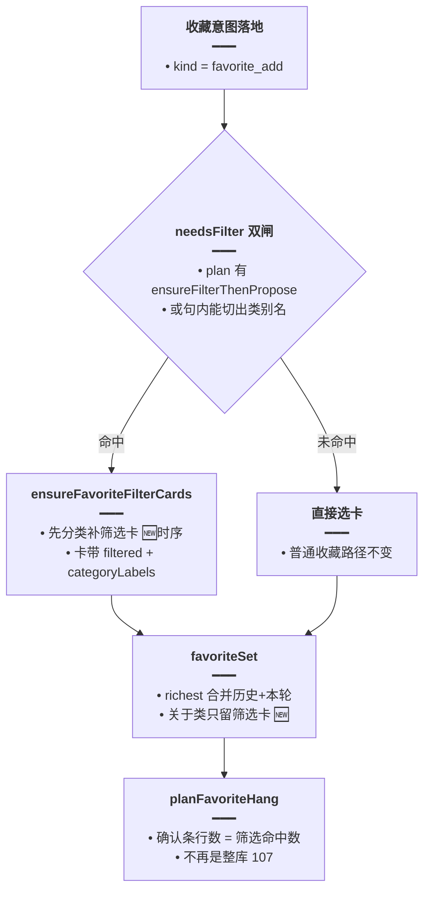

# 关于类收藏筛选卡

> 延伸阅读：
> - [英语Agent意图帧.md](./英语Agent意图帧.md)：`ensureFilterThenPropose` 计划步与 `needsFilterCards` 的来源。
> - [收藏意图总闸.md](./收藏意图总闸.md)：`favoriteNeedsFilterCards` + `ensureFavoriteFilterCards` 的前序实现。
> - [筛选卡续答与整类收藏.md](./筛选卡续答与整类收藏.md)：`favoriteSet` / `dropFullLibraryCards` 的前序实现。

## 1. 背景与目标

「收藏所有关于家庭的单词」这类**关于类收藏**有一个顽固 bug：确认条上挂的是**整库 107 条**而不是筛选后的命中行。根因有两层：

1. **时序错**：收尾挂确认条时先 `favoriteSet` 选卡、后 `ensureFavoriteFilterCards` 补筛选卡——补卡前池子里只有整库「词条」卡，`favoriteSet` 自然把它 richest 出来挂上了条。
2. **选卡口径宽**：`favoriteSet` 的「关于类只留筛选卡」判断只看 `favoriteNeedsFilterCards`（软添加口令表），「收藏所有关于…」这种硬添加 + 关于类复合句不在口令表内，整库卡漏网。

目标：关于类收藏**先补筛选卡、再选卡**，且选卡时**只留带类别的筛选卡**——确认条行数永远等于筛选命中数，不再出现整库数字。

## 2. 改动范围

| 路径 | 改动 |
|------|------|
| `apps/backend/src/services/agent/tools/english/favorite-ask.ts` | `ScopeCard` 加 `filtered` 标记；`dropFullLibraryCards` 认 `filtered`；新增 `onlyCategoryFilterCards`；`favoriteSet` 关于类只留筛选卡 |
| `apps/backend/src/services/agent/agent.service.ts` | 收藏块 `needsFilter` 加「硬添加 + 关于类」分支；`ensureFavoriteFilterCards` 移到 `favoriteSet` **之前**，删去补卡后重算 set/plan 的重复代码 |

## 3. 实现思路

1. **双闸判定**：`needsFilter = intent.needsFilterCards || (kind === 'favorite_add' && categoryLabels.length > 0)`。软添加口令走 IntentFrame 的 `ensureFilterThenPropose` 计划步；硬添加复合句走 `categoryLabels` 直验——两道闸任一命中都先补卡。
2. **时序对调**：`ensureFavoriteFilterCards` 提到 `favoriteSet` 之前，保证选卡时池子里已有筛选卡；补卡后**不再重算** set/plan（旧版重算一遍是时序倒置留下的补丁，对调后自然消失）。
3. **选卡收紧**：`favoriteSet` 末尾加「关于类 → `onlyCategoryFilterCards`」——只留 `filtered === true && categoryLabels.length > 0` 的卡；一张筛选卡都没有时保持原池（避免误伤「列出全部再收藏」这类真整库场景的空确认）。
4. **filtered 标记贯通**：`dropFullLibraryCards` 的「已有筛选卡」判定从只看 `categoryLabels` 扩为 `filtered || categoryLabels`，与 `onlyCategoryFilterCards` 同一口径，两处不会再各认各的。

### 主流程（改动后）



## 4. 关键实现（改动前 / 改动后对比 + 注释）

### 4.1 `ScopeCard.filtered` 与 `dropFullLibraryCards` 口径统一

来源：`apps/backend/src/services/agent/tools/english/favorite-ask.ts`（**改动前**，约 L361–L369，diff `-` 侧）

```ts
// 选卡池里的卡片形状：缺「是否筛选卡」的一手标记，只能靠 categoryLabels 反推
type ScopeCard = {
	// 卡片标题：确认条与卡面展示用
	title?: string;
	// 卡的侧别（vocab 词条 / classic 语句）：favoriteSet 按它分桶
	contentKind?: string;
	// 卡内条目列表：确认条行数的数据源
	items?: unknown[];
	// 卡来源（哪一步产出的卡）：追溯用
	source?: string;
	// 所属库 id：定位整库卡来自哪个词库
	libraryId?: string;
	// 命中的类别名：旧版反推「是否筛选卡」的唯一依据
	categoryLabels?: string[];
	// 关联产物 id：卡片落库与引用用
	artifactId?: string;
};
```

来源：`apps/backend/src/services/agent/tools/english/favorite-ask.ts`（**改动后**，约 L361–L370）

```ts
// 选卡池里的卡片形状
type ScopeCard = {
	// 卡片标题：确认条与卡面展示用
	title?: string;
	// 卡的侧别（vocab 词条 / classic 语句）：favoriteSet 按它分桶
	contentKind?: string;
	// 卡内条目列表：确认条行数的数据源
	items?: unknown[];
	// 卡来源（哪一步产出的卡）：追溯用
	source?: string;
	// 所属库 id：定位整库卡来自哪个词库
	libraryId?: string;
	// 命中的类别名：与 filtered 一起构成筛选卡判定口径
	categoryLabels?: string[];
	// 关联产物 id：卡片落库与引用用
	artifactId?: string;
	// 一手筛选标记：与 ElResourceListPayload.filtered 对齐，选卡不再纯靠 labels 反推
	filtered?: boolean;
};
```

来源：`apps/backend/src/services/agent/tools/english/favorite-ask.ts`（**改动前**，约 L476–L488，diff `-` 侧）

```ts
/** 同侧已有分类筛选卡时，无类别的整库「词条」卡不能冒充「上述」。 */
// 「已有筛选卡」只认 categoryLabels：筛选卡 labels 为空时误判为没有筛选卡
function dropFullLibraryCards(cards: ScopeCard[]): ScopeCard[] {
	// 同侧是否已有筛选卡：按侧别 kind 判定，别侧的筛选卡不算数
	const hasFiltered = (kind: string) =>
		// 扫全池：任意一张同侧卡带类别即视为「已有筛选卡」
		cards.some(
			// some 回调：逐卡判定
			(card) =>
				// 同侧且带类别名 → 是筛选卡（旧口径只认 labels，labels 空则漏判）
				card.contentKind === kind && (card.categoryLabels?.length ?? 0) > 0,
		);
	// 过滤全池：逐卡决定去留
	return cards.filter((card) => {
		// 取卡的侧别；缺省空串，空串侧永远无筛选卡，天然放行
		const kind = card.contentKind ?? '';
		// 该侧没有筛选卡：整库卡照留，不丢
		if (!hasFiltered(kind)) return true;
		// 该侧已有筛选卡：只留带类别的卡，整库「词条」卡丢弃
		return (card.categoryLabels?.length ?? 0) > 0;
	});
}
```

来源：`apps/backend/src/services/agent/tools/english/favorite-ask.ts`（**改动后**，约 L476–L496）

```ts
/** 同侧已有分类筛选卡时，无类别的整库「词条」卡不能冒充「上述」。 */
// 判定口径扩为 filtered || labels：与 onlyCategoryFilterCards 同一事实源
function dropFullLibraryCards(cards: ScopeCard[]): ScopeCard[] {
	// 同侧是否已有筛选卡：按侧别 kind 判定，别侧的筛选卡不算数
	const hasFiltered = (kind: string) =>
		// 扫全池：任意一张同侧卡命中口径即视为「已有筛选卡」
		cards.some(
			// some 回调：逐卡判定
			(card) =>
				// 先卡侧别：不同侧的筛选卡不算数
				card.contentKind === kind &&
				// filtered 一手标记优先：labels 被上游清过的卡仍是筛选卡
				(card.filtered || (card.categoryLabels?.length ?? 0) > 0),
		);
	// 过滤全池：逐卡决定去留
	return cards.filter((card) => {
		// 取卡的侧别；缺省空串，空串侧无筛选卡，天然放行
		const kind = card.contentKind ?? '';
		// 该侧没有筛选卡：整库卡照留
		if (!hasFiltered(kind)) return true;
		// 有筛选卡：只留筛选卡，整库卡丢弃
		return card.filtered || (card.categoryLabels?.length ?? 0) > 0;
	});
}

/** 关于类收藏：只留带类别的筛选卡，丢掉整库「词条」卡。 */
// favoriteSet 的关于类专用收紧：filtered 与 labels 双重要求，缺一不可
function onlyCategoryFilterCards(cards: ScopeCard[]): ScopeCard[] {
	// 过滤全池：只放行关于类筛选卡
	return cards.filter(
		// 双重要求缺一不可：filtered 为真且带类别名；整库卡两条都不满足，被丢弃
		(card) => card.filtered === true && (card.categoryLabels?.length ?? 0) > 0,
	);
}
```

变更摘要：`ScopeCard` 新增 `filtered` 一手标记；`dropFullLibraryCards` 与新增的 `onlyCategoryFilterCards` 统一以 `filtered + categoryLabels` 为准。

### 4.2 `favoriteSet` 关于类只留筛选卡

来源：`apps/backend/src/services/agent/tools/english/favorite-ask.ts`（**改动前**，约 L498–L541，diff `-` 侧，函数尾部节选；前半 `side` / `indexes` / `fromHistory` / `fromTurn` 推导未改动，对称省略）

```ts
/** 这句要收藏的卡。历史窗口与本轮库卡同一池再 richest。 */
export function favoriteSet(
	// 历史窗口消息：fromHistory 的取卡来源
	messages: FavoriteScopeMessage[],
	// 用户原句：省略的 side 推导与关于类判定的输入
	userText: string,
	// 上一轮收藏序号取数函数：解析「这些/上面」指代的卡
	priorIndexes: (
		// 在哪段消息切片里找序号
		slice: FavoriteScopeMessage[],
		// 是否桥接上一轮收藏：跨句追加收藏的开关
		bridgeFavorites: boolean,
	// 返回命中消息的下标列表
	) => number[],
	// 本轮新出的库卡：默认空，兼容无新卡的场景
	turnCards: ScopeCard[] = [],
// 返回按侧分桶的收藏集；无可收藏卡时为 null
): FavoriteSet | null {
	// ...（side / indexes / fromHistory / fromTurn 推导未改动）
	const fromTurn = turnCards.filter((card) => favoriteEligibleCard(card));
	// const：选完不再变；没有关于类收紧
	const full = dropFullLibraryCards(richest([...fromHistory, ...fromTurn]));
	// 组装 FavoriteSet：按 side 决定哪侧留卡、哪侧置空
	return {
		// 本次收藏的侧别（vocab / classic / 两侧）
		side,
		// 词条侧卡列表
		vocab:
			// 只收藏语句侧时词条侧要置空
			side === 'classic'
				// classic 专场：词条侧不给卡
				? []
				// 否则从选卡池滤出词条卡
				: full.filter((card) => card.contentKind === 'vocab'),
		// 语句侧卡列表
		classic:
			// 只收藏词条侧时语句侧要置空
			side === 'vocab'
				// vocab 专场：语句侧不给卡
				? []
				// 否则从选卡池滤出语句卡
				: full.filter((card) => card.contentKind === 'classic'),
	};
}
```

来源：`apps/backend/src/services/agent/tools/english/favorite-ask.ts`（**改动后**，约 L498–L542；前半推导未改动，对称省略）

```ts
/** 这句要收藏的卡。历史窗口与本轮库卡同一池再 richest。 */
export function favoriteSet(
	// 历史窗口消息：fromHistory 的取卡来源
	messages: FavoriteScopeMessage[],
	// 用户原句：关于类双闸判定（闸一/闸二）的输入
	userText: string,
	// 上一轮收藏序号取数函数：解析「这些/上面」指代的卡
	priorIndexes: (
		// 在哪段消息切片里找序号
		slice: FavoriteScopeMessage[],
		// 是否桥接上一轮收藏：跨句追加收藏的开关
		bridgeFavorites: boolean,
	// 返回命中消息的下标列表
	) => number[],
	// 本轮新出的库卡：默认空，兼容无新卡的场景
	turnCards: ScopeCard[] = [],
// 返回按侧分桶的收藏集；无可收藏卡时为 null
): FavoriteSet | null {
	// ...（side / indexes / fromHistory / fromTurn 推导未改动）
	const fromTurn = turnCards.filter((card) => favoriteEligibleCard(card));
	// 改 let：关于类句会被筛选卡子集替换
	let full = dropFullLibraryCards(richest([...fromHistory, ...fromTurn]));
	// 「收藏…关于家庭…」：有筛选卡则只用筛选卡，确认条不能变成整库 107
	if (
		// 闸一：软添加口令（IntentFrame ensureFilterThenPropose 的判定源）
		favoriteNeedsFilterCards(userText) ||
		// 闸二：硬添加复合句能切出类别名（「收藏所有关于…」）
		categoryLabels(userText).length > 0
	// 双闸任一命中：进入关于类收紧分支
	) {
		// 只留筛选卡：整库「词条」卡在这里被丢弃
		const labeled = onlyCategoryFilterCards(full);
		// 一张筛选卡都没有时保持原池：真整库收藏不被误伤成空确认
		if (labeled.length) full = labeled;
	}
	// 组装 FavoriteSet：按 side 决定哪侧留卡、哪侧置空
	return {
		// 本次收藏的侧别（vocab / classic / 两侧）
		side,
		// 词条侧卡列表
		vocab:
			// 只收藏语句侧时词条侧要置空
			side === 'classic'
				// classic 专场：词条侧不给卡
				? []
				// 否则从选卡池滤出词条卡
				: full.filter((card) => card.contentKind === 'vocab'),
		// 语句侧卡列表
		classic:
			// 只收藏词条侧时语句侧要置空
			side === 'vocab'
				// vocab 专场：语句侧不给卡
				? []
				// 否则从选卡池滤出语句卡
				: full.filter((card) => card.contentKind === 'classic'),
	};
}
```

变更摘要：`favoriteSet` 尾部新增关于类收紧——双闸任一命中时把选卡池替换为筛选卡子集；子集为空则不动。

### 4.3 `agent.service.ts` 收藏块：先补卡再选卡

来源：`apps/backend/src/services/agent/agent.service.ts`（**改动前**，约 L1713–L1743，diff `-` 侧；`ensureFavoriteFilterCards` 参数块未改动，对称省略）

```ts
									// 只看软添加口令：「收藏所有关于…」硬添加复合句漏判
									const needsFilter = Boolean(elSurface.intent?.needsFilterCards);
									// 收集本轮已出的库卡：此刻池子里还没有筛选卡
									let turnCards = collectTurnLibraryCards();
									// 先选卡：池子里还没有筛选卡，整库卡被 richest 出来
									let set = favoriteSet(history, dto.content, priorIndexes, turnCards);
									// 由选卡结果推导确认条挂载计划
									let plan = set
										// 有卡可收藏：挂确认条，行数 = 选卡条数
										? planFavoriteHang({ set, turnVocab: [], turnClassic: [] })
										// 无卡可收藏：不挂确认条
										: null;
									// 复合句缺卡：本轮补分类，禁止立刻「上面没有」
									// 补卡压在选卡之后：确认条已挂整库，107 条事故来源
									if (needsFilter && !plan?.hang) {
										// 按句内类别补出筛选卡（先分类后出卡）
										await this.ensureFavoriteFilterCards({
											// ...（参数块未改动，对称省略）
										});
										// 重收本轮卡：把刚补出的筛选卡纳入池子
										turnCards = collectTurnLibraryCards();
										// 补卡后重算一遍：时序倒置留下的补丁
										set = favoriteSet(history, dto.content, priorIndexes, turnCards);
										// 用新池重挂确认条，覆盖之前的整库计划
										plan = set
											// 有卡：挂确认条
											? planFavoriteHang({ set, turnVocab: [], turnClassic: [] })
											// 无卡：不挂确认条
											: null;
									}
```

来源：`apps/backend/src/services/agent/agent.service.ts`（**改动后**，约 L1716–L1747；`ensureFavoriteFilterCards` 参数块未改动，对称省略）

```ts
									// 关于类收藏：先补筛选卡，再选卡；禁止先用整库卡挂上 107 确认条
									const needsFilter =
										// 闸一：软添加口令（来自 IntentFrame 计划步）
										Boolean(elSurface.intent?.needsFilterCards) ||
										// 闸二：硬添加复合句直验类别名，「收藏所有关于…」不再漏
										(elSurface.intent?.kind === 'favorite_add' &&
											// 句内能切出类别名即需补卡（如「家庭」「旅行」）
											categoryLabels(dto.content).length > 0);
									// 收集本轮已出的库卡
									let turnCards = collectTurnLibraryCards();
									// 先补卡：选卡前池子里已有筛选卡
									if (needsFilter) {
										// 按句内类别补出筛选卡（先分类后出卡）
										await this.ensureFavoriteFilterCards({
											// ...（参数块未改动，对称省略）
										});
										// 重收本轮卡：把刚补出的筛选卡纳入池子
										turnCards = collectTurnLibraryCards();
									}
									// 后选卡：只算一遍，补卡后重算的补丁代码随之删除
									const set = favoriteSet(
										// 历史窗口消息：历史卡来源
										history,
										// 用户原句：favoriteSet 内关于类双闸判定的输入
										dto.content,
										// 「这些/上面」指代的取数函数
										priorIndexes,
										// 本轮卡（已含筛选卡）：选卡池的本轮侧
										turnCards,
									);
									// 由选卡结果推导确认条挂载计划；只算这一遍
									const plan = set
										// 有卡可收藏：挂确认条，行数 = 筛选命中数
										? planFavoriteHang({ set, turnVocab: [], turnClassic: [] })
										// 无卡可收藏：不挂确认条
										: null;
```

变更摘要：`needsFilter` 从单闸扩为双闸；`ensureFavoriteFilterCards` 提到 `favoriteSet` 之前且补卡后不再重算——「先补筛选卡、再选卡」一句话落地。

## 5. 行为变化与兼容性

- **行为修正**（预期变化）：「收藏所有关于家庭的单词 / 把关于旅行的语句都收藏了」确认条行数 = 筛选命中数；不再出现整库 107 条确认。
- **不变**：普通收藏（「收藏这些」）、整库收藏（句内无关于类标记）路径不变；`favoriteSet` 对无筛选卡场景保持原池。
- **依赖**：确认条行数正确的前提是筛选卡带上 `filtered: true` + `categoryLabels`——该字段由外溢链路（`ElResourceListPayload`）写入，见 [筛选卡续答与整类收藏.md](./筛选卡续答与整类收藏.md)。

## 6. 测试与回归建议

1. 「收藏所有关于家庭的单词」→ 先出「家庭」筛选卡，确认条行数 = 命中数，不是整库总数。
2. 「需要收藏关于旅行的语句」→ 同上（软添加口令路径）。
3. 「收藏这些」（无关于类）→ 直接挂确认条，不补筛选卡。
4. 「列出全部单词，然后都收藏」→ 整库收藏仍可用，确认条为整库数。
5. 长对话中先说「关于家庭的词」再说「都收藏了」→ 沿用筛选卡，确认条为命中数。

## 7. 相关源码路径

- `apps/backend/src/services/agent/tools/english/favorite-ask.ts`（`filtered` / `onlyCategoryFilterCards` / `favoriteSet`）
- `apps/backend/src/services/agent/agent.service.ts`（收藏块 `needsFilter` 与时序）

> 若与仓库最新源码不一致，以源码为准。
