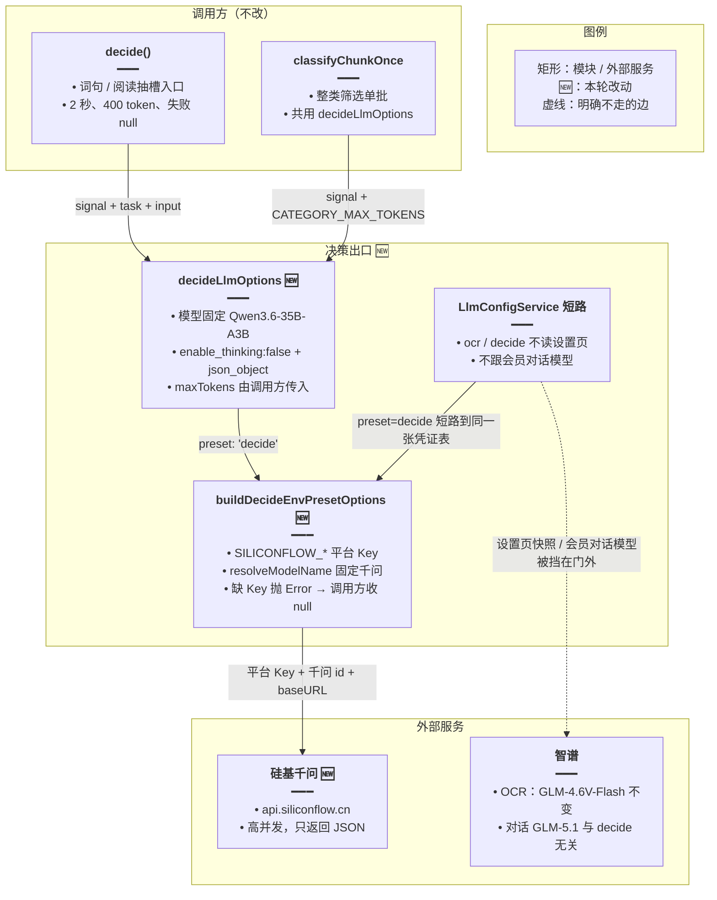
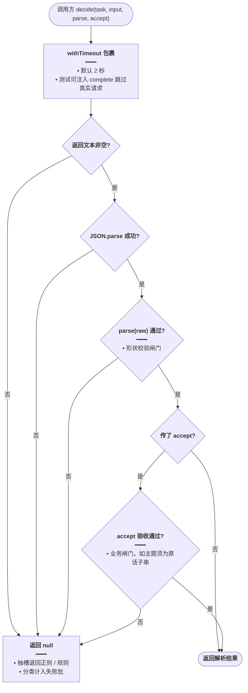

# 决策改用千问

> 英语 Agent 的短决策（词句 / 阅读抽槽、整类筛选判定）整档从智谱 `glm-4.7-flash` 切到硅基流动 `Qwen/Qwen3.6-35B-A3B`，请求固定关思考 + JSON 外壳；OCR 仍固定智谱视觉模型。两条链路都不读设置页自定义大模型，也不跟会员对话模型。

## 延伸阅读

- [词句分类列出.md](./词句分类列出.md)：分类列出是 `decide` 的主要调用方，整类筛选的批次与确认条规则见该篇
- [分类截断续批.md](./分类截断续批.md)：分类批处理的截断续批也用 `decide`，本篇只换它的出口与请求参数
- 规划态：[../ideas/english/决策改用千问.md](../ideas/english/决策改用千问.md)

---

## 1. 背景与目标

智谱免费档 `glm-4.7-flash` 只有 1 路并发，而整类筛选固定 4 路并发：多出来的请求被限流（1302）后收成 `null`，失败批变多，确认条变空或带「有批未能判断」；抽槽与分类还互相抢这 1 路。

本轮目标：

- `decide` 档整档换出口：平台 `SILICONFLOW_API_KEY` + `https://api.siliconflow.cn/v1`，模型固定 `Qwen/Qwen3.6-35B-A3B`。
- 请求参数固定 `enable_thinking: false` + `response_format: json_object`，不再带智谱 `thinking` 对象（硅基不认识的字段会整批 400）。
- 不读 `SILICONFLOW_MODEL_NAME`、不读设置页快照、不跟会员对话模型；OCR 出口保持智谱不变。
- `decide()` 的任务 / 原文 / `parse` / `accept` 契约、失败返回 `null` 的约定不变，调用方零改动。

## 2. 改动范围

- `apps/backend/src/utils/create-llm.ts`（+31）：新增 `DECIDE_MODEL_NAME` 常量与 `buildDecideEnvPresetOptions`；两张凭证表的 `decide` 项改指向它；`SiliconFlowLlmPreset` 的 `decide` 注释更新
- `apps/backend/src/utils/glm-decide.ts`（+25）：`DECIDE_MODEL_NAME` 迁出为再导出；新增 `DECIDE_JSON_KWARGS`；`decideLlmOptions` 支持传入 `maxTokens`
- `apps/backend/src/services/llm-config/llm-config.service.ts`（+2）：短路注释更新为「OCR 固定智谱视觉、短决策固定硅基千问」

调用方（`pack-ask.ts` / `reading-ask.ts` / `category-propose.ts`）无 diff：`classifyChunkOnce` 早已共用 `decideLlmOptions(signal, CATEGORY_MAX_TOKENS)`，换出口对它透明。

## 3. 实现思路

### 3.1 核心决策

- **换出口而不是只改模型名**：Key 仍是 `GLM_API_KEY` 时，千问 id 会打到 `open.bigmodel.cn`。所以凭证档（Key / Base URL / 模型名解析）整份换掉，新增 `buildDecideEnvPresetOptions`，两张凭证表（非会员 / 会员）的 `decide` 项一起改，避免会员表被遗忘回智谱。
- **常量上移**：`DECIDE_MODEL_NAME` 从 `glm-decide.ts` 迁到 `create-llm.ts`，凭证档解析与调用方覆盖共用同一份 id；`glm-decide.ts` 再导出保持旧 import 路径可用，且避免 `create-llm` 反向引用 `glm-decide` 形成循环。
- **只放硅基认识的字段**：`DECIDE_JSON_KWARGS = { enable_thinking: false, response_format: json_object }`，不再展开 `GLM_THINKING_DISABLED_KWARGS`（`thinking: { type: 'disabled' }` 是智谱私有字段，打到硅基会 400，被 `catch` 收成 `null` 后与限流难以区分）。
- **短路保留**：`LlmConfigService.resolveSiliconFlowCredentials` 里 `ocr || decide` 的短路一字不动，设置页自定义 Base URL / 模型与会员对话模型永远进不了这两条链路。

### 3.2 架构图



**读图要点**：

- 抽槽与分类都汇聚到同一份 `decideLlmOptions`，模型名与关思考只有一份，不会再出现「分类已换、抽槽仍带智谱字段」的分叉。
- 凭证层面两张表（非会员 / 会员）的 `decide` 项都指向 `buildDecideEnvPresetOptions`，会员身份不改变短决策出口。
- 智谱节点画出来只为标边界：OCR 仍走它，对话模型与它同侧但和 `decide` 没有调用关系。

### 3.3 主流程图（一次 decide 的闸门）



**读图要点**：本轮只换 `completeWithLlm` 内部打到哪里、带什么字段；上图的空文本 / 坏 JSON / `parse` / `accept` 四道闸门与「任何异常收 `null`」的兜底全部未动，调用方的回退路径（正则、失败批计数）不受影响。

## 4. 关键实现（改动前 / 改动后对比）

### 4.1 `DECIDE_MODEL_NAME`：迁到 create-llm.ts 并换千问

**对比范围**：常量定义从 `glm-decide.ts` 移到 `create-llm.ts`，值从 `glm-4.7-flash` 换为 `Qwen/Qwen3.6-35B-A3B`。

**改动前** · `apps/backend/src/utils/glm-decide.ts`（基线，约 L9–L10）

```typescript
/** 决策模型不跟 GLM_MODEL_NAME。对话默认模型换大了，这里仍是 flash。 */
// 改动前：决策模型写死智谱 glm-4.7-flash，出口与并发都受智谱免费档约束
export const DECIDE_MODEL_NAME = 'glm-4.7-flash';
```

**改动后** · `apps/backend/src/utils/create-llm.ts`（当前，约 L27–L28）

```typescript
/** 短决策和整类筛选固定模型。不读 SILICONFLOW_MODEL_NAME，避免跟着对话模型走。 */
// 常量上移到 create-llm.ts：凭证档解析（resolveModelName）与调用方覆盖共用同一份 id，两处不会写岔
export const DECIDE_MODEL_NAME = 'Qwen/Qwen3.6-35B-A3B';
```

**变更摘要**：常量搬家 + 换值；`glm-decide.ts` 改为再导出（见 §4.5），旧引用方无需改 import。

### 4.2 `SiliconFlowLlmPreset` 的 `decide` 注释

**对比范围**：`create-llm.ts` 中预设联合类型的 JSDoc，仅 `decide` 一行说明变化，类型成员不变。

**改动前** · `apps/backend/src/utils/create-llm.ts`（基线，约 L27–L33）

```typescript
/**
 * @description 硅基流动模型用途预设（与业务一一对应，用于选择配置）
 * - chat: 聊天
 * - assistant: 知识库助手
 * - knowledgeQa: 知识库问答
 * - englishLearning: 英语学习
 * - ocr: 图片 OCR（固定 GLM_* 环境变量 + GLM-4.6V-Flash，不走设置页覆盖）
 * - decide: 短决策（固定 GLM_* + 调用方写死的 glm-4.7-flash，会员也不切硅基）
 */
```

**改动后** · `apps/backend/src/utils/create-llm.ts`（当前，约 L30–L38）

```typescript
/**
 * @description 硅基流动模型用途预设（与业务一一对应，用于选择配置）
 * - chat: 聊天
 * - assistant: 知识库助手
 * - knowledgeQa: 知识库问答
 * - englishLearning: 英语学习
 * - ocr: 图片 OCR（固定 GLM_* 环境变量 + GLM-4.6V-Flash，不走设置页覆盖）
 * - decide: 短决策（固定 SILICONFLOW_* + Qwen/Qwen3.6-35B-A3B，不跟对话模型，设置页也不覆盖）
 */
```

**变更摘要**：仅文档行，把 `decide` 档的真实出口（硅基千问）写明白，防止后来者按旧注释以为仍是智谱。

### 4.3 `buildDecideEnvPresetOptions`（纯新增）

**对比范围**：`create-llm.ts` 新增函数；基线中不存在。

**改动后** · `apps/backend/src/utils/create-llm.ts`（当前，约 L272–L284，新增）

```typescript
/**
 * @description 决策档凭证：平台硅基 Key，模型固定千问。不走 buildSiliconFlowEnvPresetOptions，那个会读对话模型名。
 */
// 决策档专用凭证工厂：Key / Base URL 复用硅基平台环境变量，模型名钉死千问
function buildDecideEnvPresetOptions(): ResolveSiliconFlowOptions {
	// 返回统一的凭证解析选项结构，交给 resolveSiliconFlowCredentials 消费
	return {
		// 与知识库、会员对话同一把平台 Key，不使用 GLM_API_KEY
		apiKeyEnvKeys: SILICONFLOW_ENV_API_KEY_KEYS,
		// 硅基 Base URL 环境变量名列表，允许运维覆盖网关
		baseUrlEnvKeys: SILICONFLOW_ENV_BASE_URL_KEYS,
		// 环境变量缺省时回落硅基国内站，避免落到智谱默认根路径把千问 id 打错供应商
		defaultBaseUrl: DEFAULT_SILICONFLOW_BASE_URL,
		// 模型名固定千问：刻意不用 resolveSiliconFlowModelNameFromEnv，那个默认读对话模型 GLM-5.1
		resolveModelName: () => DECIDE_MODEL_NAME,
		// 缺 Key 时的报错文案，供 onMissingApiKey 抛出
		missingApiKeyMessage: '未配置 SILICONFLOW_API_KEY，无法做决策',
		// 抛普通 Error 而非 HttpException：由 decide / 分类器的 catch 收成 null，不变成用户可见的 503 对话错误
		onMissingApiKey: throwSiliconFlowError,
	};
}
```

**变更摘要**：新增。与 `buildSiliconFlowEnvPresetOptions` 的唯一差异是 `resolveModelName` 固定返回千问、不读 `SILICONFLOW_MODEL_NAME`；这正是不能复用会员档工厂的原因。

### 4.4 两张凭证表的 `decide` 项

**对比范围**：`create-llm.ts` 中 `siliconFlowResolvePresets` 与 `memberSiliconFlowResolvePresets` 两个 Record 的 `decide` 属性；同一张表内其它项未改，对称省略。

**改动前** · `apps/backend/src/utils/create-llm.ts`（基线，非会员表约 L373–L386、会员表约 L409–L422）

```typescript
// 非会员凭证预设表：preset → 凭证解析选项工厂（Record 泛型参数同行展示）
const siliconFlowResolvePresets: Record<SiliconFlowLlmPreset, (config: ConfigService) => ResolveSiliconFlowOptions> = {
	// chat / assistant / knowledgeQa / englishLearning / ocr 五项与基线相同，略
	// ... 五项未改动
	// 改动前：decide 走非会员智谱档，Key / Base URL / 模型名全部来自 GLM_*
	decide: () =>
		// 用智谱档工厂：出口 open.bigmodel.cn，模型名由 GLM_MODEL_NAME 决定
		buildGlmEnvPresetOptions(
			// 缺智谱 Key 时的报错文案
			'未配置 GLM_API_KEY，无法做决策',
			// 抛普通 Error，decide 的 catch 会收成 null
			throwSiliconFlowError,
		),
};

// 会员凭证预设表：默认 SILICONFLOW_*，ocr / decide 是例外（Record 泛型参数同行展示）
const memberSiliconFlowResolvePresets: Record<SiliconFlowLlmPreset, (config: ConfigService) => ResolveSiliconFlowOptions> = {
	// chat / assistant / knowledgeQa / englishLearning / ocr 五项与基线相同，略
	// ... 五项未改动
	// 改动前：会员表里的 decide 同样走智谱 GLM_*，会员身份不影响短决策出口
	decide: () =>
		// 同非会员表的 decide：智谱档工厂 + 智谱报错文案
		buildGlmEnvPresetOptions(
			// 缺智谱 Key 时的报错文案
			'未配置 GLM_API_KEY，无法做决策',
			// 抛普通 Error，decide 的 catch 会收成 null
			throwSiliconFlowError,
		),
};
```

**改动后** · `apps/backend/src/utils/create-llm.ts`（当前，非会员表约 L367–L394、会员表约 L399–L426）

```typescript
// 非会员凭证预设表：preset → 凭证解析选项工厂（Record 泛型参数同行展示）
const siliconFlowResolvePresets: Record<SiliconFlowLlmPreset, (config: ConfigService) => ResolveSiliconFlowOptions> = {
	// chat / assistant / knowledgeQa / englishLearning / ocr 五项与基线相同，略
	// ... 五项未改动
	// 改动后：decide 整档换硅基平台 Key + 固定千问，Key、Base URL、模型名由新工厂钉死
	decide: () => buildDecideEnvPresetOptions(),
};

// 会员凭证预设表：默认 SILICONFLOW_*，ocr / decide 是例外（Record 泛型参数同行展示）
const memberSiliconFlowResolvePresets: Record<SiliconFlowLlmPreset, (config: ConfigService) => ResolveSiliconFlowOptions> = {
	// chat / assistant / knowledgeQa / englishLearning / ocr 五项与基线相同，略
	// ... 五项未改动
	// 改动后：会员表的 decide 与非会员表同一份工厂，会员身份不改变短决策出口
	decide: () => buildDecideEnvPresetOptions(),
};
```

**变更摘要**：两张表的 `decide` 项由 `buildGlmEnvPresetOptions('未配置 GLM_API_KEY，无法做决策', throwSiliconFlowError)` 换成 `buildDecideEnvPresetOptions()`；只改非会员表会让会员路径回到智谱，所以两处一起改。

### 4.5 `glm-decide.ts` 头部：import 换常量 + 新增 `DECIDE_JSON_KWARGS`

**对比范围**：`glm-decide.ts` 文件头（import 区、模型常量、新增的请求参数常量）；`DECIDE_TIMEOUT_MS`（2000）与 `DECIDE_MAX_TOKENS`（400）未改动，略。

**改动前** · `apps/backend/src/utils/glm-decide.ts`（基线，约 L1–L10）

```typescript
// LangChain 消息类型：拼系统 / 用户消息
import { HumanMessage, SystemMessage } from '@langchain/core/messages';
// NestJS ConfigService 类型：decide 只用它读环境变量
import type { ConfigService } from '@nestjs/config';
// createLlm 入口与选项类型；改动前还引入智谱关思考参数
import {
	// createLlm 的选项类型，decideLlmOptions 的返回类型
	type CreateLlmOptions,
	// 统一建客户端入口
	createLlm,
	// 智谱关思考字段 thinking: { type: 'disabled' }，换硅基后不再使用
	GLM_THINKING_DISABLED_KWARGS,
	// 来源为 create-llm 工具模块
} from './create-llm';

/** 决策模型不跟 GLM_MODEL_NAME。对话默认模型换大了，这里仍是 flash。 */
// 改动前：决策模型常量定义在本文件，值是智谱 glm-4.7-flash
export const DECIDE_MODEL_NAME = 'glm-4.7-flash';
```

**改动后** · `apps/backend/src/utils/glm-decide.ts`（当前，约 L1–L15）

```typescript
// LangChain 消息类型：拼系统 / 用户消息（未改动）
import { HumanMessage, SystemMessage } from '@langchain/core/messages';
// NestJS ConfigService 类型：decide 只用它读环境变量（未改动）
import type { ConfigService } from '@nestjs/config';
// 不再引智谱关思考参数；改引迁到 create-llm 的千问模型常量
import {
	// createLlm 的选项类型，decideLlmOptions 的返回类型（未改动）
	type CreateLlmOptions,
	// 统一建客户端入口（未改动）
	createLlm,
	// 千问模型常量：唯一来源上移到 create-llm，本文件只再导出
	DECIDE_MODEL_NAME,
	// 来源为 create-llm 工具模块
} from './create-llm';

// 再导出保持旧 import 路径（category-propose 等）可用，同时避免 create-llm 反向引用本文件形成循环
export { DECIDE_MODEL_NAME };

/** 只放硅基认识的字段。不带智谱 thinking，避免不认识的字段让整批 400。 */
// 决策请求固定参数：替换旧的智谱 thinking 展开
export const DECIDE_JSON_KWARGS = {
	// 关闭千问思考链：400 / 分类大额度全留给 JSON，思考 token 会挤占上限导致截断
	enable_thinking: false,
	// 强制 JSON 对象输出；业务形状仍由调用方 parse 把关
	response_format: { type: 'json_object' as const },
};
```

**变更摘要**：import 里 `GLM_THINKING_DISABLED_KWARGS` → `DECIDE_MODEL_NAME`；常量改为再导出；新增 `DECIDE_JSON_KWARGS` 收拢「关思考 + JSON 外壳」两个字段。

### 4.6 `decideLlmOptions`：模型换千问、`maxTokens` 可传入

**对比范围**：`glm-decide.ts` 中 `decideLlmOptions` 全函数（签名 + 返回对象）。

**改动前** · `apps/backend/src/utils/glm-decide.ts`（基线，约 L30–L45）

```typescript
/** createLlm 入参。检查用它确认没有把模型交给会员档。 */
// 旧签名只收 AbortSignal：maxTokens 固定 400，分类想要更大额度只能自己另拼一份选项
export function decideLlmOptions(signal: AbortSignal): CreateLlmOptions {
	// 返回 createLlm 选项：一次短决策的全部约束集中在这里
	return {
		// decide 档：旧版解析 GLM_API_KEY，出口是智谱
		preset: 'decide',
		// 模型名写死 glm-4.7-flash，覆盖凭证解析结果，双保险
		modelName: DECIDE_MODEL_NAME,
		// 非流式：要一整段 JSON，流式半截文本会让 JSON.parse 失败
		streaming: false,
		// 温度 0：分类 / 抽槽要稳定，不采样
		temperature: 0,
		// 未传 temperature 时也不落到 createLlm 默认的 0.3
		defaultTemperature: 0,
		// 固定 400：只够一个槽位对象，分类场景被绑死
		maxTokens: DECIDE_MAX_TOKENS,
		// 智谱关思考字段 + JSON 外壳：thinking 对象是智谱私有字段，打到硅基会 400
		modelKwargs: {
			// 展开智谱关思考：thinking: { type: 'disabled' }
			...GLM_THINKING_DISABLED_KWARGS,
			// 强制 JSON 对象输出
			response_format: { type: 'json_object' },
		},
		// 调用方的超时信号原样传给 invoke
		abortSignal: signal,
	};
}
```

**改动后** · `apps/backend/src/utils/glm-decide.ts`（当前，约 L35–L50）

```typescript
/** createLlm 入参。检查用它确认没有把模型交给会员档。maxTokens 缺省 400，分类传入 65536。 */
// 新签名增加 maxTokens 参数：分类批处理传入更大输出额度，不再自己另拼选项
export function decideLlmOptions(
	// 超时 / 取消信号：短决策 2 秒、分类由调用方掌握，都经它传到 invoke
	signal: AbortSignal,
	// 输出 token 上限：缺省 400 够一个槽位对象；分类传入数千避免词表被截断
	maxTokens: number = DECIDE_MAX_TOKENS,
	// 返回 createLlm 的选项类型，调用方无需再包一层客户端
): CreateLlmOptions {
	// 返回 createLlm 选项：供应商档、模型名、思考开关集中一处，抽槽与分类共用
	return {
		// decide 档：现在解析硅基平台 SILICONFLOW_API_KEY，出口是硅基千问
		preset: 'decide',
		// 模型名仍是同一份常量（现为千问），覆盖凭证解析结果，双保险
		modelName: DECIDE_MODEL_NAME,
		// 非流式：要一整段 JSON，流式半截文本会让 JSON.parse 失败（未改动）
		streaming: false,
		// 温度 0：分类 / 抽槽要稳定，不采样（未改动）
		temperature: 0,
		// 未传 temperature 时也不落到 createLlm 默认的 0.3（未改动）
		defaultTemperature: 0,
		// 由参数传入：抽槽走缺省 400，分类按批大小给足
		maxTokens,
		// 硅基认识的关思考 + JSON 外壳；不再展开智谱 thinking 对象
		modelKwargs: DECIDE_JSON_KWARGS,
		// 调用方的超时信号原样传给 invoke（未改动）
		abortSignal: signal,
	};
}
```

**变更摘要**：签名加 `maxTokens`（缺省 400）；`modelKwargs` 从「智谱 thinking 展开 + json_object」换成 `DECIDE_JSON_KWARGS`；`preset` / `modelName` 写法不变，但指向的常量与档位内容已是硅基千问。

### 4.7 `decide`：四道闸门（本轮未改动，贴出作上下文）

**对比范围**：`glm-decide.ts` 中 `decide` 全函数；本轮无 diff，展示当前实现以说明「换供应商对调用方透明」的落点。辅助函数 `withTimeout` / `textOf` / `completeWithLlm` 也未改动（`completeWithLlm` 内部即 `createLlm(config, decideLlmOptions(signal))` + 双消息 invoke），略。

**当前实现** · `apps/backend/src/utils/glm-decide.ts`（约 L87–L118，本轮未改动）

```typescript
/**
 * 一次短决策。超时、缺密钥、非 JSON、parse 或 accept 失败都返回 null，不重试。
 * 不传 userId，也不传用户凭证 resolver。
 */
// 泛型决策入口：任务 / 原文 / parse / accept 契约本轮未改，换供应商对调用方完全透明
export async function decide<T>(
	// 只读环境变量：不传 userId、不传 resolver，设置页与会员对话模型进不来
	config: ConfigService,
	// 调用方给出的任务、原文与两道闸门
	input: DecideInput<T>,
	// 成功返回解析结果，任何失败形态返回 null
): Promise<T | null> {
	// 超时缺省 2 秒；测试可注入更短等待
	const timeoutMs = input.timeoutMs ?? DECIDE_TIMEOUT_MS;
	// 外层兜底：超时、缺 Key、HTTP 4xx/5xx 都进 catch 收成 null，不抛进对话
	try {
		// 把真实请求或测试注入包进 withTimeout，到点 reject
		const text = await withTimeout(
			// 测试注入了 complete 时走假实现，不打真实模型
			input.complete
				// 有注入：直接调注入函数拿文本
				? input.complete(input.task, input.input)
				// 无注入：走 completeWithLlm → createLlm decide 档发真实请求
				: completeWithLlm(config, input.task, input.input, timeoutMs),
			// 超时上限与外层一致，双保险先到先拒
			timeoutMs,
		);
		// 空白文本直接 null：JSON.parse 空串必失败，提前短路
		if (!text.trim()) return null;
		// 待解析的原始 JSON 值
		let raw: unknown;
		// 内层只兜 JSON.parse：坏 JSON 与空文本同罪，收 null
		try {
			// 尝试把模型文本解析为 JSON 值
			raw = JSON.parse(text);
			// 解析失败进入 catch：交调用方回退（正则 / 规则）
		} catch {
			// 坏 JSON 统一返回 null
			return null;
		}
		// 第一道闸门：形状校验，parse 返回 null 表示形状不符
		const parsed = input.parse(raw);
		// 形状不符直接 null，不进业务验收
		if (parsed == null) return null;
		// 没有 accept 时形状通过即可返回
		if (!input.accept) return parsed;
		// 第二道闸门：业务验收（如主题必须是原话子串）
		const accepted = input.accept(parsed, input.input);
		// 验收不通过也返回 null；通过则返回验收后的值
		return accepted == null ? null : accepted;
		// 所有未捕获异常（含 invoke 抛错、缺 Key）统一进外层 catch
	} catch {
		// 返回 null：抽槽退回正则，分类把这一批计入失败
		return null;
	}
}
```

**变更摘要**：无 diff。它解释了为什么换出口可以零调用方改动：所有失败形态（缺 `SILICONFLOW_API_KEY`、硅基 400 / 429、超时、坏 JSON、闸门不通过）都被收成 `null`，与旧版限流失败走同一条回退路径。

### 4.8 `LlmConfigService.resolveSiliconFlowCredentials` 短路注释

**对比范围**：`llm-config.service.ts` 中 `ocr || decide` 短路块的上一行注释；`if` 与解析调用未改。

**改动前** · `apps/backend/src/services/llm-config/llm-config.service.ts`（基线，约 L300–L306）

```typescript
		/** OCR 与短决策固定走 GLM_*，不受设置页自定义大模型或会员硅基覆盖 */
		// 短路：ocr / decide 不读设置页快照、不按会员切对话模型，直接用环境凭证
		if (preset === 'ocr' || preset === 'decide') {
			// 从环境变量解析凭证：ocr → 智谱视觉档；decide → 旧版智谱 GLM_* 档
			return resolveEnvSiliconFlowCredentials(
				// ConfigService：读环境变量里的 Key / Base URL
				config,
				// 取该 preset 的非会员凭证解析选项并立即执行：旧版 decide 在此落到智谱
				siliconFlowResolvePresetsForPreset(preset)(config),
			);
		}
```

**改动后** · `apps/backend/src/services/llm-config/llm-config.service.ts`（当前，约 L300–L306）

```typescript
		/** OCR 固定智谱视觉模型；短决策固定硅基千问。两者都不读设置页，也不跟会员对话模型。 */
		// 短路保留：ocr / decide 不读设置页快照、不按会员切对话模型；注释更新为 decide 已是硅基千问
		if (preset === 'ocr' || preset === 'decide') {
			// 从环境变量解析凭证：ocr → 智谱视觉档（未变）；decide → 新硅基千问档
			return resolveEnvSiliconFlowCredentials(
				// ConfigService：读环境变量里的 Key / Base URL
				config,
				// 取该 preset 的非会员凭证解析选项并立即执行：decide 在此落到 buildDecideEnvPresetOptions
				siliconFlowResolvePresetsForPreset(preset)(config),
			);
		}
```

**变更摘要**：仅注释一行。短路必须保留——删掉它，设置页自定义 Base URL 会接到千问模型名上，把请求打到别的供应商。

## 5. 行为变化与兼容性

- **用户可见**：整类筛选 4 路真正并行（硅基按账户给 RPM/TPM），失败批减少；确认条形状、空命中 vs 失败的区分、「有批未能判断」文案均不变。抽槽仍是 2 秒预算，失败仍退回正则。
- **计费变化**：非会员的筛选 / 抽槽从智谱免费额度改为消耗平台硅基余额。
- **未改动路径**：对话 / 知识库 / 英语正文生成仍走 `SILICONFLOW_MODEL_NAME`（默认 `Pro/zai-org/GLM-5.1`）或设置页自定义；OCR 仍固定 `GLM_API_KEY` + `GLM-4.6V-Flash`；`GLM_THINKING_DISABLED_KWARGS` 仍被对话等链路使用。
- **失败语义不变**：缺 `SILICONFLOW_API_KEY` 时 `buildDecideEnvPresetOptions` 抛普通 `Error`，被 `decide` / 分类器的 `catch` 收成 `null`，与旧版缺 `GLM_API_KEY` 的表现一致。

## 6. 测试与回归建议

- 用平台 Key 对 `Qwen/Qwen3.6-35B-A3B` 发一条带 `enable_thinking: false` + `response_format: json_object` 的真实请求：状态码非 400，正文为 JSON、无思考段占用 `max_tokens`。
- 整类筛选：命中词都来自清单原行；把 Key 故意配错再跑一次，应得到「有批未能判断」（`failedChunks > 0`）而非「库里没有这类词」。
- 不跟对话模型：设置页改自定义 Base URL / 模型后再筛选，请求仍是平台硅基 Key + 千问 id。
- 抽槽回退：规则认不全时抽槽成功，主题仍为原话子串；让模型超时，应静默退回正则。
- 旁路不动：普通对话仍走对话模型；OCR 仍走智谱视觉模型。
- 若硅基拒绝 `enable_thinking` 或 `json_object`：整档回滚（`decide` 项改回 `buildGlmEnvPresetOptions`、恢复智谱 `thinking` 展开），不要把两家字段叠在一起再试。

## 7. 相关文档与代码索引

| 说明 | 路径 |
|------|------|
| 决策档常量与凭证工厂 | `apps/backend/src/utils/create-llm.ts`（`DECIDE_MODEL_NAME` L28、`buildDecideEnvPresetOptions` L275、两张凭证表 `decide` 项 L393 / L425） |
| 短决策封装 | `apps/backend/src/utils/glm-decide.ts`（`DECIDE_JSON_KWARGS` L12、`decideLlmOptions` L36、`decide` L91） |
| 凭证短路 | `apps/backend/src/services/llm-config/llm-config.service.ts` L300–L306 |
| 分类调用方（无 diff） | `apps/backend/src/services/agent/tools/english/category-propose.ts`（`decideLlmOptions(signal, CATEGORY_MAX_TOKENS)` L167） |
| 主要调用方文档 | [词句分类列出.md](./词句分类列出.md)、[分类截断续批.md](./分类截断续批.md) |
| 规划稿 | [../ideas/english/决策改用千问.md](../ideas/english/决策改用千问.md) |

---

（若与仓库最新源码不一致，以源码为准）
