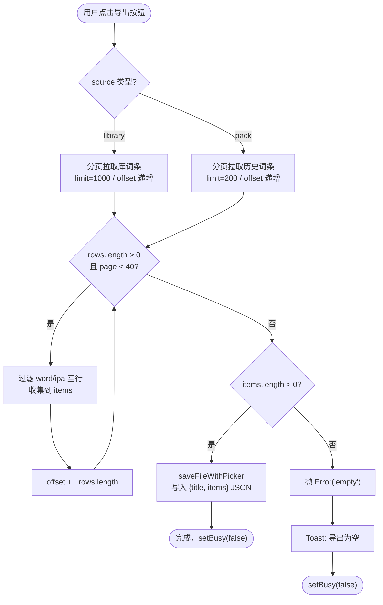

# 单词库 JSON 导出

## 延伸阅读

- [词库整库DOCX导出.md](./词库整库DOCX导出.md)：词库 / 语句库**整库导出为 Word（DOCX）**，导出按钮已升级为下拉菜单（JSON / Word 两项）
- [英语收藏DOCX导出.md](./英语收藏DOCX导出.md)：单词 / 经典句收藏 DOCX 导出
- [DOCX异步导出Job.md](./DOCX异步导出Job.md)：**大集合（>1 万条）异步导出 Job**——收藏 / 错题 / 复习超过 1 万条时改为后台生成 + 轮询下载

> **注**：本文记录的 `Export.tsx` 为最初「单 JSON 按钮」版本。当前版本已升级为 **DropdownMenu 下拉**（含「导出 JSON」「导出 Word」两项），Word 导出实现见姊妹篇 [词库整库DOCX导出.md](./词库整库DOCX导出.md)；大集合异步分流见 [DOCX异步导出Job.md](./DOCX异步导出Job.md)。

---

## 1. 背景与目标

英语学习「资源库」中的单词库（vocabulary library）此前只支持浏览与 DOCX 导出，无法一键导出原始词条 JSON。经典句库已有 `exportClassicQuotesJson` 导出能力，但单词库缺少等价功能。

本轮新增 **单词库 JSON 导出**：在资源库列表的单词库行操作区新增导出按钮，点击后分页拉取该库全部词条（含音标、词性、分词、释义、例句），经 `saveFileWithPicker` 保存为 `.json` 文件。导出格式与经典句 JSON 导出一致，便于后续导入或离线分析。

## 2. 改动范围

- `apps/frontend/src/views/englishLearning/components/vocab/Export.tsx` — **新增**：导出按钮组件（Tooltip + busy 态 + 错误 Toast）
- `apps/frontend/src/views/englishLearning/utils/exportVocabulary.ts` — **新增**：分页拉取 + saveFileWithPicker 工具函数
- `apps/frontend/src/views/englishLearning/components/vocab/index.ts` — 新增 `export { Export } from './Export'`
- `apps/frontend/src/views/englishLearning/library/components/LibraryListPanel.tsx` — 接入 VocabExport；经典句 Export 重命名为 ClassicExport；i18n 键 `englishLearning.library.deleteConfirmAction` → `common.delete`

## 3. 实现思路

1. **分页拉取**：库接口 `listEnglishVocabularyLibraryItems` 单页上限 1000；历史（pack）接口 `listEnglishVocabularyPackItems` 单页上限 200。为防止 total 虚高导致死循环，设最多 40 页（库 4 万 / 历史 8000）硬顶。
2. **过滤无效行**：仅保留 `word` 与 `ipa` 均非空的词条，避免导出空白行。
3. **不写半截文件**：全部页面拉取完毕后才调用 `saveFileWithPicker` 一次性写入 JSON，中途出错不产生残留文件。
4. **错误反馈**：空库抛 `Error('empty')`，组件侧区分空库与失败两种 Toast 文案。
5. **文件名安全化**：`safeFileName` 去除文件系统非法字符并截断至 80 字符，空标题回退 `vocabulary`。

### 导出流程



**读图要点**：导出按钮点击后进入分页循环，每页拉取后过滤无效行并累加 offset；循环退出条件为 rows 为空、offset 达到 total、或超过 40 页硬顶。全部词条收集完成后一次性写入 JSON 文件；若库为空则弹 Toast 提示。

## 4. 关键代码对比与注释

### 4.1 `Export.tsx` 导出按钮组件（纯新增）

> **版本注记**：以下为最初「单 JSON 按钮」实现。当前版本已升级为 **DropdownMenu 下拉**（导出 JSON / 导出 Word），详见 [词库整库DOCX导出.md](./词库整库DOCX导出.md) §4.6。

**对比范围**：`apps/frontend/src/views/englishLearning/components/vocab/Export.tsx` 全文件（基线中不存在，为新增组件）。

**改动后** · `apps/frontend/src/views/englishLearning/components/vocab/Export.tsx`（新增，约 L1–L98）

```tsx
// 组件文档注释：说明该组件用于单词库/历史行的 JSON 导出
/**
 * 单词库 / 历史行：导出该集合全部词条为 JSON。
 */
// 从 design 层导入 Tooltip 组件，提供悬停提示
import Tooltip from '@design/Tooltip';
// 从 UI 组件库导入 Button，作为导出按钮载体
import { Button } from '@ui/button';
// 从 sonner 封装导入 Toast，用于导出失败时弹出提示
import { Toast } from '@ui/sonner';
// 从 lucide-react 导入 FileJson 图标，作为按钮图标
import { FileJson } from 'lucide-react';
// 从 React 导入 MouseEvent 类型与 useState，用于事件类型与 busy 状态
import { type MouseEvent, useState } from 'react';
// 从通用 UI 导入 Spinner 组件，导出中显示加载动画
import { Spinner } from '@/components/ui';
// 从 hooks 导入 useI18n，获取 t 函数用于国际化文案
import { useI18n } from '@/hooks';
// 从 lib/utils 导入 cn，用于合并 Tailwind 类名
import { cn } from '@/lib/utils';
// 从同目录上级 utils 导入 exportVocabularyJson，执行实际分页拉取与文件保存
import { exportVocabularyJson } from '../../utils/exportVocabulary';

// 定义组件 Props 类型：区分 library 与 pack 两种来源
type ExportProps = {
	// 来源类型：library 为资源库，pack 为拉取历史
	source: 'library' | 'pack';
	// 库 ID（source=library 时必填）
	libraryId?: string;
	// 历史 streamId（source=pack 时必填）
	streamId?: string;
	// 导出文件标题（用于文件名与 JSON 内 title 字段）
	title?: string;
	// 词条总数（用于提前判断是否可能为空）
	wordCount?: number;
	// 禁用态（外部条件不满足时禁用按钮）
	disabled?: boolean;
	// 点击前回调：外部可在此 stopPropagation 等
	onBeforeClick?: (e: MouseEvent<HTMLButtonElement>) => void;
};

// 定义并导出 Export 组件：接收上述 Props
export function Export({
	// 解构 source：区分库还是历史
	source,
	// 解构 libraryId：库场景的标识
	libraryId,
	// 解构 streamId：历史场景的标识
	streamId,
	// 解构 title：文件名与 JSON 标题
	title,
	// 解构 wordCount：词条总数提示
	wordCount,
	// 解构 disabled：禁用态
	disabled,
	// 解构 onBeforeClick：点击前回调
	onBeforeClick,
}: ExportProps) {
	// 获取 t 函数用于国际化文案
	const { t } = useI18n();
	// busy 态：导出进行中禁用按钮并显示 Spinner
	const [busy, setBusy] = useState(false);
	// 按钮标签：导出 JSON 的文案
	const label = t('englishLearning.export.json');
	// 校验 ID 是否有效：库场景检查 libraryId，历史场景检查 streamId
	const idOk =
		source === 'library'
			? Boolean(libraryId?.trim())
			: Boolean(streamId?.trim());

	// 渲染 Tooltip + Button：Tooltip 显示导出文案，Button 触发导出
	return (
		// Tooltip 在按钮上方显示导出文案
		<Tooltip side="top" content={label}>
			// Button：ghost 变体、sm 尺寸，禁用条件含 disabled / busy / idOk
			<Button
				type="button"
				variant="ghost"
				size="sm"
				// 禁用：外部 disabled 或导出中或 ID 无效
				disabled={disabled || busy || !idOk}
				// aria-label 供屏幕阅读器读取
				aria-label={label}
				// aria-busy 表示当前处于异步操作中
				aria-busy={busy}
				// 合并类名：固定尺寸 + ghost 风格 + hover teal-500 主题色
				className={cn(
					'h-7 w-7 shrink-0 rounded-md p-0 transition-colors',
					'text-textcolor/65 hover:border hover:border-teal-500/15 hover:bg-teal-500/10 hover:text-teal-500',
				)}
				// 点击事件处理
				onClick={(e) => {
					// 先执行外部回调（如 stopPropagation）
					onBeforeClick?.(e);
					// 阻止事件冒泡，避免触发行展开等
					e.stopPropagation();
					// busy 或 ID 无效时不执行导出
					if (busy || !idOk) return;
					// 文件名：优先用标题，无标题时回退到默认文案
					const name =
						title?.trim() || t('englishLearning.vocab.exportFileFallback');
					// 设置 busy 态，禁用按钮并显示 Spinner
					setBusy(true);
					// 调用导出工具函数，按 source 传不同参数
					void exportVocabularyJson(
						// 库场景：传 libraryId
						source === 'library'
							? {
									source,
									libraryId: libraryId!.trim(),
									title: name,
									wordCount,
								}
							// 历史场景：传 streamId
							: {
									source,
									streamId: streamId!.trim(),
									title: name,
									wordCount,
								},
					)
						// 捕获错误：区分空库与失败两种情况
						.catch((err: unknown) => {
							// 判断是否为空库错误（err.message === 'empty'）
							const empty = err instanceof Error && err.message === 'empty';
							// 弹出错误 Toast：空库用 exportEmpty 文案，否则用 export.failed
							Toast({
								type: 'error',
								title: t(
									empty
										? 'englishLearning.vocab.exportEmpty'
										: 'englishLearning.export.failed',
								),
							});
						})
						// 无论成功失败都清除 busy 态
						.finally(() => setBusy(false));
				}}
			>
				// busy 时显示 Spinner 加载动画
				{busy ? (
					<Spinner className="size-3.5 text-textcolor" aria-hidden />
				) : (
					// 非_busy 时显示 FileJson 图标
					<FileJson className="size-3.5" aria-hidden />
				)}
			</Button>
		</Tooltip>
	);
}
```

**变更摘要**：纯新增组件。Tooltip 包裹 ghost Button，点击时分页拉取全部词条并保存 JSON；busy 态禁用按钮并切换为 Spinner；空库与失败分别弹不同 Toast。

### 4.2 `exportVocabulary.ts` 分页拉取工具（纯新增）

**对比范围**：`apps/frontend/src/views/englishLearning/utils/exportVocabulary.ts` 全文件（基线中不存在，为新增工具）。

**改动后** · `apps/frontend/src/views/englishLearning/utils/exportVocabulary.ts`（新增，约 L1–L99）

```typescript
// 文件文档注释：说明该工具分页拉取全部词条后存成 JSON，不写半截文件
/**
 * 单词库 / 拉取历史：分页拉全后存成导入兼容 JSON（不写半截文件）。
 */
// 从 service 层导入库词条列表接口
import {
	listEnglishVocabularyLibraryItems,
	listEnglishVocabularyPackItems,
} from '@/service';
// 从 utils 导入 saveFileWithPicker，用于跨端文件保存
import { saveFileWithPicker } from '@/utils';

// 定义导出来源的联合类型：library 或 pack
export type VocabExportSource =
	| {
			// 库场景标记
			source: 'library';
			// 库 ID
			libraryId: string;
			// 导出标题
			title: string;
			// 词条总数（可选，用于 total 校验）
			wordCount?: number;
		}
	| {
			// 历史场景标记
			source: 'pack';
			// 历史 streamId
			streamId: string;
			// 导出标题
			title: string;
			// 词条总数（可选）
			wordCount?: number;
		};

// 定义词条行类型：仅取导出所需字段
type VocabRow = {
	// 单词文本
	word: string;
	// 音标
	ipa: string;
	// 词性（可选）
	pos?: string | null;
	// 分词形式（可选）
	segmentation?: string | null;
	// 中文释义（可选）
	translationZh?: string | null;
	// 例句（可选）
	example?: string | null;
};

// 安全文件名：去除非法字符并截断
function safeFileName(title: string): string {
	// 去首尾空白后替换文件系统非法字符为下划线
	const s = title
		.trim()
		.replace(/[\\/:*?"<>|]/g, '_')
		// 截断至 80 字符避免文件名过长
		.slice(0, 80);
	// 空结果回退为 vocabulary
	return s || 'vocabulary';
}

// 分页拉取单页数据：根据 source 调用不同 service 接口
async function fetchPage(
	// 导出来源参数
	input: VocabExportSource,
	// 每页条数
	limit: number,
	// 偏移量
	offset: number,
): Promise<{ rows: VocabRow[]; total: number }> {
	// 库场景：调用 listEnglishVocabularyLibraryItems
	if (input.source === 'library') {
		// 请求库词条列表，silent 避免错误 Toast 干扰导出流程
		const res = await listEnglishVocabularyLibraryItems(input.libraryId, {
			limit,
			offset,
			silent: true,
		});
		// 取返回的词条行
		const rows = res.data?.items ?? [];
		// total 取 wordCount 与库 wordCount 的较大值，防虚高
		const total = Math.max(
			input.wordCount ?? 0,
			res.data?.library.wordCount ?? 0,
		);
		return { rows, total };
	}
	// 历史场景：调用 listEnglishVocabularyPackItems
	const res = await listEnglishVocabularyPackItems(input.streamId, {
		limit,
		offset,
	});
	// 取返回的词条行
	const rows = res.data?.items ?? [];
	// total 取 wordCount 与 itemCount 的较大值
	const total = Math.max(input.wordCount ?? 0, res.data?.itemCount ?? 0);
	return { rows, total };
}

// 导出主函数：分页拉取全部词条后保存 JSON
export async function exportVocabularyJson(
	// 导出来源参数
	input: VocabExportSource,
): Promise<void> {
	// 库接口上限 1000；历史 service 上限 200，多要会被截断却看起来像取完
	const pageSize = input.source === 'library' ? 1000 : 200;
	// 收集所有有效词条
	const items: VocabRow[] = [];
	// 当前偏移量
	let offset = 0;
	// 最多 40 页（库 4 万 / 历史 8000），防 total 虚高死循环
	for (let page = 0; page < 40; page += 1) {
		// 拉取当前页
		const { rows, total } = await fetchPage(input, pageSize, offset);
		// 无数据则退出循环
		if (rows.length === 0) break;
		// 遍历当前页词条，过滤无效行
		for (const row of rows) {
			// 取 word 并 trim
			const word = row.word?.trim();
			// 取 ipa 并 trim
			const ipa = row.ipa?.trim();
			// word 或 ipa 为空则跳过，不导出残缺词条
			if (!word || !ipa) continue;
			// 压入有效词条，空值统一为空字符串
			items.push({
				word,
				ipa,
				pos: row.pos ?? '',
				segmentation: row.segmentation ?? '',
				translationZh: row.translationZh ?? '',
				example: row.example ?? '',
			});
		}
		// offset 累加实际拉取条数
		offset += rows.length;
		// 本页不足一页或 offset 达到 total 则退出
		if (rows.length < pageSize || (total > 0 && offset >= total)) break;
	}
	// 无有效词条则抛 empty 错误，由组件侧弹空库 Toast
	if (items.length === 0) throw new Error('empty');
	// 全部词条收集完毕后一次性写入 JSON 文件
	await saveFileWithPicker({
		// JSON 内容：title + items 数组，格式化缩进 2 空格
		content: JSON.stringify({ title: input.title, items }, null, 2),
		// 文件名：安全化后的标题 + .json 后缀
		file_name: `${safeFileName(input.title)}.json`,
	});
}
```

**变更摘要**：纯新增工具函数。按 source 类型选库（1000/页）或历史（200/页）接口分页拉取，过滤 word/ipa 空行，最多 40 页防死循环；全部收集后一次性 `saveFileWithPicker` 写入 JSON。

### 4.3 `vocab/index.ts` barrel 导出

**对比范围**：`apps/frontend/src/views/englishLearning/components/vocab/index.ts` 全文件。

**改动前** · `apps/frontend/src/views/englishLearning/components/vocab/index.ts`（基线，约 L1–L9）

```typescript
// 从 Card 组件导出类型定义
export type {
	CardData,
	CardFields,
	CardProps,
	CardSelection,
	CardVariant,
} from './Card';
// 从 Card 组件导出 Card 组件
export { Card } from './Card';
// 从 Segment 组件导出 Segment 组件
export { Segment } from './Segment';
```

**改动后** · `apps/frontend/src/views/englishLearning/components/vocab/index.ts`（当前，约 L1–L10）

```typescript
// 从 Card 组件导出类型定义
export type {
	CardData,
	CardFields,
	CardProps,
	CardSelection,
	CardVariant,
} from './Card';
// 从 Card 组件导出 Card 组件
export { Card } from './Card';
// 从 Export 组件导出 Export 组件：新增单词库 JSON 导出按钮
export { Export } from './Export';
// 从 Segment 组件导出 Segment 组件
export { Segment } from './Segment';
```

**变更摘要**：新增一行 `export { Export } from './Export'`，将单词库导出按钮组件暴露给外部消费方。

### 4.4 `LibraryListPanel.tsx` 接入 VocabExport

**对比范围**：`apps/frontend/src/views/englishLearning/library/components/LibraryListPanel.tsx` import 区与 JSX 操作区（基线 vs 当前）。

**改动前** · `apps/frontend/src/views/englishLearning/library/components/LibraryListPanel.tsx`（基线，约 L34–L40）

```typescript
// 改动前：从 classic 模块导入 Annotate 与 Export（经典句导出按钮）
import { Annotate, Export } from '../../components/classic';
// 从 entry 模块导入 Entry 组件
import { Entry } from '../../components/entry';
// 从 types 导入类型定义
import type { EnglishLibraryListItem, LibraryKind } from '../types';
// 从 types 导入库词条计数工具
import { getLibraryItemCount } from '../types';
// 从 LibraryEditDialog 导出编辑弹窗
import { LibraryEditDialog } from './LibraryEditDialog';
```

**改动后** · `apps/frontend/src/views/englishLearning/library/components/LibraryListPanel.tsx`（当前，约 L34–L42）

```typescript
// 改动后：经典句 Export 重命名为 ClassicExport，避免与单词库 VocabExport 混淆
import { Annotate, Export as ClassicExport } from '../../components/classic';
// 从 entry 模块导入 Entry 组件
import { Entry } from '../../components/entry';
// 从 vocab 模块导入 Export 重命名为 VocabExport：新增单词库 JSON 导出按钮
import { Export as VocabExport } from '../../components/vocab';
// 从 types 导入类型定义
import type { EnglishLibraryListItem, LibraryKind } from '../types';
// 从 types 导入库词条计数工具
import { getLibraryItemCount } from '../types';
// 从 LibraryEditDialog 导出编辑弹窗
import { LibraryEditDialog } from './LibraryEditDialog';
```

**变更摘要**：经典句 `Export` 重命名为 `ClassicExport`，新增 `VocabExport` 从 `vocab` 模块导入。两个 Export 不再命名冲突。

**改动前** · `apps/frontend/src/views/englishLearning/library/components/LibraryListPanel.tsx`（基线，约 L336–L340）

```typescript
// 删除确认弹窗文案：改动前使用 englishLearning.library.deleteConfirmAction，与 common.delete 语义重复
							confirmText={t('common.delete')}
// 取消按钮文案
							cancelText={t('common.cancel')}
```

**改动后** · `apps/frontend/src/views/englishLearning/library/components/LibraryListPanel.tsx`（当前，约 L337–L340）

```typescript
// 删除确认弹窗文案：改动后收敛到 common.delete，与全站删除按钮共用同一键
							confirmText={t('common.delete')}
// 取消按钮文案
							cancelText={t('common.cancel')}
```

**变更摘要**：`englishLearning.library.deleteConfirmAction` → `common.delete`，消除重复键。

**改动前** · `apps/frontend/src/views/englishLearning/library/components/LibraryListPanel.tsx`（基线，约 L509–L520）

```tsx
// 改动前：单词库行无导出按钮，经典句行使用 Export（旧名）
							) : null}
						{kind === 'classic' && classicLib ? (
							<Export
								source="library"
								libraryId={classicLib.id}
```

**改动后** · `apps/frontend/src/views/englishLearning/library/components/LibraryListPanel.tsx`（当前，约 L509–L530）

```tsx
// 改动前位置：单词库行此前无导出按钮
							) : null}
// 单词库行：新增 VocabExport 导出按钮，仅在 kind === 'vocab' 且有 vocabLib 时渲染
						{kind === 'vocab' && vocabLib ? (
							<VocabExport
								// 来源为库
								source="library"
								// 传入库 ID
								libraryId={vocabLib.id}
								// 传入标题（trim 后为空则传 undefined）
								title={vocabLib.title?.trim() || undefined}
								// 传入词条数：大于 0 时传值，否则 undefined
								wordCount={
									vocabLib.wordCount != null &&
									vocabLib.wordCount > 0
										? vocabLib.wordCount
										: undefined
								}
								// 点击前回调：阻止冒泡避免触发行展开
								onBeforeClick={(e) => {
									e.stopPropagation();
								}}
							/>
						) : null}
// 经典句行：Export 改为 ClassicExport（重命名后引用一致）
						{kind === 'classic' && classicLib ? (
							<ClassicExport
								source="library"
								libraryId={classicLib.id}
```

**变更摘要**：单词库行新增 `VocabExport` JSX 块（`kind === 'vocab'` 条件渲染），经典句行 `Export` 改为 `ClassicExport`。同时 `actionCount` 计算从 `kind === 'classic' ? 1 : 0` 简化为 `1`（单词库行也有导出按钮了，操作数恒为 1）。

## 5. 兼容性与影响

- **用户可感知**：资源库单词库行新增导出按钮，点击即可导出全部词条为 JSON。
- **导出格式**：`{ title: string, items: VocabRow[] }`，与经典句 JSON 导出结构一致，便于后续导入。
- **兼容性**：经典句导出不受影响（仅重命名 import，行为不变）。
- **边界**：空库弹空库 Toast；拉取失败弹失败 Toast；导出中按钮禁用并显示 Spinner。

## 6. 相关源码路径

| 说明 | 路径 |
| ---- | ---- |
| 导出按钮组件（新增） | `apps/frontend/src/views/englishLearning/components/vocab/Export.tsx` |
| 分页拉取工具（新增） | `apps/frontend/src/views/englishLearning/utils/exportVocabulary.ts` |
| vocab barrel 导出 | `apps/frontend/src/views/englishLearning/components/vocab/index.ts` |
| 资源库列表接入 | `apps/frontend/src/views/englishLearning/library/components/LibraryListPanel.tsx` |

---

（若与仓库最新源码不一致，以源码为准）
