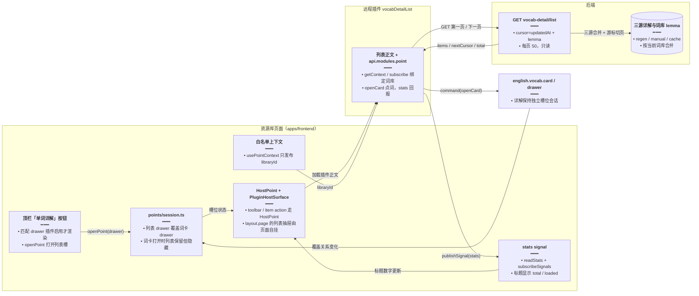
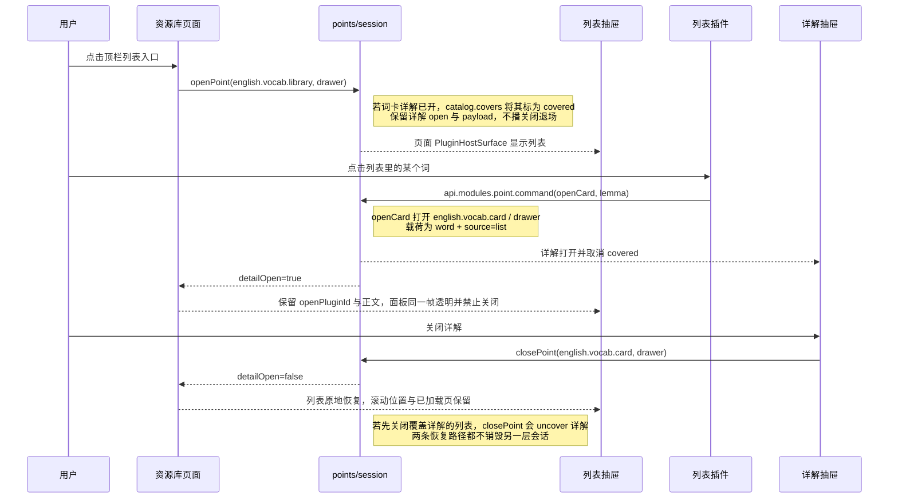

# 单词详解列表：词库绑定、Redis 缓存与游标分页

> **状态**：已落地 | **日期**：2026-11-13 | **功能域**：英语学习
> **需求摘要**：资源库顶栏出现「单词详解」入口，打开右侧抽屉查看**当前词库里已有详解**的词（重新生成 / 手动导入 / 全站缓存三源合并）。列表按词库隔离，用 Redis 有序集合 + 哈希缓存加速；每页 50 条、向下滚动继续加载，标题处显示「共 N 条 / 已加载 M 条」。从列表点词进入详解面板，关闭后回到列表。

> [!IMPORTANT]
> **2026-11-14 当前实现迁移**：列表宿主不再使用 `vocabDetail/session.ts` 的列表统计与 `api.modules.vocabDetail` 专属桥，而是并入通用 **HostPoint + `points/session.ts` + `api.modules.point` + `modules:point`**。现行宿主总览见 [学习页扩展点](./学习页扩展点.md)，通用协议见 [声明式扩展点](../plugins/声明式扩展点.md)。
>
> **本文当前定位**：§4 的词库隔离、三源合并、Redis、游标与接口仍是当前后端主文档；Remote 列表的分页和防串页记录仍有效。§5 是 **2026-11-13 前端历史基线**，其中旧会话、`setListStats` 与恢复列表的“当前”代码只描述当时实现。
>
> **当前用户行为**：没有匹配 `english.vocab.library / drawer` 的已启用插件时顶栏入口不渲染、不占位；词条 action 由 `HostPoint` 处理；列表、详解与导入按目录槽位及 `covers` / `yieldTo` 协调；列表插件通过 `api.modules.point.publishSignal('stats', …)` 回报统计，通过 `command('openCard', …)` 打开详解；词库页只向上下文发布目录白名单中的 `libraryId`。导入按钮仍要求匹配插件已启用且当前库可编辑。从列表点词时列表面板同一帧隐藏，详解不滑入、页面不闪，见 [详解抽屉瞬时让位](./详解抽屉瞬时让位.md)。

## 延伸阅读

- 同轮姊妹稿（卡片入口、多来源与停止生成）：[单词详解缓存与抽屉.md](./单词详解缓存与抽屉.md)
- 同轮姊妹稿（手动导入 JSON 详解）：[手动导入单词详解.md](./手动导入单词详解.md)
- 插件侧实现（词库绑定 / 游标分页 / 统计回报）：[单词详解列表插件.md](./单词详解列表插件.md)
- 插件注册与宿主接入：[单词详解插件接入.md](../plugins/单词详解插件接入.md)
- 业务页插件槽统一模板：[宿主插件集成指南](../plugins/宿主插件集成指南.md)

---

## 1. 背景与目标

单词详解上线后，只有「在单词卡上点图标」这一条入口。已经生成过详解的词散落在缓存表里，用户下次想复看只能回到原卡片去找。本轮补一条**汇总入口**：

1. **列表按词库隔离**：接口必须传 `libraryId`，只返回该词库已有详解的词，非所有者 403。
2. **三源合并**：重新生成（regen）、手动导入（manual）、全站缓存（cache）按 lemma 合并去重，同词取优先级最高的来源。
3. **Redis 缓存加速**：用有序集合存 `(lemma, score=updatedAt)`、哈希存摘要，epoch 版本号控制失效；翻页直接走 Redis，不查库。
4. **游标分页**：按 `updatedAt DESC, lemma DESC` 排序，用 `updatedAt|lemma` 作游标，翻页不重复、不丢行；每页 50 条。
5. **只下发摘要**：每行只要词面、首条释义、更新时间，完整详解仍由单词入口按需获取。
6. **入口跟随插件**：插件未启用时不显示按钮；抽屉宽度与详解抽屉一致（420px）。
7. **两个抽屉保留状态并互相让位**：列表打开时覆盖词卡详解；从列表点词后详解重新置顶、列表暂时隐藏；关闭上层后恢复下层，不再通过销毁下层插件正文来互斥。
8. **顶栏统计**：标题右侧显示总条数与已加载条数，由列表插件通过 `api.modules.point.publishSignal('stats', …)` 回报。

## 2. 改动范围与当前路径

后端行仍是当前实现索引；前端行已按 2026-11-14 的声明式扩展点更新。旧专属统计会话及恢复列表代码只在 §5 留作历史记录。

| 层 | 路径 | 说明 |
| --- | --- | --- |
| 后端 | `apps/backend/src/services/english-learning/vocab-detail.service.ts` | `listForLibrary`、Redis 有序集合缓存、`patchLemmaForUser` / `patchLemmaForViewers` / `dropLibraryListCache` |
| 后端 | `apps/backend/src/services/english-learning/english-learning.controller.ts` | `GET vocab-detail/list?libraryId=` |
| 后端 | `apps/backend/src/services/english-learning/english-learning.service.ts` | 删库时调 `dropLibraryListCache` |
| 后端 | `apps/backend/src/services/english-learning/entity/english-vocabulary-library-item.entity.ts` | 新增 `lemma` 列 |
| 后端 | `apps/backend/src/migrations/1794414166786-english_vocab_library_item_lemma.ts` | **真正执行 DDL**：`lemma` 列 + `idx_evli_lemma_library` 索引 |
| 后端 | `apps/backend/src/migrations/1794414159799-english_vocab_library_item_lemma.ts` | 空占位迁移，无任何 DDL |
| 后端 | `apps/backend/src/migrations/1794414300000-english_vocab_library_item_lemma_backfill.ts` | lemma 分批回填迁移 |
| 后端 | `apps/backend/scripts/backfill-vocab-lemma.cjs` | 手工补数脚本（连 `.env.production`，幂等） |
| 前端 | `apps/frontend/src/federation/host/HostPoint.tsx` | 统一渲染 toolbar / item action / 布局层抽屉，无匹配插件时不占位 |
| 前端 | `apps/frontend/src/federation/points/catalog.ts` | 声明词库槽位、`drawer` 覆盖词卡抽屉、`import-drawer` 让位及 `stats` / `openCard` 能力 |
| 前端 | `apps/frontend/src/federation/points/session.ts` | 槽位会话、`libraryId` 白名单上下文、`stats` 信号与订阅 |
| 前端 | `apps/frontend/src/federation/points/api.ts` | 向列表插件注入 `getContext` / `subscribe` / `publishSignal` / `command` |
| 前端 | `apps/frontend/src/views/englishLearning/library/vocabulary/index.tsx` | 发布词库上下文、顶栏入口、页面自挂列表抽屉、统计标题与叠层显示 |
| 前端 | `apps/frontend/src/components/design/Drawer/index.tsx` | 标题内边距对齐（与详解抽屉共用） |
| 前端 | `apps/frontend/src/federation/host/PluginHostSurface.tsx` | 承载目录标记为 `layout.page` 的列表抽屉 |
| 前端 | `apps/frontend/src/federation/runtime/index.ts` | 以 `modules:point` 注入当前词库扩展点 API |

## 3. 实现思路

### 3.1 当前数据流（2026-11-14）



### 3.2 当前两个抽屉的覆盖与恢复时序



### 3.3 关键决策与权衡

| 决策 | 备选 | 为什么选它 |
| --- | --- | --- |
| 游标用 `updatedAt + id` | offset 分页 | 生成新详解会改变排序，offset 会重复/漏行；联合键稳定 |
| 多取一条判断 `hasMore` | 单独 count 判断是否到底 | 一次查询即可判断，`count` 只用于顶栏总数 |
| 列表只发摘要 | 直接返回整份 `detail` | 50 行 JSON 体积过大，列表也不需要全部栏目 |
| 用目录 `covers` 与页面让位保留两层会话 | 打开一层就关闭另一层 | 两层保留各自 payload、正文和滚动状态，关闭上层即可恢复下层，也避免重载远程插件 |
| 恢复列表时禁用进入动画 | 正常滑入 | 从详解切到列表，或关掉从列表点开的详解时，列表停在原位，避免再滑入一次 |
| 统计走 `stats` signal | 列表插件自己塞进标题或专属 `setListStats` | 标题由宿主渲染，通用信号白名单即可回写数据，无需为单词详解维护专属桥 |

## 4. 后端实现

### 4.1 列表类型、游标与三源合并

列表的分页原语与三源合并放在 `vocab-detail-run.ts`，服务层只负责查库、写缓存与切页。

**来源**：`apps/backend/src/services/english-learning/vocab-detail-run.ts`（**改动后**，约 L54–L176）

```typescript
// 打开来源：重新生成 / 手动导入 / 全站缓存
export type VocabOpenSource = 'regen' | 'manual' | 'generated';

// 每页条数与前端滚动分页约定一致
export const LIST_PAGE_SIZE = 50;
// 游标分隔符：ISO 时间|词形
export const LIST_CURSOR_SEP = '|';

// 单个来源的一份摘要
type ListSlot = { glossZh: string; updatedAt: Date };

// 一条候选命中：来自某张表的某一行
export type ListHit = {
	// 词形
	lemma: string;
	// 来源表
	source: VocabOpenSource;
	// 首条释义
	glossZh: string;
	// 该行更新时间
	updatedAt: Date;
};

// 合并后的列表行
export type MergedRow = {
	// 词形
	lemma: string;
	// 首条释义
	glossZh: string;
	// 胜出来源的更新时间
	updatedAt: Date;
	// 胜出来源
	source: VocabOpenSource;
};

// 游标：时间戳 + 词形
export type ListCursor = { updatedAt: number; lemma: string };

/** 一词一行。胜出份由 pickVocabOpen 决定，不用三份里更晚的时间。 */
export function mergeLibraryDetailHits(hits: ListHit[]): MergedRow[] {
	// 按词形归并三份候选
	const byLemma = new Map<string, Record<VocabOpenSource, ListSlot | null>>();
	// 逐条候选归位
	for (const hit of hits) {
		// 空词形直接丢弃，避免脏数据占位
		if (!hit.lemma) continue;
		// 取该词的三个槽位，没有就建空槽
		const slot = byLemma.get(hit.lemma) ?? {
			// 重新生成槽
			regen: null,
			// 手动导入槽
			manual: null,
			// 全站缓存槽
			generated: null,
		};
		// 同一来源可能有多行，只留更新时间最新的一份
		const prev = slot[hit.source];
		// 新行更晚才覆盖旧槽
		if (!prev || hit.updatedAt.getTime() >= prev.updatedAt.getTime()) {
			// 写入该来源的摘要
			slot[hit.source] = { glossZh: hit.glossZh, updatedAt: hit.updatedAt };
		}
		// 放回归并表
		byLemma.set(hit.lemma, slot);
	}
	// 合并结果
	const merged: MergedRow[] = [];
	// 逐词挑出优先级最高的一份
	for (const [lemma, versions] of byLemma) {
		// 优先级：regen > manual > generated
		const picked = pickVocabOpen(versions);
		// 三份都没有就跳过
		if (!picked) continue;
		// 只保留胜出份的摘要
		merged.push({
			// 词形
			lemma,
			// 胜出份首条释义
			glossZh: picked.detail.glossZh,
			// 胜出份更新时间
			updatedAt: picked.detail.updatedAt,
			// 胜出来源
			source: picked.source,
		});
	}
	// 排序：时间倒序，同一时间按词形倒序，和游标比较方向一致
	merged.sort((a, b) => {
		// 先比时间
		const delta = b.updatedAt.getTime() - a.updatedAt.getTime();
		// 时间不同直接返回
		if (delta !== 0) return delta;
		// 同一个词不参与比较
		if (a.lemma === b.lemma) return 0;
		// 词形倒序
		return a.lemma < b.lemma ? 1 : -1;
	});
	// 返回合并结果
	return merged;
}

// 解析游标：格式不对由调用方统一转 400
export function parseListCursor(cursor: string): ListCursor {
	// 找分隔符位置
	const sep = cursor.indexOf(LIST_CURSOR_SEP);
	// 分隔符必须在中间，否则视为损坏
	if (sep <= 0) throw new Error('cursor');
	// 前半段是 ISO 时间
	const updatedAt = new Date(cursor.slice(0, sep)).getTime();
	// 后半段是词形
	const lemma = cursor.slice(sep + 1);
	// 时间不可解析或词形为空都判非法
	if (Number.isNaN(updatedAt) || !lemma) throw new Error('cursor');
	// 返回游标
	return { updatedAt, lemma };
}

// 判断某行是否严格排在游标之后
function isOlderThanCursor(row: MergedRow, cursor: ListCursor): boolean {
	// 取该行时间
	const time = row.updatedAt.getTime();
	// 时间更早，肯定在游标之后
	if (time < cursor.updatedAt) return true;
	// 时间更晚，肯定在游标之前
	if (time > cursor.updatedAt) return false;
	// 时间相同则比词形，方向与排序一致
	return row.lemma < cursor.lemma;
}

/** Redis 不可用时在内存里切页。顺序与有序集合的 REV 一致。 */
export function pageMergedDetails(
	// 全量合并行
	rows: MergedRow[],
	// 当前游标，首页为空
	cursor: ListCursor | null,
): {
	// 本页行
	items: Array<{
		// 词形
		lemma: string;
		// 首条释义
		glossZh: string;
		// 更新时间
		updatedAt: string;
		// 来源
		source: VocabOpenSource;
	}>;
	// 下一页游标
	nextCursor: string | null;
	// 全量条数
	total: number;
} {
	// 总数就是合并后的行数
	const total = rows.length;
	// 有游标就过滤掉游标及之前的行
	const rest = cursor
		? rows.filter((row) => isOlderThanCursor(row, cursor))
		: rows;
	// 多取一条判断是否还有下一页
	const hasMore = rest.length > LIST_PAGE_SIZE;
	// 有下一页就裁掉探测用的那条
	const page = hasMore ? rest.slice(0, LIST_PAGE_SIZE) : rest;
	// 本页最后一条是下一页锚点
	const last = page.at(-1);
	// 有更多且有锚点才给游标
	const nextCursor =
		hasMore && last
			? `${last.updatedAt.toISOString()}${LIST_CURSOR_SEP}${last.lemma}`
			: null;
	// 返回分页结果
	return {
		// 行映射：时间统一转 ISO
		items: page.map((row) => ({
			// 词形
			lemma: row.lemma,
			// 首条释义
			glossZh: row.glossZh,
			// 时间转字符串
			updatedAt: row.updatedAt.toISOString(),
			// 来源
			source: row.source,
		})),
		// 下一页游标
		nextCursor,
		// 全量条数
		total,
	};
}

/** 打开顺序：重新生成，手动导入，全站缓存。都没有则返回 null，由调用方再生成。 */
export function pickVocabOpen<T>(versions: {
	// 重新生成份
	regen: T | null;
	// 手动导入份
	manual: T | null;
	// 全站缓存份
	generated: T | null;
}): { detail: T; source: VocabOpenSource } | null {
	// 重新生成优先级最高
	if (versions.regen) return { detail: versions.regen, source: 'regen' };
	// 其次手动导入
	if (versions.manual) return { detail: versions.manual, source: 'manual' };
	// 最后全站缓存
	if (versions.generated) return { detail: versions.generated, source: 'generated' };
	// 三份都没有
	return null;
}
```

服务层对外类型（`vocab-detail.service.ts` 约 L72–L119）：

```typescript
// 列表行：面板所需的最小字段
export type VocabDetailListItem = {
	// 词形
	lemma: string;
	// 首条释义
	glossZh: string;
	// 更新时间
	updatedAt: string;
	// 来源，前端可据此标注「手动导入」
	source: VocabOpenSource;
};

// 列表分页返回体
export type VocabDetailListPage = {
	// 当前页行
	items: VocabDetailListItem[];
	// 下一页游标，null 表示没有更多
	nextCursor: string | null;
	// 全量条数
	total: number;
};

// 手动导入列表的行
export type ImportedWord = {
	// 词形
	lemma: string;
	// 首条释义
	glossZh: string;
	// 更新时间
	updatedAt: string;
};

// 手动导入列表分页返回体
export type ImportedWordPage = {
	// 当前页行
	items: ImportedWord[];
	// 下一页游标
	nextCursor: string | null;
	// 全量条数
	total: number;
};

// 导入列表每页条数
const IMPORT_PAGE = 50;
```

### 4.2 列表入口 `listForLibrary`

**来源**：`apps/backend/src/services/english-learning/vocab-detail.service.ts`（**新增**，约 L454–L486）

```typescript
	async listForLibrary(
		// 当前用户 id
		userId: number,
		// 词库 id
		libraryId: string,
		// 游标
		cursor?: string,
	// 返回分页结果
	): Promise<VocabDetailListPage> {
		// 所有者或公开库可读，其余 404
		await this.assertLibraryReadable(userId, libraryId);
		// 解析游标，格式不对转 400
		const parsed = readListCursor(cursor);
		// 取 Redis 客户端；拿不到说明没配 Redis
		const client = await this.lockClient();
		// 无 Redis：每次都重建并内存切页
		if (!client) {
			// 内存切页，行为与有序集合一致
			return pageMergedDetails(
				// 现算三源合并行
				await this.buildLibraryDetailRows(userId, libraryId),
				// 当前游标
				parsed,
			);
		}
		// 全局 epoch：详解结构版本或数据整体变化时递增
		const epoch = String((await client.get(LIST_EPOCH_KEY)) ?? '0');
		// 该用户该库的缓存是否与当前 epoch 对齐
		const ready = await client.get(listReadyKey(userId, libraryId));
		// 对齐才敢直接读缓存
		if (ready === epoch) {
			try {
				// 续期四个键，避免长时间不访问被淘汰
				await this.touchListKeys(client, userId, libraryId);
				// 从有序集合 + 哈希切页
				return await this.pageListZset(client, userId, libraryId, parsed);
			} catch (e) {
				// 缓存薄行缺失等异常：记日志并标记未就绪，下面重建
				this.logger.warn(
					// 只截前 200 字，避免刷屏
					`vocab detail list page failed: ${
						// 异常消息做兜底
						e instanceof Error ? e.message.slice(0, 200) : String(e)
					}`,
				);
				// 清掉就绪标记
				await client.del(listReadyKey(userId, libraryId));
			}
		}
		// 缓存未就绪：同进程合并冷启动，避免并发重复查库
		const rows = await this.buildListOnce(userId, libraryId);
		// 写入有序集合 + 哈希，并记下 epoch
		await this.writeListZset(client, userId, libraryId, rows, epoch);
		// 再用刚写好的缓存切页
		return this.pageListZset(client, userId, libraryId, parsed);
	}
```

### 4.3 Redis 有序集合切页

**来源**：`apps/backend/src/services/english-learning/vocab-detail.service.ts`（**新增**，约 L1046–L1108）

```typescript
	private async pageMembers(
		// Redis 客户端
		client: RedisLockClient,
		// 有序集合键
		zkey: string,
		// 当前游标
		cursor: ListCursor | null,
	// 返回本页成员（多取一条）
	): Promise<string[]> {
		// 多取一条用于判断 hasMore
		const limit = LIST_PAGE_SIZE + 1;
		// 首页：从最高分往最低分取
		if (!cursor) {
			// 按分数倒序取前 limit 条
			return client.zRange(zkey, '+inf', '-inf', {
				// 按分数区间
				BY: 'SCORE',
				// 倒序
				REV: true,
				// 从 0 开始取 limit 条
				LIMIT: { offset: 0, count: limit },
			});
		}
		// 先取与游标同一秒的全部成员
		const same = await client.zRange(zkey, cursor.updatedAt, cursor.updatedAt, {
			// 按分数区间
			BY: 'SCORE',
			// 倒序
			REV: true,
		});
		// 同一秒里只保留词形更小的，保证不重不漏
		const restSame = same.filter((lemma) => lemma < cursor.lemma);
		// 再取更早的所有成员
		const lower = await client.zRange(zkey, `(${cursor.updatedAt}`, '-inf', {
			// 按分数区间，左括号表示开区间
			BY: 'SCORE',
			// 倒序
			REV: true,
			// 从 0 开始取 limit 条
			LIMIT: { offset: 0, count: limit },
		});
		// 同一秒剩余的接上更早的，截到 limit
		return [...restSame, ...lower].slice(0, limit);
	}

	private async pageListZset(
		// Redis 客户端
		client: RedisLockClient,
		// 当前用户
		userId: number,
		// 当前词库
		libraryId: string,
		// 当前游标
		cursor: ListCursor | null,
	// 返回分页结果
	): Promise<VocabDetailListPage> {
		// 取本页成员
		const members = await this.pageMembers(
			// Redis 客户端
			client,
			// 有序集合键
			listZsetKey(userId, libraryId),
			// 当前游标
			cursor,
		);
		// 多出一条即说明还有下一页
		const hasMore = members.length > LIST_PAGE_SIZE;
		// 有下一页就裁掉探测用的那条
		const page = hasMore ? members.slice(0, LIST_PAGE_SIZE) : members;
		// 本页为空就不查哈希
		const raw = page.length
			? await client.hmGet(listHashKey(userId, libraryId), page)
			: [];
		// 逐行把成员和摘要拼起来
		const items = page.map((lemma, index) => {
			// 取该词的摘要 JSON
			const cell = raw[index];
			// 摘要缺失说明缓存不一致，直接报错触发重建
			if (!cell) throw new Error('list cache thin row missing');
			// 解析摘要
			const parsed = JSON.parse(cell) as {
				// 首条释义
				glossZh: string;
				// 来源
				source: VocabOpenSource;
				// 更新时间
				updatedAt: string;
			};
			// 组装列表行
			return {
				// 词形
				lemma,
				// 首条释义
				glossZh: parsed.glossZh,
				// 更新时间
				updatedAt: parsed.updatedAt,
				// 来源
				source: parsed.source,
			};
		});
		// 全量条数
		const total = await client.zCard(listZsetKey(userId, libraryId));
		// 本页最后一条是下一页锚点
		const last = items.at(-1);
		// 有更多且有锚点才给游标
		const nextCursor =
			hasMore && last ? `${last.updatedAt}${LIST_CURSOR_SEP}${last.lemma}` : null;
		// 返回分页结果
		return { items, nextCursor, total };
	}
```

### 4.4 构建缓存与增量更新

**来源**：`apps/backend/src/services/english-learning/vocab-detail.service.ts`（**新增**，约 L958–L1027）

```typescript
	private async buildLibraryDetailRows(
		// 当前用户，用于取该用户的手动与重新生成
		userId: number,
		// 当前词库
		libraryId: string,
	// 返回合并后的全量行
	): Promise<MergedRow[]> {
		// 取本库全部词条：优先用 lemma 列，缺失时回退 word
		const rows = await this.libraryItems.find({
			// 限定本库
			where: { libraryId },
			// 只取需要的三列
			select: { id: true, word: true, lemma: true },
		});
		// 词形去重：lemma 为空时现算，长度超限的丢弃
		const lemmas = [
			// 去重
			...new Set(
				// 逐条取词形
				rows
					// lemma 优先，没有就用 word 规范化
					.map((row) => row.lemma || normalizeVocabLemma(row.word ?? ''))
					// 空词形与超长词形都排除
					.filter((lemma) => lemma.length > 0 && lemma.length <= 120),
			),
		];
		// 本库没有有效词形，直接空列表
		if (lemmas.length === 0) return [];
		// 三源命中集合
		const hits: ListHit[] = [];
		// 每 1000 个词一批，避免 IN 参数过长
		for (let i = 0; i < lemmas.length; i += 1000) {
			// 批量查三类表并收集命中
			hits.push(...(await this.loadListHits(userId, lemmas.slice(i, i + 1000))));
		}
		// 一词一行合并
		return mergeLibraryDetailHits(hits);
	}

	private async buildListOnce(
		// 当前用户
		userId: number,
		// 当前词库
		libraryId: string,
	// 返回合并后的全量行
	): Promise<MergedRow[]> {
		// 同进程合并键
		const key = `${userId}:${libraryId}`;
		// 已有在途构建则直接等它
		const pending = this.listBuilds.get(key);
		// 命中就复用
		if (pending) return pending;
		// 新建构建任务，结束后从映射里移除
		const job = this.buildLibraryDetailRows(userId, libraryId).finally(() => {
			// 清理在途记录
			this.listBuilds.delete(key);
		});
		// 记录在途
		this.listBuilds.set(key, job);
		// 返回任务
		return job;
	}

	private async writeListZset(
		// Redis 客户端
		client: RedisLockClient,
		// 当前用户
		userId: number,
		// 当前词库
		libraryId: string,
		// 合并后的全量行
		rows: MergedRow[],
		// 写入时的 epoch
		epoch: string,
	// 无返回值
	): Promise<void> {
		// 有序集合键
		const zkey = listZsetKey(userId, libraryId);
		// 摘要哈希键
		const hkey = listHashKey(userId, libraryId);
		// 先清空旧的集合与哈希
		await client.del([zkey, hkey]);
		// 每 1000 行一批写入
		for (let i = 0; i < rows.length; i += 1000) {
			// 当前批
			const group = rows.slice(i, i + 1000);
			// 写有序集合：分数为更新时间
			await client.zAdd(
				// 有序集合键
				zkey,
				// 逐行转成 score + value
				group.map((row) => ({
					// 分数用时间戳
					score: row.updatedAt.getTime(),
					// 成员是词形
					value: row.lemma,
				})),
			);
			// 本批的摘要载荷
			const payload: Record<string, string> = {};
			// 逐行序列化摘要
			for (const row of group) {
				// 词形作为字段名
				payload[row.lemma] = JSON.stringify({
					// 首条释义
					glossZh: row.glossZh,
					// 来源
					source: row.source,
					// 时间转 ISO
					updatedAt: row.updatedAt.toISOString(),
				});
			}
			// 写入哈希
			await client.hSet(hkey, payload);
		}
		// 记录该库已按当前 epoch 就绪
		await client.set(listReadyKey(userId, libraryId), epoch);
		// 把当前用户登记为该库的查看者，便于后续增量更新
		await client.sAdd(listViewersKey(libraryId), String(userId));
		// 续期所有键
		await this.touchListKeys(client, userId, libraryId);
	}

	private async touchListKeys(
		// Redis 客户端
		client: RedisLockClient,
		// 当前用户
		userId: number,
		// 当前词库
		libraryId: string,
	// 无返回值
	): Promise<void> {
		// 四个键统一续期
		for (const key of [
			// 有序集合
			listZsetKey(userId, libraryId),
			// 摘要哈希
			listHashKey(userId, libraryId),
			// 就绪标记
			listReadyKey(userId, libraryId),
			// 查看者集合
			listViewersKey(libraryId),
		]) {
			// 按库列表统一 TTL 续期
			await client.pExpire(key, EL_LIB_LIST_TTL_MS);
		}
		// 再次登记查看者，避免集合过期后丢失
		await client.sAdd(listViewersKey(libraryId), String(userId));
		// 查看者集合也要续期
		await client.pExpire(listViewersKey(libraryId), EL_LIB_LIST_TTL_MS);
	}
```

**来源**：`apps/backend/src/services/english-learning/vocab-detail.service.ts`（**新增**，约 L1110–L1172）

```typescript
	private async loadListHits(
		// 当前用户
		userId: number,
		// 一批词形
		lemmas: string[],
	// 返回三类命中
	): Promise<ListHit[]> {
		// 空批次直接返回
		if (lemmas.length === 0) return [];
		// 全站缓存按 cache_key 查，先算出每个词的缓存键
		const keys = lemmas.map((lemma) => vocabDetailCacheKey(lemma));
		// 三张表并行查
		const [generated, manual, regen] = await Promise.all([
			// 全站缓存：cacheKey + 无用户
			this.slotRows(this.repo, 'c', keys, null),
			// 手动导入：用户 + lemma
			this.slotRows(this.manualRepo, 'm', lemmas, userId),
			// 重新生成：用户 + lemma
			this.slotRows(this.regenRepo, 'r', lemmas, userId),
		]);
		// 转成统一命中结构，非法行丢弃
		return [
			// 全站缓存命中
			...generated.map((row) => this.toHit(row, 'generated')),
			// 手动导入命中
			...manual.map((row) => this.toHit(row, 'manual')),
			// 重新生成命中
			...regen.map((row) => this.toHit(row, 'regen')),
			// 过滤掉转换失败的行
		].filter((row): row is ListHit => row !== null);
	}

	private slotRows(
		// 目标表
		repo: Repository<{ lemma: string }>,
		// 表别名
		alias: string,
		// 查询键：缓存表传 cacheKey，其它表传 lemma
		keys: string[],
		// 用户 id；null 表示全站表
		userId: number | null,
	) {
		// 数据库类型决定 JSON 路径写法
		const type = this.repo.manager.connection.options.type;
		// 取首条释义表达式
		const gloss =
			// Postgres 写法
			type === 'postgres'
				? `${alias}.detail->'senses'->0->>'glossZh'`
				// MySQL 写法
				: `JSON_UNQUOTE(JSON_EXTRACT(${alias}.detail, '$.senses[0].glossZh'))`;
		// 构造查询器
		const qb = repo.createQueryBuilder(alias);
		// 取词形
		qb.select(`${alias}.lemma`, 'lemma');
		// 取更新时间
		qb.addSelect(`${alias}.updatedAt`, 'updatedAt');
		// 取首条释义
		qb.addSelect(gloss, 'glossZh');
		// 只认当前结构版本
		qb.where(`${alias}.schemaVersion = :v`, { v: VOCAB_DETAIL_CACHE_VERSION });
		// 用户隔离表：按用户 + lemma 过滤
		if (userId != null) {
			// 用户与词形集合
			qb.andWhere(
				`${alias}.userId = :userId AND ${alias}.lemma IN (:...keys)`,
				// 绑定参数
				{ userId, keys },
			);
		} else {
			// 全站表：按缓存键过滤
			qb.andWhere(`${alias}.cacheKey IN (:...keys)`, { keys });
		}
		// 返回扁平行
		return qb.getRawMany<{
			// 词形
			lemma?: unknown;
			// 更新时间
			updatedAt?: unknown;
			// 首条释义
			glossZh?: unknown;
		}>();
	}

	private toHit(
		// 查询得到的扁平行
		row: { lemma?: unknown; updatedAt?: unknown; glossZh?: unknown },
		// 来源
		source: VocabOpenSource,
	): ListHit | null {
		// 词形必须是非空字符串
		if (typeof row.lemma !== 'string' || !row.lemma) return null;
		// 解析更新时间
		const updatedAt = new Date(row.updatedAt as string | Date);
		// 时间非法则丢弃
		if (Number.isNaN(updatedAt.getTime())) return null;
		// 返回统一命中结构
		return {
			// 词形
			lemma: row.lemma,
			// 来源
			source,
			// 释义只接受字符串
			glossZh: typeof row.glossZh === 'string' ? row.glossZh : '',
			// 更新时间
			updatedAt,
		};
	}
```

### 4.5 增量 patch 与失效

**来源**：`apps/backend/src/services/english-learning/vocab-detail.service.ts`（**新增**，约 L1174–L1280）

```typescript
	private async patchListLemma(
		// 目标用户
		userId: number,
		// 目标词库
		libraryId: string,
		// 发生变化的词
		lemma: string,
	// 无返回值
	): Promise<void> {
		try {
			// 取 Redis 客户端
			const client = await this.lockClient();
			// 无 Redis 就放弃增量，下次全量重建
			if (!client) return;
			// 当前 epoch
			const epoch = String((await client.get(LIST_EPOCH_KEY)) ?? '0');
			// 该用户该库的就绪标记
			const ready = await client.get(listReadyKey(userId, libraryId));
			// 缓存已过期或未构建，交给下次访问重建
			if (ready !== epoch) return;
			// 只查这一个词的三源，按优先级选一份
			const row = mergeLibraryDetailHits(
				// 三源命中
				await this.loadListHits(userId, [lemma]),
			)[0];
			// 有序集合键
			const zkey = listZsetKey(userId, libraryId);
			// 摘要哈希键
			const hkey = listHashKey(userId, libraryId);
			// 三源都没有：从缓存里移除该词
			if (!row) {
				// 删成员
				await client.zRem(zkey, lemma);
				// 删摘要
				await client.hDel(hkey, lemma);
			} else {
				// 写入或更新时间分数
				await client.zAdd(zkey, {
					// 分数用胜出份时间
					score: row.updatedAt.getTime(),
					// 成员是词形
					value: lemma,
				});
				// 写入摘要
				await client.hSet(
					// 哈希键
					hkey,
					// 字段名
					lemma,
					// 摘要 JSON
					JSON.stringify({
						// 首条释义
						glossZh: row.glossZh,
						// 来源
						source: row.source,
						// 时间转 ISO
						updatedAt: row.updatedAt.toISOString(),
					}),
				);
			}
			// 续期相关键
			await this.touchListKeys(client, userId, libraryId);
		} catch (e) {
			// 增量失败不影响主流程，下次全量重建会收敛
			this.logger.warn(
				// 只截前 200 字
				`vocab detail list patch failed: ${
					// 异常消息兜底
					e instanceof Error ? e.message.slice(0, 200) : String(e)
				}`,
			);
		}
	}

	private async libraryIdsForLemma(
		// 词形
		lemma: string,
	// 返回包含该词的词库 id 列表
	): Promise<string[]> {
		// 查所有包含该词形的词条
		const rows = await this.libraryItems.find({
			// 按词形过滤
			where: { lemma },
			// 只要词库 id
			select: { libraryId: true },
		});
		// 去重后返回
		return [...new Set(rows.map((row) => row.libraryId))];
	}

	private async patchLemmaForViewers(
		// 发生变化的词
		lemma: string,
	// 无返回值
	): Promise<void> {
		// 取 Redis 客户端
		const client = await this.lockClient();
		// 无 Redis 直接返回
		if (!client) return;
		// 找到包含该词的词库
		const libraryIds = await this.libraryIdsForLemma(lemma);
		// 逐库更新
		for (const libraryId of libraryIds) {
			// 取该库的查看者
			const viewers = await client.sMembers(listViewersKey(libraryId));
			// 逐查看者更新自己的缓存
			for (const viewer of viewers) {
				// 查看者 id 转数字
				await this.patchListLemma(Number(viewer), libraryId, lemma);
			}
		}
	}

	private async patchLemmaForUser(
		// 指定用户
		userId: number,
		// 发生变化的词
		lemma: string,
	// 无返回值
	): Promise<void> {
		// 找到包含该词的词库
		const libraryIds = await this.libraryIdsForLemma(lemma);
		// 逐个词库更新该用户的缓存
		for (const libraryId of libraryIds) {
			// 只更新这一个词
			await this.patchListLemma(userId, libraryId, lemma);
		}
	}

	private async bumpListEpoch(): Promise<void> {
		try {
			// 取 Redis 客户端
			const client = await this.lockClient();
			// 无 Redis 直接返回
			if (!client) return;
			// 全局 epoch +1，所有旧缓存自动失效
			await client.incr(LIST_EPOCH_KEY);
		} catch (e) {
			// 失败只记日志，下次访问会重建
			this.logger.warn(
				// 只截前 200 字
				`vocab detail list epoch failed: ${
					// 异常消息兜底
					e instanceof Error ? e.message.slice(0, 200) : String(e)
				}`,
			);
		}
	}

	async dropLibraryListCache(
		// 词库 id
		libraryId: string,
	// 无返回值
	): Promise<void> {
		try {
			// 取 Redis 客户端
			const client = await this.lockClient();
			// 无 Redis 直接返回
			if (!client) return;
			// 取该库所有查看者
			const viewers = await client.sMembers(listViewersKey(libraryId));
			// 逐查看者删除缓存
			for (const viewer of viewers) {
				// 查看者 id 转数字
				const userId = Number(viewer);
				// 删有序集合、哈希、就绪标记
				await client.del([
					// 有序集合
					listZsetKey(userId, libraryId),
					// 摘要哈希
					listHashKey(userId, libraryId),
					// 就绪标记
					listReadyKey(userId, libraryId),
				]);
			}
			// 最后删查看者集合
			await client.del(listViewersKey(libraryId));
		} catch (e) {
			// 失败只记日志
			this.logger.warn(
				// 只截前 200 字
				`vocab detail list drop failed: ${
					// 异常消息兜底
					e instanceof Error ? e.message.slice(0, 200) : String(e)
				}`,
			);
		}
	}
```

**缓存键与常量**（`vocab-detail.service.ts` 约 L175–L188）：

```typescript
// 全局 epoch 键：所有用户的列表缓存共用
const LIST_EPOCH_KEY = 'el:vocabDetail:epoch';

// 有序集合：用户 + 词库
function listZsetKey(userId: number, libraryId: string): string {
	// 键名包含用户与词库，天然隔离
	return `el:vocabDetailList:z:u:${userId}:lib:${libraryId}`;
}
// 摘要哈希：用户 + 词库
function listHashKey(userId: number, libraryId: string): string {
	// 字段名为词形，值为 JSON 摘要
	return `el:vocabDetailList:h:u:${userId}:lib:${libraryId}`;
}
// 就绪标记：记录构建时的 epoch
function listReadyKey(userId: number, libraryId: string): string {
	// 与全局 epoch 比对，不一致就重建
	return `el:vocabDetailList:ready:u:${userId}:lib:${libraryId}`;
}
// 查看者集合：记录访问过该库的用户
function listViewersKey(libraryId: string): string {
	// 增量更新与删库清理都依赖这个集合
	return `el:vocabDetailList:viewers:${libraryId}`;
}
```

### 4.6 接口 `GET vocab-detail/list`

**来源**：`apps/backend/src/services/english-learning/english-learning.controller.ts`（**改动后**，约 L1190–L1207）

```typescript
	/** 当前词库里已有详解的词：游标每页 50，不触发生成 */
	// 路由挂在 english-learning 前缀下
	@Get('vocab-detail/list')
	// 方法名：列表接口
	async vocabDetailList(
		// 取当前登录用户
		@Req() req: AuthedRequest,
		// 词库 id，必填
		@Query('libraryId') libraryId?: string,
		// 游标
		@Query('cursor') cursor?: string,
	) {
		// 解构用户 id
		const userId = req.user?.userId;
		// 未登录 401
		if (userId == null) throw new UnauthorizedException('未授权');
		// libraryId 非字符串或空，400
		if (typeof libraryId !== 'string' || !libraryId.trim()) {
			// 抛参数错误
			throw new BadRequestException('libraryId');
		}
		// 调服务层列表
		return this.vocabDetailService.listForLibrary(
			// 当前用户
			userId,
			// 词库 id 去空格
			libraryId.trim(),
			// 空串当首页
			typeof cursor === 'string' && cursor.length > 0 ? cursor : undefined,
		);
	}
```

### 4.7 词条 lemma 列、迁移与一次性回填

**实体字段**（`apps/backend/src/services/english-learning/entity/english-vocabulary-library-item.entity.ts`）：

```typescript
	// 类级索引：列表按 (lemma, library_id) 过滤，避免整库扫描
	@Index('idx_evli_lemma_library', ['lemma', 'libraryId'])
	// 规范化词形：写入时由应用层从 word 派生，列表按此列与详解合并
	@Column({ type: 'varchar', length: 120, default: '' })
	// 非空默认空串，避免历史行出现 NULL 参与比较
	lemma!: string;
```

**建列迁移**：`1794414159799` 是空的占位迁移（同一功能最初创建），真正执行 DDL 的是 `1794414166786`。

**来源**：`apps/backend/src/migrations/1794414166786-english_vocab_library_item_lemma.ts`（**新增**）

```typescript
// 迁移契约
import { MigrationInterface, QueryRunner } from 'typeorm';

// 词条 lemma 列 + 联合索引迁移
export class EnglishVocabLibraryItemLemma1794414166786
	// 实现迁移接口
	implements MigrationInterface
{
	// 显式迁移名，便于在 migrations 表里定位
	name = 'EnglishVocabLibraryItemLemma1794414166786';

	// up：加列 + 建 (lemma, library_id) 索引
	public async up(queryRunner: QueryRunner): Promise<void> {
		// 加列：非空默认空串，历史行先落空串再由回填迁移补齐
		await queryRunner.query(
			`ALTER TABLE \`english_vocabulary_library_item\` ADD \`lemma\` varchar(120) NOT NULL DEFAULT ''`,
		);
		// 联合索引：列表先按词形过滤再按库限定，列顺序与查询一致
		await queryRunner.query(
			`CREATE INDEX \`idx_evli_lemma_library\` ON \`english_vocabulary_library_item\` (\`lemma\`, \`library_id\`)`,
		);
	}

	// down：删索引 + 删列
	public async down(queryRunner: QueryRunner): Promise<void> {
		// 先删索引
		await queryRunner.query(
			`DROP INDEX \`idx_evli_lemma_library\` ON \`english_vocabulary_library_item\``,
		);
		// 再删列
		await queryRunner.query(
			`ALTER TABLE \`english_vocabulary_library_item\` DROP COLUMN \`lemma\``,
		);
	}
}
```

**数据回填迁移**：只处理 `lemma = ''` 的行，分批 200 条，可重复执行。

**来源**：`apps/backend/src/migrations/1794414300000-english_vocab_library_item_lemma_backfill.ts`（**新增**）

```typescript
// 迁移契约
import { MigrationInterface, QueryRunner } from 'typeorm';

// 与运行时一致的词形规范化：去首尾空格、压缩空白、转小写、超长置空
function storedLemma(word: string): string {
	// 转字符串并做基础清洗
	const lemma = String(word ?? '')
		// 去首尾空格
		.trim()
		// 连续空白压成一个空格
		.replace(/\s+/g, ' ')
		// 统一小写，保证与查询侧一致
		.toLowerCase();
	// 超过列长度就返回空串，避免写入被截断成半截词
	return lemma.length > 120 ? '' : lemma;
}

// lemma 回填迁移
export class EnglishVocabLibraryItemLemmaBackfill1794414300000
	// 实现迁移接口
	implements MigrationInterface
{
	// up：分批把 word 规范化后写入 lemma
	public async up(queryRunner: QueryRunner): Promise<void> {
		// 上一批的最大 id，用作键集翻页
		let last = '';
		// 循环直到没有待回填行
		for (;;) {
			// 每批 200 条，只取 lemma 仍为空的行
			const rows: { id: string; word: string }[] = await queryRunner.query(
				// 键集翻页避免深分页
				'SELECT id, word FROM `english_vocabulary_library_item` WHERE id > ? AND lemma = ? ORDER BY id ASC LIMIT 200',
				// 上一批末尾 id + 空串条件
				[last, ''],
			);
			// 没有待处理行就结束
			if (!rows.length) return;
			// CASE WHEN 的片段
			const values: string[] = [];
			// CASE WHEN 的参数
			const params: string[] = [];
			// 逐行构造 WHEN ? THEN ?
			for (const row of rows) {
				// 占位符
				values.push('WHEN ? THEN ?');
				// id 与规范化后的词形
				params.push(row.id, storedLemma(row.word));
			}
			// 本批 id 列表
			const ids = rows.map((row) => row.id);
			// 一条 UPDATE 批量写入，减少往返
			await queryRunner.query(
				// CASE id 精准匹配每行，ELSE lemma 保证未列出的行不动
				`UPDATE \`english_vocabulary_library_item\` SET lemma = CASE id ${values.join(' ')} ELSE lemma END WHERE id IN (${ids.map(() => '?').join(',')})`,
				// CASE 参数在前，IN 参数在后
				[...params, ...ids],
			);
			// 记录本批末尾 id
			last = ids[ids.length - 1];
		}
	}

	// down：不回滚数据，避免把用户后来写入的 lemma 清掉
	public async down(): Promise<void> {}
}
```

**线上一次性脚本**：迁移之外还提供一个可重复执行的补数脚本，用于已经在跑的环境（不改 schema，只补空值）。

**来源**：`apps/backend/scripts/backfill-vocab-lemma.cjs`（**新增**）

```javascript
// 文件系统：检查 .env.production 是否存在
const fs = require('node:fs');
// 路径工具：向上找工程根
const path = require('node:path');
// 环境文件解析
const dotenv = require('dotenv');
// MySQL 连接
const mysql = require('mysql2/promise');

// 与运行时一致的词形规范化
function storedLemma(word) {
	// 清洗并转小写
	const lemma = String(word ?? '')
		// 去首尾空格
		.trim()
		// 连续空白压成一个
		.replace(/\s+/g, ' ')
		// 统一小写
		.toLowerCase();
	// 超长置空，避免截断成半截词
	return lemma.length > 120 ? '' : lemma;
}

// 从当前目录或脚本目录向上找含 .env.production 的目录
function findRoot() {
	// 两个起点：运行目录与脚本目录
	const starts = [process.cwd(), __dirname];
	// 依次尝试
	for (const start of starts) {
		// 当前检查目录
		let dir = path.resolve(start);
		// 最多向上 6 层
		for (let i = 0; i < 6; i += 1) {
			// 找到环境文件即返回
			if (fs.existsSync(path.join(dir, '.env.production'))) return dir;
			// 取父目录
			const parent = path.dirname(dir);
			// 已到根目录就停止
			if (parent === dir) break;
			// 继续向上
			dir = parent;
		}
	}
	// 没找到
	return null;
}

// 读取并校验数据库配置
function readEnv() {
	// 先定位工程根
	const root = findRoot();
	// 没有环境文件直接退出
	if (!root) {
		// 提示
		console.error('找不到 .env.production');
		// 非零退出
		process.exit(1);
	}
	// 解析环境文件
	const merged = dotenv.parse(
		// 读文件内容
		fs.readFileSync(path.join(root, '.env.production')),
	);
	// 必需项
	const need = ['DB_HOST', 'DB_PORT', 'DB_USERNAME', 'DB_PASSWORD', 'DB_DATABASE'];
	// 逐项校验
	for (const key of need) {
		// 缺项则报错退出
		if (!merged[key]) {
			// 指出缺哪个
			console.error(`缺少 ${key}`);
			// 非零退出
			process.exit(1);
		}
	}
	// 本脚本只支持 MySQL
	if (merged.DB_TYPE && merged.DB_TYPE !== 'mysql') {
		// 提示实际类型
		console.error(`这个脚本只连 MySQL，当前 DB_TYPE=${merged.DB_TYPE}`);
		// 非零退出
		process.exit(1);
	}
	// 返回配置
	return merged;
}

// 主流程
async function main() {
	// 读配置
	const env = readEnv();
	// 打印目标库，便于确认没连错环境
	console.log(
		`using .env.production ${env.DB_HOST}:${env.DB_PORT}/${env.DB_DATABASE}`,
	);
	// 建连接
	const conn = await mysql.createConnection({
		// 主机
		host: env.DB_HOST,
		// 端口转数字
		port: Number(env.DB_PORT),
		// 用户名
		user: env.DB_USERNAME,
		// 密码
		password: env.DB_PASSWORD,
		// 库名
		database: env.DB_DATABASE,
	});
	// 键集翻页游标
	let last = '';
	// 已更新行数
	let updated = 0;
	// 循环直到没有空 lemma 行
	for (;;) {
		// 每批 200 条，只取 lemma 为空的行
		const [rows] = await conn.query(
			// 按 id 升序键集翻页
			'SELECT id, word FROM english_vocabulary_library_item WHERE id > ? AND lemma = ? ORDER BY id ASC LIMIT 200',
			// 上一批末尾 id + 空串
			[last, ''],
		);
		// 没有待处理行结束
		if (!rows.length) break;
		// CASE 参数
		const params = [];
		// CASE 片段
		const whens = [];
		// 逐行构造
		for (const row of rows) {
			// 占位符
			whens.push('WHEN ? THEN ?');
			// id 与规范化词形
			params.push(row.id, storedLemma(row.word));
		}
		// 本批 id
		const ids = rows.map((row) => row.id);
		// 批量更新
		await conn.query(
			// CASE id 精准匹配，ELSE lemma 保证其它行不动
			`UPDATE english_vocabulary_library_item SET lemma = CASE id ${whens.join(' ')} ELSE lemma END WHERE id IN (${ids.map(() => '?').join(',')})`,
			// 参数顺序与 SQL 一致
			[...params, ...ids],
		);
		// 累计更新数
		updated += rows.length;
		// 推进游标
		last = ids[ids.length - 1];
	}
	// 收尾统计：还剩多少空值、已填多少
	const [check] = await conn.query(
		// 一次算出两个计数
		"SELECT SUM(lemma = '') AS empty_lemma, SUM(lemma <> '') AS filled FROM english_vocabulary_library_item",
	);
	// 打印结果
	console.log(
		`updated ${updated}, empty ${check[0].empty_lemma}, filled ${check[0].filled}`,
	);
	// 关闭连接
	await conn.end();
}

// 执行并统一错误出口
main().catch((error) => {
	// 只打印消息，避免堆栈刷屏
	console.error(error instanceof Error ? error.message : error);
	// 非零退出
	process.exit(1);
});
```

> 在含 `.env.production` 的目录执行（线上一般是 `/usr/local/dnhyxc-ai/server`）：`node dist/scripts/backfill-vocab-lemma.cjs`。脚本只补 `lemma = ''` 的行，重复执行是空操作。

### 4.8 删库时清除缓存

**来源**：`apps/backend/src/services/english-learning/english-learning.service.ts`（**改动后**，约 L2599）

```typescript
		// 删除词库前先清掉所有查看者在该库上的列表缓存
		await this.vocabDetail.dropLibraryListCache(libraryId);
		// 再删词库本体
		await this.vocabLibraryRepo.remove(lib);
```

## 5. 前端实现（2026-11-13 历史基线）

> **历史代码阅读边界**：本节保留迁移前的 `federation/modules/vocabDetail/session.ts`、`setListStats`、`modules.vocabDetail.open`、`suspendedListId` 及“先关再恢复”代码，用于解释当时实现和迁移差异。它们不是当前路径；现行列表上下文、`stats` signal、槽位覆盖与 `openCard` 命令以 §2、§3 和两篇扩展点主文档为准。后端 §4 仍是当前主文档。

### 5.1 列表统计的读写与订阅（历史）

**来源**：`apps/frontend/src/federation/modules/vocabDetail/session.ts`（**新增**，约 L96–L114）

```typescript
// 列表统计：总条数与已加载条数，由列表插件回报
export type VocabDetailListStats = { total: number; loaded: number };

// 模块级统计缓存
let listStats: VocabDetailListStats | null = null;
// 统计订阅者
const listStatsListeners = new Set<() => void>();

// 读统计副本
export function readVocabDetailListStats(): VocabDetailListStats | null {
	// 有值才复制，避免调用方改内部对象
	return listStats ? { ...listStats } : null;
}

// 写统计：插件每次分页后回报，顶栏标题据此显示「共 N 条 / 已加载 M 条」
export function setVocabDetailListStats(next: VocabDetailListStats | null): void {
	// 写入副本或清空
	listStats = next ? { total: next.total, loaded: next.loaded } : null;
	// 通知订阅者刷新顶栏
	for (const listener of [...listStatsListeners]) listener();
}

// 订阅统计变化
export function subscribeVocabDetailListStats(listener: () => void): () => void {
	// 加入集合
	listStatsListeners.add(listener);
	// 退订
	return () => listStatsListeners.delete(listener);
}
```

历史调用侧由插件桥 `modules.vocabDetail.setListStats` 收口（见 [单词详解缓存与抽屉.md](./单词详解缓存与抽屉.md) §5.6 的历史快照），插件只负责在每页返回后调一次。当前实现改为 `api.modules.point.publishSignal('stats', { total, loaded })`，完整迁移见 [统一 point 模块桥](../plugins/统一point模块桥.md) 与 [单词详解列表插件](./单词详解列表插件.md)。

### 5.2 资源库页面：导入、状态与订阅

**对比范围**：`VocabularyLibrarySection` 从函数签名到 `useEnglishLearningList` 之前的 hooks 区（列表主体未改动）。

**改动前** · `apps/frontend/src/views/englishLearning/library/vocabulary/index.tsx`（基线，约 L1–L60）

```typescript
// 设计系统加载态
import Loading from '@design/Loading';
// 通用按钮 / 滚动区 / 轻提示
import { Button, ScrollArea, Toast } from '@ui/index';
// 收藏星图标
import { Star } from 'lucide-react';
// React hooks：此版本还没有 CSSProperties（尚未做抽屉样式覆盖）
import { useCallback, useEffect, useRef, useState } from 'react';
// 跳转收藏页
import { useNavigate } from 'react-router';
// 多语言
import { useI18n } from '@/hooks';
// 收藏状态的增量同步
import { useIncrementalVocabFavoriteStatus } from '@/hooks/useIncrementalVocabFavoriteStatus';
// 类名合并
import { cn } from '@/lib/utils';
// ...（其它既有 import 未改动）

// 资源库区块入参
export type VocabularyLibrarySectionProps = {
	// 当前词库 id
	libraryId: string | null;
	// 词库元信息
	libraryMeta: EnglishVocabularyLibraryListItem | null;
	// 续读位置变化回调
	onResumeOffsetChange?: (libraryId: string, offset: number) => void;
};

// 单词资源库区块
export function VocabularyLibrarySection({
	// 词库 id
	libraryId,
	// 词库元信息
	libraryMeta,
	// 续读回调
	onResumeOffsetChange,
// 解构结束，进入组件体
}: VocabularyLibrarySectionProps) {
	// 只需要文案，不需要 locale
	const { t } = useI18n();
	// 路由跳转
	const navigate = useNavigate();
	// ...（后的 hooks 未改动）

	// 只有词库 id 时才有内容，否则提示选择词库
	if (!libraryId) {
		// 空态提示
		return (
			// 居中的提示文本
			<div className="text-textcolor/60 flex h-full min-h-0 flex-col items-center justify-center px-6 text-center text-sm">
				{/* 渲染选择词库的提示文案 */}
				{t('englishLearning.library.selectLibrary')}
			</div>
		);
	}
	// ...（列表渲染未改动）
}
```

**改动后** · `apps/frontend/src/views/englishLearning/library/vocabulary/index.tsx`（当前，约 L1–L110）

```typescript
// 设计系统加载态
import Loading from '@design/Loading';
// 通用按钮 / 滚动区 / 轻提示
import { Button, ScrollArea, Toast } from '@ui/index';
// 收藏星图标
import { Star } from 'lucide-react';
// React hooks：新增 CSSProperties，用于抽屉的 CSS 变量覆盖
import { type CSSProperties, useCallback, useEffect, useRef, useState } from 'react';
// 跳转收藏页
import { useNavigate } from 'react-router';
// 联邦：插件槽、插件图标、插件标题取词、已启用插件列表
import {
	// 按语言取插件标题
	pickPluginLocaleText,
	// 插件槽容器（抽屉 / 顶栏触发器）
	PluginHostSurface,
	// 插件注册表图标
	PluginIcon,
	// 按 surface 取已启用插件
	useHostSurfacePlugins,
// 结束联邦导入
} from '@/federation';
// 详解会话：列表与详解两个抽屉互斥、统计读写
import {
	// 关闭详解抽屉
	closeVocabDetail,
	// 标记「被列表顶替」，让详解抽屉跳过退场动画
	markVocabDetailReplacedByList,
	// 读列表统计
	readVocabDetailListStats,
	// 读当前会话（判断详解是否已打开）
	readVocabDetailSession,
	// 订阅会话变化
	subscribeVocabDetail,
	// 订阅列表统计变化
	subscribeVocabDetailListStats,
// 结束会话导入
} from '@/federation/modules/vocabDetail/session';
// 多语言
import { useI18n } from '@/hooks';
// 收藏状态的增量同步
import { useIncrementalVocabFavoriteStatus } from '@/hooks/useIncrementalVocabFavoriteStatus';
// 类名合并
import { cn } from '@/lib/utils';
// ...（其它既有 import 未改动）
// 与详解抽屉共用的宽度常量
import { vocabDrawerWidth } from '../../components/vocab/DetailDrawer';

// 资源库区块入参
export type VocabularyLibrarySectionProps = {
	// 当前词库 id
	libraryId: string | null;
	// 词库元信息
	libraryMeta: EnglishVocabularyLibraryListItem | null;
	// 续读位置变化回调
	onResumeOffsetChange?: (libraryId: string, offset: number) => void;
};

// 单词资源库区块
export function VocabularyLibrarySection({
	// 词库 id
	libraryId,
	// 词库元信息
	libraryMeta,
	// 续读回调
	onResumeOffsetChange,
// 解构结束，进入组件体
}: VocabularyLibrarySectionProps) {
	// 文案与语言：标题插件要用 locale 取多语言名
	const { t, locale } = useI18n();
	// 路由跳转
	const navigate = useNavigate();
	// 当前打开的列表抽屉插件 id
	const [openPluginId, setOpenPluginId] = useState<string | null>(null);
	// 顶替详解抽屉时不要从右侧滑入，否则开场那一帧 Loading 落在槽位右边
	const [listStill, setListStill] = useState(false);
	// 找到已启用的「列表」插件（slot=drawer），未启用时为空
	const listPlugin = useHostSurfacePlugins('english.vocab.library').find(
		// 只要抽屉槽位
		(plugin) => plugin.host?.slot === 'drawer',
	);
	// 会话订阅回调里读最新打开状态，用 ref 避免闭包拿到旧值
	const openPluginIdRef = useRef(openPluginId);
	// 每次渲染同步最新值
	openPluginIdRef.current = openPluginId;
	// 列表插件 id 的 ref：插件晚到时也能在回调里比对
	const listPluginIdRef = useRef(listPlugin?.id ?? null);
	// 每次渲染同步
	listPluginIdRef.current = listPlugin?.id ?? null;
	// 被详解抽屉临时顶替的列表 id，关闭详解后据此恢复
	const suspendedListId = useRef<string | null>(null);
	// 顶栏统计：初始值从会话里读，避免首帧显示 0
	const [listStats, setListStats] = useState(readVocabDetailListStats);

	// 订阅统计：插件每页回报后刷新标题数字
	useEffect(
		// 返回退订函数
		() =>
			// 订阅并同步到本地状态
			subscribeVocabDetailListStats(() =>
				// 读最新副本
				setListStats(readVocabDetailListStats()),
			// 结束订阅
			),
		// 只订阅一次
		[],
	);

	// 订阅会话：详解打开时收起列表，关闭时恢复
	useEffect(() => {
		// 返回退订函数
		return subscribeVocabDetail(() => {
			// 读最新会话
			const next = readVocabDetailSession();
			// 详解被打开
			if (next.open) {
				// 当前是否已开着列表
				const current = openPluginIdRef.current;
				// 列表没开就不用收
				if (!current) return;
				// 记下待恢复的列表 id
				suspendedListId.current = current;
				// 收起列表抽屉
				setOpenPluginId(null);
				// 结束打开分支
				return;
			// 结束打开分支
			}
			// 详解关闭：取出之前挂起的列表
			const restore = suspendedListId.current;
			// 没有挂起或插件已变化则不恢复
			if (!restore || listPluginIdRef.current !== restore) return;
			// 清空挂起标记，避免重复恢复
			suspendedListId.current = null;
			// 告知详解抽屉「这次关闭是被列表顶替」，跳过退场动画
			markVocabDetailReplacedByList();
			// 列表原地出现，不播放入场滑入
			setListStill(true);
			// 恢复列表抽屉
			setOpenPluginId(restore);
		// 结束订阅回调
		});
	// 只订阅一次：内部用 ref 读取最新值
	}, []);
	// ...（后的 hooks 与列表主体未改动）
}
```

**变更摘要**：页面新增四个会话相关的 ref / state 与两个订阅 effect；`useI18n` 额外取 `locale` 供插件标题使用。

### 5.3 顶栏「单词详解」按钮

**对比范围**：顶栏右侧操作区（`Entry` + 收藏按钮之后）。

**改动前** · `apps/frontend/src/views/englishLearning/library/vocabulary/index.tsx`（基线，约 L300–L320）

```typescript
				// 右侧操作区
				<div className="flex shrink-0 flex-nowrap items-center gap-3">
					{/* 练习入口 */}
					<Entry
						// 文本样式
						variant="text"
						// 没有词时禁用
						disabled={total <= 0}
						// 练习参数
						practice={{
							// 来源为词库
							source: 'library',
							// 词库 id
							libraryId,
							// 练习标题
							sourceTitle: meta?.title?.trim() || undefined,
							// 题目池总数
							poolTotal: total > 0 ? total : undefined,
						// 结束练习参数
						}}
					/>
					{/* 收藏入口 */}
					<button
						// 非提交
						type="button"
						// 文本按钮样式
						className="flex items-center gap-1 text-teal-500 hover:text-teal-400 cursor-pointer text-sm"
						// 跳收藏页
						onClick={() => {
							// 路由跳转
							navigate('/english-learning/favorites');
						// 结束点击
						}}
					>
						{/* 星标图标 */}
						<Star className="size-4.5" />
						{/* 收藏文案 */}
						{t('englishLearning.practice.favorites')}
					</button>
				</div>
```

**改动后** · `apps/frontend/src/views/englishLearning/library/vocabulary/index.tsx`（当前，约 L338–L414）

```typescript
				// 右侧操作区
				<div className="flex shrink-0 flex-nowrap items-center gap-3">
					{/* 练习入口 */}
					<Entry
						// 文本样式
						variant="text"
						// 没有词时禁用
						disabled={total <= 0}
						// 练习参数
						practice={{
							// 来源为词库
							source: 'library',
							// 词库 id
							libraryId,
							// 练习标题
							sourceTitle: meta?.title?.trim() || undefined,
							// 题目池总数
							poolTotal: total > 0 ? total : undefined,
						// 结束练习参数
						}}
					/>
					{/* 收藏入口 */}
					<button
						// 非提交
						type="button"
						// 文本按钮样式
						className="flex items-center gap-1 text-teal-500 hover:text-teal-400 cursor-pointer text-sm"
						// 跳收藏页
						onClick={() => {
							// 路由跳转
							navigate('/english-learning/favorites');
						// 结束点击
						}}
					>
						{/* 星标图标 */}
						<Star className="size-4.5" />
						{/* 收藏文案 */}
						{t('englishLearning.practice.favorites')}
					</button>
					{/* 单词详解入口：列表插件启用才显示 */}
					{listPlugin ? (
						// 文本按钮，与收藏样式一致
						<button
							// 非提交
							type="button"
							// 与收藏同款配色与字号
							className="flex cursor-pointer items-center gap-1 text-sm text-teal-500 hover:text-teal-400"
							// 点击：已开详解则先关详解，再打开列表
							onClick={() => {
								// 详解抽屉当前是否打开
								if (readVocabDetailSession().open) {
									// 清空挂起标记：这次是用户主动切到列表
									suspendedListId.current = null;
									// 让详解抽屉跳过退场动画
									markVocabDetailReplacedByList();
									// 关闭详解
									closeVocabDetail();
									// 列表原地出现
									setListStill(true);
									// 打开列表
									setOpenPluginId(listPlugin.id);
									// 结束本次点击
									return;
								// 结束详解打开分支
								}
								// 普通开合：恢复入场动画
								setListStill(false);
								// 再点同一个插件即关闭
								setOpenPluginId((id) =>
									// 相同则收起，否则展开
									id === listPlugin.id ? null : listPlugin.id,
								);
							// 结束点击
							}}
						>
							{/* 插件图标：菜单图标优先，其次卡片操作图标 */}
							<PluginIcon
								// 图标名
								name={listPlugin.menu?.icon ?? listPlugin.host?.icon}
								// 与收藏星同尺寸
								className="size-4.5"
							/>
							{/* 插件标题：多语言缺省用中文兜底 */}
							{pickPluginLocaleText(listPlugin.title, locale) || '单词详解'}
						</button>
					) : null}
				</div>
				{/* 列表抽屉：宽度与标题都由宿主覆盖 */}
				<PluginHostSurface
					// 列表插件所在 surface
					surface="english.vocab.library"
					// 抽屉形态
					part="drawer"
					// 受控打开
					openPluginId={openPluginId}
					// 关闭时复位「原地出现」标记
					onOpenPluginIdChange={(id) => {
						// 只有关闭需要复位
						if (!id) setListStill(false);
						// 同步打开状态
						setOpenPluginId(id);
					// 结束回调
					}}
					// 与详解抽屉同宽，避免切换时宽度跳变
					drawerWidth={vocabDrawerWidth}
					// 顶替场景把进入位移归零，抽屉原地出现
					chromeStyle={
						// 仅在顶替时覆盖
						listStill
							// CSS 变量：进入动画的水平位移
							? ({ '--tw-enter-translate-x': '0px' } as CSSProperties)
							// 其余情况交回默认动画
							: undefined
					// 结束样式
					}
					// 标题：插件标题 + 统计，不能只靠插件自己画
					drawerTitle={
						// 基线与统计左对齐
						<span className="flex min-w-0 items-baseline gap-2">
							{/* 固定标题 */}
							<span className="shrink-0">
								{/* 多语言标题 */}
								{t('englishLearning.vocabDetailList.heading')}
							</span>
							{/* 统计：总数 / 已加载 */}
							<span className="text-textcolor/50 truncate text-sm font-normal">
								{/* 统计文案，缺省按 0 显示 */}
								{t('englishLearning.vocabDetailList.summary', {
									// 总条数
									total: listStats?.total ?? 0,
									// 已加载条数
									loaded: listStats?.loaded ?? 0,
								// 结束插值
								})}
							</span>
						</span>
					// 结束标题节点
					}
				/>
```

**变更摘要**：新增列表入口按钮与抽屉宿主；抽屉宽度复用 `vocabDrawerWidth`，标题改为「标题 + 统计」，顶替场景通过 CSS 变量禁用进入位移。

### 5.4 多语言文案

**改动前** · `apps/frontend/src/i18n/locales/zh-CN/englishLearning.ts`（基线，约 L426–L429）／`apps/frontend/src/i18n/locales/en-US/englishLearning.ts`（基线，约 L467–L470）

```typescript
// 中文：只有单词相关的既有文案，没有列表标题与统计
'englishLearning.vocab.playWord': '朗读',
// ...（其它既有键未改动）
// 英文：同样没有列表标题与统计
'englishLearning.vocab.playWord': 'Play',
// ...（其它既有键未改动）
```

**改动后** · `apps/frontend/src/i18n/locales/zh-CN/englishLearning.ts`（当前，约 L428–L429）／`apps/frontend/src/i18n/locales/en-US/englishLearning.ts`（当前，约 L469–L470）

```typescript
// 中文：列表抽屉标题
'englishLearning.vocabDetailList.heading': '单词详解列表',
// 中文：共 N 条 / 已加载 M 条，两个占位符由页面传入
'englishLearning.vocabDetailList.summary': '共 {total} 条 / 已加载 {loaded} 条',
// 英文：列表抽屉标题
'englishLearning.vocabDetailList.heading': 'Word detail list',
// 英文：统计文案
'englishLearning.vocabDetailList.summary': '{total} total / {loaded} loaded',
```

**变更摘要**：中英各补两个键，键名与页面调用处一致；统计文案依赖 `{total}` / `{loaded}` 两个插值。

## 6. 兼容性与影响

- **接口**：`GET /english-learning/vocab-detail/list?libraryId=` 需登录；`libraryId` 缺失返回 400，非所有者返回 403；`cursor` 非法返回 400。
- **词库隔离**：列表只返回当前词库已有详解的词，不再是全站缓存的全量列表。
- **三源合并**：重新生成、手动导入、全站缓存按 lemma 合并去重，同词取优先级最高的来源。
- **Redis 缓存**：列表翻页走 Redis 有序集合 + 哈希，不查库；无 Redis 时退化到直接查库。
- **缓存失效**：新增详解时 `patchLemmaForUser` 重建该用户所有词库的列表缓存；删库时 `dropLibraryListCache` 清除。
- **lemma 列**：词库词条新增 `lemma` 列，由 `1794414166786` 执行 `ALTER TABLE ... ADD \`lemma\` varchar(120) NOT NULL DEFAULT ''` 并建 `idx_evli_lemma_library (lemma, library_id)`，再由 `1794414300000` 分批回填；`1794414159799` 只是空占位。新写入由应用层 `normalizeVocabLemma` 规范化。
- **插件未启用**：`english.vocab.library` 没有匹配 `slot=drawer` 的已启用插件时，顶栏不渲染入口也不占位；toolbar、item action 与导入 action 同样按各自槽位匹配。
- **上下文与统计**：词库扩展点只发布 `libraryId`，统计只接受目录声明的 `stats` signal；关抽屉不会隐式清空统计，插件可回写新值或以 `null` 作废。
- **两个抽屉**：列表 `drawer` 打开会覆盖词卡详解并保留其会话；详解从列表打开时列表保留正文但暂时隐藏；关闭上层恢复下层，插件被禁用则不渲染对应正文。

### 回归建议

1. 未启用列表插件 → 顶栏无「单词详解」按钮。
2. 打开列表 → 首屏 50 条；滚动到底 → 继续加载，且无重复行。
3. 翻到第二页后新生成一个详解 → 再刷新首页可见新词，游标翻页仍不重不漏。
4. 列表标题统计随分页从「共 N 条 / 已加载 50 条」递增。
5. 列表点词 → 列表保留会话并暂时隐藏、详解以 `source=list` 打开；关闭详解 → 列表原地恢复且滚动位置不变。
6. 详解已打开时点顶栏按钮 → 列表打开、详解标记为 covered 而非关闭；关闭列表 → 原详解重新露出。
7. 再次点击入口按钮 → 列表关闭。
8. 切换语言 → 标题与统计文案同步。
9. 删除词库 → 该词库的列表缓存被清除，下次访问重建。

## 7. 相关源码路径

| 说明 | 路径 |
| --- | --- |
| 列表服务 | `apps/backend/src/services/english-learning/vocab-detail.service.ts` |
| 接口 | `apps/backend/src/services/english-learning/english-learning.controller.ts` |
| 删库清缓存 | `apps/backend/src/services/english-learning/english-learning.service.ts` |
| lemma 列实体 | `apps/backend/src/services/english-learning/entity/english-vocabulary-library-item.entity.ts` |
| lemma 列迁移（真实 DDL） | `apps/backend/src/migrations/1794414166786-english_vocab_library_item_lemma.ts` |
| lemma 列迁移（空占位） | `apps/backend/src/migrations/1794414159799-english_vocab_library_item_lemma.ts` |
| lemma 回填迁移 | `apps/backend/src/migrations/1794414300000-english_vocab_library_item_lemma_backfill.ts` |
| lemma 补数脚本 | `apps/backend/scripts/backfill-vocab-lemma.cjs` |
| 通用扩展点渲染 | `apps/frontend/src/federation/host/HostPoint.tsx` |
| 扩展点目录与覆盖关系 | `apps/frontend/src/federation/points/catalog.ts` |
| 槽位会话、白名单上下文与 stats | `apps/frontend/src/federation/points/session.ts` |
| 扩展点 API | `apps/frontend/src/federation/points/api.ts` |
| openCard 等命令 | `apps/frontend/src/federation/points/commands.ts` |
| 资源库页面 | `apps/frontend/src/views/englishLearning/library/vocabulary/index.tsx` |
| 页面自挂列表抽屉 | `apps/frontend/src/federation/host/PluginHostSurface.tsx` |
| `modules:point` 权限注入 | `apps/frontend/src/federation/runtime/index.ts` |

---

（若与仓库最新源码不一致，以源码为准）
