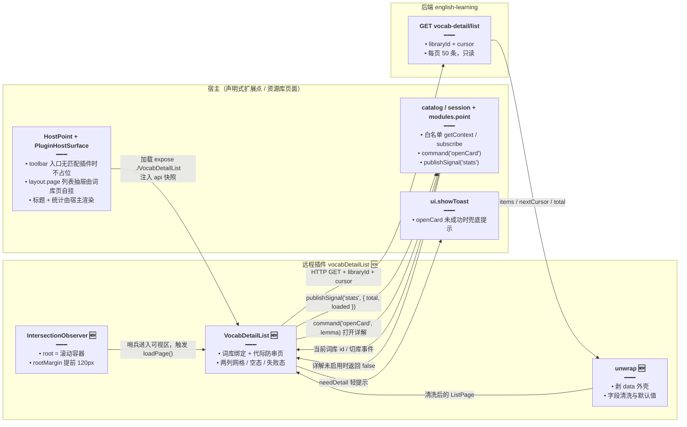
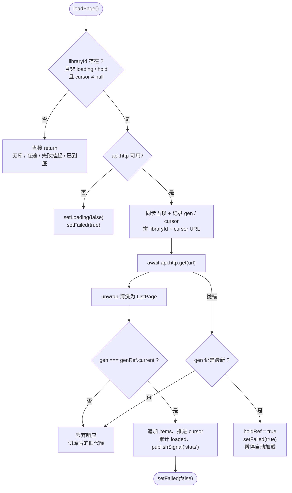

# 单词详解列表插件：词库绑定、游标分页与宿主桥兜底

> **状态**：已落地 | **日期**：2026-11-13；point 桥更新：2026-11-14 | **功能域**：英语学习
> **需求摘要**：资源库顶栏的「单词详解」抽屉正文由远程插件 `vocabDetailList` 渲染。插件只拿到宿主注入的 `api` 快照：通过 `modules.point.getContext / subscribe` 绑定当前词库并在切库时整体重置，通过 `api.http.get` 按游标分页拉取「当前词库已有详解」的词，用两列网格展示词面、首条释义与本地化时间；滚动触底自动加载下一页，首屏失败可整块重试、翻页失败可底部重试；点词调用 `modules.point.command('openCard', lemma)` 打开详解面板，未明确返回 `true` 时用 `ui.showToast` 兜底；每页返回后通过 `modules.point.publishSignal('stats', value)` 向宿主回报总数与已加载数。

> [!IMPORTANT]
> **2026-11-14 当前实现迁移**：列表宿主不再使用 `vocabDetail/session.ts`、`api.modules.vocabDetail` 与 `modules:vocabDetail`，而是并入通用 **HostPoint + `points/session.ts` + `api.modules.point` + `modules:point`**。现行宿主总览见 [学习页扩展点](./学习页扩展点.md)，通用协议见 [声明式扩展点](../plugins/声明式扩展点.md)。
>
> **本文当前定位**：Remote 列表的游标分页、防重入、代际隔离与失败恢复仍是当前主文档，§5 记录现行 `point` 契约。§4 是 **2026-11-13 Remote 初版完整代码快照**，其中 `vocabDetail.open / setListStats / getListLibrary / subscribeListLibrary` 只作历史基线，不是当前宿主接口。
>
> **当前用户行为**：没有匹配已启用插件时列表入口和槽位不占位；卡片 action 由 `HostPoint` 处理，列表、详解与导入由声明式槽位及覆盖 / 让位关系协调。从列表点词时列表面板同一帧隐藏、详解不滑入，见 [详解抽屉瞬时让位](./详解抽屉瞬时让位.md)。列表通过 `stats` signal 回报统计，通过 `openCard` command 打开详解；词库页只发布白名单中的 `libraryId`。导入按钮仍只在匹配插件存在且当前库可编辑时显示。

## 延伸阅读

- 宿主 / 后端侧同题文档（词库隔离、Redis 缓存、三源合并与接口）：[单词详解列表.md](./单词详解列表.md)
- 同轮姊妹稿（详解面板插件）：[单词详解插件面板.md](./单词详解插件面板.md)
- 同轮姊妹稿（手动导入详解插件）：[单词详解导入插件.md](./单词详解导入插件.md)
- 宿主接入与插件桥约定：[单词详解插件接入.md](../plugins/单词详解插件接入.md)
- 统一 `point` 契约、解析函数与预览路由：[统一 point 模块桥](../plugins/统一point模块桥.md)

---

## 1. 背景与目标

「单词详解列表」的入口、420px 抽屉、标题统计，以及列表、详解和导入抽屉的覆盖 / 让位都由声明式扩展点与宿主页面负责；抽屉正文则拆成独立远程插件，避免宿主包体继续膨胀。插件运行在模块联邦沙箱里，不能直接读宿主路由、会话或后端 SDK，只能使用 `api` 快照中的能力。

宿主侧已经解决了「列表从哪来」（词库隔离、Redis 有序集合、游标协议、`items / nextCursor / total` 返回体），插件侧要解决的是「怎么把这一页数据稳定地渲染出来」：

1. **跟随当前词库**：首屏通过 `point.getContext()` 读取 `libraryId`，切库时通过统一 `point.subscribe` 重置列表，绝不能把 A 库的词显示在 B 库抽屉里。
2. **游标分页**：后端只给 `nextCursor`，插件不假设页码；`null` 即到底，滚动不再发请求。
3. **弱网与脏数据容错**：响应可能带 `data` 外壳，行字段可能缺失或类型不对；单行坏数据不能拖垮整页。
4. **并发安全**：滚动回调与 React 渲染存在时间差，切库时旧请求也可能晚到；用同步锁与代际号保证不重入、不串页。
5. **失败可恢复**：首屏失败显示整块重试，翻页失败保留已加载内容并在底部重试；失败后不自动空转。
6. **入口互通**：点词把词形交给宿主的详解模块打开面板；详解插件未启用时给轻提示，而不是静默无响应。
7. **统计回报**：每页成功后回报 `{ total, loaded }`，让宿主抽屉标题实时显示「共 N 条 / 已加载 M 条」。
8. **轻量展示**：两列网格、词面截断、释义最多一行、时间按宿主语言本地化，非法时间不占位。

## 2. 改动范围

下表保留 2026-11-13 初版落地记录，并补入当前共享 `point` 适配；§4 的旧桥类型仍以当时快照为准。

| 层 | 路径 | 说明 |
| --- | --- | --- |
| 插件入口 | `src/views/vocab-detail-list/index.ts` | 新增；引入 `styles.css`，默认导出 `./list`，作为 MF expose `./VocabDetailList` |
| 列表视图 | `src/views/vocab-detail-list/list.tsx` | 新增；`ListItem` / `ListPage` / `HostApi` 类型、`unwrap` 响应清洗、`VocabDetailList` 组件；当前业务桥为 `modules.point` |
| 当前共享适配 | `src/views/vocab-detail/point.ts` | 当前 `PointModule` 与 `libraryIdFromContext`；把白名单上下文安全收窄为词库 id |
| MF 暴露 | `vite.config.ts` | 关联；注册 `./VocabDetailList` 指向 `src/views/vocab-detail-list/index.ts` |
| 预览路由 | `src/router/routes.tsx` | 关联；`/english-learning/vocab-detail-list` 用 `mockApi` 注入单页数据 |
| 文案 | `src/i18n/locales/zh-CN.ts`、`src/i18n/locales/en-US.ts` | 关联；`vocabDetailList.empty / failed / retry / needDetail` 与 `common.loadingMore` |
| 暴露清单 | `plugin-info.md` | 关联；登记 `./VocabDetailList` 与预览路径 |

本文只展开前两行的插件源码；其余为接入配套，不重复宿主/后端的实现细节。

## 3. 实现思路

### 3.1 插件与宿主的数据流



**读图要点**：插件不持有列表入口，也不渲染标题；它只消费宿主按目录白名单下发的 `libraryId` 与 HTTP / `point` 能力。数据从后端到插件先过 `unwrap`，再进组件状态；统计通过 `stats` signal 回到宿主，「打开详解」通过 `openCard` command 固定打开 `english.vocab.card / drawer`，详解插件未启用或槽位不匹配时返回 `false`。

### 3.2 取数与分页主流程



**读图要点**：`loadPage` 同时承担首屏与翻页，所有守卫都在函数入口一次做完；成功路径推进游标并回报统计，失败路径只置挂起标记，等用户点重试。`finally` 只在代际未变时释放同步锁，避免旧请求覆盖切库后的新状态。

### 3.3 关键决策与权衡

| 决策 | 备选 | 为什么选它 |
| --- | --- | --- |
| 游标由后端下发、插件只透传 | 插件自己算 offset 页码 | 新生成详解会改变排序，offset 会重复/漏行；插件不该复制排序规则 |
| `genRef` 代际号丢弃旧响应 | 用 `AbortController` 取消请求 | 宿主的 `http.get` 只暴露 Promise，没有 abort 信号；丢弃旧代际已足够防串页 |
| `loadingRef` 同步占锁 | 只看 `loading` state | state 更新是异步的，滚动回调可能在重渲染前连续触发多次 |
| `holdRef` 失败挂起 | 失败后继续自动重试 | 后端不可用时会造成重试风暴；改为等用户点「重试」 |
| `cursorRef` 三态 | 只存 string | 需要区分「还没取首页」（undefined）与「已到底」（null），否则空库会误判 |
| `unwrap` 用 `flatMap` 逐行清洗 | 直接信任响应强转 | 单行脏数据不应让整页 `map` 抛错；逐行过滤后仍可展示其余词 |
| `IntersectionObserver` 以 `ScrollArea` 为 root | 监听 window 滚动 | 抽屉内是独立滚动容器，window 滚动事件不会触发；`rootMargin` 提前预取减少等待 |
| 统计与打开详解都走 `point` signal / command | 插件自己操作标题/路由 | 标题与详解面板属于宿主布局，插件越权会破坏声明式抽屉的覆盖、让位与恢复语义 |

### 3.4 关键机制落点

- **词库绑定**：`libraryRef` 保存当前库 id；`useEffect` 挂载时调 `apply()` 读取 `point.getContext()`，并通过 `point.subscribe(apply)` 订阅变化。切库后清空 `items`、游标归 `undefined`、计数归零、代际自增，再取第一页。
- **防串页**：`genRef` 在重置时 `+= 1`；请求发出前记录 `gen`，响应回来先比对，不一致直接丢弃（成功与失败分支都比对）。
- **分页终止**：`cursorRef.current === null` 是「后端明确到底」，`loadPage` 与 `IntersectionObserver` 都会提前返回。
- **防重入**：`loadingRef` 在 `await` 之前同步置 `true`；即使滚动回调与 effect 同帧触发，也只有一个请求能进入。
- **失败挂起**：`catch` 里 `holdRef.current = true`，`retry()` 先解除挂起再复用同一游标重取，不会跳页或重复。
- **统计回报**：`loadedRef` 累计条数，避免从异步 `items` 里推算；每页成功后调用 `point.publishSignal('stats', { total, loaded })`，切库瞬间回报 `0/0`。
- **详情联动**：`onPick` 调 `point.command('openCard', lemma)`；返回值不是 `true` 或模块缺失时用 `showToast` 提示「请先启用单词解析」。
- **展示细节**：两列网格 `grid-cols-2`；词面 `truncate`、释义 `line-clamp-1`；时间用 `toLocaleString(locale)`，`Invalid Date` 返回空串并跳过该行。

## 4. 关键代码与注释（2026-11-13 初版历史快照）

> 以下文件均为本轮**新增**，基线中不存在，因此只给「改动后」代码块。这里保留首次落地的完整源码：分页、清洗与渲染算法仍有参考价值，但 `api.modules.vocabDetail` 及其 `open / setListStats / getListLibrary / subscribeListLibrary` 已不是当前契约；现行差异见 §5，不能再照抄旧桥接入宿主。

### 4.1 模块入口 `index.ts`

**来源**：`src/views/vocab-detail-list/index.ts`（**改动后** · 新增，约 L1–L3）

```typescript
// 引入插件全局样式与 Tailwind：保证宿主内渲染时主题变量与基础样式可用
import '@/styles.css';

// 从 ./list 导出默认组件，作为 MF expose ./VocabDetailList 的唯一入口
export { default } from './list';
```

### 4.2 类型约定 `ListItem` / `ListPage` / `HostApi`

**来源**：`src/views/vocab-detail-list/list.tsx`（**改动后** · 新增，约 L1–L35）

```typescript
// 复用宿主设计系统的加载态组件，保证插件内的骨架/转圈与宿主一致
import Loading from '@design/Loading';
// 复用宿主 UI 套件的按钮与滚动容器，避免插件自带一套视觉规范
import { Button, ScrollArea } from '@ui/index';
// 引入 React 状态与副作用钩子：分页状态、代际号、滚动容器与生命周期都需要
import { useCallback, useEffect, useRef, useState } from 'react';
// 复用宿主的语言与国际化钩子，让「共 N 条 / 已加载 M 条」等文案跟随界面语言
import { useHostLocale, useI18n } from '@/hooks';

// 列表行：只保留渲染词卡所需的最小字段
type ListItem = {
	// 词形：同时作为列表 key 与打开详解的参数
	lemma: string;
	// 首条中文释义：可能为空串，界面按需省略整行
	glossZh: string;
	// 更新时间 ISO 字符串：由前端转 Date 后按 locale 展示
	updatedAt: string;
};

// 列表分页返回体：与后端 items / nextCursor / total 对齐
type ListPage = {
	// 当前页的行
	items: ListItem[];
	// 下一页游标：null 表示已经没有更多
	nextCursor: string | null;
	// 该词库的总条数，用于抽屉标题统计
	total: number;
};

// 宿主注入的 API 快照：插件只通过它取数与回报，不直接依赖宿主实现
type HostApi = {
	// 宿主当前语言：用于 useHostLocale 同步 i18n
	locale?: 'zh-CN' | 'en-US';
	// HTTP 能力：目前只需要 GET，返回体由 unwrap 做容错
	http?: { get: (url: string) => Promise<unknown> };
	// UI 能力：打开详解失败时用 Toast 兜底
	ui?: {
		// 轻提示：message 必填，type 决定颜色与图标
		showToast: (options: {
			// 提示正文，由插件传入已翻译文案
			message: string;
			// 语义级别：默认 info，成功/失败可按需指定
			type?: 'success' | 'error' | 'info';
		// 选项对象结束，回调返回 void，宿主只负责展示
		}) => void;
	};
	// 业务模块桥：详解面板与列表统计都挂在这里
	modules?: {
		// 单词详解模块：可选，宿主未启用时整个对象缺失
		vocabDetail?: {
			// 打开指定词的详解；返回 false 表示没能打开
			open?: (word: string) => boolean;
			// 回报列表统计：抽屉标题据此显示总数与已加载数
			setListStats?: (stats: { total: number; loaded: number }) => void;
			// 读当前词库：返回 null 表示尚未选择词库
			getListLibrary?: () => { libraryId: string } | null;
			// 订阅切库事件：返回退订函数，切库后列表整体重置
			subscribeListLibrary?: (listener: () => void) => () => void;
		};
	};
};
```

### 4.3 响应清洗 `unwrap`

**来源**：`src/views/vocab-detail-list/list.tsx`（**改动后** · 新增，约 L37–L74）

```typescript
// 把宿主返回的未知结构收敛成 ListPage：兼容 data 外壳、过滤脏行并补默认值
function unwrap(res: unknown): ListPage {
	// 先判断是否带 data 外壳：后端正常包一层，mock 或异常时可能直接是本体
	const body =
		// 只有对象且显式含 data 字段才剥壳，避免把普通响应误当包装体
		res && typeof res === 'object' && 'data' in res
			// 取 data 作为真正的分页体
			? (res as { data: unknown }).data
			// 没有外壳就用原响应
			: res;
	// 剥壳后仍不是对象（null 或原始值）则返回空页
	if (!body || typeof body !== 'object') {
		// 空页：items 为空、游标 null（视为到底）、总数 0
		return { items: [], nextCursor: null, total: 0 };
	}
	// 把 body 收窄成分页体的弱类型视图，字段逐个校验
	const page = body as {
		// 行数组：未知类型，交给下面 Array.isArray 判定
		items?: unknown;
		// 下一页游标：未知类型，只有字符串才采纳
		nextCursor?: unknown;
		// 总条数：未知类型，最后转数字
		total?: unknown;
	};
	// 只接受数组；非数组一律按空列表处理，避免 map / flatMap 抛错
	const items = Array.isArray(page.items)
		// 用 flatMap 逐行清洗：合法行返回单元素数组，非法行返回空数组被摊平
		? page.items.flatMap((row) => {
				// 行本身不是对象（null 或原始值）直接丢弃
				if (!row || typeof row !== 'object') return [];
				// 把行收窄成词卡字段的弱类型视图，逐字段校验
				const item = row as {
					// 词形：未知类型，必须是非空字符串
					lemma?: unknown;
					// 释义：未知类型，非字符串时回退空串
					glossZh?: unknown;
					// 更新时间：未知类型，非字符串时回退空串
					updatedAt?: unknown;
				};
				// 词形是列表 key 与打开参数：缺失或空串的行没有意义
				if (typeof item.lemma !== 'string' || !item.lemma) return [];
				// 合法行包装成单元素数组，供 flatMap 摊平
				return [
					{
						// 词形已校验为非空字符串，可直接使用
						lemma: item.lemma,
						// 释义只接受字符串，其余类型统一回退空串
						glossZh: typeof item.glossZh === 'string' ? item.glossZh : '',
						// 更新时间同理，非法值回退空串，前端会跳过时间行
						updatedAt: typeof item.updatedAt === 'string' ? item.updatedAt : '',
					},
				];
			})
		// 非数组时给空列表，保证后续 setItems 拿到可展开的数组
		: [];
	// 总条数转数字：后端可能给字符串或缺失
	const total = Number(page.total);
	// 返回统一形状：调用方无需再关心响应外壳与脏数据
	return {
		// 清洗后的行
		items,
		// 游标只接受字符串，其余（null / 数字 / 缺失）一律视为到底
		nextCursor: typeof page.nextCursor === 'string' ? page.nextCursor : null,
		// 总数有限才采用；否则退化为当前已知行数，避免标题显示 NaN
		total: Number.isFinite(total) ? total : items.length,
	};
}
```

### 4.4 组件 `VocabDetailList`

**来源**：`src/views/vocab-detail-list/list.tsx`（**改动后** · 新增，约 L76–L272）

```typescript
// 默认导出列表组件；宿主通过 expose ./VocabDetailList 挂载并注入 api 快照
export default function VocabDetailList({ api }: { api: HostApi }) {
	// 取翻译函数与当前语言：文案走 i18n，时间用 locale 本地化
	const { t, locale } = useI18n();
	// 跟随宿主语言：插件模式下 Host 会下发 locale，独立预览时无操作
	useHostLocale(api);
	// 已加载的列表行：分页时只追加，避免整表重排
	const [items, setItems] = useState<ListItem[]>([]);
	// 首次加载与翻页共用加载态，驱动整页 Loading / 「加载更多」
	const [loading, setLoading] = useState(true);
	// 失败标记：首屏失败显示重试块，翻页失败显示底部重试
	const [failed, setFailed] = useState(false);
	// 游标：undefined = 还没取过首页，null = 已到底，string = 下一页锚点
	const cursorRef = useRef<string | null | undefined>(undefined);
	// 同步防重入锁：滚动回调可能在 state 更新前连发，必须用 ref 立即占位
	const loadingRef = useRef(false);
	// 失败挂起标记：置 true 后停止 IntersectionObserver 自动加载，等用户点重试
	const holdRef = useRef(false);
	// 滚动容器引用：作为 IntersectionObserver 的 root，保证以列表可视区为参照
	const viewportRef = useRef<HTMLDivElement>(null);
	// 触底哨兵引用：一个 1px 高元素，进入可视区即触发下一页
	const sentinelRef = useRef<HTMLDivElement>(null);
	// 累计已加载条数：回报 setListStats 时不能依赖异步 state
	const loadedRef = useRef(0);
	// 当前绑定的词库 id：切库时与 Host 的 getListLibrary 结果比对
	const libraryRef = useRef('');
	// 请求代际：切库或重置时自增，旧请求回来发现代际不同就丢弃
	const genRef = useRef(0);

	// 取一页：首屏与滚动加载都走这里，内部统一处理守卫、容错与统计回报
	const loadPage = useCallback(async () => {
		// 先读当前词库：空串表示宿主还没给出词库，不能发请求
		const libraryId = libraryRef.current;
		// 进入前置守卫：缺库、在途、失败挂起或已到底时都不该再发请求
		if (
			// 没有词库 id：请求会 400，也没法做词库隔离
			!libraryId ||
			// 已有请求在途：滚动回调和 effect 可能并发触发，避免重复请求
			loadingRef.current ||
			// 上一次失败后挂起：等用户显式点重试，避免无限重试风暴
			holdRef.current ||
			// 游标为 null：后端已明确没有下一页，继续滚也不该再请求
			cursorRef.current === null
		// 守卫条件结束，命中任意一条都进入提前返回
		) {
			// 任一守卫命中都直接返回，不改变任何状态
			return;
		}
		// 宿主没有注入 http 能力时无法取数，按失败处理而不是一直 Loading
		if (!api.http) {
			// 结束加载态，避免整页 Loading 卡死
			setLoading(false);
			// 标记失败，界面显示重试块
			setFailed(true);
			// 提前返回，不再拼 URL
			return;
		}
		// 先同步占锁，防止 await 之前的并发调用重复发请求
		loadingRef.current = true;
		// 再更新渲染态：首屏显示整页 Loading，翻页显示「加载更多」
		setLoading(true);
		// 记录本次请求所属代际：响应回来时据此判断是否已被切库淘汰
		const gen = genRef.current;
		// 快照当前游标：翻页参数在请求期间不应被其它回调改写
		const cursor = cursorRef.current;
		// 拼列表 URL：libraryId 必传，cursor 仅在有下一页锚点时追加
		const url = `/english-learning/vocab-detail/list?libraryId=${encodeURIComponent(libraryId)}${
			// 首页没有游标，只传 libraryId
			cursor ? `&cursor=${encodeURIComponent(cursor)}` : ''
		// 模板字符串闭合：完整 URL 拼装完成
		}`;
		// 请求与状态更新都放在 try 中，任何异常都收敛到失败分支
		try {
			// 取数并清洗：unwrap 负责剥 data 外壳、过滤脏行、补默认值
			const page = unwrap(await api.http.get(url));
			// 代际已变说明期间切了词库：丢弃旧响应，避免旧库数据串进新列表
			if (gen !== genRef.current) return;
			// 推进游标：null 表示后端已无下一页，后续滚动自然停止
			cursorRef.current = page.nextCursor;
			// 累加已加载条数：用 ref 保证回报统计时拿到的是最新累计值
			loadedRef.current += page.items.length;
			// 追加本页数据：函数式更新避免闭包拿到过期 items
			setItems((prev) => [...prev, ...page.items]);
			// 回报统计给宿主：抽屉标题据此显示「共 N 条 / 已加载 M 条」
			api.modules?.vocabDetail?.setListStats?.({
				// 总数来自后端，不随分页变化
				total: page.total,
				// 已加载数用累计值，而不是当前页长度
				loaded: loadedRef.current,
			});
			// 本次成功即清除失败标记，翻页失败后重试成功也能恢复
			setFailed(false);
		// 成功分支结束，进入失败捕获
		} catch {
			// 旧代际的失败同样丢弃，否则切库后会被上一次请求误标失败
			if (gen !== genRef.current) return;
			// 置挂起标记：暂停自动触底加载，等待用户点重试
			holdRef.current = true;
			// 显示失败 UI：首屏是整块重试，已有数据时是底部重试
			setFailed(true);
		// 失败分支结束，进入清理
		} finally {
			// 只有代际未变才释放：旧代际的锁已被切库逻辑重置，不能覆盖新状态
			if (gen === genRef.current) {
				// 释放防重入锁，允许下一次翻页
				loadingRef.current = false;
				// 结束加载态，隐藏整页 Loading / 「加载更多」
				setLoading(false);
			}
		}
	// 依赖宿主桥能力：api 引用变化时（重挂载 / 换宿主）重建取数函数
	}, [api.http, api.modules]);

	// 词库绑定：首次挂载读取当前词库，并订阅宿主切库事件做整体重置
	useEffect(() => {
		// 缓存 vocabDetail 模块引用，避免 apply 内反复可选链
		const vocab = api.modules?.vocabDetail;
		// 统一的「按当前词库重置」逻辑：首次挂载、切库、重新订阅都复用
		const apply = () => {
			// 向宿主取当前词库 id：没有模块或没选词库时回退空串
			const next = vocab?.getListLibrary?.()?.libraryId ?? '';
			// 同库且已初始化过游标时不重复重置，避免订阅回调把已加载列表清空
			if (next === libraryRef.current && cursorRef.current !== undefined)
				// 直接返回，保留现有分页进度
				return;
			// 记录新词库，后续请求按它做隔离
			libraryRef.current = next;
			// 游标回到「未取首页」：undefined 让 loadPage 发第一页
			cursorRef.current = undefined;
			// 清掉失败挂起，切库后允许重新自动加载
			holdRef.current = false;
			// 清掉防重入锁：旧库请求即使还在路上，也不能挡住新库请求
			loadingRef.current = false;
			// 已加载计数归零，统计从 0 重新累计
			loadedRef.current = 0;
			// 代际自增：旧库在途响应回来会因代际不符被丢弃
			genRef.current += 1;
			// 清空旧库列表，避免切换瞬间看到上一库的词
			setItems([]);
			// 清除失败态，新库重新走加载流程
			setFailed(false);
			// 先回报 0/0：标题在首屏加载前不会残留上一库的数字
			vocab?.setListStats?.({ total: 0, loaded: 0 });
			// 没有词库（未选择或插件未拿到上下文）时结束加载并停在空态
			if (!next) return setLoading(false);
			// 有词库则立刻取第一页；void 表示不等待返回
			void loadPage();
		};
		// 挂载即执行一次，覆盖「打开抽屉时已有词库」的常见路径
		apply();
		// 订阅切库事件：返回退订函数交给 React 清理
		return vocab?.subscribeListLibrary?.(apply);
	// 模块引用或取数函数变化时重新绑定，保证闭包拿到最新 loadPage
	}, [api.modules, loadPage]);

	// 触底加载：用 IntersectionObserver 监听 1px 哨兵，避免滚动事件高频计算
	useEffect(() => {
		// 滚动容器：必须是 ScrollArea 的真实视口，否则 root 判定不准
		const root = viewportRef.current;
		// 触底哨兵：放在列表最后，进入可视区即代表接近底部
		const target = sentinelRef.current;
		// 缺容器 / 哨兵、失败挂起或已到底时都不必建观察器
		if (!root || !target || failed || cursorRef.current === null) return;
		// 以滚动容器为 root 观察哨兵；阈值 0 表示刚露头就触发
		const io = new IntersectionObserver(
			// 回调只关心最新一条 entry 是否与 root 相交
			(entries) => {
				// 未相交说明还没滚到底，直接忽略
				if (!entries[0]?.isIntersecting) return;
				// 相交则请求下一页；loadPage 内部还有在途 / 挂起 / 到底的二次守卫
				void loadPage();
			},
			// root 指定滚动容器；rootMargin 提前 120px 预取，滚动更顺滑
			{ root, rootMargin: '120px 0px', threshold: 0 },
		);
		// 开始观察哨兵
		io.observe(target);
		// 卸载或依赖变化时断开，避免旧观察器继续触发请求
		return () => io.disconnect();
	// items.length 变化后哨兵位置会移动，需要重建观察器；loading 参与以便加载完再判定
	}, [failed, items.length, loadPage, loading]);

	// 手动重试：清除挂起标记后重新取当前游标指向的那一页
	const retry = () => {
		// 先解除失败挂起，否则 loadPage 会在守卫处直接返回
		holdRef.current = false;
		// 清掉失败 UI，立即回到加载态
		setFailed(false);
		// 复用同一个 loadPage：游标与代际都保持原值，不会重复或跳页
		void loadPage();
	};

	// 点词：优先交给宿主的详解模块打开面板，宿主未启用时用 Toast 兜底
	const onPick = (lemma: string) => {
		// open 返回 boolean 表示是否成功打开；模块缺失时按 false 处理
		const opened = api.modules?.vocabDetail?.open?.(lemma) ?? false;
		// 没打开说明详解插件未启用或当前词无法打开，需要给用户反馈
		if (!opened) {
			// 走宿主 ui.showToast，保持与站内提示一致的样式与层级
			api.ui?.showToast({
				// 文案提示先启用单词解析，避免点击后毫无反应
				message: t('vocabDetailList.needDetail'),
				// info 级别：不是错误，只是能力未就绪
				type: 'info',
			});
		}
	};

	// 空态判定：不在加载、不是失败、没有任何行，且后端明确已到底
	const showEmpty =
		// 四个条件同时满足才显示空文案，避免首屏加载中误闪空态
		!loading && !failed && items.length === 0 && cursorRef.current === null;

	// 根容器：占满抽屉高度并纵向排列，左右留白与宿主抽屉标题对齐
	return (
		// 高度撑满、允许子级收缩；py / pl 与抽屉内容区留白保持一致
		<div className="text-textcolor flex h-full min-h-0 flex-col py-3.5 pl-3.5 text-sm">
			// 首屏失败且没有旧数据：整块失败态 + 重试按钮
			{failed && items.length === 0 ? (
				// 垂直居中铺满剩余高度，右侧补 pr 抵消根容器的左内边距
				<div className="flex flex-1 flex-col items-center justify-center gap-3 pr-3.5">
					// 失败文案：走 i18n，跟随宿主语言
					<p className="text-textcolor/70">{t('vocabDetailList.failed')}</p>
					// 重试按钮：清除挂起后重新取当前页
					<Button type="button" variant="outline" size="sm" onClick={retry}>
						// 按钮文案：与失败提示同语言
						{t('vocabDetailList.retry')}
					// 失败态重试按钮闭合
					</Button>
				// 失败态容器闭合
				</div>
			// 首屏加载中且没有数据：整页 Loading；已有数据时不遮挡列表
			) : loading && items.length === 0 ? (
				// 复用设计系统 Loading，高度撑满抽屉
				<Loading className="h-full" />
			// 其余情况渲染列表：含空态、加载更多与翻页失败
			) : (
				// 滚动容器：作为 IntersectionObserver 的 root，滚动条收窄贴右
				<ScrollArea
					// 绑定容器引用，供触底观察器取 root
					ref={viewportRef}
					// 纵向弹性布局，保证内容不足时也能撑满
					className="box-border flex min-h-0 flex-1 flex-col"
					// 滚动条贴右且收窄，右侧内容用 pr-3.5 预留空间
					scrollbarClassName="right-0 w-1.5 border-l-0 p-0"
				>
					// 右侧留白容器：给滚动条让位，避免文字被遮挡
					<div className="pr-3.5">
						// 空态优先：仅当已确认没有数据时显示
						{showEmpty ? (
							// 居中空文案：提示该词库还没有解析结果
							<p className="text-textcolor/55 px-2 py-4 text-center">
								// 空态文案：走 i18n
								{t('vocabDetailList.empty')}
							// 空态文案闭合
							</p>
						// 非空态：渲染网格、哨兵与翻页状态
						) : (
							// Fragment：网格、哨兵、失败与加载更多并列，不额外加节点
							<>
								// 两列网格：词条较多时更紧凑，gap-2 控制卡片间距
								<div className="grid w-full grid-cols-2 gap-2">
									// 逐行渲染：每行独立计算时间文案，再绑定点击
									{items.map((row) => {
										// 把 ISO 时间解析成 Date，用于本地化展示
										const time = new Date(row.updatedAt);
										// 非法时间显示空串；合法则按当前 locale 格式化
										const stamp = Number.isNaN(time.getTime())
											// 解析失败不展示时间，避免出现 Invalid Date
											? ''
											// 本地化时间：跟随宿主语言与时区
											: time.toLocaleString(locale);
										// 返回单张词卡：整卡可点，内部纵向排布词面 / 释义 / 时间
										return (
											// 用 Button 承担可访问性与键盘操作，ghost 变体去掉默认底色
											<Button
												// 词形唯一，作为列表 key 避免复用错位
												key={row.lemma}
												// 非表单提交，避免触发外层表单
												type="button"
												// ghost 外观：底色由下面的 className 覆盖
												variant="ghost"
												// 点击整卡打开详解，而不是只有词面可点
												onClick={() => onPick(row.lemma)}
												// 卡片外观：浅主题底、两列等宽、左对齐并允许换行
												className="bg-theme/5 border-theme/5 hover:bg-theme/10 h-auto w-full min-w-0 flex-col items-stretch gap-0.5 rounded-md border px-2 py-1.5 text-left font-normal whitespace-normal"
											>
												// 词面：截断超长词，保持两列卡片高度稳定
												<span className="truncate font-medium">
													// 渲染词形
													{row.lemma}
												// 词面闭合
												</span>
												// 有释义才渲染第二行，避免空行撑高卡片
												{row.glossZh ? (
													// 释义：最多一行，字号更小、颜色更淡
													<span className="text-textcolor/60 line-clamp-1 text-xs">
														// 渲染首条中文释义
														{row.glossZh}
													// 释义闭合
													</span>
												// 无释义时不占位
												) : null}
												// 有合法时间才渲染第三行
												{stamp ? (
													// 时间：等宽数字，避免逐行宽度跳动
													<span className="text-textcolor/40 text-xs tabular-nums">
														// 渲染本地化时间
														{stamp}
													// 时间闭合
													</span>
												// 无时间时不占位
												) : null}
											// 卡片按钮闭合
											</Button>
										);
									})}
								// 网格闭合
								</div>
								// 触底哨兵：1px 高且对辅助技术隐藏，仅用于观察位置
								<div ref={sentinelRef} className="h-px" aria-hidden />
								// 翻页失败且已有数据：底部给一个轻量重试，不清空已加载内容
								{failed ? (
									// 居中放重试按钮，上下留一点间距
									<div className="flex justify-center py-2">
										// ghost 小号按钮，不抢列表视觉
										<Button
											// 非提交
											type="button"
											// ghost 外观
											variant="ghost"
											// 小号尺寸
											size="sm"
											// 重试当前游标
											onClick={retry}
										>
											// 重试文案
											{t('vocabDetailList.retry')}
										// 按钮闭合
										</Button>
									// 容器闭合
									</div>
								// 未失败时不渲染底部重试
								) : null}
								// 翻页加载中：列表底部提示「加载更多」
								{loading ? (
									// 小号灰字居中，避免遮挡最后一行
									<p className="text-textcolor/45 text-center text-xs mt-2">
										// 通用加载文案，走 i18n
										{t('common.loadingMore')}
									// 文案闭合
									</p>
								// 未加载时不渲染
								) : null}
							// Fragment 闭合
							</>
						// 空态分支闭合
						)}
					// 右侧留白容器闭合
					</div>
				// 滚动容器闭合
				</ScrollArea>
			// 列表分支闭合
			)}
		// 根容器闭合
		</div>
	);
}
```

## 5. 2026-11-14：列表迁移到统一 `modules.point`

> 本节是现行桥接实现。§4 保留插件首次落地时的完整源码与旧桥基线；遇到 `vocabDetail` 旧方法时，以本节前后对比为准。统一契约与预览路由见 [统一 point 模块桥](../plugins/统一point模块桥.md)。

### 5.1 新增共享解析函数与收窄 `HostApi`

新增 import 只引入类型和 `libraryIdFromContext`，运行时的词库字段校验统一交给共享函数，组件不再直接访问 `getListLibrary` 返回对象。

**来源**：`src/views/vocab-detail-list/list.tsx`（**改动后** · 当前约 L5–L8；新增 import，基线不存在）

```typescript
// 从单词插件共享 point 模块引入上下文解析与类型，避免列表重复声明一套五方法契约
import {
	// 引入词库 id 解析函数，把 unknown 上下文安全收窄为字符串
	libraryIdFromContext,
	// 以 type-only 形式引入 PointModule，编译后只保留真正的运行时解析函数
	type PointModule,
} from '@/views/vocab-detail/point';
```

**来源**：`src/views/vocab-detail-list/list.tsx`（**改动前** · 基线约 L18–L35，完整 `HostApi`）

```typescript
// 旧 HostApi 同时声明 locale、HTTP、Toast 与业务化 vocabDetail 模块
type HostApi = {
	// 宿主语言可选注入，供列表时间本地化使用
	locale?: 'zh-CN' | 'en-US';
	// HTTP 只暴露 GET，因为列表不需要写后端接口
	http?: { get: (url: string) => Promise<unknown> };
	// UI 能力可选注入，用于详解插件不可用时的轻提示
	ui?: {
		// showToast 接收消息与级别，保持与宿主 Toast 契约一致
		showToast: (options: {
			// message 是用户可见提示正文
			message: string;
			// type 限制为宿主支持的三种提示级别
			type?: 'success' | 'error' | 'info';
		}) => void;
	};
	// 旧 modules 容器按 vocabDetail 业务名暴露列表相关方法
	modules?: {
		// 业务模块可选，未启用详解能力时组件需要走降级分支
		vocabDetail?: {
			// open 负责打开详解抽屉并同步返回是否成功
			open?: (word: string) => boolean;
			// setListStats 把总数与已加载数回写宿主抽屉标题
			setListStats?: (stats: { total: number; loaded: number }) => void;
			// getListLibrary 同步读取当前词库 id，可能未绑定而返回 null
			getListLibrary?: () => { libraryId: string } | null;
			// subscribeListLibrary 监听切库并返回退订函数
			subscribeListLibrary?: (listener: () => void) => () => void;
		};
	};
};
```

**来源**：`src/views/vocab-detail-list/list.tsx`（**改动后** · 当前约 L22–L32，完整 `HostApi`）

```typescript
// 新 HostApi 保留原有 locale、HTTP 与 Toast，只把业务模块面替换为统一 point
type HostApi = {
	// 宿主语言仍用于 updatedAt 的本地化展示
	locale?: 'zh-CN' | 'en-US';
	// 列表仍只需要 GET，接口与游标协议不受桥接改造影响
	http?: { get: (url: string) => Promise<unknown> };
	// Toast 继续承担 openCard 未成功时的用户提示
	ui?: {
		// showToast 的消息结构不变，避免引入新的宿主 UI 依赖
		showToast: (options: {
			// message 仍来自 vocabDetailList.needDetail 等 i18n key
			message: string;
			// 提示级别沿用宿主既有三选一集合
			type?: 'success' | 'error' | 'info';
		}) => void;
	};
	// 统一 modules 容器只声明 point，类型复用共享 PointModule，不再列业务方法
	modules?: { point?: PointModule };
};
```

**变更摘要**：`HostApi` 的 HTTP 与 UI 面完全不变；旧 `vocabDetail` 内四个方法由 `point.getContext / subscribe / publishSignal / command` 组合替代。

### 5.2 `loadPage`：每页统计改走 `publishSignal('stats')`

**来源**：`src/views/vocab-detail-list/list.tsx`（**改动前** · 基线约 L91–L134，完整 `loadPage` Hook）

```typescript
// 旧 loadPage 用 useCallback 固定请求函数，供首屏、触底与重试共用
const loadPage = useCallback(async () => {
	// 同步读取当前词库 id，避免异步请求过程中闭包捕获过期 React state
	const libraryId = libraryRef.current;
	// 请求前统一检查无库、在途、失败挂起与已到底四种不可加载状态
	if (
		// 没有词库时不构造请求，防止把空 id 发给后端
		!libraryId ||
		// 同步锁为真时跳过，避免 IntersectionObserver 与 effect 重复触发请求
		loadingRef.current ||
		// 失败挂起时必须等用户重试，避免触底造成重试风暴
		holdRef.current ||
		// nextCursor 为 null 表示后端明确到底，不再发空翻页请求
		cursorRef.current === null
	) {
		// 任一守卫命中都直接结束，保留当前列表与错误状态
		return;
	}
	// 宿主未提供 HTTP 时无法取数，需要显式进入失败态而不是一直 Loading
	if (!api.http) {
		// 结束首屏 Loading，让失败 UI 可以渲染
		setLoading(false);
		// 标记失败，供首屏或底部重试入口显示
		setFailed(true);
		// 没有请求可发，直接返回
		return;
	}
	// await 前同步占用请求锁，防止同一帧发生重入
	loadingRef.current = true;
	// 同步更新 Loading 状态，为首屏或翻页提供视觉反馈
	setLoading(true);
	// 记录本次请求代际，响应回来时用于识别切库后的旧请求
	const gen = genRef.current;
	// 记录请求发起时的游标，避免响应期间游标变化影响 URL
	const cursor = cursorRef.current;
	// 拼接词库与可选游标参数，并分别编码防止特殊字符破坏查询串
	const url = `/english-learning/vocab-detail/list?libraryId=${encodeURIComponent(libraryId)}${
		// 只有游标非空才追加 cursor，首页保持干净 URL
		cursor ? `&cursor=${encodeURIComponent(cursor)}` : ''
	}`;
	// 进入请求与状态提交分支，把网络异常交给统一 catch
	try {
		// 等待宿主 GET 并立即清洗响应，得到可信的 items、nextCursor 与 total
		const page = unwrap(await api.http.get(url));
		// 代际不一致说明已切库或重置，直接丢弃旧响应避免串页
		if (gen !== genRef.current) return;
		// 用后端下发的新游标推进分页状态，null 将阻止后续自动加载
		cursorRef.current = page.nextCursor;
		// 按本页实际清洗后的条数累计已加载数，供统计与展示使用
		loadedRef.current += page.items.length;
		// 函数式追加新行，确保连续响应基于最新 prev 而不是旧闭包
		setItems((prev) => [...prev, ...page.items]);
		// 旧桥通过 setListStats 可选方法回报标题统计，方法不存在时静默跳过
		api.modules?.vocabDetail?.setListStats?.({
			// total 直接采用后端总数，让标题不受本地清洗行数影响
			total: page.total,
			// loaded 使用同步 ref 的累计值，避免等待 items state 更新
			loaded: loadedRef.current,
		});
		// 成功提交后清除失败态，恢复后续触底自动加载
		setFailed(false);
	// 捕获请求或清洗异常，按代际决定是否更新当前 UI
	} catch {
		// 旧代际失败同样直接丢弃，不能覆盖新词库的成功状态
		if (gen !== genRef.current) return;
		// 设置失败挂起锁，暂停 IntersectionObserver 的自动重试
		holdRef.current = true;
		// 标记失败以显示首屏或底部重试按钮
		setFailed(true);
	// 无论成功失败都要尝试释放请求锁，但必须防止旧请求误释放新代际锁
	} finally {
		// 只有代际仍一致时才允许清理当前请求状态
		if (gen === genRef.current) {
			// 释放同步锁，让下一次触底或重试可以进入
			loadingRef.current = false;
			// 结束 Loading 视觉状态，恢复列表交互
			setLoading(false);
		}
	}
	// HTTP 与 modules 引用变化时重建回调，确保使用最新宿主能力
}, [api.http, api.modules]);
```

**来源**：`src/views/vocab-detail-list/list.tsx`（**改动后** · 当前约 L88–L131，完整 `loadPage` Hook）

```typescript
// 新 loadPage 保留同一请求、代际与锁机制，只替换统计回写的宿主通道
const loadPage = useCallback(async () => {
	// 同步读取当前词库 id，请求逻辑不直接依赖 point 上下文对象
	const libraryId = libraryRef.current;
	// 请求前继续依次检查四种不可加载状态，保持原分页行为
	if (
		// 空词库仍然短路，point 解析得到的空串在这里统一生效
		!libraryId ||
		// 在途锁防止重复请求，逻辑不随桥接迁移改变
		loadingRef.current ||
		// 失败挂起仍要求用户显式重试
		holdRef.current ||
		// null 游标仍表示没有下一页
		cursorRef.current === null
	) {
		// 守卫命中时不发请求也不清状态
		return;
	}
	// HTTP 能力缺失仍进入可恢复失败态
	if (!api.http) {
		// 关闭 Loading 以展示错误内容
		setLoading(false);
		// 标记失败以提供重试入口
		setFailed(true);
		// 无宿主请求能力时直接结束
		return;
	}
	// 发请求前同步占锁，防止滚动事件重入
	loadingRef.current = true;
	// 打开 Loading 状态，复用既有加载 UI
	setLoading(true);
	// 捕获当前代际，继续防止切库旧响应覆盖新列表
	const gen = genRef.current;
	// 固定本页游标，URL 构造规则不变
	const cursor = cursorRef.current;
	// 使用相同后端端点与编码方式，桥接改造不改变 API 协议
	const url = `/english-learning/vocab-detail/list?libraryId=${encodeURIComponent(libraryId)}${
		// 非空游标才追加查询参数，保持首页与翻页两种 URL 形态
		cursor ? `&cursor=${encodeURIComponent(cursor)}` : ''
	}`;
	// 请求、验收与状态提交仍在同一 try 中统一处理
	try {
		// 等待并清洗相同列表响应，后端返回结构不变
		const page = unwrap(await api.http.get(url));
		// 旧代际响应继续直接丢弃
		if (gen !== genRef.current) return;
		// 推进后端游标，为下一页或到底判断做准备
		cursorRef.current = page.nextCursor;
		// 累计实际追加入列表的行数
		loadedRef.current += page.items.length;
		// 函数式追加保持并发状态更新正确
		setItems((prev) => [...prev, ...page.items]);
		// 新桥以封闭信号名 stats 回写相同数据，point 不存在时安全跳过
		api.modules?.point?.publishSignal('stats', {
			// total 仍取后端总数，信号值结构与旧 setListStats 参数一致
			total: page.total,
			// loaded 仍取同步累计值，宿主标题可实时显示加载进度
			loaded: loadedRef.current,
		});
		// 成功后清除失败态，恢复触底加载
		setFailed(false);
	// 异常处理保持原策略，不让旧请求污染新代际
	} catch {
		// 非当前代际直接忽略错误
		if (gen !== genRef.current) return;
		// 当前请求失败后挂起自动加载
		holdRef.current = true;
		// 展示可重试错误状态
		setFailed(true);
	// 收尾仍按代际释放锁，避免新旧请求互相清理
	} finally {
		// 仅当前代际可以结束自己的 loading
		if (gen === genRef.current) {
			// 释放同步请求锁
			loadingRef.current = false;
			// 关闭 Loading 视觉状态
			setLoading(false);
		}
	}
	// 依赖仍包含 api.modules，使 point 实例变化后回调使用最新桥
}, [api.http, api.modules]);
```

**变更摘要**：仅统计调用从 `api.modules?.vocabDetail?.setListStats?.(value)` 改为 `api.modules?.point?.publishSignal('stats', value)`；请求、游标、防重入与代际逻辑逐行保持原语义。

### 5.3 词库订阅：`getListLibrary` → `getContext`

**来源**：`src/views/vocab-detail-list/list.tsx`（**改动前** · 基线约 L136–L156，完整词库同步 `useEffect`）

```typescript
// 旧 effect 负责首屏读取词库、订阅切库并在变化时重置整个分页会话
useEffect(() => {
	// 读取旧 vocabDetail 模块，后续所有词库与统计操作都走这个业务对象
	const vocab = api.modules?.vocabDetail;
	// 定义同步函数，首屏与宿主通知共用同一套重置流程
	const apply = () => {
		// 通过旧 getListLibrary 可选链取 id，未绑定时归一为空串
		const next = vocab?.getListLibrary?.()?.libraryId ?? '';
		// id 未变且已请求过首页时跳过，避免重复通知清空列表
		if (next === libraryRef.current && cursorRef.current !== undefined)
			// 同一词库的冗余通知直接忽略
			return;
		// 保存新词库 id，供 loadPage 同步读取
		libraryRef.current = next;
		// 游标恢复 undefined，表示新库尚未请求首页
		cursorRef.current = undefined;
		// 清除失败挂起，让新库可以立即发起请求
		holdRef.current = false;
		// 释放旧 loading 锁，防止切库时旧请求阻塞新库首屏
		loadingRef.current = false;
		// 已加载计数归零，统计从新库重新开始
		loadedRef.current = 0;
		// 代际自增，作废旧词库全部在途响应
		genRef.current += 1;
		// 清空展示行，避免 A 库内容短暂出现在 B 库
		setItems([]);
		// 清除旧错误状态，让新库从正常加载态开始
		setFailed(false);
		// 旧桥在切库瞬间通过 setListStats 把标题统计清零
		vocab?.setListStats?.({ total: 0, loaded: 0 });
		// 无新词库时只关闭 Loading，不发请求并等待后续绑定
		if (!next) return setLoading(false);
		// 有词库则复用 loadPage 拉取新库第一页
		void loadPage();
	};
	// 挂载后立即执行一次，完成首屏词库绑定
	apply();
	// 订阅旧专用切库方法，并把可选退订函数交给 effect 清理
	return vocab?.subscribeListLibrary?.(apply);
	// modules 或 loadPage 变化时重建绑定，保证回调拿到最新宿主引用
}, [api.modules, loadPage]);
```

**来源**：`src/views/vocab-detail-list/list.tsx`（**改动后** · 当前约 L133–L153，完整词库同步 `useEffect`）

```typescript
// 新 effect 保留首屏同步、切库重置与退订职责，但只依赖统一 point
useEffect(() => {
	// 读取当前 point 实例，同一次 effect 内 apply 与 subscribe 使用同一桥对象
	const point = api.modules?.point;
	// 定义首屏与通知共用同步函数，重置流程与旧版保持一致
	const apply = () => {
		// 用共享解析函数读取 getContext 并安全收窄 libraryId，未绑定归一为空串
		const next = libraryIdFromContext(point?.getContext());
		// 同库且已有分页会话时仍跳过冗余通知，避免不必要清空
		if (next === libraryRef.current && cursorRef.current !== undefined)
			// 无需处理的通知直接返回
			return;
		// 保存新词库 id，供请求函数读取
		libraryRef.current = next;
		// 重置游标到未请求状态
		cursorRef.current = undefined;
		// 解除旧失败挂起，允许新库首屏请求
		holdRef.current = false;
		// 释放旧请求锁，避免切库后无法加载
		loadingRef.current = false;
		// 清零本库已加载计数
		loadedRef.current = 0;
		// 增加代际，作废旧库响应
		genRef.current += 1;
		// 清空旧库列表行
		setItems([]);
		// 清除旧库错误状态
		setFailed(false);
		// 新桥用 stats 信号回写 0/0，信号值与旧统计参数完全一致
		point?.publishSignal('stats', { total: 0, loaded: 0 });
		// 没有词库仍只关闭 Loading，保持无库空态
		if (!next) return setLoading(false);
		// 有词库继续复用同一 loadPage 拉首页
		void loadPage();
	};
	// 挂载后立即读取一次上下文，避免等待首次宿主通知
	apply();
	// 用统一 subscribe 监听表面变化，返回的退订函数直接用于 effect 清理
	return point?.subscribe(apply);
	// 依赖保持 api.modules 与 loadPage，桥实例或请求回调变化时重新订阅
}, [api.modules, loadPage]);
```

**变更摘要**：`getContext` 取代专用 `getListLibrary`，`subscribe` 取代 `subscribeListLibrary`；重置、清零统计、代际作废和首屏加载顺序不变。

### 5.4 `onPick`：`open` → `command('openCard')`

**来源**：`src/views/vocab-detail-list/list.tsx`（**改动前** · 基线约 L179–L187，完整 `onPick`）

```typescript
// 旧 onPick 接收列表行词形，尝试通过业务模块打开详解抽屉
const onPick = (lemma: string) => {
	// 调用旧 open 可选方法，模块或方法缺失、返回 false 都归一为未打开
	const opened = api.modules?.vocabDetail?.open?.(lemma) ?? false;
	// 未成功打开时给出提示，避免用户点击后没有任何反馈
	if (!opened) {
		// 通过宿主 Toast 显示详解插件未启用或未绑定的提示
		api.ui?.showToast({
			// 使用既有 i18n key，保证中英文提示一致
			message: t('vocabDetailList.needDetail'),
			// 以 info 级别展示能力缺失，而不是误报后端错误
			type: 'info',
		});
	}
};
```

**来源**：`src/views/vocab-detail-list/list.tsx`（**改动后** · 当前约 L176–L184，完整 `onPick`）

```typescript
// 新 onPick 仍接收词形并复用相同 Toast 兜底，只替换打开详解的命令通道
const onPick = (lemma: string) => {
	// 调用统一 openCard 命令并严格要求返回 true，其它 unknown 返回值都视为未打开
	const opened = api.modules?.point?.command('openCard', lemma) === true;
	// 命令缺失或宿主拒绝打开时继续提供明确反馈
	if (!opened) {
		// 复用宿主 Toast，不引入插件自己的全局提示组件
		api.ui?.showToast({
			// 沿用原 i18n 文案，用户看到的能力提示不变
			message: t('vocabDetailList.needDetail'),
			// 仍以 info 级别表达前置能力未满足
			type: 'info',
		});
	}
};
```

**变更摘要**：旧 `?? false` 改成 `=== true`，这是因为 `command` 返回 `unknown`；只有宿主明确返回布尔 `true` 才算打开成功，其它值都走既有 Toast 兜底。

## 6. 兼容性与影响

- **不新增后端约定**：插件只使用已有的 `GET /english-learning/vocab-detail/list?libraryId=&cursor=`，请求参数与宿主侧文档一致；后端返回 `items / nextCursor / total` 即可。
- **宿主能力可选**：`http`、`ui.showToast`、`modules.point` 全部按可选链访问。缺少 `http` 时进入失败态；`openCard` 未明确返回 `true` 时只提示不崩溃；上下文缺少 `libraryId` 时按「未选择词库」显示空态。运行时必须声明 `modules:point`，且插件 `host.surface` 已登记为 `english.vocab.library`，宿主才会注入对应 `point`。
- **词库切换**：订阅回调与首次挂载复用同一 `apply()`；同库且游标已初始化时不重复重置，避免宿主的无关通知清空已加载列表。
- **请求取消语义**：不真正取消在途 HTTP，而是用代际号丢弃旧响应；后端可能仍完成一次查询，但不会污染当前列表。
- **统计副作用**：切库瞬间通过 `publishSignal('stats', { total: 0, loaded: 0 })` 主动回报 `0/0`，宿主标题不会短暂显示上一库的总数；分页后回报 `{ total, loaded }`，不再调用专属 `setListStats`。
- **样式隔离**：入口引入 `@/styles.css`，由宿主 `@scope` 隔离；抽屉内滚动容器使用 `ScrollArea`，滚动条宽度与宿主一致。
- **国际化**：文案键由插件包内的 `vocabDetailList.*` 提供；时间格式依赖 `useHostLocale` 同步后的 locale，非法时间不渲染。
- **桥接破坏性变更**：2026-11-14 起，`vocabDetail` 旧业务桥由 `point` 完整替代，宿主与三个单词插件须同步发布；列表自己的 expose、HTTP 协议与页面路径不变。`english.vocab.library` 的上下文只发布目录 `contextKeys` 允许的 `libraryId`；宿主未启用本插件或槽位不匹配时入口返回 `null`，不占布局。

### 回归建议

1. 未选择词库时打开抽屉 → 显示空态，不发列表请求，标题统计为 `0 / 0`。
2. 正常词库首屏 → 第一批数据按两列网格展示，词面/释义/时间齐全。
3. 滚动到底 → 自动加载下一页，行不重复、不跳页；加载中底部出现「加载更多」。
4. 翻到最后一页 → `nextCursor` 为 `null` 后继续滚动不再发请求。
5. 首屏请求失败 → 显示整块失败文案与「重试」；点重试后恢复。
6. 第二页请求失败 → 已加载内容保留，底部出现「重试」；点重试只补当前页。
7. 请求进行中切换词库 → 旧库响应被丢弃，列表清空后展示新库第一页，统计归零再递增。
8. 词库没有详解 → 显示「这本库还没有解析」空态，而非一直 Loading。
9. 详解插件未启用时点词 → 出现「请先启用单词解析」轻提示，列表不跳动。
10. 详解插件启用时点词 → 打开对应 `lemma` 的详解面板，列表保持当前滚动位置。
11. 切换宿主语言 → 标题统计、空态/失败文案与时间格式同步变化。
12. 响应中混入 `null` 行、空 `lemma`、数字类型 `glossZh` → 脏行被过滤，其余行正常展示。
13. 列表插件未启用或 `drawer` 槽位不匹配 → 顶栏入口与抽屉均不占位；仅声明 `modules:vocabDetail` 的旧包不再获得专属桥。
14. 声明 `modules:point` 且 `host.surface = english.vocab.library` → 只能读到白名单 `libraryId`，分页后宿主标题收到 `stats`；点词经 `openCard` 打开详解，列表会话保留并在上层关闭后恢复。

## 7. 相关源码路径

| 说明 | 路径 |
| --- | --- |
| 插件入口（expose 默认导出） | `src/views/vocab-detail-list/index.ts` |
| 列表视图（类型、`unwrap`、`VocabDetailList`） | `src/views/vocab-detail-list/list.tsx` |
| 当前共享 `point` 契约与词库上下文解析 | `src/views/vocab-detail/point.ts` |
| MF 暴露注册 | `vite.config.ts` |
| 独立预览路由 | `src/router/routes.tsx` |
| 中文文案 | `src/i18n/locales/zh-CN.ts` |
| 英文文案 | `src/i18n/locales/en-US.ts` |
| 宿主语言同步 Hook | `src/hooks/useHostLocale.ts` |
| 暴露清单 | `plugin-info.md` |

---

（若与仓库最新源码不一致，以源码为准）
