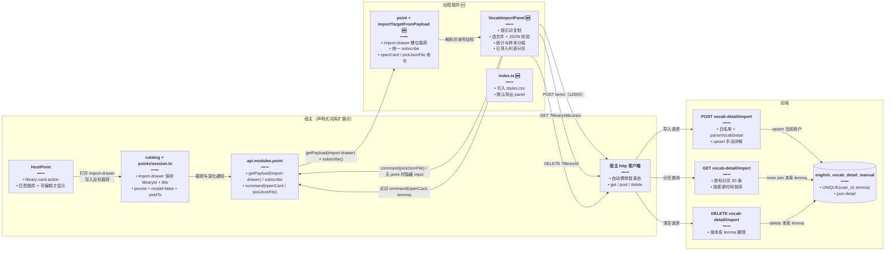
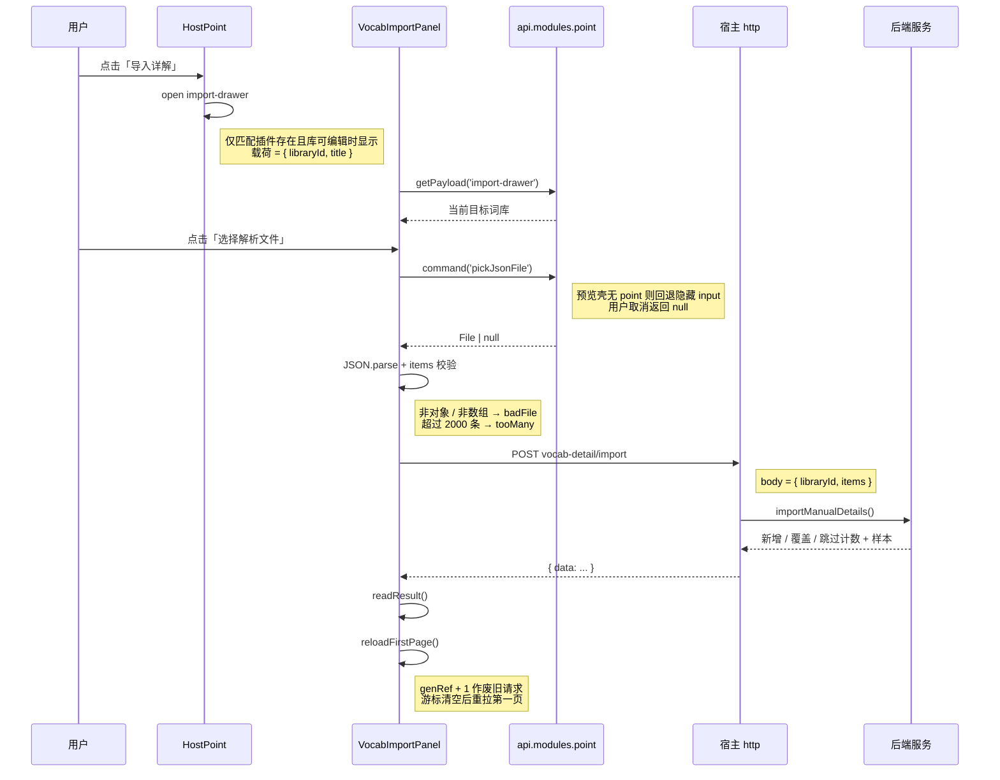
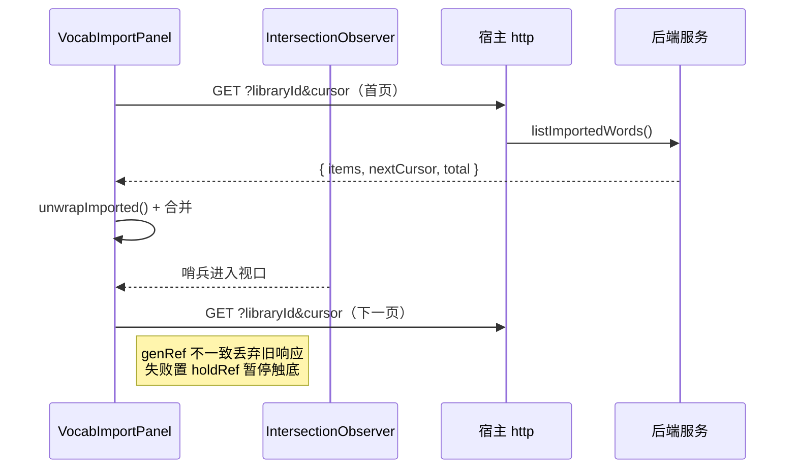

# 手动导入单词详解远程插件：提示词复制、JSON 导入与已导入列表

> **状态**：已落地 | **日期**：2026-11-13；point 桥更新：2026-11-14 | **功能域**：英语学习
> **需求摘要**：把「导入单词详解」抽屉的正文拆成独立远程插件——展示并一键复制生成提示词、选择 JSON 文件批量导入、展示新增/覆盖/不在库/格式不对的统计与样本，并按游标分页列出当前词库已导入的词；点词可直接打开详解，宿主未启用详解插件时用 Toast 兜底。后端入库、白名单与校验逻辑见宿主与后端专题，本篇只讲插件侧。

> [!IMPORTANT]
> **2026-11-14 当前实现迁移**：导入宿主已从 `vocabDetailImport/session.ts`、`ImportDrawer.tsx`、`api.modules.vocabDetailImport` 与 `modules:vocabDetailImport`，迁到词库扩展点的 **`library-card-action` → `import-drawer` + `api.modules.point` + `modules:point`**。现行宿主总览见 [学习页扩展点](./学习页扩展点.md)，通用协议见 [声明式扩展点](../plugins/声明式扩展点.md)。
>
> **本文当前定位**：Remote 的提示词、JSON 校验、导入 / 清空请求、统计样本、游标分页与防串页仍是当前主文档。§4 是 **2026-11-13 Remote 初版完整代码快照**，其中 `ImportModule`、`getTarget`、旧 `open / pickJsonFile` 方法只作历史基线；当前共享适配在 `src/views/vocab-detail/point.ts`。
>
> **当前用户行为**：只有 `library-card-action` 匹配到已启用插件且 `isOwned !== false` 时才显示导入按钮，无匹配插件不占位。`HostPoint` 将 `{ libraryId, title }` 写入 `import-drawer`；面板经 `point.getPayload / subscribe` 跟随目标，经 `pickJsonFile / openCard` command 调宿主能力。列表、详解与导入由声明式槽位协调，导入抽屉按 `yieldTo` 给词卡详解让位，面板同一帧隐藏且详解不滑入，见 [详解抽屉瞬时让位](./详解抽屉瞬时让位.md)；词库统计走 `stats` signal，页面上下文按白名单发布。

## 延伸阅读

- 宿主与后端实现（导入接口、白名单、手动详解表）：[手动导入单词详解](./手动导入单词详解.md)
- 同轮姊妹稿（详解抽屉面板插件）：[单词详解插件面板](./单词详解插件面板.md)
- 同轮姊妹稿（详解列表插件）：[单词详解列表插件](./单词详解列表插件.md)
- 插件如何接入宿主与当前 `modules:point` 桥：[单词详解插件接入](../plugins/单词详解插件接入.md)
- 统一五方法契约、导入目标解析与预览分流：[统一 point 模块桥](../plugins/统一point模块桥.md)

---

## 1. 背景与目标

「导入单词详解」原来由宿主抽屉直接渲染表单，表单与宿主布局强耦合，改一次 UI 就要动主项目。初版把**抽屉正文**整体下沉为远程插件 `vocabDetailImport`；当前宿主通过 `HostPoint` 与词库扩展点负责按钮、抽屉和目标载荷，插件自己完成提示词、文件选择、导入、统计和已导入列表。

插件侧要达成的目标：

1. **目标跟随宿主**：通过 `point.getPayload('import-drawer')` 读取当前词库，经 `importTargetFromPayload` 收窄后写入面板 `target` 状态；通过 `point.subscribe()` 接收切库事件，切库后立即重置并重新拉列表。
2. **提示词可复制**：展示完整提示词供用户粘贴给模型，复制成功后 1 秒内显示「已复制」，避免用户重复点击。
3. **文件选择双通道**：有 `point` 时调用 `command('pickJsonFile')`，用 `Promise.resolve` 兼容同步值与 Promise；没有 `point` 时回退到隐藏 `<input type="file">`。命令返回 `null` 表示取消，不会再次触发隐藏文件框。
4. **导入前本地校验**：只接受可解析 JSON、顶层含 `items` 数组、且不超过 2000 条，尽量把错误挡在请求之前。
5. **统计与样本可视化**：导入后展示新增、覆盖、不在库、格式不对四类计数，并把三类样本词按颜色分组展示。
6. **已导入列表分页**：按游标加载、触底自动追加，切库与清空后重置，旧响应不能覆盖新库数据。

不在本篇范围：后端如何做 lemma 白名单、`parseVocabDetail` 校验、upsert 与删除，见 [手动导入单词详解](./手动导入单词详解.md)。

## 2. 改动范围

| 路径 | 角色 | 变更 |
| --- | --- | --- |
| `src/views/vocab-detail-import/prompt.ts` | 提示词常量 | 新增；导出 `IMPORT_PROMPT`，复制与展示共用一份文本 |
| `src/views/vocab-detail-import/panel.tsx` | 插件面板主体 | 初版新增；2026-11-14 改用统一 `point`、槽位载荷与命令 |
| `src/views/vocab-detail/point.ts` | 当前共享适配 | 新增；提供 `PointModule` 与 `importTargetFromPayload`，完整代码见统一桥主文档 |
| `src/views/vocab-detail-import/index.ts` | 插件入口 | 新增；引入全局样式并默认导出面板 |

§4 记录初版纯新增源码，因此只给当时的「改动后」代码块；§5 给出 2026-11-14 统一桥迁移的改动前后对比，当前实现以 §5 为准。

## 3. 实现思路

### 3.1 数据流



**读图要点**：插件不直接访问后端域名，所有请求都经宿主 `http` 客户端，登录态与基地址由宿主统一处理；当前只依赖 `modules.point` 的统一五方法，词库数据固定在 `import-drawer` 槽位，文件选择与打开详解分别收敛为 `pickJsonFile` 和 `openCard` 命令。

### 3.2 导入时序



**读图要点**：本地校验失败不会发请求；导入成功后不是手工插入列表，而是重置游标重新拉第一页，保证排序、总数与后端一致。

### 3.3 列表分页与防串页



**读图要点**：`genRef` 是「代际」标记，切库、重载都会自增，旧请求回来时代际不匹配直接丢弃；`holdRef` 在请求失败后置位，避免触底反复重试把错误刷屏，用户点「重试」才清除。

### 3.4 关键决策与权衡

| 决策 | 备选 | 为什么选它 |
| --- | --- | --- |
| 优先 `command('pickJsonFile')`，无 point 时隐藏 input 兜底 | 只用 `<input type="file">` | 主项目需要宿主文件框能力；`Promise.resolve` 同时承接同步与异步返回值，null 只表示取消 |
| 本地先校验 `items` 与 2000 上限 | 全交给后端 400 | 大文件上传后再失败体验差；本地能提前给出明确文案 |
| 导入成功重拉第一页 | 本地把新词插入列表 | 后端会区分新增/覆盖并影响排序与总数，重拉最省心 |
| `genRef` 代际 + `cursorRef` 游标 | 只靠 `AbortController` | 宿主 http 没有暴露取消能力；代际比对同样能防止旧响应串页 |
| 失败置 `holdRef` 挂起触底 | 失败后继续自动重试 | 触底会连续触发，失败时反复请求会刷屏并打爆后端 |
| 三类样本按颜色分组 | 只显示计数 | 用户需要知道具体哪些词没导入，才能回去修 JSON |
| 点词走 `command('openCard')`，非 true 时 Toast | 插件内自己开详解 | 详解抽屉属于另一个插件，复用宿主命令能保持单实例与叠层顺序；unknown 返回值必须显式判定 |

## 4. 初版关键代码与注释（2026-11-13 历史快照）

> 本节保留初版完整源码，其中 `ImportModule`、`modules.vocabDetailImport`、`getTarget` 与 `open` 均是旧桥记录。当前桥接以 §5 为准；提示词、响应解析、分页与 JSX 未改部分仍以本节为准。

> `IMPORT_PROMPT` 是多行模板字符串，字符串内部的文字行不能插入 `//`（会破坏提示词内容），因此代码块内只对 `export const` 声明行加注释；模板内容原样保留，逐行语义见正文与常量自带说明。

### 4.1 `IMPORT_PROMPT` 提示词常量

**来源**：`src/views/vocab-detail-import/prompt.ts`（**改动后**，约 L1–L21）

```typescript
/** 与规划文档 §9.4 一致。输入是词库导出 JSON，输出才是可导入文件。 */
// 导出唯一的提示词常量：复制按钮与只读展示共用，避免两处文案漂移
export const IMPORT_PROMPT = `请为 JSON 文件中的 items 里的每一个 word 写详解。
只输出一个 JSON 对象，不要 Markdown，不要重复输入里的 title、ipa、pos、segmentation、translationZh、example。
顶层是 { "items": [ ... ] }。每个 item 只有 word 和 detail。
word 必须原样复制输入里的 word，不要翻译，不要改大小写，不要改空格。
detail 不要写 lemma，不要写音标，不要写音节。
输入里的 pos 若含多个词性（如 adj./n./v.），拆成多条 senses，每条 pos 不超过 32 个字符。
输入里的 translationZh 和 example 只作参考，detail.examples 另写至少 4 条，不要把词库原句原样再贴一次就结束。
detail.morphology.parts：至少 4 段，最多 8 段，每段 form、kind、meaningZh。
kind 只能是 prefix、root、suffix、base。拆不开时只给一段 kind 为 base 的整词，不要编造前后缀。
detail.morphology.storyZh：一两句中文，可以是空字符串。
detail.memory.hookZh：一句中文记忆，必须有。
detail.senses：至少 4 条，最多 6 条，每条 pos、glossZh、nuanceZh。没有差别 nuanceZh 用空字符串。
detail.examples：至少 4 条，最多 6 条，每条 en 和 zh 都要有。
detail.family、collocations、synonyms：可空数组，最多 6 条。
family 和 synonyms 每条是 word、pos、glossZh。
collocations 每条是 phrase、glossZh。
detail.tags：可空数组，最多 4 个短标签。
如果一次写不完，只输出已经写完的词，JSON 必须能被完整解析，不要截断在半个对象。
一次输出不要超过 2000 条；超出时分成多个同样形状的文件。
注意：最终必须要以 .json 文件形式或者 markdown 的形式输出，一定不能直接通过文本的形式输出，同时如果可以要优先通过 .json 文件形式输出。`;
```

### 4.2 `panel.tsx` 模块导入与类型契约

**来源**：`src/views/vocab-detail-import/panel.tsx`（**改动后**，约 L1–L48）

```typescript
// 引入设计系统确认弹窗：清空是破坏性操作，必须二次确认
import Confirm from '@design/Confirm';
// 引入统一 UI 的按钮与滚动区域，保证与宿主抽屉的视觉和滚动条一致
import { Button, ScrollArea } from '@ui/index';
// 引入勾选与复制图标：复制成功后切换为 CheckCircle，给用户即时反馈
import { CheckCircle, Copy } from 'lucide-react';
// 引入 React 基础 Hook：缓存回调、注册副作用、跨渲染保存引用、管理状态
import { useCallback, useEffect, useRef, useState } from 'react';
// 引入宿主语言同步与翻译 Hook：插件需跟随宿主中英文切换
import { useHostLocale, useI18n } from '@/hooks';
// 引入提示词常量：复制与展示共用，避免两处维护
import { IMPORT_PROMPT } from './prompt';

// 导入目标：当前词库 id 与标题，由宿主桥实时下发
type Target = { libraryId: string; title: string };

// 宿主注入的 vocabDetailImport 模块契约，插件只通过这些方法读写抽屉状态
type ImportModule = {
	// 读取当前导入目标；未选中词库时返回 null，面板据此禁用按钮
	getTarget: () => Target | null;
	// 订阅目标变化并返回退订函数，切库时让面板重新拉取列表
	subscribe: (listener: () => void) => () => void;
	// 点词打开宿主详解抽屉；返回是否成功，失败时面板用 Toast 兜底
	open?: (word: string) => boolean;
	// 宿主提供的文件选择器
	/** 主项目里选一个 JSON 文件；取消为 null。预览壳没有这个方法。 */
	// 预览壳无此方法时，选择文件会回退到隐藏 input
	pickJsonFile?: () => Promise<File | null>;
};

// 宿主 API 契约：语言、HTTP、Toast 与业务模块都从这里取，插件不直接访问宿主内部
type HostApi = {
	// 宿主当前语言；插件首次加载时用它对齐词典，避免先闪中文
	locale?: 'zh-CN' | 'en-US';
	// 宿主 HTTP 客户端；缺失时列表与导入都要走失败提示，不能静默
	http?: {
		// GET：读取已导入词的分页列表
		get: (url: string) => Promise<unknown>;
		// POST：提交 JSON 导入请求
		post: (url: string, body?: unknown) => Promise<unknown>;
		// DELETE：按词库清空当前用户的手动详解
		delete: (url: string) => Promise<unknown>;
	};
	// 宿主 UI 能力；点词打不开详解时用 Toast 告知用户
	ui?: {
		// 显示轻提示；这里只用到 info，避免打断用户
		showToast: (options: {
			// 提示文案，来自 i18n key
			message: string;
			// 提示类型；默认 info，这里显式传 info
			type?: 'success' | 'error' | 'info';
		// 函数签名闭合：返回 void，调用方不依赖返回值
		}) => void;
	};
	// 宿主注入的业务模块集合；只有申请了 vocabDetailImport 才存在
	modules?: { vocabDetailImport?: ImportModule };
};

// 后端导入响应：区分新增、覆盖与两类跳过，并附带样本词供面板分组展示
type ImportResult = {
	// 新增成功的条数
	imported: number;
	// 命中已有手动详解、被覆盖的条数
	overwritten: number;
	// 不在当前词库白名单内、被跳过的条数
	skippedNotInLibrary: number;
	// detail 结构校验失败、被跳过的条数
	skippedInvalid: number;
	// 不在库中的样本词，用于定位需要用户修正的条目
	skippedNotInLibrarySample: string[];
	// 格式不对的样本词，用于定位需要用户修正的条目
	skippedInvalidSample: string[];
	// 被覆盖的样本词，让用户知道哪些词被新内容替换
	overwrittenSample: string[];
};

// 已导入列表行：只保留展示所需字段，减少无关数据跨桥传输
type ImportedWord = {
	// 词面，作为列表 key 与点词打开详解的参数
	lemma: string;
	// 第一条释义摘要，列表副标题展示；缺失时为空串
	glossZh: string;
	// 更新时间 ISO 字符串，面板按当前语言格式化为本地时间
	updatedAt: string;
};
```

### 4.3 响应解析与容错工具

**来源**：`src/views/vocab-detail-import/panel.tsx`（**改动后**，约 L50–L131）

```typescript
// 拆宿主响应壳：兼容 http 客户端包一层 { data } 与直接返回业务对象两种形态
function unwrap(res: unknown): Record<string, unknown> {
	// 仅当是对象且含 data 字段时才取内层，避免把业务字段 data 误当响应壳
	const body =
		// 三元分支一：对象且含 data 键
		res && typeof res === 'object' && 'data' in res
			// 取内层 data 作为真实响应体
			? (res as { data: unknown }).data
			// 否则认为响应本身就是业务体
			: res;
	// 只接受对象形态；null、数组、原始值统一降级为空对象，后续取值不抛错
	return body && typeof body === 'object'
		// 断言为普通记录，便于按字段名读取
		? (body as Record<string, unknown>)
		// 非对象时给空对象，所有计数与样本自然回落默认值
		: {};
}

// 把后端计数转成安全数字：非数字或非有限值统一为 0，避免 NaN 进入 UI
function asCount(value: unknown): number {
	// 仅接受有限 number，其余（字符串、undefined、Infinity）都按 0 处理
	return typeof value === 'number' && Number.isFinite(value) ? value : 0;
}

// 把后端样本数组收敛为字符串数组：过滤非字符串，防止渲染时 join 出错
function asSample(value: unknown): string[] {
	// 非数组直接返回空数组，兼容后端省略字段的情况
	if (!Array.isArray(value)) return [];
	// 逐项做类型守卫，只保留字符串，保证后续 join('、') 安全
	return value.filter((item): item is string => typeof item === 'string');
}

// 解析导入响应：字段逐个走 asCount / asSample，任何缺字段都能得到稳定结构
function readResult(res: unknown): ImportResult {
	// 先拆壳拿到业务字段所在对象，后续只读这个对象
	const body = unwrap(res);
	// 组装面板可直接消费的结果对象，避免在组件里重复做类型判断
	return {
		// 新增条数，缺失按 0
		imported: asCount(body.imported),
		// 覆盖条数，用于提示用户哪些词被替换
		overwritten: asCount(body.overwritten),
		// 不在词库的条数，配合样本展示跳过原因
		skippedNotInLibrary: asCount(body.skippedNotInLibrary),
		// 格式错误的条数，提示用户检查 detail 结构
		skippedInvalid: asCount(body.skippedInvalid),
		// 不在库中的样本词列表
		skippedNotInLibrarySample: asSample(body.skippedNotInLibrarySample),
		// 格式不对的样本词列表
		skippedInvalidSample: asSample(body.skippedInvalidSample),
		// 被覆盖的样本词列表
		overwrittenSample: asSample(body.overwrittenSample),
	};
}

// 解析已导入列表响应：校验 items、nextCursor、total，协议不符时抛错触发失败态
function unwrapImported(res: unknown): {
	// 本页已导入词
	items: ImportedWord[];
	// 下一页游标；null 表示没有更多
	nextCursor: string | null;
	// 当前词库已导入总数
	total: number;
} {
	// 拆壳拿到业务对象
	const body = unwrap(res);
	// items 必须是数组，否则视为空列表；行级再做过滤避免整页失败
	const items = Array.isArray(body.items)
		// 逐行映射：flatMap 允许非法行返回空数组被跳过
		? body.items.flatMap((row) => {
				// 非对象行直接丢弃，避免读取属性时抛错
				if (!row || typeof row !== 'object') return [];
				// 收窄行结构，字段都用 unknown 等待逐个校验
				const item = row as {
					// 词面字段
					lemma?: unknown;
					// 释义摘要字段
					glossZh?: unknown;
					// 更新时间字段
					updatedAt?: unknown;
				};
				// lemma 是列表唯一标识，缺失或非字符串时整行不可用
				if (typeof item.lemma !== 'string' || !item.lemma) return [];
				// 合法行组装为标准结构，字符串字段缺失时回落空串
				return [
					{
						// 已校验为字符串的词面
						lemma: item.lemma,
						// 非字符串摘要统一为空串，避免渲染出 undefined
						glossZh: typeof item.glossZh === 'string' ? item.glossZh : '',
						// 非字符串时间统一为空串，由面板判断是否展示
						updatedAt: typeof item.updatedAt === 'string' ? item.updatedAt : '',
					},
				];
			})
		// items 缺失或非数组时给空页
		: [];
	// 游标字段必须存在且类型正确，否则抛错让面板进入失败挂起态
	if (
		// 响应体没有 nextCursor 键，说明协议不匹配
		!('nextCursor' in body) ||
		// 有值但不是字符串也视为协议错误
		(body.nextCursor != null && typeof body.nextCursor !== 'string')
	) {
		// 抛空消息错误，由 errorText 使用调用方传入的兜底文案
		throw new Error('');
	}
	// total 可能是字符串或数字，统一转 Number 后再判有限值
	const total = Number(body.total);
	// 空字符串游标按 null 处理，表示已经到底
	const nextCursor =
		// 只有非空字符串才作为下一页游标
		typeof body.nextCursor === 'string' && body.nextCursor
			// 原样返回后端游标
			? body.nextCursor
			// 其余情况视为没有下一页
			: null;
	// 返回面板可直接合并的分页结构
	return {
		// 过滤后的本页行
		items,
		// 归一化后的下一页游标
		nextCursor,
		// total 非法时退化为本页条数，至少保证展示不为 NaN
		total: Number.isFinite(total) ? total : items.length,
	};
}

// 统一错误文案：优先 Error.message，其次对象 message，最后用 i18n 兜底
function errorText(cause: unknown, fallback: string): string {
	// 标准 Error 且消息非空时直接使用，保留后端的具体原因
	if (cause instanceof Error && cause.message.trim()) return cause.message;
	// 宿主可能抛普通对象，含 message 字段时继续尝试读取
	if (cause && typeof cause === 'object' && 'message' in cause) {
		// 取出 message，类型未知需再校验
		const message = (cause as { message?: unknown }).message;
		// 字符串且非空才采用，避免把对象显示成 [object Object]
		if (typeof message === 'string' && message.trim()) return message;
	}
	// 都取不到时返回调用方给的本地化兜底文案
	return fallback;
}
```

### 4.4 `VocabImportPanel` 组件

**对比范围**：`panel.tsx` 中 `VocabImportPanel` 全组件（声明 → 组件闭合，约 L133–L591），包含目标订阅、分页、导入、清空与全部 JSX。

**来源**：`src/views/vocab-detail-import/panel.tsx`（**改动后**，约 L133–L591）

```typescript
// 插件面板默认导出：宿主通过模块联邦挂载，只接收一个 api 通道
export default function VocabImportPanel({ api }: { api: HostApi }) {
	// 取翻译函数与当前语言：文案全部走 key，时间格式跟随 locale
	const { t, locale } = useI18n();
	// 跟随宿主语言切换：插件模式下桥快照与 locale 事件都会生效
	useHostLocale(api);
	// 缓存宿主桥引用：后续 effect 与事件处理都读这一个对象
	const bridge = api.modules?.vocabDetailImport;
	// 用 ref 保存最新 http：异步回调里避免闭包拿到旧 api
	const httpRef = useRef(api.http);
	// 每次 render 同步最新 http，宿主热更新 api 时无需重建状态
	httpRef.current = api.http;
	// 目标词库状态：首帧直接问宿主，避免先渲染空库再跳变
	const [target, setTarget] = useState<Target | null>(
		// 惰性初始化：只在挂载时调用一次 getTarget
		() => bridge?.getTarget() ?? null,
	);
	// 导入或清空请求是否进行中：用于禁用按钮与防止重复提交
	const [busy, setBusy] = useState(false);
	// 全局错误文案：文件错误、导入失败、复制失败都复用这一处展示
	const [error, setError] = useState<string | null>(null);
	// 最近一次导入统计：成功后展示新增/覆盖/跳过四类计数
	const [result, setResult] = useState<ImportResult | null>(null);
	// 清空确认弹窗开关：破坏性操作必须先弹 Confirm
	const [confirmClear, setConfirmClear] = useState(false);
	// 提示词复制反馈：true 时图标与文案切成「已复制」
	const [copied, setCopied] = useState(false);
	// 已导入词列表：分页追加，切库或清空后重置
	const [items, setItems] = useState<ImportedWord[]>([]);
	// 已导入总数：来自后端 total，用于「共 N 条 / 已加载 M 条」
	const [total, setTotal] = useState(0);
	// 列表加载中：首屏骨架与触底「加载更多」共用
	const [listLoading, setListLoading] = useState(false);
	// 列表错误文案：首屏失败展示重试按钮，触底失败在底部展示重试
	const [listError, setListError] = useState<string | null>(null);
	// 隐藏文件 input 引用：宿主没有 pickJsonFile 时用它兜底
	const fileRef = useRef<HTMLInputElement>(null);
	// 列表代际：切库/重载时自增，旧请求返回时代际不符直接丢弃
	const genRef = useRef(0);
	// 游标：undefined 表示尚未加载，null 表示到底，字符串表示下一页
	const cursorRef = useRef<string | null | undefined>(undefined);
	// 请求锁：同一时刻只允许一个列表请求，避免触底重复发
	const loadingRef = useRef(false);
	// 失败挂起：请求失败后暂停触底，等用户点重试再解除
	const holdRef = useRef(false);
	// 当前词库 id：异步请求里读取，避免闭包拿到旧 target
	const libraryRef = useRef('');
	// 复制反馈定时器：1 秒后恢复「复制」，卸载时要清理
	const copiedTimer = useRef<number | null>(null);
	// 列表滚动容器：作为 IntersectionObserver 的 root
	const listViewportRef = useRef<HTMLDivElement>(null);
	// 列表底部哨兵：进入视口即触发下一页
	const sentinelRef = useRef<HTMLDivElement>(null);

	// 订阅宿主目标变化：切库时同步 target，驱动下面重置 effect
	useEffect(() => {
		// 没有桥说明宿主未注入能力，直接不订阅
		if (!bridge) return;
		// 订阅并在回调里重新取目标；返回退订函数交给 React 清理
		return bridge.subscribe(() => setTarget(bridge.getTarget()));
	// 桥对象变化才重新订阅，避免每次 render 都解绑重绑
	}, [bridge]);

	// 卸载时清理复制定时器，避免组件已卸载还 setState
	useEffect(
		// 返回清理函数：组件卸载或依赖变化时执行
		() => () => {
			// 有未触发的定时器才清理，防止 clearTimeout(null)
			if (copiedTimer.current != null) window.clearTimeout(copiedTimer.current);
		// 清理函数结束
		},
		// 空依赖：只在挂载时注册一次清理
		[],
	);

	// 拉取一页已导入词：首页与触底共用，内部用 ref 做并发与代际保护
	const loadPage = useCallback(async () => {
		// 读取当前词库 id：异步回调里不能用闭包里的 target
		const libraryId = libraryRef.current;
		// 任一前置条件不满足就跳过：无库、正在加载、失败挂起、已到底
		if (
			// 没有选中词库，无法请求
			!libraryId ||
			// 已有请求在飞，避免重复
			loadingRef.current ||
			// 上次失败仍挂起，等用户重试
			holdRef.current ||
			// null 表示已经加载完所有页
			cursorRef.current === null
		) {
			// 直接返回，不改任何状态
			return;
		}
		// 取当前 http 与代际、游标快照，保证本次请求参数一致
		const http = httpRef.current;
		// 记录发起请求时的代际，响应回来要对比
		const gen = genRef.current;
		// 记录本次请求使用的游标，undefined 表示首页
		const cursor = cursorRef.current;
		// 宿主没有 get 能力时无法拉列表，直接进入失败态
		if (!http?.get) {
			// 置失败挂起，避免触底反复尝试
			holdRef.current = true;
			// 用本地化文案提示加载失败
			setListError(t('vocabImport.listFailed'));
			// 结束 loading，让失败 UI 立即可见
			setListLoading(false);
			// 不再继续请求
			return;
		}
		// 加请求锁，防止触底在响应前再次触发
		loadingRef.current = true;
		// 同步 loading 状态，驱动「加载更多」与首屏 loading
		setListLoading(true);
		// 拼请求地址：libraryId 必带，游标按需追加并编码
		const url = `/english-learning/vocab-detail/import?libraryId=${encodeURIComponent(libraryId)}${
			// 有游标时追加 cursor 参数，首页不带
			cursor ? `&cursor=${encodeURIComponent(cursor)}` : ''
		// 模板字符串闭合：本次 URL 拼接结束
		}`;
		// 请求与状态更新放在 try 里，任何异常都转成可展示错误
		try {
			// 等待响应并交给 unwrapImported 做结构校验
			const page = unwrapImported(await http.get(url));
			// 代际变化说明已切库/重载，本次结果作废
			if (gen !== genRef.current) return;
			// 记录下一页游标，null 表示到底
			cursorRef.current = page.nextCursor;
			// 首页替换、后续页追加，保证列表顺序与后端一致
			setItems((prev) => (cursor ? [...prev, ...page.items] : page.items));
			// 更新总数，展示「共 N 条」
			setTotal(page.total);
			// 成功后清掉旧错误，重试按钮消失
			setListError(null);
		// 捕获网络或协议错误
		} catch (cause) {
			// 代际变化时忽略旧错误，避免污染新库状态
			if (gen !== genRef.current) return;
			// 置失败挂起，暂停后续触底
			holdRef.current = true;
			// 优先展示后端/宿主错误，取不到再用本地化兜底
			setListError(errorText(cause, t('vocabImport.listFailed')));
		// 无论成功失败都要释放请求锁
		} finally {
			// 只有代际一致才改 loading，旧请求不能影响新库
			if (gen === genRef.current) {
				// 释放请求锁，允许下一次触底
				loadingRef.current = false;
				// 关闭加载中 UI
				setListLoading(false);
			}
		}
	// t 变化（切语言）时重建回调，保证错误文案使用新语言
	}, [t]);

	// 重置并重拉第一页：切库、导入成功、清空成功后都调用
	const reloadFirstPage = () => {
		// 代际自增：让所有在飞请求的结果作废
		genRef.current += 1;
		// 游标回到未加载状态，下次请求从首页开始
		cursorRef.current = undefined;
		// 解除失败挂起，允许重新请求
		holdRef.current = false;
		// 释放请求锁，避免上一次异常退出后永久锁死
		loadingRef.current = false;
		// 清空旧列表，防止新库数据与旧数据短暂混排
		setItems([]);
		// 总数归零，等新首页返回后再更新
		setTotal(0);
		// 清掉旧错误，避免失败态残留
		setListError(null);
		// 立即拉第一页；void 表示有意不等待 Promise
		void loadPage();
	};

	// 词库变化时重置列表并拉新库第一页；首次挂载同样会走这里
	useEffect(() => {
		// 把最新词库 id 写进 ref，供异步 loadPage 读取
		libraryRef.current = target?.libraryId ?? '';
		// 代际自增：旧库请求回来一律丢弃
		genRef.current += 1;
		// 游标重置为未加载
		cursorRef.current = undefined;
		// 解除失败挂起
		holdRef.current = false;
		// 释放请求锁
		loadingRef.current = false;
		// 清空旧库列表
		setItems([]);
		// 总数归零
		setTotal(0);
		// 清掉旧库错误
		setListError(null);
		// 没有词库时不发请求，直接展示空态
		if (!libraryRef.current) {
			// 确保 loading 关闭，否则会一直显示加载中
			setListLoading(false);
			// 提前返回
			return;
		}
		// 有词库才拉第一页
		void loadPage();
	// 词库 id 或 loadPage 变化时重新执行；loadPage 变化只跟语言有关
	}, [target?.libraryId, loadPage]);

	// 注册触底监听：哨兵进入滚动容器视口就加载下一页
	useEffect(() => {
		// 取滚动容器与哨兵 DOM
		const root = listViewportRef.current;
		// 取哨兵的 DOM 引用
		const sentinel = sentinelRef.current;
		// 缺少任一元素、已有错误或已到底都不注册
		if (!root || !sentinel || listError || cursorRef.current === null) return;
		// 创建观察器：root 限定滚动容器，rootMargin 提前 120px 预加载
		const io = new IntersectionObserver(
			// 回调只关心首个条目是否进入视口
			(entries) => {
				// 未进入视口直接返回，避免滚动过程中误触
				if (!entries[0]?.isIntersecting) return;
				// 进入视口就拉下一页；loadPage 内部还有锁与游标判断
				void loadPage();
			},
			// 配置：root 为列表容器，底部提前 120px 触发，任意交集比例即可
			{ root, rootMargin: '120px 0px', threshold: 0 },
		);
		// 开始观察哨兵
		io.observe(sentinel);
		// 卸载或依赖变化时断开观察，避免重复回调
		return () => io.disconnect();
	// 列表长度、错误、加载态变化时重新注册，保证哨兵存在且状态最新
	}, [items.length, listError, listLoading, loadPage]);

	// 复制提示词：成功后立刻切到「已复制」，1 秒后自动恢复
	const copyPrompt = async () => {
		// 剪贴板写入可能被权限拒绝，必须捕获
		try {
			// 把完整提示词写入剪贴板，文本与展示保持一致
			await navigator.clipboard.writeText(IMPORT_PROMPT);
			// 切换到已复制状态，给用户明确反馈
			setCopied(true);
			// 清掉之前的错误，避免旧错误干扰成功提示
			setError(null);
			// 已有定时器先清掉，防止连续点击产生多个定时器
			if (copiedTimer.current != null) window.clearTimeout(copiedTimer.current);
			// 1 秒后恢复为可复制状态
			copiedTimer.current = window.setTimeout(() => {
				// 定时器已触发，清空引用避免卸载时误清理
				copiedTimer.current = null;
				// 文案与图标恢复为「复制」
				setCopied(false);
			// 回显时长 1000ms，足够看见但不至于一直停留
			}, 1000);
		// 剪贴板不可用或用户拒绝权限
		} catch {
			// 用本地化文案提示复制失败
			setError(t('vocabImport.copyFailed'));
		}
	};

	// 处理选中的 JSON 文件：本地校验通过后才 POST 导入
	const onFile = async (file: File | undefined) => {
		// 用户取消选择或还没有目标词库时不处理
		if (!file || !target) return;
		// 新一次导入先清掉旧错误
		setError(null);
		// 同样清掉上一次统计，避免旧结果误导
		setResult(null);
		// 解析结果先用 unknown 承接，后续逐层校验
		let parsed: unknown;
		// 读文件与 JSON.parse 都可能抛错
		try {
			// 读文本并解析；await file.text() 兼容浏览器 File API
			parsed = JSON.parse(await file.text());
		// 非法 JSON 或读文件失败
		} catch {
			// 提示文件不是可导入的 JSON
			setError(t('vocabImport.badFile'));
			// 终止流程，不发请求
			return;
		}
		// 只接受顶层含 items 的对象，其余结构一律视为无效
		const fileItems =
			// 三元分支一：对象且含 items 键
			parsed && typeof parsed === 'object' && 'items' in parsed
				// 取出 items，类型未知
				? (parsed as { items?: unknown }).items
				// 不符合结构时给 null
				: null;
		// items 必须是数组，否则提示文件无效
		if (!Array.isArray(fileItems)) {
			// 复用文件无效文案
			setError(t('vocabImport.badFile'));
			// 终止流程
			return;
		}
		// 与后端上限保持一致：单次最多 2000 条
		if (fileItems.length > 2000) {
			// 提示用户拆分文件
			setError(t('vocabImport.tooMany'));
			// 终止流程，避免超大请求体
			return;
		}
		// 取最新 http，后续异步请求使用
		const http = httpRef.current;
		// 宿主没有 http 时无法导入，直接返回
		if (!http) return;
		// 进入忙碌态：禁用选择/清空按钮，防止重复操作
		setBusy(true);
		// 提交导入并处理统计
		try {
			// POST 到导入接口，body 只需词库 id 与条目数组
			const res = await http.post('/english-learning/vocab-detail/import', {
				// 目标词库 id 决定白名单与入库归属
				libraryId: target.libraryId,
				// 已通过本地结构与数量校验的条目
				items: fileItems,
			});
			// 解析统计结果，字段缺失会回落为 0 或空数组
			setResult(readResult(res));
			// 导入会改变排序与总数，直接重拉第一页
			reloadFirstPage();
		// 网络错误、权限错误或后端校验异常
		} catch (cause) {
			// 优先展示具体错误，取不到再用本地化兜底
			setError(errorText(cause, t('vocabImport.failed')));
		// 无论成功失败都退出忙碌态
		} finally {
			// 恢复按钮可用
			setBusy(false);
		}
	};

	// 清空当前词库的手动详解：必须先经过 Confirm 确认
	const clearManual = async () => {
		// 没有目标词库时无事可做
		if (!target) return;
		// 取最新 http
		const http = httpRef.current;
		// 宿主没有 http 时无法删除
		if (!http) return;
		// 进入忙碌态，禁用按钮并防止重复点击
		setBusy(true);
		// 清掉旧错误
		setError(null);
		// 执行删除
		try {
			// DELETE 带 libraryId；后端按本库 lemma 集合删除该用户手动详解
			await http.delete(
				// 词库 id 必须编码，避免特殊字符破坏查询串
				`/english-learning/vocab-detail/import?libraryId=${encodeURIComponent(target.libraryId)}`,
			);
			// 清空成功后旧统计不再有意义
			setResult(null);
			// 关闭确认弹窗
			setConfirmClear(false);
			// 重拉第一页，列表应变为空
			reloadFirstPage();
		// 删除失败
		} catch (cause) {
			// 展示具体错误或本地化兜底
			setError(errorText(cause, t('vocabImport.failed')));
		// 无论成功失败都退出忙碌态
		} finally {
			// 恢复按钮可用
			setBusy(false);
		}
	};

	// 选择文件：优先宿主原生选择器，缺失时回退隐藏 input
	const chooseFile = async () => {
		// 读宿主桥上的文件选择方法，判断能力是否存在
		const pick = bridge?.pickJsonFile;
		// 预览壳没有该方法时，用隐藏 input 兜底
		if (!pick) {
			// 触发 input.click()，由 onChange 统一走 onFile
			fileRef.current?.click();
			// 兜底路径结束
			return;
		}
		// 宿主选择器可能被取消或被拒绝
		try {
			// 等待用户选择；取消返回 null
			const file = await pick();
			// 只有真正选到文件才继续导入
			if (file) await onFile(file);
		// 宿主可能抛 'accept' 表示类型不符，也可能抛其他错误
		} catch (cause) {
			// 只信任 Error.message，其他类型统一空串
			const message = cause instanceof Error ? cause.message : '';
			// 按错误类型给不同文案
			setError(
				// 'accept' 表示文件类型不被接受
				message === 'accept'
					// 提示文件不是可导入 JSON
					? t('vocabImport.badFile')
					// 其他错误统一提示导入失败
					: t('vocabImport.failed'),
			);
		}
	};

	// 点词回调：优先让宿主打开详解；打不开时 Toast 提示先启用详解插件
	const onPick = (lemma: string) => {
		// bridge.open 可选；缺失或返回 false 都视为没打开
		const opened = bridge?.open?.(lemma) ?? false;
		// 没打开说明详解插件未启用或当前不可用
		if (!opened) {
			// 用宿主 Toast 给出可操作提示
			api.ui?.showToast({
				// 文案提醒先启用单词解析（详解）插件
				message: t('vocabImport.needDetail'),
				// info 级别，不打断用户
				type: 'info',
			});
		}
	};

	// 空态判定：有目标、不在加载、无错误、列表为空
	const showEmpty =
		// 四个条件同时成立才显示「还没有导入的词」
		Boolean(target) && !listLoading && !listError && items.length === 0;
	// 三类样本分组：覆盖（青）、不在库（琥珀）、格式不对（玫红）
	const detailGroups = (
		// 用 as const 固定元组类型，保证解构出的 tone 可拼接 class
		[
			// 第一组：被覆盖的词
			[
				// 分组标题走 i18n
				t('vocabImport.statReplaced'),
				// 样本缺失时用空数组，过滤后自然不展示
				result?.overwrittenSample ?? [],
				// 青色底与边框，表示可接受的结果
				'bg-teal-500/5 border border-teal-500/6',
			],
			// 第二组：不在当前词库的词
			[
				// 分组标题
				t('vocabImport.statMissing'),
				// 不在库样本
				result?.skippedNotInLibrarySample ?? [],
				// 琥珀色提醒用户这些词需要先加入词库
				'bg-amber-500/5 border border-amber-500/6',
			],
			// 第三组：detail 结构不合格的词
			[
				// 分组标题
				t('vocabImport.statInvalid'),
				// 格式错误样本
				result?.skippedInvalidSample ?? [],
				// 玫红色表示需要修 JSON
				'bg-rose-500/5 border border-rose-500/6',
			],
		// 固定元组，防止 TS 把数组推断成宽泛的 string
		] as const
	// 过滤掉没有样本的分组，避免展示空块
	).filter(([, words]) => words.length > 0);

	// 渲染面板：自上而下依次是标题/提示词、已导入列表、错误与统计、底部操作
	return (
		// 根容器：整列布局，占满抽屉高度且允许子项收缩
		<div className="text-textcolor flex h-full min-h-0 flex-col text-sm">
			// 顶部固定区：词库标题、提示词标题与复制按钮
			<div className="shrink-0 space-y-1.5 px-3.5 pt-2.5">
				// 当前词库标题；无目标时展示「还没有选中词库」
				<p className="min-w-0 truncate font-medium">
					// 优先标题，缺失时用 i18n 空库文案
					{target?.title ?? t('vocabImport.noLibrary')}
				</p>
				// 提示词标题行：左侧标题，右侧复制按钮
				<div className="mt-1 flex items-center justify-between gap-2">
					// 左侧「提示词」标签
					<span className="text-textcolor text-[13px]">
						// 标签文案走 i18n
						{t('vocabImport.promptTitle')}
					</span>
					// 复制按钮：复制成功后图标与文案一起切换
					<button
						// 明确按钮类型，避免在表单内误触发表单提交
						type="button"
						// 文本按钮样式，颜色随主题
						className="text-textcolor/70 hover:text-textcolor flex cursor-pointer items-center gap-1 text-[13px]"
						// 点击复制；void 表示不等待 Promise
						onClick={() => void copyPrompt()}
					>
						// 已复制显示勾选图标，否则显示复制图标
						{copied ? <CheckCircle size={13} /> : <Copy size={13} />}
						// 已复制与可复制两种文案
						{copied ? t('vocabImport.copied') : t('vocabImport.copyPrompt')}
					</button>
				</div>
			</div>
			// 提示词只读展示区：固定比例高度，内部可滚动
			<div className="bg-theme/5 border-theme/5 mx-3.5 mt-1.5 flex min-h-0 flex-[2] flex-col overflow-hidden rounded-md border py-2">
				// 滚动容器：min-h-0 让 flex 子项真正可滚动
				<ScrollArea
					// 占满剩余高度
					className="min-h-0 flex-1"
					// 滚动条贴右且收窄，避免挤压正文
					scrollbarClassName="right-0 w-1.5 border-l-0 p-0"
				>
					// 提示词正文：保留换行与空格，保证复制内容与展示一致
					<p className="text-textcolor/70 px-2 text-[13px] leading-relaxed whitespace-pre-wrap">
						// 直接渲染常量，不额外加工
						{IMPORT_PROMPT}
					</p>
				</ScrollArea>
			</div>
			// 使用说明：告诉用户先复制提示词再让模型生成 JSON
			<p className="text-textcolor/70 shrink-0 px-3.5 pt-1.5 pb-2 text-xs leading-relaxed text-justify">
				// 说明文案走 i18n
				{t('vocabImport.hint')}
			</p>
			// 已导入统计行：标题 + 总数/已加载
			<p className="flex min-w-0 shrink-0 items-baseline gap-2 px-3.5 pb-1.5 text-[13px]">
				// 左侧固定标题
				<span className="text-textcolor shrink-0">
					// 标题文案
					{t('vocabImport.importedTitle')}
				</span>
				// 右侧摘要：共 N 条 / 已加载 M 条
				<span className="text-textcolor/50 truncate font-normal">
					// 传入 total 与 items.length，由词典插值
					{t('vocabImport.importedSummary', {
						// 总数转字符串，满足插值参数类型
						total: String(total),
						// 已加载数量转字符串
						loaded: String(items.length),
					})}
				</span>
			</p>
			// 列表滚动区：作为 IntersectionObserver 的 root
			<ScrollArea
				// 把 DOM 引用交给观察器
				ref={listViewportRef}
				// 固定比例高度，内部纵向排列
				className="box-border flex min-h-0 flex-[5] flex-col px-3.5"
			>
				// 首屏加载且没有旧数据时展示 loading
				{listLoading && items.length === 0 ? (
					// 居中加载文案
					<p className="text-textcolor/55 px-2 py-6 text-center text-xs">
						// 通用加载中文案
						{t('common.loading')}
					</p>
				// 首屏失败且没有旧数据时展示错误 + 重试
				) : listError && items.length === 0 ? (
					// 错误块：纵向居中
					<div className="flex flex-col items-center gap-3 px-2 py-6">
						// 展示错误原因
						<p className="text-textcolor/70 text-center">{listError}</p>
						// 重试按钮：清除挂起后重新拉第一页
						<Button
							// 明确按钮类型
							type="button"
							// 描边样式表示次要操作
							variant="outline"
							// 小尺寸
							size="sm"
							// 点击重试
							onClick={() => {
								// 解除失败挂起
								holdRef.current = false;
								// 清掉错误，让 loading 态接管
								setListError(null);
								// 重新请求当前游标页
								void loadPage();
							}}
						>
							// 重试文案
							{t('vocabImport.retry')}
						</Button>
					</div>
				// 正常空态：有库但没有已导入词
				) : showEmpty ? (
					// 空态文案
					<p className="text-textcolor/55 px-2 py-4 text-center">
						// 提示这本库还没有导入的词
						{t('vocabImport.importedEmpty')}
					</p>
				// 默认：渲染两列卡片列表
				) : (
					// 两列网格，间距 2
					<div className="grid w-full grid-cols-2 gap-2">
						// 逐行渲染已导入词
						{items.map((row) => {
							// 把 ISO 时间转本地时间对象
							const time = new Date(row.updatedAt);
							// 非法时间给空串，合法时按当前语言格式化
							const stamp = Number.isNaN(time.getTime())
								// 非法时间不展示
								? ''
								// 合法时间转本地化字符串
								: time.toLocaleString(locale);
							// 每个词渲染为整块可点击卡片
							return (
								// 卡片按钮：ghost 样式但自定义为白底块
								<Button
									// 用词面作 key，列表内唯一
									key={row.lemma}
									// 明确按钮类型
									type="button"
									// 幽灵按钮，悬浮态由 class 覆盖
									variant="ghost"
									// 点击打开该词详解
									onClick={() => onPick(row.lemma)}
									// 高度自适应、两列宽、左对齐、允许换行
									className="bg-theme/5 border-theme/5 hover:bg-theme/10 h-auto w-full min-w-0 flex-col items-stretch gap-0.5 rounded-md border px-2 py-1.5 text-left font-normal whitespace-normal"
								>
									// 词面：单行截断
									<span className="truncate font-medium">{row.lemma}</span>
									// 有释义摘要时才展示副标题
									{row.glossZh ? (
										// 摘要单行截断
										<span className="text-textcolor/60 line-clamp-1 text-xs">
											// 释义摘要
											{row.glossZh}
										</span>
									// 无摘要不渲染
									) : null}
									// 有合法更新时间时才展示时间
									{stamp ? (
										// 时间使用等宽数字，避免跳动
										<span className="text-textcolor/40 text-xs tabular-nums">
											// 本地化时间文本
											{stamp}
										</span>
									// 无时间不渲染
									) : null}
								</Button>
							// 当前行渲染结束
							);
						})}
						// 未到底时放哨兵，进入视口触发下一页
						{cursorRef.current !== null ? (
							// 1px 高的哨兵，视觉不可见但可被观察
							<div
								// 交给 IntersectionObserver 观察
								ref={sentinelRef}
								// 占满两列，高度 1px
								className="col-span-2 h-1 w-full"
								// 对读屏隐藏
								aria-hidden
							/>
						// 已到底不渲染哨兵
						) : null}
						// 触底失败时在列表底部展示重试
						{listError ? (
							// 居中的重试块
							<div className="col-span-2 flex justify-center py-2">
								// 重试按钮
								<Button
									// 明确按钮类型
									type="button"
									// 描边次要样式
									variant="outline"
									// 小尺寸
									size="sm"
									// 点击重试：清挂起、清错误、重新拉页
									onClick={() => {
										// 解除失败挂起
										holdRef.current = false;
										// 清掉错误
										setListError(null);
										// 重新请求
										void loadPage();
									}}
								>
									// 重试文案
									{t('vocabImport.retry')}
								</Button>
							</div>
						// 无错误不渲染
						) : null}
						// 加载下一页时展示「加载更多」
						{listLoading ? (
							// 占满两列的加载文案
							<p className="text-textcolor/45 col-span-2 mt-2 text-center text-xs">
								// 通用加载更多文案
								{t('common.loadingMore')}
							</p>
						// 未加载不渲染
						) : null}
					</div>
				)}
			</ScrollArea>
			// 全局错误提示：复制/导入/清空失败都会走到这里
			{error ? (
				// 玫红色错误文案
				<p className="shrink-0 px-3.5 pt-2.5 text-xs text-rose-500">{error}</p>
			// 无错误不渲染
			) : null}
			// 导入统计行：只在有结果时展示
			{result ? (
				// 四类计数用中点分隔
				<p className="text-textcolor shrink-0 px-3.5 pt-2.5 text-[13px] leading-5">
					// 新增标签与数值
					{t('vocabImport.statAdded')} {result.imported}
					// 分隔点
					<span className="text-textcolor/25 px-1.5">·</span>
					// 覆盖标签与数值
					{t('vocabImport.statReplaced')} {result.overwritten}
					// 分隔点
					<span className="text-textcolor/25 px-1.5">·</span>
					// 不在库标签与数值
					{t('vocabImport.statMissing')} {result.skippedNotInLibrary}
					// 分隔点
					<span className="text-textcolor/25 px-1.5">·</span>
					// 格式不对标签与数值
					{t('vocabImport.statInvalid')} {result.skippedInvalid}
				</p>
			// 无结果不渲染
			) : null}
			// 样本分组：只展示有样本的组
			{detailGroups.length > 0 ? (
				// 分组区可滚动，避免样本过多挤掉列表
				<ScrollArea
					// 占剩余空间的三份
					className="mt-1 min-h-0 flex-[3]"
					// 滚动条贴右收窄
					scrollbarClassName="right-0 w-1.5 border-l-0 p-0"
				>
					// 分组纵向排列
					<div className="space-y-2 px-3.5">
						// 遍历三类分组，解构出标题、词列表与色调
						{detailGroups.map(([label, words, tone]) => (
							// 每组一个带色调的圆角块
							<div key={label} className={`${tone} rounded-md px-2 py-2`}>
								// 组标题与样本数量
								<p className="text-textcolor text-[13px]">
									// 标题 + 数量
									{label} {words.length}
								</p>
								// 样本词用顿号连接
								<p className="text-textcolor/70 mt-1 text-xs leading-5">
									// 拼接后展示
									{words.join('、')}
								</p>
							</div>
						))}
					</div>
				</ScrollArea>
			// 无样本不渲染
			) : null}
			// 底部操作栏：选择文件与清空
			<div className="bg-background flex shrink-0 items-center justify-end gap-2 px-3.5 pt-2.5 pb-3.5">
				// 选择文件按钮：无目标或忙碌时禁用
				<Button
					// 明确按钮类型
					type="button"
					// 小尺寸
					size="sm"
					// 无词库或请求中不可选文件
					disabled={!target || busy}
					// 两个按钮各占一半
					className="flex-1"
					// 点击走 chooseFile，内部决定用桥还是 input
					onClick={() => void chooseFile()}
				>
					// 按钮文案
					{t('vocabImport.chooseFile')}
				</Button>
				// 清空按钮：无目标、忙碌或总数 0 时禁用
				<Button
					// 明确按钮类型
					type="button"
					// 默认实心按钮
					variant="default"
					// 小尺寸
					size="sm"
					// 橙色警示样式，提醒是破坏性操作
					className="flex-1 bg-orange-400 hover:bg-orange-500"
					// 没有可清空的词时禁用
					disabled={!target || busy || total === 0}
					// 点击先打开确认弹窗，不直接删除
					onClick={() => setConfirmClear(true)}
				>
					// 按钮文案
					{t('vocabImport.clear')}
				</Button>
			</div>
			// 隐藏文件 input：pickJsonFile 缺失时的兜底通道
			<input
				// 暴露 DOM 引用，供 chooseFile 触发 click
				ref={fileRef}
				// 文件类型 input
				type="file"
				// 只接受 JSON，减少用户选错
				accept="application/json,.json"
				// 完全隐藏，不占布局
				className="hidden"
				// 选中文件后统一交给 onFile
				onChange={(event) => {
					// 取第一个文件，允许多选但只处理首个
					const file = event.target.files?.[0];
					// 立即清空 value，保证再次选同一文件也能触发 change
					event.target.value = '';
					// 交给 onFile 做校验与导入
					void onFile(file);
				}}
			/>
			// 清空确认弹窗：受控开关，确认后执行删除
			<Confirm
				// 由 confirmClear 控制显隐
				open={confirmClear}
				// 用户取消或确认后同步开关
				onOpenChange={setConfirmClear}
				// 弹窗标题
				title={t('vocabImport.clearTitle')}
				// 弹窗说明，强调只清空当前库的手动详解
				description={t('vocabImport.clearDesc')}
				// 确认按钮用危险样式
				confirmVariant="destructive"
				// 确认后走清空逻辑
				onConfirm={() => void clearManual()}
			/>
		</div>
	);
}
```

### 4.5 插件入口

**来源**：`src/views/vocab-detail-import/index.ts`（**改动后**，约 L1–L3）

```typescript
// 引入插件全局样式，确保远程容器内 class 与宿主主题变量生效
import '@/styles.css';

// 默认导出面板组件，供模块联邦 expose ./VocabDetailImport 使用
export { default } from './panel';
```

## 5. 2026-11-14：导入面板迁移到统一 `modules.point`

本节覆盖本轮全部桥接改动：共享类型与目标解析函数、首帧目标、变化订阅、宿主选文件命令和打开词卡命令。提示词、HTTP 导入、结果统计、游标分页、清空、复制与全部 JSX 均未改变，沿用 §4 的完整实现。

### 5.1 文件头与 `HostApi`：删除专用 `ImportModule`

**来源**：`src/views/vocab-detail-import/panel.tsx`（**改动前** · 基线约 L1–L32；完整 import、`Target`、`ImportModule` 与 `HostApi`，后续类型对称省略）

```typescript
// 引入确认弹窗，清空手动详解前继续执行二次确认
import Confirm from '@design/Confirm';
// 引入按钮与滚动区域，导入表单和分页列表的视觉不因桥接迁移改变
import { Button, ScrollArea } from '@ui/index';
// 引入复制成功与复制图标，继续提供提示词复制反馈
import { CheckCircle, Copy } from 'lucide-react';
// 引入 React Hook，首帧状态、目标订阅和异步命令都复用这些基础能力
import { useCallback, useEffect, useRef, useState } from 'react';
// 引入宿主语言同步和翻译 Hook，保持远程面板中英文一致
import { useHostLocale, useI18n } from '@/hooks';
// 引入提示词常量，复制按钮与只读区域继续共用同一文本
import { IMPORT_PROMPT } from './prompt';

// 定义导入目标的数据结构，旧桥直接返回这个强类型对象
type Target = { libraryId: string; title: string };

// 旧专用模块把目标读取、订阅、打开详解与选文件分别声明成业务方法
type ImportModule = {
	// 旧 getTarget 同步返回完整目标，字段可信度依赖宿主直接遵守类型
	getTarget: () => Target | null;
	// 旧 subscribe 只监听导入目标变化，语义与新版统一订阅相同但入口不同
	subscribe: (listener: () => void) => () => void;
	// 旧 open 是可选业务命令，布尔返回值决定是否显示未启用提示
	open?: (word: string) => boolean;
	// 保留源码注释，说明原生选文件能力和取消语义
	/** 主项目里选一个 JSON 文件；取消为 null。预览壳没有这个方法。 */
	// 旧 pickJsonFile 只承诺 Promise，新命令还需兼容 unknown 与同步返回值
	pickJsonFile?: () => Promise<File | null>;
};

// 旧 HostApi 同时声明语言、HTTP、Toast 与 vocabDetailImport 专用模块
type HostApi = {
	// 宿主语言快照继续供 useHostLocale 对齐插件词典
	locale?: 'zh-CN' | 'en-US';
	// HTTP 能力不受桥接迁移影响，仍负责导入、列表和清空请求
	http?: {
		// GET 方法读取当前词库已导入词的分页数据
		get: (url: string) => Promise<unknown>;
		// POST 方法提交待导入 items
		post: (url: string, body?: unknown) => Promise<unknown>;
		// DELETE 方法清空当前词库的手动详解
		delete: (url: string) => Promise<unknown>;
	};
	// Toast 能力继续在打开词卡失败时给出轻提示
	ui?: {
		// showToast 接收统一消息配置，不要求插件操作宿主内部通知组件
		showToast: (options: {
			// message 是已经本地化的用户可读文案
			message: string;
			// type 限定三种视觉级别，本面板失败兜底使用 info
			type?: 'success' | 'error' | 'info';
		}) => void;
	};
	// 旧 modules 按业务名暴露 ImportModule，新版将删除这个专用入口
	modules?: { vocabDetailImport?: ImportModule };
};
```

**来源**：`src/views/vocab-detail-import/panel.tsx`（**改动后** · 当前约 L1–L28；完整 import、`Target` 与 `HostApi`，后续类型对称省略）

```typescript
// 引入确认弹窗，破坏性清空操作继续保持原交互
import Confirm from '@design/Confirm';
// 引入按钮与滚动区域，桥接改造不触碰既有视觉组件
import { Button, ScrollArea } from '@ui/index';
// 引入复制状态图标，提示词复制反馈保持原样
import { CheckCircle, Copy } from 'lucide-react';
// 引入 React Hook，用状态保存经收窄的导入目标并订阅宿主变化
import { useCallback, useEffect, useRef, useState } from 'react';
// 引入宿主语言同步与翻译 Hook，远程插件继续跟随主站语言
import { useHostLocale, useI18n } from '@/hooks';
// 从共享适配文件引入目标解析和统一模块类型，避免面板自行解释 unknown 载荷
import {
	// importTargetFromPayload 负责把 import-drawer 原始记录收窄成 Target 或 null
	importTargetFromPayload,
	// PointModule 以 type-only 导入，只参与编译期宿主能力约束
	type PointModule,
// 共享适配位于单词详解目录，三个单词插件由此复用同一边界规则
} from '@/views/vocab-detail/point';
// 提示词常量继续从当前目录引入，导入协议文本没有变化
import { IMPORT_PROMPT } from './prompt';

// 保留面板内部目标类型，使后续 HTTP 与 JSX 不需要感知通用 Record
type Target = { libraryId: string; title: string };

// 新 HostApi 保留语言、HTTP 与 Toast，只把专用业务模块替换为统一 point
type HostApi = {
	// locale 仍是可选宿主语言快照，插件挂载时据此同步
	locale?: 'zh-CN' | 'en-US';
	// http 仍按可选能力注入，缺失时沿用既有失败与禁用分支
	http?: {
		// GET 继续拉取已导入词列表，不改变游标协议
		get: (url: string) => Promise<unknown>;
		// POST 继续提交导入内容，不改变后端请求体
		post: (url: string, body?: unknown) => Promise<unknown>;
		// DELETE 继续清空当前库手动详解，不改变接口参数
		delete: (url: string) => Promise<unknown>;
	};
	// ui 继续承载 openCard 未成功时的用户提示
	ui?: {
		// showToast 的配置结构与旧版完全一致，避免无关 UI 改造
		showToast: (options: {
			// message 继续使用 vocabImport.needDetail 等 i18n 文案
			message: string;
			// type 仍限定成功、错误和信息三类提示
			type?: 'success' | 'error' | 'info';
		}) => void;
	};
	// modules 现在只声明统一 point，旧 vocabDetailImport 不再有兼容别名
	modules?: { point?: PointModule };
};
```

**变更摘要**：`ImportModule` 被整体删除；通用载荷先由共享函数收窄，再进入原来的 `Target` 状态。HTTP、UI、提示词和其它数据类型均保持原样。

### 5.2 `VocabImportPanel`：槽位目标、统一订阅与两个命令

下面两块都是完整组件符号，从 `export default function` 写到组件闭合。中间未改的状态、分页、导入、复制、清空、派生值和 JSX 用相同位置的注释对称省略；修改涉及的首帧目标、首个订阅 effect、`chooseFile` 与 `onPick` 全部保留。

**来源**：`src/views/vocab-detail-import/panel.tsx`（**改动前** · 基线约 L133–L591；完整 `VocabImportPanel`，未改中段与 JSX 对称省略）

```tsx
// 默认导出导入面板组件，宿主继续只通过 api 注入能力
export default function VocabImportPanel({ api }: { api: HostApi }) {
	// 获取翻译函数和当前语言，按钮、错误与时间展示保持本地化
	const { t, locale } = useI18n();
	// 同步宿主语言，保证远程插件独立挂载时也跟随主站切换
	useHostLocale(api);
	// 读取旧 vocabDetailImport 专用桥，后续目标与命令都依赖这个对象
	const bridge = api.modules?.vocabDetailImport;
	// 用 ref 保存最新 HTTP 客户端，避免异步回调闭包捕获旧实例
	const httpRef = useRef(api.http);
	// 每次渲染同步 HTTP ref，宿主替换客户端时无需重建面板状态
	httpRef.current = api.http;
	// 初始化目标状态，旧版直接信任专用桥返回的 Target
	const [target, setTarget] = useState<Target | null>(
		// 惰性读取首帧目标，避免先显示无库再跳变；桥缺失时归一为 null
		() => bridge?.getTarget() ?? null,
	);
	// 对称省略未改的请求状态、分页 ref 与其余局部状态
	// ...（未改动）
	// 建立旧桥目标订阅，切库后更新 target 并触发后续列表重置 effect
	useEffect(() => {
		// 没有专用桥时不注册监听，目标维持 null 并禁用依赖词库的操作
		if (!bridge) return;
		// 每次通知重新调用 getTarget，并把宿主退订函数直接交给 effect 清理
		return bridge.subscribe(() => setTarget(bridge.getTarget()));
		// 专用桥实例变化时退订旧对象并订阅新对象
	}, [bridge]);
	// 对称省略未改的复制、分页、导入与清空逻辑，直接进入文件选择函数
	// ...（未改动）
	// chooseFile 负责优先使用宿主文件框，没有能力时回退隐藏 input
	const chooseFile = async () => {
		// 读取旧桥可选 pickJsonFile 方法，以方法是否存在决定选择通道
		const pick = bridge?.pickJsonFile;
		// 方法缺失时点击隐藏文件输入框，让独立预览仍能选本地 JSON
		if (!pick) {
			// 通过 DOM ref 触发系统文件框，不暴露额外可见按钮
			fileRef.current?.click();
			// 已走兜底通道，不再执行宿主命令分支
			return;
		}
		// 捕获文件框取消之外的异常，并映射成面板既有错误文案
		try {
			// 等待旧桥 Promise 得到 File 或 null，null 表示用户取消
			const file = await pick();
			// 只有真正选中文件才进入 JSON 解析和导入流程
			if (file) await onFile(file);
		} catch (cause) {
			// 提取标准 Error 消息，用 accept 区分文件类型不接受与其它失败
			const message = cause instanceof Error ? cause.message : '';
			// 根据错误原因设置本地化提示，不在组件里暴露原始异常对象
			setError(
				// accept 对应文件类型错误，其余异常统一使用导入失败兜底
				message === 'accept'
					// 文件 accept 不匹配时提示 JSON 文件无效
					? t('vocabImport.badFile')
					// 其它宿主异常沿用通用导入失败文案
					: t('vocabImport.failed'),
			);
		}
	};

	// onPick 处理已导入词点击，把词面交给旧桥打开详解
	const onPick = (lemma: string) => {
		// 旧 open 缺失或返回 false 都归一为未打开，决定后续 Toast 兜底
		const opened = bridge?.open?.(lemma) ?? false;
		// 只有未成功打开时才提示，避免正常跳转时出现多余通知
		if (!opened) {
			// 通过宿主 UI 能力显示轻提示，不直接操作宿主通知组件
			api.ui?.showToast({
				// 使用既有 needDetail 文案引导用户先启用单词解析
				message: t('vocabImport.needDetail'),
				// 信息级提示足以表达入口不可用，不打断当前导入任务
				type: 'info',
			});
		}
	};
	// 对称省略未改的展示派生值、完整 JSX 与隐藏 input onChange 绑定
	// ...（未改动）
}
```

**来源**：`src/views/vocab-detail-import/panel.tsx`（**改动后** · 当前约 L129–L587；完整 `VocabImportPanel`，未改中段与 JSX 对称省略）

```tsx
// 默认导出同一导入面板，业务 UI 与 expose 名称均不随桥接变化
export default function VocabImportPanel({ api }: { api: HostApi }) {
	// 获取翻译函数与当前语言，所有既有本地化逻辑继续复用
	const { t, locale } = useI18n();
	// 同步宿主语言，确保目标标题之外的插件文案跟随主站
	useHostLocale(api);
	// 读取统一 point，后续目标、订阅与命令不再访问专用业务模块
	const point = api.modules?.point;
	// 继续用 ref 保存最新 HTTP 客户端，桥接迁移不改变异步请求闭包策略
	const httpRef = useRef(api.http);
	// 渲染时同步 HTTP ref，保证导入与分页总是使用最新宿主客户端
	httpRef.current = api.http;
	// 初始化目标状态，新版把通用槽位载荷先收窄再写入 Target
	const [target, setTarget] = useState<Target | null>(() =>
		// 读取 import-drawer 首帧载荷并校验 libraryId，空载荷或脏数据统一得到 null
		importTargetFromPayload(point?.getPayload('import-drawer') ?? null),
	);
	// 对称省略未改的请求状态、分页 ref 与其余局部状态
	// ...（未改动）
	// 建立统一 point 订阅，任何表面通知都重新读取当前导入槽位
	useEffect(() => {
		// 没有 point 时不注册监听，隐藏 input 兜底与无库空态仍可工作
		if (!point) return;
		// 返回宿主退订函数，确保组件卸载或 point 替换后不再更新状态
		return point.subscribe(() =>
			// 每次通知都读取并收窄最新 import-drawer 载荷，避免复用旧目标快照
			setTarget(importTargetFromPayload(point.getPayload('import-drawer'))),
		);
		// point 是唯一外部依赖，实例变化必须重建订阅关系
	}, [point]);
	// 对称省略未改的复制、分页、导入与清空逻辑，保持与改动前相同切口
	// ...（未改动）
	// chooseFile 现在通过统一命令选择文件，point 缺失仍回退隐藏 input
	const chooseFile = async () => {
		// 读取统一 command 方法作为能力入口，方法存在不代表命令一定返回文件
		const pick = point?.command;
		// 没有 point 或 command 时才打开隐藏文件框，命令返回 null 不进入这个分支
		if (!pick) {
			// 触发隐藏 input 的系统文件框，保留无桥环境的最低可用能力
			fileRef.current?.click();
			// 已完成兜底动作，不再继续调用宿主命令
			return;
		}
		// 捕获同步抛错和异步拒绝，两种异常都进入同一错误文案分支
		try {
			// Promise.resolve 把同步 File/null 与异步 Promise 统一成可 await 结果
			const file = await Promise.resolve(
				// 调用 pickJsonFile 命令并显式传 undefined 参数，类型断言仅描述预期返回形态
				point.command('pickJsonFile', undefined) as Promise<File | null>,
			);
			// 仅 File 非空时解析导入；null 或 undefined 都按用户取消处理
			if (file) await onFile(file);
		} catch (cause) {
			// 标准 Error 保留 message，用于识别 accept 文件类型错误
			const message = cause instanceof Error ? cause.message : '';
			// 设置与旧版一致的错误提示，使命令迁移不改变用户可见异常语义
			setError(
				// accept 仍走文件无效，其它同步或异步异常走通用失败
				message === 'accept'
					// 文件类型不被接受时显示 badFile
					? t('vocabImport.badFile')
					// 其它失败显示 vocabImport.failed
					: t('vocabImport.failed'),
			);
		}
	};

	// onPick 继续打开同一详解面板，但动作改由 openCard 统一命令完成
	const onPick = (lemma: string) => {
		// command 返回 unknown，只有严格等于 true 才认定打开成功，避免 truthy 误判
		const opened = point?.command('openCard', lemma) === true;
		// point 缺失、命令缺失或任何非 true 返回值都走既有 Toast 兜底
		if (!opened) {
			// 使用宿主 showToast，保持插件不直接依赖宿主 UI 内部实现
			api.ui?.showToast({
				// 继续使用 needDetail 提示启用详解能力
				message: t('vocabImport.needDetail'),
				// 信息级提示不阻断正在进行的导入与列表浏览
				type: 'info',
			});
		}
	};
	// 对称省略未改的展示派生值、完整 JSX 与隐藏 input onChange 绑定
	// ...（未改动）
}
```

**变更摘要**：首帧与订阅都改读 `import-drawer`，并统一经过 `importTargetFromPayload`；`pickJsonFile` 用 `Promise.resolve` 兼容命令返回形态，`openCard` 用 `=== true` 收窄 `unknown`。组件其它逻辑与 JSX 没有任何行为改动。

## 6. 兼容性与影响

- **插件初版为新增，桥接本轮为破坏性切换**：面板现在只通过 `api.modules.point`、`api.http`、`api.ui` 与语言快照工作，不再回退 `api.modules.vocabDetailImport`；宿主与远程包须同步发布。只有声明 `modules:point` 且 `host.surface = english.vocab.library` 已登记时才注入 `point`。
- **入口条件不变**：导入按钮仍要求 `library-card-action` 有匹配已启用插件，并且 `showEdit = lib.isOwned !== false`；任一条件不满足都不显示、不占位。
- **抽屉协调**：`import-drawer` 使用 `persist + modal=false + yieldTo`；词卡详解打开时导入抽屉同一帧隐藏但保留状态，详解不滑入、页面不闪，详解关闭后导入在原位恢复。词库列表与详解之间同样保留会话并按 `covers / covered` 覆盖、恢复。
- **桥缺失**：`point` 为空时 `target` 为 `null`，标题显示「还没有选中词库」，清空按钮禁用且列表不发请求；选择文件会尝试隐藏 input，但 `onFile` 仍因无目标而不提交。
- **HTTP 缺失**：列表请求直接进入失败态并挂起触底，导入/清空直接返回；不会出现无响应按钮。
- **文件选择能力差异**：有 `point.command` 时调用 `pickJsonFile`，同步值、Promise 与异常分别由 `Promise.resolve + await + catch` 统一处理；无 `point` 时回退隐藏 `<input>`。命令返回 `null` 表示取消，不再回退 input。
- **详解插件未启用**：`openCard` 未明确返回 `true` 时只弹 Toast，不阻断导入面板。
- **分页协议**：后端必须返回 `nextCursor` 字段（可为 `null`）；缺失会被 `unwrapImported` 判为协议错误并展示加载失败。
- **国际化**：所有可见文案均走 `vocabImport.*` / `common.*` key；新增语言只需补词典，不需要改组件。
- **时间展示**：`updatedAt` 解析失败时整行不显示时间，不影响词面与释义。

### 回归建议

1. 未启用 `vocabDetailImport` 或插件未挂载 `library-card-action` → 不显示导入按钮、不占位，也不会创建 `import-drawer` 会话。
2. 匹配插件已启用但 `lib.isOwned === false` → 导入按钮仍不显示；恢复可编辑后再显示。
3. 面板已打开但缺少 `point` 或目标载荷 → 标题显示空库文案，选择文件与清空按钮禁用，列表不发请求。
4. 宿主不注入 `http` → 列表展示「已导入词加载失败」与重试按钮；点击重试仍失败时保持挂起，不刷屏。
5. 复制提示词 → 立即变为「已复制」并显示勾选图标，约 1 秒后恢复「复制」。
6. 主项目选择文件 → 经 `pickJsonFile` command 打开宿主选择器；独立预览无 `point` 时回退隐藏 input。
7. 选择非 JSON 文件 → 提示「文件不是可导入的 JSON」，不发 POST。
8. 选择缺少 `items` 或 `items` 非数组的文件 → 同样提示文件无效。
9. 选择超过 2000 条的 JSON → 提示一次最多 2000 条，不发 POST。
10. 导入合法文件 → 展示新增/覆盖/不在库/格式不对四类计数；三类样本按青/琥珀/玫红分组，空组不展示。
11. 清空 → 先弹 Confirm；确认后列表清空、统计消失；取消不改任何状态。
12. 切换目标词库载荷 → 列表立即清空并拉新库第一页，旧库在飞请求返回后不得覆盖新库。
13. 滚动到底 → 自动加载下一页并显示「加载更多」；游标为 `null` 后不再请求。
14. 分页请求失败 → 列表底部出现重试；点击后清挂起并继续加载当前游标页。
15. 点击已导入词 → 经 `openCard` 打开对应详解；未启用详解插件时返回 `false` 并出现「请先启用单词解析」Toast。
16. 详解从导入抽屉上打开 → 导入抽屉按 `yieldTo` 同一帧隐藏但保留状态，详解直接出现、页面不闪；关闭详解后导入在原位恢复，列表滚动与分页不丢失。
17. 切换中英文 → 标题、按钮、统计与时间格式同步更新。

## 7. 相关源码路径

| 说明 | 路径 |
| --- | --- |
| 提示词常量 | `src/views/vocab-detail-import/prompt.ts` |
| 面板主体（类型、解析工具、组件） | `src/views/vocab-detail-import/panel.tsx` |
| 当前统一桥类型与导入目标解析 | `src/views/vocab-detail/point.ts` |
| 插件入口（样式 + 默认导出） | `src/views/vocab-detail-import/index.ts` |

---

（若与仓库最新源码不一致，以源码为准）
