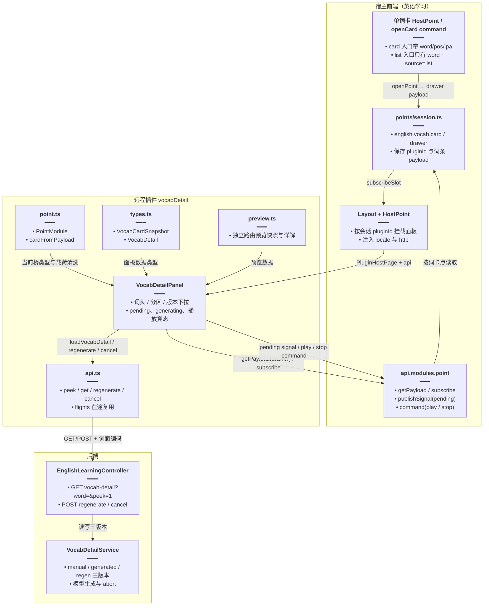
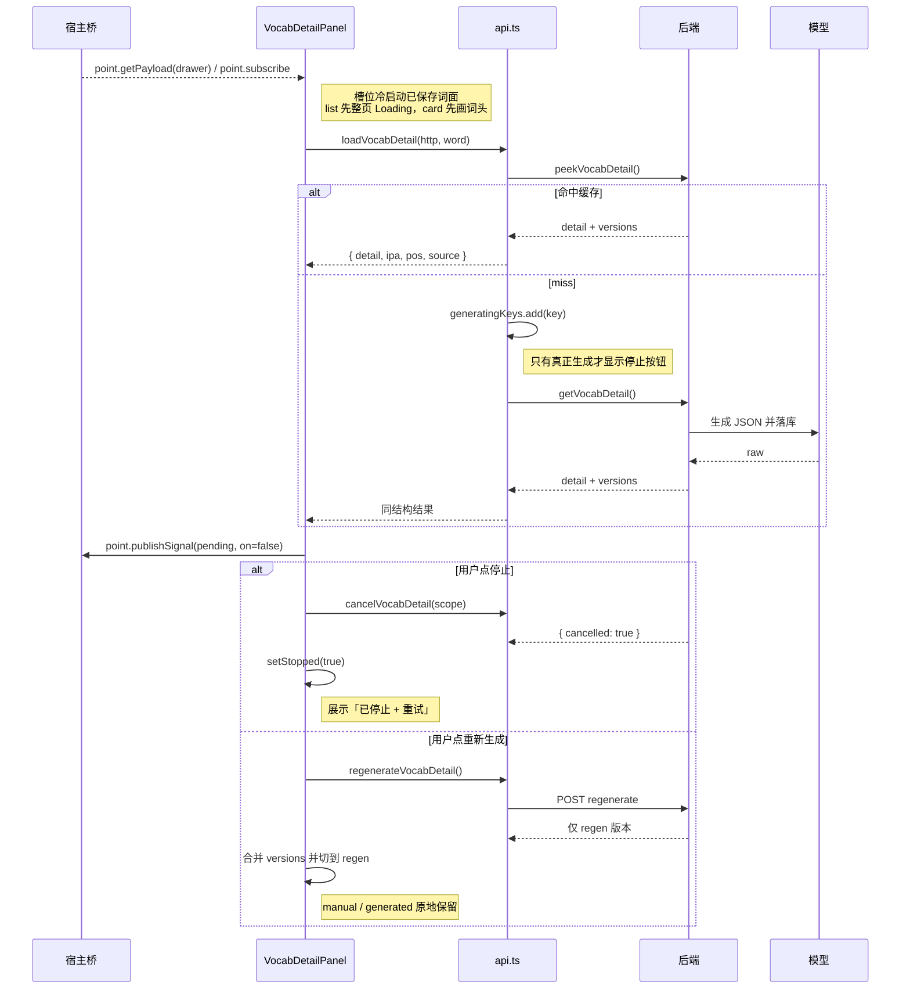

# 单词详解远程插件：面板渲染与按词加载编排

> **状态**：已落地 | **日期**：2026-11-13；point 桥更新：2026-11-14 | **功能域**：英语学习
> **需求摘要**：`vocabDetail` 远程插件只负责详解抽屉的正文：当前通过 `api.modules.point.getPayload('drawer')` 读取词头快照，先 `peek` 只读缓存、未命中再生成，同词在途复用；支持手动导入 / 全站生成 / 重新生成三版本切换、重新生成、停止生成与例句朗读；列表入口只带词面时用整页 Loading，卡片入口保留已有词头。

> [!IMPORTANT]
> **2026-11-14 当前实现迁移**：宿主专属 `vocabDetail/session.ts`、`PluginActions.tsx`、`api.modules.vocabDetail` 与 `modules:vocabDetail` 已迁到通用 **HostPoint + `points/session.ts` + `api.modules.point` + `modules:point`**。现行宿主总览见 [学习页扩展点](./学习页扩展点.md)，通用协议见 [声明式扩展点](../plugins/声明式扩展点.md)。
>
> **本文当前定位**：`api.ts` 的请求、在途复用、生成状态与 `panel.tsx` 的渲染、版本切换、竞态处理仍是当前 Remote 主文档。§4 收录的是 **2026-11-13 Remote 初版代码快照**：其中 `VocabDetailModule`、`getSnapshot`、`setPending` 等专属桥类型已不再是当前契约；当前共享适配在 `src/views/vocab-detail/point.ts`，面板读取 `drawer` 载荷，以 `pending` signal 回写加载态，以 `play` / `stop` command 朗读。
>
> **当前用户行为**：没有匹配已启用插件时卡片 action 和抽屉不占位；卡片 action 由 `HostPoint` 打开词卡 `drawer`，列表 / 导入插件则通过 `openCard` command 打开同一扩展点；三种正文由声明式槽位、覆盖和让位关系协调。词库统计走 `stats` signal，页面上下文按目录白名单发布；导入按钮仍须匹配插件已启用且当前库可编辑。

## 延伸阅读

- 详解缓存、抽屉与后端生成：[单词详解缓存与抽屉](./单词详解缓存与抽屉.md)
- 同系列：详解列表远程插件：[单词详解列表插件](./单词详解列表插件.md)
- 同系列：详解导入远程插件：[单词详解导入插件](./单词详解导入插件.md)
- 宿主注册、模块桥与 i18n 文案落地：[单词详解插件接入](../plugins/单词详解插件接入.md)
- 统一五方法契约、词卡解析与预览路由：[统一 point 模块桥](../plugins/统一point模块桥.md)

---

## 1. 背景与目标

「单词详解」在宿主里是一枚卡片图标加一个布局层抽屉。抽屉打开后需要一块正文：词头、构词、记忆钩子、义项、例句、家族词、搭配、近义与标签，还要能在三份详解之间切换、能重新生成、能在生成中停下、能把例句读出来。本轮把这部分正文拆成**独立的远程插件** `vocabDetail`；当前宿主提供词卡槽位载荷、按扩展点窄化的 `api.modules.point` 与 HTTP。

目标按优先级排列：

1. **面板启动即画**：先用 `point.getPayload('drawer')` 读到的词头铺满，不等网络，避免抽屉先白一下；冷启动时载荷已先落在槽位会话中。
2. **不浪费模型**：先 `peek` 只读缓存，未命中才 `get` 触发生成，命中缓存时连「停止生成」都不出现。
3. **同词只跑一次**：`flights` 按规范化词面合并同词在途请求，后到的调用复用同一个 Promise，只多挂一次回调。
4. **生成可中断**：`cancel` 发一次静默 POST，后端确认后界面进入「已停止 + 重试」，而不是一直转圈。
5. **重新生成不污染缓存**：结果只写 `regen` 版本，手动导入与全站缓存保持原地，用户可随时切回。
6. **朗读不打架**：`playRun` 序号作废旧 Promise，切换段落先 `point.command('stop', …)` 再调 `play` command，旧语音结束不会误清新段落的播放态。
7. **两种入口两种骨架**：卡片入口词头已有，原地显示词头；列表入口只有词面，用整页 Loading 遮住空面板。
8. **文案全走 i18n key**：面板只引用 key 名，`zh-CN` / `en-US` 的具体文案在接入文档维护。

## 2. Remote 初版改动范围与当前增量

下表的文件与行数是 **2026-11-13 初版落地记录**；2026-11-14 新增 `point.ts` 并改用 `api.modules.point`，原表中的“模块桥契约”仅指当时基线。

| 文件 | 类型 | 初版行数 | 职责 |
| --- | --- | --- | --- |
| `src/views/vocab-detail/types.ts` | 新增 | 32 | 初版包含词头快照、详解结构与专属桥类型；当前桥类型已移出 |
| `src/views/vocab-detail/point.ts` | 当前新增 | 以源码为准 | 当前 `PointModule`、`cardFromPayload`、`libraryIdFromContext` 与 `importTargetFromPayload` 共享适配 |
| `src/views/vocab-detail/preview.ts` | 新增 | 38 | 独立路由预览用的快照与详解样例数据 |
| `src/views/vocab-detail/api.ts` | 新增 | 227 | `peek` / `get` / `regenerate` / `cancel`，响应收窄、版本与来源校验、在途复用、`pending/generating` 钩子 |
| `src/views/vocab-detail/panel.tsx` | 新增 | 765 | 面板 UI：词头、分区、版本下拉、重新生成/停止、朗读竞态、加载与空/错/停止态 |
| `src/views/vocab-detail/index.ts` | 新增 | 3 | 插件入口：引入公共样式并默认导出面板 |

初版目录内全部为**纯新增**文件，不修改既有模块；§4 代码块按当时基线只给「改动后」。当前增量是统一 `point.ts` 适配和 `modules:point` 权限，不把 §4 的专属桥代码当作现行实现。

## 3. 实现思路

### 3.1 当前模块与依赖关系（2026-11-14）



**读图要点**：插件只依赖槽位载荷、`api.modules.point` 与 HTTP，宿主内部如何挂载和覆盖抽屉与它无关。`source` 是快照里影响「骨架形态」的字段：`list` 走整页 Loading，缺省按 `card` 保留词头。`point.ts` 是当前 Remote 共享适配；`preview.ts` 只在独立预览路由里提供预览数据，线上不会替代真实槽位。

### 3.2 一次打开到可交互的主流程



**读图要点**：`peek` 与 `get` 返回同一种结果结构，面板只有一条成功分支，不必区分「缓存命中」与「刚生成」。`cancelled` 是正常结束而非错误，因此走 `setStopped` 而不是 `setError`。重新生成不走 `loadVocabDetail`，避免把在途复用表与生成态混在一起。

### 3.3 关键决策与权衡

| 决策 | 备选 | 为什么选它 |
| --- | --- | --- |
| 先 `peek` 再 `get` | 直接 `get` | 详解按词全局缓存，命中率很高；直接 `get` 会让面板误显示「停止生成」，也浪费一次写请求 |
| `flights` 合并在途请求 | 每处调用各自请求 | 换词来回切、面板重挂都会重复触发；复用同一个 Promise 最省，也天然共享取消结果 |
| `generatingKeys` 单独记 | 用 pending 推断 | pending 包含「等别人结果」，只有真正打模型时才该出现停止按钮 |
| `cancel` 静默 `catch` | 失败弹错 | 停止是用户主动行为，失败由宿主 Toast；插件再抛会多一条未处理异常 |
| 重新生成只写 `regen` | 覆盖 generated | 覆盖后用户无法回退，且会污染全站缓存，影响其他用户 |
| 版本切换只改本地状态 | 切版本重新请求 | 三版本已在首次响应里带回，切版本零延迟、零请求 |
| `memory.hookZh` 作为有效性哨兵 | 校验全部字段 | 一个必填字段就能区分「完整 JSON」与「模型截断」，规则简单且与后端一致 |
| 列表入口整页 Loading | 与卡片一样先画词头 | 列表只有词面，画一个只有单词的空壳反而更割裂 |
| 播放用序号作废旧回调 | 只依赖 `command('stop')` | 停止命令不保证 Promise 立即结束，序号能确保旧语音的 `finally` 不误清状态 |

## 4. 初版关键代码与注释（2026-11-13 历史快照）

> **历史代码阅读边界**：以下代码保留 Remote 初版的完整符号与逐行注释，请求算法、面板分区和竞态处理仍有参考价值；其中 `VocabDetailModule`、`modules.vocabDetail`、`getSnapshot`、`subscribeVocabDetail`、`setPending`、`play` / `stop` 方法签名是旧桥记录，**不按这些代码修改当前宿主**。当前统一使用 `point.ts` + `api.modules.point`：读 `drawer` 载荷、发布 `pending` signal、调用目录允许的 `play` / `stop` command，权限为 `modules:point`。

### 4.1 `types.ts`：快照、详解与模块桥契约

**来源**：`src/views/vocab-detail/types.ts` · **改动后** · 约 L1–L32（纯新增，基线无对应实现）

```ts
// 导出一个只读快照类型：宿主打开面板前把词头信息写进来，插件侧不反向修改
// 快照字段只覆盖「词头」展示，避免插件为了音标词性再发一次请求
export type VocabCardSnapshot = {
	// 词面必填：列表入口只有它，卡片入口也一定带
	word: string;
	// 词性可选：卡片来源通常有，列表来源多为空，渲染时回退到接口返回的 pos
	pos?: string | null;
	// 音标可选：原串可能不带斜杠，交给 displayIpa 统一格式
	ipa?: string | null;
	// 中文释义可选：面板不直接画它，保留给快照调试与后续扩展
	translationZh?: string | null;
	// 例句可选：同样是卡片来源才有的附带信息，不影响详解主流程
	example?: string | null;
	/** 宿主写入：list 用整页 Loading，card 保持词头。 */
	// 宿主标注来源：list 表示只有词面，需要用整页 Loading 遮住空面板；card 保留词头
	source?: 'card' | 'list';
};

// 详解结构：与后端 vocab-detail 的 JSON 一一对应，缺 memory.hookZh 视为无效
export type VocabDetail = {
	// 词形还原后的词头：展示层以它为准，避免卡片词形与详解词形不一致
	lemma: string;
	// 构词拆解：parts 逐段列出前后缀与词根，storyZh 给一句人话串联
	morphology: {
		// 每个构词片段：form 是表面形式，kind 决定标签类型，meaningZh 是中文义
		parts: { form: string; kind: string; meaningZh: string }[];
		// 一句构词故事：把 parts 串成可读解释，空串时面板不渲染该段
		storyZh: string;
	};
	// 记忆钩子：唯一必填的顶层语义字段，解析层以它判断整份详解是否有效
	memory: { hookZh: string };
	// 义项列表：pos + 中文释义 + nuanceZh 使用场景提示
	senses: { pos: string; glossZh: string; nuanceZh: string }[];
	// 例句对：en 原句用于朗读与展示，zh 给中文对照
	examples: { en: string; zh: string }[];
	// 同族词：word/pos/glossZh 直接映射到 Lines 的 main/aside/detail
	family: { word: string; pos: string; glossZh: string }[];
	// 固定搭配：phrase 作为主文案，glossZh 作补充说明
	collocations: { phrase: string; glossZh: string }[];
	// 近义词：结构同同族词，便于复用同一套 Lines 渲染
	synonyms: { word: string; pos: string; glossZh: string }[];
	// 标签：如 CET-6，面板底部用 · 连接展示
	tags: string[];
};

// 模块桥：宿主通过 modules.vocabDetail 注入，面板只依赖这个小接口
export type VocabDetailModule = {
	// 读取当前词快照：面板首次挂载与订阅回调都走它
	getSnapshot: () => VocabCardSnapshot | null;
	// 订阅快照变化并返回取消订阅函数：换词时宿主推一次，面板据此重渲染
	subscribeVocabDetail: (listener: () => void) => () => void;
	// 可选：把「正在加载」写回宿主（如卡片图标转圈），未注入时面板自行展示
	setPending?: (word: string, pending: boolean) => void;
	// 可选：调用宿主 TTS 朗读，返回 Promise 以便 finally 收尾播放态
	play?: (text: string) => Promise<void>;
	// 可选：立即停止宿主播放，切换段落或卸载时打断上一段语音
	stop?: () => void;
};
```
`VocabCardSnapshot.source` 是宿主写入的唯一「形态开关」：`card` 表示词头已有音标与词性，面板直接画；`list` 表示只有词面，面板用整页 Loading。`VocabDetail` 的九个字段与后端 JSON 一一对应，渲染层不做二次清洗，有效性只在 `asDetail` 里用 `memory.hookZh` 判断。

### 4.2 `preview.ts`：独立预览数据

#### 4.2.1 文件头与 `previewSnapshot`

**来源**：`src/views/vocab-detail/preview.ts` · **改动后** · 约 L1–L9（纯新增，基线无对应实现）

```ts
// 只导入类型：预览数据仅服务独立路由，不引入 api 层运行时依赖
import type { VocabCardSnapshot, VocabDetail } from './types';

// 预览快照：独立路由挂载面板时充当宿主 getSnapshot 的返回值
export const previewSnapshot: VocabCardSnapshot = {
	// 用真实词形演示词头区（词面/词性/音标/释义/例句）
	word: 'toilsome',
	// 词性带点号，验证词头右侧小字展示
	pos: 'adj.',
	// 音标自带斜杠，验证 displayIpa 不会重复包裹
	ipa: '/ˈtɔɪlsəm/',
	// 中文释义：卡片来源才有的附带字段
	translationZh: '辛苦的；劳苦的；费力的',
	// 例句：用于验证预览时词头不与详解例句重复渲染
	example: 'The consequences of this decision could be toilsome.',
};
```
#### 4.2.2 `previewDetail`

**来源**：`src/views/vocab-detail/preview.ts` · **改动后** · 约 L11–L38（纯新增，基线无对应实现）

```ts
// 预览详解：字段齐全，覆盖构词/记忆/义项/例句/家族/搭配/近义/标签全部区块
export const previewDetail: VocabDetail = {
	// 词头与快照一致，避免预览时词头与详解标题对不上
	lemma: 'toilsome',
	// 构词拆解：两段演示词根与后缀标签
	morphology: {
		// 逐段列出：toil 为词根、-some 为后缀
		parts: [
			// 第一段：kind=base 命中 KIND_LABEL 的「词根」文案
			{ form: 'toil', kind: 'base', meaningZh: '辛劳' },
			// 第二段：kind=suffix 展示「后缀」标签，验证 Tag 前置样式
			{ form: '-some', kind: 'suffix', meaningZh: '易于…的' },
		],
		// 构词故事：非空即渲染，验证 Section 内追加说明段
		storyZh: '辛劳，再加上“易于…的”。',
	},
	// 记忆钩子：必填字段，缺失时 asDetail 会把整份详解判为无效
	memory: { hookZh: 'toil 是劳苦，后面再加一些，就是很费力。' },
	// 义项：一条即可验证 pos 标签 + 释义 + nuance 三行结构
	senses: [
		{
			// 词性标签：渲染成 Tag 前置
			pos: 'adj.',
			// 中文释义：加粗主文案
			glossZh: '费力的，劳苦的',
			// nuanceZh：小字补充使用场景，验证可选行不渲染空段落
			nuanceZh: '多形容工作、路程或后果，不用于轻松的小事。',
		},
	],
	// 例句列表：验证中英对照两行与右侧朗读按钮
	examples: [
		{
			// 英文原句：展示并交给 TTS 朗读
			en: 'The consequences of this decision could be toilsome.',
			// 中文翻译：第二行弱化颜色展示
			zh: '这个决定的后果可能会很费力。',
		},
	],
	// 同族词：一条足够验证 family 区块按需渲染
	family: [{ word: 'toil', pos: 'n.', glossZh: '苦工' }],
	// 固定搭配：一条验证 collocations 区块
	collocations: [{ phrase: 'toilsome work', glossZh: '费力的工作' }],
	// 近义词：一条验证 synonyms 区块
	synonyms: [{ word: 'laborious', pos: 'adj.', glossZh: '吃力的' }],
	// 标签：验证底部以 · 连接的标签行
	tags: ['CET-6'],
};
```
预览数据的字段刻意覆盖所有分区：`morphology.parts` 同时给 `base` 与 `suffix`，用来验证标签翻译；`nuanceZh`、`family`、`collocations`、`synonyms`、`tags` 都给一条，用来验证「有数据才渲染」的分支。独立路由通过 `mockApi` 把它包成 `{ data: { detail, ipa, pos, versions } }` 形态，正好走一遍 `unwrap`。

### 4.3 `api.ts`：类型、响应剥壳与版本收窄

#### 4.3.1 版本类型与宿主 HTTP 契约

**来源**：`src/views/vocab-detail/api.ts` · **改动后** · 约 L1–L23（纯新增，基线无对应实现）

```ts
// 同步翻译函数：错误兜底文案需要在不依赖 React 的场景直接取字典
import { translateSync } from '@/i18n';
// 只导入详解类型：api 层不关心快照与模块桥
import type { VocabDetail } from './types';

// 宿主 HTTP 的最小契约：post 缺失时视为宿主不支持写操作
type HostHttp = {
	// get 只读请求：peek 与正式加载都走它
	get: (url: string) => Promise<unknown>;
	// post 可选：重新生成与停止生成需要它，缺省时上层给出可读错误
	post?: (url: string, body?: unknown) => Promise<unknown>;
};

// 版本来源枚举：manual=手动导入，generated=全站缓存生成，regen=用户重新生成
export type VersionSource = 'manual' | 'generated' | 'regen';

// 三份版本并存：切换版本只换展示，不重新请求
export type VocabVersions = {
	// manual 可为空：未导入时返回 null
	manual: VocabDetail | null;
	// generated 可为空：生成失败或尚未生成时 null
	generated: VocabDetail | null;
	// regen 可为空：用户没点过重新生成时为 null
	regen: VocabDetail | null;
};

// 一次加载的完整载荷：详情 + 词头补全 + 当前生效来源 + 三版本快照
export type VocabDetailPayload = {
	// 最终展示的详解：已通过 memory.hookZh 校验
	detail: VocabDetail;
	// 后端补全的音标：列表来源没有音标时用它回填词头
	ipa: string;
	// 后端补全的词性：卡片缺词性时回退到它或首个义项
	pos: string;
	// 当前生效版本：决定底部下拉的选中项
	source: VersionSource;
	// 三版本集合：供下拉切换，避免切版本再发请求
	versions: VocabVersions;
};
```
#### 4.3.2 `asText` / `unwrap`

**来源**：`src/views/vocab-detail/api.ts` · **改动后** · 约 L25–L52（纯新增，基线无对应实现）

```ts
// 把未知值收窄成去空白字符串：接口字段可能是 null/数字，统一成空串
function asText(value: unknown): string {
	// 非字符串一律返回空串，调用方无需再判类型
	return typeof value === 'string' ? value.trim() : '';
}

// 剥离宿主统一响应外壳：部分环境返回 { data }，部分直接返回业务体
function unwrap(res: unknown): {
	// 声明返回结构：字段都用 unknown，交给后面的 as* 逐项收窄
	detail?: VocabDetail;
	// detail 直接透传类型，其余字段保留 unknown 待校验
	ipa?: unknown;
	// 音标原值：可能带斜杠或缺省
	pos?: unknown;
	// 词性原值：可能缺省
	cancelled?: unknown;
	// 取消标记：true 表示用户点了停止
	miss?: unknown;
	// 未命中标记：peek 模式下表示没有缓存
	source?: unknown;
	// 来源版本原值：需要结合 versions 校验
	versions?: unknown;
} {
	// 取出 data 字段：有外壳时剥一层，没有则原样使用
	const body =
		// 判断是否为对象且含 data，避免对 null/字符串取属性
		res && typeof res === 'object' && 'data' in res
			// 是外壳则取 data，否则认为响应体本身就是业务数据
			? (res as { data: unknown }).data
			// 非对象时后续统一返回空对象，按缺字段处理
			: res;
	// 非对象直接返回空对象，避免后面读属性抛错
	if (!body || typeof body !== 'object') return {};
	// 断言成宽松结构：调用方按字段存在性分支，不做额外运行时校验
	return body as {
		// 详解原值：类型可信但内容仍需校验
		detail?: VocabDetail;
		// 音标原值：交给 asText 收窄
		ipa?: unknown;
		// 词性原值：交给 asText 收窄
		pos?: unknown;
		// 取消标记：优先于详情判断
		cancelled?: unknown;
		// 未命中标记：只有 peek 会返回
		miss?: unknown;
		// 来源原值：交给 asSource 校验
		source?: unknown;
		// 版本集合原值：交给 asVersions 收窄
		versions?: unknown;
	};
}
```
`unwrap` 只做一层剥壳：宿主有的环境返回 `{ data }`，有的直接返回业务体。剥完仍用 `unknown` 字段，交给 `as*` 逐个收窄，避免把 `any` 带进渲染层。

#### 4.3.3 `asDetail` / `asVersions` / `asSource` / `fallbackSource`

**来源**：`src/views/vocab-detail/api.ts` · **改动后** · 约 L54–L83（纯新增，基线无对应实现）

```ts
// 收窄详解：只有 memory.hookZh 非空才算有效结果
function asDetail(value: unknown): VocabDetail | null {
	// 非对象直接判无效，防止把字符串当详解渲染
	if (!value || typeof value !== 'object') return null;
	// 先按目标类型断言，再检查必填栏目
	const detail = value as VocabDetail;
	// 以记忆钩子作为有效性哨兵：缺它说明模型输出不完整，宁可报错重试
	return detail.memory?.hookZh ? detail : null;
}

// 逐项收窄三版本：缺字段的版本记为 null，下拉只展示存在的版本
function asVersions(value: unknown): VocabVersions {
	// 先准备对象容器：非对象时用空对象兜底，保证三个键都存在
	const row =
		// 只有对象才按版本键读取，避免对 null 取属性
		value && typeof value === 'object'
			// 按版本键做局部映射，值为 unknown 待 asDetail 收窄
			? (value as Partial<Record<VersionSource, unknown>>)
			: {};
	// 返回三版本固定形状，调用方无需再判 undefined
	return {
		// manual 版本：手动导入，优先级高于自动生成
		manual: asDetail(row.manual),
		// generated 版本：全站缓存生成结果
		generated: asDetail(row.generated),
		// regen 版本：用户主动重新生成的结果
		regen: asDetail(row.regen),
	};
}

// 校验来源版本：值合法且该版本确实存在才采用
function asSource(value: unknown, versions: VocabVersions): VersionSource {
	// 三选一枚举比较：排除后端返回未知字符串的情况
	if (value === 'regen' || value === 'manual' || value === 'generated') {
		// 已选版本为空时回退到实际存在的版本，避免下拉选中空项
		return versions[value] ? value : fallbackSource(versions);
	}
	// 非法或缺省时同样按优先级回退
	return fallbackSource(versions);
}

// 兜底优先级：重新生成 > 手动导入 > 生成，与产品口径一致
function fallbackSource(versions: VocabVersions): VersionSource {
	// 有重新生成结果就优先展示它
	if (versions.regen) return 'regen';
	// 其次手动导入，最后才用全站生成结果
	if (versions.manual) return 'manual';
	// 三者都空时仍返回 generated，交给上层按空状态处理
	return 'generated';
}
```
`asDetail` 用 `memory.hookZh` 当哨兵：缺它就把整份详解判为无效，宁可报错重试，也不把半截 JSON 渲染成正文。`asSource` 先信后端给的来源，但必须该版本真的存在；不合法时按 `regen > manual > generated` 兜底，与产品口径一致。

### 4.4 `api.ts`：错误兜底与统一结果解析

**来源**：`src/views/vocab-detail/api.ts` · **改动后** · 约 L85–L114（纯新增，基线无对应实现）

```ts
// 把任意异常转成可展示文案：优先原始 message，最后回退到 i18n 兜底
export function errorMessage(cause: unknown): string {
	// Error 实例且 message 非空时直接使用，保留后端业务提示
	if (cause instanceof Error && cause.message.trim()) return cause.message;
	// 非 Error 但带 message 字段的对象（如宿主包装错误）也尝试读取
	if (cause && typeof cause === 'object' && 'message' in cause) {
		// 取出 message 字段，类型仍是 unknown
		const message = (cause as { message?: unknown }).message;
		// 字符串且非空才采用，避免展示 [object Object]
		if (typeof message === 'string' && message.trim()) return message;
	}
	// 兜底用字典里的加载失败文案，保证界面永远有可读提示
	return translateSync('vocabDetail.loadFailed');
}

// 加载结果的联合类型：要么被用户取消，要么是完整载荷
export type VocabDetailResult =
	// 取消分支：只带标记，调用方不渲染错误
	| { cancelled: true }
	// 成功分支：cancelled 缺省或 false，同时携带载荷
	| ({ cancelled?: false } & VocabDetailPayload);

// 解析统一响应：把 cancelled/miss 与业务字段分流
function parseVocabDetailResult(
	// 入参是 unwrap 之后的结构，避免重复剥壳
	body: ReturnType<typeof unwrap>,
// 返回统一结果类型，取消与成功共用一套处理
): VocabDetailResult {
	// 取消优先判断：停止生成后即使没有 detail 也算正常结束
	if (body.cancelled === true) return { cancelled: true };
	// 取出详解原值：可能是任意类型
	const detail = body.detail;
	// 缺 memory.hookZh 视为坏结果，抛出可读错误让界面给重试
	if (!detail?.memory?.hookZh) {
		// 错误文案走 i18n，与兜底路径保持一致
		throw new Error(translateSync('vocabDetail.loadFailed'));
	}
	// 收窄三版本：后续来源校验依赖它
	const versions = asVersions(body.versions);
	// 组装标准载荷：词头补全字段都做去空白处理
	return {
		// 详情直接使用已校验对象
		detail,
		// 音标缺失时给空串，词头回退逻辑在面板侧处理
		ipa: asText(body.ipa),
		// 词性同理，空串表示后端也没补到
		pos: asText(body.pos),
		// 来源按版本存在性校验，避免选中不存在的版本
		source: asSource(body.source, versions),
		// 三版本快照透传给下拉
		versions,
	};
}
```
`parseVocabDetailResult` 是唯一把 `cancelled`、`detail`、`versions` 组装成 `VocabDetailResult` 的地方：取消优先，其次校验详情，最后统一做 `asText` 与来源校验，因此 `get` / `peek` 共用同一条成功路径。

### 4.5 `api.ts`：peek / get / regenerate / cancel

#### 4.5.1 `getVocabDetail` / `peekVocabDetail`

**来源**：`src/views/vocab-detail/api.ts` · **改动后** · 约 L116–L137（纯新增，基线无对应实现）

```ts
// 正式加载：缓存未命中时后端会调用模型生成
export async function getVocabDetail(
	// http 由调用方提供，函数本身不持有宿主引用
	http: HostHttp,
	// 词面决定查询目标，调用前已做去空白
	word: string,
// 返回统一结果类型，取消与成功共用一套处理
): Promise<VocabDetailResult> {
	// 发起一次 GET：不再附加 peek 参数，允许后端生成
	const res = await http.get(
		// 只读接口也编码词面，避免空格或多字节字符破坏查询串
		`/english-learning/vocab-detail?word=${encodeURIComponent(word)}`,
	);
	// 剥壳后按标准结果解析，取消与成功都在这里分流
	return parseVocabDetailResult(unwrap(res));
}

/** 只读已有解析，不打模型。没有则 miss。 */
// 只读缓存：peek=1 让后端未命中时直接返回 miss，不打模型
export async function peekVocabDetail(
	// http 与 get 共用同一宿主契约
	http: HostHttp,
	// 词面同样需要编码
	word: string,
// 返回可能是取消、成功，或额外的 miss 标记
): Promise<VocabDetailResult | { miss: true }> {
	// 发起只读 GET：附加 peek=1 是唯一与 get 的差别
	const res = await http.get(
		// 词面编码规则与 get 一致，保证缓存键一致
		`/english-learning/vocab-detail?word=${encodeURIComponent(word)}&peek=1`,
	);
	// 先剥壳再判断 miss，避免读嵌套字段
	const body = unwrap(res);
	// miss 时直接返回标记，调用方据此决定是否生成
	if (body.miss === true) return { miss: true };
	// 不是 miss 就按标准结果解析，取消与成功都在这里分流
	return parseVocabDetailResult(body);
}
```
两者只差一个 `peek=1`：`peek` 未命中返回 `{ miss: true }` 而不是报错，让上层决定是否生成；`get` 则允许后端在未命中时直接生成。

#### 4.5.2 `regenerateVocabDetail`

**来源**：`src/views/vocab-detail/api.ts` · **改动后** · 约 L139–L160（纯新增，基线无对应实现）

```ts
/** 再打一次模型。结果只写入重新生成，不改手动导入和全站缓存。 */
// 重新生成：结果只写入 regen 版本，不动手动导入与全站缓存
export async function regenerateVocabDetail(
	// http 与其它接口保持同一签名，便于复用调用处
	http: HostHttp,
	// 词面决定要重算哪一条
	word: string,
// 返回统一结果类型，取消与成功共用一套处理
): Promise<VocabDetailResult> {
	// 宿主没有 post 能力时直接报错，避免静默失败
	if (!http.post) throw new Error(translateSync('vocabDetail.loadFailed'));
	// 调后端重新生成接口
	const res = await http.post(
		// 词面放查询串，并做编码
		`/english-learning/vocab-detail/regenerate?word=${encodeURIComponent(word)}`,
		{},
	);
	// 剥壳后再判断取消与详情，避免直接读嵌套字段
	const body = unwrap(res);
	// 用户中途停止时后端返回 cancelled，前端按已停止处理
	if (body.cancelled === true) return { cancelled: true };
	// 收窄详情：坏结果不写入版本，避免污染下拉
	const detail = asDetail(body.detail);
	// 无效时抛错，让面板显示重试入口
	if (!detail) throw new Error(translateSync('vocabDetail.loadFailed'));
	// 只回填 regen 版本：另两版本由调用方合并保留
	return {
		// 详情使用刚生成的结果
		detail,
		// 重新生成不带词头补全，ipa 留空交给已有词头
		ipa: '',
		// 词性同样留空
		pos: '',
		// 来源固定为 regen，保证下拉选中新结果
		source: 'regen',
		// 只把 regen 置为新详情，另两版本显式置空由上层合并
		versions: { manual: null, generated: null, regen: detail },
	};
}
```
重新生成自己拼一份只含 `regen` 的载荷：`ipa` / `pos` 留空（词头已有），另两版本显式置 `null`，由面板合并时保留旧值。这样即使后端返回完整三版本，也不会覆盖用户已有的手动导入。

#### 4.5.3 `cancelVocabDetail`

**来源**：`src/views/vocab-detail/api.ts` · **改动后** · 约 L162–L177（纯新增，基线无对应实现）

```ts
/** 让后端 abort 这一词正在进行的模型调用。关掉面板不会走这里。 */
// 通知后端停止：让正在跑的模型调用尽快 abort
export function cancelVocabDetail(
	// http 用于发一次静默 POST
	http: HostHttp,
	// 词面用于定位任务
	word: string,
	// scope 区分普通生成与重新生成
	scope?: 'regen',
// 返回 void：停止是静默请求，调用方不等待结果
): void {
	// 重新生成需要额外 scope，后端据此只取消 regen 任务
	const extra = scope === 'regen' ? '&scope=regen' : '';
	// 用 void 接住可选链结果：宿主没提供 post 时什么也不做
	void http
		// 调用停止接口，post 可能存在也可能不存在
		.post?.(
			// 词面编码与其它接口保持一致，并附加 scope
			`/english-learning/vocab-detail/cancel?word=${encodeURIComponent(word)}${extra}`,
			{},
		)
		// 挂一个空 catch：失败由宿主 Toast，这里只负责不抛异常
		?.catch(() => {
			// 失败时宿主会 Toast。这里接住拒绝，避免生成请求还在飞时多一条未处理异常。
		});
}
```
停止生成是「尽力而为」的请求：宿主没提供 `post` 时什么都不做，请求被拒也只在内部吞掉——界面仍会在结果返回 `cancelled` 后进入已停止态，不会因为取消请求失败而卡住。

### 4.6 `api.ts`：在途复用与 pending / generating 钩子

**来源**：`src/views/vocab-detail/api.ts` · **改动后** · 约 L179–L227（纯新增，基线无对应实现）

```ts
// 在途请求表：键是规范化词面，值是同一次加载的 Promise
const flights = new Map<string, Promise<VocabDetailResult>>();
// 正在调用模型的词集合：区分「排队等结果」与「真的在生成」
const generatingKeys = new Set<string>();

// 规范化词面：去首尾空白、压缩连续空白、统一小写，避免同词多次请求
function flightKey(word: string): string {
	// 三步归一化后作为 Map 键，保证大小写与空格不影响复用
	return word.trim().replace(/\s+/g, ' ').toLowerCase();
}

// 加载钩子：面板用它把 pending/generating 映射到自己或宿主的 UI
type LoadHooks = {
	// setPending 写回宿主：卡片图标或列表行显示加载态
	setPending?: (pending: boolean) => void;
	// setGenerating 只影响面板内部：决定是否显示停止按钮
	setGenerating?: (generating: boolean) => void;
};

/** 先 peek 缓存；没有再生成。同词在途复用。关掉面板不会取消。点停止才断开模型。 */
// 先 peek 缓存，miss 才生成；同词在途复用同一个 Promise
export function loadVocabDetail(
	// http 由调用方传入，函数本身不持有宿主引用
	http: HostHttp,
	// 词面决定加载目标
	word: string,
	// hooks 兼容旧的单函数写法，避免接入方升级时改调用点
	hooks?: LoadHooks | ((pending: boolean) => void),
// 返回统一结果类型，取消与成功共用一套处理
): Promise<VocabDetailResult> {
	// 归一化两种 hooks 写法：函数视为 setPending，对象则解构
	const { setPending, setGenerating } =
		// 对象写法下缺省字段为 undefined，调用处统一用可选链
		typeof hooks === 'function' ? { setPending: hooks } : (hooks ?? {});
	// 计算在途键：同词不同大小写或空格视为同一请求
	const key = flightKey(word);
	// 查在途表：命中说明已有人替这次加载跑了请求
	const existing = flights.get(key);
	// 命中在途任务时直接复用，避免重复打模型
	if (existing) {
		// 复用前把 pending 置真：新调用方也要看到加载态
		setPending?.(true);
		// 生成态按集合判断：可能只是排队等别人的结果
		setGenerating?.(generatingKeys.has(key));
		// 复用同一个 Promise，并在结束时统一收尾加载态
		return existing.finally(() => {
			// 任务结束关闭 pending，避免 UI 卡在加载
			setPending?.(false);
			// 生成态一并关闭，即使复用的是别人的任务
			setGenerating?.(false);
		});
	}
	// 新请求先置 pending：后续 peek 可能很快返回，但界面已有反馈
	setPending?.(true);
	// 异步任务体：先 peek，未命中再生成
	const job = (async () => {
		// 只读查询缓存：命中则直接返回，不消耗模型调用
		const peeked = await peekVocabDetail(http, word);
		// 没有 miss 标记说明拿到缓存或取消结果，原样返回
		if (!('miss' in peeked)) return peeked;
		// 只有真正要生成时才登记，避免缓存命中时误显示停止按钮
		generatingKeys.add(key);
		// 同步给面板：此时才允许点「停止生成」
		setGenerating?.(true);
		// try/finally 保证异常路径也能清掉生成标记
		try {
			// 正式请求：后端未命中会生成并落库
			return await getVocabDetail(http, word);
		// finally 在成功与失败两条路径都会执行
		} finally {
			// 清集合：退出生成态，停止按钮随之消失
			generatingKeys.delete(key);
			// 同步关闭面板的生成态
			setGenerating?.(false);
		}
	// 任务无论成败都收尾：从在途表移除并关闭 pending
	})().finally(() => {
		// 移除在途记录，允许下次重新请求
		flights.delete(key);
		// 关闭 pending：与复用分支保持同一收尾语义
		setPending?.(false);
	});
	// 先登记再返回：并发调用能在同一 tick 内命中这条 Promise
	flights.set(key, job);
	// 返回同一个任务引用，调用方无需区分是否复用
	return job;
}
```
`flights` 与 `generatingKeys` 的分工是这段的核心：

- `flights` 命中时立刻把 `pending` 置真，并在复用的 Promise 上再挂一次 `finally`，让每个调用方都能收尾自己的 UI，而不会提前结束别人的加载态。
- `generatingKeys` 只在 `peek` 返回 miss 之后才写入，因此缓存命中时 `setGenerating(false)`，面板不会出现「停止生成」。
- 任务结束（无论成功、失败、取消）都在最外层 `finally` 里删表并关闭 `pending`，保证不会泄漏键。

### 4.7 `panel.tsx`：文件头与宿主契约

#### 4.7.1 依赖导入

**来源**：`src/views/vocab-detail/panel.tsx` · **改动后** · 约 L1–L37（纯新增，基线无对应实现）

```tsx
// 加载态组件：列表来源整页 Loading 与滚动区内的小转圈统一视觉
import Loading from '@design/Loading';
// 按钮基础组件：动作条、重试、停止生成共用尺寸与主题
import { Button } from '@ui/button';
// 滚动容器：详解较长，保证面板内部滚动而不撑破抽屉
import { ScrollArea } from '@ui/index';
// 开始导入下拉菜单组件：版本切换需要根/内容/菜单项/触发器四件套
import {
	// DropdownMenu 根：管理展开状态与外部点击关闭
	DropdownMenu,
	// 菜单内容：向上弹出，避免被抽屉底部裁切
	DropdownMenuContent,
	// 菜单项：每个版本一行，含图标、文案与选中勾
	DropdownMenuItem,
	// 触发器：用 asChild 把样式交给自定义 Button
	DropdownMenuTrigger,
// 结束下拉菜单导入：四个组件都参与版本切换
} from '@ui/dropdown-menu';
// Spinner 小转圈：滚动区内的加载态用，比整页 Loading 轻
import { Spinner } from '@ui/spinner';
// 开始导入 lucide 图标：面板所有操作图标都来自这里
import {
	// Check：版本下拉里标记当前选中版本
	Check,
	// History：generated 版本图标
	History,
	// Import：manual 版本图标
	Import,
	// PanelTopClose：下拉展开时的触发器图标
	PanelTopClose,
	// PanelTopOpen：下拉收起时的触发器图标
	PanelTopOpen,
	// RefreshCw：重新生成按钮
	RefreshCw,
	// Sparkles：regen 版本图标，语义是 AI 新生成
	Sparkles,
	// Square：停止生成与播放中的停止图标
	Square,
	// Volume2：未播放时的朗读图标
	Volume2,
// 结束 lucide 导入：只引入实际用到的图标，避免打包冗余
} from 'lucide-react';
// React 基础能力：ReactNode 标注子节点，effect/ref/state 支撑加载与播放态
import { type ReactNode, useEffect, useRef, useState } from 'react';
// 宿主语言同步与字典：面板文案全部走 t()，切语言即时生效
import { useHostLocale, useI18n } from '@/hooks';
// className 合并工具：版本选中勾用透明度切换，需要条件拼接
import { cn } from '@/lib/utils';
// 开始导入 api 能力：面板不直接调 http，统一经这一层
import {
	// 取消当前词的模型调用：停止生成按钮触发
	cancelVocabDetail,
	// 异常转文案：请求失败与坏结果统一走它
	errorMessage,
	// 组合加载：先 peek 再生成，同词在途复用
	loadVocabDetail,
	// 重新生成：只写 regen 版本
	regenerateVocabDetail,
	// 版本来源类型：下拉与来源校验共用
	type VersionSource,
	// 三版本集合类型：状态与 props 都用它
	type VocabVersions,
// 结束 api 导入：加载、取消、重新生成都从这里进
} from './api';
// 开始导入类型：快照、详解与模块桥都是纯类型
import type {
	// 词头快照：卡片或列表写入
	VocabCardSnapshot,
	// 详解结构：渲染各区块的依据
	VocabDetail,
	// 模块桥：getSnapshot/subscribe/setPending/play/stop
	VocabDetailModule,
// 结束类型导入：运行时不需要这些类型
} from './types';
```
#### 4.7.2 `HostApi`

**来源**：`src/views/vocab-detail/panel.tsx` · **改动后** · 约 L39–L50（纯新增，基线无对应实现）

```tsx
// 宿主 API 的最小契约：只声明面板实际用到的字段，避免耦合整个宿主
type HostApi = {
	// 宿主语言：useHostLocale 用它同步 i18n
	locale?: 'zh-CN' | 'en-US';
	// 事件总线：预留给宿主事件，当前面板未直接使用
	event?: {
		// 订阅事件：签名与宿主保持一致
		on: (event: string, handler: (data?: unknown) => void) => void;
		// 取消订阅：effect 清理时使用
		off: (event: string, handler: (data?: unknown) => void) => void;
	};
	// HTTP 能力：由 api 层封装后使用
	http?: {
		// 只读请求：peek 与正式加载
		get: (url: string) => Promise<unknown>;
		// 写请求：重新生成与停止生成
		post?: (url: string, body?: unknown) => Promise<unknown>;
	};
	// 模块桥集合：vocabDetail 未注入时面板退化为空态
	modules?: { vocabDetail?: VocabDetailModule };
};
```
宿主契约只声明面板真正用到的字段：`modules.vocabDetail` 整块可选，`play` / `stop` / `setPending` 也各自可选，因此宿主可以按能力逐步接入。

#### 4.7.3 `displayIpa` / `KIND_LABEL` / `kindLabel`

**来源**：`src/views/vocab-detail/panel.tsx` · **改动后** · 约 L52–L71（纯新增，基线无对应实现）

```tsx
// 统一音标展示格式：接口与卡片可能给带斜杠或不带斜杠的原串
function displayIpa(ipa: string): string {
	// 先 trim：避免空白导致斜杠判断失败
	const text = ipa.trim();
	// 空音标直接返回空串，调用方据此决定是否渲染该行
	if (!text) return '';
	// 成对斜杠判断：长度至少 2 且首尾都是 /，避免把单个 / 误认为已包裹
	if (text.length >= 2 && text.startsWith('/') && text.endsWith('/')) {
		// 已包裹则原样返回，保持后端写法
		return text;
	}
	// 未包裹时补一对斜杠，保证视觉一致
	return `/${text}/`;
}

// 构词类型到 i18n key 的映射：后端返回英文 kind，界面展示中文标签
const KIND_LABEL: Record<string, string> = {
	// prefix：前缀
	prefix: 'vocabDetail.kind.prefix',
	// root：词根
	root: 'vocabDetail.kind.root',
	// suffix：后缀
	suffix: 'vocabDetail.kind.suffix',
	// base：基础形式，与 root 区分后端语义
	base: 'vocabDetail.kind.base',
};

// 把 kind 翻成当前语言：字典缺 key 时回退原值，避免界面出现空标签
function kindLabel(kind: string, t: (key: string) => string): string {
	// 查表拿到 i18n key
	const key = KIND_LABEL[kind];
	// 有 key 走翻译，没有就把后端 kind 原样展示，便于发现新类型
	return key ? t(key) : kind;
}
```
音标可能来自快照、接口或首个义项，格式不统一，`displayIpa` 统一补斜杠；`kindLabel` 把后端英文 `kind` 翻成当前语言，字典缺 key 时原样回退，新增类型不会显示成空白。

### 4.8 `panel.tsx`：词头与基础块

#### 4.8.1 `WordHead`

**来源**：`src/views/vocab-detail/panel.tsx` · **改动后** · 约 L73–L113（纯新增，基线无对应实现）

```tsx
// 词头区：词面 + 词性 + 音标 + 朗读按钮，数据来自快照与后端补全
function WordHead({
	// card：已合并补全字段的快照，空则整块不渲染
	card,
	// playing：当前是否正在朗读「这个词」
	playing,
	// onPlay：宿主支持播放时才传，决定是否渲染按钮
	onPlay,
}: {
	// 快照可为空：换词瞬间可能出现空值
	card: VocabCardSnapshot | null;
	// 播放态由面板管理，词头只负责展示
	playing: boolean;
	// 播放回调带 key 与文本，便于面板判断是哪一段在播
	onPlay?: (key: string, text: string) => void;
}) {
	// 取字典函数：停止与播放文案都走 i18n
	const { t } = useI18n();
	// 无词面时整体不渲染，避免出现空 header 占位
	if (!card?.word) return null;
	// 音标先格式化再决定是否展示
	const ipa = card.ipa ? displayIpa(card.ipa) : '';
	// 词性去空白：空串与 undefined 都视为没有
	const pos = card.pos?.trim();
	// 词头播放的固定 key：与面板判断 playingKey 的规则保持一致
	const key = `word:${card.word}`;
	// 返回词头 JSX
	return (
		// 渲染词头容器：顶部对齐，右侧留给朗读按钮
		<header className="flex items-start gap-2">
			// 左侧信息列：占满剩余宽度并允许收缩，长词不挤掉按钮
			<div className="flex min-w-0 flex-1 flex-col gap-1.5">
				// 词面与词性同一基线：视觉上更像词典词头
				<div className="flex flex-wrap items-baseline gap-x-2">
					// 词面主标题：字号与字重压过正文，形成层级
					<h2 className="text-textcolor text-[1.75rem] font-semibold leading-none tracking-tight">
						// 直接渲染快照词面，不做大小写变换
						{card.word}
					// 词面标题闭合
					</h2>
					// 有词性才渲染，列表来源可能没有
					{pos ? (
						// 词性用小字弱化，不抢词面注意力
						<span className="text-textcolor/45 text-xs">{pos}</span>
					// 无词性时渲染空，保持三目完整
					) : null}
				// 词性容器闭合
				</div>
				// 有音标才渲染，避免空行
				{ipa ? (
					// 等宽字体展示音标，并带青绿色强调
					<p className="font-mono text-[13px] leading-snug text-teal-600/90 dark:text-teal-400/90">
						// 音标文本
						{ipa}
					// 音标段落闭合
					</p>
				// 无音标时不占位
				) : null}
			// 左侧信息列闭合
			</div>
			// 宿主提供播放能力才渲染按钮，否则词头只读
			{onPlay ? (
				// 朗读按钮：播放中显示停止图标
				<PlayButton
					// 播放态由面板传入，决定图标与文案
					playing={playing}
					// 播放态决定文案：播放中提示可停止
					label={playing ? t('vocabDetail.stop') : t('vocabDetail.play')}
					// 点击把词头 key 与词面交给面板统一处理
					onClick={() => onPlay(key, card.word)}
				// 按钮自闭合
				/>
			// 无播放能力时不渲染
			) : null}
		// 词头容器闭合
		</header>
	);
}
```
`WordHead` 只读 `shownCard`：词面、词性、音标、例句都来自宿主快照或后端补全，自己不请求。播放 key 固定为 `word:${词面}`，与面板判断 `playingKey` 的规则一致；宿主没注入 `play` 时整个按钮不渲染。

#### 4.8.2 `Section` / `Tag`

**来源**：`src/views/vocab-detail/panel.tsx` · **改动后** · 约 L115–L130（纯新增，基线无对应实现）

```tsx
// 分区容器：统一标题层级与纵向间距，详解各块复用
function Section({ title, children }: { title: string; children: ReactNode }) {
	// 渲染分区外壳
	return (
		// section 承载标题与内容
		<section className="flex flex-col gap-3">
			// 分区标题：弱化小标题，避免和词面抢层级
			<h3 className="text-textcolor/55 text-[13px] font-medium">{title}</h3>
			// 子内容由调用方传入，保持分区无业务假设
			{children}
		// 分区闭合
		</section>
	);
}

// 小标签：词性与构词类型都用它，统一尺寸与配色
function Tag({ children }: { children: string }) {
	// 渲染标签
	return (
		// span 用行内块并固定行高，避免多标签换行错位
		<span className="mr-1.5 inline-flex shrink-0 rounded bg-teal-500/15 px-1.5 text-[11px] leading-5 text-teal-600 dark:text-teal-400">
			// 标签文本
			{children}
		// 标签闭合
		</span>
	);
}
```
`Section` 只负责标题层级与纵向间距，不假设内部内容；`Tag` 统一词性、构词类型的标签样式，避免每个分区各写一套。

### 4.9 `panel.tsx`：版本常量与操作条

#### 4.9.1 `VERSION_ORDER` / `VERSION_LABEL` / `VERSION_ICON` / `presentVersions`

**来源**：`src/views/vocab-detail/panel.tsx` · **改动后** · 约 L132–L149（纯新增，基线无对应实现）

```tsx
// 版本展示顺序：手动导入 → 生成 → 重新生成，与产品口径一致
const VERSION_ORDER: VersionSource[] = ['manual', 'generated', 'regen'];

// 版本到 i18n key 的映射：下拉文案统一走字典
const VERSION_LABEL: Record<VersionSource, string> = {
	// manual：手动导入
	manual: 'vocabDetail.version.manual',
	// generated：全站生成
	generated: 'vocabDetail.version.generated',
	// regen：重新生成
	regen: 'vocabDetail.version.regen',
};

// 版本到图标的映射：下拉每行左侧图标
const VERSION_ICON: Record<VersionSource, typeof Import> = {
	// manual 用 Import 图标，语义是导入的版本
	manual: Import,
	// generated 用 History 图标，语义是历史生成
	generated: History,
	// regen 用 Sparkles 图标，语义是 AI 新生成
	regen: Sparkles,
};

// 筛出实际存在的版本：下拉只展示有内容的项
function presentVersions(versions: VocabVersions | null): VersionSource[] {
	// 无版本集合时返回空数组，调用方按不足 2 个隐藏下拉
	if (!versions) return [];
	// 按固定顺序过滤，保证下拉顺序稳定
	return VERSION_ORDER.filter((source) => versions[source]);
}
```
三张表把版本枚举映射到顺序、i18n key 与图标，新增版本只需改这三处加 `asVersions`。`presentVersions` 按固定顺序过滤，保证下拉永远「手动导入 → 生成 → 重新生成」，与后端返回顺序无关。

#### 4.9.2 `DetailActions`

**来源**：`src/views/vocab-detail/panel.tsx` · **改动后** · 约 L151–L255（纯新增，基线无对应实现）

```tsx
// 操作条：左侧版本下拉，右侧重新生成或停止
function DetailActions({
	// source：当前展示的版本，决定下拉选中项与触发器文案
	source,
	// choices：实际存在的版本，少于 2 个时不渲染下拉
	choices,
	// regenerating：重新生成中，禁用下拉并切换右侧按钮
	regenerating,
	// stopping：停止中，禁用停止按钮防重复点击
	stopping,
	// onPick：切换版本，只改本地状态不发请求
	onPick,
	// onRegen：触发重新生成
	onRegen,
	// onStop：触发停止生成
	onStop,
}: {
	// 来源版本：三选一
	source: VersionSource;
	// 可选版本列表：已按存在性过滤
	choices: VersionSource[];
	// 重新生成中标记
	regenerating: boolean;
	// 停止中标记
	stopping: boolean;
	// 切换版本回调
	onPick: (source: VersionSource) => void;
	// 重新生成回调
	onRegen: () => void;
	// 停止回调
	onStop: () => void;
}) {
	// 取字典函数：版本名与操作文案都走 i18n
	const { t } = useI18n();
	// 下拉开关状态：同时驱动触发器图标
	const [open, setOpen] = useState(false);
	// 触发器图标随开关切换：展开时显示收起图标
	const TriggerIcon = open ? PanelTopClose : PanelTopOpen;
	// 统一链接样式：动作条按钮保持文字按钮外观
	const link =
		// 样式串含 open 与 disabled 状态修饰，与 Button 变体配合
		'h-auto gap-1.5 px-0! py-0 text-sm font-medium text-teal-500 shadow-none has-[>svg]:px-0! hover:bg-transparent hover:text-teal-400 disabled:opacity-40 data-[state=open]:bg-transparent data-[state=open]:text-teal-400';
	// 返回操作条 JSX
	return (
		// 右对齐横向排列：左侧下拉、右侧动作按钮
		<div className="flex items-center justify-end gap-4">
			// 至少两个版本才值得切换，单选时隐藏下拉避免无意义交互
			{choices.length >= 2 ? (
				// 受控下拉：open 由本地状态管理，选中后关闭
				<DropdownMenu open={open} onOpenChange={setOpen}>
					// 用 asChild 让自定义 Button 承接触发器行为
					<DropdownMenuTrigger asChild>
						// 触发器按钮：文字风格，尺寸与操作条一致
						<Button
							// 显式 type=button，避免在表单内误触发表单提交
							type="button"
							// ghost 变体：去掉底色，只保留文字与图标
							variant="ghost"
							// sm 尺寸：与右侧按钮高度对齐
							size="sm"
							// 重新生成中禁用下拉，避免切版本与生成结果互相覆盖
							disabled={regenerating}
							// 同步展开态给读屏，保证可访问性
							aria-expanded={open}
							// 套用统一样式串
							className={link}
						// 触发器按钮内容开始
						>
							// 触发器图标：随展开态切换，保持视觉提示
							<TriggerIcon className="size-4 shrink-0 opacity-90" aria-hidden />
							// 版本名容器：限制宽度，长文案截断
							<span className="max-w-28 truncate">
								// 按当前来源取字典文案
								{t(VERSION_LABEL[source])}
							// 版本名容器闭合
							</span>
						// 触发器按钮闭合
						</Button>
					// 触发器闭合
					</DropdownMenuTrigger>
					// 菜单内容：从触发器上方弹出，避免被抽屉底部裁切
					<DropdownMenuContent
						// 向上弹出：面板底部空间更充裕
						side="top"
						// 右对齐：与操作条右侧按钮对齐
						align="end"
						// 与触发器留 6px 间距，避免视觉粘连
						sideOffset={6}
						// 最小宽度：保证版本名不被挤成两行
						className="min-w-36"
					// 菜单内容开标签结束
					>
						// 遍历可选版本：每个版本一行
						{choices.map((item) => {
							// 取该版本的图标组件，运行时决定渲染哪个
							const Icon = VERSION_ICON[item];
							// 返回菜单项 JSX
							return (
								// 菜单项：整行可点，选中项带勾
								<DropdownMenuItem
									// key 用版本枚举，顺序稳定
									key={item}
									// 菜单项内图标与文案留间距
									className="gap-2"
									// 选中即切换本地版本，不发请求
									onSelect={() => onPick(item)}
								// 菜单项开标签结束
								>
									// 版本图标
									<Icon
										// 图标统一尺寸并继承文字色
										className="size-4 shrink-0 text-textcolor"
										// 图标装饰性，对读屏隐藏
										aria-hidden
									// 图标自闭合
									/>
									// 版本名容器：允许收缩并截断
									<span className="min-w-0 flex-1 truncate">
										// 版本名文案走字典
										{t(VERSION_LABEL[item])}
									// 版本名容器闭合
									</span>
									// 选中勾：当前版本显示实心，其余占位隐藏
									<Check
										// 用 cn 按是否当前版本切换透明度，避免布局跳动
										className={cn(
											// 固定尺寸：透明度变化不改变行高
											'size-3.5 shrink-0',
											// 当前版本不透明，其余透明占位
											item === source ? 'opacity-100' : 'opacity-0',
										)}
										// 装饰性图标，对读屏隐藏
										aria-hidden
									// 选中勾自闭合
									/>
								// 菜单项闭合
								</DropdownMenuItem>
							);
						})}
					// 菜单内容闭合
					</DropdownMenuContent>
				// 下拉根闭合
				</DropdownMenu>
			// 不足两个版本时不渲染下拉
			) : null}
			// 重新生成中：右侧显示停止按钮
			{regenerating ? (
				// 停止按钮：与重新生成同款文字按钮
				<Button
					// 显式 type=button，避免表单提交
					type="button"
					// ghost 变体保持文字外观
					variant="ghost"
					// sm 尺寸与左侧对齐
					size="sm"
					// 停止中禁用，防止重复请求
					disabled={stopping}
					// 统一样式串
					className={link}
					// 点击触发停止
					onClick={onStop}
				// 停止按钮内容开始
				>
					// 方块图标：停止语义
					<Square
						// 实心方块更接近播放器的停止键
						className="size-4 shrink-0 fill-current opacity-90"
						// 装饰性图标，对读屏隐藏
						aria-hidden
					// 图标自闭合
					/>
					// 停止中文案与默认文案分开，给出即时反馈
					{stopping ? t('vocabDetail.stopping') : t('vocabDetail.stopGenerate')}
				// 停止按钮闭合
				</Button>
			) : (
				// 重新生成按钮
				<Button
					// 显式 type=button，避免表单提交
					type="button"
					// ghost 变体保持文字外观
					variant="ghost"
					// sm 尺寸与左侧对齐
					size="sm"
					// 统一样式串
					className={link}
					// 点击触发重新生成
					onClick={onRegen}
				// 按钮内容开始
				>
					// 刷新图标：重新生成语义
					<RefreshCw className="size-4 shrink-0 opacity-90" aria-hidden />
					// 重新生成文案走字典
					{t('vocabDetail.regenerate')}
				// 按钮闭合
				</Button>
			)}
		// 操作条闭合
		</div>
	);
}
```
`DetailActions` 的左边是版本下拉，右边是「重新生成 / 停止生成」：

- 只有 `choices.length >= 2` 才渲染下拉，单版本时不给无意义交互。
- 下拉选中项由 `source` 决定，勾用透明度占位，切换时不改变行高。
- `regenerating` 时禁用下拉，避免切版本与生成结果互相覆盖；同时右侧切成停止按钮，`stopping` 时再禁用一次防重复点击。

### 4.10 `panel.tsx`：停止按钮、播放按钮与通用行

#### 4.10.1 `StopGenerate`

**来源**：`src/views/vocab-detail/panel.tsx` · **改动后** · 约 L257–L278（纯新增，基线无对应实现）

```tsx
// 停止生成按钮：整页 Loading 与滚动区加载态共用
function StopGenerate({
	// stopping：停止请求已发出但后端尚未确认
	stopping,
	// onStop：点击后发静默取消请求
	onStop,
}: {
	// 停止中标记
	stopping: boolean;
	// 停止回调
	onStop: () => void;
}) {
	// 取字典函数：停止文案走 i18n
	const { t } = useI18n();
	// 返回按钮 JSX
	return (
		// 文字按钮：去掉底色，贴合加载行高度
		<Button
			// 显式 type=button，避免表单提交
			type="button"
			// sm 尺寸与加载文案同高
			size="sm"
			// link 变体：无底色文字按钮
			variant="link"
			// 停止中禁用，防止重复取消
			disabled={stopping}
			// 紧凑样式：与加载行同一行高度
			className="text-teal-500 hover:text-teal-400 px-0! h-5"
			// 点击触发停止
			onClick={onStop}
		// 按钮内容开始
		>
			// 方块图标：停止语义
			<Square className="size-4 fill-current" />
			// 停止生成文案走字典
			{t('vocabDetail.stopGenerate')}
		// 按钮闭合
		</Button>
	);
}
```
#### 4.10.2 `PlayButton`

**来源**：`src/views/vocab-detail/panel.tsx` · **改动后** · 约 L280–L309（纯新增，基线无对应实现）

```tsx
// 朗读按钮：词头与例句、词条行共用
function PlayButton({
	// playing：该段是否正在朗读
	playing,
	// label：读屏文案，播放与停止不同
	label,
	// onClick：由调用方决定播哪段
	onClick,
}: {
	// 播放态
	playing: boolean;
	// 可访问名称
	label: string;
	// 点击回调
	onClick: () => void;
}) {
	// 返回按钮 JSX
	return (
		// 图标按钮：ghost 变体只留图标，不占文字宽度
		<Button
			// 显式 type=button，避免表单提交
			type="button"
			// ghost 变体：图标按钮不需要底色
			variant="ghost"
			// sm 尺寸：与行内文字高度协调
			size="sm"
			// 用 aria-label 提供语义，图标本身不可读
			aria-label={label}
			// 点击交给调用方
			onClick={onClick}
			// 按播放态切换边框与底色，给出正在播放的反馈
			className={
				// 条件表达式开始：播放中走强调样式
				playing
					// 播放中：青绿色边框与底色，点击即停止
					? 'mt-0.5 h-7 w-7 shrink-0 rounded-md border border-teal-500/40 bg-teal-500/15 p-0 text-teal-600 dark:text-teal-400'
					// 未播放：描边弱化，悬停转青绿
					: 'border-theme/10 text-textcolor/60 hover:border-theme/20 hover:bg-theme/10 mt-0.5 h-7 w-7 shrink-0 rounded-md border p-0 hover:text-teal-600 dark:hover:text-teal-400'
			}
		// 按钮内容开始
		>
			// 播放中显示停止图标
			{playing ? (
				// 停止图标：实心方块
				<Square className="size-3.5 fill-current" />
			) : (
				// 未播放显示喇叭图标
				<Volume2 className="size-3.5" />
			)}
		// 按钮闭合
		</Button>
	);
}
```
#### 4.10.3 `Lines`

**来源**：`src/views/vocab-detail/panel.tsx` · **改动后** · 约 L311–L367（纯新增，基线无对应实现）

```tsx
// 通用行列表：构词、家族词、搭配、近义共用一套渲染
function Lines({
	// items：每行的主文案、补充、说明与朗读文本
	items,
	// tag：类型标在形式前面用小标签，构词区用它
	tag = false,
	// playingKey：当前播放行，用于切换图标
	playingKey,
	// onPlay：宿主支持播放时才传
	onPlay,
	// playLabel：播放文案
	playLabel,
	// stopLabel：停止文案
	stopLabel,
}: {
	// items 行数据结构开始：每个分区都映射成这个形状
	items: {
		// key：行内唯一，同时作为播放态标识
		key: string;
		// main：主文案，如词形或短语
		main: string;
		// aside：补充信息，如词性或构词类型
		aside?: string;
		// detail：中文释义
		detail: string;
		// speak：需要朗读的文本，缺省则该行不显示按钮
		speak?: string;
	}[];
	/** 类型标在形式前面，用小标签标识 */
	// tag 为真时把 aside 渲染成前置标签
	tag?: boolean;
	// 当前播放行 key，可为空
	playingKey?: string | null;
	// 播放回调，缺省则整列不渲染按钮
	onPlay?: (key: string, text: string) => void;
	// 播放文案，缺省时按钮 aria-label 为空
	playLabel?: string;
	// 停止文案，缺省时同上
	stopLabel?: string;
}) {
	// 返回列表 JSX
	return (
		// 列表容器：纵向排列并留间距，行与行之间不贴边
		<div className="flex flex-col gap-2">
			// 遍历行数据
			{items.map((item) => {
				// 判断该行是否正在播放
				const playing = playingKey === item.key;
				// 先拼出行内容：标签、主文案、补充、说明的顺序由 tag 决定
				const line = (
					// 段落占满剩余宽度，长文本自然换行
					<p className="min-w-0 flex-1 text-sm leading-6">
						// 构词区：类型以小标签放最前
						{tag && item.aside ? <Tag>{item.aside}</Tag> : null}
						// 主文案加粗，作为视觉锚点
						<span className="text-textcolor mr-1.5 font-medium">
							// 主文案文本
							{item.main}
						// 主文案 span 闭合
						</span>
						// 非构词区：补充信息以弱化小字跟在主文案后
						{!tag && item.aside ? (
							// 补充信息弱化颜色，避免抢主文案
							<span className="mr-1.5 text-xs text-teal-600/80 dark:text-teal-400/80">
								// 补充信息文本
								{item.aside}
							// 补充信息 span 闭合
							</span>
						// 无补充信息时不渲染
						) : null}
						// 说明文字用次级颜色，形成三层信息
						<span className="text-textcolor/70">{item.detail}</span>
					// 行内容段落闭合
					</p>
				);
				// 没有朗读文本或宿主不支持播放时，走纯文本分支
				if (!item.speak || !onPlay) {
					// 纯文本行：用行 key 作为 React key，保证换词后正确复用
					return <div key={item.key}>{line}</div>;
				}
				// 需要朗读时返回带按钮的行
				return (
					// 行容器顶部对齐，右侧按钮不随文本拉伸
					<div key={item.key} className="flex items-start gap-2">
						// 行内容在前
						{line}
						// 朗读按钮：按当前行播放态切图标
						<PlayButton
							// 传入播放态
							playing={playing}
							// 文案按播放态切换，空字符串兜底避免 undefined
							label={(playing ? stopLabel : playLabel) ?? ''}
							// 点击把行 key 与朗读文本交给面板
							onClick={() => onPlay(item.key, item.speak ?? '')}
						// 按钮自闭合
						/>
					// 行容器闭合
					</div>
				);
			})}
		// 列表容器闭合
		</div>
	);
}
```
`Lines` 是构词、家族词、搭配、近义的公共渲染器：`tag` 决定「类型标签在前」还是「词性小字在后」，`speak` 缺省时该行不显示朗读按钮，因此家族词/近义词可读，搭配也能读短语。

### 4.11 `panel.tsx`：详解分区 `DetailSections`

**来源**：`src/views/vocab-detail/panel.tsx` · **改动后** · 约 L369–L510（纯新增，基线无对应实现）

```tsx
// 详解正文：按后端字段顺序渲染各分区
function DetailSections({
	// detail：已校验的详解
	detail,
	// onPlay：播放回调，缺省时各区不渲染按钮
	onPlay,
	// playingKey：当前播放行
	playingKey,
}: {
	// 详解对象
	detail: VocabDetail;
	// 播放回调可选
	onPlay?: (key: string, text: string) => void;
	// 播放行 key 可为空
	playingKey: string | null;
}) {
	// 取字典函数：分区标题与播放文案都走 i18n
	const { t } = useI18n();
	// 播放文案提前取：传给多行列表复用
	const playLabel = t('vocabDetail.play');
	// 停止文案同理，避免每行重复翻译
	const stopLabel = t('vocabDetail.stop');
	// 返回分区容器 JSX
	return (
		// 纵向排列并留大间距，分区之间形成段落感
		<div className="flex flex-col gap-7">
			// 构词分区：拆解 + 故事
			<Section title={t('vocabDetail.morphology')}>
				// 行列表：构词区需要前置标签
				<Lines
					// tag 模式把构词类型放前面
					tag
					// 把 parts 映射成行数据，保持与 VocabDetail 字段一致
					items={detail.morphology.parts.map((part) => ({
						// key 由类型与形式组成，避免同形不同类冲突
						key: `${part.kind}-${part.form}`,
						// 主文案是构词片段形式
						main: part.form,
						// 补充信息是翻译后的类型标签
						aside: kindLabel(part.kind, t),
						// 说明是中文义
						detail: part.meaningZh,
					}))}
				// Lines 自闭合
				/>
				// 有构词故事才渲染，空串时省略该段
				{detail.morphology.storyZh ? (
					// 故事用次级颜色，区别于行列表
					<p className="text-textcolor/70 text-sm leading-7">
						// 故事文本
						{detail.morphology.storyZh}
					// 故事段落闭合
					</p>
				// 无故事时不占位
				) : null}
			// 构词分区闭合
			</Section>
			// 记忆分区：唯一必填语义字段
			<Section title={t('vocabDetail.memory')}>
				// 记忆钩子用正文色，作为重点阅读段
				<p className="text-textcolor text-sm leading-7">
					// 钩子文本
					{detail.memory.hookZh}
				// 段落闭合
				</p>
			// 记忆分区闭合
			</Section>
			// 义项分区：每条含词性、释义与语感
			<Section title={t('vocabDetail.senses')}>
				// 义项纵向排列，条与条之间留间距
				<div className="flex flex-col gap-3">
					// 遍历义项
					{detail.senses.map((sense) => (
						// 每条义项一个容器
						<div
							// key 用词性加释义，避免重复义项冲突
							key={`${sense.pos}-${sense.glossZh}`}
							// 条内纵向排列，释义与语感分行
							className="flex flex-col gap-1"
						// 义项条目开标签结束
						>
							// 释义行：词性标签 + 加粗释义
							<p className="text-sm leading-6">
								// 词性渲染成标签，与构词标签视觉统一
								<Tag>{sense.pos}</Tag>
								// 释义加粗，作为该条的主信息
								<span className="text-textcolor font-medium">
									// 释义文本
									{sense.glossZh}
								// 释义 span 闭合
								</span>
							// 释义行闭合
							</p>
							// 有语感说明才渲染，避免空行
							{sense.nuanceZh ? (
								// 语感用弱化小字，补充使用场景
								<p className="text-textcolor/55 text-xs leading-5">
									// 语感文本
									{sense.nuanceZh}
								// 语感段落闭合
								</p>
							// 无语感时不占位
							) : null}
						// 义项条目闭合
						</div>
					))}
				// 义项容器闭合
				</div>
			// 义项分区闭合
			</Section>
			// 例句分区：中英对照 + 朗读
			<Section title={t('vocabDetail.examples')}>
				// 例句纵向排列，句与句之间留更大间距
				<div className="flex flex-col gap-4">
					// 遍历例句
					{detail.examples.map((example) => {
						// 用英文原句拼播放 key，与行列表规则一致
						const key = `example:${example.en}`;
						// 判断该句是否正在播放
						const playing = playingKey === key;
						// 返回例句条目
						return (
							// 条目顶部对齐，右侧留给朗读按钮
							<div key={example.en} className="flex items-start gap-2">
								// 文本列占满剩余宽度
								<div className="min-w-0 flex-1">
									// 英文原句用正文色，作为主要阅读内容
									<p className="text-textcolor text-sm leading-7">
										// 英文原句文本
										{example.en}
									// 段落闭合
									</p>
									// 中文翻译另起一行并弱化
									<p className="text-textcolor/55 mt-1 text-sm leading-6">
										// 中文翻译文本
										{example.zh}
									// 翻译段落闭合
									</p>
								// 文本列闭合
								</div>
								// 宿主支持播放才渲染按钮
								{onPlay ? (
									// 例句朗读按钮
									<PlayButton
										// 传入播放态
										playing={playing}
										// 文案按播放态切换
										label={playing ? stopLabel : playLabel}
										// 点击朗读英文原句
										onClick={() => onPlay(key, example.en)}
									// 按钮自闭合
									/>
								// 无播放能力时不渲染
								) : null}
							// 例句条目闭合
							</div>
						);
					})}
				// 例句容器闭合
				</div>
			// 例句分区闭合
			</Section>
			// 有家族词才渲染，避免空标题
			{(detail.family ?? []).length > 0 ? (
				// 家族词分区
				<Section title={t('vocabDetail.family')}>
					// 行列表：词性作为补充信息
					<Lines
						// 传当前播放行，保证图标状态一致
						playingKey={playingKey}
						// 传播放回调，缺省时只渲染文本
						onPlay={onPlay}
						// 播放文案复用
						playLabel={playLabel}
						// 停止文案复用
						stopLabel={stopLabel}
						// 把家族词映射成行数据
						items={(detail.family ?? []).map((row) => ({
							// key 带 family 前缀，避免与近义词同词冲突
							key: `family:${row.word}`,
							// 主文案是家族词
							main: row.word,
							// 补充信息是词性
							aside: row.pos,
							// 说明是中文释义
							detail: row.glossZh,
							// 朗读文本就是该词
							speak: row.word,
						}))}
					// Lines 自闭合
					/>
				// 家族词分区闭合
				</Section>
			// 无数据时不渲染该分区
			) : null}
			// 有搭配才渲染
			{(detail.collocations ?? []).length > 0 ? (
				// 搭配分区：短语作主文案
				<Section title={t('vocabDetail.collocations')}>
					// 行列表
					<Lines
						// 传当前播放行，保证图标状态一致
						playingKey={playingKey}
						// 传播放回调
						onPlay={onPlay}
						// 播放文案复用
						playLabel={playLabel}
						// 停止文案复用
						stopLabel={stopLabel}
						// 把搭配映射成行数据
						items={(detail.collocations ?? []).map((row) => ({
							// key 带 collocation 前缀
							key: `collocation:${row.phrase}`,
							// 主文案是固定搭配
							main: row.phrase,
							// 说明是中文释义
							detail: row.glossZh,
							// 朗读文本是短语
							speak: row.phrase,
						}))}
					// Lines 自闭合
					/>
				// 搭配分区闭合
				</Section>
			// 无数据时不渲染
			) : null}
			// 有近义词才渲染
			{(detail.synonyms ?? []).length > 0 ? (
				// 近义分区
				<Section title={t('vocabDetail.synonyms')}>
					// 行列表：词性作补充
					<Lines
						// 传当前播放行
						playingKey={playingKey}
						// 传播放回调
						onPlay={onPlay}
						// 播放文案复用
						playLabel={playLabel}
						// 停止文案复用
						stopLabel={stopLabel}
						// 把近义词映射成行数据
						items={(detail.synonyms ?? []).map((row) => ({
							// key 带 synonym 前缀
							key: `synonym:${row.word}`,
							// 主文案是近义词
							main: row.word,
							// 补充信息是词性
							aside: row.pos,
							// 说明是中文释义
							detail: row.glossZh,
							// 朗读文本是该词
							speak: row.word,
						}))}
					// Lines 自闭合
					/>
				// 近义分区闭合
				</Section>
			// 无数据时不渲染
			) : null}
			// 有标签才渲染
			{(detail.tags ?? []).length > 0 ? (
				// 标签行用弱化小字，放在正文末尾
				<p className="text-textcolor/45 text-xs">
					// 用 · 连接，保持单行可读
					{(detail.tags ?? []).join(' · ')}
				// 段落闭合
				</p>
			// 无标签时不渲染
			) : null}
		// 分区容器闭合
		</div>
	);
}
```
`DetailSections` 严格按 `VocabDetail` 的字段顺序排列，并对可选区块做「有数据才渲染」：`storyZh`、`nuanceZh`、`family`、`collocations`、`synonyms`、`tags` 为空时连标题都不出现。例句的播放 key 是 `example:${en}`，与 `Lines` 的行 key 规则统一，因此同一个 `playingKey` 能同时驱动词头、例句与词条行。

### 4.12 `panel.tsx`：面板主组件 `VocabDetailPanel`

**来源**：`src/views/vocab-detail/panel.tsx` · **改动后** · 约 L512–L765（纯新增，基线无对应实现）

```tsx
// 面板主组件：宿主通过模块联邦挂载，api 由宿主注入
export default function VocabDetailPanel({ api }: { api: HostApi }) {
	// 取字典函数：界面文案全部走 i18n，具体文案见接入文档
	const { t } = useI18n();
	// 把宿主 locale 同步给 i18n，宿主切换语言时面板即时跟随
	useHostLocale(api);
	// 取模块桥：未启用或未注入时为 undefined，面板降级为空态
	const bridge = api.modules?.vocabDetail;
	// 用 ref 存 http：effect 依赖里不直接写 api.http，避免宿主重渲染导致重复加载
	const httpRef = useRef(api.http);
	// 每次渲染刷新 ref，保证事件回调里拿到最新的 http 实例
	httpRef.current = api.http;
	// 当前词快照：来自 bridge.getSnapshot 与订阅推送
	const [card, setCard] = useState<VocabCardSnapshot | null>(null);
	// 当前展示的详解：可能是 manual/generated/regen 中任一版本
	const [detail, setDetail] = useState<VocabDetail | null>(null);
	// 后端补全的词头：列表来源没有 ipa/pos 时用它回填
	const [head, setHead] = useState<{ ipa: string; pos: string } | null>(null);
	// 错误文案：坏结果或请求失败时展示重试入口
	const [error, setError] = useState<string | null>(null);
	// 重试计数：作为加载 effect 的依赖，点重试即自增触发重新加载
	const [attempt, setAttempt] = useState(0);
	// 正在朗读的段落 key：词头与例句、词条各自唯一
	const [playingKey, setPlayingKey] = useState<string | null>(null);
	// 停止中标记：点停止到后端返回 cancelled 之间的过渡态
	const [stopping, setStopping] = useState(false);
	// 已停止标记：后端确认取消后展示「已停止 + 重试」
	const [stopped, setStopped] = useState(false);
	// 三版本集合：驱动底部下拉切换
	const [versions, setVersions] = useState<VocabVersions | null>(null);
	// 当前生效版本：下拉选中项与来源展示
	const [source, setSource] = useState<VersionSource | null>(null);
	// 重新生成中：控制按钮在重新生成与停止之间切换
	const [regenerating, setRegenerating] = useState(false);
	// 是否真的在调模型：缓存命中时为 false，不显示停止按钮
	const [generating, setGenerating] = useState(false);
	// 播放序号：每次切换或停止自增，用于丢弃过期 Promise 的收尾
	const playRun = useRef(0);
	// 重新生成序号：换词或重复点击时让旧请求结果失效
	const regenRun = useRef(0);

	// 切换朗读：同一段再点即停止，不同段则打断上一段再播
	const togglePlay = (key: string, text: string) => {
		// 取宿主播放方法：未注入时整个函数退化为空操作
		const speak = bridge?.play;
		// 空文本或宿主不支持播放时直接返回，避免调用空实现
		if (!text.trim() || !speak) return;
		// 再点同一段：视为停止
		if (playingKey === key) {
			// 自增序号：让上一次 speak 的 finally 失效，不再改状态
			playRun.current += 1;
			// 立即停止宿主播放，打断正在播的语音
			bridge?.stop?.();
			// 清空播放态，按钮回到「播放」样式
			setPlayingKey(null);
			// 停止分支结束，继续往下就是重新播放
			return;
		}
		// 切换新段落前也自增序号，作废旧回调
		playRun.current += 1;
		// 记录本次播放序号，finally 里据此判断是否仍是当前播放
		const run = playRun.current;
		// 先停掉上一段，避免两段语音叠加
		bridge?.stop?.();
		// 立即点亮新段落的播放态，给点击即反馈
		setPlayingKey(key);
		// 调宿主 TTS；用 void 接住 Promise，失败也不影响交互
		void speak(text).finally(() => {
			// 播放结束后收尾：只有序号未变才清空，防止旧语音影响新播放
			if (playRun.current === run) setPlayingKey(null);
		});
	};

	// 卸载或换词时停掉朗读，避免插件卸载后音频继续播
	useEffect(() => {
		// 清理函数在依赖变化与卸载时执行
		return () => {
			// 自增序号让在途 speak 的收尾失效
			playRun.current += 1;
			// 立即停止宿主播放
			bridge?.stop?.();
		};
	// 清理函数注册到 effect：bridge 变化时重新绑定，卸载时也能停播
	}, [bridge]);

	// 订阅宿主快照：换词只换快照，不重挂面板
	useEffect(() => {
		// 宿主未注入桥时不订阅，面板保持空态
		if (!bridge) return;
		// 拉取当前快照的统一入口，订阅回调与首次挂载共用
		const pull = () => setCard(bridge.getSnapshot());
		// 挂载即拉一次，避免等第一次推送才渲染词头
		pull();
		// 返回取消订阅函数交给 effect 清理，防止泄漏
		return bridge.subscribeVocabDetail(pull);
	// 订阅随 bridge 变化重建，返回值即取消订阅函数
	}, [bridge]);

	// 词面变化时重新加载：换词、重试都走这一段
	useEffect(() => {
		// 取当前词面并去空白，快照可能带空格
		const word = card?.word.trim();
		// 从 ref 取 http，避免把 api.http 写进依赖数组
		const http = httpRef.current;
		// 没有词面或宿主没给 http 时直接返回，保持空态
		if (!word || !http) return;
		// 清空旧详解，避免换词瞬间还显示上一个词的正文
		setDetail(null);
		// 清空补全词头，新词重新从快照开始
		setHead(null);
		// 清空错误，新词不继承上一个词的失败提示
		setError(null);
		// 清空已停止，新词重新走加载
		setStopped(false);
		// 清空停止中，避免残留的停止态卡住按钮
		setStopping(false);
		// 清空版本集合，旧词的下拉不能带到新词
		setVersions(null);
		// 清空来源，下拉选中项随新结果重建
		setSource(null);
		// 清空重新生成中，换词即作废旧的重生成任务
		setRegenerating(false);
		// 清空生成中，旧词的生成标记不延续
		setGenerating(false);
		// 自增重新生成序号，让旧请求的回调全部失效
		regenRun.current += 1;
		// 局部取消标记：卸载或换词后丢弃已返回的结果
		let cancelled = false;
		// 取出宿主 setPending，只有注入时才回写加载态
		const setPending = bridge?.setPending;
		// 发起组合加载：内部先 peek 再按需生成
		void loadVocabDetail(http, word, {
			// 把 pending 映射到宿主，面板不关心宿主怎么展示
			setPending: (pending) => setPending?.(word, pending),
			// 把 generating 映射到面板状态
			setGenerating: (on) => {
				// 卸载或换词后不再更新生成态，避免对已卸载组件 setState
				if (!cancelled) setGenerating(on);
			},
		})
			// 成功分支：取消与正常结果都要处理
			.then((next) => {
				// 已被取消的请求直接丢弃，避免旧词结果覆盖新词
				if (cancelled) return;
				// 后端确认取消：进入「已停止 + 重试」
				if (next.cancelled) {
					// 标记已停止，界面给重试入口
					setStopped(true);
					// 结束停止中过渡态
					setStopping(false);
					// 取消分支结束，不再写入详解
					return;
				}
				// 正常结果先结束停止中过渡态
				setStopping(false);
				// 写入详解，面板据此渲染各分区
				setDetail(next.detail);
				// 写入三版本，下拉切换用这份快照
				setVersions(next.versions);
				// 写入当前来源，决定下拉选中项
				setSource(next.source);
				// 写入后端补全的词头，列表来源靠它补音标与词性
				setHead({ ipa: next.ipa, pos: next.pos });
			})
			// 失败分支：坏结果与网络错误都走这里
			.catch((cause: unknown) => {
				// 未被取消才更新界面，防止旧词错误覆盖新词
				if (!cancelled) {
					// 结束停止中过渡态，避免按钮一直禁用
					setStopping(false);
					// 错误转成可读文案，界面展示重试按钮
					setError(errorMessage(cause));
				}
			});
		// 清理函数：卸载或换词时终止本轮加载的副作用
		return () => {
			// 置取消标记，后续回调全部短路
			cancelled = true;
			// 自增播放序号，让在途朗读的收尾失效
			playRun.current += 1;
			// 停止宿主播放，避免上一个词的语音继续
			bridge?.stop?.();
			// 清空播放态，新词从「未播放」开始
			setPlayingKey(null);
		};
	// 依赖：重试计数、模块桥、当前词面；任一变化重新加载
	}, [attempt, bridge, card?.word]);

	// 停止生成：让后端 abort 当前词的模型调用
	const stopGenerate = () => {
		// 取当前词面并去空白
		const word = card?.word.trim();
		// 从 ref 取 http
		const http = httpRef.current;
		// 无词面、无 http 或已在停止中时直接返回，避免重复请求
		if (!word || !http || stopping) return;
		// 进入停止中：按钮立即禁用并显示停止中文案
		setStopping(true);
		// 重新生成中要带 scope，否则只取消普通生成任务
		cancelVocabDetail(http, word, regenerating ? 'regen' : undefined);
	};

	// 切换版本：只换展示，不发请求
	const onPickVersion = (nextSource: VersionSource) => {
		// 取目标版本的详解
		const next = versions?.[nextSource];
		// 该版本不存在时直接返回，避免出现空白正文
		if (!next) return;
		// 切换来源，下拉选中项跟随
		setSource(nextSource);
		// 切换详解内容
		setDetail(next);
	};

	// 重新生成：结果只写 regen 版本
	const regenerate = async () => {
		// 取当前词面并去空白
		const word = card?.word.trim();
		// 从 ref 取 http
		const http = httpRef.current;
		// 无词面、无 http 或已在重新生成中时直接返回，防止重复计费
		if (!word || !http || regenerating) return;
		// 自增序号，让上一次重新生成的结果失效
		regenRun.current += 1;
		// 记录本次序号，回调里据此判断是否仍是当前任务
		const run = regenRun.current;
		// 进入重新生成中：右侧按钮切成停止
		setRegenerating(true);
		// 清掉停止中，新一轮任务重新开始
		setStopping(false);
		// 清空错误，重新生成是用户主动重试
		setError(null);
		// try/finally 保证异常路径也能退出重新生成态
		try {
			// 调后端重新生成：只写 regen，不动手动导入与全站缓存
			const next = await regenerateVocabDetail(http, word);
			// 序号已变说明换词或有新任务，丢弃旧结果
			if (regenRun.current !== run) return;
			// 后端确认取消时不写版本，界面保持原状
			if (next.cancelled) return;
			// 合并版本：保留已有 manual/generated，只替换 regen
			setVersions((current) => ({
				// manual 保持原样，没有则为 null
				manual: current?.manual ?? null,
				// generated 保持原样，没有则为 null
				generated: current?.generated ?? null,
				// regen 换成新生成结果
				regen: next.detail,
			}));
			// 切换到 regen 版本
			setSource('regen');
			// 展示新生成结果
			setDetail(next.detail);
		// 失败分支：展示错误与重试入口
		} catch (cause: unknown) {
			// 只有仍是当前任务才写错误，避免旧任务覆盖界面
			if (regenRun.current === run) setError(errorMessage(cause));
		// finally 在成功与失败两条路径都会执行
		} finally {
			// 仍是当前任务才收尾，防止旧任务关掉新任务的加载态
			if (regenRun.current === run) {
				// 退出重新生成态，右侧按钮切回重新生成
				setRegenerating(false);
				// 结束停止中过渡态
				setStopping(false);
			}
		}
	};

	// 派生 pending：有词面但还没详解、没错误、没被停止时都算加载中
	const pending = Boolean(card?.word) && !detail && !error && !stopped;
	// 生成态与停止中任一为真就显示停止入口
	const showStop = generating || stopping;
	// 合并补全后的词头：快照缺音标词性时用后端结果补齐
	const shownCard = card
		// 有快照才构造，避免空对象渲染
		? {
				// 展开快照保留原字段
				...card,
				// 音标优先用快照，其次接口补全，最后空串
				ipa: card.ipa?.trim() || head?.ipa || '',
				// 词性依次回退到接口补全与首个义项，保证词头有词性
				pos: card.pos?.trim() || head?.pos || detail?.senses[0]?.pos || '',
			}
		// 无快照时为 null
		: null;
	// 列表只有词条，整页 Loading；卡片打开时词头已经有了，不再换成 Loading
	// 列表入口只有词面：整页 Loading 遮住空面板，避免先闪空态
	if (pending && card?.source === 'list') {
		// 返回整页加载骨架
		return (
			// 占满抽屉高度，加载区可纵向撑开
			<div className="flex h-full min-h-0 flex-col">
				// 整页 Loading：文案区分加载中与停止中
				<Loading
					// 加载区占满剩余高度，居中展示
					className="min-h-0 flex-1"
					// 停止中就提示停止中，否则提示加载中
					text={stopping ? t('vocabDetail.stopping') : t('vocabDetail.loading')}
				// Loading 自闭合
				/>
				// 正在生成或停止中才显示停止入口
				{showStop ? (
					// 底部居中放置停止按钮，不打断加载视觉
					<div className="flex justify-center px-4 pb-4">
						// 停止按钮：复用同一组件与状态
						<StopGenerate stopping={stopping} onStop={stopGenerate} />
					// 容器闭合
					</div>
				// 无停止入口时不渲染
				) : null}
			// 整页骨架闭合
			</div>
		);
	}

	// 计算下拉可选版本：只保留实际存在的
	const versionChoices = presentVersions(versions);
	// 返回常规面板：词头 + 正文 + 操作条
	return (
		// 外层占满高度，内边距与抽屉对齐
		<div className="flex h-full min-h-0 flex-col py-3.5 pl-3.5">
		// 滚动容器：正文可滚动，操作条随正文滚动
		<ScrollArea
			// 占满剩余高度，保证内部滚动而非整页滚动
			className="min-h-0 flex-1"
			// 右侧滚动条收窄，避免挤占正文宽度
			scrollbarClassName="right-0 w-1.5 border-l-0 p-0"
		// 滚动容器开标签结束
		>
		// 正文列：允许选中复制，纵向留大间距
		<div className="flex select-text flex-col gap-6 pr-3.5">
			// 词头：传入合并补全后的快照
			<WordHead
				// 快照由 shownCard 提供，已补齐 ipa/pos
				card={shownCard}
				// 词头播放 key 与 togglePlay 内部规则一致
				playing={playingKey === `word:${card?.word ?? ''}`}
				// 宿主支持播放才传回调，否则词头不渲染按钮
				onPlay={bridge?.play ? togglePlay : undefined}
			// 词头自闭合
			/>
			// 没有词面：展示空态文案
			{!card?.word ? (
				// 空态文案走 i18n，提示宿主先选词
				<p className="text-textcolor/55 text-sm">{t('vocabDetail.empty')}</p>
			// 无词面时不占位
			) : null}
			// 有错误：展示错误文案与重试
			{error ? (
				// 错误块纵向排列，按钮在文案下方
				<div className="flex flex-col items-start gap-2">
					// 错误文案用玫红色，明确是失败态
					<p className="text-sm text-rose-500">{error}</p>
					// 重试按钮：自增 attempt 触发加载 effect
					<Button
						// 显式 type=button，避免表单提交
						type="button"
						// sm 尺寸，弱化于正文
						size="sm"
						// 自增重试计数，依赖变化即重新加载
						onClick={() => setAttempt((n) => n + 1)}
					// 按钮开标签结束
					>
						// 重试文案走 i18n
						{t('vocabDetail.retry')}
					// 按钮闭合
					</Button>
				// 错误块闭合
				</div>
			// 无错误时不占位
			) : null}
			// 已被用户停止：展示已停止与重试
			{stopped ? (
				// 停止块纵向排列，按钮在文案下方
				<div className="flex flex-col items-start gap-2">
					// 已停止文案用次级颜色，说明这是正常结束
					<p className="text-textcolor/55 text-sm">
						// 已停止文案走 i18n
						{t('vocabDetail.stopped')}
					// 文案段落闭合
					</p>
					// 重试按钮：重新发起加载
					<Button
						// 显式 type=button，避免表单提交
						type="button"
						// sm 尺寸与错误态一致
						size="sm"
						// 自增重试计数触发加载
						onClick={() => setAttempt((n) => n + 1)}
					// 按钮开标签结束
					>
						// 重试文案复用
						{t('vocabDetail.retry')}
					// 按钮闭合
					</Button>
				// 停止块闭合
				</div>
			// 未停止时不占位
			) : null}
			// 加载中：滚动区内的小转圈，卡片入口用它而不是整页 Loading
			{pending ? (
				// 加载行横向排列，文案在左、停止在右
				<div className="w-full text-textcolor/55 flex items-center justify-between gap-3 self-start text-sm">
					// 左侧转圈与文案成组
					<span className="flex items-center gap-2">
						// 小转圈：与文案同色，提示加载中
						<Spinner
							// 固定尺寸且不参与收缩
							className="size-4 shrink-0 text-textcolor/55"
							// 装饰性图标，对读屏隐藏
							aria-hidden
						// 转圈自闭合
						/>
						// 加载文案容器
						<span>
							// 停止中提示停止中，否则提示加载中
							{stopping ? t('vocabDetail.stopping') : t('vocabDetail.loading')}
						// 文案容器闭合
						</span>
					// 左侧成组闭合
					</span>
					// 正在生成或停止中才显示停止入口
					{showStop ? (
						// 停止按钮与整页加载共用同一组件
						<StopGenerate stopping={stopping} onStop={stopGenerate} />
					// 无停止入口时不渲染
					) : null}
				// 加载行闭合
				</div>
			// 非加载中时不占位
			) : null}
			// 有详解：渲染各分区
			{detail ? (
				// 详解正文组件
				<DetailSections
					// 传入当前详解版本
					detail={detail}
					// 传入当前播放行，保证图标状态一致
					playingKey={playingKey}
					// 宿主支持播放才传回调
					onPlay={bridge?.play ? togglePlay : undefined}
				// 正文组件自闭合
				/>
			// 无详解时不占位
			) : null}
			// 有详解且知道来源：渲染底部版本操作条
			{detail && source ? (
				// 版本操作条
				<DetailActions
					// 当前来源决定下拉选中项
					source={source}
					// 可选版本决定是否显示下拉
					choices={versionChoices}
					// 重新生成中禁用下拉并切换右侧按钮
					regenerating={regenerating}
					// 停止中禁用停止按钮
					stopping={stopping}
					// 切换版本只改本地状态
					onPick={onPickVersion}
					// 重新生成用 void 接住 Promise，避免未处理拒绝
					onRegen={() => void regenerate()}
					// 停止生成走同一入口
					onStop={stopGenerate}
				// 操作条自闭合
				/>
			// 无详情或来源时不渲染操作条
			) : null}
		// 正文列闭合
		</div>
		// 滚动容器闭合
		</ScrollArea>
		// 外层容器闭合
		</div>
	);
}
```
这一段是整篇文档的重点，按职责拆成四块：

1. **状态与序号**：`playRun` / `regenRun` 两个自增序号用来作废旧回调，换词、卸载、重复点击都能让上一个请求「说了不算」。
2. **三个 effect**：卸载停播、订阅快照、按词加载。加载 effect 在开始前把所有与「词」相关的状态清零（含 `regenRun` 自增），并用局部 `cancelled` 丢弃过期结果；`attempt` 作为重试依赖。
3. **三个动作**：`stopGenerate` 只发静默取消；`onPickVersion` 只换本地状态；`regenerate` 合并三版本并切到 `regen`，序号变化时丢弃旧结果。
4. **渲染分支**：`pending && source === 'list'` 走整页 Loading；其余情况渲染词头 + 空态/错误/已停止/加载行 + 正文 + 操作条。

`shownCard` 的补全顺序值得注意：`card.ipa → head.ipa → ''`，`card.pos → head.pos → detail.senses[0].pos → ''`。列表来源没有词性时，最后一个回退能保证词头至少和首个义项一致。

### 4.13 `index.ts`：插件入口

**来源**：`src/views/vocab-detail/index.ts` · **改动后** · 约 L1–L3（纯新增，基线无对应实现）

```ts
// 引入插件公共样式：面板在抽屉里渲染，必须自带基础排版与主题变量
import '@/styles.css';

// 默认导出面板组件：模块联邦只认 default，路由与宿主都按默认导出挂载
export { default } from './panel';
```
入口只做两件事：引入公共样式，默认导出面板。模块联邦只认 `default`，路由与宿主抽屉都按默认导出挂载，因此这里不再命名导出其它东西。

## 5. 2026-11-14：详解面板迁移到统一 `modules.point`

本节是面板桥接的现行实现。`cardFromPayload` 与 `PointModule` 的完整定义见 [统一 point 模块桥](../plugins/统一point模块桥.md)，这里只展开 `panel.tsx` 如何消费它们；§4 中同名旧方法均为初版历史快照。

### 5.1 类型依赖与 `HostApi`

**来源**：`src/views/vocab-detail/panel.tsx`（**改动前** · 基线约 L25–L50；完整 API import、旧类型 import 与 `HostApi`，前部 UI import 对称省略）

```typescript
// 从 api 模块引入请求、错误解析和版本类型，加载算法不因桥接迁移改变
import {
	// cancelVocabDetail 继续负责停止普通生成或重新生成
	cancelVocabDetail,
	// errorMessage 继续把未知异常转换为面板错误文案
	errorMessage,
	// loadVocabDetail 继续编排 peek、get、在途复用与状态钩子
	loadVocabDetail,
	// regenerateVocabDetail 继续生成独立的 regen 版本
	regenerateVocabDetail,
	// VersionSource 以 type-only 导入，约束三版本封闭集合
	type VersionSource,
	// VocabVersions 以 type-only 导入，描述三版本响应结构
	type VocabVersions,
// API import 来自同目录，保持请求层与面板层边界清晰
} from './api';
// 旧版从 types 同时引入纯数据类型和专用宿主模块类型
import type {
	// VocabCardSnapshot 仍是面板词头快照的数据结构
	VocabCardSnapshot,
	// VocabDetail 仍是构词、记忆、义项和例句等完整详解结构
	VocabDetail,
	// VocabDetailModule 是旧专用桥类型，本轮将由 PointModule 替代
	VocabDetailModule,
// 旧类型统一来自 types.ts，数据契约与宿主契约混在同一文件
} from './types';

// 旧 HostApi 声明语言、事件、HTTP 与 vocabDetail 专用模块
type HostApi = {
	// locale 是可选宿主语言快照，供 useHostLocale 同步插件语言
	locale?: 'zh-CN' | 'en-US';
	// event 提供宿主事件订阅能力，面板语言同步仍会使用
	event?: {
		// on 注册事件处理器，data 使用 unknown 保持宿主事件载荷边界
		on: (event: string, handler: (data?: unknown) => void) => void;
		// off 解除同一事件处理器，避免组件卸载后残留监听
		off: (event: string, handler: (data?: unknown) => void) => void;
	};
	// http 是详解读取、生成、重新生成与取消的请求通道
	http?: {
		// get 必须存在，用于 peek 和普通详解加载
		get: (url: string) => Promise<unknown>;
		// post 可选，重新生成与取消时按既有请求层守卫使用
		post?: (url: string, body?: unknown) => Promise<unknown>;
	};
	// 旧 modules 按 vocabDetail 业务名暴露专用快照、pending 与朗读方法
	modules?: { vocabDetail?: VocabDetailModule };
};
```

**来源**：`src/views/vocab-detail/panel.tsx`（**改动后** · 当前约 L25–L47；完整 API import、新适配 import、数据类型 import 与 `HostApi`，前部 UI import 对称省略）

```typescript
// 从 api 模块引入原请求与版本能力，本轮不修改加载、生成和取消算法
import {
	// cancelVocabDetail 保持原停止生成行为
	cancelVocabDetail,
	// errorMessage 保持原异常文案转换
	errorMessage,
	// loadVocabDetail 仍接收 setPending 钩子，但钩子实现改发统一信号
	loadVocabDetail,
	// regenerateVocabDetail 仍只生成 regen 版本
	regenerateVocabDetail,
	// VersionSource 继续约束 manual、generated、regen 三个版本
	type VersionSource,
	// VocabVersions 继续描述面板保存的三版本数据
	type VocabVersions,
// API import 路径和导出不变，便于把本次改动限制在宿主桥边界
} from './api';
// 从共享 point 适配引入载荷解析与统一模块类型，替代旧专用桥依赖
import { cardFromPayload, type PointModule } from './point';
// 纯数据类型继续从 types 引入，VocabDetailModule 已不再存在
import type { VocabCardSnapshot, VocabDetail } from './types';

// 新 HostApi 保留语言、事件与 HTTP，只替换 modules 中的宿主扩展点类型
type HostApi = {
	// locale 继续作为可选语言快照，不改变现有国际化流程
	locale?: 'zh-CN' | 'en-US';
	// event 的订阅与退订能力保持原样
	event?: {
		// on 继续注册未知载荷的事件处理器
		on: (event: string, handler: (data?: unknown) => void) => void;
		// off 继续解除对应处理器，保证清理语义不变
		off: (event: string, handler: (data?: unknown) => void) => void;
	};
	// http 仍负责所有详解接口请求，与 point 的页面动作分工明确
	http?: {
		// get 仍是普通加载必需能力
		get: (url: string) => Promise<unknown>;
		// post 仍按可选能力声明，供重新生成与取消使用
		post?: (url: string, body?: unknown) => Promise<unknown>;
	};
	// modules 现在只暴露按 host.surface 下发的统一 point，不保留旧业务别名
	modules?: { point?: PointModule };
};
```

**变更摘要**：数据类型与 API 请求层不变；专用 `VocabDetailModule` 从依赖中删除，词卡原始载荷由 `cardFromPayload` 收窄，宿主能力统一收窄为 `point?: PointModule`。

### 5.2 `VocabDetailPanel`：快照、信号、朗读与按钮能力

以下前后块均为完整 `VocabDetailPanel` 符号。未改的状态声明、停止生成、版本切换、重新生成、派生值、列表 Loading 和其它 JSX 采用对称省略；所有本轮修改行及其必要上下文完整保留。

**来源**：`src/views/vocab-detail/panel.tsx`（**改动前** · 基线约 L512–L769；完整 `VocabDetailPanel`，未改逻辑与 JSX 对称省略）

```tsx
// 默认导出详解面板，宿主通过 api 注入专用业务桥和 HTTP
export default function VocabDetailPanel({ api }: { api: HostApi }) {
	// 获取翻译函数，加载、停止、重试与播放按钮继续使用既有文案
	const { t } = useI18n();
	// 同步宿主语言，保证远程面板跟随主站中英文切换
	useHostLocale(api);
	// 读取旧 vocabDetail 专用桥，快照、pending 和播放都走这个对象
	const bridge = api.modules?.vocabDetail;
	// 对称省略未改的 HTTP ref、详解状态、版本状态与播放序号 ref
	// ...（未改动）
	// togglePlay 处理词头与例句播放切换，key 标识当前播放段落
	const togglePlay = (key: string, text: string) => {
		// 旧版先取可选 play 方法，用它同时判断能力是否存在并保留调用引用
		const speak = bridge?.play;
		// 空文本或没有 play 方法时不动作，避免无内容朗读和能力缺失异常
		if (!text.trim() || !speak) return;
		// 再次点击当前 key 表示停止本轮播放
		if (playingKey === key) {
			// 增加播放代际，使旧 Promise 的 finally 不再清理新状态
			playRun.current += 1;
			// 调用旧可选 stop 方法停止宿主语音
			bridge?.stop?.();
			// 清除当前播放 key，按钮立即恢复未播放外观
			setPlayingKey(null);
			// 停止分支已经处理完成，不再启动新播放
			return;
		}
		// 新段落播放前推进代际，作废前一段语音的结束回调
		playRun.current += 1;
		// 保存本轮代际，后面只允许同代际回调清理播放状态
		const run = playRun.current;
		// 停止可能仍在播放的旧段落，避免两段声音重叠
		bridge?.stop?.();
		// 设置新播放 key，让对应按钮立即切换为停止图标
		setPlayingKey(key);
		// 调用旧 play Promise，并在结束或失败后统一清理状态
		void speak(text).finally(() => {
			// 只有本轮仍是最新代际时才清 key，防止旧回调误清新段落
			if (playRun.current === run) setPlayingKey(null);
		});
	};

	// 注册组件卸载清理，确保面板消失后不会继续朗读
	useEffect(() => {
		// 返回清理函数，React 在卸载或桥实例变化前执行
		return () => {
			// 推进播放代际，作废所有未结算语音回调
			playRun.current += 1;
			// 旧桥存在 stop 时停止语音，避免后台残留声音
			bridge?.stop?.();
		};
		// 旧桥实例变化时重新建立清理闭包
	}, [bridge]);

	// 注册旧专用快照订阅，把宿主词卡同步到面板 card 状态
	useEffect(() => {
		// 没有旧桥时不读取快照，面板保持空态
		if (!bridge) return;
		// 每次同步直接调用 getSnapshot，旧返回类型已被声明为 VocabCardSnapshot
		const pull = () => setCard(bridge.getSnapshot());
		// 挂载后立即拉取一次，避免等待首次宿主通知才显示词头
		pull();
		// 返回旧专用订阅的退订函数，卸载后不再接收快照通知
		return bridge.subscribeVocabDetail(pull);
		// 旧桥实例替换时退订旧对象并重新拉取
	}, [bridge]);

	// 按当前词面和重试次数加载详解，并统一处理生成、播放与竞态清理
	useEffect(() => {
		// 读取并修剪词面，空白词不会进入请求
		const word = card?.word.trim();
		// 从 ref 取最新 HTTP 客户端，避免闭包使用旧实例
		const http = httpRef.current;
		// 无词或无 HTTP 时不发请求，保留空态或既有展示
		if (!word || !http) return;
		// 清空旧详解，防止新词加载期间显示上一词内容
		setDetail(null);
		// 清空后端补全的词头，等待新词响应重新写入
		setHead(null);
		// 清除上一词错误，让本轮加载从正常状态开始
		setError(null);
		// 重置已停止标记，避免新词误显示停止态
		setStopped(false);
		// 重置停止中标记，按钮状态不跨词继承
		setStopping(false);
		// 清空旧版本集合，防止版本下拉短暂指向上一词
		setVersions(null);
		// 清空当前版本来源，等待新响应指定有效版本
		setSource(null);
		// 重置重新生成状态，避免新词继承旧任务外观
		setRegenerating(false);
		// 重置真实生成状态，停止按钮由本轮请求钩子重新决定
		setGenerating(false);
		// 推进重新生成代际，作废旧词尚未完成的 regen 响应
		regenRun.current += 1;
		// 用本地标记记录 effect 是否已清理，阻止旧响应继续 setState
		let cancelled = false;
		// 旧版直接取可选 setPending 方法，词面和布尔值在调用时再传
		const setPending = bridge?.setPending;
		// 启动既有加载编排，请求复用与 peek/get 逻辑仍在 api.ts
		void loadVocabDetail(http, word, {
			// 把 api 层布尔 pending 转成旧桥所需的词面加布尔参数
			setPending: (pending) => setPending?.(word, pending),
			// 把真实生成状态同步到面板，用于决定是否展示停止按钮
			setGenerating: (on) => {
				// effect 未取消时才更新，避免旧请求污染新词状态
				if (!cancelled) setGenerating(on);
			},
		})
			// 请求成功后处理统一结果，缓存命中与新生成走同一分支
			.then((next) => {
				// effect 已取消则丢弃结果，防止旧词响应覆盖新词
				if (cancelled) return;
				// cancelled 是用户主动停止的正常结果，不进入错误态
				if (next.cancelled) {
					// 展示已停止与重试入口
					setStopped(true);
					// 停止请求已结束，清除停止中状态
					setStopping(false);
					// 已处理取消结果，不再写入详解数据
					return;
				}
				// 正常完成后清除停止中状态
				setStopping(false);
				// 写入当前版本详解正文
				setDetail(next.detail);
				// 写入响应携带的三版本集合
				setVersions(next.versions);
				// 记录当前展示版本，供操作条与版本切换使用
				setSource(next.source);
				// 写入后端补全的音标和词性，卡片快照缺字段时据此展示
				setHead({ ipa: next.ipa, pos: next.pos });
			})
			// 捕获加载异常，统一转成面板可显示错误
			.catch((cause: unknown) => {
				// 仅当前 effect 仍有效时更新错误与停止状态
				if (!cancelled) {
					// 请求失败意味着停止流程已结束，清除停止中标记
					setStopping(false);
					// 使用既有 errorMessage 提取用户可读错误
					setError(errorMessage(cause));
				}
			});
		// effect 清理时取消本次结果提交并停止当前朗读
		return () => {
			// 标记取消，then、catch 与 generating 回调都会停止写状态
			cancelled = true;
			// 推进播放代际，使未结算播放回调失效
			playRun.current += 1;
			// 旧桥可选 stop 在换词或重试前停止语音
			bridge?.stop?.();
			// 立即清除播放按钮状态，避免新词沿用旧词播放图标
			setPlayingKey(null);
		};
		// 重试、旧桥实例或词面变化时重新执行加载与清理
	}, [attempt, bridge, card?.word]);
	// 对称省略未改的停止生成、版本切换、重新生成、派生值与列表 Loading
	// ...（未改动）
	// 返回卡片与详情共用的主面板布局
	return (
		// 最外层保持固定高度和既有内边距，桥接迁移不改变视觉布局
		<div className="flex h-full min-h-0 flex-col py-3.5 pl-3.5">
			// ScrollArea 提供面板内部滚动，长详解不撑破宿主抽屉
			<ScrollArea
				// flex-1 让滚动区占满剩余高度
				className="min-h-0 flex-1"
				// 滚动条样式与宿主细滚动条保持一致
				scrollbarClassName="right-0 w-1.5 border-l-0 p-0"
			>
				// 内容列保持文本可选和统一分区间距
				<div className="flex select-text flex-col gap-6 pr-3.5">
					// WordHead 渲染词面、音标、词性和词头播放按钮
					<WordHead
						// shownCard 合并宿主快照与后端补全词头，保持首屏和最终数据一致
						card={shownCard}
						// 只有当前词头 key 与 playingKey 相同才显示播放中
						playing={playingKey === `word:${card?.word ?? ''}`}
						// 旧版只有 play 方法存在时才传 onPlay，否则词头不渲染播放按钮
						onPlay={bridge?.play ? togglePlay : undefined}
					/>
					// 对称省略未改的空态、错误、停止、加载与重试 JSX
					// ...（未改动）
					// 有详解正文时才渲染各内容分区
					{detail ? (
						// DetailSections 渲染构词、记忆、义项、例句等完整内容
						<DetailSections
							// detail 是当前选中版本的完整详解
							detail={detail}
							// playingKey 让具体例句按钮显示各自播放状态
							playingKey={playingKey}
							// 旧版同样按 play 方法是否存在决定例句播放按钮能力
							onPlay={bridge?.play ? togglePlay : undefined}
						/>
					) : null}
					// 对称省略未改的详情操作条与其余闭合前内容
					// ...（未改动）
				</div>
			</ScrollArea>
		</div>
	);
}
```

**来源**：`src/views/vocab-detail/panel.tsx`（**改动后** · 当前约 L509–L770；完整 `VocabDetailPanel`，未改逻辑与 JSX 对称省略）

```tsx
// 默认导出同一详解面板，业务组件与 expose 名称保持不变
export default function VocabDetailPanel({ api }: { api: HostApi }) {
	// 获取翻译函数，所有用户可见文案继续使用既有 key
	const { t } = useI18n();
	// 同步宿主语言，桥接迁移不改变国际化流程
	useHostLocale(api);
	// 读取统一 point，后续快照、pending 与朗读命令都走五方法契约
	const point = api.modules?.point;
	// 对称省略未改的 HTTP ref、详解状态、版本状态与播放序号 ref
	// ...（未改动）
	// togglePlay 保持原播放竞态策略，仅把宿主动作改成统一命令
	const togglePlay = (key: string, text: string) => {
		// 空文本或 point 缺失时不动作，point 同时作为播放能力的存在性判断
		if (!text.trim() || !point) return;
		// 点击正在播放的同一段落时进入停止分支
		if (playingKey === key) {
			// 推进播放代际，防止旧 Promise 结算误改后续状态
			playRun.current += 1;
			// 用 stop 命令停止宿主语音，undefined 显式表达该命令无参数
			point.command('stop', undefined);
			// 立即清除播放 key，保持旧版按钮即时反馈
			setPlayingKey(null);
			// 停止后不再启动新播放
			return;
		}
		// 新段落开始前推进代际，隔离前一段语音回调
		playRun.current += 1;
		// 保存本轮序号，只允许本轮 finally 清理自己的播放状态
		const run = playRun.current;
		// 先调用 stop 命令中断旧段落，避免声音重叠
		point.command('stop', undefined);
		// 设置新段落 key，立即更新对应按钮外观
		setPlayingKey(key);
		// Promise.resolve 兼容同步或异步 play 返回，finally 统一处理结束与失败
		void Promise.resolve(point.command('play', text)).finally(() => {
			// 仅最新播放代际可以清除 key，旧语音结束不会干扰新段落
			if (playRun.current === run) setPlayingKey(null);
		});
	};

	// 组件卸载或 point 替换时执行相同的播放清理
	useEffect(() => {
		// 返回清理函数，保证离开面板后停止宿主朗读
		return () => {
			// 推进代际，作废尚未结束的播放回调
			playRun.current += 1;
			// point 可选调用 stop，缺少桥时安全跳过且不产生异常
			point?.command('stop', undefined);
		};
		// point 实例是唯一外部依赖，替换时更新清理闭包
	}, [point]);

	// 订阅统一 drawer 槽位，并把通用载荷收窄成词卡快照
	useEffect(() => {
		// point 缺失时保持空 card，不尝试读取宿主数据
		if (!point) return;
		// 每次同步读取 drawer 并经 cardFromPayload 校验，脏载荷会归一为 null
		const pull = () => setCard(cardFromPayload(point.getPayload('drawer')));
		// 首次立即拉取，保证打开抽屉即有词头而不等待宿主通知
		pull();
		// 直接返回统一订阅的退订函数，卸载后不再更新面板
		return point.subscribe(pull);
		// point 替换时重新读取并订阅新实例
	}, [point]);

	// 按词加载详解的算法保持原样，只把 pending 回写和停止朗读迁到 point
	useEffect(() => {
		// 修剪当前词面，得到请求与 pending 信号共用的稳定 key
		const word = card?.word.trim();
		// 读取最新 HTTP 客户端，请求能力仍与页面扩展点分离
		const http = httpRef.current;
		// 无词或无 HTTP 时不发请求，避免无效调用
		if (!word || !http) return;
		// 清空旧详解，避免新词加载中展示旧正文
		setDetail(null);
		// 清空旧词头补全，等待本轮响应
		setHead(null);
		// 清除旧错误，恢复本轮初始状态
		setError(null);
		// 重置已停止状态，避免新词误显示停止提示
		setStopped(false);
		// 重置停止中状态，按钮不继承上一词任务
		setStopping(false);
		// 清空旧版本集合，版本选择不跨词复用
		setVersions(null);
		// 清空当前版本来源，等待本轮结果指定
		setSource(null);
		// 重置重新生成状态，避免旧任务影响新词操作条
		setRegenerating(false);
		// 重置真实生成状态，由 api 钩子按本轮实际情况更新
		setGenerating(false);
		// 推进 regen 代际，作废旧词重新生成响应
		regenRun.current += 1;
		// 本地取消标记继续阻止旧请求提交状态
		let cancelled = false;
		// 创建统一 pending 回写函数，把 api 层布尔值包装成表面信号载荷
		const setPending = (pending: boolean) =>
			// point 存在时发布 pending 信号，宿主据此控制对应插件图标加载态
			point?.publishSignal('pending', {
				// pluginId 固定为 vocabDetail，确保宿主只更新详解插件而不是其它入口
				pluginId: 'vocabDetail',
				// key 使用已修剪词面，与宿主卡片 pending 标识一致
				key: word,
				// on 透传 api 层当前 pending 布尔值，开始与结束共用同一通道
				on: pending,
			});
		// 启动既有加载编排，api.ts 的 peek/get、在途复用和生成判定不变
		void loadVocabDetail(http, word, {
			// 直接传统一回写函数，不再把词面作为单独参数交给旧桥
			setPending,
			// 真实生成状态仍用于控制停止按钮显示
			setGenerating: (on) => {
				// effect 已取消时不更新新词状态
				if (!cancelled) setGenerating(on);
			},
		})
			// 成功结果继续走同一处理分支，缓存命中与生成完成结构一致
			.then((next) => {
				// 旧 effect 的结果直接丢弃，避免跨词覆盖
				if (cancelled) return;
				// 用户主动停止仍是正常结束，不进入错误态
				if (next.cancelled) {
					// 显示已停止与重试入口
					setStopped(true);
					// 停止流程结束，清除停止中状态
					setStopping(false);
					// 取消结果没有新正文，提前结束成功回调
					return;
				}
				// 正常结果清除停止中状态
				setStopping(false);
				// 写入当前版本正文
				setDetail(next.detail);
				// 保存三版本集合供下拉切换
				setVersions(next.versions);
				// 保存当前版本来源供操作条展示
				setSource(next.source);
				// 保存后端补全的音标和词性，合并到 shownCard
				setHead({ ipa: next.ipa, pos: next.pos });
			})
			// 请求异常继续统一转成面板错误
			.catch((cause: unknown) => {
				// 只处理仍有效的当前请求异常
				if (!cancelled) {
					// 失败后清除停止中状态，避免按钮永久禁用
					setStopping(false);
					// 使用既有 errorMessage 生成用户可读错误
					setError(errorMessage(cause));
				}
			});
		// 换词、重试或卸载时继续取消结果提交并停止朗读
		return () => {
			// 设置取消标记，阻止异步回调写状态
			cancelled = true;
			// 推进播放代际，使旧播放 finally 失效
			playRun.current += 1;
			// 通过统一 stop 命令中断当前语音，point 缺失时安全跳过
			point?.command('stop', undefined);
			// 清除播放 key，新词不会显示旧词播放状态
			setPlayingKey(null);
		};
		// 重试、point 实例或词面变化时重新执行加载，依赖中不再出现旧 bridge
	}, [attempt, point, card?.word]);
	// 对称省略未改的停止生成、版本切换、重新生成、派生值与列表 Loading
	// ...（未改动）
	// 返回同一主面板布局，只有播放能力判断从旧 play 方法改为 point
	return (
		// 最外层尺寸与间距保持不变，避免桥接迁移引入视觉变化
		<div className="flex h-full min-h-0 flex-col py-3.5 pl-3.5">
			// ScrollArea 继续提供面板内部滚动
			<ScrollArea
				// 滚动区占满剩余高度并保持可收缩
				className="min-h-0 flex-1"
				// 细滚动条样式与改动前一致
				scrollbarClassName="right-0 w-1.5 border-l-0 p-0"
			>
				// 内容列继续允许选择文本并保持分区间距
				<div className="flex select-text flex-col gap-6 pr-3.5">
					// WordHead 继续展示词头与可选播放按钮
					<WordHead
						// shownCard 合并快照和后端词头补全，规则不变
						card={shownCard}
						// 当前词头 key 命中时才显示播放中
						playing={playingKey === `word:${card?.word ?? ''}`}
						// point 存在即提供 togglePlay，命令目录是否允许由宿主表面约束
						onPlay={point ? togglePlay : undefined}
					/>
					// 对称省略未改的空态、错误、停止、加载与重试 JSX
					// ...（未改动）
					// 有详解时继续渲染全部内容分区
					{detail ? (
						// DetailSections 的渲染输入不变，只调整播放能力来源
						<DetailSections
							// detail 仍是当前版本完整详解
							detail={detail}
							// playingKey 仍定位当前播放例句
							playingKey={playingKey}
							// point 存在时为例句提供统一播放命令处理函数
							onPlay={point ? togglePlay : undefined}
						/>
					) : null}
					// 对称省略未改的详情操作条与其余闭合前内容
					// ...（未改动）
				</div>
			</ScrollArea>
		</div>
	);
}
```

**变更摘要**：`drawer + cardFromPayload` 替代专用快照；`pending` 信号载荷显式携带 `pluginId / key / on`；`play / stop` 统一为命令，`Promise.resolve` 保留播放结算语义；两处播放按钮改为按 `point` 是否存在决定渲染。

## 6. 兼容性与影响

- **Remote 初版为新增目录**：`src/views/vocab-detail/` 初版不修改既有插件、路由与宿主代码；2026-11-14 的兼容性边界是统一接入扩展点，而不是继续保留专属桥。
- **当前模块与权限**：宿主只在插件具有 `modules:point` 且 `host.surface` 已登记时注入 `api.modules.point`。缺少 point 或 `drawer` 载荷时，`card` 为 `null`，面板展示 `vocabDetail.empty` 空态；不会回退到 `api.modules.vocabDetail`。
- **信号与命令能力**：`pending` 通过 signal 回写，未注入 point 时只影响宿主图标加载提示；point 缺失时词头与行内不渲染朗读按钮，有 point 时朗读仅能调用目录允许的 `play` / `stop` command。
- **`loadVocabDetail` 兼容旧签名**：`hooks` 同时接受 `(pending) => void` 与 `{ setPending, setGenerating }`，接入方按旧写法传参也能工作，只是拿不到 `generating`。
- **有效性哨兵需与后端同步**：`asDetail` 以 `memory.hookZh` 判断详解是否有效；后端若调整必填栏目，这里的判断要同步，否则有效结果会被判为坏结果并提示重试。
- **`peek` 依赖后端约定**：需要后端识别 `peek=1` 并返回 `miss: true`；未实现时 `peek` 会退化成一次普通生成请求，功能仍可用，但失去「先读缓存、不误显示停止按钮」的意义。
- **`cancel` 的 `scope` 依赖后端**：`scope=regen` 用于只取消重新生成任务；后端不识别时会退化为取消普通生成，停止重新生成可能表现为「界面已停止但任务仍在跑」。
- **版本枚举是封闭集合**：新增版本需同时改 `VersionSource`、`asVersions`、`VERSION_ORDER`、`VERSION_LABEL`、`VERSION_ICON`，否则新版本不会出现在下拉里。
- **i18n key 必须双语落地**：面板引用的 key 需在 `zh-CN` 与 `en-US` 同时存在（文案见接入文档），否则 `t()` 会原样回显 key 名。

**回归建议**：

1. 卡片入口：`HostPoint` 冷启动先保存 `drawer` 载荷，面板挂载后立即出现词头，加载完成后不闪烁；无 `modules:point` 或无 point 注入时走空态，不报错。
2. 列表入口：`source === 'list'` 时先整页 Loading，加载完成后正文与词头同时出现，词头能显示后端补全的音标词性。
3. 缓存命中：已详解过的词再次打开，不出现「停止生成」按钮，响应几乎即时。
4. 停止生成：冷词生成中点停止，界面进入「已停止 + 重试」，点重试能重新加载；停止期间按钮禁用。
5. 重新生成：点重新生成 → 右侧变停止 → 成功后切到 `regen` 版本；切回 `manual` / `generated` 内容仍在；重新生成失败时保留原版本并显示错误。
6. 换词竞态：生成中快速换词，旧请求结果不得覆盖新词；换词后播放态、错误、已停止全部清零。
7. 朗读：连续点两个不同段落，前一段立即中断；同一段再点即停止；播完后按钮自动回到喇叭态。
8. 版本下拉：三版本齐全时下拉可用，选中项带勾；单版本时不显示下拉。
9. 语言切换：`en-US` 下所有按钮、分区标题、空态/错误/已停止文案均无 key 名残留。

## 7. 相关源码路径

| 说明 | 路径 | 初版行数 |
| --- | --- | --- |
| 快照与详解类型（初版另含旧桥类型） | `src/views/vocab-detail/types.ts` | 32 |
| 当前 PointModule 与载荷 / 上下文适配 | `src/views/vocab-detail/point.ts` | 以当前源码为准 |
| 独立路由预览数据 | `src/views/vocab-detail/preview.ts` | 38 |
| 加载、重新生成、取消与在途复用 | `src/views/vocab-detail/api.ts` | 227 |
| 面板 UI 与加载编排 | `src/views/vocab-detail/panel.tsx` | 765 |
| 插件入口（样式 + 默认导出） | `src/views/vocab-detail/index.ts` | 3 |
| 独立预览路由挂载 | `src/router/routes.tsx` | 路由 `english-learning/vocab-detail` |

---

（若与仓库最新源码不一致，以源码为准）
