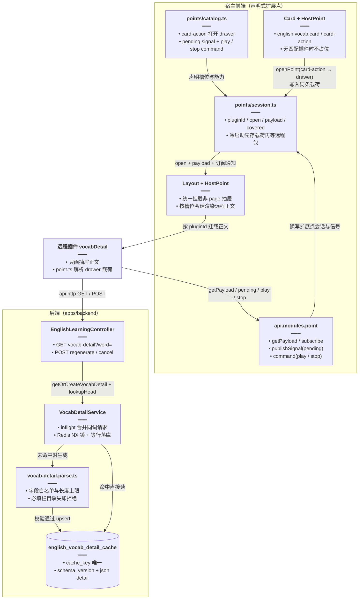
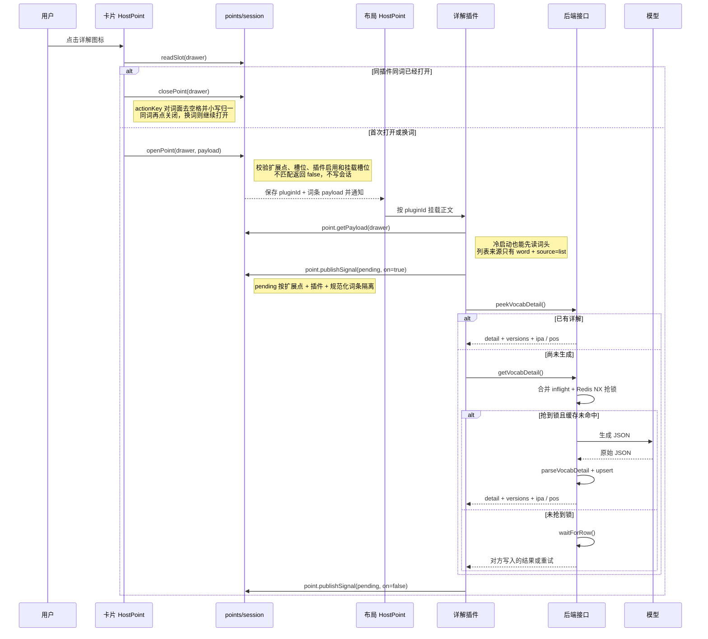
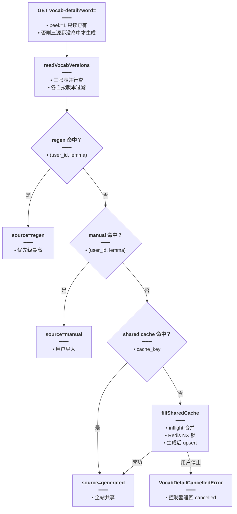

# 单词详解：多来源缓存、插件抽屉与停止生成

> **状态**：已落地 | **日期**：2026-11-13 | **功能域**：英语学习
> **需求摘要**：启用「单词详解」插件后，单词卡尾部多一枚图标；点开右侧抽屉查看词根词缀、记忆钩子、详细释义、例句、派生词、搭配与近义。详解按**重新生成 > 手动导入 > 全站缓存**三级优先；可「重新生成」覆盖缓存、可「停止生成」中断模型；同一词在调用结束前再点只复用 inflight。

> [!IMPORTANT]
> **2026-11-14 当前实现迁移**：详解宿主已从 `federation/modules/vocabDetail/session.ts`、`DetailDrawer.tsx`、`PluginActions.tsx`、`api.modules.vocabDetail` 与 `modules:vocabDetail`，迁到通用 **HostPoint + `points/catalog.ts` + `points/session.ts` + `api.modules.point` + `modules:point`**。现行宿主总览见 [学习页扩展点](./学习页扩展点.md)，通用协议见 [声明式扩展点](../plugins/声明式扩展点.md)。
>
> **本文当前定位**：§4 的三张表、缓存键、三源优先级、inflight、Redis NX、重新生成与停止生成仍是当前后端主文档。§5 中专属会话、抽屉、卡片按钮和模块桥是 **2026-11-13 前端历史基线**；通用 Drawer / Sheet 与朗读目录记录仍可结合源码参考，旧桥接代码中的“当前”不代表现行宿主。
>
> **当前用户行为**：插件未启用或槽位不匹配时，`HostPoint` 返回空、不占位，`openPoint` 返回 `false` 且不写会话。卡片 action 通过 `HostPoint` 打开 `english.vocab.card / drawer`，点击载荷先落入 `points/session.ts`，再等待远程插件下载。列表、详解与导入由声明式槽位及 `covers` / `yieldTo` 协调；`layout.page` 列表抽屉仍由词库页通过 `PluginHostSurface` 自挂。词库统计使用 `stats` signal，页面上下文按目录白名单发布；导入按钮仍只在匹配插件存在且当前库可编辑时显示。

## 延伸阅读

- 同轮姊妹稿（顶栏「单词详解」列表入口）：[单词详解列表.md](./单词详解列表.md)
- 同轮姊妹稿（手动导入 JSON 详解）：[手动导入单词详解.md](./手动导入单词详解.md)
- 插件侧实现（面板 / 版本切换 / 停止生成 / 朗读）：[单词详解插件面板.md](./单词详解插件面板.md)
- 插件注册与宿主接入：[单词详解插件接入.md](../plugins/单词详解插件接入.md)
- 业务页插件槽统一模板：[宿主插件集成指南](../plugins/宿主插件集成指南.md)
- [卡片单条重标.md](./卡片单条重标.md)：单词卡右上角标注按钮强制重跑详解，脱离 HTTP 断连，刷新靠服务端在途名单恢复停止图标

---

## 1. 背景与目标

单词卡过去只能看词面、音标、词性与一条中文释义。想了解构词、搭配、近义与例句，只能自己查词典，学习链路被打断。本轮把「详解」做成**插件 + 全局缓存**：

1. **入口只在插件启用后出现**：单词卡尾部按 `english.vocab.card` 表面的 `card-action` 槽渲染图标，未启用时不占位。
2. **抽屉由宿主统一挂载**：英语学习布局通过 `HostPoint` 挂载详解抽屉；同一插件换词只替换 `drawer` 载荷，不因换词销毁正文。
3. **详解按词全局缓存**：`cache_key = sha256(schemaVersion + 规范化词面)`，跨用户共享；未命中才调用英语学习模型生成一次 JSON。
4. **并发只生成一次**：进程内 Promise 合并同词请求，跨进程用 Redis `SET NX PX` 抢占；抢不到就等对方写库，而不是轮询模型。
5. **坏结果不入库**：解析层对必填栏目做严格校验，缺栏目直接拒绝，避免错误详解沉淀成缓存。
6. **列表打开时不带音标**：列表只有词面，音标与词性由后端从当前用户的词库 / 收藏补齐。

## 2. 改动范围与当前路径

后端行仍是当前实现索引；前端行已按 2026-11-14 的声明式扩展点更新。旧专属宿主文件只在 §5 留作历史档案。

| 层 | 路径 | 说明 |
| --- | --- | --- |
| 后端 | `apps/backend/src/services/english-learning/entity/english-vocab-detail-cache.entity.ts` | 新增缓存表实体 |
| 后端 | `apps/backend/src/services/english-learning/entity/english-vocab-detail-manual.entity.ts` | 手动详解表（用户隔离） |
| 后端 | `apps/backend/src/services/english-learning/entity/english-vocab-detail-regen.entity.ts` | 重新生成详解表（用户隔离） |
| 后端 | `apps/backend/src/migrations/1794218985993-english_vocab_detail_cache.ts` | 缓存表建表迁移 |
| 后端 | `apps/backend/src/migrations/1794398252308-english_vocab_detail_regen.ts` | manual + regen 建表 + lemma 索引迁移 |
| 后端 | `apps/backend/src/services/english-learning/vocab-detail.parse.ts` | JSON 结构与严格校验 |
| 后端 | `apps/backend/src/services/english-learning/vocab-detail-run.ts` | 生成运行器（取消、游标） |
| 后端 | `apps/backend/src/services/english-learning/vocab-detail.service.ts` | 缓存读写、锁、生成、重新生成、停止（列表分页见姊妹稿） |
| 后端 | `apps/backend/src/services/english-learning/english-learning.controller.ts` | 详解接口（列表接口见姊妹稿） |
| 后端 | `apps/backend/src/services/english-learning/english-learning.module.ts` | 实体与 Provider 注册 |
| 前端 | `apps/frontend/src/federation/host/HostPoint.tsx` | 渲染卡片 action 与非 page 抽屉；无匹配已启用插件时不占位 |
| 前端 | `apps/frontend/src/federation/points/catalog.ts` | 声明 `card-action → drawer`、`pending` signal、`play / stop` command 与抽屉关系 |
| 前端 | `apps/frontend/src/federation/points/session.ts` | 统一保存 `pluginId / open / payload / covered`，校验插件与槽位并处理冷启动载荷 |
| 前端 | `apps/frontend/src/federation/points/api.ts` | 提供 `getPayload / subscribe / publishSignal / command` 等 `api.modules.point` 能力 |
| 前端 | `apps/frontend/src/federation/points/commands.ts` | 注册 `openCard / pickJsonFile` 等目录允许的宿主命令 |
| 前端 | `apps/frontend/src/views/englishLearning/components/vocab/Card.tsx` | 向 `HostPoint` 传入当前词条载荷 |
| 前端 | `apps/frontend/src/views/englishLearning/Layout.tsx` | 挂载非 page 扩展点抽屉，离开英语学习时统一关闭 |
| 前端 | `apps/frontend/src/federation/runtime/index.ts` | 在 `modules:point` 权限与 `host.surface` 匹配时注入扩展点 API |
| 前端 | `apps/frontend/src/federation/host/PluginHostSurface.tsx` | 承载词库页面自挂的 `layout.page` 列表抽屉，与详解槽位协调 |
| 前端 | `apps/frontend/src/components/design/Drawer/index.tsx` | 标题区内边距对齐 |
| 前端 | `apps/frontend/src/views/englishLearning/utils/ttsCacheFolder.ts` | 朗读缓存目录 |

## 3. 实现思路

### 3.1 当前总体结构（2026-11-14）



### 3.2 当前一次点开的时序



### 3.3 关键决策与权衡

| 决策 | 备选 | 为什么选它 |
| --- | --- | --- |
| 详解按词条**全局**缓存（无 `user_id`） | 按用户缓存 | 详解内容与用户无关，按用户会放大模型成本与表体积 |
| 缓存键含 `schema_version` | 只按词面缓存 | 栏目或提示词调整时改版本号即可整体失效，旧行由 `purgeStale` 清掉 |
| 同词并发用 inflight + Redis NX | 直接并发调模型 | 避免同一词被多个进程/多次点击重复计费 |
| 抢不到锁时**等行落库** | 直接返回错误或自己再生成 | 模型一次要几十秒，等待比重复生成更省也更快 |
| 坏 JSON **不入库** | 宽松补默认值 | 错误详解一旦入库会被长期命中，宁可在界面上给重试 |
| 抽屉会话统一放进 `points/session.ts` | 为详解维护专属单例 | `pluginId / open / payload / covered` 可复用到列表和导入，并统一处理覆盖、让位与恢复 |
| 卡片 action 与布局抽屉使用 `HostPoint` | 专属 `PluginActions + DetailDrawer` | 目录声明插件、槽位和打开关系；无匹配插件自然不占位，冷启动载荷也不会丢失 |
| 加载态使用 `pending` signal | 专属 `setPending` 桥方法 | 按扩展点、插件和规范化词条隔离，列表、工具栏可复用同一套信号订阅 |
| 朗读使用目录允许的 `play / stop` command | 把宿主播放函数直接塞进专属模块 | command 白名单限制插件可调能力，Remote 只依赖统一 `PointModule` |

## 4. 后端实现

### 4.1 缓存表实体 `EnglishVocabDetailCache`

**来源**：`apps/backend/src/services/english-learning/entity/english-vocab-detail-cache.entity.ts`（**新增**，约 L1–L40）

```typescript
// 从 typeorm 取列装饰器与实体装饰器，声明「一张表」所需的元数据
import {
	// 普通列：cache_key / schema_version / lemma / detail
	Column,
	// 创建时间列，落库时自动写入
	CreateDateColumn,
	// 实体装饰器，把类映射到具体表名
	Entity,
	// 索引装饰器，声明唯一键与列表分页联合索引
	Index,
	// 自增/UUID 主键列
	PrimaryGeneratedColumn,
	// 更新时间列，更新时自动刷新
	UpdateDateColumn,
// 结束 typeorm 导入，避免遗漏任一装饰器导致建表失败
} from 'typeorm';
// 只导入类型：这里声明 json 列的 TS 形状，不引入运行时依赖
import type { VocabDetail } from '../vocab-detail.parse';

/**
 * 单词详解全局缓存（跨用户共享）。
 * cache_key = sha256(schemaVersion + 规范化词面)。
 */
// 映射到 english_vocab_detail_cache 表；全局共享，因此不建 user_id 列
@Entity('english_vocab_detail_cache')
// cache_key 唯一索引：同词同版本只允许一行，配合 upsert 实现幂等写入
@Index('UQ_evdc_cache_key', ['cacheKey'], { unique: true })
// (updated_at, id) 联合索引：支撑列表页按时间倒序的游标分页，避免全表排序
@Index('IDX_evdc_updated_id', ['updatedAt', 'id'])
// 导出实体类，供 TypeOrmModule.forFeature 与 Repository 注入使用
export class EnglishVocabDetailCache {
	// UUID 主键：游标分页需要稳定顺序，UUID 比自增更利于分库迁移
	@PrimaryGeneratedColumn('uuid')
	// 主键字段，插入后由数据库回填
	id!: string;

	// 缓存键列固定 64 位，正好容纳 sha256 十六进制串
	@Column({ name: 'cache_key', type: 'varchar', length: 64 })
	// 业务侧计算的哈希，命中判断只看这一列
	cacheKey!: string;

	// 结构版本列，改栏目或提示词时升版本，旧行不再命中
	@Column({ name: 'schema_version', type: 'varchar', length: 16 })
	// 与 VOCAB_DETAIL_CACHE_VERSION 对齐
	schemaVersion!: string;

	/** 规范化词面，只用于排查，不作为面板标题 */
	// 词面列上限 120，与接口入参长度校验保持一致
	@Column({ type: 'varchar', length: 120 })
	// 小写、压空格的词面，便于人工排查缓存行
	lemma!: string;

	// json 列直接存解析后的结构化详解，避免再拆多张子表
	@Column({ type: 'json' })
	// 类型复用解析层导出的 VocabDetail，保证读写形状一致
	detail!: VocabDetail;

	// 创建时间由数据库默认值写入，业务无需关心
	@CreateDateColumn({ name: 'created_at', type: 'timestamp' })
	// 落库时间
	createdAt!: Date;

	// 更新时间在每次更新时自动刷新，列表排序依赖它
	@UpdateDateColumn({ name: 'updated_at', type: 'timestamp' })
	// 最近一次写入时间
	updatedAt!: Date;
}
```

### 4.2 建表迁移

**来源**：`apps/backend/src/migrations/1794218985993-english_vocab_detail_cache.ts`（**新增**，约 L1–L17）

```typescript
// 迁移接口与查询器类型：TypeORM 迁移的固定契约
import { MigrationInterface, QueryRunner } from "typeorm";

// 类名带时间戳后缀，TypeORM 以此排序迁移执行顺序
export class EnglishVocabDetailCache1794218985993 implements MigrationInterface {
	// 显式声明迁移名，避免压缩构建后类名变化导致记录对不上
	name = 'EnglishVocabDetailCache1794218985993'

	// up：正向迁移，建表并补唯一键
	public async up(queryRunner: QueryRunner): Promise<void> {
		// 建缓存表：json 列存详解、唯一索引保证同词同版本只有一行
		await queryRunner.query(`CREATE TABLE \`english_vocab_detail_cache\` (\`id\` varchar(36) NOT NULL, \`cache_key\` varchar(64) NOT NULL, \`schema_version\` varchar(16) NOT NULL, \`lemma\` varchar(120) NOT NULL, \`detail\` json NOT NULL, \`created_at\` timestamp(6) NOT NULL DEFAULT CURRENT_TIMESTAMP(6), \`updated_at\` timestamp(6) NOT NULL DEFAULT CURRENT_TIMESTAMP(6) ON UPDATE CURRENT_TIMESTAMP(6), UNIQUE INDEX \`UQ_evdc_cache_key\` (\`cache_key\`), PRIMARY KEY (\`id\`)) ENGINE=InnoDB`);
		// 同轮生成的「实体漂移」顺带清理：该列在实体中已不存在，留着会让后续 migration 反复提示
		await queryRunner.query(`ALTER TABLE \`english_agent_session_summaries\` DROP COLUMN \`covers_before_message_id\``);
	// 结束 up
	}

	// down：回滚，先补回漂移列再删表，保证回滚后可再次 up
	public async down(queryRunner: QueryRunner): Promise<void> {
		// 把漂移列按原定义加回，避免回滚后与旧代码不一致
		await queryRunner.query(`ALTER TABLE \`english_agent_session_summaries\` ADD \`covers_before_message_id\` varchar(36) NULL`);
		// 先删唯一索引，部分 MySQL 版本删表前要求索引名显式移除
		await queryRunner.query(`DROP INDEX \`UQ_evdc_cache_key\` ON \`english_vocab_detail_cache\``);
		// 最后删表
		await queryRunner.query(`DROP TABLE \`english_vocab_detail_cache\``);
	// 结束 down
	}

// 结束迁移类
}
```

> 另有一个空的 `1794218961164-english_vocab_detail_cache.ts`（`up` / `down` 为空），是生成迁移时的占位，可忽略；真正建表的是 `1794218985993`。列表分页所需的 `(updated_at, id)` 联合索引迁移属于列表功能，详见 [单词详解列表.md](./单词详解列表.md)。

### 4.3 JSON 结构与严格校验

#### 4.3.1 版本号、类型与词面规范化

**来源**：`apps/backend/src/services/english-learning/vocab-detail.parse.ts`（**新增**，约 L1–L30）

```typescript
/** 详解缓存版本。栏目或提示词约定变化时改这里，旧行不再命中。 */
// 版本号参与 cache_key 计算，升版本等于整体失效，无需手工清表
export const VOCAB_DETAIL_CACHE_VERSION = 'v1';

// 一段构词成分：词形、类型、中文含义
export type VocabDetailPart = {
	// 该段的字面，如 tele / phone / -er
	form: string;
	// 四类之一，避免模型自由发挥
	kind: 'prefix' | 'root' | 'suffix' | 'base';
	// 该段的中文含义
	meaningZh: string;
};

// 详解总结构：面板按这 8 个栏目分区渲染
export type VocabDetail = {
	// 规范化后的词面，作为面板标题的兜底
	lemma: string;
	// 构词信息：拆分片段 + 中文构词说明
	morphology: {
		// 1~8 段
		parts: VocabDetailPart[];
		// 一两句中文构词说明，可为空串
		storyZh: string;
	};
	// 记忆钩子：必须有，面板至少给出一个记忆点
	memory: { hookZh: string };
	// 释义列表：词性 + 中文释义 + 语域/差别
	senses: { pos: string; glossZh: string; nuanceZh: string }[];
	// 例句：英文 + 中文，成对出现
	examples: { en: string; zh: string }[];
	// 派生词族
	family: { word: string; pos: string; glossZh: string }[];
	// 常见搭配
	collocations: { phrase: string; glossZh: string }[];
	// 近义词
	synonyms: { word: string; pos: string; glossZh: string }[];
	// 考试 / 难度标签
	tags: string[];
};

// 合法的构词类型集合，用 Set 做 O(1) 白名单校验
const KINDS = new Set(['prefix', 'root', 'suffix', 'base']);

/** 去空白、合并空格、转小写。超过 120 的原文由调用方拒绝，这里不再截成假词。 */
export function normalizeVocabLemma(word: string): string {
	// 先 trim 去掉首尾空白，再把内部连续空白压成一个空格，最后统一小写，保证「Apple」与「apple」命中同一行
	return word.trim().replace(/\s+/g, ' ').toLowerCase();
}
```

#### 4.3.2 取值辅助函数

**来源**：`apps/backend/src/services/english-learning/vocab-detail.parse.ts`（**新增**，约 L32–L55）

```typescript
// 把 unknown 收窄成普通对象；数组与 null 都视为非法
function asRecord(value: unknown): Record<string, unknown> | null {
	// 非对象、null 或数组直接拒绝，避免后续属性访问踩空
	if (!value || typeof value !== 'object' || Array.isArray(value)) return null;
	// 断言为键值对象，交给调用方按栏目取值
	return value as Record<string, unknown>;
}

// 数组兜底：模型偶尔返回 null/字符串，这里统一成空数组
function asList(value: unknown): unknown[] {
	// 是数组就原样返回，否则给空数组让上层自然跳过
	return Array.isArray(value) ? value : [];
}

// 取一段文本：仅接受字符串，去空白并按上限截断
function asText(value: unknown, max = 500): string | null {
	// 非字符串一律当缺失，避免数字/对象混入面板
	if (typeof value !== 'string') return null;
	// 去首尾空白后截断，防止超长文本把卡片撑爆
	const text = value.trim().slice(0, max);
	// 空串当缺失，便于统一用 null 判断必填
	return text || null;
}

// 通用「逐条解析 + 限条数」：parse 返回 null 表示该条非法，直接跳过
function take<T>(value: unknown, parse: (item: unknown) => T | null, limit: number): T[] {
	// 收集合法行
	const rows: T[] = [];
	// 遍历原始数组；非数组时 asList 已返回空数组
	for (const item of asList(value)) {
		// 单条解析，非法行返回 null
		const row = parse(item);
		// 非法行跳过，不阻断整份详解
		if (row === null) continue;
		// 合法行入列
		rows.push(row);
		// 达到上限立即停止，控制面板体积与入库大小
		if (rows.length === limit) break;
	}
	// 返回收集结果
	return rows;
}
```

#### 4.3.3 各栏目解析器与主入口

**来源**：`apps/backend/src/services/english-learning/vocab-detail.parse.ts`（**新增**，约 L57–L138）

```typescript
// 解析一段构词成分：三字段都必填，kind 必须在白名单内
function parsePart(value: unknown): VocabDetailPart | null {
	// 先收窄成对象，非对象直接判非法
	const row = asRecord(value);
	// 空对象或非对象时返回 null
	if (!row) return null;
	// 词形限 80 字，防止模型把整句塞进 form
	const form = asText(row.form, 80);
	// 中文含义沿用默认 500 字上限
	const meaningZh = asText(row.meaningZh);
	// kind 先按字符串取出，非字符串给空串以便走白名单判断
	const kind = typeof row.kind === 'string' ? row.kind : '';
	// 任一必填缺失或 kind 非法，整段作废
	if (!form || !meaningZh || !KINDS.has(kind)) return null;
	// 组装成强类型片段，kind 已通过白名单校验
	return { form, kind: kind as VocabDetailPart['kind'], meaningZh };
}

// 解析一条释义：词性限 32 字，释义必填，差别可为空
function parseSense(
	// 单条释义的原始值，先当 unknown 再收窄
	value: unknown,
// 合法返回强类型释义，非法返回 null 由 take 跳过
): VocabDetail['senses'][number] | null {
	// 收窄成对象
	const row = asRecord(value);
	// 非对象直接作废
	if (!row) return null;
	// 词性缩写（n / v / adj）限 32 字
	const pos = asText(row.pos, 32);
	// 中文释义必填
	const glossZh = asText(row.glossZh);
	// 词性或释义缺失则不展示该条
	if (!pos || !glossZh) return null;
	// nuanceZh 允许为空串，面板按空串隐藏对应行
	return { pos, glossZh, nuanceZh: asText(row.nuanceZh) ?? '' };
}

// 解析一条例句：中英必须成对，缺一不可
function parseExample(
	// 单条例句的原始值，先当 unknown 再收窄
	value: unknown,
// 中英成对才返回，否则 null
): VocabDetail['examples'][number] | null {
	// 收窄成对象
	const row = asRecord(value);
	// 非对象直接作废
	if (!row) return null;
	// 英文原句
	const en = asText(row.en);
	// 中文译文
	const zh = asText(row.zh);
	// 只有一半的例句不展示，避免中英错位
	if (!en || !zh) return null;
	// 返回成对例句
	return { en, zh };
}

// 解析派生词 / 近义词共用的三字段结构
function parseFamily(
	// 派生词 / 近义词单行的原始值
	value: unknown,
// 三字段齐全才返回，否则 null
): VocabDetail['family'][number] | null {
	// 收窄成对象
	const row = asRecord(value);
	// 非对象直接作废
	if (!row) return null;
	// 词形限 80 字
	const word = asText(row.word, 80);
	// 词性限 32 字
	const pos = asText(row.pos, 32);
	// 中文释义
	const glossZh = asText(row.glossZh);
	// 三字段缺一即作废，避免出现只有词形没有释义的行
	if (!word || !pos || !glossZh) return null;
	// 返回合法行
	return { word, pos, glossZh };
}

// 解析一条搭配：短语限 120 字，释义必填
function parseCollocation(
	// 搭配单行的原始值
	value: unknown,
// 短语与释义齐全才返回，否则 null
): VocabDetail['collocations'][number] | null {
	// 收窄成对象
	const row = asRecord(value);
	// 非对象直接作废
	if (!row) return null;
	// 搭配短语限 120 字，避免整句混入
	const phrase = asText(row.phrase, 120);
	// 中文释义必填
	const glossZh = asText(row.glossZh);
	// 缺一即作废
	if (!phrase || !glossZh) return null;
	// 返回合法搭配
	return { phrase, glossZh };
}

/** 必填栏目缺失返回 null，调用方不得入库。 */
export function parseVocabDetail(raw: unknown, lemma: string): VocabDetail | null {
	// 整份 JSON 必须是对象，字符串/数组直接拒绝
	const body = asRecord(raw);
	// 非法外壳返回 null，服务层据此抛 502
	if (!body) return null;
	// 取构词栏目对象
	const morphology = asRecord(body.morphology);
	// 片段最多 8 段，0 段视为缺失
	const parts = take(morphology?.parts, parsePart, 8);
	// 没有构词片段就没有详解主体，拒绝入库
	if (parts.length === 0) return null;
	// 取记忆栏目对象
	const memory = asRecord(body.memory);
	// 记忆钩子是必填项
	const hookZh = asText(memory?.hookZh);
	// 缺失记忆钩子则拒绝，避免留着空栏目
	if (!hookZh) return null;
	// 释义最多 6 条，0 条视为无效
	const senses = take(body.senses, parseSense, 6);
	// 没有释义的面板没有价值，拒绝
	if (senses.length === 0) return null;
	// 例句最多 4 条
	const examples = take(body.examples, parseExample, 4);
	// 至少要有一条完整例句
	if (examples.length === 0) return null;
	// 组装最终结构：可选栏目允许为空数组，必填栏目已在上面校验
	return {
		// 写回规范化词面，保证缓存行与查询键一致
		lemma,
		// 构词说明允许空串，便于面板隐藏该段
		morphology: { parts, storyZh: asText(morphology?.storyZh) ?? '' },
		// 记忆钩子已校验非空
		memory: { hookZh },
		// 释义列表
		senses,
		// 例句列表
		examples,
		// 派生词最多 6 条，可为空
		family: take(body.family, parseFamily, 6),
		// 搭配最多 6 条，可为空
		collocations: take(body.collocations, parseCollocation, 6),
		// 近义复用 parseFamily 的三字段结构，最多 6 条
		synonyms: take(body.synonyms, parseFamily, 6),
		// 标签只收字符串且限 32 字，最多 4 个
		tags: take(body.tags, (tag) => asText(tag, 32), 4),
	// 结束返回结构
	};
}
```

### 4.4 服务层 `VocabDetailService`

#### 4.4.1 常量、类型与构造函数

**来源**：`apps/backend/src/services/english-learning/vocab-detail.service.ts`（**改动后**，约 L1–L213）

```typescript
// 生成缓存键用 sha256，生成锁 token 用 randomUUID
import { createHash, randomUUID } from 'node:crypto';
// LangChain 消息类型：system 给任务约束，human 给词面
import { HumanMessage, SystemMessage } from '@langchain/core/messages';
// 取全局缓存实例的注入令牌，用于拿 Redis 客户端做锁与列表缓存
import { CACHE_MANAGER } from '@nestjs/cache-manager';
import {
	// 上游模型失败统一 502
	BadGatewayException,
	// 入参非法统一 400
	BadRequestException,
	// 访客越权读别人的词库统一 403
	ForbiddenException,
	// 依赖注入令牌装饰器
	Inject,
	// 可注入类装饰器
	Injectable,
	// 日志器
	Logger,
	// 词库不存在统一 404
	NotFoundException,
} from '@nestjs/common';
// 读取环境变量（模型覆盖等）
import { ConfigService } from '@nestjs/config';
// TypeORM 仓库注入
import { InjectRepository } from '@nestjs/typeorm';
// cache-manager 的 Cache 类型，用于访问底层 store
import type { Cache } from 'cache-manager';
// 统一的模型工厂：按 englishLearning 预设取凭证与模型名
import { createLlm } from 'src/utils/create-llm';
// In 用于按 id 集合查词库，Not 用于「不等于当前版本」的批量清理
import { In, Not, Repository } from 'typeorm';
// 用户级模型配置：会员走硅基、非会员走智谱
import { LlmConfigService } from '../llm-config/llm-config.service';
// 全站缓存表实体：所有用户共享一份生成结果
import { EnglishVocabDetailCache } from './entity/english-vocab-detail-cache.entity';
// 手动导入表实体：按 (userId, lemma) 用户隔离
import { EnglishVocabDetailManual } from './entity/english-vocab-detail-manual.entity';
// 重新生成表实体：按 (userId, lemma) 用户隔离
import { EnglishVocabDetailRegen } from './entity/english-vocab-detail-regen.entity';
// 词库表：列表先校验词库是否属于当前用户
import { EnglishVocabularyLibrary } from './entity/english-vocabulary-library.entity';
// 收藏表：打开详解时补音标 / 词性
import { EnglishVocabularyFavorite } from './entity/english-vocabulary-favorite.entity';
// 词库词条表：列表从这里取词面，同时补音标 / 词性
import { EnglishVocabularyLibraryItem } from './entity/english-vocabulary-library-item.entity';
import {
	// 词面规范化：trim、压缩空白、转小写
	normalizeVocabLemma,
	// JSON 严格校验：模型输出与导入内容都走同一套
	parseVocabDetail,
	// 缓存版本，参与键计算与漂移清理
	VOCAB_DETAIL_CACHE_VERSION,
	// 详解结构类型
	type VocabDetail,
} from './vocab-detail.parse';
// 列表缓存 TTL：与资源库列表缓存共用同一份配置
import { EL_LIB_LIST_TTL_MS } from './english-learning-library.cache';
import {
	// 生成运行器：AbortController + 早到停止标记
	createVocabRuns,
	// 判断错误是否为「用户主动停止」
	isVocabAbort,
	// 列表游标分隔符 updatedAt|lemma
	LIST_CURSOR_SEP,
	// 列表每页条数，固定 50
	LIST_PAGE_SIZE,
	// 三源合并：一个词面只留一行
	mergeLibraryDetailHits,
	// 无 Redis 时在内存里切页
	pageMergedDetails,
	// 游标解析
	parseListCursor,
	// 三源优先级：regen > manual > generated
	pickVocabOpen,
	// 用户停止生成时抛出的错误类型
	VocabDetailCancelledError,
	// 游标类型
	type ListCursor,
	// 单条命中
	type ListHit,
	// 合并后的一行
	type MergedRow,
	// 来源类型
	type VocabOpenSource,
} from './vocab-detail-run';

// 模型任务提示词：把栏目、条数上限与「不许编」写死在 system，减少后处理压力
const VOCAB_DETAIL_TASK = `你是英语单词详解助手。只输出一个 JSON 对象，不要 Markdown。
字段：
- morphology.parts：1 到 8 段。每段 form、kind（只能是 prefix、root、suffix、base）、meaningZh。拆不开时只给一段 kind 为 base 的整词，不要编造前后缀。
- morphology.storyZh：一两句中文构词说明，可以是空字符串。
- memory.hookZh：一句中文记忆，必须有。
- senses：1 到 6 条。每条 pos、glossZh、nuanceZh（没有差别就用空字符串）。释义要写清词性和场合，不要只给一个词。
- examples：1 到 4 条。每条 en 和 zh 都要有。
- family：派生词，可空数组。每条 word、pos、glossZh。最多 6 条。
- collocations：常见搭配，可空数组。每条 phrase、glossZh。最多 6 条。
- synonyms：近义，可空数组。每条 word、pos、glossZh。最多 6 条。
- tags：考试或难度短标签，可空数组，最多 4 个。不确定就给空数组。`;

/** 同进程后来的请求直接等这一次，不必轮询。 */
// 键是 cacheKey；同进程并发点同一词时只发起一次模型调用
const vocabDetailInflight = new Map<string, Promise<VocabDetail>>();
/** 重新生成按用户分开，不加入可能返回缓存的全站在途。 */
// 键是 userId|lemma；用户主动重新生成不能被别人的全站缓存结果顶掉
const vocabDetailRegenInflight = new Map<string, Promise<VocabDetail>>();
/** 这一轮模型调用的 AbortSignal。停止时 abort，OpenAI 客户端会断开上游 HTTP。 */
// 模块级单例：同一个进程内所有请求共享同一份 run 表
const vocabRuns = createVocabRuns();
// 停止标记保留 60 秒，覆盖「停止先到、arm 后到」的窗口
const CANCEL_MARK_MS = 60_000;
// 轮询停止标记的间隔，兼顾响应速度与 Redis 压力
const CANCEL_MARK_POLL_MS = 300;
/** 调用中不解锁，结束才在 finally 里删。过期只留给进程崩溃；须长于 OpenAI 客户端默认 10 分钟。 */
// 锁 TTL 取 11 分钟，比客户端 10 分钟超时更长，避免两轮生成重叠
const VOCAB_DETAIL_LOCK_MS = 11 * 60 * 1000;
// 等行落库的轮询间隔，400ms 兼顾库压力与体感
const VOCAB_DETAIL_LOCK_POLL_MS = 400;
// 释放锁用 Lua 保证「比较 token 再删」原子执行，避免误删别人的锁
const UNLOCK_SCRIPT = `if redis.call("get", KEYS[1]) == ARGV[1] then return redis.call("del", KEYS[1]) else return 0 end`;

// 列表行：词面、摘要、时间、来源。来源用于前端显示「导入 / 新生成」标记
export type VocabDetailListItem = {
	// 词面
	lemma: string;
	// 第一条释义，作为列表摘要
	glossZh: string;
	// 胜出份的更新时间，列表按它倒序
	updatedAt: string;
	// 这一行来自哪一份：regen / manual / generated
	source: VocabOpenSource;
};

// 列表分页返回体
export type VocabDetailListPage = {
	// 当前页行
	items: VocabDetailListItem[];
	// 下一页游标，null 表示没有更多
	nextCursor: string | null;
	// 全量条数，用于顶栏统计
	total: number;
};

// 手动导入列表的一行
export type ImportedWord = {
	// 词面
	lemma: string;
	// 摘要
	glossZh: string;
	// 导入时间
	updatedAt: string;
};

// 手动导入列表分页体
export type ImportedWordPage = {
	// 当前页
	items: ImportedWord[];
	// 下一页游标
	nextCursor: string | null;
	// 总条数
	total: number;
};

// 同一个词的三份详解，前端据此显示版本切换
export type VocabVersions = {
	// 手动导入
	manual: VocabDetail | null;
	// 全站缓存
	generated: VocabDetail | null;
	// 用户重新生成
	regen: VocabDetail | null;
};

// 打开详解的返回体：胜出份 + 三份快照
export type VocabDetailOpen = {
	// 胜出份
	detail: VocabDetail;
	// 胜出份来源
	source: VocabOpenSource;
	// 三份原始版本
	versions: VocabVersions;
};

// 已导入列表每页条数
const IMPORT_PAGE = 50;

/** 已导入列表自己的游标。字母与解析列表相同，但不走那套 Redis。 */
function parseImportCursor(cursor: string): { updatedAt: number; lemma: string } {
	// 找分隔符，必须在中间
	const sep = cursor.indexOf(LIST_CURSOR_SEP);
	// 分隔符缺失或位于开头都判非法
	if (sep <= 0) throw new BadRequestException('cursor');
	// 前半段是 ISO 时间
	const updatedAt = new Date(cursor.slice(0, sep)).getTime();
	// 后半段是词面
	const lemma = cursor.slice(sep + 1);
	// 时间不可解析或词面为空都判非法
	if (Number.isNaN(updatedAt) || !lemma) throw new BadRequestException('cursor');
	// 返回解析结果
	return { updatedAt, lemma };
}

// 把外部游标转成内部类型；格式错误统一 400
function readListCursor(cursor?: string): ListCursor | null {
	// 空游标表示第一页
	if (!cursor) return null;
	try {
		// 复用解析器的严格校验
		return parseListCursor(cursor);
	} catch {
		// 解析器抛 Error，这里翻译成 400
		throw new BadRequestException('cursor');
	}
}

// 锁持有结果：Redis 抢到 / 没有 Redis 退化为本地串行 / 被别人占用
type LockHold = 'redis' | 'local' | 'busy';

// Redis 客户端的最小接口，避免把 ioredis 类型铺进业务
type RedisLockClient = {
	// SET key value NX PX：抢锁，成功返回 'OK'
	set: (
		key: string,
		value: string,
		options?: { NX?: true; PX?: number },
	) => Promise<string | null>;
	// GET：判断锁是否还在
	get: (key: string) => Promise<string | null>;
	// DEL：删除列表就绪标记、单条游标行等
	del: (key: string | string[]) => Promise<number>;
	// INCR：全局 epoch 自增
	incr: (key: string) => Promise<number>;
	// PEXPIRE：刷新列表缓存 TTL
	pExpire: (key: string, ms: number) => Promise<number>;
	// EVAL：执行解锁 Lua 脚本
	eval: (
		script: string,
		options: { keys: string[]; arguments: string[] },
	) => Promise<unknown>;
	// ZADD：列表有序集合，score 取 updatedAt
	zAdd: (
		key: string,
		member:
			| { score: number; value: string }
			| { score: number; value: string }[],
	) => Promise<number>;
	// ZREM：删单个词面
	zRem: (key: string, member: string) => Promise<number>;
	// ZCARD：列表总条数
	zCard: (key: string) => Promise<number>;
	// ZRANGE BY SCORE REV LIMIT：按时间倒序切页
	zRange: (
		key: string,
		min: string | number,
		max: string | number,
		options?: {
			BY: 'SCORE';
			REV: true;
			LIMIT?: { offset: number; count: number };
		},
	) => Promise<string[]>;
	// HSET：摘要哈希，field 为词面
	hSet: (
		key: string,
		field: string | Record<string, string>,
		value?: string,
	) => Promise<number>;
	// HDEL：删摘要
	hDel: (key: string, field: string) => Promise<number>;
	// HMGET：一次取一页摘要，减少往返
	hmGet: (key: string, fields: string[]) => Promise<(string | null)[]>;
	// SADD：记录正在看该词库的用户
	sAdd: (key: string, member: string) => Promise<number>;
	// SMEMBERS：遍历观看者，逐个补丁
	sMembers: (key: string) => Promise<string[]>;
};

// 全局列表代际：任何会改变合并结果的写操作都自增，旧缓存整体作废
const LIST_EPOCH_KEY = 'el:vocabDetail:epoch';

// 有序集合键：用户 + 词库，score 为 updatedAt
function listZsetKey(userId: number, libraryId: string): string {
	return `el:vocabDetailList:z:u:${userId}:lib:${libraryId}`;
}
// 摘要哈希键：field 是词面，value 是列表行 JSON
function listHashKey(userId: number, libraryId: string): string {
	return `el:vocabDetailList:h:u:${userId}:lib:${libraryId}`;
}
// 就绪标记键：值等于当前 epoch 才可直接翻页
function listReadyKey(userId: number, libraryId: string): string {
	return `el:vocabDetailList:ready:u:${userId}:lib:${libraryId}`;
}
// 观看者集合：词库有新详解时，只补丁正在看的人
function listViewersKey(libraryId: string): string {
	return `el:vocabDetailList:viewers:${libraryId}`;
}

@Injectable()
// 单词详解服务：缓存读写、并发锁、模型生成、三源优先级、列表分页
export class VocabDetailService {
	// 该服务自己的日志前缀，便于过滤
	private readonly logger = new Logger(VocabDetailService.name);
	// 版本漂移清理只需每个进程做一次
	private stalePurged = false;
	/** ponytail: 同进程合并冷启动。多实例仍可能各算一遍，结果相同；成为负担再加 Redis 锁。 */
	// 列表冷启动构建的在途 Promise，避免同词库并发重建
	private listBuilds = new Map<string, Promise<MergedRow[]>>();

	// 构造函数注入：环境变量、用户模型配置、缓存、五张表仓库
	constructor(
		// 读取模型覆盖等环境变量
		private readonly configService: ConfigService,
		// 解析会员 / 非会员的模型凭证
		private readonly llmConfigService: LlmConfigService,
		// 全局缓存，用于取 Redis 客户端
		@Inject(CACHE_MANAGER) private readonly cache: Cache,
		// 详解缓存表
		@InjectRepository(EnglishVocabDetailCache)
		private readonly repo: Repository<EnglishVocabDetailCache>,
		// 资源库词条，列表取词面并补音标 / 词性
		@InjectRepository(EnglishVocabularyLibraryItem)
		private readonly libraryItems: Repository<EnglishVocabularyLibraryItem>,
		// 收藏表，作为音标 / 词性的兜底来源
		@InjectRepository(EnglishVocabularyFavorite)
		private readonly favorites: Repository<EnglishVocabularyFavorite>,
		// 手动导入表，按用户隔离
		@InjectRepository(EnglishVocabDetailManual)
		private readonly manualRepo: Repository<EnglishVocabDetailManual>,
		// 重新生成表，按用户隔离
		@InjectRepository(EnglishVocabDetailRegen)
		private readonly regenRepo: Repository<EnglishVocabDetailRegen>,
		// 词库表，列表前校验归属
		@InjectRepository(EnglishVocabularyLibrary)
		private readonly libraries: Repository<EnglishVocabularyLibrary>,
	) {}
```

> 上面是文件头、常量、对外类型、Redis 键函数与构造函数的完整摘录。本轮相比上一版新增了 `vocabDetailRegenInflight`、`vocabRuns`、`CANCEL_MARK_*`、`ImportedWord*`、`VocabVersions`、`VocabDetailOpen`、`IMPORT_PAGE`、`parseImportCursor`、列表缓存键函数与三个新仓库；`VocabDetailListItem` 多了 `source`。其余成员方法在 4.4.2–4.4.8 与 4.7 分块给出。

#### 4.4.2 入口 `peekVocabDetail` / `openVocabDetail`

**来源**：`apps/backend/src/services/english-learning/vocab-detail.service.ts`（**改动后**，约 L215–L239）

原入口 `getOrCreateVocabDetail` 只查全站缓存；本轮拆成「只读探测」和「打开」两步，三源优先级统一由 `pickVocabOpen` 决定。

```typescript
	/** 只读已有详解，不触发生成。没有则 null。 */
	async peekVocabDetail(
		word: string,
		userId: number,
	): Promise<VocabDetailOpen | null> {
		// 规范化词面：trim、压缩空白、转小写，三张表同一口径
		const lemma = normalizeVocabLemma(word);
		// 空词直接 400，不进入查表流程
		if (!lemma) throw new BadRequestException('单词为空');
		// 超长原文拒绝：既防注入，也避免拿被截断的假词去查
		if (word.trim().length > 120) throw new BadRequestException('单词过长');
		// 三张表并行取该用户该词的所有版本
		const versions = await this.readVocabVersions(userId, lemma);
		// 按 regen > manual > generated 选胜出份
		const picked = pickVocabOpen(versions);
		// 一份都没有返回 null，由调用方决定是否生成
		return picked ? { ...picked, versions } : null;
	}

	/** 打开详解。顺序：重新生成、手动导入、全站缓存；三份都没有才生成进缓存。 */
	async openVocabDetail(word: string, userId: number): Promise<VocabDetailOpen> {
		// 先只读探测：命中三源任一都不打模型
		const peeked = await this.peekVocabDetail(word, userId);
		// 命中直接返回，不再生成
		if (peeked) return peeked;
		// 三源都没有，规范化词面
		const lemma = normalizeVocabLemma(word);
		// 生成一次并写入全站缓存（同词并发由 inflight + Redis 锁合并）
		const detail = await this.fillSharedCache(lemma, userId);
		// 返回生成结果，来源标记为 generated，另两份为空
		return {
			detail,
			source: 'generated',
			versions: { manual: null, generated: detail, regen: null },
		};
	}
```

#### 4.4.3 补齐词头 `lookupHead`

**来源**：`apps/backend/src/services/english-learning/vocab-detail.service.ts`（**改动后**，约 L296–L320）

```typescript
	/** 列表打开时快照没有音标和词性，从当前用户的词库或收藏补上。 */
	async lookupHead(
		// 当前用户，保证只从自己的数据里补
		userId: number,
		// 词面
		word: string,
	// 返回音标与词性，缺失时给空串
	): Promise<{ ipa: string; pos: string }> {
		// 规范化词面，与缓存键同一口径
		const lemma = normalizeVocabLemma(word);
		// 空词不查库，直接返回空
		if (!lemma) return { ipa: '', pos: '' };
		// 两张表并行查，减少一次往返
		const [library, favorite] = await Promise.all([
			// 资源库词条：按用户 + 小写去空格词面匹配
			this.libraryItems
				.createQueryBuilder('item')
				// 只取音标列，减少传输
				.select('item.ipa', 'ipa')
				// 追加词性列
				.addSelect('item.pos', 'pos')
				// 限定当前用户
				.where('item.userId = :userId', { userId })
				// 库内词面同样做大小写与空白归一
				.andWhere('LOWER(TRIM(item.word)) = :lemma', { lemma })
				// 只要一条，命中即够
				.limit(1)
				// 取原始行，便于直接读别名
				.getRawOne<{ ipa: string | null; pos: string | null }>(),
			// 收藏表：用 wordKey 精确匹配
			this.favorites.findOne({
				// 用户与词键双重条件
				where: { userId, wordKey: word.trim().toLowerCase() },
				// 只取必要列
				select: { id: true, ipa: true, pos: true },
			}),
		]);
		// 词库优先，其次收藏，最后空串；trim 防止脏数据带空格
		return {
			ipa: library?.ipa?.trim() || favorite?.ipa?.trim() || '',
			pos: library?.pos?.trim() || favorite?.pos?.trim() || '',
		};
	}
```

#### 4.4.4 抢锁与跟随 `leadOrFollow`

**来源**：`apps/backend/src/services/english-learning/vocab-detail.service.ts`（**改动后**，约 L322–L350）

```typescript
	/** Redis NX：别的进程正在生成就等它写入缓存，不另开一次模型。关抽屉不解锁。点停止会 abort。 */
	private async leadOrFollow(
		// 规范化词面
		lemma: string,
		// 发起用户：仅用于模型凭证与日志，不影响缓存归属
		userId: number,
		// 缓存键，同时派生锁键与停止标记键
		cacheKey: string,
	// 返回详解
	): Promise<VocabDetail> {
		// 锁键与缓存键区分前缀，避免与其它业务键冲突
		const lockKey = `vocab-detail:lock:${cacheKey}`;
		// 已经点过停止就留着标记，让别的进程也别再开模型；没停过才清掉上一轮的标记
		if (!vocabRuns.stopped(cacheKey)) {
			await this.clearCancelMark(cacheKey);
		}
		// 最多两轮：一次抢锁失败等行、等不到就再抢一次
		for (let attempt = 0; attempt < 2; attempt++) {
			// 每轮开始先看停止标记：上一轮等待期间点了停止就不再请求模型
			await this.throwIfCancelled(cacheKey);
			// 本次持有者 token，解锁时比对，防止误删他人锁
			const token = randomUUID();
			// 尝试抢锁
			const hold = await this.tryLock(lockKey, token);
			// 被别人占用：等对方写库，而不是重复调用模型
			if (hold === 'busy') {
				// 轮询缓存表，同时检查锁是否还在
				const detail = await this.waitForRow(cacheKey, lockKey);
				// 等到行就直接返回
				if (detail) return detail;
				// 没等到再看一次停止标记，避免把已停止的请求继续跑下去
				await this.throwIfCancelled(cacheKey);
				// 对方失败或锁已释放，进入下一轮重新抢锁
				continue;
			}
			try {
				// 抢到锁（或没有 Redis 退化为本地）时先查缓存再决定是否生成
				return await this.resolveVocabDetail(lemma, userId, cacheKey);
			} finally {
				// 只有真实 Redis 锁需要释放；本地模式没有远端锁
				if (hold === 'redis') await this.unlock(lockKey, token);
			}
		}
		// 两轮都没拿到结果，给出可重试的 502
		throw new BadGatewayException('详解生成失败，请重试');
	}
```

#### 4.4.5 锁原语 `tryLock` / `unlock` / `lockHeld` / `lockClient`

**来源**：`apps/backend/src/services/english-learning/vocab-detail.service.ts`（**改动后**，约 L352–L423）

```typescript
	// 抢锁：有 Redis 用 SET NX PX；Redis 异常时退化为「本进程串行」而不是整体失败
	private async tryLock(key: string, token: string): Promise<LockHold> {
		// 抢锁过程中的任何异常都不能阻断业务
		try {
			// 取底层 Redis 客户端
			const client = await this.lockClient();
			// 没有 Redis（如单机内存缓存）就退化为本地模式
			if (!client) return 'local';
			// NX 保证只有一个持有者，PX 保证进程崩溃后锁会自动过期
			const res = await client.set(key, token, {
				// 键不存在才写入
				NX: true,
				// 毫秒级过期，长于模型调用
				PX: VOCAB_DETAIL_LOCK_MS,
			});
			// 'OK' 表示本次抢到，否则说明别人持有
			return res === 'OK' ? 'redis' : 'busy';
		} catch (e) {
			// 只记警告，不影响主流程
			this.logger.warn(
				// 截断错误信息，避免日志爆量
				`vocab detail lock skipped: ${
					e instanceof Error ? e.message.slice(0, 200) : String(e)
				}`,
			);
			// 降级为本地串行，仍能保证本进程不重复生成
			return 'local';
		}
	}

	// 解锁：Lua 比对 token 后删除，防止「超时后锁被别人拿走又误删」
	private async unlock(key: string, token: string): Promise<void> {
		// 释放失败不影响已经生成好的结果
		try {
			// 取客户端
			const client = await this.lockClient();
			// 没有客户端就无事可做
			if (!client) return;
			// 原子执行「值相等才删」
			await client.eval(UNLOCK_SCRIPT, { keys: [key], arguments: [token] });
		} catch (e) {
			// 只记警告，锁的 TTL 会兜底清理
			this.logger.warn(
				`vocab detail unlock failed: ${
					e instanceof Error ? e.message.slice(0, 200) : String(e)
				}`,
			);
		}
	}

	// 判断锁是否仍在：等待方据此决定继续等还是提前退出
	private async lockHeld(key: string): Promise<boolean> {
		// 查询异常时按「锁不在」处理，让等待方尽快重试
		try {
			// 取客户端
			const client = await this.lockClient();
			// 没有 Redis 就无法判断，返回 false 触发重试
			if (!client) return false;
			// 存在即表示仍有人在生成
			return (await client.get(key)) != null;
		} catch {
			// 异常按未持有处理，避免无限等待
			return false;
		}
	}

	// 从 cache-manager 的 store 里取 Redis 客户端，兼容不同包装层
	private async lockClient(): Promise<RedisLockClient | null> {
		// 取第一个 store：应用只配了一个 Redis 缓存
		const first = this.cache.stores?.[0] as
			| {
					// 直接暴露 getClient
					getClient?: () => Promise<RedisLockClient>;
					// 或包在 store 里
					store?: { getClient?: () => Promise<RedisLockClient> };
			  }
			| undefined;
		// 有包装层就用包装层，否则用自身
		const store = first?.store?.getClient ? first.store : first;
		// 没有 getClient 说明不是 Redis store
		if (!store?.getClient) return null;
		// 返回客户端供锁与列表缓存操作使用
		return store.getClient();
	}
```

#### 4.4.6 等待落库 `waitForRow`

**来源**：`apps/backend/src/services/english-learning/vocab-detail.service.ts`（**改动后**，约 L395–L411）

```typescript
	// 等待持有锁的一方写入缓存行；锁释放仍无行则返回 null 让上层重试
	private async waitForRow(
		// 缓存键
		cacheKey: string,
		// 锁键，用于判断持有者是否已释放
		lockKey: string,
	// 命中返回详解，否则 null
	): Promise<VocabDetail | null> {
		// 截止时间与锁 TTL 一致，避免等待超过锁寿命
		const deadline = Date.now() + VOCAB_DETAIL_LOCK_MS;
		// 循环轮询直到截止
		while (Date.now() < deadline) {
			// 等待期间也要能响应「停止生成」，否则停止要等到锁超时才生效
			await this.throwIfCancelled(cacheKey);
			// 先查表，命中立即返回
			const hit = await this.repo.findOne({ where: { cacheKey } });
			// 有行就结束等待
			if (hit) return hit.detail;
			// 锁已释放且仍无行，说明对方失败，交给上层重试
			if (!(await this.lockHeld(lockKey))) return null;
			// 未命中且锁仍在时短暂等待，避免打爆数据库
			await new Promise((resolve) =>
				// 400ms 轮询间隔
				setTimeout(resolve, VOCAB_DETAIL_LOCK_POLL_MS),
			);
		}
		// 超时后再查一次，覆盖「刚好在截止时刻写入」的情况
		const hit = await this.repo.findOne({ where: { cacheKey } });
		// 有则返回，无则 null
		return hit?.detail ?? null;
	}
```

#### 4.4.7 查缓存与版本漂移清理

**来源**：`apps/backend/src/services/english-learning/vocab-detail.service.ts`（**改动后**，约 L425–L452）

```typescript
	// 已持锁时先读缓存，未命中才生成
	private async resolveVocabDetail(
		lemma: string,
		// 发起用户
		userId: number,
		// 缓存键
		cacheKey: string,
	// 返回详解
	): Promise<VocabDetail> {
		// 首次调用时清理旧版本行，避免版本升级后数据无限膨胀
		await this.purgeStale();
		// 再查一次：可能在抢锁期间已被别的进程写入
		const hit = await this.repo.findOne({ where: { cacheKey } });
		// 命中直接返回，不调模型
		if (hit) return hit.detail;
		// 仍未命中才真正生成
		return this.generateAndStore(lemma, userId, cacheKey);
	}

	// 版本漂移清理：每进程只做一次，失败下次重试
	private async purgeStale(): Promise<void> {
		// 已经清理过就直接返回
		if (this.stalePurged) return;
		// 先置位：清理失败时在 catch 里复位，避免并发重复执行
		this.stalePurged = true;
		// 清理失败不应阻断本次生成
		try {
			// 删除所有 schema_version 不等于当前版本的行
			const removed = await this.repo.delete({
				// Not 表示「不等于当前版本」
				schemaVersion: Not(VOCAB_DETAIL_CACHE_VERSION),
			});
			// 有行被删说明合并结果变了，自增全局 epoch 让所有列表缓存整体失效
			if ((removed.affected ?? 0) > 0) await this.bumpListEpoch();
		} catch (e) {
			// 复位标记，下次请求再试
			this.stalePurged = false;
			// 只记警告
			this.logger.warn(
				`purge stale vocab detail cache failed: ${
					e instanceof Error ? e.message.slice(0, 200) : String(e)
				}`,
			);
		}
	}
```

#### 4.4.8 生成并入库 `generateAndStore` / `fillSharedCache`

**来源**：`apps/backend/src/services/english-learning/vocab-detail.service.ts`（**改动后**，约 L488–L536）

```typescript
	/** 全站缓存未命中时的那一次生成。先挂上在途，停止才能在 arm 之前认到这一轮。 */
	private fillSharedCache(lemma: string, userId: number): Promise<VocabDetail> {
		// 键 = sha256(版本 + 词面)，版本升级即整体失效
		const cacheKey = vocabDetailCacheKey(lemma);
		// 同进程已有同词请求时直接复用
		const pending = vocabDetailInflight.get(cacheKey);
		// 命中在飞请求就返回同一个 Promise
		if (pending) return pending;
		// 进入抢锁 / 跟随流程，finally 清理 inflight 与早到停止标记
		const job = this.leadOrFollow(lemma, userId, cacheKey).finally(() => {
			// 只清理自己登记的那一个，避免把后来者的在途删掉
			if (vocabDetailInflight.get(cacheKey) === job) {
				vocabDetailInflight.delete(cacheKey);
			}
			// 这一轮结束，清掉早到的停止，避免误伤下一次打开
			vocabRuns.finish(cacheKey);
		});
		// 先登记再等待，避免同一 tick 的第二个请求漏判
		vocabDetailInflight.set(cacheKey, job);
		// 返回本次（或被复用的）结果
		return job;
	}

	private async generateAndStore(
		// 规范化词面，作为 human 消息
		lemma: string,
		// 发起用户，决定会员 / 非会员的模型凭证
		userId: number,
		// 缓存键，同时作为 runKey 让停止能命中这一轮
		cacheKey: string,
	// 返回校验后的详解
	): Promise<VocabDetail> {
		// 打模型并做严格校验；失败不会写表
		const parsed = await this.callModel(lemma, userId, cacheKey);
		// 以 cacheKey 为冲突键 upsert：并发写入也只保留一行
		await this.repo.upsert(
			{
				// 缓存键
				cacheKey,
				// 版本号，供漂移清理使用
				schemaVersion: VOCAB_DETAIL_CACHE_VERSION,
				// 规范化词面
				lemma,
				// 校验后的详解
				detail: parsed,
			},
			// 冲突时按 cacheKey 更新
			['cacheKey'],
		);
		// 正在看该词库的用户就地补丁，不用等整表重建
		await this.patchLemmaForViewers(lemma);
		// 返回本次结果
		return parsed;
	}
```

> `callModel`、`watchCancel` 与停止标记的完整实现见 [4.7.7](#477-模型调用与停止)。文件末尾的 `textOf` 仍是把 LangChain `content` 统一压成字符串的工具函数，未改动。

### 4.5 接口层

详解相关的三个接口（`GET vocab-detail`、`POST vocab-detail/regenerate`、`POST vocab-detail/cancel`）已在 [4.7.8](#478-控制器) 连同真实代码一起给出；列表接口 `GET vocab-detail/list?libraryId=` 见姊妹稿 [单词详解列表.md](./单词详解列表.md)。

### 4.6 模块注册

本轮模块注册需要同时登记缓存、手动导入、重新生成三张表的实体，真实代码见 [4.7.9](#479-模块注册)。

### 4.7 多来源详解与停止生成

原版只有全站缓存一张表。本轮加入**重新生成**（用户主动再打一次模型）与**手动导入**（用户自己灌 JSON）两张用户隔离表，并把「停止生成」做成真正断开上游 HTTP 的 abort。

#### 4.7.1 三级优先级



**三条约束**：

1. 优先级固定为 `regen > manual > generated`，由纯函数 `pickVocabOpen` 统一决定，列表合并也用同一函数，避免两处口径不一致。
2. 生成只写**全站缓存**；重新生成只写**该用户的 regen 行**；手动导入只写**该用户的 manual 行**。
3. 任何一源命中都返回三份 `versions`，前端可提示「当前看到的是重新生成 / 手动导入」。

#### 4.7.2 用户隔离的两张表

**来源**：`apps/backend/src/services/english-learning/entity/english-vocab-detail-manual.entity.ts`（**新增**）

```typescript
// TypeORM 装饰器
import {
	// 普通列
	Column,
	// 创建时间自动维护
	CreateDateColumn,
	// 实体声明
	Entity,
	// 唯一索引
	Index,
	// UUID 主键
	PrimaryGeneratedColumn,
	// 更新时间自动维护
	UpdateDateColumn,
} from 'typeorm';
// 复用缓存表的 JSON 结构类型
import type { VocabDetail } from '../vocab-detail.parse';

/** 某个账号自己导入的单词详解。不进全站缓存。 */
@Entity('english_vocab_detail_manual')
// 同一用户同一词只允许一条，重复导入走 upsert
@Index('UQ_evdm_user_lemma', ['userId', 'lemma'], { unique: true })
export class EnglishVocabDetailManual {
	// UUID 主键
	@PrimaryGeneratedColumn('uuid')
	id!: string;

	// 所属用户，int 与用户表一致
	@Column({ name: 'user_id', type: 'int' })
	userId!: number;

	// 规范化词形
	@Column({ type: 'varchar', length: 120 })
	lemma!: string;

	// 结构版本号，与缓存表共用
	@Column({ name: 'schema_version', type: 'varchar', length: 16 })
	schemaVersion!: string;

	// 完整详解 JSON
	@Column({ type: 'json' })
	detail!: VocabDetail;

	// 创建时间
	@CreateDateColumn({ name: 'created_at', type: 'timestamp' })
	createdAt!: Date;

	// 更新时间，列表按此倒序
	@UpdateDateColumn({ name: 'updated_at', type: 'timestamp' })
	updatedAt!: Date;
}
```

**来源**：`apps/backend/src/services/english-learning/entity/english-vocab-detail-regen.entity.ts`（**新增**）

```typescript
// TypeORM 装饰器
import {
	// 普通列
	Column,
	// 创建时间
	CreateDateColumn,
	// 实体声明
	Entity,
	// 唯一索引
	Index,
	// UUID 主键
	PrimaryGeneratedColumn,
	// 更新时间
	UpdateDateColumn,
} from 'typeorm';
// 复用缓存表的 JSON 结构类型
import type { VocabDetail } from '../vocab-detail.parse';

/** 某个账号最新一次重新生成的详解。不进全站缓存，也不改手动导入。 */
@Entity('english_vocab_detail_regen')
// 同一用户同一词只保留最新一次重新生成
@Index('UQ_evdr_user_lemma', ['userId', 'lemma'], { unique: true })
export class EnglishVocabDetailRegen {
	// UUID 主键
	@PrimaryGeneratedColumn('uuid')
	id!: string;

	// 所属用户
	@Column({ name: 'user_id', type: 'int' })
	userId!: number;

	// 规范化词形
	@Column({ type: 'varchar', length: 120 })
	lemma!: string;

	// 结构版本号
	@Column({ name: 'schema_version', type: 'varchar', length: 16 })
	schemaVersion!: string;

	// 完整详解 JSON
	@Column({ type: 'json' })
	detail!: VocabDetail;

	// 创建时间
	@CreateDateColumn({ name: 'created_at', type: 'timestamp' })
	createdAt!: Date;

	// 更新时间
	@UpdateDateColumn({ name: 'updated_at', type: 'timestamp' })
	updatedAt!: Date;
}
```

#### 4.7.3 建表迁移

**来源**：`apps/backend/src/migrations/1794398252308-english_vocab_detail_regen.ts`（**新增**）

```typescript
// 迁移契约
import { MigrationInterface, QueryRunner } from 'typeorm';

// 重新生成表迁移，类名时间戳决定执行顺序
export class EnglishVocabDetailRegen1794398252308
	// 实现迁移接口
	implements MigrationInterface
{
	// 显式迁移名，便于在 migrations 表里定位
	name = 'EnglishVocabDetailRegen1794398252308';

	// up：建重新生成表
	public async up(queryRunner: QueryRunner): Promise<void> {
		// 一条 CREATE TABLE 同时建唯一索引，避免两步之间出现重复行
		await queryRunner.query(
			`CREATE TABLE \`english_vocab_detail_regen\` (\`id\` varchar(36) NOT NULL, \`user_id\` int NOT NULL, \`lemma\` varchar(120) NOT NULL, \`schema_version\` varchar(16) NOT NULL, \`detail\` json NOT NULL, \`created_at\` timestamp(6) NOT NULL DEFAULT CURRENT_TIMESTAMP(6), \`updated_at\` timestamp(6) NOT NULL DEFAULT CURRENT_TIMESTAMP(6) ON UPDATE CURRENT_TIMESTAMP(6), UNIQUE INDEX \`UQ_evdr_user_lemma\` (\`user_id\`, \`lemma\`), PRIMARY KEY (\`id\`)) ENGINE=InnoDB`,
		);
	}

	// down：先删索引再删表
	public async down(queryRunner: QueryRunner): Promise<void> {
		// 唯一索引单独删除
		await queryRunner.query(
			`DROP INDEX \`UQ_evdr_user_lemma\` ON \`english_vocab_detail_regen\``,
		);
		// 再删表
		await queryRunner.query(`DROP TABLE \`english_vocab_detail_regen\``);
	}
}
```

> **现状提醒**：`1794384000733-english_vocab_detail_manual.ts` 目前是**空迁移**，仓库里没有为 `english_vocab_detail_manual` 生成 `CREATE TABLE`。若目标环境关闭了 `synchronize`，上线前必须补一条建表迁移（字段与实体一致，并带 `UQ_evdm_user_lemma` 唯一索引），否则手动导入会直接报表不存在。

#### 4.7.4 只读与打开：`peekVocabDetail` / `openVocabDetail`

**来源**：`apps/backend/src/services/english-learning/vocab-detail.service.ts`（**改动后**，约 L215–L239）

```typescript
	/** 只读已有详解，不触发生成。没有则 null。 */
	async peekVocabDetail(
		// 原始词面
		word: string,
		// 当前用户
		userId: number,
	// 命中返回详解与三份版本，未命中返回 null
	): Promise<VocabDetailOpen | null> {
		// 规范化词形
		const lemma = normalizeVocabLemma(word);
		// 规范化失败说明词为空
		if (!lemma) throw new BadRequestException('单词为空');
		// 超长词面直接拒绝，避免打穿索引长度
		if (word.trim().length > 120) throw new BadRequestException('单词过长');
		// 并行读三张表
		const versions = await this.readVocabVersions(userId, lemma);
		// 按优先级挑一份
		const picked = pickVocabOpen(versions);
		// 命中则带上三份版本一起返回
		return picked ? { ...picked, versions } : null;
	}

	/** 打开详解。顺序：重新生成、手动导入、全站缓存；三份都没有才生成进缓存。 */
	async openVocabDetail(
		// 原始词面
		word: string,
		// 当前用户
		userId: number,
	// 一定返回一份详解
	): Promise<VocabDetailOpen> {
		// 先走只读链路，命中就不花模型钱
		const peeked = await this.peekVocabDetail(word, userId);
		// 命中直接返回
		if (peeked) return peeked;
		// 三份都没有，重新规范词形供生成使用
		const lemma = normalizeVocabLemma(word);
		// 生成并写入全站缓存
		const detail = await this.fillSharedCache(lemma, userId);
		// 返回生成结果，versions 里只填全站缓存份
		return {
			// 详解本体
			detail,
			// 来源标记
			source: 'generated',
			// 手动与重新生成为空
			versions: { manual: null, generated: detail, regen: null },
		};
	}
```

#### 4.7.5 三表并行读与版本过滤

**来源**：`apps/backend/src/services/english-learning/vocab-detail.service.ts`（**新增**，约 L675–L694）

```typescript
	private async readVocabVersions(
		// 当前用户
		userId: number,
		// 规范化词形
		lemma: string,
	// 返回三份版本
	): Promise<VocabVersions> {
		// 三张表并行查，缩短首屏等待
		const [manual, generated, regen] = await Promise.all([
			// 手动导入：按用户 + 词形
			this.readManual(userId, lemma),
			// 全站缓存：按 cache_key
			this.findCachedDetail(lemma),
			// 重新生成：按用户 + 词形
			this.readRegen(userId, lemma),
		]);
		// 返回三份版本
		return { manual, generated, regen };
	}

	private async findCachedDetail(
		// 规范化词形
		lemma: string,
	// 命中返回详解，没有返回 null
	): Promise<VocabDetail | null> {
		// 按缓存键 + 版本号精确查
		const row = await this.repo.findOne({
			// 查询条件
			where: {
				// 缓存键 = sha256(版本 + 词形)
				cacheKey: vocabDetailCacheKey(lemma),
				// 只认当前结构版本
				schemaVersion: VOCAB_DETAIL_CACHE_VERSION,
			},
		});
		// 再走一次严格解析，防止历史脏数据直接下发
		return row ? parseVocabDetail(row.detail, lemma) : null;
	}
```

#### 4.7.6 重新生成 `regenerateVocabDetail`

**来源**：`apps/backend/src/services/english-learning/vocab-detail.service.ts`（**新增**，约 L241–L265）

```typescript
	/** 再打一次模型，只 upsert 该用户该词的重新生成行。 */
	async regenerateVocabDetail(
		// 原始词面
		word: string,
		// 当前用户
		userId: number,
	// 返回新生成的详解
	): Promise<VocabDetail> {
		// 规范化词形
		const lemma = normalizeVocabLemma(word);
		// 空词拒绝
		if (!lemma) throw new BadRequestException('单词为空');
		// 超长词拒绝
		if (word.trim().length > 120) throw new BadRequestException('单词过长');
		// 该用户该词的运行键
		const runKey = regenRunKey(userId, lemma);
		// 同用户同词已有在途生成
		const pending = vocabDetailRegenInflight.get(runKey);
		// 有在途就等它，没有才新开一次
		const detail = pending
			? await pending
			: await this.startRegen(lemma, userId, runKey);
		// 写入或覆盖该用户的重新生成行
		await this.regenRepo.upsert(
			// 行内容
			{
				// 用户
				userId,
				// 词形
				lemma,
				// 结构版本
				schemaVersion: VOCAB_DETAIL_CACHE_VERSION,
				// 详解本体
				detail,
			},
			// 冲突键
			['userId', 'lemma'],
		);
		// 增量更新该用户在相关词库列表里的这一行
		await this.patchLemmaForUser(userId, lemma);
		// 返回详解
		return detail;
	}
```

**来源**：`apps/backend/src/services/english-learning/vocab-detail.service.ts`（**新增**，约 L503–L516）

```typescript
	private startRegen(
		// 规范化词形
		lemma: string,
		// 当前用户
		userId: number,
		// 运行键：用户 + 词形
		runKey: string,
	// 返回详解
	): Promise<VocabDetail> {
		// 发起模型调用，结束后清理在途与停止标记
		const job = this.callModel(lemma, userId, runKey).finally(() => {
			// 只有自己还在映射里时才删，避免误删后一轮
			if (vocabDetailRegenInflight.get(runKey) === job) {
				// 删除在途
				vocabDetailRegenInflight.delete(runKey);
			}
			// 清掉早到的停止标记，避免下一次打开被误伤
			vocabRuns.finish(runKey);
		});
		// 先登记在途，停止才能在 arm 之前认到这一轮
		vocabDetailRegenInflight.set(runKey, job);
		// 返回任务
		return job;
	}
```

#### 4.7.7 停止生成：abort 上游 HTTP

**来源**：`apps/backend/src/services/english-learning/vocab-detail-run.ts`（**新增**，约 L1–L52）

```typescript
/** 用户点了停止。控制器据此返回，不写缓存。 */
export class VocabDetailCancelledError extends Error {
	constructor() {
		// 固定消息，便于日志检索
		super('vocab detail cancelled');
		// 修正 name，跨类判断更可靠
		this.name = 'VocabDetailCancelledError';
	}
}

// 判断异常是否属于「用户主动停止」：显式异常、signal 已 abort、SDK 的 abort 名称、消息里带 abort
export function isVocabAbort(error: unknown, signal?: AbortSignal): boolean {
	// 显式取消异常
	if (error instanceof VocabDetailCancelledError) return true;
	// signal 已被 abort
	if (signal?.aborted) return true;
	// 非对象无法继续判断
	if (!error || typeof error !== 'object') return false;
	// 取错误名
	const name = (error as { name?: string }).name ?? '';
	// OpenAI SDK 的两种 abort 名称
	if (name === 'AbortError' || name === 'APIUserAbortError') return true;
	// 兜底看消息
	const message = String((error as { message?: unknown }).message ?? '');
	// 消息里带 abort 也当成取消
	return /abort/i.test(message);
}

/**
 * 一次详解生成的停止状态。
 * 停止先于 arm 到达时记在 early 里，arm 直接抛，不再去请求模型。
 */
export function createVocabRuns() {
	// 运行键 → AbortController
	const runs = new Map<string, AbortController>();
	// 早到的停止标记
	const early = new Set<string>();
	// 暴露四个操作
	return {
		/** pending：请求已经在飞，但模型调用还没 arm。 */
		stop(
			// 运行键
			key: string,
			// 是否已有在途请求
			pending: boolean,
		): boolean {
			// 既没有在途控制器、也不是 pending，说明没东西可停
			if (!pending && !runs.has(key)) return false;
			// 记下早到标记，arm 时直接抛
			early.add(key);
			// 取控制器
			const ac = runs.get(key);
			// 已 arm 且未 abort 就断开
			if (ac && !ac.signal.aborted) ac.abort();
			// 告诉调用方停成功了
			return true;
		},
		arm(
			// 运行键
			key: string,
	): AbortController {
			// 停止先到：不再请求模型
			if (early.has(key)) throw new VocabDetailCancelledError();
			// 新建控制器
			const ac = new AbortController();
			// 登记
			runs.set(key, ac);
			// 返回给调用方
			return ac;
		},
		end(
			// 运行键
			key: string,
			// 本次控制器
			ac: AbortController,
	) {
			// 只有还是自己那个才删，避免删掉后一轮
			if (runs.get(key) === ac) runs.delete(key);
		},
		/** 这一轮结束（成功、失败或取消）后清掉早到的停止，避免下一次打开被误伤。 */
		finish(
			// 运行键
			key: string,
	) {
			// 清掉早到标记
			early.delete(key);
		},
		stopped(
			// 运行键
			key: string,
			// 可选 signal
			signal?: AbortSignal,
		) {
			// 早到标记或 signal 已 abort 都算停止
			return early.has(key) || Boolean(signal?.aborted);
		},
	};
}
```

**来源**：`apps/backend/src/services/english-learning/vocab-detail.service.ts`（**改动后**，约 L538–L651）

```typescript
	/** 打模型并解析。runKey 用来 abort；这里不写任何表。 */
	private async callModel(
		// 规范化词形
		lemma: string,
		// 当前用户，用于取该用户的模型配置
		userId: number,
		// 运行键
		runKey: string,
	// 返回解析后的详解
	): Promise<VocabDetail> {
		// 挂上 AbortController；若停止先到会在这里直接抛
		const ac = vocabRuns.arm(runKey);
		// 起一个轮询，别的进程点停止时本地也能 abort
		const stopWatch = this.watchCancel(runKey, ac);
		try {
			// arm 后立刻检查一次，缩小竞态窗口
			if (vocabRuns.stopped(runKey, ac.signal)) {
				// 已停止
				throw new VocabDetailCancelledError();
			}
			// 创建模型，关闭流式并限制输出长度
			const llm = await createLlm(
				// 配置服务
				this.configService,
				// 模型参数
				{
					// 英语学习预设
					preset: 'englishLearning',
					// 用户，用于取用户自己的模型配置
					userId,
					// 非流式，等完整 JSON
					streaming: false,
					// 低温度，减少格式漂移
					temperature: 0.3,
					// 输出上限
					maxTokens: 4096,
					// 把 signal 交给 OpenAI 客户端
					abortSignal: ac.signal,
					// 强制 JSON 对象
					modelKwargs: { response_format: { type: 'json_object' } },
				},
				// 模型配置服务
				this.llmConfigService,
			);
			// 建模型期间可能已被停止，再检查一次
			if (vocabRuns.stopped(runKey, ac.signal)) {
				// 已停止
				throw new VocabDetailCancelledError();
			}
			// invoke 的 signal 会进 OpenAI SDK 的 RequestOptions，abort 时断开上游连接
			const message = await llm.invoke(
				// 系统提示词 + 词形
				[new SystemMessage(VOCAB_DETAIL_TASK), new HumanMessage(lemma)],
				// 请求级 signal
				{ signal: ac.signal },
			);
			// 取出文本内容
			const text = textOf(message.content);
			// 严格解析，结构不对直接拒绝
			const parsed = parseVocabDetail(JSON.parse(text), lemma);
			// 解析失败视为坏结果
			if (!parsed) throw new Error('vocab detail schema rejected');
			// 返回结果
			return parsed;
		} catch (e) {
			// 参数错误原样抛出
			if (e instanceof BadRequestException) throw e;
			// abort 统一转成取消异常，控制器据此返回 cancelled
			if (isVocabAbort(e, ac.signal)) throw new VocabDetailCancelledError();
			// 其它异常取消息
			const message = e instanceof Error ? e.message : String(e);
			// 记日志，只截前 200 字
			this.logger.warn(
				// 日志正文
				`vocab detail generate failed: ${message.slice(0, 200)}`,
			);
			// 统一 502
			throw new BadGatewayException('详解生成失败，请重试');
		} finally {
			// 停掉轮询
			stopWatch();
			// 从运行表移除控制器
			vocabRuns.end(runKey, ac);
		}
	}

	/** 别的进程点了停止：本地这条模型调用也要 abort。 */
	private watchCancel(
		// 运行键
		cacheKey: string,
		// 本次控制器
		ac: AbortController,
	// 返回停止轮询的函数
	): () => void {
		// 每 300ms 查一次停止标记
		const timer = setInterval(() => {
			// 异步查询；查不到就走下一次
			void this.cancelMarked(cacheKey).then((marked) => {
				// 有标记且尚未 abort 就断开
				if (marked && !ac.signal.aborted) ac.abort();
			});
		}, CANCEL_MARK_POLL_MS);
		// 不阻止进程退出
		timer.unref?.();
		// 返回清理函数
		return () => clearInterval(timer);
	}

	private async throwIfCancelled(
		// 运行键
		cacheKey: string,
	// 无返回值，已取消则抛异常
	): Promise<void> {
		// 本进程已标记停止
		if (vocabRuns.stopped(cacheKey)) throw new VocabDetailCancelledError();
		// 别的进程已标记停止
		if (await this.cancelMarked(cacheKey)) {
			// 转成本进程的取消异常
			throw new VocabDetailCancelledError();
		}
	}

	private cancelMarkKey(
		// 运行键
		cacheKey: string,
	): string {
		// 停止标记的键名，带有效期，进程崩溃也能自愈
		return `vocab-detail:cancel:${cacheKey}`;
	}

	private async markCancel(
		// 运行键
		cacheKey: string,
	// 无返回值
	): Promise<void> {
		try {
			// 取 Redis 客户端
			const client = await this.lockClient();
			// 无 Redis 时只靠本进程状态
			if (!client) return;
			// SET + PX 原子写入，60 秒后自动消失
			await client.eval(
				// 用 Lua 保证设置与过期原子
				`redis.call("set", KEYS[1], "1", "PX", ARGV[1]) return 1`,
				// 键与过期毫秒
				{
					// 停止标记键
					keys: [this.cancelMarkKey(cacheKey)],
					// 过期时间
					arguments: [String(CANCEL_MARK_MS)],
				},
			);
		} catch (e) {
			// 标记失败只记日志，本次仍靠 abort 生效
			this.logger.warn(
				// 只截前 200 字
				`vocab detail cancel mark failed: ${
					// 异常消息兜底
					e instanceof Error ? e.message.slice(0, 200) : String(e)
				}`,
			);
		}
	}

	private async clearCancelMark(
		// 运行键
		cacheKey: string,
	// 无返回值
	): Promise<void> {
		try {
			// 取 Redis 客户端
			const client = await this.lockClient();
			// 无 Redis 直接返回
			if (!client) return;
			// 删除停止标记
			await client.eval(`return redis.call("del", KEYS[1])`, {
				// 停止标记键
				keys: [this.cancelMarkKey(cacheKey)],
				// 无参数
				arguments: [],
			});
		} catch {
			// 标记过期后跟随者自己会停，忽略异常
		}
	}

	private async cancelMarked(
		// 运行键
		cacheKey: string,
	// 是否存在停止标记
	): Promise<boolean> {
		try {
			// 取 Redis 客户端
			const client = await this.lockClient();
			// 无 Redis 视为未标记
			if (!client) return false;
			// 标记存在即已停止
			return (await client.get(this.cancelMarkKey(cacheKey))) != null;
		} catch {
			// 查询失败视为未标记，避免误杀
			return false;
		}
	}
```

**停止入口**（`vocab-detail.service.ts` 约 L267–L293）：

```typescript
	async cancelVocabDetail(
		// 原始词面
		word: string,
		// 当前用户；scope=regen 时必填
		userId?: number,
		// regen 只停该用户的重新生成，否则停全站缓存那一次
		scope?: string,
	// 返回是否真的停到了
	): Promise<{ cancelled: boolean }> {
		// 规范化词形
		const lemma = normalizeVocabLemma(word);
		// 空词拒绝
		if (!lemma) throw new BadRequestException('单词为空');
		// 超长词拒绝
		if (word.trim().length > 120) throw new BadRequestException('单词过长');
		// 是否停重新生成
		const regen = scope === 'regen';
		// 停重新生成必须带用户
		if (regen && userId == null) throw new BadRequestException('单词为空');
		// 全站缓存的运行键就是缓存键
		const cacheKey = vocabDetailCacheKey(lemma);
		// 按作用域选运行键
		const runKey = regen ? regenRunKey(userId as number, lemma) : cacheKey;
		// 是否有在途请求
		const pending = regen
			? vocabDetailRegenInflight.has(runKey)
			: vocabDetailInflight.has(cacheKey);
		// 本进程内停止
		const cancelled = vocabRuns.stop(runKey, pending);
		// 停到了才写跨进程标记
		if (cancelled) {
			// 写 Redis 停止标记，让别的进程也 abort
			await this.markCancel(runKey);
			// 记一条日志
			this.logger.warn(`vocab detail model call aborted: ${lemma}`);
		}
		// 返回结果
		return { cancelled };
	}
```

#### 4.7.8 控制器：peek / regenerate / cancel

**来源**：`apps/backend/src/services/english-learning/english-learning.controller.ts`（**改动后**，约 L1209–L1296）

```typescript
	/** 单词卡详解：重新生成、手动导入、全站缓存；都没有才生成进缓存。peek=1 只读已有，不生成。 */
	// 路由：GET vocab-detail
	@Get('vocab-detail')
	async vocabDetail(
		// 取当前登录用户
		@Req() req: AuthedRequest,
		// 词面
		@Query('word') word?: string,
		// peek=1 或 true 时只读
		@Query('peek') peek?: string,
	) {
		// 解构用户 id
		const userId = req.user?.userId;
		// 未登录 401
		if (userId == null) throw new UnauthorizedException('未授权');
		// 词面兜底为空串
		const wordText = typeof word === 'string' ? word : '';
		// 两种 peek 写法都认
		const peekOnly = peek === '1' || peek === 'true';
		try {
			// 只读模式
			if (peekOnly) {
				// 三源查找，不生成
				const opened = await this.vocabDetailService.peekVocabDetail(
					// 词面
					wordText,
					// 当前用户
					userId,
				);
				// 没命中明确告诉前端
				if (!opened) return { miss: true };
				// 从词库或收藏补音标与词性
				const head = await this.vocabDetailService.lookupHead(
					// 当前用户
					userId,
					// 词面
					wordText,
				);
				// 返回详解与头部信息
				return {
					// 详解本体
					detail: opened.detail,
					// 来源
					source: opened.source,
					// 三份版本
					versions: opened.versions,
					// 音标
					ipa: head.ipa,
					// 词性
					pos: head.pos,
				};
			}
			// 非只读：打开与补头部并行
			const [opened, head] = await Promise.all([
				// 三源或生成
				this.vocabDetailService.openVocabDetail(wordText, userId),
				// 头部信息
				this.vocabDetailService.lookupHead(userId, wordText),
			]);
			// 返回完整结果
			return {
				// 详解本体
				detail: opened.detail,
				// 来源
				source: opened.source,
				// 三份版本
				versions: opened.versions,
				// 音标
				ipa: head.ipa,
				// 词性
				pos: head.pos,
			};
		} catch (error) {
			// 用户点了停止：返回明确标记，而不是 5xx
			if (error instanceof VocabDetailCancelledError) {
				return { cancelled: true };
			}
			// 其它异常交给全局过滤器
			throw error;
		}
	}

	/** 再打一次模型，只写入该用户的重新生成行。 */
	// 路由：POST vocab-detail/regenerate
	@Post('vocab-detail/regenerate')
	async regenerateVocabDetail(
		// 取当前登录用户
		@Req() req: AuthedRequest,
		// 词面走 query，避免 body 解析
		@Query('word') word?: string,
	) {
		// 解构用户 id
		const userId = req.user?.userId;
		// 未登录 401
		if (userId == null) throw new UnauthorizedException('未授权');
		// 词面兜底
		const wordText = typeof word === 'string' ? word : '';
		try {
			// 重新生成
			const detail = await this.vocabDetailService.regenerateVocabDetail(
				// 词面
				wordText,
				// 当前用户
				userId,
			);
			// 返回详解
			return { detail };
		} catch (error) {
			// 用户停止
			if (error instanceof VocabDetailCancelledError) {
				// 返回明确标记
				return { cancelled: true };
			}
			// 其它异常上抛
			throw error;
		}
	}

	/** 停止这一词正在进行的详解，并断开已经发出的模型请求。 */
	// 路由：POST vocab-detail/cancel
	@Post('vocab-detail/cancel')
	async cancelVocabDetail(
		// 取当前登录用户
		@Req() req: AuthedRequest,
		// 词面
		@Query('word') word?: string,
		// regen 时只停该用户的重新生成
		@Query('scope') scope?: string,
	) {
		// 解构用户 id
		const userId = req.user?.userId;
		// 未登录 401
		if (userId == null) throw new UnauthorizedException('未授权');
		// 词面兜底
		const wordText = typeof word === 'string' ? word : '';
		// 交给服务层停止
		return this.vocabDetailService.cancelVocabDetail(wordText, userId, scope);
	}
```

#### 4.7.9 模块注册

**来源**：`apps/backend/src/services/english-learning/english-learning.module.ts`（**改动后**，约 L36–L83）

```typescript
// 全站缓存表
import { EnglishVocabDetailCache } from './entity/english-vocab-detail-cache.entity';
// 手动导入表
import { EnglishVocabDetailManual } from './entity/english-vocab-detail-manual.entity';
// 重新生成表
import { EnglishVocabDetailRegen } from './entity/english-vocab-detail-regen.entity';

@Module({
	imports: [
		TypeOrmModule.forFeature([
			// ...既有实体
			// 单词详解全站缓存
			EnglishVocabDetailCache,
			// 手动导入（用户隔离）
			EnglishVocabDetailManual,
			// 重新生成（用户隔离）
			EnglishVocabDetailRegen,
		]),
	],
	// ...其余配置
})
```

## 5. 前端实现（2026-11-13 专属宿主历史基线）

> **历史代码阅读边界**：以下保留当时前端宿主的新增与改动前后记录，不做机械全局替换。`vocabDetail/session.ts`、`DetailDrawer.tsx`、`PluginActions.tsx`、`api.modules.vocabDetail` 与 `modules:vocabDetail` 已不是当前接入方式；现行结构、流程和路径以文首说明、§2、§3、§6、§7 为准。通用 Drawer / Sheet 行为及 TTS 缓存目录不受这次桥接迁移影响。


### 5.1 抽屉会话单例 `session.ts`

#### 5.1.1 状态、读取与打开 / 关闭

**来源**：`apps/frontend/src/federation/modules/vocabDetail/session.ts`（**新增**，约 L1–L68）

```typescript
// 打开来源：卡片点开 / 列表点开；两者在抽屉里的 Loading 策略不同
export type VocabDetailSource = 'card' | 'list';

// 打开抽屉时携带的卡片快照：先渲染词头，再等接口
export type VocabCardSnapshot = {
	// 词面，必填
	word: string;
	// 词性，列表来源时可能缺失
	pos?: string | null;
	// 音标，列表来源时可能缺失
	ipa?: string | null;
	// 中文释义
	translationZh?: string | null;
	// 例句
	example?: string | null;
	/** 列表点进来才铺 Loading；卡片打开沿用词头。 */
	// 来源标记，插件据此决定开场骨架
	source?: VocabDetailSource;
};

// 会话形状：是否打开、当前插件、当前词
export type VocabDetailSession = {
	// 抽屉是否打开
	open: boolean;
	// 当前渲染的插件 id
	pluginId: string | null;
	// 当前词快照
	card: VocabCardSnapshot | null;
};

// 模块级单例：布局层抽屉与所有卡片共用一份状态
let session: VocabDetailSession = { open: false, pluginId: null, card: null };
/** 列表顶替详解：详解抽屉不要再播退场，否则两个右滑叠在一起，列表 Loading 会偏右。 */
// 标记「本次关闭是被列表抽屉顶替」，用于跳过退场动画
let replacedByList = false;
// 订阅者集合：抽屉与列表据此重渲染
const listeners = new Set<() => void>();
// 正在请求中的词集合：切换词或关抽屉都不清，请求结束才清
const pendingLemmas = new Set<string>();
// pending 的独立订阅者，避免业务组件跟着整个会话重渲染
const pendingListeners = new Set<() => void>();

// 词的归一键：去首尾空白、压空格、小写
function lemmaKey(word: string): string {
	// 与后端 normalizeVocabLemma 同口径
	return word.trim().replace(/\s+/g, ' ').toLowerCase();
}

// 判断两个词是否同一词：用于「再点同一个词是关闭」的判断
function sameLemma(a: string, b: string): boolean {
	// 左右都归一
	const left = a.trim().replace(/\s+/g, ' ').toLowerCase();
	// 右侧同理
	const right = b.trim().replace(/\s+/g, ' ').toLowerCase();
	// 非空且相等才算同一词
	return left.length > 0 && left === right;
}

// 广播：复制数组，允许订阅者在回调里退订
function emit(): void {
	// 逐个通知
	for (const listener of [...listeners]) listener();
}

// 读会话：返回副本，避免调用方直接改内部状态
export function readVocabDetailSession(): VocabDetailSession {
	// 返回浅拷贝，card 也复制一层
	return {
		// 是否打开
		open: session.open,
		// 当前插件
		pluginId: session.pluginId,
		// 卡片快照副本
		card: session.card ? { ...session.card } : null,
	// 结束返回
	};
}

/** 再点同一插件的同一个词则关闭，换词则替换快照。 */
export function openVocabDetail(pluginId: string, card: VocabCardSnapshot): void {
	// 空词不打开，避免抽屉空转
	if (!card.word.trim()) return;
	// 同一插件 + 同一个词：视为再次点击，直接关闭
	if (
		// 当前已打开
		session.open &&
		// 插件一致
		session.pluginId === pluginId &&
		// 有快照
		session.card &&
		// 词归一后相等
		sameLemma(session.card.word, card.word)
	) {
		// 关闭抽屉
		closeVocabDetail();
		// 结束本次操作
		return;
	}
	// 卡片打开时复位「被列表顶替」标记
	replacedByList = false;
	// 写入新会话：强制 source=card，让插件沿用词头而不是铺列表骨架
	session = { open: true, pluginId, card: { ...card, source: 'card' } };
	// 通知订阅者
	emit();
}

/** 列表点词：只打开。同一词再点也不关闭。 */
export function showVocabDetail(pluginId: string, card: VocabCardSnapshot): void {
	// 空词忽略
	if (!card.word.trim()) return;
	// 列表打开不是顶替，复位标记
	replacedByList = false;
	// 写入会话并标记来源为 list
	session = { open: true, pluginId, card: { ...card, source: 'list' } };
	// 通知订阅者
	emit();
}

// 标记「详解抽屉被列表抽屉顶替」，供抽屉跳过退场动画
export function markVocabDetailReplacedByList(): void {
	// 置位
	replacedByList = true;
}

// 读取顶替标记
export function vocabDetailReplacedByList(): boolean {
	// 直接返回内部标记
	return replacedByList;
}

// 关闭抽屉：清空会话并通知
export function closeVocabDetail(): void {
	// 重置为关闭态
	session = { open: false, pluginId: null, card: null };
	// 通知订阅者卸载正文
	emit();
}

// 给插件桥的只读快照：只返回当前词，不暴露 open / pluginId
export function getSnapshot(): VocabCardSnapshot | null {
	// 有词才返回副本
	return session.card ? { ...session.card } : null;
}

// 订阅会话变化，返回退订函数
export function subscribeVocabDetail(listener: () => void): () => void {
	// 加入集合
	listeners.add(listener);
	// 退订时移除
	return () => listeners.delete(listener);
}
```

#### 5.1.2 请求中标记与列表统计

**来源**：`apps/frontend/src/federation/modules/vocabDetail/session.ts`（**新增**，约 L70–L114）

```typescript
/** 该词的详解请求还在飞。关抽屉、换词都不清掉，请求结束才清。 */
export function setVocabDetailPending(word: string, pending: boolean): void {
	// 归一成集合键
	const key = lemmaKey(word);
	// 空词直接忽略
	if (!key) return;
	// 当前是否已在集合中
	const has = pendingLemmas.has(key);
	// 状态没变化就不通知，避免无意义重渲染
	if (pending === has) return;
	// 标记为请求中
	if (pending) pendingLemmas.add(key);
	// 请求结束，移除标记
	else pendingLemmas.delete(key);
	// 通知 pending 订阅者（卡片图标据此转圈）
	for (const listener of [...pendingListeners]) listener();
}

// 查询某词是否仍在请求中，供 useSyncExternalStore 的 getSnapshot 使用
export function isVocabDetailPending(word: string): boolean {
	// 归一后判断
	return pendingLemmas.has(lemmaKey(word));
}

// 订阅 pending 变化
export function subscribeVocabDetailPending(listener: () => void): () => void {
	// 加入集合
	pendingListeners.add(listener);
	// 退订
	return () => pendingListeners.delete(listener);
}

// 列表统计：总条数与已加载条数，由列表插件回报
export type VocabDetailListStats = { total: number; loaded: number };

// 模块级统计缓存
let listStats: VocabDetailListStats | null = null;
// 统计订阅者
const listStatsListeners = new Set<() => void>();

// 读统计副本
export function readVocabDetailListStats(): VocabDetailListStats | null {
	// 有值才复制，避免调用方改内部对象
	return listStats ? { ...listStats } : null;
}

// 写统计：插件每次分页后回报，顶栏标题据此显示「共 N 条 / 已加载 M 条」
export function setVocabDetailListStats(next: VocabDetailListStats | null): void {
	// 写入副本或清空
	listStats = next ? { total: next.total, loaded: next.loaded } : null;
	// 通知订阅者刷新顶栏
	for (const listener of [...listStatsListeners]) listener();
}

// 订阅统计变化
export function subscribeVocabDetailListStats(listener: () => void): () => void {
	// 加入集合
	listStatsListeners.add(listener);
	// 退订
	return () => listStatsListeners.delete(listener);
}
```

### 5.2 布局层唯一抽屉 `VocabDetailDrawer`

**来源**：`apps/frontend/src/views/englishLearning/components/vocab/DetailDrawer.tsx`（**新增**，约 L1–L86）

```typescript
// 通用抽屉：标题、宽度、Portal 化都复用现有实现
import { Drawer } from '@design/Drawer';
// React 副作用与状态
import { useEffect, useRef, useState } from 'react';
// 联邦工具：Portal 认领、样式作用域键、插件列表与多语言取词
import {
	// 认领 Portal 目标，保证插件样式作用域正确
	claimPluginPortalTarget,
	// 释放认领
	clearPluginPortalClaim,
	// 按语言取插件标题
	pickPluginLocaleText,
	// 生成插件样式作用域键
	styleRealmKey,
	// 按 surface 取已启用插件
	useHostSurfacePlugins,
// 结束导入
} from '@/federation';
// 插件正文容器：统一 loading / error / 隔离
import { PluginHostPage } from '@/federation/host/PluginHostPage';
// 会话单例：读状态、订阅、关闭、顶替标记
import {
	// 关闭会话
	closeVocabDetail,
	// 读当前会话
	readVocabDetailSession,
	// 订阅变化
	subscribeVocabDetail,
	// 是否被列表顶替
	vocabDetailReplacedByList,
// 结束导入
} from '@/federation/modules/vocabDetail/session';
// i18n：插件标题按界面语言取
import { useI18n } from '@/hooks';

/** 详解抽屉与详解列表抽屉共用，避免两层宽度不一致。 */
// 统一宽度：移动端占满，桌面端 420px 上限
export const vocabDrawerWidth = 'w-full sm:max-w-[420px]';

/** 英语学习布局上唯一的详解抽屉。插件正文只加载一次。 */
export function VocabDetailDrawer() {
	// 取当前语言
	const { locale } = useI18n();
	// 只订阅单词卡表面的插件：详解插件挂在 card-action
	const plugins = useHostSurfacePlugins('english.vocab.card');
	// 会话快照作为渲染状态
	const [session, setSession] = useState(readVocabDetailSession);

	// 订阅会话变化：每次打开 / 换词 / 关闭都同步到本地状态
	useEffect(() => subscribeVocabDetail(() => setSession(readVocabDetailSession())), []);

	// 找到当前会话对应的插件，且必须声明 card-action 槽
	const plugin = plugins.find(
		// id 一致且槽位正确
		(item) =>
			// 插件 id 与会话一致
			item.id === session.pluginId && item.host?.slot === 'card-action',
	);
	// 只有插件存在且会话要求打开时才真正展开
	const open = session.open && Boolean(plugin);
	// 记录已认领的插件 id，用于收起时释放
	const claimedId = useRef<string | null>(null);
	// 抽屉走 Portal。先认领再画，第二次渲染才不会把 Portal 从 body 挪进插件 scope
	if (open && plugin) {
		// 认领 Portal 目标与样式作用域
		claimPluginPortalTarget(
			// 插件 id
			plugin.id,
			// 由入口、remote 名与 id 组成的稳定作用域键
			styleRealmKey(plugin.entry, plugin.remoteName, plugin.id),
		);
		// 记住已认领的 id
		claimedId.current = plugin.id;
	// 未打开但有认领记录时释放
	} else if (claimedId.current) {
		// 释放 Portal 认领
		clearPluginPortalClaim(claimedId.current);
		// 清空记录
		claimedId.current = null;
	}

	// 插件被下架 / 卸载时，会话仍指向旧插件，这里自动收起
	useEffect(() => {
		// 会话要求打开但找不到插件
		if (session.open && session.pluginId && !plugin) closeVocabDetail();
	// 依赖插件与打开状态
	}, [plugin, session.open, session.pluginId]);

	// 列表同时打开时，退场滑出的这层会把新抽屉的 Loading 挤到右边
	if (!open && vocabDetailReplacedByList()) return null;

	// 标题优先插件多语言标题，缺省用 id
	const title = plugin
		// 取当前语言文案
		? pickPluginLocaleText(plugin.title, locale) || plugin.id
		// 无插件时留空
		: '';

	// 渲染抽屉
	return (
		// 受控抽屉：打开状态由会话决定
		<Drawer
			// 是否打开
			open={open}
			// 标题
			title={title}
			// 与列表抽屉共用宽度
			width={vocabDrawerWidth}
			// 正文去掉内边距，交给插件自己排版
			bodyClassName="overflow-hidden p-0"
			// 关闭时同步会话与 Portal
			onOpenChange={(next) => {
				// 只有关闭需要处理
				if (!next) {
					// 有认领先释放
					if (claimedId.current) {
						// 释放 Portal 认领
						clearPluginPortalClaim(claimedId.current);
						// 清空记录
						claimedId.current = null;
					}
					// 关闭会话，通知所有订阅方
					closeVocabDetail();
				}
			}}
		>
			{/* 有插件才挂正文 */}
			{plugin ? (
				// 撑满抽屉，插件内部自行滚动
				<div className="h-full min-h-0">
					{/* 插件正文：part=drawer 与其它业务槽位保持一致 */}
					<PluginHostPage
						// 插件 id
						pluginId={plugin.id}
						// 抽屉槽
						part="drawer"
						// 高度撑满
						className="h-full min-h-0"
					/>
				</div>
			) : null}
		</Drawer>
	);
}
```

### 5.3 单词卡尾部插件按钮

**来源**：`apps/frontend/src/views/englishLearning/components/vocab/PluginActions.tsx`（**新增**，约 L1–L60）

```typescript
// 统一按钮与加载指示器
import { Button, Spinner } from '@ui/index';
// 外部 store 订阅：pending 状态变化走 useSyncExternalStore，避免整树重渲染
import { useSyncExternalStore } from 'react';
// 插件列表与多语言标题
import { pickPluginLocaleText, useHostSurfacePlugins } from '@/federation';
// 插件图标：按注册表里的图标名渲染
import { PluginIcon } from '@/federation/host/PluginIcon';
// 会话操作：查询 pending、打开、订阅
import {
	// 某词是否请求中
	isVocabDetailPending,
	// 卡片打开（同词再点关闭）
	openVocabDetail,
	// pending 订阅
	subscribeVocabDetailPending,
// 结束导入
} from '@/federation/modules/vocabDetail/session';
// 语言
import { useI18n } from '@/hooks';
// 卡片数据类型
import type { CardData } from './Card';

/** 单词卡尾部：已启用的 card-action 插件各一枚图标。未启用时不占位。 */
export function VocabCardPluginActions({ card }: { card: CardData }) {
	// 取语言，用于按钮的无障碍标题
	const { locale } = useI18n();
	// 订阅当前词的请求状态
	const pending = useSyncExternalStore(
		// 订阅函数
		subscribeVocabDetailPending,
		// 快照：按词查询
		() => isVocabDetailPending(card.word),
		// 服务端渲染兜底：一律不 pending
		() => false,
	);
	// 只保留 card-action 槽的插件，未启用插件时为空数组
	const plugins = useHostSurfacePlugins('english.vocab.card').filter(
		// 槽位判断
		(plugin) => plugin.host?.slot === 'card-action',
	);
	// 没有插件就不渲染容器，避免占位
	if (plugins.length === 0) return null;
	// 每个插件一枚图标按钮
	return (
		// 片段包裹，不额外引入布局节点
		<>
			{/* 逐个插件渲染图标按钮 */}
			{plugins.map((plugin) => {
				// 按钮标题：优先多语言，缺省用 id
				const label = pickPluginLocaleText(plugin.title, locale) || plugin.id;
				// 渲染单个按钮
				return (
					// 统一 ghost 小按钮，与收藏星一致
					<Button
						// 稳定 key
						key={plugin.id}
						// 非提交按钮
						type="button"
						// 图标按钮风格
						variant="ghost"
						// 小尺寸
						size="sm"
						// 空词不可点
						disabled={!card.word.trim()}
						// 固定方形，与其它尾部操作对齐
						className="h-7 w-7 shrink-0 rounded-md border border-theme/10 p-0 text-textcolor/55 hover:border-theme/20 hover:bg-theme/10 hover:text-teal-600"
						// 无障碍标题
						aria-label={label}
						// 请求中告知辅助技术
						aria-busy={pending}
						// 阻止指针事件冒泡，避免触发卡片自身的点击
						onPointerDown={(event) => event.stopPropagation()}
						// 点击写入会话：把卡片快照交给抽屉
						onClick={() =>
							// 插件 id + 快照
							openVocabDetail(plugin.id, {
								// 词面
								word: card.word,
								// 词性
								pos: card.pos,
								// 音标
								ipa: card.ipa,
								// 中文释义
								translationZh: card.translationZh,
								// 例句
								example: card.example,
							})
						}
					>
						{/* 按请求状态切换图标 */}
						{pending ? (
							// 请求中显示转圈，告诉用户不用重复点
							<Spinner className="size-3.5 text-textcolor/55" aria-hidden />
						) : (
							// 非请求中：显示插件图标
							<PluginIcon name={plugin.host?.icon} className="size-3.5" />
						)}
					</Button>
				);
			})}
		</>
	);
}
```

### 5.4 卡片透传 `CardActionButtons` / `Card`

**对比范围**：`CardActionButtons` 全函数（含早退分支与 JSX 尾部）；播放按钮 JSX 用 `// ...` 对称省略。`Card` 调用处另附小段对比。

**改动前** · `apps/frontend/src/views/englishLearning/components/vocab/Card.tsx`（基线，约 L92–L140）

```typescript
// 卡片尾部操作簇：只有「播放」与业务传入的尾按钮
function CardActionButtons({
	// 是否播放中
	playing,
	// 播放是否禁用
	playDisabled,
	// 播放切换回调
	onTogglePlay,
	// 播放按钮文案
	playLabels,
	// 业务自定义尾按钮
	trailingActions,
// 入参解构结束，开始类型声明
}: {
	// 是否播放中
	playing: boolean;
	// 播放是否禁用
	playDisabled: boolean;
	// 播放切换回调，可选
	onTogglePlay?: () => void;
	// 播放按钮文案，必填
	playLabels: { play: string; stop: string };
	// 业务自定义尾按钮，可选
	trailingActions?: ReactNode;
}) {
	// 播放与尾按钮都没有就整块不渲染，避免空按钮簇占位
	if (!onTogglePlay && !trailingActions) {
		// 直接返回空
		return null;
	}

	// 渲染操作簇
	return (
		// 横向按钮组，固定在卡片右上三行高
		<div className="row-span-3 flex shrink-0 items-center gap-1 self-start">
			{/* 播放 / 停止按钮：整段未改动 */}
			{/* ...（未改动） */}
			{/* 业务尾按钮（收藏星等） */}
			{trailingActions}
		</div>
	);
}
```

**改动后** · `apps/frontend/src/views/englishLearning/components/vocab/Card.tsx`（当前，约 L96–L143）

```typescript
// 卡片尾部操作簇：新增插件按钮，固定在业务尾按钮之后
function CardActionButtons({
	// 新增：整张卡数据，插件按钮需要词面与词头
	card,
	// 是否播放中
	playing,
	// 播放是否禁用
	playDisabled,
	// 播放切换回调
	onTogglePlay,
	// 播放按钮文案
	playLabels,
	// 业务自定义尾按钮
	trailingActions,
// 入参解构结束，开始类型声明
}: {
	// 卡片数据
	card: CardData;
	// 是否播放中
	playing: boolean;
	// 播放是否禁用
	playDisabled: boolean;
	// 播放切换回调，可选
	onTogglePlay?: () => void;
	// 播放按钮文案，必填
	playLabels: { play: string; stop: string };
	// 业务自定义尾按钮，可选
	trailingActions?: ReactNode;
}) {
	// 早退条件未改动：播放与尾按钮都没有时整块不渲染
	if (!onTogglePlay && !trailingActions) {
		// 直接返回空
		return null;
	}

	// 渲染操作簇
	return (
		// 横向按钮组，固定在卡片右上三行高
		<div className="row-span-3 flex shrink-0 items-center gap-1 self-start">
			{/* 播放 / 停止按钮：整段未改动 */}
			{/* ...（未改动） */}
			{/* 业务尾按钮（收藏星等） */}
			{trailingActions}
			{/* 插件按钮：未启用插件时内部返回 null，不占位 */}
			<VocabCardPluginActions card={card} />
		</div>
	);
}
```

**改动前** · `apps/frontend/src/views/englishLearning/components/vocab/Card.tsx`（基线，约 L168–L177）

```typescript
// 有播放或尾按钮时才渲染操作簇
{hasActions ? (
	// 操作簇
	<CardActionButtons
		// 播放中
		playing={playing}
		// 播放禁用
		playDisabled={playDisabled}
		// 切换播放
		onTogglePlay={onTogglePlay}
		// 文案
		playLabels={playLabels}
		// 业务尾按钮
		trailingActions={trailingActions}
	/>
) : null}
```

**改动后** · `apps/frontend/src/views/englishLearning/components/vocab/Card.tsx`（当前，约 L173–L182）

```typescript
// 有播放或尾按钮时才渲染操作簇
{hasActions ? (
	// 操作簇
	<CardActionButtons
		// 新增：把整卡数据交给插件按钮
		card={data}
		// 播放中
		playing={playing}
		// 播放禁用
		playDisabled={playDisabled}
		// 切换播放
		onTogglePlay={onTogglePlay}
		// 文案
		playLabels={playLabels}
		// 业务尾按钮
		trailingActions={trailingActions}
	/>
) : null}
```

**变更摘要**：`CardActionButtons` 增加 `card` 入参并在尾按钮之后插入 `VocabCardPluginActions`；`Card` 调用处传 `data`。注意早退条件未变——卡片若既无播放也无尾按钮，插件图标同样不出现，因此入口只保证出现在「本来就有操作簇」的卡片上。

### 5.5 布局挂载与离开关闭

**改动前** · `apps/frontend/src/views/englishLearning/Layout.tsx`（基线，约 L1–L24）

```typescript
// 只取副作用
import { useEffect } from 'react';
// 子路由出口与当前路由位置
import { Outlet, useLocation } from 'react-router';
// 统一停止朗读
import { stopAllPlayback } from '@/utils/speech';

// 英语学习路由壳
export default function Layout() {
	// 取路径与查询串，用于判断路由是否变化
	const { pathname, search } = useLocation();

	// 子页切换或离开英语学习时停播，避免跨页继续朗读
	useEffect(() => {
		// 依赖变化（即路由变化）时先清理上一次播放
		return () => stopAllPlayback();
	// pathname / search 变化都会触发
	}, [pathname, search]);

	// 渲染布局
	return (
		// 占满父容器，避免子页出现双层滚动
		<div className="h-full min-h-0 w-full min-w-0">
			{/* 子路由 */}
			<Outlet />
		</div>
	);
}
```

**改动后** · `apps/frontend/src/views/englishLearning/Layout.tsx`（当前，约 L1–L29）

```typescript
// 只取副作用
import { useEffect } from 'react';
// 子路由出口与当前路由位置
import { Outlet, useLocation } from 'react-router';
// 关闭详解会话
import { closeVocabDetail } from '@/federation/modules/vocabDetail/session';
// 统一停止朗读
import { stopAllPlayback } from '@/utils/speech';
// 布局层唯一详解抽屉
import { VocabDetailDrawer } from './components/vocab/DetailDrawer';

// 英语学习路由壳
export default function Layout() {
	// 取路径与查询串，用于判断路由是否变化
	const { pathname, search } = useLocation();

	// 子页切换或离开英语学习时停播，避免跨页继续朗读
	useEffect(() => {
		// 依赖变化（即路由变化）时先清理上一次播放
		return () => stopAllPlayback();
	// pathname / search 变化都会触发
	}, [pathname, search]);

	// 只在离开英语学习时关抽屉。子页之间切换保持当前词。
	useEffect(() => {
		// 布局卸载时关闭会话，清空词快照
		return () => closeVocabDetail();
	// 依赖为空：只在挂载 / 卸载时执行，避免每次换路由都关抽屉
	}, []);

	// 渲染布局
	return (
		// 占满父容器，避免子页出现双层滚动
		<div className="h-full min-h-0 w-full min-w-0">
			{/* 子路由 */}
			<Outlet />
			{/* 唯一详解抽屉：所有列表共用，插件正文只加载一次 */}
			<VocabDetailDrawer />
		</div>
	);
}
```

**变更摘要**：布局卸载时关闭详解；抽屉挂在 `Outlet` 之后，切换英语学习子页不会重挂插件正文。

### 5.6 插件桥 `modules.vocabDetail`

**改动前** · `apps/frontend/src/federation/runtime/index.ts`（基线，约 L6–L32、L148–L200）

```typescript
// 联邦运行时导入：此时还没有 listHostSurfacePlugins
import {
	// 创建联邦实例
	createFederation,
	// 默认主题变量名
	DEFAULT_HOST_THEME_CUSTOM_PROP,
	// 宿主 HTTP 客户端类型
	type HostHttpClient,
	// 插件描述类型
	type PluginDescriptor,
// 结束 kit 导入
} from '@dnhyxc-ai/federation-kit';
// ...（既有 capabilities 导入）
// 此时没有详解会话、朗读与 TTS 目录导入

// buildModules 里只有学习笔记、对话、电子书等既有分支
buildModules: (allow) => {
	// 模块表
	const modules: Record<string, unknown> = {};
	// ...（既有分支）
	// 无 modules:vocabDetail 分支
	// 空表返回 undefined
	return Object.keys(modules).length > 0 ? modules : undefined;
},
```

**改动后** · `apps/frontend/src/federation/runtime/index.ts`（当前，约 L6–L45、L148–L203）

```typescript
// 联邦运行时导入：新增插件列表查询，用于 open 前确认插件已启用
import {
	// 创建联邦实例
	createFederation,
	// 默认主题变量名
	DEFAULT_HOST_THEME_CUSTOM_PROP,
	// 宿主 HTTP 客户端类型
	type HostHttpClient,
	// 列出某 surface 已启用插件
	listHostSurfacePlugins,
	// 插件描述类型
	type PluginDescriptor,
// 结束 kit 导入
} from '@dnhyxc-ai/federation-kit';
// 朗读能力：详解面板发音走统一选路（会员云端 / 非会员本机）
import { playPreferred, stopAllPlayback } from '@/utils/speech';
// 详解朗读缓存目录，独立目录便于按业务清理
import { TTS_CACHE_FOLDER } from '@/views/englishLearning/utils/ttsCacheFolder';
// 详解会话操作
import {
	// 当前词快照
	getSnapshot,
	// 列表统计写入
	setVocabDetailListStats,
	// 请求中标记
	setVocabDetailPending,
	// 列表点词打开
	showVocabDetail,
	// 会话订阅
	subscribeVocabDetail,
// 结束会话导入
} from '../modules/vocabDetail/session';

// buildModules 增加 vocabDetail 分支
buildModules: (allow) => {
	// 模块表
	const modules: Record<string, unknown> = {};
	// ...（既有分支）
	// 仅在注册表声明 modules:vocabDetail 时暴露
	if (allow.has('modules:vocabDetail')) {
		// 组装详解模块桥
		modules.vocabDetail = {
			// 读当前词（只读）
			getSnapshot,
			// 订阅换词 / 关闭
			subscribeVocabDetail,
			// 写入请求中标记：插件据此控制骨架与重试
			setPending: setVocabDetailPending,
			// 列表点词打开详解：返回是否真的打开
			open: (word: unknown): boolean => {
				// 非字符串或空词直接拒绝
				if (typeof word !== 'string' || !word.trim()) return false;
				// 只有插件启用且挂在 card-action 槽时才允许打开
				const enabled = listHostSurfacePlugins('english.vocab.card').some(
					// 精确匹配详解插件与槽位
					(plugin) =>
						// 插件 id 固定
						plugin.id === 'vocabDetail' &&
						// 槽位必须是卡片操作
						plugin.host?.slot === 'card-action',
				);
				// 未启用时返回 false，列表可给出提示
				if (!enabled) return false;
				// 列表打开：只打开不切换关闭
				showVocabDetail('vocabDetail', { word });
				// 成功打开
				return true;
			},
			// 列表统计上报：顶栏「共 N 条 / 已加载 M 条」
			setListStats: (stats: unknown) => {
				// 非对象视为清空
				if (!stats || typeof stats !== 'object') {
					// 清空统计
					setVocabDetailListStats(null);
					// 结束
					return;
				}
				// 收窄成数字字段
				const row = stats as { total?: unknown; loaded?: unknown };
				// 转成数字
				const total = Number(row.total);
				// 已加载条数
				const loaded = Number(row.loaded);
				// 任一非有限数就忽略，防止 NaN 显示到顶栏
				if (!Number.isFinite(total) || !Number.isFinite(loaded)) return;
				// 写入非负整数
				setVocabDetailListStats({
					// 总条数下界 0
					total: Math.max(0, Math.floor(total)),
					// 已加载下界 0
					loaded: Math.max(0, Math.floor(loaded)),
				});
			},
			// 朗读：复用宿主统一选路（会员云端 / 非会员本机）
			play: (text: unknown) => {
				// 空文本直接完成
				if (typeof text !== 'string' || !text.trim()) return Promise.resolve();
				// 持久化缓存，目录独立便于清理
				return playPreferred(text, {
					// 落盘缓存
					persistDisk: true,
					// 详解专用目录
					cacheFolder: TTS_CACHE_FOLDER.vocabDetail,
				});
			},
			// 停止所有朗读
			stop: () => stopAllPlayback(),
		};
	}
	// 空表返回 undefined
	return Object.keys(modules).length > 0 ? modules : undefined;
},
```

**变更摘要**：插件桥新增 `getSnapshot` / `subscribeVocabDetail` / `setPending` / `open` / `setListStats` / `play` / `stop`；`open` 会先确认插件已启用，避免列表指向不存在的抽屉。

### 5.7 宿主槽位支持覆盖宽度与标题

**改动前** · `apps/frontend/src/federation/host/PluginHostSurface.tsx`（基线，约 L16–L60、L155–L180）

```typescript
// 只用到 CSSProperties
import { type CSSProperties, useEffect } from 'react';
// ...（既有）

// 属性表：没有宽度与标题覆盖
export type PluginHostSurfaceProps = {
	// ...（既有）
	// 抽屉正文类名
	drawerBodyClassName?: string;
};

// 抽屉部分：标题固定取插件 title，宽度走 Drawer 默认
return (
	// 通用抽屉
	<Drawer
		// 插件标题
		title={pickPluginLocaleText(openMeta.title, locale) || openMeta.id}
		// 打开状态
		open={!!openPluginId}
		// ...（其余既有）
		// 正文类名
		bodyClassName={drawerBodyClassName}
		// chrome 样式
		contentStyle={chromeStyle}
	>
		{/* ...（既有正文容器） */}
	</Drawer>
);
```

**改动后** · `apps/frontend/src/federation/host/PluginHostSurface.tsx`（当前，约 L16–L63、L160–L185）

```typescript
// 新增 ReactNode：标题允许传富节点（如「标题 + 统计」）
import { type CSSProperties, type ReactNode, useEffect } from 'react';
// ...（既有）

// 属性表新增两个可选项
export type PluginHostSurfaceProps = {
	// ...（既有）
	// 抽屉正文类名
	drawerBodyClassName?: string;
	/** 覆盖抽屉默认宽度，例如与单词详解抽屉对齐 */
	// 传 class 字符串给 Drawer
	drawerWidth?: string;
	/** 覆盖抽屉标题。缺省用插件 title */
	// 传富节点替换默认标题
	drawerTitle?: ReactNode;
};

// 解构新增参数
export function PluginHostSurface({
	// ...（既有）
	// 默认正文去掉左内边距
	drawerBodyClassName = 'py-2 pl-0',
	// 宽度覆盖
	drawerWidth,
	// 标题覆盖
	drawerTitle,
// 入参解构结束，进入槽位组件体
}: PluginHostSurfaceProps) {
	// ...（既有逻辑）

	// 抽屉部分
	return (
		// 通用抽屉
		<Drawer
			// 优先生效调用方标题，缺省回退插件多语言标题
			title={
				// 覆盖优先
				drawerTitle ?? (pickPluginLocaleText(openMeta.title, locale) || openMeta.id)
			}
			// 打开状态
			open={!!openPluginId}
			// ...（其余既有）
			// 覆盖宽度；undefined 时 Drawer 走默认
			width={drawerWidth}
			// 正文类名
			bodyClassName={drawerBodyClassName}
			// chrome 样式
			contentStyle={chromeStyle}
		>
			{/* ...（既有正文容器） */}
		</Drawer>
	);
}
```

**变更摘要**：宿主槽位从「只能按插件元信息渲染」变为「可覆盖宽度与标题」，列表抽屉因此能与详解抽屉共用 420px 宽度并显示统计。

### 5.8 抽屉标题内边距对齐

**改动前** · `apps/frontend/src/components/design/Drawer/index.tsx`（基线，约 L92–L94）

```typescript
// 标题区：左右 16px 内边距
<SheetHeader className="px-4 py-4 border-b border-theme/10 shrink-0">
```

**改动后** · `apps/frontend/src/components/design/Drawer/index.tsx`（当前，约 L92–L94）

```typescript
// 标题区：左右收到 14px，与插件正文左侧 1.5（6px）+ 插件内边距组合后视觉对齐
<SheetHeader className="px-3.5 py-4 border-b border-theme/10 shrink-0">
```

**变更摘要**：仅调整标题左右内边距，避免详解 / 列表抽屉里标题比正文明显更靠内。

### 5.9 朗读缓存目录

**改动前** · `apps/frontend/src/views/englishLearning/utils/ttsCacheFolder.ts`（基线，约 L7–L11）

```typescript
// 各业务朗读缓存目录
export const TTS_CACHE_FOLDER = {
	// 今日记词
	daily: '今日记词',
	// 复习
	review: '复习',
	// 词根词缀
	morphology: '词根词缀',
} as const;
```

**改动后** · `apps/frontend/src/views/englishLearning/utils/ttsCacheFolder.ts`（当前，约 L7–L12）

```typescript
// 各业务朗读缓存目录
export const TTS_CACHE_FOLDER = {
	// 今日记词
	daily: '今日记词',
	// 复习
	review: '复习',
	// 词根词缀
	morphology: '词根词缀',
	// 单词详解面板，独立目录便于按业务清理
	vocabDetail: '单词详解',
} as const;
```

**变更摘要**：新增 `vocabDetail` 目录，详解面板发音与其它业务缓存隔离。

## 6. 兼容性与影响

- **接口**：`GET /english-learning/vocab-detail?word=[&peek=1]`、`POST /english-learning/vocab-detail/regenerate`、`POST /english-learning/vocab-detail/cancel` 均需登录（`JwtGuard`）。
- **数据**：新增表 `english_vocab_detail_cache`（全站）、`english_vocab_detail_manual`（用户隔离）、`english_vocab_detail_regen`（用户隔离）；首次部署需执行迁移 `1794218985993`（缓存表）、`1794398252308`（manual + regen 表 + lemma 索引）。
- **三级优先级**：重新生成 > 手动导入 > 全站缓存；同一用户重新生成后会覆盖全站缓存对该用户的可见性。
- **取消范围**：`POST vocab-detail/cancel` 只取消当前进程内的 inflight，跨进程需等对方自然完成。
- **缓存失效**：修改栏目或提示词时提升 `VOCAB_DETAIL_CACHE_VERSION`；下一个请求会删除所有旧版本行（每进程一次）。
- **无 Redis 环境**：锁退化为本进程串行，跨进程仍可能重复生成一次，但结果以 `upsert` 收敛，不会产生重复行。
- **插件与槽位**：未启用或挂载槽位不匹配时 `HostPoint` 不占位，`openPoint` 返回 `false` 且不写会话；Remote 需要 `modules:point` 权限和匹配的 `host.surface`。
- **声明式叠层**：词库列表通过 `covers` 隐藏但保留词卡详解会话，导入抽屉通过 `yieldTo` 给详解让位；关闭上层后恢复下层，不再销毁另一层正文。
- **通用数据通道**：详解加载态走 `pending` signal，词库统计走 `stats` signal；页面上下文仅发布目录 `contextKeys` 白名单字段，词库点只发布 `libraryId`。
- **导入入口**：仍须同时满足 `library-card-action` 有匹配已启用插件和当前库可编辑，迁移通用桥不会放开权限。
- **坏结果**：解析层拒绝后返回 502，不入库；插件侧应展示重试入口。

### 回归建议

1. 启用插件 → 单词卡由 `HostPoint` 出现图标；关闭插件或改到不匹配槽位 → 图标消失、无空占位，`openPoint` 返回 `false`。
2. 同词连点两次 → 第二次关闭；换词 → 抽屉不关、`drawer` 载荷切换，正文按新词加载。
3. 首次生成中关抽屉再打开同词 → `pending` signal 与图标状态正确，后端不重复调模型，命中后直接出内容。
4. 两个浏览器同时点同一个新词 → 只产生一行缓存，两边都能拿到结果。
5. 模型返回缺 `memory` / `senses` / `examples` → 接口 502，缓存表无新行。
6. 列表通过 `command('openCard', lemma)` 点词 → 载荷为 `word + source=list`；详解插件未启用或槽位不匹配时命令返回 `false`，列表给提示。
7. 点「重新生成」→ 写入 regen 表；再次点开该词 → 命中 regen 而非全站缓存。
8. 生成中点「停止生成」→ 接口返回 `{ cancelled: true }`，不写库；`play / stop` command 不串其他词条或插件。
9. 列表覆盖详解、详解覆盖导入及逆向恢复 → 下层 `open + payload` 和正文状态保留；离开英语学习再回来 → 各扩展点抽屉关闭。
10. 切库与列表分页 → 插件只能读到白名单 `libraryId`，宿主标题通过 `stats` signal 显示正确的 `total / loaded`。
11. 当前库不可编辑或没有匹配导入插件 → 导入按钮不显示；两者同时满足时才可打开 `import-drawer`。

## 7. 相关源码路径

| 说明 | 路径 |
| --- | --- |
| 缓存实体 | `apps/backend/src/services/english-learning/entity/english-vocab-detail-cache.entity.ts` |
| 手动详解实体 | `apps/backend/src/services/english-learning/entity/english-vocab-detail-manual.entity.ts` |
| 重新生成实体 | `apps/backend/src/services/english-learning/entity/english-vocab-detail-regen.entity.ts` |
| 缓存表迁移 | `apps/backend/src/migrations/1794218985993-english_vocab_detail_cache.ts` |
| manual+regen 迁移 | `apps/backend/src/migrations/1794398252308-english_vocab_detail_regen.ts` |
| 生成运行器 | `apps/backend/src/services/english-learning/vocab-detail-run.ts` |
| JSON 解析 | `apps/backend/src/services/english-learning/vocab-detail.parse.ts` |
| 服务层 | `apps/backend/src/services/english-learning/vocab-detail.service.ts` |
| 接口 | `apps/backend/src/services/english-learning/english-learning.controller.ts` |
| 模块注册 | `apps/backend/src/services/english-learning/english-learning.module.ts` |
| 当前动作与抽屉宿主 | `apps/frontend/src/federation/host/HostPoint.tsx` |
| 当前扩展点目录 | `apps/frontend/src/federation/points/catalog.ts` |
| 当前槽位会话 | `apps/frontend/src/federation/points/session.ts` |
| 当前 point API | `apps/frontend/src/federation/points/api.ts` |
| 当前宿主命令 | `apps/frontend/src/federation/points/commands.ts` |
| 卡片接线 | `apps/frontend/src/views/englishLearning/components/vocab/Card.tsx` |
| 布局挂载 | `apps/frontend/src/views/englishLearning/Layout.tsx` |
| 当前运行时注入 | `apps/frontend/src/federation/runtime/index.ts` |
| 页面自挂宿主 | `apps/frontend/src/federation/host/PluginHostSurface.tsx` |
| 通用抽屉 | `apps/frontend/src/components/design/Drawer/index.tsx` |
| Sheet 组件 | `apps/frontend/src/components/ui/sheet.tsx` |
| Remote 当前共享适配 | `src/views/vocab-detail/point.ts`（dnhyxc-ai-plugins） |
| Remote 当前详解面板 | `src/views/vocab-detail/panel.tsx`（dnhyxc-ai-plugins） |
| 朗读目录常量 | `apps/frontend/src/views/englishLearning/utils/ttsCacheFolder.ts` |

---

（若与仓库最新源码不一致，以源码为准）
