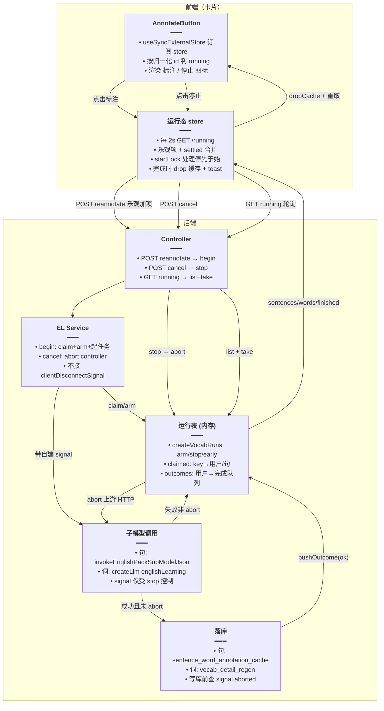

# 卡片单条重标

## 延伸阅读

- [句内词标注缓存与批量标注.md](./句内词标注缓存与批量标注.md)：单句标注的缓存命中、批量预热与子模型调用，本专题在其之上增加「强制重跑」路径。
- [单词详解缓存与抽屉.md](./单词详解缓存与抽屉.md)：单词详解的重新生成 / 停止生成机制，本专题把「卡片右上角按钮」接到同一套 `regen` 表与 `regenLemmaByRun` 运行表上。
- [句子成分标识.md](./句子成分标识.md)：重标产出的标注同样携带可选 `roleZh`，前端词槽据此画成分色块。
- [标注导入提示词弹窗.md](./标注导入提示词弹窗.md)：重标让在线标注可单卡重跑；手动导入走另一入口，二者在同一卡片上互斥。

---

## 1. 背景与目标

经典句看中写的每张卡（语句卡 / 单词卡）在打开时会按需请求句内词标注或单词详解。原来这两类请求都走「查缓存 → miss 调模型 → 写回缓存」的同步链路，且把 HTTP 连接的断开信号（`clientDisconnectSignal`）传给了模型调用：用户一旦切页、刷新或关闭抽屉，正在跑的模型请求就被 abort，结果永远不会落库，下次打开还得重来。

用户的真实需求是「我就想让这一张卡重新标一遍」，并且这个动作不应该因为我切走了页面就作废。因此本轮在每张卡片右上角加一枚标注按钮：点击立刻在后端起一个脱离 HTTP 生命周期的后台任务，强制重跑该句的句标注或该词的详解；按钮进入「停止」态，刷新页面后靠一次 `/running` 轮询恢复状态；任务结束（成功 / 失败）时把结果推给前端，前端自动清掉该句 / 该词的前端缓存并重取，让卡片即时看到新标注。

核心目标：

- **脱离 HTTP 断连**：后台任务挂在 Node 进程内，不跟请求的 `AbortSignal` 走，切页 / 刷新 / 关抽屉都不停。
- **单卡粒度**：语句按 `english` 原文归一去重，单词按 `lemma` 归一，同一用户同一句 / 同一词同时只跑一次。
- **可观测可恢复**：前端刷新后能恢复「正在跑」列表与「刚跑完」结果，按钮态不会丢。
- **结果即时生效**：完成后清掉该句 / 该词的前端缓存，卡片重新拉取即拿到新标注。

## 2. 改动范围

后端：

- `apps/backend/src/services/english-learning/sentence-annotate-run.ts`（新增）：句标注运行表，复用 `vocab-detail-run.ts` 的 `createVocabRuns`，外加占坑表、在途表与完成事件队列。
- `apps/backend/src/services/english-learning/english-learning.controller.ts`：新增 3 个端点（重跑 / 停止 / 查询运行态）。
- `apps/backend/src/services/english-learning/english-learning.service.ts`：新增 `beginReannotateSentenceWords` / `cancelReannotateSentenceWords` / `listReannotateSentenceEnglish` / `takeReannotateOutcomes`；在 `annotateSentenceWordsViaLlmAndCache` 写库前补一道 abort 守卫，避免「停止后仍写入缓存」。
- `apps/backend/src/services/english-learning/vocab-detail.service.ts`：新增 `regenLemmaByRun`（runKey → lemma）、`regenOutcomes`（用户维度完成事件队列）及对应读取 / 取走方法；`regenerateVocabDetail` 在成功 / 失败时推入完成事件。

前端：

- `apps/frontend/src/service/api.ts`：登记 3 个新接口地址。
- `apps/frontend/src/service/index.ts`：导出 `reannotateEnglishSentenceWords` / `cancelReannotateEnglishSentenceWords` / `getCardAnnotateRunning`，复用既有 `regenerateEnglishVocabDetail` / `cancelEnglishVocabDetail`。
- `apps/frontend/src/views/englishLearning/components/annotate/Button.tsx`（新增）：卡片右上角标注按钮，内部用 `useSyncExternalStore` 维护运行态 store（含乐观更新、停止先于开始的竞态处理、完成后自动清缓存）。
- `apps/frontend/src/views/englishLearning/components/classic/Card.tsx`：语句卡接入标注按钮。
- `apps/frontend/src/views/englishLearning/components/vocab/Card.tsx`：单词卡接入标注按钮。

## 3. 实现思路

### 3.1 双运行表：语句与单词各自一份

句标注和单词详解是两套独立的模型调用与缓存，运行状态也分开存放：

- 句标注运行表：新建 `sentence-annotate-run.ts`，内部直接 `createVocabRuns()` 拿 `arm/stop/end/finish/stopped` 能力（处理「停止先于 arm」的 early 标记），再在模块级加 `claimed`（占坑表）、`inflight`（在途 Promise）、`outcomes`（用户维度完成队列）。
- 单词运行表：复用既有 `vocab-detail-run.ts` 的 `vocabRuns`（`createVocabRuns()`）与 `vocabDetailRegenInflight`；本轮在 `vocab-detail.service.ts` 顶层新增 `regenLemmaByRun`（runKey → lemma，用于刷新后认出哪个词在跑）和 `regenOutcomes`（用户维度完成事件）。

两份运行表都只活在**当前 Node 进程内存**里。多实例部署时，`/running` 只能看到打到同一实例的任务；进程重启后运行态丢失（但已落库的缓存 / regen 行仍在）。这一限制在接口契约上已明确：查询返回的是「本进程正在跑」，不承诺跨实例聚合。

### 3.2 runKey 的设计：用户 + 内容指纹

runKey 必须满足两点：同一用户同一句 / 同一词去重；不同用户互不干扰。

- 句标注：`sentenceAnnotateRunKey(userId, cacheKey)` = `` `${userId}:${cacheKey}` ``，其中 `cacheKey` 来自 `buildSentenceWordAnnotationCacheKey(english.toLowerCase(), words)`（已有缓存键，含分词）。
- 单词：`regenRunKey(userId, lemma)` = `` `regen:${userId}:${vocabDetailCacheKey(lemma)}` ``，其中 `vocabDetailCacheKey` 是 lemma 的 sha256。

`claimSentenceAnnotate` / `vocabDetailRegenInflight` 在起任务前先查 runKey：已存在则直接返回 `running: true`，不重复起模型。

### 3.3 脱离 HTTP：不接 `clientDisconnectSignal`

原来的 `annotateSentenceWords` 控制器把 `clientDisconnectSignal(req)` 传给 service，service 再把 signal 传给模型客户端，请求断开即 abort。重标路径**故意不传 signal**：

- `beginReannotateSentenceWords` 内部自己 `armSentenceAnnotate(key)` 创建一个 `AbortController`，只在用户点「停止」时 abort；HTTP 请求返回后这个 controller 仍被运行表持有，模型继续跑。
- `regenerateVocabDetail`（单词重标）走 `startRegen`，同样用 `vocabRuns` 自建 controller，不接请求 signal。

这样切页 / 刷新不会中断模型。代价是用户必须显式点「停止」才会 abort，否则模型会跑到自然结束。

### 3.4 完成事件队列 + 前端轮询恢复

后端用两个用户维度的队列记录「刚跑完」，队列元素是 `{ id, ok }`，其中 `id` 句标注取 `english.trim().toLowerCase()`、单词取 `lemma`：

- 句标注：`takeSentenceAnnotateOutcomes(userId)`，每次 `/running` 取走并清空。
- 单词：`takeRegenOutcomes(userId)` 同样取走清空。

前端 `AnnotateButton` 内部的 store 每 2 秒调用一次 `getCardAnnotateRunning`，拿到：

- `sentences`：本用户正在跑的句归一化列表 → 按钮显示「停止」。
- `words`：本用户正在跑的 lemma 列表 → 按钮显示「停止」。
- `finished.sentences` / `finished.words`：自上次轮询以来完成的条目 → 前端弹成功 / 失败 toast，并在该条目离开「正在跑」名单时自动 `dropSentenceWordAnnotationCache` 清掉前端缓存，卡片下次取标注即命中 miss 重拉。

取走即清空（`take` 语义），避免重复 toast。进程重启后队列为空，已落库的结果靠卡片自身的缓存 miss 重新拉取。

### 3.5 前端乐观更新与「停止先于开始」竞态

网络往返期间按钮态不能闪回「标注」，否则用户连点会误触。前端 store 维护：

- `optimisticSentences` / `optimisticWords`：点击后立即加入，乐观渲染「停止」态。
- `settledSentences` / `settledWords`：开始请求返回后标记，表示「这一轮已被服务端受理或拒绝」，用于判定乐观项何时算「结束」。
- `startLock` / `stopAfterStart`：若用户在开始请求尚未返回时就点了停止，先把停止记到 `stopAfterStart`，等开始请求返回后再发停止请求——避免停止请求先到服务端、被 early 标记吃掉，开始请求后到又起了模型的竞态。

`reconcileRunning(server, optimistic, settled)` 把三份名单合并：服务端有的保留；乐观项里服务端没有、且已 settled 的算作 `finished`；其余乐观项并入视图。这样刷新后服务端名单能把图标画回来，本地点击也能即时反馈。

### 3.6 停止语义：abort 上游 HTTP + 标记不再写库

点「停止」时：

- `stopSentenceAnnotate(key)` / `vocabRuns.stop(runKey, pending)` 调用 `AbortController.abort()`，OpenAI 客户端收到 signal 后断开上游 HTTP。
- `annotateSentenceWordsViaLlmAndCache` 在写库（`upsert`）前补了一道 `if (signal?.aborted) throw AbortError`：即便模型已返回、解析已完成，只要用户在写库前点了停止，就抛错不写缓存，保证「停止」后不会留下半新半旧的结果。
- abort 产生的 `AbortError` 在 `beginReannotateSentenceWords` 的 `.catch` 里被识别（`e.name === 'AbortError'`），**不推入失败队列**——停止是用户主动行为，不算失败，前端不该弹失败提示。

### 3.7 主流程



### 3.8 与既有「整集预热」的关系

整集预热（`EnglishAnnotateSource`）是批量任务，也用运行表但 key 不同（按 source/libraryId/streamId）。单卡重标是单句 / 单词粒度，二者互不抢占：整集在跑时单卡仍可重标某一句（会单独起模型）；反之亦然。这是有意为之——单卡重标是用户的「我就要这一句立刻更新」，不应被整集任务阻塞。

## 4. 关键代码对比与注释

### 4.1 句标注运行表（`sentence-annotate-run.ts`，新增全文）

**改动后** · `apps/backend/src/services/english-learning/sentence-annotate-run.ts`（当前，约 L1–L84，全文）

```typescript
// 复用单词详解那套运行表：createVocabRuns 提供 arm/stop/end/finish/stopped，
// 并内置 early 集合处理「停止先于 arm」的竞态，句标注不必再实现一遍
import { createVocabRuns } from './vocab-detail-run';

/**
 * 卡片单条重标的在途表。键是 userId + cache_key，两个人标同一句互不断开。
 * 形态与 createVocabRuns 相同：停止先于 arm 记在 early 里，arm 直接抛，不再请求模型。
 */
// 拿到运行表单例：所有句标注共享，arm/stop 走它
const runs = createVocabRuns();
// 在途 Promise：按 runKey 去重，同一句同时只挂一个 job
const inflight = new Map<string, Promise<unknown>>();
// 占坑表：runKey → { userId, english }，claim 时写入，用于判重与列正在跑的句
const claimed = new Map<string, { userId: number; english: string }>();
// 完成事件队列：userId → [{ id, ok }]，/running 取走清空
const outcomes = new Map<number, { id: string; ok: boolean }[]>();

// 完成事件元素类型：id 是归一化句原文或 lemma，ok 标记成功失败
export type CardAnnotateOutcome = { id: string; ok: boolean };

/** 这一轮结束。停止不算，成功或失败各记一条，下次查询取走。 */
// 推入完成事件：beginReannotate 的 then/catch 调它
export function pushSentenceAnnotateOutcome(
	userId: number,
	english: string,
	ok: boolean,
): void {
	// id 取归一化（trim + 小写），与前端 sentenceId 对齐，便于匹配卡片
	const id = english.trim().toLowerCase();
	// 空句不记
	if (!id) return;
	// 取该用户队列，没有则新建
	const list = outcomes.get(userId) ?? [];
	// 追加本条
	list.push({ id, ok });
	// 写回
	outcomes.set(userId, list);
}

// /running 调用：取走并清空该用户的句完成事件
export function takeSentenceAnnotateOutcomes(
	userId: number,
): CardAnnotateOutcome[] {
	const list = outcomes.get(userId) ?? [];
	// 取走即清空，避免重复消费
	outcomes.delete(userId);
	return list;
}

// 生成 runKey：用户 + 缓存键（含分词），同用户同句去重、不同用户隔离
export function sentenceAnnotateRunKey(userId: number, cacheKey: string): string {
	return `${userId}:${cacheKey}`;
}

/** 占坑。已经在跑则返回 false，调用方不要再打一次模型。 */
// 起任务前先占坑：已占则拒绝
export function claimSentenceAnnotate(
	key: string,
	userId: number,
	english: string,
): boolean {
	// 已在跑：拒绝重复起模型
	if (claimed.has(key)) return false;
	// 占坑并记录用户与句原文（供 listEnglish 用）
	claimed.set(key, { userId, english });
	return true;
}

// 占用成功后创建控制器：若该 key 已被 early 标记（停止先到），createVocabRuns.arm 会抛
export function armSentenceAnnotate(key: string): AbortController {
	return runs.arm(key);
}

/** arm 之前就被停止：清掉占坑和 early，下一次点击还能再开。 */
// arm 抛错时回滚：删占坑 + 清 early 标记，否则同 key 永远被 early 挡住
export function releaseSentenceAnnotateClaim(key: string): void {
	claimed.delete(key);
	runs.finish(key);
}

// 绑定模型 job 到 runKey：finally 里清理在途、结束控制器、删占坑
export function trackSentenceAnnotate(
	key: string,
	job: Promise<unknown>,
	ac: AbortController,
): void {
	// 包一层 finally：无论成功/失败/停止都清理
	const tracked = job.finally(() => {
		// 只在仍是当前在途时删，避免误删新一轮
		if (inflight.get(key) === tracked) inflight.delete(key);
		// 结束控制器（从 runs map 移除该 ac）
		runs.end(key, ac);
		// 清 early 标记，允许下次再开
		runs.finish(key);
		// 删占坑：该句不再算「正在跑」
		claimed.delete(key);
	});
	// 登记在途
	inflight.set(key, tracked);
}

// 停止：abort 控制器；pending 用 claimed.has 判定是否真有在途
export function stopSentenceAnnotate(key: string): boolean {
	return runs.stop(key, claimed.has(key));
}

// 列出该用户正在跑的句原文（/running 恢复按钮态用）
export function listSentenceAnnotateEnglish(userId: number): string[] {
	const out: string[] = [];
	// 遍历占坑表，收集同用户的句原文
	for (const row of claimed.values()) {
		if (row.userId === userId) out.push(row.english);
	}
	return out;
}
```

### 4.2 控制器：三个新端点（`english-learning.controller.ts`，新增）

**改动后** · `apps/backend/src/services/english-learning/english-learning.controller.ts`（当前，约 L1394–L1442）

```typescript
	/** 卡片单条重标。不接断开信号：切页和刷新都不停模型。 */
	// 重跑句标注：POST /english-learning/practice/reannotate-sentence-words
	@Post('practice/reannotate-sentence-words')
	reannotateSentenceWords(
		// 取当前登录用户
		@Req() req: AuthedRequest,
		// 校验 body：{ english: string }
		@Body() dto: ReannotateSentenceWordsDto,
	) {
		// 未登录直接 401
		const userId = req.user?.userId;
		if (userId == null) {
			throw new UnauthorizedException('未授权');
		}
		// 交给 service：起后台任务，立即返回 { running: true }，不等待模型
		return this.englishLearningService.beginReannotateSentenceWords({
			userId,
			english: dto.english,
		});
	}

	/** 停止这一句的重标，并断开已经发出的模型请求。 */
	// 停止句标注：POST /english-learning/practice/reannotate-sentence-words/cancel
	@Post('practice/reannotate-sentence-words/cancel')
	cancelReannotateSentenceWords(
		@Req() req: AuthedRequest,
		@Body() dto: ReannotateSentenceWordsDto,
	) {
		const userId = req.user?.userId;
		if (userId == null) {
			throw new UnauthorizedException('未授权');
		}
		// 调用 service：abort 该 runKey 的控制器，返回是否真的取消了
		const cancelled = this.englishLearningService.cancelReannotateSentenceWords(
			userId,
			dto.english,
		);
		return { cancelled };
	}

	/** 本用户正在跑的单卡标注。刷新后按钮靠这个恢复停止图标。 */
	// 查询运行态：GET /english-learning/practice/card-annotate/running
	@Get('practice/card-annotate/running')
	cardAnnotateRunning(@Req() req: AuthedRequest) {
		const userId = req.user?.userId;
		if (userId == null) {
			throw new UnauthorizedException('未授权');
		}
		// 一次返回句 + 词 两路运行态与完成队列，前端合并渲染
		return {
			// 正在跑的句原文列表
			sentences: this.englishLearningService.listReannotateSentenceEnglish(userId),
			// 正在跑的 lemma 列表（单词详解重标）
			words: this.vocabDetailService.listRegenLemmas(userId),
			finished: {
				// 取走并清空句完成事件（元素 { id, ok }，id 为归一化句原文）
				sentences: this.englishLearningService.takeReannotateOutcomes(userId),
				// 取走并清空词完成事件（元素 { id, ok }，id 为 lemma）
				words: this.vocabDetailService.takeRegenOutcomes(userId),
			},
		};
	}
```

### 4.3 Service：起任务 / 停止 / 查询（`english-learning.service.ts`，新增方法）

**改动后** · `apps/backend/src/services/english-learning/english-learning.service.ts`（当前，约 L8013–L8083）

```typescript
	/**
	 * 卡片单条重标。不读缓存命中，模型成功且可用后才 upsert。
	 * 立刻返回；调用挂在进程内，不跟这次 HTTP 的断开走。
	 */
	// 入口：校验 → 算 key → claim → arm → 起模型（不 await）→ 立即返回
	beginReannotateSentenceWords(params: {
		userId: number;
		english: string;
	}): { running: boolean } {
		// 去掉首尾空白，避免同句因空格不同算成两个 key
		const english = params.english.trim();
		// 复用既有分词器，得到句内词列表
		const words = segmentEnglishSentenceWords(english);
		// 空句或分词为空：400
		if (!english || words.length === 0) {
			throw new BadRequestException('english 不能为空');
		}
		// 单卡重标只接受合理长度的句子，超长拒绝
		if (words.length > 80) {
			throw new BadRequestException('words 过多');
		}
		// 归一化为小写参与缓存键计算
		const englishNorm = english.toLowerCase();
		// 用既有缓存键构造器：键里含分词，保证不同分词不会串
		const cacheKey = buildSentenceWordAnnotationCacheKey(englishNorm, words);
		// 拼成运行表 key：用户 + 缓存键
		const key = sentenceAnnotateRunKey(params.userId, cacheKey);
		// 尝试占用；已在跑或已停止则直接返回 running:true（不起重复模型）
		if (!claimSentenceAnnotate(key, params.userId, english)) {
			return { running: true };
		}
		// 声明控制器变量：arm 可能抛错，需要在 catch 里回滚 claim
		let ac: AbortController;
		try {
			// 创建控制器并登记；若 key 已被停止（early）会抛 VocabDetailCancelledError
			ac = armSentenceAnnotate(key);
		} catch (e) {
			// arm 失败：回滚占用，避免 key 卡死
			releaseSentenceAnnotateClaim(key);
			// 停止先到的情况返回 running:false，前端刷新后靠名单恢复
			if (e instanceof VocabDetailCancelledError) return { running: false };
			// 其它错误继续抛出
			throw e;
		}
		// 起模型任务：不 await，挂在进程内；传自建 signal，不传 HTTP 断开信号
		const job = this.annotateSentenceWordsViaLlmAndCache({
			userId: params.userId,
			english,
			englishNorm,
			words,
			cacheKey,
			// 关键：这个 signal 只受 stopSentenceAnnotate 控制，与 HTTP 断开无关
			signal: ac.signal,
		})
			.then(() => {
				// 成功：推入完成队列（ok=true），前端轮询取到后清缓存重取
				pushSentenceAnnotateOutcome(params.userId, english, true);
			})
			.catch((e: unknown) => {
				// 用户主动停止：不记失败，前端不弹错误
				if (e instanceof Error && e.name === 'AbortError') return;
				// 真正失败：记失败事件，前端可提示
				pushSentenceAnnotateOutcome(params.userId, english, false);
				// 打 warn 日志便于排查
				const message = e instanceof Error ? e.message : String(e);
				this.logger.warn(
					`[EnglishLearning] reannotateSentenceWords failed: ${message.slice(0, 200)}`,
				);
			});
		// 绑定任务到运行表（finally 时 finish 清理）
		trackSentenceAnnotate(key, job, ac);
		// 立即返回 running:true，不等模型
		return { running: true };
	}

	// 停止：算 key → abort 控制器
	cancelReannotateSentenceWords(userId: number, english: string): boolean {
		// 同样 trim + 分词，保证 key 与 begin 时一致
		const text = english.trim();
		const words = segmentEnglishSentenceWords(text);
		// 空句直接返回 false（没在跑）
		if (!text || words.length === 0) return false;
		// 重算缓存键与运行表 key
		const cacheKey = buildSentenceWordAnnotationCacheKey(
			text.toLowerCase(),
			words,
		);
		// stop 会 abort 控制器并打 early 标记，返回是否取消成功
		return stopSentenceAnnotate(sentenceAnnotateRunKey(userId, cacheKey));
	}

	// 列出该用户正在跑的句原文（/running 用）
	listReannotateSentenceEnglish(userId: number): string[] {
		return listSentenceAnnotateEnglish(userId);
	}

	// 取走该用户的句完成事件队列（/running 用，取走即清空）
	takeReannotateOutcomes(userId: number) {
		return takeSentenceAnnotateOutcomes(userId);
	}
```

### 4.4 写库前 abort 守卫（`english-learning.service.ts`，修改）

`annotateSentenceWordsViaLlmAndCache` 是句标注与重标共用的模型调用 + 写库方法。原来模型返回并解析成功后直接 `upsert` 写缓存，现在在写库前补一道守卫：若用户在解析完成后、写库前点了停止，则抛 `AbortError` 不写库，保证「停止」语义干净。

**改动前** · `apps/backend/src/services/english-learning/english-learning.service.ts`（基线，约 L8560–L8572）

```typescript
		const annotated = this.extractSentenceWordAnnotationsLoose(parsed, words);
		// 解析不完整或条数不符：抛 502，不写库
		if (!isUsableSentenceWordAnnotations(annotated, words.length)) {
			throw new BadGatewayException('句内词标注不完整或条数与分词不一致');
		}

		// 解析通过后直接写缓存——原来这里没有检查 signal
		try {
			await this.sentenceWordAnnotationCacheRepo.upsert(
```

**改动后** · `apps/backend/src/services/english-learning/english-learning.service.ts`（当前，约 L8560–L8576）

```typescript
		const annotated = this.extractSentenceWordAnnotationsLoose(parsed, words);
		// 解析不完整或条数不符：抛 502，不写库
		if (!isUsableSentenceWordAnnotations(annotated, words.length)) {
			throw new BadGatewayException('句内词标注不完整或条数与分词不一致');
		}
		// 写库前最后一道守卫：用户在模型返回后点了停止，则不写入缓存
		// 避免「停止」后仍留下新结果，导致前端以为没停
		if (signal?.aborted) {
			const err = new Error('Aborted');
			err.name = 'AbortError';
			throw err;
		}

		// 未停止才写库
		try {
			await this.sentenceWordAnnotationCacheRepo.upsert(
```

**变更摘要**：在 `isUsable` 校验通过与 `upsert` 之间插入 `signal?.aborted` 检查。重标路径传的是运行表自建 signal，同步标注路径传的是 `clientDisconnectSignal`——两种「停止」都能在写库前拦住。

### 4.5 单词详解：运行态跟踪（`vocab-detail.service.ts`，新增）

单词详解的「重新生成」本就存在（`regenerateVocabDetail`），但之前没有暴露「哪个词正在重标」「刚重标完了哪个词」给前端，卡片按钮无法恢复状态。本轮新增 `regenLemmaByRun` 与 `regenOutcomes` 两个进程内映射，并在 `regenerateVocabDetail` 的成功 / 失败分支推入完成事件。

**改动后** · `apps/backend/src/services/english-learning/vocab-detail.service.ts`（当前，约 L62–L75，顶层映射与辅助函数）

```typescript
/** 同进程后来的请求直接等这一次，不必轮询。 */
// 全站缓存生成的在途 Promise：按 cacheKey 去重（既有）
const vocabDetailInflight = new Map<string, Promise<VocabDetail>>();
/** 重新生成按用户分开，不加入可能返回缓存的全站在途。 */
// 重新生成的在途 Promise：按 regenRunKey（含 userId）去重，避免不同用户互等
const vocabDetailRegenInflight = new Map<string, Promise<VocabDetail>>();
/** runKey → lemma，刷新后卡片还能认出哪一个词正在重标。 */
// 运行表补充映射：/running 列出正在跑的 lemma 用
const regenLemmaByRun = new Map<string, string>();
/** 重新生成结束（成功或失败）。停止不记。查询时取走。 */
// 用户维度完成事件队列：/running 取走清空
const regenOutcomes = new Map<number, { id: string; ok: boolean }[]>();

// 向某用户的词完成队列推一条（私有辅助）
function pushRegenOutcome(userId: number, lemma: string, ok: boolean): void {
	// 取队列，没有则新建
	const list = regenOutcomes.get(userId) ?? [];
	// 追加：id 用 lemma，前端据此找到对应卡片
	list.push({ id: lemma, ok });
	// 写回
	regenOutcomes.set(userId, list);
}
```

**改动后** · `apps/backend/src/services/english-learning/vocab-detail.service.ts`（当前，约 L272–L286，查询方法）

```typescript
	/** 当前用户正在重标的词。进程重启后为空，旧详解行还在。 */
	// /running 调用：列出正在跑的 lemma
	listRegenLemmas(userId: number): string[] {
		// regenRunKey 前缀：regen:${userId}:
		const prefix = `regen:${userId}:`;
		// 收集匹配前缀的 runKey 对应的 lemma
		const out: string[] = [];
		// 遍历运行映射
		for (const [key, lemma] of regenLemmaByRun) {
			// 只留当前用户的
			if (key.startsWith(prefix)) out.push(lemma);
		}
		return out;
	}

	// /running 调用：取走并清空该用户的词完成事件
	takeRegenOutcomes(userId: number): { id: string; ok: boolean }[] {
		const list = regenOutcomes.get(userId) ?? [];
		// 取走即清空
		regenOutcomes.delete(userId);
		return list;
	}
```

### 4.6 `regenerateVocabDetail`：成功 / 失败推入完成事件（修改）

原来失败分支只打日志，现在改为推入失败完成事件（取消类异常不推），让前端能感知「重标失败」。

**改动前** · `apps/backend/src/services/english-learning/vocab-detail.service.ts`（基线，约 L288–L320）

```typescript
	/** 再打一次模型，只 upsert 该用户该词的重新生成行。 */
	async regenerateVocabDetail(
		word: string,
		userId: number,
	): Promise<VocabDetail> {
		const lemma = normalizeVocabLemma(word);
		if (!lemma) throw new BadRequestException('单词为空');
		if (word.trim().length > 120) throw new BadRequestException('单词过长');
		const runKey = regenRunKey(userId, lemma);
		try {
			const pending = vocabDetailRegenInflight.get(runKey);
			const detail = pending
				? await pending
				: await this.startRegen(lemma, userId, runKey);
			await this.regenRepo.upsert(
				{
					userId,
					lemma,
					schemaVersion: VOCAB_DETAIL_CACHE_VERSION,
					detail,
				},
				['userId', 'lemma'],
			);
			await this.patchLemmaForUser(userId, lemma);
			return detail;
		} catch (e) {
			if (e instanceof VocabDetailCancelledError) throw e;
			if (!(e instanceof BadRequestException)) {
				const message = e instanceof Error ? e.message : String(e);
				this.logger.warn(
					`[EnglishLearning] regenerateVocabDetail failed: ${message.slice(0, 200)}`,
				);
			}
			throw e;
		}
	}
```

**改动后** · `apps/backend/src/services/english-learning/vocab-detail.service.ts`（当前，约 L288–L321）

```typescript
	/** 再打一次模型，只 upsert 该用户该词的重新生成行。 */
	async regenerateVocabDetail(
		word: string,
		userId: number,
	): Promise<VocabDetail> {
		// 归一化词形：与缓存键计算保持一致
		const lemma = normalizeVocabLemma(word);
		if (!lemma) throw new BadRequestException('单词为空');
		if (word.trim().length > 120) throw new BadRequestException('单词过长');
		// 计算 runKey：含 userId，保证用户隔离
		const runKey = regenRunKey(userId, lemma);
		try {
			// 同 runKey 已有在途：直接 await 它，不重复起模型
			const pending = vocabDetailRegenInflight.get(runKey);
			const detail = pending
				? await pending
				: await this.startRegen(lemma, userId, runKey);
			// 只写该用户的 regen 行，不碰全站缓存
			await this.regenRepo.upsert(
				{
					userId,
					lemma,
					schemaVersion: VOCAB_DETAIL_CACHE_VERSION,
					detail,
				},
				['userId', 'lemma'],
			);
			// 刷新该用户的列表缓存（让新结果可见）
			await this.patchLemmaForUser(userId, lemma);
			// 成功：推入完成队列，前端轮询取到后清缓存重取
			pushRegenOutcome(userId, lemma, true);
			return detail;
		} catch (e) {
			// 用户主动取消：不记失败，直接抛出
			if (e instanceof VocabDetailCancelledError) throw e;
			// 非参数错误的真实失败：推入失败事件（前端可提示），不再只打日志
			if (!(e instanceof BadRequestException)) {
				pushRegenOutcome(userId, lemma, false);
			}
			throw e;
		}
	}
```

**变更摘要**：成功路径 `return detail` 前加 `pushRegenOutcome(..., true)`；失败路径把「打日志」换成 `pushRegenOutcome(..., false)`（参数错误不推，因为那是调用方问题不是模型失败）。

### 4.7 前端：接口登记与服务函数（`api.ts` / `service/index.ts`，新增）

**改动后** · `apps/frontend/src/service/api.ts`（当前，约 L259–L264，新增 3 个地址常量）

```typescript
// 语句卡重标地址：服务端立即返回，模型后台跑
export const ENGLISH_LEARNING_PRACTICE_REANNOTATE_SENTENCE_WORDS =
	'/english-learning/practice/reannotate-sentence-words';
// 停止句重标地址：断开上游模型
export const ENGLISH_LEARNING_PRACTICE_REANNOTATE_SENTENCE_WORDS_CANCEL =
	'/english-learning/practice/reannotate-sentence-words/cancel';
// 查询卡片标注运行态地址：句 + 词 + 完成队列一次返回
export const ENGLISH_LEARNING_PRACTICE_CARD_ANNOTATE_RUNNING =
	'/english-learning/practice/card-annotate/running';
```

**改动后** · `apps/frontend/src/service/index.ts`（当前，约 L1688–L1737，新增服务函数）

```typescript
/** 卡片上正在跑的单条标注。刷新后靠它把按钮画回停止。 */
// 查询运行态：silent 避免失败弹气泡（轮询失败静默）
export const getCardAnnotateRunning = async () => {
	return await http.get<{
		// 正在跑的归一化句原文列表
		sentences: string[];
		// 正在跑的 lemma 列表
		words: string[];
		// 自上次查询以来完成的条目（可选，老后端可能没这字段）
		finished?: {
			sentences: { id: string; ok: boolean }[];
			words: { id: string; ok: boolean }[];
		};
	}>(
		ENGLISH_LEARNING_PRACTICE_CARD_ANNOTATE_RUNNING,
		{ silent: true },
	);
};

/** 语句卡重标。服务端立刻返回，模型在后台跑，断开页面也不停。 */
// 起句重标：传 english 原文，服务端归一化算 key
export const reannotateEnglishSentenceWords = async (english: string) => {
	return await http.post<{ running: boolean }>(
		ENGLISH_LEARNING_PRACTICE_REANNOTATE_SENTENCE_WORDS,
		{ english },
		{ silent: true },
	);
};

/** 停止这一句的重标，并断开上游模型。 */
// 停句重标：传同一句 english，服务端算同一 key 去 abort
export const cancelReannotateEnglishSentenceWords = async (english: string) => {
	return await http.post<{ cancelled: boolean }>(
		ENGLISH_LEARNING_PRACTICE_REANNOTATE_SENTENCE_WORDS_CANCEL,
		{ english },
		{ silent: true },
	);
};

/** 单词卡重标：只写该用户的重新生成行。 */
// 起词重标：复用既有详解重新生成接口，word 走 query，timeout 放长到 3 分钟
export const regenerateEnglishVocabDetail = async (word: string) => {
	return await http.post<{ detail?: unknown; cancelled?: boolean }>(
		ENGLISH_LEARNING_VOCAB_DETAIL_REGENERATE,
		{},
		{ silent: true, timeout: 180_000, querys: { word } },
	);
};

/** 停止这一词的重标。scope=regen 只断该用户这一轮。 */
// 停词重标：scope=regen 限定只断重新生成，不误伤全站缓存那次
export const cancelEnglishVocabDetail = async (word: string) => {
	return await http.post<{ cancelled: boolean }>(
		ENGLISH_LEARNING_VOCAB_DETAIL_CANCEL,
		{},
		{ silent: true, querys: { word, scope: 'regen' } },
	);
};
```

### 4.8 前端：卡片标注按钮组件（`annotate/Button.tsx`，新增全文）

组件内部维护运行态 store：`serverSnap`（服务端名单）、`viewSnap`（合并后的视图）、`optimistic*`（点击后乐观项）、`settled*`（已受理标记）、`startLock` / `stopAfterStart`（停先于始的竞态）。`reconcileRunning` 合并三份名单；`applyServer` 在句离开正在跑名单时自动 `dropSentenceWordAnnotationCache` 清前端缓存；`toggleCardAnnotate` 处理起停与竞态。

**改动后** · `apps/frontend/src/views/englishLearning/components/annotate/Button.tsx`（当前，约 L1–L313，摘录关键完整符号）

```typescript
/**
 * 单词卡 / 语句卡右上角单条标注。
 * 进行中画停止方块；卸载不取消，刷新靠服务端在途名单把图标画回来。
 */
// 引入 UI 按钮与 toast：点击反馈与完成提示用
import { Button, Toast } from '@ui/index';
// 停止用方块图标、标注用整词图标
import { Square, WholeWord } from 'lucide-react';
// 用 useSyncExternalStore 订阅模块级 store，所有卡片共享同一份运行态
import { useSyncExternalStore } from 'react';
import { useI18n } from '@/hooks';
// translateSync 用于非 React 上下文（toast）里取文案
import { translateSync } from '@/i18n';
import { cn } from '@/lib/utils';
// 起停句标注、起停词详解、查询运行态：都从 service 导入
import {
	cancelEnglishVocabDetail,
	cancelReannotateEnglishSentenceWords,
	getCardAnnotateRunning,
	reannotateEnglishSentenceWords,
	regenerateEnglishVocabDetail,
} from '@/service';
// 句标注完成后清前端缓存：让卡片下次取标注 miss 重拉
import { dropSentenceWordAnnotationCache } from '@/views/englishLearning/practice/utils/sentenceWordAnnotationCache';

// 按钮类型：句卡或词卡
type Kind = 'sentence' | 'word';
// store 快照：正在跑的句与词两份名单
type Snap = { sentences: string[]; words: string[] };
// 空快照初值
const EMPTY: Snap = { sentences: [], words: [] };

/**
 * 服务端名单与本地乐观项合并。
 * 请求已经结束、服务端也没有的项，视为这一轮结束。
 */
// 合并三份名单：服务端在跑的、本地乐观加的、已 settled 的
function reconcileRunning(
	server: readonly string[],
	optimistic: readonly string[],
	settled: ReadonlySet<string>,
): { view: string[]; finished: string[] } {
	// 收集「已结束」的乐观项
	const finished: string[] = [];
	// 视图先拷服务端名单
	const view = [...server];
	// 遍历乐观项：服务端有则跳过（已被服务端认领）；settled 了算结束；否则并入视图
	for (const item of optimistic) {
		if (server.includes(item)) continue;
		if (settled.has(item)) {
			finished.push(item);
			continue;
		}
		view.push(item);
	}
	return { view, finished };
}

// 模块级自测：校验 reconcileRunning 行为，防止后续改坏
{
	const settled = new Set(['gone']);
	const merged = reconcileRunning(['keep'], ['keep', 'gone', 'wait'], settled);
	if (
		merged.finished.length !== 1 ||
		merged.finished[0] !== 'gone' ||
		merged.view.length !== 2 ||
		!merged.view.includes('keep') ||
		!merged.view.includes('wait')
	) {
		throw new Error('reconcileRunning');
	}
}

// 服务端最新快照：每次 refresh 写入
let serverSnap: Snap = EMPTY;
// 合并后的视图快照：组件订阅的就是它
let viewSnap: Snap = EMPTY;
// 本地乐观项：点击后立即加入，渲染停止态
const optimisticSentences = new Set<string>();
const optimisticWords = new Set<string>();
// 已受理标记：开始请求返回后置位，用于判定乐观项是否结束
const settledSentences = new Set<string>();
const settledWords = new Set<string>();
// 订阅者集合：useSyncExternalStore 用
const listeners = new Set<() => void>();
/** 开始请求还没返回时，停止先记在这里，返回后再断开，避免停止比开始先到服务端。 */
// 起停竞态锁：key = `${kind}:${id}`
const startLock = new Set<string>();
// 记录「开始返回后需补发停止」的锁
const stopAfterStart = new Set<string>();
// 轮询定时器：有在跑项时每 2s 刷新
let timer: ReturnType<typeof setInterval> | null = null;
// 进行中的 refresh Promise：串行化避免并发覆盖
let refreshing: Promise<Set<string>> | null = null;

// 弹成功/失败 toast：完成事件用
function toastAnnotate(ok: boolean) {
	Toast({
		type: ok ? 'success' : 'error',
		title: translateSync(
			ok
				? 'englishLearning.cardAnnotate.success'
				: 'englishLearning.cardAnnotate.failed',
		),
	});
}

// 批量弹完成 toast：遍历 finished 行，去重避免重复弹
function toastFinished(
	rows: { id: string; ok: boolean }[] | undefined,
	kind: Kind,
	toasted: Set<string>,
) {
	for (const row of rows ?? []) {
		toastAnnotate(row.ok);
		toasted.add(`${kind}:${row.id.trim().toLowerCase()}`);
	}
}

// 句 id 归一化：与后端 pushSentenceAnnotateOutcome 的 id 对齐
function sentenceId(text: string): string {
	return text.trim().toLowerCase();
}
// 词 id 归一化：压缩空白 + 小写，与 lemma 对齐
function wordId(text: string): string {
	return text.trim().replace(/\s+/g, ' ').toLowerCase();
}

// 快照相等判定：避免无意义重渲染
function same(a: Snap, b: Snap): boolean {
	return (
		a.sentences.join('\0') === b.sentences.join('\0') &&
		a.words.join('\0') === b.words.join('\0')
	);
}

// 通知所有订阅者重渲染
function emit() {
	for (const fn of listeners) fn();
}

// 发布新视图：合并名单 → 更新 viewSnap → 通知 → 按需启停轮询
function publish() {
	const next: Snap = {
		sentences: reconcileRunning(
			serverSnap.sentences,
			[...optimisticSentences],
			settledSentences,
		).view,
		words: reconcileRunning(serverSnap.words, [...optimisticWords], settledWords)
			.view,
	};
	// 无变化则不发
	if (same(viewSnap, next)) return;
	viewSnap = next;
	emit();
	// 有在跑项：启 2s 轮询
	if (next.sentences.length > 0 || next.words.length > 0) {
		if (timer == null) timer = setInterval(() => void refresh(), 2000);
		return;
	}
	// 没有在跑项：停轮询
	if (timer != null) {
		clearInterval(timer);
		timer = null;
	}
}

// 应用服务端新快照：检测哪些句结束了 → 清缓存；收敛乐观项
function applyServer(next: Snap) {
	// 上轮在跑、这轮不在的句：任务结束，清前端缓存让卡片重拉
	for (const english of serverSnap.sentences) {
		if (!next.sentences.includes(english)) dropSentenceWordAnnotationCache(english);
	}
	// 算出句乐观项里已结束的，清掉并清缓存
	const sentenceDone = reconcileRunning(
		next.sentences,
		[...optimisticSentences],
		settledSentences,
	).finished;
	for (const english of sentenceDone) {
		optimisticSentences.delete(english);
		settledSentences.delete(english);
		dropSentenceWordAnnotationCache(english);
	}
	// 词乐观项里已结束的清掉（词缓存由详情面板自行刷新，这里不清）
	const wordDone = reconcileRunning(
		next.words,
		[...optimisticWords],
		settledWords,
	).finished;
	for (const word of wordDone) {
		optimisticWords.delete(word);
		settledWords.delete(word);
	}
	// 服务端已认领的乐观项：从本地集合移除，避免重复
	for (const english of [...optimisticSentences]) {
		if (next.sentences.includes(english)) {
			optimisticSentences.delete(english);
			settledSentences.delete(english);
		}
	}
	for (const word of [...optimisticWords]) {
		if (next.words.includes(word)) {
			optimisticWords.delete(word);
			settledWords.delete(word);
		}
	}
	// 更新服务端快照并发布
	serverSnap = next;
	publish();
}

// 轮询刷新：拿运行态 + 完成事件，弹 toast，应用快照
function refresh(): Promise<Set<string>> {
	// 串行化：上一次没回来就复用它，避免并发覆盖
	if (refreshing) return refreshing;
	refreshing = getCardAnnotateRunning()
		.then((res) => {
			const toasted = new Set<string>();
			// 句完成事件弹 toast
			toastFinished(res.data?.finished?.sentences, 'sentence', toasted);
			// 词完成事件弹 toast
			toastFinished(res.data?.finished?.words, 'word', toasted);
			// 归一化服务端名单后应用
			applyServer({
				sentences: (res.data?.sentences ?? []).map((item) =>
					item.trim().toLowerCase(),
				),
				words: (res.data?.words ?? []).map((item) => item.trim().toLowerCase()),
			});
			return toasted;
		})
		.catch(() => new Set<string>())
		.finally(() => {
			refreshing = null;
		});
	return refreshing;
}

// 开始/停止后串行刷新：等在途的完成再刷一次，保证拿到最新状态
async function refreshAfter(): Promise<Set<string>> {
	const seen = refreshing ? await refreshing : new Set<string>();
	const next = await refresh();
	return new Set([...seen, ...next]);
}

// useSyncExternalStore 订阅：首个订阅者触发一次 refresh
function subscribeCardAnnotate(onStoreChange: () => void) {
	listeners.add(onStoreChange);
	void refresh();
	return () => {
		listeners.delete(onStoreChange);
	};
}

// 取视图快照：useSyncExternalStore 的 getSnapshot
function getCardAnnotateSnapshot(): Snap {
	return viewSnap;
}

// 竞态锁的 key
function lockId(kind: Kind, id: string): string {
	return `${kind}:${id}`;
}

// 停止：句走 cancelReannotate，词走 cancelEnglishVocabDetail
async function cancelCardAnnotate(kind: Kind, text: string): Promise<void> {
	if (kind === 'sentence') await cancelReannotateEnglishSentenceWords(text);
	else await cancelEnglishVocabDetail(text);
}

// 点击按钮的核心逻辑：判 running → 起或停 → 处理竞态 → 刷新
async function toggleCardAnnotate(kind: Kind, text: string): Promise<void> {
	const id = kind === 'sentence' ? sentenceId(text) : wordId(text);
	if (!id) return;
	const lock = lockId(kind, id);
	// 当前是否在跑（看视图快照）
	const running = (
		kind === 'sentence' ? viewSnap.sentences : viewSnap.words
	).includes(id);
	if (running) {
		// 开始请求还没返回：停止先记下来，等开始返回后再发
		if (startLock.has(lock)) {
			stopAfterStart.add(lock);
			return;
		}
		// 正常停止：发取消 + 刷新
		try {
			await cancelCardAnnotate(kind, text);
		} finally {
			await refreshAfter();
		}
		return;
	}
	// 已在 startLock 里（开始请求在飞）：忽略重复点击
	if (startLock.has(lock)) return;
	// 乐观加项 + 加锁，立即发布让按钮变停止态
	if (kind === 'sentence') optimisticSentences.add(id);
	else optimisticWords.add(id);
	startLock.add(lock);
	publish();
	let accepted = false;
	try {
		// 发起重标：句或词
		if (kind === 'sentence') await reannotateEnglishSentenceWords(text);
		else await regenerateEnglishVocabDetail(text);
		accepted = true;
	} catch {
		accepted = false;
	} finally {
		// 释放开始锁
		startLock.delete(lock);
		// 标记 settled：这一轮已受理或拒绝
		if (kind === 'sentence') settledSentences.add(id);
		else settledWords.add(id);
		// 若期间用户点了停止：补发停止请求
		const stopped = stopAfterStart.delete(lock);
		if (stopped) {
			try {
				await cancelCardAnnotate(kind, text);
			} catch {
				// 停止失败时名单里还在，图标保持停止
			}
		}
		// 刷新拿最新状态；若未停止且未受理且没弹过 toast，补一个失败 toast
		const toasted = await refreshAfter();
		if (!stopped && !accepted && !toasted.has(lock)) toastAnnotate(false);
	}
}

// 按钮组件：订阅 store，按 id 判 running 渲染图标
export function AnnotateButton({ kind, text }: { kind: Kind; text: string }) {
	const { t } = useI18n();
	// 订阅运行态：第三个参数是 getServerSnapshot（SSR 用，这里同 getSnapshot）
	const snap = useSyncExternalStore(
		subscribeCardAnnotate,
		getCardAnnotateSnapshot,
		getCardAnnotateSnapshot,
	);
	// 计算当前卡的归一化 id
	const id = kind === 'sentence' ? sentenceId(text) : wordId(text);
	// 是否在跑：决定图标与样式
	const running = (kind === 'sentence' ? snap.sentences : snap.words).includes(id);
	return (
		<Button
			type="button"
			variant="ghost"
			size="sm"
			onClick={(event) => {
				// 阻止冒泡：避免触发卡片点击
				event.stopPropagation();
				void toggleCardAnnotate(kind, text);
			}}
			className={cn(
				'h-7 w-7 shrink-0 rounded-md border p-0 transition-colors',
				// 运行中：teal 高亮；否则：灰底 hover 变 teal
				running
					? 'border-teal-500/40 bg-teal-500/15 text-teal-500'
					: 'border-theme/10 text-textcolor/65 hover:border-teal-500/15 hover:bg-teal-500/10 hover:text-teal-500',
			)}
			aria-label={
				// 无障碍标签：运行中提示「停止」，否则提示「标注」
				running
					? t('englishLearning.cardAnnotate.stop')
					: t('englishLearning.cardAnnotate.action')
			}
		>
			{/* 运行中画停止方块，否则画整词图标 */}
			{running ? (
				<Square className="size-3.5 fill-current" aria-hidden />
			) : (
				<WholeWord className="size-4.5" aria-hidden />
			)}
		</Button>
	);
}
```

> 说明：上面为 `Button.tsx` 关键完整符号摘录，已覆盖 store 状态、`reconcileRunning`、`applyServer`、`refresh`、`toggleCardAnnotate` 与组件本身；`publish` / `refreshAfter` 等辅助函数与源码一致。若与仓库最新源码不一致，以源码为准。

### 4.9 卡片接入（`classic/Card.tsx` 与 `vocab/Card.tsx`，修改）

语句卡与单词卡只需在 action 区插入一枚 `<AnnotateButton>`，无需传回调——缓存清除与重取由 store 的 `applyServer` 自动完成。

**改动前** · `apps/frontend/src/views/englishLearning/components/classic/Card.tsx`（基线，import 区无 AnnotateButton，action 区无标注按钮）

```tsx
// 基线：action 区只有播放等原有按钮，没有标注按钮
			{trailingActions}
```

**改动后** · `apps/frontend/src/views/englishLearning/components/classic/Card.tsx`（当前，约 L13 与 L119）

```tsx
// 引入标注按钮组件
import { AnnotateButton } from '../annotate/Button';
			// ... 原有播放按钮 ...
			// 语句卡 action 区插入：传句原文，kind=sentence
			<AnnotateButton kind="sentence" text={english} />
			{trailingActions}
```

**改动后** · `apps/frontend/src/views/englishLearning/components/vocab/Card.tsx`（当前，约 L12 与 L147）

```tsx
// 引入标注按钮组件
import { AnnotateButton } from '../annotate/Button';
			// 单词卡 action 区插入：传词原形，kind=word
			<AnnotateButton kind="word" text={card.word} />
```

**变更摘要**：两张卡各加一行 `<AnnotateButton>`，按钮组件内部订阅运行态并处理起停、竞态与缓存清除，卡片本身无需额外状态。

## 5. 兼容性与影响

- **新接口**：3 个端点均为新增，不影响既有接口。
- **运行态仅本进程**：多实例部署时 `/running` 只返回打到当前实例的任务；进程重启后运行态丢失，但已落库的缓存 / regen 行仍在，卡片靠缓存 miss 自然重取。这是已知限制，非回归。
- **停止不写库**：`annotateSentenceWordsViaLlmAndCache` 写库前新增 abort 守卫，对既有同步标注路径也生效——原来同步标注在写库前断开时模型调用已抛 AbortError、不会走到写库；现在多了一道在「解析完成后、写库前」断开的兜底，行为更严格，不破坏既有成功路径。
- **完成队列取走即清空**：`take` 语义是删除，前端在 `refresh` 里消费 `finished` 弹 toast；若某轮没消费到也不影响数据正确性（已落库），只是少弹一次 toast。
- **单词重标复用既有 regen 表**：`listRegenLemmas` / `takeRegenOutcomes` 是新增读取，不改变 `regenerateVocabDetail` 的写库语义，对已有「重新生成」按钮无影响。
- **前端乐观与竞态**：`startLock` / `stopAfterStart` 处理「停止先于开始返回」；`reconcileRunning` 保证刷新后服务端名单能把图标画回来。极端情况下（开始请求一直 pending）按钮会保持停止态直到请求返回，属预期。

## 6. 相关源码路径

| 说明 | 路径 |
| ---- | ---- |
| 句标注运行表（新增） | `apps/backend/src/services/english-learning/sentence-annotate-run.ts` |
| 运行表底座（既有，被复用） | `apps/backend/src/services/english-learning/vocab-detail-run.ts` |
| 控制器 3 端点 | `apps/backend/src/services/english-learning/english-learning.controller.ts` |
| service 重标方法 + 写库守卫 | `apps/backend/src/services/english-learning/english-learning.service.ts` |
| 单词详解运行态跟踪 | `apps/backend/src/services/english-learning/vocab-detail.service.ts` |
| 前端接口地址 | `apps/frontend/src/service/api.ts` |
| 前端服务函数 | `apps/frontend/src/service/index.ts` |
| 卡片标注按钮组件（新增） | `apps/frontend/src/views/englishLearning/components/annotate/Button.tsx` |
| 语句卡接入 | `apps/frontend/src/views/englishLearning/components/classic/Card.tsx` |
| 单词卡接入 | `apps/frontend/src/views/englishLearning/components/vocab/Card.tsx` |

---

（若与仓库最新源码不一致，以源码为准）
