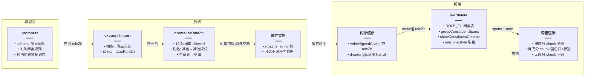

# 句子成分标识

## 延伸阅读

- [句内词标注缓存与批量标注.md](./句内词标注缓存与批量标注.md)：句内词标注的缓存键、批量预热与子模型调用，本专题在其产出上新增可选 `roleZh` 字段。
- [经典句看中写词槽练习.md](./经典句看中写词槽练习.md)：词槽元数据（词性 / IPA / 释义）分发，本专题在词槽上叠加成分色块。
- [卡片单条重标.md](./卡片单条重标.md)：重标产出的标注同样携带 `roleZh`，成分色块随重标即时刷新。
- [标注导入提示词弹窗.md](./标注导入提示词弹窗.md)：手动导入的 JSON 可携带 `roleZh`，导入弹窗里的生成提示词已写明闭集规则。
- 规划稿：[../ideas/english/句子成分标识.md](../ideas/english/句子成分标识.md)（已实现）

---

## 1. 背景与目标

句内词标注（看中写练习里每个词的词性 / IPA / 释义）已经稳定，但学习者在「揭示 / 全对」时只能看到词性徽章，看不出一句话的句法骨架——哪个是主语、哪个是谓语、哪个是宾语。本轮给句内词标注新增一个**可选字段 `roleZh`**（句子成分），模型按闭集（主语 / 谓语 / 主语和谓语 / 宾语 / 表语 / 定语 / 状语 / 补语 / 同位语 / 其他成分）给每个词打标，前端在词槽上把**连续同值的词**收成一块，画上成分色块与块底标签，让句法结构一眼可读。

核心约束：

- **闭集归一**：模型可能生造词（如「状语成分」「其他」），入库前用 `normalizeRoleZh` 归一到闭集，闭集外一律存空串（不画色块），避免界面出现生造标签。
- **可选不破坏**：`roleZh` 对模型、缓存、导入全链路可选；老缓存、老导入文件没有该字段时前端照常渲染，只是不画色块。
- **连续同值合并**：前端把相邻且 `roleZh` 相同的词收成一个 span 画色块，中间隔了别的成分就分开；避免把不相邻的同成分词误并。
- **揭示 / 全对才画**：作答中（未揭示）不画成分色块，避免泄题；只跟「显示词性」开关联动——揭示必画，未揭示时开了词性才画。

## 2. 改动范围

后端：

- `apps/backend/src/services/english-learning/prompt.ts`：`SENTENCE_WORDS_ANNOTATE_SYSTEM` 与批量版在输出 JSON schema 中加 `roleZh`，并补 4 条成分标注规则。
- `apps/backend/src/services/english-learning/english-learning.service.ts`：新增私有方法 `normalizeRoleZh`（闭集归一）；在 `extractSentenceWordAnnotationsLoose` 的抽取与 `importSentenceWordAnnotations` 的落库两处调用它。
- `apps/backend/src/services/english-learning/entity/english-sentence-word-annotation-cache.entity.ts`：缓存实体加 `roleZh?: string` 列。
- `apps/backend/src/services/english-learning/dto/import-sentence-word-annotations.dto.ts`：导入 DTO 的词对象加可选 `roleZh`。

前端：

- `apps/frontend/src/views/englishLearning/practice/utils/wordMeta.ts`：`SentenceWordMeta` 加 `roleZh?`；新增 `ROLE_ZH` 闭集表、`groupConstituentSpans`（连续同值合并）、`showConstituentChrome`（揭示/开关判定）、`roleToneStyle`（成分取色）。
- `apps/frontend/src/views/englishLearning/practice/components/slots/SentenceWordSlots.tsx`：词槽渲染从「逐词平铺」改为「按成分 chunk 分组」，有成分的 chunk 外包色块 + 块底标签。
- `apps/frontend/src/views/englishLearning/practice/utils/sentenceWordAnnotationCache.ts`：缓存对齐时带上 `roleZh`；新增 `dropSentenceWordAnnotationCache(english)` 供重标结束后清前端缓存。
- `apps/frontend/src/views/englishLearning/utils/parseAnnotationImport.ts`：导入解析的词对象加可选 `roleZh`，旧文件缺省时不写。
- `apps/frontend/src/service/index.ts`：`EnglishSentenceWordAnnotation` 类型加 `roleZh?`；列表缓存键集合登记 `roleZh`。
- 中英文 i18n：补充成分相关文案（成分色块不依赖 i18n，标签即 `roleZh` 原文）。

## 3. 实现思路

### 3.1 闭集：前后端共享同一套成分名

成分名闭集共 10 项，**前端 `ROLE_ZH` 数组与后端 `normalizeRoleZh` 的 `allowed` 集合顺序一致**——这样前端可以用 `ROLE_ZH.indexOf(roleZh)` 当下标，直接取主题色板 `ACCENT_COLORS` 里的对应色，改主题色板时成分色块同步换色，无需再维护一张成分→色映射。顺序是：

```
主语 → 谓语 → 主语和谓语 → 宾语 → 表语 → 定语 → 状语 → 补语 → 同位语 → 其他成分
```

「主语和谓语」单独成一项，是因为主谓（如 `I am`）经常连续同标，合并成一块更符合阅读直觉；闭集里没有「主谓宾」这种跨段合并，避免色块越画越大。

### 3.2 模型提示词：闭集 + 句法优先

提示词在输出 schema 的 `words` 对象里加了 `"roleZh":""`，并补 4 条规则：

- 先分析句子结构再落标签，**禁止按词性猜测**（例如不能因为是名词就标主语）。
- `roleZh` 只能是闭集 10 项之一。
- 连词 / 感叹词等标「其他成分」；同位语是复指说明的中心词。
- 连续同一成分写同一个 `roleZh`，不相邻不要合并。

批量版提示词（开局预热、整集续标）同步加了 `roleZh`，保证批量产出与单句产出字段一致。

### 3.3 入库归一：`normalizeRoleZh`

模型可能输出闭集外的词（「状语成分」「其他」「宾语补足语」等），入库前统一过 `normalizeRoleZh`：

- 空串 → 空串（不画色块）。
- 命中闭集 → 原样保留。
- 「其他」→「其他成分」；「状语成分」→「状语」（仅这两个已知别名做映射）。
- 其余生造词 → 空串（不画色块）。

归一发生在两处：`extractSentenceWordAnnotationsLoose`（模型产出抽取，L8638）和 `importSentenceWordAnnotations`（手动导入落库，L7455）。这样无论在线生成还是手动导入，入库的 `roleZh` 都已归一，前端拿到即可直接渲染。`normalizeRoleZh` **不参与入库验收**（`isUsableSentenceWordAnnotations` 只校验条数，不校验 roleZh），因为成分是可选增强，缺了不影响主流程。

### 3.4 前端合并：`groupConstituentSpans`

拿到一句所有词的 `roleZh` 数组后，`groupConstituentSpans` 扫描一遍，把**相邻且非空、文本相同**的收成左闭右开区间 `{ start, end, roleZh }`：

- 输入 `['状语','','状语']` → 两个 span（中间空了断开）。
- 输入 `['主语和谓语','主语和谓语']` → 一个 span。
- 输入 `['','']` → 空数组（不画色块）。

然后 `wordChunks(tokens.length, roleSpans)` 把整句词索引切成：有成分的连续段作为一个 `chunk`（带 `roleZh`），其余无成分的词各自成无 `roleZh` 的 chunk。渲染时无成分 chunk 直接平铺（与原来一致），有成分 chunk 外包一层 `div` 画背景色 + 底部标签。

### 3.5 取色：`roleToneStyle`

`roleToneStyle(roleZh)` 用 `ROLE_ZH.indexOf` 拿下标，取 `ACCENT_COLORS[下标]`，未知成分兜底用色板最后一色；再走 `accentBadgeStyle(hex)` 算出背景色与文字色。色块背景用 `color-mix(in srgb, 背景色 18%, transparent)` 调淡，避免压住词槽文字。成分标签（块底小徽章）直接用 `tone` 原色。

### 3.6 何时画：`showConstituentChrome`

- `reveal === true`（已揭示 / 全对）→ 必画。
- 未揭示时 → 只在 `showPos`（显示词性开关）打开时画。

作答中不画成分色块，避免泄题；同时与词性开关联动，保持「想看句法就得先开揭示或开词性」的一致心智。

### 3.7 数据流



### 3.8 兼容性

- 老缓存行没有 `roleZh` 列值 → 实体字段为 `undefined` → 前端 `w?.roleZh?.trim() ?? ''` 得空串 → `groupConstituentSpans` 跳过 → 不画色块，行为与改前完全一致。
- 老导入 JSON 没有 `roleZh` → `parseAnnotationImport` 的 `roleZh` 可选缺省 → 落库时 `normalizeRoleZh('')` → 空串，不画色块。
- 成分色块不进题目正确性判定：`matchSlotInput` 等逻辑不读 `roleZh`，纯展示。

## 4. 关键代码对比与注释

### 4.1 提示词：单句版加 `roleZh`（`prompt.ts`，修改）

**改动前** · `apps/backend/src/services/english-learning/prompt.ts`（基线，单句 system 段）

```typescript
export const SENTENCE_WORDS_ANNOTATE_SYSTEM = `
# Role
英语教学助手：为「看中写」标注句中每个词的 posZh / 英式 IPA / meaningZh。

# Task
按输入 english 与 words，为每一个词填写标注。

# Output
仅输出一个 JSON 对象，无 Markdown/解释：
{"words":[{"posZh":"","ipa":"","meaningZh":""}]}
- words 长度与顺序必须与输入 words 一致；不要输出 word 字段（服务端按下标对齐）
- posZh 只能是：冠词、限定词、名词、动词、助动词、形容词、副词、介词、代词、连词、数词、感叹词、短语
- ipa：英式 RP，Unicode，无 // []；例 dance→dɑːns，water→ˈwɔːtə，car→kɑː（词尾 r 不发音）
- th：清音 θ（think/with/three）vs 浊音 ð（this/that/the）；**with 单独标 wɪθ（勿 wɪð）**
- meaningZh：按**本句搭配/语法功能**释义（2～12 字），禁止只抄词典第一义
  - 例：agree with you 中 with →「表示同意对象」或「与…一致」，勿空泛「与；和」
- 禁止跳词/合并；助动词标「助动词」；the/a/an「冠词」；this/that/my/your「限定词」
- 字符串内禁止未转义英文半角双引号 "
`;
```

**改动后** · `apps/backend/src/services/english-learning/prompt.ts`（当前，约 L170–L194，单句 system 段）

```typescript
export const SENTENCE_WORDS_ANNOTATE_SYSTEM = `
# Role
英语教学助手：为「看中写」标注句中每个词的 posZh / 英式 IPA / meaningZh / roleZh。

# Task
按输入 english 与 words，为每一个词填写标注。

# Output
仅输出一个 JSON 对象，无 Markdown/解释：
{"words":[{"posZh":"","ipa":"","meaningZh":"","roleZh":""}]}
- words 长度与顺序必须与输入 words 一致；不要输出 word 字段（服务端按下标对齐）
- posZh 只能是：冠词、限定词、名词、动词、助动词、形容词、副词、介词、代词、连词、数词、感叹词、短语
- ipa：英式 RP，Unicode，无 // []；例 dance→dɑːns，water→ˈwɔːtə，car→kɑː（词尾 r 不发音）
- th：清音 θ（think/with/three）vs 浊音 ð（this/that/the）；**with 单独标 wɪθ（勿 wɪð）**
- meaningZh：按**本句搭配/语法功能**释义（2～12 字），禁止只抄词典第一义
  - 例：agree with you 中 with →「表示同意对象」或「与…一致」，勿空泛「与；和」
- 禁止跳词/合并；助动词标「助动词」；the/a/an「冠词」；this/that/my/your「限定词」
- 字符串内禁止未转义英文半角双引号 "
- roleZh 按该词在本句中的句法功能标注。先分析句子结构再落标签，必须准确，符合严格句法分析，禁止按词性猜测
- roleZh 只能是：主语、谓语、主语和谓语、宾语、表语、定语、状语、补语、同位语、其他成分
- 同位语是复指说明的中心词。并列连词、从属连词、感叹词标「其他成分」
- 连续同一成分写同一个 roleZh；中间隔了别的成分就分开。禁止把词性写入 roleZh
`;
```

**变更摘要**：角色描述与输出 schema 各加 `roleZh`，并补 4 条成分规则。批量版 `SENTENCE_WORDS_ANNOTATE_BATCH_SYSTEM` 同步做了相同改动（schema 加 `roleZh` + 同样 4 条规则，措辞略调：「不相邻不要合并」），保证批量预热与单句产出字段一致。

### 4.2 闭集归一：`normalizeRoleZh`（`english-learning.service.ts`，新增）

**改动后** · `apps/backend/src/services/english-learning/english-learning.service.ts`（当前，约 L8696–L8716，全文）

```typescript
	/** 句子成分闭集。闭集外存空串，避免界面画出生造词；不参与入库验收 */
	// 私有方法：把模型/导入的原始成分字符串归一到闭集
	private normalizeRoleZh(raw: string): string {
		// 闭集：与前端 ROLE_ZH 顺序一致，共 10 项
		const allowed = new Set([
			'主语',
			'谓语',
			'主语和谓语',
			'宾语',
			'表语',
			'定语',
			'状语',
			'补语',
			'同位语',
			'其他成分',
		]);
		// 去首尾空白，空串直接返回空（不画色块）
		const s = raw.trim();
		if (!s) return '';
		// 命中闭集：原样保留
		if (allowed.has(s)) return s;
		// 已知别名 1：「其他」→「其他成分」
		if (s === '其他') return '其他成分';
		// 已知别名 2：「状语成分」→「状语」
		if (s === '状语成分') return '状语';
		// 闭集外的生造词：存空串，前端不画色块
		return '';
	}
```

### 4.3 抽取与导入：两处调用归一（`english-learning.service.ts`，修改）

模型产出的抽取（`extract...Loose`）和手动导入落库（`importSentenceWordAnnotations`）都要过归一，保证入库即干净。

**改动前** · `apps/backend/src/services/english-learning/english-learning.service.ts`（基线，抽取处无 roleZh）

```typescript
				posZh: this.normalizePosZh(posRaw),
				ipa: ipaRaw ?? '',
				meaningZh: meaningRaw ?? '',
```

**改动后** · `apps/backend/src/services/english-learning/english-learning.service.ts`（当前，约 L8636–L8639，抽取处）

```typescript
				posZh: this.normalizePosZh(posRaw),
				ipa: ipaRaw ?? '',
				meaningZh: meaningRaw ?? '',
				// 新增：成分也走闭集归一，闭集外存空串
				roleZh: this.normalizeRoleZh(roleRaw),
```

**改动后** · `apps/backend/src/services/english-learning/english-learning.service.ts`（当前，约 L7453–L7457，导入落库处）

```typescript
				return {
					word: w.word ?? '',
					posZh: this.normalizePosZh(w.posZh ?? ''),
					ipa: w.ipa ?? '',
					meaningZh: w.meaningZh ?? '',
					// 新增：导入的 roleZh 同样归一，老文件缺省传空串
					roleZh: this.normalizeRoleZh(w.roleZh ?? ''),
				};
```

### 4.4 缓存实体与导入 DTO：加可选列（修改）

**改动前** · `apps/backend/src/services/english-learning/entity/english-sentence-word-annotation-cache.entity.ts`（基线，词对象无 roleZh）

```typescript
@Column({ type: 'varchar', length: 64, nullable: true })
meaningZh?: string;
```

**改动后** · `apps/backend/src/services/english-learning/entity/english-sentence-word-annotation-cache.entity.ts`（当前，词对象加 roleZh 列）

```typescript
@Column({ type: 'varchar', length: 64, nullable: true })
meaningZh?: string;

// 新增：句子成分，可选；nullable 兼容老行（老行该列为 NULL）
@Column({ type: 'varchar', length: 32, nullable: true })
roleZh?: string;
```

**改动前** · `apps/backend/src/services/english-learning/dto/import-sentence-word-annotations.dto.ts`（基线，导入词 DTO 无 roleZh）

```typescript
@IsString()
meaningZh: string;
```

**改动后** · `apps/backend/src/services/english-learning/dto/import-sentence-word-annotations.dto.ts`（当前，导入词 DTO 加可选 roleZh）

```typescript
@IsString()
meaningZh: string;

// 新增：成分可选；@IsOptional 允许老文件不传，@IsString 传了必须是字符串
@IsOptional()
@IsString()
roleZh?: string;
```

### 4.5 前端：`wordMeta.ts` 成分元数据（修改 + 新增）

`SentenceWordMeta` 加 `roleZh?`，并新增闭集表、合并函数、显示判定、取色函数。

**改动前** · `apps/frontend/src/views/englishLearning/practice/utils/wordMeta.ts`（基线，类型无 roleZh，无成分函数）

```typescript
export type SentenceWordMeta = {
	posZh: string;
	ipa: string;
	meaningZh: string;
};
```

**改动后** · `apps/frontend/src/views/englishLearning/practice/utils/wordMeta.ts`（当前，约 L6–L74）

```typescript
export type SentenceWordMeta = {
	posZh: string;
	ipa: string;
	meaningZh: string;
	/** 句子成分；空或缺失则不画色块 */
	// 新增：可选成分，空串表示不画色块
	roleZh?: string;
};

/** 与后端 normalizeRoleZh 同一顺序，下标对应 ACCENT_COLORS */
// 闭集表：顺序与后端 allowed 一致，indexOf 即色板下标
const ROLE_ZH = [
	'主语',
	'谓语',
	'主语和谓语',
	'宾语',
	'表语',
	'定语',
	'状语',
	'补语',
	'同位语',
	'其他成分',
] as const;

// 成分 span：左闭右开区间 [start, end)
export type ConstituentSpan = {
	start: number;
	end: number;
	roleZh: string;
};

/** 相邻且非空、文本相同的成分收成左闭右开区间 */
// 扫描 roles 数组，合并连续同值非空段
export function groupConstituentSpans(
	roles: readonly string[],
): ConstituentSpan[] {
	const spans: ConstituentSpan[] = [];
	let i = 0;
	while (i < roles.length) {
		// 取当前词的成分，空则跳过
		const role = roles[i]?.trim() ?? '';
		if (!role) {
			i += 1;
			continue;
		}
		// 向后找连续同值的结束位置
		let end = i + 1;
		while (end < roles.length && (roles[end]?.trim() ?? '') === role) {
			end += 1;
		}
		// 收成一个 span
		spans.push({ start: i, end, roleZh: role });
		i = end;
	}
	return spans;
}

/** 揭示/全对必画；作答只跟词性开关 */
// 显示判定：揭示必画，未揭示时需开了词性才画（避免泄题）
export function showConstituentChrome(
	reveal: boolean,
	showPos: boolean,
): boolean {
	if (reveal) return true;
	return showPos;
}

/** 成分色块与块底标签。未知名字用色板最后一色 */
// 取色：用 ROLE_ZH 下标取主题色板，未知兜底最后一色
export function roleToneStyle(roleZh: string): {
	backgroundColor: string;
	color: string;
} {
	const i = ROLE_ZH.indexOf(roleZh as (typeof ROLE_ZH)[number]);
	const item =
		ACCENT_COLORS[i >= 0 ? i : ACCENT_COLORS.length - 1] ?? ACCENT_COLORS[0]!;
	return accentBadgeStyle(item.hex);
}
```

### 4.6 词槽渲染：按成分 chunk 分组画色块（`SentenceWordSlots.tsx`，修改）

原来词槽是逐词平铺；现在先算 `roleSpans` → `chunks`，渲染时遍历 chunks：无成分的 chunk 直接平铺（保持原行为），有成分的 chunk 外包色块 div + 底部标签。

**改动后** · `apps/frontend/src/views/englishLearning/practice/components/slots/SentenceWordSlots.tsx`（当前，约 L307–L310，计算 spans 与 chunks）

```typescript
	// 判定是否画成分：揭示必画，否则需开词性
	const roleSpans = showConstituentChrome(reveal, showPos)
		// 把所有词的 roleZh 收成连续同值 span
		? groupConstituentSpans(metas.map((m) => m?.roleZh?.trim() ?? ''))
		: [];
	// 按 spans 把词索引切成 chunks：有成分的连续段成一组，其余各自成组
	const chunks = wordChunks(tokens.length, roleSpans);
```

**改动后** · `apps/frontend/src/views/englishLearning/practice/components/slots/SentenceWordSlots.tsx`（当前，约 L432–L457，chunks 渲染）

```typescript
			<div className="flex w-full flex-wrap items-start justify-center gap-x-4 gap-y-4">
				{/* 遍历 chunks：每个 chunk 是一段连续同成分或无成分的词 */}
				{chunks.map((chunk) => {
					// 先渲染 chunk 内每个词的列（词性/词槽/IPA/释义，逻辑不变）
					const cols = chunk.indexes.map((i) => renderWord(i));
					// 无成分的 chunk：直接平铺，与改前行为一致
					if (!chunk.roleZh) {
						return <Fragment key={chunk.key}>{cols}</Fragment>;
					}
					// 有成分：取该成分的色调
					const tone = roleToneStyle(chunk.roleZh);
					return (
						// 外层 div 画淡色块背景，包住这一段词
						<div
							key={chunk.key}
							className="flex w-max max-w-full shrink-0 flex-col items-center gap-1 rounded-lg px-2 py-1.5"
							style={{
								// 背景色用 color-mix 调淡 18%，避免压住文字
								backgroundColor: `color-mix(in srgb, ${tone.backgroundColor} 18%, transparent)`,
							}}
						>
							{/* 词列横向排列 */}
							<div className="flex flex-wrap items-start justify-center gap-x-4 gap-y-2">
								{cols}
							</div>
							{/* 块底成分标签：用原色徽章，文字即 roleZh */}
							<span
								className="inline-flex items-center rounded px-1.5 pt-1 pb-[5px] text-[13px] leading-none font-medium whitespace-nowrap"
								style={tone}
							>
								{chunk.roleZh}
							</span>
						</div>
					);
				})}
			</div>
```

**变更摘要**：`renderWord` 本身逻辑不变（词性 / 词槽 / IPA / 释义照旧），变化在外层——从「直接 `tokens.map(renderWord)`」改为「`chunks.map`，有成分的 chunk 包色块」。无成分时走 `Fragment` 平铺，保证老数据 / 无成分句与改前像素级一致。

### 4.7 前端缓存：带 `roleZh` 对齐 + 重标后清缓存（`sentenceWordAnnotationCache.ts`，修改）

缓存写入时把 `roleZh` 一并对齐；新增 `dropSentenceWordAnnotationCache(english)` 供卡片单条重标结束后清前端内存，让卡片下次取标注 miss 重拉、拿到新成分。

**改动前** · `apps/frontend/src/views/englishLearning/practice/utils/sentenceWordAnnotationCache.ts`（基线，无 drop、对齐无 roleZh）

```typescript
const aligned = words.map((_, j) => {
	const w = rows[j];
	return {
		posZh: w?.posZh?.trim() ?? '',
		ipa: w?.ipa?.trim() ?? '',
		meaningZh: w?.meaningZh?.trim() ?? '',
	};
});
```

**改动后** · `apps/frontend/src/views/englishLearning/practice/utils/sentenceWordAnnotationCache.ts`（当前，约 L42–L74，drop + 对齐带 roleZh）

```typescript
/** 这一句重标结束后丢掉练习内存，下次开局向服务端要新结果 */
// 新增：按句前缀清掉该句所有分词键的缓存与在途请求
export function dropSentenceWordAnnotationCache(english: string): void {
	// 缓存键前缀：归一化句原文 + "::"
	const prefix = `${english.trim().toLowerCase()}::`;
	// 空前缀不删（避免误删全部）
	if (!prefix || prefix === '::') return;
	// 遍历缓存，删前缀匹配的键
	for (const key of cache.keys()) {
		if (key.startsWith(prefix)) cache.delete(key);
	}
	// 同样清在途请求，避免旧 inflight 回填旧成分
	for (const key of inflight.keys()) {
		if (key.startsWith(prefix)) inflight.delete(key);
	}
}

// 对齐写入：按下标把 rows 映射到 words 长度，缺词补空
function writeAlignedCache(
	english: string,
	words: string[],
	rows: EnglishSentenceWordAnnotation[],
): SentenceWordMeta[] | undefined {
	if (!rows.length) return undefined;
	const aligned = words.map((_, j) => {
		const w = rows[j];
		return {
			posZh: w?.posZh?.trim() ?? '',
			ipa: w?.ipa?.trim() ?? '',
			meaningZh: w?.meaningZh?.trim() ?? '',
			// 新增：成分一并写入缓存，空则空串
			roleZh: w?.roleZh?.trim() ?? '',
		};
	});
	setSentenceWordAnnotationCache(
		sentenceWordAnnotationCacheKey(english, words.join('\0')),
		aligned,
	);
	return aligned;
}
```

**变更摘要**：`dropSentenceWordAnnotationCache` 是纯新增（被 `annotate/Button.tsx` 的 `applyServer` 在句离开运行名单时调用）；`writeAlignedCache` 与单句请求的 fallback 各补一行 `roleZh`，保证缓存里始终有该字段（空串占位），下游 `groupConstituentSpans` 无需判空。

### 4.8 导入解析：可选 `roleZh`（`parseAnnotationImport.ts`，修改）

**改动前** · `apps/frontend/src/views/englishLearning/utils/parseAnnotationImport.ts`（基线，导入词类型与解析无 roleZh）

```typescript
export type AnnotationImportWord = {
	word: string;
	posZh: string;
	ipa: string;
	meaningZh: string;
};
// ...
	const meaningZh =
		typeof raw.meaningZh === 'string' ? raw.meaningZh.trim() : '';
	if (!word || !posZh || !ipa || !meaningZh) return null;
	return { word, posZh, ipa, meaningZh };
```

**改动后** · `apps/frontend/src/views/englishLearning/utils/parseAnnotationImport.ts`（当前，约 L5–L40）

```typescript
export type AnnotationImportWord = {
	word: string;
	posZh: string;
	ipa: string;
	meaningZh: string;
	/** 旧文件可缺；空串由服务端当「不展示」 */
	// 新增：成分可选，旧文件没有则不写该字段
	roleZh?: string;
};
// ...
	const meaningZh =
		typeof raw.meaningZh === 'string' ? raw.meaningZh.trim() : '';
	// 四个必填字段缺一则整词作废
	if (!word || !posZh || !ipa || !meaningZh) return null;
	// 新增：解析 roleZh，空串不写（展开运算符条件写）
	const roleZh = typeof raw.roleZh === 'string' ? raw.roleZh.trim() : '';
	return { word, posZh, ipa, meaningZh, ...(roleZh ? { roleZh } : {}) };
```

**变更摘要**：`roleZh` 作为可选字段透传，空串时不写入对象（服务端 `normalizeRoleZh('')` 仍得空串，效果一致），保持导入 JSON 干净。

## 5. 兼容性与影响

- **向后兼容**：`roleZh` 全链路可选。老缓存行（列 NULL）、老导入文件（无该字段）都走空串，前端不画色块，行为与改前一致。
- **不破坏验收**：`normalizeRoleZh` 不参与 `isUsableSentenceWordAnnotations` 验收，成分缺失不会导致整句标注被判失败。
- **取色随主题**：成分色块用 `ACCENT_COLORS` 下标取色，切换主题色板时成分色块同步变化，无需额外维护。
- **与重标联动**：重标结束后前端 `applyServer` 调 `dropSentenceWordAnnotationCache`，新成分随下次取标注即时生效（见 [卡片单条重标.md](./卡片单条重标.md)）。
- **泄题防护**：`showConstituentChrome` 确保未揭示且未开词性时不画色块，作答中看不到成分。

## 6. 相关源码路径

| 说明 | 路径 |
| ---- | ---- |
| 提示词（单句 + 批量加 roleZh） | `apps/backend/src/services/english-learning/prompt.ts` |
| 闭集归一 + 抽取/导入调用 | `apps/backend/src/services/english-learning/english-learning.service.ts` |
| 缓存实体 roleZh 列 | `apps/backend/src/services/english-learning/entity/english-sentence-word-annotation-cache.entity.ts` |
| 导入 DTO roleZh 可选 | `apps/backend/src/services/english-learning/dto/import-sentence-word-annotations.dto.ts` |
| 前端成分元数据（闭集/合并/取色） | `apps/frontend/src/views/englishLearning/practice/utils/wordMeta.ts` |
| 词槽成分色块渲染 | `apps/frontend/src/views/englishLearning/practice/components/slots/SentenceWordSlots.tsx` |
| 前端缓存对齐 + 重标清缓存 | `apps/frontend/src/views/englishLearning/practice/utils/sentenceWordAnnotationCache.ts` |
| 导入解析 roleZh 透传 | `apps/frontend/src/views/englishLearning/utils/parseAnnotationImport.ts` |
| 前端服务类型 roleZh | `apps/frontend/src/service/index.ts` |

---

（若与仓库最新源码不一致，以源码为准）
