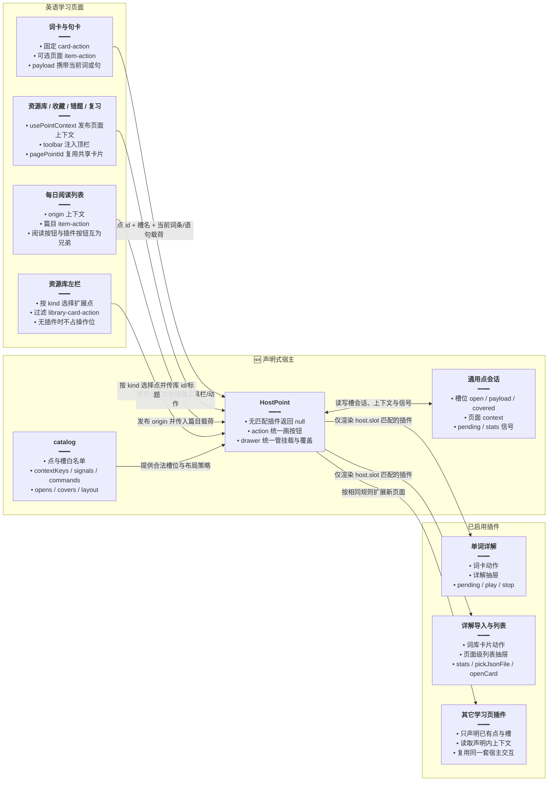
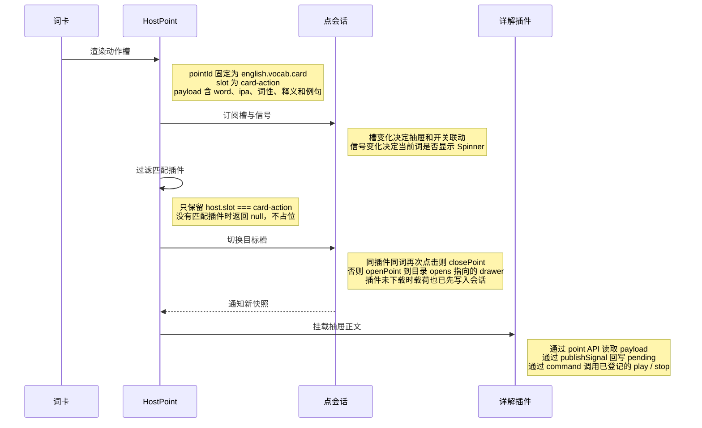
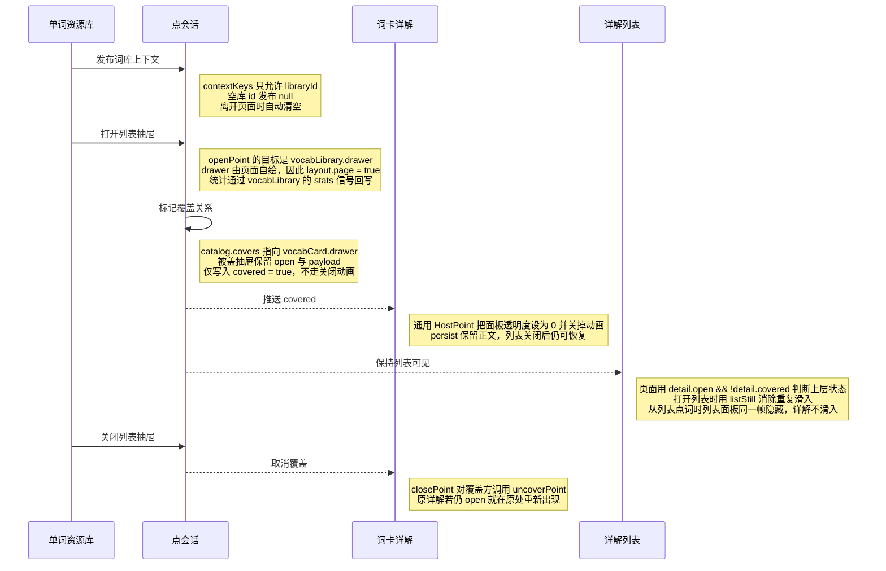
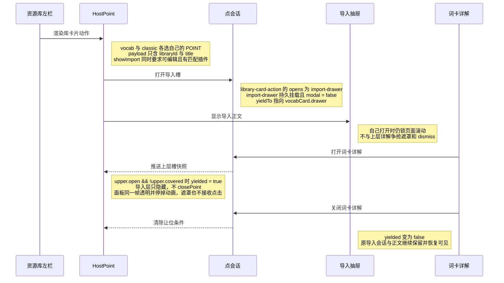

# 学习页扩展点

> 延伸阅读：[声明式扩展点](../plugins/声明式扩展点.md) · [单词详解缓存与抽屉](./单词详解缓存与抽屉.md) · [详解抽屉瞬时让位](./详解抽屉瞬时让位.md)

本文记录基线 `58d0e2a1` 之后，英语学习页迁到声明式 `HostPoint` 的实现。下文代码块里的 `covers`、`yieldTo`、`openPluginId` 和 `PluginHostSurface` 是那一轮的写法。
>
> **现行实现**：目录写角色，`compilePoint` 得到槽。盖住和让位在 `catalog.ts` 的 `stacks`。词库列表抽屉由词库页的 `HostPoint` 画，标题用 `title`，开关只在槽位会话里。`PluginHostSurface` 已删除。

## 1. 这次解决什么问题

旧实现把「哪个插件能出现、按钮怎么画、抽屉怎么开、词库上下文怎么传、生成中与列表统计怎么回写」分散在单词详解专用模块和页面 JSX 中。新增一个页面入口就要复制一组专用代码，经典句、收藏、错题和每日阅读也无法复用单词卡已经具备的插件能力。

这次迁移把页面只负责提供的内容收敛为四类声明：

- **扩展点与槽位**：`toolbar` 负责顶栏正文，`card-action` / `item-action` / `library-card-action` 负责动作，`drawer` / `item-drawer` / `import-drawer` 负责抽屉。
- **页面上下文**：词库发布 `libraryId`，收藏、错题与复习发布 `kind`，每日阅读发布 `origin`；目录未声明的字段不会进入插件上下文。
- **动作载荷**：卡片把当前词或当前句作为 `payload` 交给动作槽；动作槽根据目录里的 `opens` 找到目标抽屉，而不是直接调用某个专用 `openXxx`。
- **抽屉布局策略**：角色上的 `drawer` 决定谁挂载、是否常驻、是否模态和顺序。叠放不写在槽上，写在 `stacks` 的 `cover` 和 `yield`。

一个容易误读的事实是：`DetailDrawer.tsx` 与 `ImportDrawer.tsx` 虽然仍保留并完成了新会话 API 迁移，但当前仓库没有任何挂载方。实际运行入口是英语 `Layout` 遍历 `layoutDrawerSlots` 后渲染的通用 `HostPoint`，不能再把旧专用抽屉描述成现行主链路。

## 2. 改动文件与职责

| 文件 | 变化 | 在现行链路中的职责 |
| --- | --- | --- |
| `apps/frontend/src/federation/points/catalog.ts` | 新增 | 声明学习页扩展点、槽位、上下文、信号、命令、覆盖关系和布局顺序 |
| `apps/frontend/src/federation/host/HostPoint.tsx` | 新增 | 通用渲染工具栏、动作按钮和抽屉，统一处理空插件、冷启动载荷、转圈与叠放 |
| `apps/frontend/src/views/englishLearning/Layout.tsx` | 修改 | 遍历目录统一挂抽屉，离开英语学习时统一关闭 |
| `apps/frontend/src/views/englishLearning/components/vocab/Card.tsx` | 修改 | 用通用词卡动作替换专用插件按钮，并支持页面级 `item-action` |
| `apps/frontend/src/views/englishLearning/components/classic/Card.tsx` | 修改 | 给经典句卡补上固定卡片动作与可选页面动作 |
| `apps/frontend/src/views/englishLearning/components/vocab/PluginActions.tsx` | 删除 | 旧词卡专用按钮由 `HostPoint` 动作槽取代 |
| `apps/frontend/src/federation/modules/vocabDetail/session.ts` | 删除 | 旧详解、转圈、统计与列表词库会话由通用点会话取代 |
| `apps/frontend/src/federation/modules/vocabDetailImport/session.ts` | 删除 | 旧导入目标会话由 `import-drawer` 槽载荷与点上下文取代 |
| `apps/frontend/src/views/englishLearning/components/vocab/DetailDrawer.tsx` | 修改但不再挂载 | 保留专用抽屉的新 API 版本，作为迁移对照而非现行入口 |
| `apps/frontend/src/views/englishLearning/components/vocab/ImportDrawer.tsx` | 修改但不再挂载 | 保留专用导入抽屉的新 API 版本，作为迁移对照而非现行入口 |
| `apps/frontend/src/views/englishLearning/library/vocabulary/index.tsx` | 修改 | 发布词库上下文，接工具栏、列表覆盖、统计回写和词卡页面动作 |
| `apps/frontend/src/views/englishLearning/library/classic/index.tsx` | 修改 | 发布经典句库上下文，接工具栏与句卡页面动作 |
| `apps/frontend/src/views/englishLearning/library/components/LibraryListPanel.tsx` | 修改 | 左栏按库类型渲染任意已启用的 `library-card-action`，不再只认导入插件 |
| `apps/frontend/src/views/englishLearning/dailyReading/List.tsx` | 修改 | 接顶栏与篇目动作，并拆出兄弟按钮避免按钮嵌套 |
| `apps/frontend/src/views/englishLearning/favorites/vocabulary/index.tsx` | 修改 | 发布单词收藏上下文，接顶栏与卡片页面动作 |
| `apps/frontend/src/views/englishLearning/favorites/classic/index.tsx` | 修改 | 发布经典句收藏上下文，接顶栏与卡片页面动作 |
| `apps/frontend/src/views/englishLearning/favorites/components/FavoritesPanelFooter.tsx` | 修改 | 在共享收藏顶栏插入可选 `HostPoint` |
| `apps/frontend/src/views/englishLearning/mistakes/vocabulary/VocabularyMistakesPanel.tsx` | 修改 | 在错题与复习间切换扩展点，发布 `kind: 'vocab'` |
| `apps/frontend/src/views/englishLearning/mistakes/classic/ClassicQuoteMistakesPanel.tsx` | 修改 | 在错题与复习间切换扩展点，发布 `kind: 'classic'` |
| `apps/frontend/src/views/englishLearning/mistakes/components/MistakesPanelFooter.tsx` | 修改 | 在共享错题/复习顶栏插入可选 `HostPoint` |

## 3. 总体结构



## 4. 三条关键时序

### 4.1 词卡打开详解



### 4.2 单词详解列表覆盖词卡详解



### 4.3 导入抽屉让位给词卡详解



## 5. 目录声明：所有页面共用同一份约束

`POINT` 固定点 id，`listPoint` 复用普通列表的三槽结构，`hostPoints` 对词卡和词库做特化，`layoutDrawerSlots` 则把目录转换成英语布局可直接遍历的抽屉清单。纯新增文件只列改动后。

来源：`apps/frontend/src/federation/points/catalog.ts`，**改动后**，约 L3–L147。

```ts
// 声明槽位结构，让插件只能使用主项目预先允许的交互形态。
export type HostPointSlot = {
	// 槽名是动作与抽屉之间建立 opens 关系的稳定键。
	name: string;
	// 用三类槽区分按钮、抽屉与顶栏正文，HostPoint 据此选择渲染分支。
	kind: 'action' | 'drawer' | 'toolbar';
	// 动作点击后打开的目标槽；载荷最终写在目标槽上而不是按钮槽上。
	opens?: string;
	// 布局策略只作用于抽屉，避免每个页面重复处理持久挂载、滚动锁与覆盖。
	layout?: {
		// page 为 true 时页面自绘抽屉，布局只在离开英语学习时负责关闭会话。
		page?: boolean;
		// persist 保留已加载的插件正文，并允许覆盖期间不播放退场。
		persist?: boolean;
		// modal 为 false 时不锁焦点，便于其上继续叠一层详解。
		modal?: boolean;
		// 指定上层槽开着且未被盖住时，本抽屉只隐藏不关闭。
		yieldTo?: { point: string; slot: string };
		// order 决定统一挂载顺序，数值小的先挂并位于下层。
		order?: number;
	};
};
// 声明一个扩展点的完整能力边界，插件不能绕过目录自造上下文或命令。
export type HostPointSpec = {
	// id 与 POINT 中的稳定标识一致，也是会话和插件 surface 的关联键。
	id: string;
	// slots 列出这个点允许出现的全部交互位置。
	slots: readonly HostPointSlot[];
	// contextKeys 白名单限制页面能传给插件的上下文字段。
	contextKeys: readonly string[];
	// signals 白名单限制插件能回写的界面状态。
	signals: readonly ('pending' | 'stats')[];
	// commands 白名单限制插件能调用的主站能力。
	commands: readonly string[];
	// covers 声明某个抽屉打开时要覆盖另一个点的目标槽。
	covers?: { slot: string; targetPoint: string; targetSlot: string };
};
// 集中命名学习页扩展点，页面与插件配置共用这些常量以避免字符串漂移。
export const POINT = {
	// 固定单词卡动作与详解抽屉属于词卡点。
	vocabCard: 'english.vocab.card',
	// 单词资源库顶栏、词条动作、库卡动作和列表抽屉属于词库点。
	vocabLibrary: 'english.vocab.library',
	// 固定经典句卡动作与抽屉属于句卡点。
	classicCard: 'english.classic.card',
	// 经典句资源库的页面级能力独立于单词资源库。
	classicLibrary: 'english.classic.library',
	// 错题页单独成点，避免与复习页上下文和插件混用。
	mistakes: 'english.mistakes',
	// 今日复习复用错题面板但使用独立点 id。
	review: 'english.review',
	// 单词与经典句收藏共用收藏点，再由 kind 区分内容。
	favorites: 'english.favorites',
	// 每日阅读列表拥有独立的 origin 上下文和篇目动作。
	dailyReading: 'english.dailyReading',
	// 阅读页点保留在统一目录中，本文不展开其页面迁移。
	ebookRead: 'ebook.read',
// as const 保留字面量类型，让点 id 在调用处具备可检查性。
} as const;
// 为收藏、错题、复习和每日阅读生成相同的工具栏、条目动作与抽屉三槽结构。
function listPoint(id: string, contextKeys: readonly string[]): HostPointSpec {
	// 返回完整点声明，调用方只需补充自己的上下文键。
	return {
		// 写入调用方指定的稳定点 id。
		id,
		// 声明普通列表页共用的三个槽。
		slots: [
			// 顶栏槽让插件直接提供内联正文。
			{ name: 'toolbar', kind: 'toolbar' },
			// 条目动作统一打开同点的 drawer。
			{ name: 'item-action', kind: 'action', opens: 'drawer' },
			// 普通列表抽屉由布局按默认策略挂载。
			{ name: 'drawer', kind: 'drawer' },
		],
		// 把各页面的上下文白名单原样放入目录。
		contextKeys,
		// 普通列表默认不允许插件回写 pending 或 stats。
		signals: [],
		// 普通列表默认不暴露主站命令。
		commands: [],
	};
}
// 建立全量点目录，HostPoint 与通用会话都按这张表校验合法性。
export const hostPoints: Record<string, HostPointSpec> = {
	// 词卡点使用固定卡片动作和持久详解抽屉。
	[POINT.vocabCard]: {
		// 点 id 与计算属性键保持一致，便于按 surface 反查。
		id: POINT.vocabCard,
		// 词卡只需要一个动作槽和一个目标抽屉。
		slots: [
			// 卡片动作点击后打开同点 drawer。
			{ name: 'card-action', kind: 'action', opens: 'drawer' },
			// 详解正文持久挂载并以 order 1 位于导入层之上。
			{ name: 'drawer', kind: 'drawer', layout: { persist: true, order: 1 } },
		],
		// 词卡数据通过动作载荷传递，因此不需要页面级上下文。
		contextKeys: [],
		// 允许详解插件按词回写生成中状态。
		signals: ['pending'],
		// 只允许调用朗读与停播两条主站命令。
		commands: ['play', 'stop'],
	},
	// 单词资源库同时支持顶栏、词条动作、页面列表、库卡动作和导入抽屉。
	[POINT.vocabLibrary]: {
		// 点 id 与词库 surface 对齐。
		id: POINT.vocabLibrary,
		// 显式列出比普通列表更多的槽，不能用 listPoint 覆盖这些特化关系。
		slots: [
			// 工具栏承载词库级插件正文。
			{ name: 'toolbar', kind: 'toolbar' },
			// 词条动作打开独立的 item-drawer，避免与页面列表 drawer 冲突。
			{ name: 'item-action', kind: 'action', opens: 'item-drawer' },
			// 词条级抽屉由通用布局默认挂载。
			{ name: 'item-drawer', kind: 'drawer' },
			// 页面列表由词库页自绘，布局仅负责离开时关闭。
			{ name: 'drawer', kind: 'drawer', layout: { page: true } },
			// 库卡动作点击后打开导入抽屉。
			{ name: 'library-card-action', kind: 'action', opens: 'import-drawer' },
			// 导入抽屉声明完整叠放策略。
			{
				// 槽名与库卡动作的 opens 对齐。
				name: 'import-drawer',
				// 该槽按抽屉渲染而不是按钮或顶栏。
				kind: 'drawer',
				// 导入层需要持久、非模态并愿意让位给详解。
				layout: {
					// 保留插件正文，避免被详解盖住时卸载重载。
					persist: true,
					// 非模态使上层详解能继续接收交互。
					modal: false,
					// 先挂载并位于词卡详解之下。
					order: 0,
					// 上层详解可见时导入层只隐藏不关闭。
					yieldTo: { point: POINT.vocabCard, slot: 'drawer' },
				},
			},
		],
		// 页面只向插件公开当前词库 id。
		contextKeys: ['libraryId'],
		// 允许列表插件回写总数与已加载数。
		signals: ['stats'],
		// 只允许选择 JSON 文件和从列表打开词卡两条命令。
		commands: ['pickJsonFile', 'openCard'],
		// 页面列表 drawer 打开时覆盖词卡详解 drawer。
		covers: {
			// 只有这个槽触发覆盖，item-drawer 与 import-drawer 不触发。
			slot: 'drawer',
			// 被覆盖的是固定词卡点。
			targetPoint: POINT.vocabCard,
			// 被覆盖的是词卡详解抽屉。
			targetSlot: 'drawer',
		},
	},
	// 经典句卡复用词卡的固定动作模式，但不声明额外信号和命令。
	[POINT.classicCard]: {
		// 点 id 与经典句卡 surface 对齐。
		id: POINT.classicCard,
		// 句卡动作打开同点默认抽屉。
		slots: [
			// 固定卡片动作与页面 item-action 可以同时存在。
			{ name: 'card-action', kind: 'action', opens: 'drawer' },
			// 默认布局负责挂载句卡抽屉。
			{ name: 'drawer', kind: 'drawer' },
		],
		// 当前句通过 payload 传递，不需要页面上下文。
		contextKeys: [],
		// 经典句卡暂不开放状态回写。
		signals: [],
		// 经典句卡暂不开放主站命令。
		commands: [],
	},
	// 经典句库需要与单词库相同数量的槽，但采用普通布局抽屉且不带覆盖关系。
	[POINT.classicLibrary]: {
		// 先复用普通列表的 id、上下文、空信号和空命令。
		...listPoint(POINT.classicLibrary, ['libraryId']),
		// 再完整替换槽表，补充库卡动作和导入抽屉。
		slots: [
			// 经典句库顶栏与单词库顶栏使用同一渲染分支。
			{ name: 'toolbar', kind: 'toolbar' },
			// 句卡页面动作打开 item-drawer，避免占用库级 drawer。
			{ name: 'item-action', kind: 'action', opens: 'item-drawer' },
			// 条目抽屉由通用布局挂载。
			{ name: 'item-drawer', kind: 'drawer' },
			// 库级 drawer 保留给经典句库插件。
			{ name: 'drawer', kind: 'drawer' },
			// 左栏库卡动作打开 import-drawer。
			{ name: 'library-card-action', kind: 'action', opens: 'import-drawer' },
			// 经典句导入使用默认模态抽屉，不复制单词导入的让位策略。
			{ name: 'import-drawer', kind: 'drawer' },
		],
	},
	// 错题页复用普通列表结构，只允许发布内容类型 kind。
	[POINT.mistakes]: listPoint(POINT.mistakes, ['kind']),
	// 今日复习与错题结构相同但点 id 独立。
	[POINT.review]: listPoint(POINT.review, ['kind']),
	// 收藏页通过 kind 区分单词和经典句。
	[POINT.favorites]: listPoint(POINT.favorites, ['kind']),
	// 每日阅读通过 origin 区分日推和手动生成。
	[POINT.dailyReading]: listPoint(POINT.dailyReading, ['origin']),
	// 电子书点保留统一声明，保证目录和布局遍历兼容阅读页。
	[POINT.ebookRead]: {
		// 点 id 与阅读页 surface 对齐。
		id: POINT.ebookRead,
		// 阅读页提供工具栏和页面自绘抽屉。
		slots: [
			// 阅读工具栏由内联插件正文组成。
			{ name: 'toolbar', kind: 'toolbar' },
			// 页面自绘抽屉由阅读页控制细节。
			{ name: 'drawer', kind: 'drawer', layout: { page: true } },
		],
		// 阅读页只公开书 id 与书名。
		contextKeys: ['bookId', 'bookTitle'],
		// 阅读页不使用学习列表信号。
		signals: [],
		// 阅读页命令保留跳转与想法列表交互。
		commands: ['navigateToCfi', 'openThought', 'closeIdeasList'],
	},
};
// 按点 id 查目录，未知 id 返回 null 以阻止插件自造扩展点。
export function getHostPoint(id: string): HostPointSpec | null {
	// 空值合并把不存在的键统一归一为 null。
	return hostPoints[id] ?? null;
}
// 展开所有点的抽屉槽供布局统一挂载和统一关闭。
export const layoutDrawerSlots = Object.values(hostPoints)
	// 把每个点拥有的抽屉转换为带 pointId 的扁平项。
	.flatMap((spec) =>
		// 先处理一个点的槽表，返回结构仍保留完整 slot 声明。
		spec.slots
			// 非抽屉槽由具体页面挂载，不能进入布局抽屉清单。
			.filter((slot) => slot.kind === 'drawer')
			// 给槽补上所属点 id，布局渲染和关闭时都需要两段键。
			.map((slot) => ({ pointId: spec.id, slot })),
	)
	// 按 layout.order 排序，未声明时以 2 作为默认层级。
	.sort((a, b) => (a.slot.layout?.order ?? 2) - (b.slot.layout?.order ?? 2));
```

目录里两条特化关系是本次行为正确的基础：`vocabLibrary.item-action` 打开 `item-drawer`，因此词条动作不会误开页面列表；`vocabLibrary.drawer` 才声明 `covers`，因此只有详解列表会覆盖词卡详解。导入抽屉则通过 `yieldTo` 让位，不走 `covers`，两组叠放语义不能混用。

## 6. 通用挂载器：空槽不占位，动作与抽屉共用会话

`HostPoint` 是实际运行入口。工具栏和动作槽按已启用插件的 `host.slot` 过滤，抽屉槽则按会话里的 `pluginId` 找正文；三种槽都没有可渲染内容时不占布局。纯新增文件只列改动后，以下从常量与属性类型开始，完整保留 `HostPoint` 组件。

来源：`apps/frontend/src/federation/host/HostPoint.tsx`，**改动后**，约 L35–L265。

```tsx
// 统一抽屉宽度，替换旧专用抽屉各自导出的宽度常量。
const pointDrawerWidth = 'w-full sm:max-w-[420px]';
// 为没有 yieldTo 的槽提供冻结空快照，避免每次渲染创建新对象导致重复重绘。
const NO_SLOT = Object.freeze({
	// 空快照没有插件正文。
	pluginId: null,
	// 空快照表示上层未打开。
	open: false,
	// 空快照不携带任何动作载荷。
	payload: null,
	// 空快照也未被其它抽屉覆盖。
	covered: false,
});
// 单独导出宽度，供仍由页面自绘的单词详解列表复用。
export { pointDrawerWidth };
// 声明通用挂载器输入，页面只传点、槽和载荷，不再感知具体插件实现。
export type HostPointProps = {
	// pointId 决定读取哪份目录和哪组会话。
	pointId: string;
	// slot 决定使用工具栏、动作还是抽屉分支。
	slot: string;
	// 动作点击时把这份载荷写入 opens 指向的目标槽。
	payload?: Record<string, unknown>;
	// className 允许调用方调整工具栏容器或抽屉正文布局。
	className?: string;
	// drawerClassName 允许页面补充抽屉外层样式。
	drawerClassName?: string;
	// drawerStyle 允许页面自绘场景补充内联样式。
	drawerStyle?: CSSProperties;
};
// 从动作载荷提取归一化词条键，用于同词切换关闭和按词查询 pending。
function actionKey(payload: Record<string, unknown> | undefined): string {
	// 单词载荷读 word，经典句载荷读 english，其它页面没有词条键时回退空串。
	const raw =
		// 优先处理字符串 word，保持单词卡现有语义。
		typeof payload?.word === 'string'
			// word 合法就直接作为原始文本。
			? payload.word
			// 没有 word 时再接受经典句的 english。
			: typeof payload?.english === 'string'
				// english 合法就作为语句原始文本。
				? payload.english
				// 非词条载荷不参与同词关闭和 pending。
				: '';
	// 去首尾空白、压缩连续空白并忽略大小写，保证 Apple 与 apple 使用同一键。
	return raw.trim().replace(/\s+/g, ' ').toLowerCase();
}
// 通用扩展点组件根据目录与插件声明选择具体渲染方式。
export function HostPoint({
	// 接收要挂载的扩展点 id。
	pointId,
	// 接收该点下的具体槽名。
	slot,
	// 接收动作打开抽屉时要保存的载荷。
	payload,
	// 接收调用方补充的正文类名。
	className,
	// 接收调用方补充的抽屉类名。
	drawerClassName,
	// 接收调用方补充的抽屉内联样式。
	drawerStyle,
// 参数整体使用 HostPointProps，保证所有页面遵循同一挂载协议。
}: HostPointProps) {
	// 当前语言用于解析插件多语言标题。
	const { locale } = useI18n();
	// 先查点目录，未知点最终直接返回 null。
	const spec = getHostPoint(pointId);
	// 再查当前槽，未知槽同样不允许渲染。
	const slotSpec = spec?.slots.find((item) => item.name === slot);
	// 读取该 surface 上所有已启用插件，后续再按 host.slot 精确过滤。
	const plugins = useHostSurfacePlugins(pointId);
	// 订阅当前槽，冷启动时也能读到插件下载前已经写入的打开载荷。
	const session = useSyncExternalStore(
		// 订阅函数只监听当前点与当前槽，避免其它抽屉变化引起重绘。
		(listener) => subscribeSlot(pointId, slot, listener),
		// 浏览器渲染读取当前槽快照。
		() => readSlot(pointId, slot),
		// 服务端快照使用同一稳定读取方式，避免水合分支不一致。
		() => readSlot(pointId, slot),
	);
	// 订阅全局信号代数，pending 或 stats 变化时让按钮和关联界面重绘。
	useSyncExternalStore(subscribeSignals, readSignalRev, () => 0);
	// 只有抽屉槽可能声明布局策略。
	const layout = slotSpec?.layout;
	// yieldTo 描述当前抽屉需要让位的上层槽。
	const yieldTo = layout?.yieldTo;
	// 订阅上层槽；没有 yieldTo 时使用稳定空快照和空订阅。
	const upper = useSyncExternalStore(
		// 有上层声明才建立订阅，否则返回不做任何事情的退订函数。
		(listener) =>
			// 只监听被让位的目标点与目标槽。
			yieldTo ? subscribeSlot(yieldTo.point, yieldTo.slot, listener) : () => {},
		// 有上层声明读取真实快照，否则读取冻结空快照。
		() => (yieldTo ? readSlot(yieldTo.point, yieldTo.slot) : NO_SLOT),
		// 服务端统一使用空上层快照，避免引入服务端会话差异。
		() => NO_SLOT,
	);
	// 上层已打开且自身未被别人覆盖时，当前抽屉才进入让位状态。
	const yielded = Boolean(yieldTo && upper.open && !upper.covered);
	// 只有抽屉需要根据会话 pluginId 找正文，工具栏和动作不使用这个变量。
	const drawerPlugin =
		// 先限定抽屉分支，防止工具栏意外读取会话插件。
		slotSpec?.kind === 'drawer'
			// 在已启用插件中找到会话指定的那个正文。
			? plugins.find((item) => item.id === session.pluginId)
			// 非抽屉没有 drawerPlugin。
			: undefined;
	// 记录当前认领 Portal 的插件 id，卸载和关闭时必须成对清理。
	const claimedId = useRef<string | null>(null);
	// 动作槽优先打开 opens 指定的目标槽，未配置时才退回当前槽。
	const targetSlot = slotSpec?.opens ?? slot;
	// 过滤真正声明在当前槽上的插件，不能只按 surface 就把所有插件画出来。
	const matched = plugins.filter((plugin) => plugin.host?.slot === slot);
	// 组件卸载时释放 Portal 认领，避免后续插件正文被错误定位到旧 scope。
	useEffect(() => {
		// effect 清理函数只处理最后一次记录的认领 id。
		return () => {
			// 只有真实认领过才需要调用清理。
			if (claimedId.current) clearPluginPortalClaim(claimedId.current);
		};
	// 认领清理只绑定组件生命周期，不因每次会话变化重复注册。
	}, []);
	// 持久抽屉若发现会话指向的插件已禁用或不再匹配，应主动关闭失效会话。
	useEffect(() => {
		// 非持久抽屉走普通 mounted 计算，不需要这条修正逻辑。
		if (!layout?.persist) return;
		// 会话声称打开且有插件 id，但当前已找不到正文时才关闭。
		if (session.open && session.pluginId && !drawerPlugin) {
			// 关闭目标槽并清理载荷，避免留下无法渲染的打开状态。
			closePoint(pointId, slot);
		}
	// 依赖布局持久性、正文匹配和会话身份，任一变化都重新校验。
	}, [
		// persist 改变时切换是否执行失效会话修正。
		layout?.persist,
		// drawerPlugin 变为空时需要关闭已失效的打开会话。
		drawerPlugin,
		// open 决定是否存在待修正的打开状态。
		session.open,
		// pluginId 参与失效会话判定。
		session.pluginId,
		// pointId 决定关闭哪个点。
		pointId,
		// slot 决定关闭哪个槽。
		slot,
	]);
	// 非模态抽屉打开就锁滚动。让位时不解开，否则详解上锁前页面会跳一帧。
	useEffect(() => {
		// 只排除模态抽屉和未打开的槽。让位不再提前返回。
		if (layout?.modal !== false || !session.open) return;
		// 保存原 overflow，确保嵌套界面离开后能恢复调用前状态。
		const prev = document.body.style.overflow;
		// 锁 body。导入抽屉让给详解时这把锁继续留着。
		document.body.style.overflow = 'hidden';
		// 清理时恢复而不是直接写空串，避免破坏其它页面已有设置。
		return () => {
			// 恢复进入当前 effect 前保存的值。
			document.body.style.overflow = prev;
		};
	// 只跟模态配置和开关走。让位变化不再重跑，避免先放开滚动。
	}, [layout?.modal, session.open, yielded]);
	// 未登记的点或槽一律不渲染，阻止插件通过任意字符串注入界面。
	if (!spec || !slotSpec) return null;
	// 工具栏槽直接渲染匹配插件的内联正文。
	if (slotSpec.kind === 'toolbar') {
		// 没有已启用插件时返回 null，顶栏不会出现多余间距。
		if (matched.length === 0) return null;
		// 有匹配插件时才创建工具栏容器。
		return (
			// contents 让插件正文参与父级 flex 布局，同时保留调用方类名。
			<div className={cn('contents', className)}>
				// 每个匹配插件各挂一份 toolbar 正文，互不共享局部组件状态。
				{matched.map((plugin) => (
					// PluginHostPage 负责加载远程插件并挂载其 toolbar part。
					<PluginHostPage
						// 插件 id 同时作为列表 key 和远程正文定位键。
						key={plugin.id}
						// 只加载当前这个插件。
						pluginId={plugin.id}
						// 明确请求工具栏 part，避免误挂抽屉正文。
						part="toolbar"
						// 工具栏正文高度由内容决定，并限制在父级可用宽度内。
						className="h-auto! min-h-0 w-full max-w-full"
					/>
				))}
			</div>
		);
	}
	// 动作槽把每个匹配插件渲染成统一图标按钮。
	if (slotSpec.kind === 'action') {
		// 没有匹配插件时不创建空按钮容器。
		if (matched.length === 0) return null;
		// 有动作插件时返回片段，不额外引入影响卡片布局的包裹节点。
		return (
			// React 片段允许一个槽同时放多个插件按钮。
			<>
				// 遍历当前槽插件，每个插件独立计算标题、键与 pending。
				{matched.map((plugin) => {
					// 标题优先取当前语言文案，缺失时以插件 id 保证可访问名称。
					const label = pickPluginLocaleText(plugin.title, locale) || plugin.id;
					// 从当前词或当前句提取归一化键。
					const key = actionKey(payload);
					// 只有带 word 且键非空的载荷才查询生成中状态，经典句等不误用 pending。
					const pending =
						// 先确认是单词载荷并且归一化键有效。
						typeof payload?.word === 'string' && key
							// 按点、插件和词三维读取，避免两个插件或两张卡一起转圈。
							? isPointPending(pointId, plugin.id, payload.word)
							// 非单词动作没有 pending 语义。
							: false;
					// 返回当前插件的一枚动作按钮。
					return (
						// 使用主站统一 Button，保持各学习页动作视觉一致。
						<Button
							// 插件 id 作为按钮 key。
							key={plugin.id}
							// 显式声明普通按钮，避免放入表单时意外提交。
							type="button"
							// ghost 变体与旧卡片动作一致。
							variant="ghost"
							// 小尺寸适合卡片尾部的紧凑操作区。
							size="sm"
							// 词条字段存在但归一化为空时禁用，防止打开无意义抽屉。
							disabled={Boolean(
								// 只有显式带 word 或 english 的载荷才执行空键校验。
								payload && ('word' in payload || 'english' in payload) && !key,
							)}
							// aria-label 使用解析后的插件标题。
							aria-label={label}
							// aria-busy 把生成中状态暴露给辅助技术。
							aria-busy={pending}
							// 固定图标按钮尺寸与边框，未启用插件时整个按钮不会存在。
							className="h-7 w-7 shrink-0 rounded-md border border-theme/10 p-0 text-textcolor/55 hover:border-theme/20 hover:bg-theme/10 hover:text-teal-600"
							// 阻止指针事件冒泡，避免触发外层卡片选择或跳转。
							onPointerDown={(event) => event.stopPropagation()}
							// 点击时处理同词关闭或打开目标槽。
							onClick={(event) => {
								// 再次阻止冒泡，确保动作不会进入阅读详情或选中库。
								event.stopPropagation();
								// 读取目标槽最新值，不能依赖本次渲染可能过期的 session。
								const current = readSlot(pointId, targetSlot);
								// 同插件、同非空词条且目标槽已打开时执行切换关闭。
								if (
									// 先确认目标槽处于打开状态。
									current.open &&
									// 必须还是同一个插件，换插件不能直接关闭。
									current.pluginId === plugin.id &&
									// 空键不能参与同词判断。
									key &&
									// 归一化键相同才视为再次点击同一词或同一句。
									key === actionKey(current.payload ?? undefined)
								) {
									// 关闭目标抽屉而不是动作槽自身。
									closePoint(pointId, targetSlot);
									// 切换关闭后不再执行 openPoint。
									return;
								}
								// 其它情况写入新插件与新载荷，并打开目录声明的目标槽。
								openPoint(pointId, plugin.id, targetSlot, payload ?? {});
							}}
						>
							// 生成中显示 Spinner，否则显示插件自己声明的图标。
							{pending ? (
								// Spinner 不需要重复朗读，使用 aria-hidden 隐藏装饰性状态图标。
								<Spinner className="size-3.5 text-textcolor/55" aria-hidden />
							) : (
								// 图标来自插件 host 配置，缺失时由 PluginIcon 处理 fallback。
								<PluginIcon name={plugin.host?.icon} className="size-3.5" />
							)}
						</Button>
					);
				})}
			</>
		);
	}
	// 剩余分支只处理抽屉正文，drawerPlugin 是最终需要挂载的插件。
	const plugin = drawerPlugin;
	// persist 转为布尔，未声明时按普通抽屉处理。
	const persist = Boolean(layout?.persist);
	// 持久抽屉在「关闭且被覆盖」时卸载，其余情况保留；普通抽屉只有打开且有正文才挂载。
	const mounted = persist
		// 关闭且被覆盖表示可以安全移除退场层，其它持久状态继续保留正文。
		? !(session.open === false && session.covered)
		// 普通抽屉必须同时满足会话打开与插件仍存在。
		: Boolean(session.open && plugin);
	// 不需要挂载时先清掉 Portal 认领，再返回 null。
	if (!mounted) {
		// 仍有认领记录说明上一次渲染曾挂载插件正文。
		if (claimedId.current) {
			// 释放旧插件的 Portal 目标，避免下一场景继承错误 scope。
			clearPluginPortalClaim(claimedId.current);
			// 清空本地记录，保证后续清理幂等。
			claimedId.current = null;
		}
		// 无挂载内容时不保留抽屉节点。
		return null;
	}
	// 打开且插件存在时，在渲染 Drawer 前认领 Portal 目标。
	if (session.open && plugin) {
		// 认领键包含入口、远程名和插件 id，防止不同插件样式域串用。
		claimPluginPortalTarget(
			// 指定当前正文所属插件。
			plugin.id,
			// 计算该插件独立样式域的 Portal key。
			styleRealmKey(plugin.entry, plugin.remoteName, plugin.id),
		);
		// 记录认领 id 供关闭和卸载时释放。
		claimedId.current = plugin.id;
	// 未打开但曾认领过时立即释放，保证 Portal 不残留在旧插件上。
	} else if (claimedId.current) {
		// 清理上一次插件的 Portal 认领。
		clearPluginPortalClaim(claimedId.current);
		// 重置本地认领记录。
		claimedId.current = null;
	}
	// 标题只在正文存在时解析，持久关闭阶段使用空标题。
	const title = plugin
		// 优先当前语言标题，缺失时回退插件 id。
		? pickPluginLocaleText(plugin.title, locale) || plugin.id
		// 没有正文时不显示标题。
		: '';
	// 渲染通用 Drawer，把所有目录布局策略翻译成实际属性。
	return (
		// 下面这份属性是迁移时的摘录。面板立刻透明、从列表打开不滑入的现行写法见详解抽屉瞬时让位。
		// Drawer 统一处理 Portal、遮罩、动画与 dismiss。
		<Drawer>
			// 只有会话打开且插件仍存在时才真正展示。
			open={Boolean(session.open && plugin)}
			// 默认模态，只有显式 modal: false 才放开焦点与交互。
			modal={layout?.modal !== false}
			// 非模态使用无干扰遮罩，配合上层抽屉叠加。
			plainOverlay={layout?.modal === false}
			// 让位时隐藏遮罩并禁止其接收指针事件。
			overlayClassName={yielded ? 'pointer-events-none opacity-0' : undefined}
			// 标题来自当前插件多语言配置。
			title={title}
			// 与旧详解抽屉保持同宽，避免迁移造成布局跳变。
			width={pointDrawerWidth}
			// 插件正文自行管理滚动，因此宿主抽屉 body 不再添加 padding。
			bodyClassName="overflow-hidden p-0"
			// 被覆盖或让位时隐藏并禁用指针，同时保留调用方自定义类名。
			className={cn(
				// covered 与 yielded 都只是视觉隐藏，不清空会话。
				(session.covered || yielded) && 'pointer-events-none invisible',
				// 保留页面补充的抽屉类名。
				drawerClassName,
			)}
			// 把调用方内联样式交给抽屉内容层。
			contentStyle={drawerStyle}
			// 让位期间阻止外部交互触发当前层关闭。
			onInteractOutside={(event) => {
				// 只有 yielded 才阻止默认 dismiss。
				if (yielded) event.preventDefault();
			}}
			// 抽屉请求关闭时统一清理 Portal 和点会话。
			onOpenChange={(next) => {
				// 只处理关闭方向，打开由动作槽或页面命令写入。
				if (!next) {
					// 让位状态下忽略当前层的关闭请求，保留导入正文。
					if (yielded) return;
					// 关闭前释放当前插件的 Portal 认领。
					if (claimedId.current) {
						// 按记录的插件 id 精确清理。
						clearPluginPortalClaim(claimedId.current);
						// 清空引用避免重复释放。
						claimedId.current = null;
					}
					// 关闭当前点当前槽，必要时由会话层揭开被覆盖抽屉。
					closePoint(pointId, slot);
				}
			}}
		>
			// 有插件正文时才创建挂载容器，持久关闭阶段不重复加载远程正文。
			{plugin ? (
				// 高度撑满抽屉并允许正文内部收缩。
				<div className={cn('h-full min-h-0', className)}>
					// 请求当前插件的 drawer part。
					<PluginHostPage
						// 指定会话选中的插件。
						pluginId={plugin.id}
						// 明确加载抽屉正文而非工具栏。
						part="drawer"
						// 正文高度撑满宿主容器。
						className="h-full min-h-0"
					/>
				</div>
			) : null}
		</Drawer>
	);
}
```

这里有两个兼容性细节：动作按钮的「同插件同词再点关闭」保留了旧词卡交互；`pending` 仍按「点 + 插件 + 归一化词条」隔离，而不是让所有卡片共用一个布尔值。抽屉的 `persist` 只负责保留挂载，真正的覆盖状态仍在通用会话中，避免把视觉显隐误当成关闭。

## 7. 英语布局：从两个专用抽屉改为遍历目录

改动前，布局显式挂载 `VocabImportDrawer` 与 `VocabDetailDrawer`，离开英语学习时分别调用两个专用关闭函数。改动后，挂载与关闭都消费 `layoutDrawerSlots`；`layout.page` 为真的抽屉仍由页面自绘，因此不会被重复挂载。

来源：`apps/frontend/src/views/englishLearning/Layout.tsx`，**改动前**，约 L1–L36。

```tsx
// React effect 用于路由变化停播和布局卸载清理。
import { useEffect } from 'react';
// Outlet 渲染子路由，useLocation 提供当前路径和查询串。
import { Outlet, useLocation } from 'react-router';
// 旧实现直接依赖详解专用关闭函数。
import { closeVocabDetail } from '@/federation/modules/vocabDetail/session';
// 旧实现直接依赖导入专用关闭函数。
import { closeVocabImport } from '@/federation/modules/vocabDetailImport/session';
// 跨子页时停止朗读，避免音频越过学习页边界。
import { stopAllPlayback } from '@/utils/speech';
// 旧实现显式引入唯一详解抽屉。
import { VocabDetailDrawer } from './components/vocab/DetailDrawer';
// 旧实现显式引入唯一导入抽屉。
import { VocabImportDrawer } from './components/vocab/ImportDrawer';
// 英语学习路由壳负责子页和全局抽屉。
export default function Layout() {
	// 读取路径和查询串，任一变化都触发停播清理。
	const { pathname, search } = useLocation();
	// 路由变化或布局卸载时停止全部朗读。
	useEffect(() => {
		// 返回清理函数使切换前的音频先停止。
		return () => stopAllPlayback();
	// 路径与查询串共同定义子页状态。
	}, [pathname, search]);
	// 布局卸载时关闭两份专用会话。
	useEffect(() => {
		// 只在离开英语学习时执行，子页切换不清空当前词。
		return () => {
			// 关闭详解抽屉并清掉旧详解快照。
			closeVocabDetail();
			// 关闭导入抽屉并清掉旧导入目标。
			closeVocabImport();
		};
	// 空依赖保证清理只绑定路由壳卸载。
	}, []);
	// 返回子路由和两个固定抽屉。
	return (
		// 路由壳占满父容器并允许内容收缩。
		<div className="h-full min-h-0 w-full min-w-0">
			// 当前子路由在这里渲染。
			<Outlet />
			// 先挂导入层，使后挂的详解层在叠放时位于其上。
			<VocabImportDrawer />
			// 后挂详解层，保留旧抽屉的固定叠放顺序。
			<VocabDetailDrawer />
		</div>
	);
}
```

来源：`apps/frontend/src/views/englishLearning/Layout.tsx`，**改动后**，约 L1–L40。

```tsx
// React effect 继续负责停播和离开学习区时的会话清理。
import { useEffect } from 'react';
// 子路由出口与位置 hook 保持不变。
import { Outlet, useLocation } from 'react-router';
// 统一引入通用关闭、通用挂载器和目录展开后的抽屉清单。
import { closePoint, HostPoint, layoutDrawerSlots } from '@/federation';
// 朗读停播逻辑不受扩展点迁移影响。
import { stopAllPlayback } from '@/utils/speech';
// 英语学习路由壳不再感知任何具体插件抽屉。
export default function Layout() {
	// 继续读取路径和查询串驱动停播。
	const { pathname, search } = useLocation();
	// 子页切换或离开学习区时停止朗读。
	useEffect(() => {
		// 清理函数保持原有跨页停播语义。
		return () => stopAllPlayback();
	// 依赖路径与查询串，避免路由内状态变化遗漏清理。
	}, [pathname, search]);
	// 离开英语学习时统一关闭目录里的全部抽屉。
	useEffect(() => {
		// 子页之间切换不执行清理，因此当前词与抽屉可以保留。
		return () => {
			// 遍历所有点声明过的抽屉，包括 page 自绘抽屉。
			for (const { pointId, slot } of layoutDrawerSlots) {
				// 通用关闭按点和槽清理会话，并在需要时揭开覆盖层。
				closePoint(pointId, slot.name);
			}
		};
	// 空依赖保证只在路由壳卸载时执行。
	}, []);
	// 返回子路由和按目录生成的通用抽屉集合。
	return (
		// 布局尺寸约束保持不变。
		<div className="h-full min-h-0 w-full min-w-0">
			// 子页面仍由 Outlet 渲染。
			<Outlet />
			// 按目录顺序挂载非 page 抽屉，顺序已经由 order 排好。
			{layoutDrawerSlots.map(({ pointId, slot }) =>
				// page 抽屉由页面自绘，这里返回 null 防止双挂。
				slot.layout?.page ? null : (
					// 通用 HostPoint 根据槽会话决定具体插件正文。
					<HostPoint
						// 点与槽组成稳定 key，避免不同抽屉复用错误组件状态。
						key={`${pointId}:${slot.name}`}
						// 把当前项所属点传给挂载器。
						pointId={pointId}
						// 把目录中的槽名传给挂载器。
						slot={slot.name}
					/>
				),
			)}
		</div>
	);
}
```

变更摘要：删除的是布局对两个具体组件和两份具体会话的硬编码，不是删除这两个文件；`page` 自绘抽屉虽不在 JSX 中挂载，仍参与离开学习区时的统一关闭。

## 8. 两份保留但不再挂载的专用抽屉

这两份文件的价值在于展示旧 UI 如何平移到新会话 API，以及确认迁移没有遗漏 `covered`、滚动锁和 Portal 清理。它们的组件定义仍完整，但当前没有 `<VocabDetailDrawer />` 或 `<VocabImportDrawer />` 挂载方，实际效果由第 6 节的通用 `HostPoint` 提供。

### 8.1 `VocabDetailDrawer`

改动前使用本地 `useState + subscribeVocabDetail`，改动后直接以 `useSyncExternalStore` 订阅 `english.vocab.card:drawer`。以下前后块采用相同省略范围：只省略未变化的 Portal 认领过程，保留组件声明、会话订阅、失效关闭、覆盖判断、抽屉属性和闭合。

来源：`apps/frontend/src/views/englishLearning/components/vocab/DetailDrawer.tsx`，**改动前**，约 L21–L88。

```tsx
// 旧专用详解抽屉从专用会话读取当前插件和卡片快照。
export function VocabDetailDrawer() {
	// 当前语言用于插件标题。
	const { locale } = useI18n();
	// 旧代码以字符串固定词卡 surface。
	const plugins = useHostSurfacePlugins('english.vocab.card');
	// 本地 state 保存专用会话快照，订阅回调负责同步。
	const [session, setSession] = useState(readVocabDetailSession);
	// 挂载时订阅专用详解会话，卸载时调用订阅函数返回的退订。
	useEffect(
		// 每次通知都重新读取完整专用快照并写入本地 state。
		() => subscribeVocabDetail(() => setSession(readVocabDetailSession())),
		// 空依赖确保只订阅一次。
		[],
	);
	// 只接受会话插件且声明在 card-action 的正文。
	const plugin = plugins.find(
		// 同时匹配插件 id 和槽位，防止其它槽同 id 误挂。
		(item) => item.id === session.pluginId && item.host?.slot === 'card-action',
	);
	// 只有会话打开且插件仍存在时才真正打开抽屉。
	const open = session.open && Boolean(plugin);
	// 记录 Portal 认领，供关闭时清理。
	const claimedId = useRef<string | null>(null);
	// ...（未改动：打开时认领 Portal、关闭时 clearPluginPortalClaim，前后对称省略）
	// 会话打开但插件已失效时关闭旧专用详解。
	useEffect(() => {
		// 通过专用关闭函数清理旧会话。
		if (session.open && session.pluginId && !plugin) closeVocabDetail();
	// 插件匹配和会话身份变化时重新校验。
	}, [plugin, session.open, session.pluginId]);
	// 被列表顶替时跳过旧详解退场，避免两个滑入动画重叠。
	if (!open && vocabDetailReplacedByList()) return null;
	// 标题从当前语言文案解析，插件不存在时为空。
	const title = plugin
		// 优先本地化标题，缺失时回退插件 id。
		? pickPluginLocaleText(plugin.title, locale) || plugin.id
		// 无正文时使用空标题。
		: '';
	// 返回旧专用 Drawer。
	return (
		// Drawer 的 open 同时受会话和插件有效性约束。
		<Drawer
			// 传入计算后的实际打开状态。
			open={open}
			// 使用解析后的插件标题。
			title={title}
			// 沿用统一详解宽度。
			width={vocabDrawerWidth}
			// 插件正文自己管理滚动。
			bodyClassName="overflow-hidden p-0"
			// 处理用户关闭请求。
			onOpenChange={(next) => {
				// 只处理关闭方向。
				if (!next) {
					// 有 Portal 认领时先清理。
					if (claimedId.current) {
						// 释放当前插件认领。
						clearPluginPortalClaim(claimedId.current);
						// 清空本地记录。
						claimedId.current = null;
					}
					// 通过旧专用函数关闭详解。
					closeVocabDetail();
				}
			}}
		>
			// 有插件时才渲染远程正文。
			{plugin ? (
				// 正文容器撑满抽屉高度。
				<div className="h-full min-h-0">
					// 挂载当前插件的 drawer part。
					<PluginHostPage
						// 指定当前插件 id。
						pluginId={plugin.id}
						// 指定抽屉正文。
						part="drawer"
						// 正文高度撑满容器。
						className="h-full min-h-0"
					/>
				</div>
			) : null}
		</Drawer>
	);
}
```

来源：`apps/frontend/src/views/englishLearning/components/vocab/DetailDrawer.tsx`，**改动后**，约 L21–L88。

```tsx
// 保留的专用详解抽屉改为消费通用点会话。
export function VocabDetailDrawer() {
	// 当前语言仍用于插件标题。
	const { locale } = useI18n();
	// 使用 POINT 常量替代散落的 surface 字符串。
	const plugins = useHostSurfacePlugins(POINT.vocabCard);
	// 直接订阅词卡 drawer 槽，不再额外维护一份本地会话 state。
	const session = useSyncExternalStore(
		// 只订阅词卡点 drawer 槽的变化。
		(listener) => subscribeSlot(POINT.vocabCard, 'drawer', listener),
		// 浏览器快照直接读取通用槽会话。
		() => readSlot(POINT.vocabCard, 'drawer'),
		// 服务端使用同样的稳定快照读取。
		() => readSlot(POINT.vocabCard, 'drawer'),
	);
	// 仍要求插件 id 匹配且声明在 card-action，保留旧正文筛选规则。
	const plugin = plugins.find(
		// 同 id 不同槽不能作为详解正文。
		(item) => item.id === session.pluginId && item.host?.slot === 'card-action',
	);
	// 实际打开状态仍要求会话与插件同时有效。
	const open = session.open && Boolean(plugin);
	// Portal 认领记录保持不变。
	const claimedId = useRef<string | null>(null);
	// ...（未改动：打开时认领 Portal、关闭时 clearPluginPortalClaim，前后对称省略）
	// 会话打开但插件失效时改用通用 closePoint。
	useEffect(() => {
		// 只有打开状态、插件 id 和正文缺失三个条件同时成立才修正。
		if (session.open && session.pluginId && !plugin) {
			// 关闭词卡点 drawer，并清理其通用载荷。
			closePoint(POINT.vocabCard, 'drawer');
		}
	// 依赖项保持旧范围，覆盖所有失效判定输入。
	}, [plugin, session.open, session.pluginId]);
	// 直接读取会话 covered，替代专用 replacedByList 标记。
	if (!open && session.covered) return null;
	// 标题解析逻辑保持原样。
	const title = plugin
		// 优先本地化标题。
		? pickPluginLocaleText(plugin.title, locale) || plugin.id
		// 无正文时为空标题。
		: '';
	// 返回迁移到通用会话后的 Drawer。
	return (
		// Drawer 仍由同一会话计算 open。
		<Drawer
			// 传入实际打开状态。
			open={open}
			// 传入本地化标题。
			title={title}
			// 保留旧组件宽度常量。
			width={vocabDrawerWidth}
			// 正文滚动方式不变。
			bodyClassName="overflow-hidden p-0"
			// covered 时隐藏并禁用指针，且不清空 open 与 payload。
			className={session.covered ? 'pointer-events-none invisible' : undefined}
			// 处理关闭请求。
			onOpenChange={(next) => {
				// 只处理关闭方向。
				if (!next) {
					// 关闭前释放 Portal。
					if (claimedId.current) {
						// 清理当前插件认领。
						clearPluginPortalClaim(claimedId.current);
						// 重置本地记录。
						claimedId.current = null;
					}
					// 通过通用函数关闭词卡 drawer。
					closePoint(POINT.vocabCard, 'drawer');
				}
			}}
		>
			// 有插件时才渲染正文。
			{plugin ? (
				// 正文容器尺寸不变。
				<div className="h-full min-h-0">
					// 挂载插件 drawer part。
					<PluginHostPage
						// 指定当前插件。
						pluginId={plugin.id}
						// 指定抽屉正文。
						part="drawer"
						// 正文高度撑满。
						className="h-full min-h-0"
					/>
				</div>
			) : null}
		</Drawer>
	);
}
```

变更摘要：`vocabDetailReplacedByList()` 被会话自带的 `covered` 替代，并补上覆盖时的 `invisible`；但现行通用 `HostPoint` 还额外处理 `persist` 和挂载顺序，这份保留组件不是布局入口。

### 8.2 `VocabImportDrawer`

导入抽屉需要同时订阅自己的 `import-drawer` 和上层的词卡 `drawer`。前后块同样只省略未变化的 Portal 认领过程。

来源：`apps/frontend/src/views/englishLearning/components/vocab/ImportDrawer.tsx`，**改动前**，约 L20–L118。

```tsx
// 旧专用导入抽屉同时依赖导入会话和详解打开状态。
export function VocabImportDrawer() {
	// 当前语言用于导入插件标题。
	const { locale } = useI18n();
	// 旧实现固定读取单词资源库 surface。
	const plugins = useHostSurfacePlugins('english.vocab.library');
	// 本地 state 保存导入专用会话。
	const [session, setSession] = useState(readVocabImportSession);
	// 本地 state 单独跟踪详解是否打开，用于让位。
	const [detailOpen, setDetailOpen] = useState(
		// 初次渲染读取旧详解快照的 open。
		() => readVocabDetailSession().open,
	);
	// 订阅旧导入会话并同步到本地 state。
	useEffect(
		// 每次通知重新读取导入快照。
		() => subscribeVocabImport(() => setSession(readVocabImportSession())),
		// 只在挂载时订阅一次。
		[],
	);
	// 订阅旧详解会话，只在 open 真变化时更新本地布尔。
	useEffect(
		// 返回旧详解订阅的退订函数。
		() =>
			// 每次详解会话变化都读取最新 open。
			subscribeVocabDetail(() => {
				// 从专用快照提取打开状态。
				const next = readVocabDetailSession().open;
				// 相同布尔不写 state，减少无效渲染。
				setDetailOpen((prev) => (prev === next ? prev : next));
			}),
		// 空依赖确保持续订阅。
		[],
	);
	// 旧实现只认 vocabDetailImport 且必须位于 library-card-action。
	const plugin = plugins.find(
		// 同时限制固定插件 id 和库卡动作槽。
		(item) =>
			// 只接受旧导入插件。
			item.id === 'vocabDetailImport' &&
			// 槽位必须匹配库卡动作。
			item.host?.slot === 'library-card-action',
	);
	// 会话和插件同时有效时才打开。
	const open = session.open && Boolean(plugin);
	// Portal 认领记录保持不变。
	const claimedId = useRef<string | null>(null);
	// ...（未改动：打开时认领 Portal、关闭时 clearPluginPortalClaim，前后对称省略）
	// 会话打开但导入插件不可用时关闭旧会话。
	useEffect(() => {
		// 使用旧专用导入关闭函数。
		if (session.open && !plugin) closeVocabImport();
	// 插件匹配或会话打开状态变化时重新校验。
	}, [plugin, session.open]);
	// 自己打开时锁定 body 滚动，不与详解共享滚动锁。
	useEffect(() => {
		// 未打开时不改 overflow。
		if (!open) return;
		// 保存进入前的 overflow。
		const prev = document.body.style.overflow;
		// 锁定背景滚动。
		document.body.style.overflow = 'hidden';
		// 关闭或卸载时恢复原值。
		return () => {
			// 恢复保存的 overflow。
			document.body.style.overflow = prev;
		};
	// 仅由自身 open 驱动滚动锁。
	}, [open]);
	// 解析插件标题。
	const title = plugin
		// 优先本地化标题，缺失时回退 id。
		? pickPluginLocaleText(plugin.title, locale) || plugin.id
		// 无插件时为空标题。
		: '';
	// 旧实现只依据详解 open 判断导入是否被覆盖。
	const covered = open && detailOpen;
	// 返回非模态导入抽屉。
	return (
		// Drawer 自身仍由导入会话控制。
		<Drawer
			// 传入实际打开状态。
			open={open}
			// 非模态允许上层详解继续交互。
			modal={false}
			// 使用无干扰遮罩。
			plainOverlay
			// 被覆盖时隐藏遮罩并禁用指针。
			overlayClassName={covered ? 'pointer-events-none opacity-0' : undefined}
			// 被覆盖时隐藏导入层但不关闭。
			className={covered ? 'invisible' : undefined}
			// 使用本地化插件标题。
			title={title}
			// 与详解抽屉保持同宽。
			width={vocabDrawerWidth}
			// 正文自行管理滚动。
			bodyClassName="overflow-hidden p-0"
			// 覆盖期间阻止外部交互关闭导入。
			onInteractOutside={(event) => {
				// 仅 covered 时阻止默认行为。
				if (covered) event.preventDefault();
			}}
			// 处理关闭请求。
			onOpenChange={(next) => {
				// 只处理关闭方向。
				if (!next) {
					// 详解仍打开时忽略导入层关闭。
					if (detailOpen) return;
					// 有关闭认领时先释放 Portal。
					if (claimedId.current) {
						// 清理当前插件认领。
						clearPluginPortalClaim(claimedId.current);
						// 清空本地记录。
						claimedId.current = null;
					}
					// 通过旧专用函数关闭导入。
					closeVocabImport();
				}
			}}
		>
			// 有插件时渲染导入正文。
			{plugin ? (
				// 正文容器撑满高度。
				<div className="h-full min-h-0">
					// 挂载插件 drawer part。
					<PluginHostPage
						// 指定导入插件。
						pluginId={plugin.id}
						// 指定抽屉正文。
						part="drawer"
						// 正文高度撑满。
						className="h-full min-h-0"
					/>
				</div>
			) : null}
		</Drawer>
	);
}
```

来源：`apps/frontend/src/views/englishLearning/components/vocab/ImportDrawer.tsx`，**改动后**，约 L19–L107。

```tsx
// 保留的专用导入抽屉改为订阅两个通用槽。
export function VocabImportDrawer() {
	// 当前语言仍用于插件标题。
	const { locale } = useI18n();
	// 使用词库 POINT 常量替代字符串。
	const plugins = useHostSurfacePlugins(POINT.vocabLibrary);
	// 直接订阅词库 import-drawer，不再维护本地 session state。
	const session = useSyncExternalStore(
		// 只监听导入槽变化。
		(listener) => subscribeSlot(POINT.vocabLibrary, 'import-drawer', listener),
		// 浏览器读取导入槽快照。
		() => readSlot(POINT.vocabLibrary, 'import-drawer'),
		// 服务端读取同一稳定快照。
		() => readSlot(POINT.vocabLibrary, 'import-drawer'),
	);
	// 直接订阅上层词卡 drawer，替代第二组 effect 与本地 detailOpen state。
	const detail = useSyncExternalStore(
		// 只监听词卡详解槽。
		(listener) => subscribeSlot(POINT.vocabCard, 'drawer', listener),
		// 浏览器读取详解槽快照。
		() => readSlot(POINT.vocabCard, 'drawer'),
		// 服务端读取同一稳定快照。
		() => readSlot(POINT.vocabCard, 'drawer'),
	);
	// 上层必须打开且未被别人覆盖，才值得当前导入层让位。
	const detailOpen = detail.open && !detail.covered;
	// 保留组件仍只认旧导入插件，通用 HostPoint 则支持任意匹配插件。
	const plugin = plugins.find(
		// 同时限制固定插件 id 和库卡动作槽。
		(item) =>
			// 保留旧导入插件 id。
			item.id === 'vocabDetailImport' &&
			// 保留库卡动作槽约束。
			item.host?.slot === 'library-card-action',
	);
	// 会话和插件同时有效时才打开。
	const open = session.open && Boolean(plugin);
	// Portal 认领记录保持不变。
	const claimedId = useRef<string | null>(null);
	// ...（未改动：打开时认领 Portal、关闭时 clearPluginPortalClaim，前后对称省略）
	// 会话打开但插件失效时关闭通用导入槽。
	useEffect(() => {
		// 无效打开状态通过 closePoint 修正。
		if (session.open && !plugin)
			// 关闭词库 import-drawer 并清理其载荷。
			closePoint(POINT.vocabLibrary, 'import-drawer');
	// 插件匹配和会话 open 是全部判定输入。
	}, [plugin, session.open]);
	// 自身打开时继续锁定背景滚动。
	useEffect(() => {
		// 未打开时不修改 overflow。
		if (!open) return;
		// 保存旧 overflow。
		const prev = document.body.style.overflow;
		// 锁定背景滚动。
		document.body.style.overflow = 'hidden';
		// 清理时恢复原值。
		return () => {
			// 恢复进入前的 overflow。
			document.body.style.overflow = prev;
		};
	// 仅由自身 open 驱动。
	}, [open]);
	// 标题解析保持不变。
	const title = plugin
		// 优先本地化标题。
		? pickPluginLocaleText(plugin.title, locale) || plugin.id
		// 无插件时为空标题。
		: '';
	// covered 现在同时考虑上层是否被覆盖，避免错误让位。
	const covered = open && detailOpen;
	// 返回迁移后的非模态导入抽屉。
	return (
		// Drawer 仍由导入会话控制。
		<Drawer
			// 传入实际打开状态。
			open={open}
			// 保持非模态。
			modal={false}
			// 保持无干扰遮罩。
			plainOverlay
			// 让位时隐藏并禁用遮罩。
			overlayClassName={covered ? 'pointer-events-none opacity-0' : undefined}
			// 让位时只隐藏导入层。
			className={covered ? 'invisible' : undefined}
			// 使用本地化标题。
			title={title}
			// 保留统一宽度。
			width={vocabDrawerWidth}
			// 正文自行管理滚动。
			bodyClassName="overflow-hidden p-0"
			// 让位期间阻止外部交互。
			onInteractOutside={(event) => {
				// covered 时阻止默认 dismiss。
				if (covered) event.preventDefault();
			}}
			// 处理关闭请求。
			onOpenChange={(next) => {
				// 只处理关闭方向。
				if (!next) {
					// 上层详解仍有效时忽略导入关闭。
					if (detailOpen) return;
					// 关闭前释放 Portal。
					if (claimedId.current) {
						// 清理当前插件认领。
						clearPluginPortalClaim(claimedId.current);
						// 清空本地记录。
						claimedId.current = null;
					}
					// 通过通用函数关闭导入槽。
					closePoint(POINT.vocabLibrary, 'import-drawer');
				}
			}}
		>
			// 有插件时渲染正文。
			{plugin ? (
				// 正文容器撑满高度。
				<div className="h-full min-h-0">
					// 挂载插件 drawer part。
					<PluginHostPage
						// 指定导入插件。
						pluginId={plugin.id}
						// 指定抽屉正文。
						part="drawer"
						// 正文高度撑满。
						className="h-full min-h-0"
					/>
				</div>
			) : null}
		</Drawer>
	);
}
```

变更摘要：旧 `detailOpen` 只看 `open`，新实现要求 `detail.open && !detail.covered`，否则被列表覆盖的详解会错误地继续让导入层隐身。通用 `HostPoint` 的 `yieldTo` 使用同一判定。

## 9. 共享卡片：固定卡片点与页面点同时存在

词卡和句卡都保留 `card-action`，用于「当前词/句本身」的插件；新增的可选 `pagePointId` 则渲染当前列表页的 `item-action`。因此资源库、收藏、错题和复习可以复用同一卡片组件，同时让固定详解动作与页面级动作并存。两类按钮都不是靠 `trailingActions` 拼接插件专用 React 节点。

### 9.1 单词卡 `CardProps`、`CardActionButtons` 与 `Card`

以下前后块采用相同切口：完整给出 `CardProps` 与 `CardActionButtons`，`Card` 保留声明、相关状态、动作区调用和闭合，省略未变化的头部/正文其余 JSX。

来源：`apps/frontend/src/views/englishLearning/components/vocab/Card.tsx`，**改动前**，约 L36–L226。

```tsx
// 卡片输入类型在旧实现中没有页面级扩展点。
export type CardProps = {
	// data 提供词条展示与插件载荷所需字段。
	data: CardData;
	// className 允许页面补充卡片外层样式。
	className?: string;
	// variant 区分资源库与可选择列表。
	variant?: CardVariant;
	// selection 提供复选框状态与回调。
	selection?: CardSelection;
	// playing 控制朗读图标状态。
	playing?: boolean;
	// playDisabled 控制朗读按钮可用性。
	playDisabled?: boolean;
	// onTogglePlay 由页面实现具体朗读。
	onTogglePlay?: () => void;
	// playLabels 提供播放和停止的无障碍文案。
	playLabels: { play: string; stop: string };
	// trailingActions 只承载页面自己提供的原生动作。
	trailingActions?: ReactNode;
	// footer 允许页面追加底部内容。
	footer?: ReactNode;
	// forceExample 强制资源库变体也展示例句。
	forceExample?: boolean;
};
// 旧动作区直接挂载单词详解专用 PluginActions。
function CardActionButtons({
	// card 提供旧专用按钮所需的词条数据。
	card,
	// playing 控制播放状态。
	playing,
	// playDisabled 控制播放按钮禁用。
	playDisabled,
	// onTogglePlay 是可选朗读回调。
	onTogglePlay,
	// playLabels 是播放/停止文案。
	playLabels,
	// trailingActions 是页面传入的额外动作。
	trailingActions,
// 参数类型内联声明旧动作区所需字段。
}: {
	// card 使用卡片同一份词条快照。
	card: CardData;
	// playing 是布尔播放状态。
	playing: boolean;
	// playDisabled 是布尔禁用状态。
	playDisabled: boolean;
	// onTogglePlay 可不提供。
	onTogglePlay?: () => void;
	// playLabels 必须提供两种状态文案。
	playLabels: { play: string; stop: string };
	// trailingActions 可以是任意 React 节点。
	trailingActions?: ReactNode;
}) {
	// 没有播放和尾部动作时，旧实现仍可能因专用插件而显示按钮，但这个提前返回会把它一并隐藏。
	if (!onTogglePlay && !trailingActions) {
		// 不渲染动作区。
		return null;
	}
	// 返回播放、页面动作和旧专用插件动作。
	return (
		// row-span 让动作区与词条头部网格对齐。
		<div className="row-span-3 flex shrink-0 items-center gap-1 self-start">
			// 有朗读回调时才显示播放按钮。
			{onTogglePlay ? (
				// 播放按钮沿用主站 Button。
				<Button
					// 普通按钮避免提交表单。
					type="button"
					// ghost 保持轻量样式。
					variant="ghost"
					// 小尺寸适配卡片。
					size="sm"
					// 根据页面状态禁用播放。
					disabled={playDisabled}
					// 点击切换朗读。
					onClick={onTogglePlay}
					// 根据 playing 切换边框和图标色。
					className={cn(
						// 所有状态共享尺寸和过渡。
						'h-7 w-7 shrink-0 rounded-md border p-2 transition-colors',
						// 播放中与未播放使用不同配色。
						playing
							// 播放中突出 teal。
							? 'border-teal-500/40 bg-teal-500/15 text-teal-600 dark:text-teal-400'
							// 未播放使用普通主题色。
							: 'border-theme/10 text-textcolor/60 hover:border-theme/20 hover:bg-theme/10 hover:text-teal-600 dark:hover:text-teal-400',
					)}
					// 无障碍名称随播放状态切换。
					aria-label={playing ? playLabels.stop : playLabels.play}
				>
					// 播放中显示停止图标，否则显示扬声器。
					{playing ? (
						// 停止图标使用实心填充。
						<Square className="size-3.5 fill-current" />
					) : (
						// 播放图标使用 Volume2。
						<Volume2 className="size-3.5" />
					)}
				</Button>
			) : null}
			// 页面原生尾部动作保持原位置。
			{trailingActions}
			// 旧专用组件内部自行订阅 pending 并调用 openVocabDetail。
			<VocabCardPluginActions card={card} />
		</div>
	);
}
// 单词卡组件在旧实现中只接收固定属性。
export function Card({
	// data 是当前词条。
	data,
	// className 是外层补充类名。
	className,
	// variant 默认资源库模式。
	variant = 'library',
	// selection 是可选选择状态。
	selection,
	// playing 默认未播放。
	playing = false,
	// playDisabled 默认可播放。
	playDisabled = false,
	// onTogglePlay 是可选朗读回调。
	onTogglePlay,
	// playLabels 是播放状态文案。
	playLabels,
	// trailingActions 是页面原生动作。
	trailingActions,
	// footer 是卡片底部内容。
	footer,
	// forceExample 默认不强制显示例句。
	forceExample = false,
// 使用上面的 CardProps 约束输入。
}: CardProps) {
	// 展开词条字段供正文展示。
	const { word, ipa, pos, segmentation, translationZh, example } = data;
	// 选择模式使用调用方给定 controlId。
	const controlId = selection?.controlId;
	// 选择模式、强制标志或非空例句决定是否展示例句行。
	const showExample =
		// 任一条件成立就展示例句。
		variant === 'selectable' || forceExample || Boolean(example?.trim());
	// 旧实现只用播放和尾部动作判断整个动作区是否存在。
	const hasActions = Boolean(onTogglePlay || trailingActions);
	// cardBody 组织词条头部、动作和正文。
	const cardBody = (
		// 外层保持纵向卡片布局。
		<div
			// 选择模式为正文保留弹性宽度。
			className={cn(
				// 基础布局样式不变。
				'flex min-w-0 flex-col justify-between gap-1.5 h-full',
				// 有选择框时正文占据剩余宽度。
				selection ? 'min-w-0 flex-1' : undefined,
			)}
		>
			// 头部使用两列网格，左列词条右列动作。
			<div className="grid grid-cols-[minmax(0,1fr)_auto] items-start gap-x-2 gap-y-0">
				// 头部显示单词、词性和可选 Label。
				<WordHeader word={word} pos={pos} controlId={controlId} />
				// 只有旧 hasActions 为真才创建动作组件。
				{hasActions ? (
					// 把当前词卡和播放状态传给旧动作区。
					<CardActionButtons
						// 当前词条同时供展示和插件使用。
						card={data}
						// 传入播放状态。
						playing={playing}
						// 传入播放禁用状态。
						playDisabled={playDisabled}
						// 传入朗读回调。
						onTogglePlay={onTogglePlay}
						// 传入播放文案。
						playLabels={playLabels}
						// 传入页面尾部动作。
						trailingActions={trailingActions}
					/>
				) : null}
			</div>
			// ...（未改动：IPA、分词、释义、例句和 footer，前后对称省略）
		</div>
	);
	// ...（未改动：最外层卡片与选择框 return，前后对称省略）
}
```

来源：`apps/frontend/src/views/englishLearning/components/vocab/Card.tsx`，**改动后**，约 L36–L239。

```tsx
// 卡片输入新增页面级扩展点，同时保留固定词卡点。
export type CardProps = {
	// data 同时作为展示数据和 HostPoint 载荷来源。
	data: CardData;
	// className 允许页面补充卡片外层样式。
	className?: string;
	// variant 区分资源库与可选择列表。
	variant?: CardVariant;
	// selection 提供复选框状态与回调。
	selection?: CardSelection;
	// playing 控制朗读图标状态。
	playing?: boolean;
	// playDisabled 控制朗读按钮可用性。
	playDisabled?: boolean;
	// onTogglePlay 由页面实现具体朗读。
	onTogglePlay?: () => void;
	// playLabels 提供播放和停止的无障碍文案。
	playLabels: { play: string; stop: string };
	// 页面点只影响 item-action；当前词的固定动作仍走 english.vocab.card。
	pagePointId?: string;
	// trailingActions 继续承载收藏、删除等页面原生动作。
	trailingActions?: ReactNode;
	// footer 允许页面追加底部内容。
	footer?: ReactNode;
	// forceExample 强制资源库变体也展示例句。
	forceExample?: boolean;
};
// 新动作区统一渲染固定词卡点与可选页面点。
function CardActionButtons({
	// card 提供通用动作载荷。
	card,
	// playing 控制播放状态。
	playing,
	// playDisabled 控制播放按钮禁用。
	playDisabled,
	// onTogglePlay 是可选朗读回调。
	onTogglePlay,
	// playLabels 是播放/停止文案。
	playLabels,
	// trailingActions 是页面传入的额外动作。
	trailingActions,
	// pagePointId 决定额外渲染哪个页面的 item-action。
	pagePointId,
// 参数类型新增可选页面点，其余保持旧约束。
}: {
	// card 使用卡片同一份词条快照。
	card: CardData;
	// playing 是布尔播放状态。
	playing: boolean;
	// playDisabled 是布尔禁用状态。
	playDisabled: boolean;
	// onTogglePlay 可不提供。
	onTogglePlay?: () => void;
	// playLabels 必须提供两种状态文案。
	playLabels: { play: string; stop: string };
	// trailingActions 可以是任意 React 节点。
	trailingActions?: ReactNode;
	// pagePointId 由资源库、收藏、错题或复习传入。
	pagePointId?: string;
}) {
	// 统一构造当前词快照，固定卡点和页面点共享完全相同的载荷。
	const payload = {
		// word 是同词切换和 pending 的主键。
		word: card.word,
		// 缺词性时显式传 null，保持载荷字段稳定。
		pos: card.pos ?? null,
		// ipa 供详解插件直接沿用词头。
		ipa: card.ipa,
		// translationZh 是当前释义。
		translationZh: card.translationZh,
		// 缺例句时显式传 null。
		example: card.example ?? null,
	};
	// 不再提前返回，确保只有插件动作而没有播放/尾部动作时也能显示。
	return (
		// 动作区网格对齐方式不变。
		<div className="row-span-3 flex shrink-0 items-center gap-1 self-start">
			// 有朗读回调时仍显示原播放按钮。
			{onTogglePlay ? (
				// 播放按钮沿用主站 Button。
				<Button
					// 普通按钮避免提交表单。
					type="button"
					// ghost 保持轻量样式。
					variant="ghost"
					// 小尺寸适配卡片。
					size="sm"
					// 根据页面状态禁用播放。
					disabled={playDisabled}
					// 点击切换朗读。
					onClick={onTogglePlay}
					// 根据 playing 切换配色。
					className={cn(
						// 所有状态共享尺寸和过渡。
						'h-7 w-7 shrink-0 rounded-md border p-2 transition-colors',
						// 根据播放状态选择样式。
						playing
							// 播放中使用 teal。
							? 'border-teal-500/40 bg-teal-500/15 text-teal-600 dark:text-teal-400'
							// 未播放使用普通主题色。
							: 'border-theme/10 text-textcolor/60 hover:border-theme/20 hover:bg-theme/10 hover:text-teal-600 dark:hover:text-teal-400',
					)}
					// 无障碍名称随状态切换。
					aria-label={playing ? playLabels.stop : playLabels.play}
				>
					// 播放中显示停止，否则显示扬声器。
					{playing ? (
						// 停止图标使用实心填充。
						<Square className="size-3.5 fill-current" />
					) : (
						// 播放图标使用 Volume2。
						<Volume2 className="size-3.5" />
					)}
				</Button>
			) : null}
			// 页面原生动作仍位于插件动作之前。
			{trailingActions}
			// 固定词卡动作替代旧 VocabCardPluginActions。
			<HostPoint
				// 固定使用单词卡点，和页面点解耦。
				pointId={POINT.vocabCard}
				// 当前词自身的插件声明在 card-action。
				slot="card-action"
				// 把统一词条载荷写入目标详解抽屉。
				payload={payload}
			/>
			// 只有调用方提供页面点才追加 item-action。
			{pagePointId ? (
				// 页面动作复用同一词条载荷，但目标槽由页面点目录决定。
				<HostPoint pointId={pagePointId} slot="item-action" payload={payload} />
			) : null}
		</div>
	);
}
// 单词卡组件新增可选页面点并始终创建动作区。
export function Card({
	// data 是当前词条。
	data,
	// className 是外层补充类名。
	className,
	// variant 默认资源库模式。
	variant = 'library',
	// selection 是可选选择状态。
	selection,
	// playing 默认未播放。
	playing = false,
	// playDisabled 默认可播放。
	playDisabled = false,
	// onTogglePlay 是可选朗读回调。
	onTogglePlay,
	// playLabels 是播放状态文案。
	playLabels,
	// pagePointId 选择当前列表页的 item-action。
	pagePointId,
	// trailingActions 是页面原生动作。
	trailingActions,
	// footer 是卡片底部内容。
	footer,
	// forceExample 默认不强制显示例句。
	forceExample = false,
// 使用更新后的 CardProps。
}: CardProps) {
	// 展开词条字段供正文展示。
	const { word, ipa, pos, segmentation, translationZh, example } = data;
	// 选择模式使用调用方给定 controlId。
	const controlId = selection?.controlId;
	// 例句展示规则不变。
	const showExample =
		// 任一条件成立就展示例句。
		variant === 'selectable' || forceExample || Boolean(example?.trim());
	// cardBody 组织词条头部、动作和正文。
	const cardBody = (
		// 外层保持纵向卡片布局。
		<div
			// 选择模式为正文保留弹性宽度。
			className={cn(
				// 基础布局样式不变。
				'flex min-w-0 flex-col justify-between gap-1.5 h-full',
				// 有选择框时正文占据剩余宽度。
				selection ? 'min-w-0 flex-1' : undefined,
			)}
		>
			// 头部仍使用两列网格。
			<div className="grid grid-cols-[minmax(0,1fr)_auto] items-start gap-x-2 gap-y-0">
				// 头部显示单词和词性。
				<WordHeader word={word} pos={pos} controlId={controlId} />
				// 始终创建动作区，让 HostPoint 自己决定是否有插件可显示。
				<CardActionButtons
					// 当前词条供构造统一载荷。
					card={data}
					// 传入播放状态。
					playing={playing}
					// 传入播放禁用状态。
					playDisabled={playDisabled}
					// 传入朗读回调。
					onTogglePlay={onTogglePlay}
					// 传入播放文案。
					playLabels={playLabels}
					// 传入页面原生动作。
					trailingActions={trailingActions}
					// 把可选页面点继续传给动作区。
					pagePointId={pagePointId}
				/>
			</div>
			// ...（未改动：IPA、分词、释义、例句和 footer，前后对称省略）
		</div>
	);
	// ...（未改动：最外层卡片与选择框 return，前后对称省略）
}
```

变更摘要：旧 `hasActions` 与 `CardActionButtons` 的提前返回会误伤「只有插件、没有播放/收藏按钮」的卡片；新实现始终创建动作容器，真正的空插件占位判断交给 `HostPoint`。

### 9.2 经典句卡 `CardProps`、`CardActionButtons` 与 `Card`

经典句卡采用相同模式，但载荷字段是 `english`、`translationZh`、`source` 和 `noteZh`，并且 `payload` 在 `Card` 中构造后传给动作区。

来源：`apps/frontend/src/views/englishLearning/components/classic/Card.tsx`，**改动前**，约 L31–L197。

```tsx
// 旧经典句卡输入没有页面级扩展点。
export type CardProps = {
	// data 提供当前经典句。
	data: CardData;
	// className 允许补充卡片样式。
	className?: string;
	// variant 区分资源库和可选择列表。
	variant?: CardVariant;
	// selection 提供选择状态和回调。
	selection?: CardSelection;
	// playing 控制朗读状态。
	playing?: boolean;
	// playDisabled 控制播放禁用。
	playDisabled?: boolean;
	// onTogglePlay 是可选朗读回调。
	onTogglePlay?: () => void;
	// playLabels 提供播放与停止文案。
	playLabels: { play: string; stop: string };
	// trailingActions 是页面原生动作。
	trailingActions?: ReactNode;
	// footer 是卡片底部内容。
	footer?: ReactNode;
	// forceNote 控制是否始终显示赏析行。
	forceNote?: boolean;
};
// 旧经典句动作区只支持播放和页面尾部动作。
function CardActionButtons({
	// playing 控制播放图标。
	playing,
	// playDisabled 控制播放禁用。
	playDisabled,
	// onTogglePlay 是可选朗读回调。
	onTogglePlay,
	// playLabels 是播放/停止文案。
	playLabels,
	// trailingActions 是页面额外动作。
	trailingActions,
// 参数类型内联声明旧动作区输入。
}: {
	// playing 是布尔播放状态。
	playing: boolean;
	// playDisabled 是布尔禁用状态。
	playDisabled: boolean;
	// onTogglePlay 可不提供。
	onTogglePlay?: () => void;
	// playLabels 必须提供两种状态文案。
	playLabels: { play: string; stop: string };
	// trailingActions 可以是任意 React 节点。
	trailingActions?: ReactNode;
}) {
	// 没有任何旧动作时整个动作区不渲染。
	if (!onTogglePlay && !trailingActions) {
		// 返回空避免占位。
		return null;
	}
	// 返回旧播放和尾部动作。
	return (
		// 动作区使用紧凑横向布局。
		<div className="flex shrink-0 items-center gap-1">
			// 有朗读回调才显示播放按钮。
			{onTogglePlay ? (
				// 播放按钮沿用主站 Button。
				<Button
					// 普通按钮避免提交。
					type="button"
					// ghost 保持轻量样式。
					variant="ghost"
					// 小尺寸适配卡片。
					size="sm"
					// 根据状态禁用。
					disabled={playDisabled}
					// 点击切换朗读。
					onClick={onTogglePlay}
					// 播放状态决定配色。
					className={cn(
						// 共享尺寸和过渡。
						'h-7 w-7 shrink-0 rounded-md border p-2 transition-colors',
						// 根据播放状态选择样式。
						playing
							// 播放中使用 teal。
							? 'border-teal-500/40 bg-teal-500/15 text-teal-600 dark:text-teal-400'
							// 未播放使用主题色。
							: 'border-theme/10 text-textcolor/60 hover:border-theme/20 hover:bg-theme/10 hover:text-teal-600 dark:hover:text-teal-400',
					)}
					// 无障碍名称随状态切换。
					aria-label={playing ? playLabels.stop : playLabels.play}
				>
					// 播放中显示停止，否则显示扬声器。
					{playing ? (
						// 停止图标使用实心填充。
						<Square className="size-3.5 fill-current" />
					) : (
						// 播放图标使用 Volume2。
						<Volume2 className="size-3.5" />
					)}
				</Button>
			) : null}
			// 页面尾部动作保持原位置。
			{trailingActions}
		</div>
	);
}
// 旧经典句卡组件只消费固定属性。
export function Card({
	// data 是当前语句。
	data,
	// className 是外层补充类名。
	className,
	// variant 默认资源库模式。
	variant = 'library',
	// selection 是可选选择状态。
	selection,
	// playing 默认未播放。
	playing = false,
	// playDisabled 默认可播放。
	playDisabled = false,
	// onTogglePlay 是可选朗读回调。
	onTogglePlay,
	// playLabels 是播放状态文案。
	playLabels,
	// trailingActions 是页面原生动作。
	trailingActions,
	// footer 是底部内容。
	footer,
	// forceNote 默认不强制显示赏析。
	forceNote = false,
// 使用旧 CardProps。
}: CardProps) {
	// 当前语言用于来源标签。
	const { t } = useI18n();
	// 展开语句字段供展示。
	const { english, translationZh, source, noteZh } = data;
	// 选择模式使用传入 controlId。
	const controlId = selection?.controlId;
	// 赏析行显示规则保持不变。
	const showNote =
		// 选择模式、强制标志或非空赏析控制显示。
		variant === 'selectable' || forceNote || Boolean(noteZh?.trim());
	// 旧实现只按播放和尾部动作判断动作区。
	const hasActions = Boolean(onTogglePlay || trailingActions);
	// cardBody 组织语句和动作。
	const cardBody = (
		// 外层使用纵向布局。
		<div
			// 选择模式保留弹性宽度。
			className={cn(
				// 基础卡片布局。
				'flex min-w-0 flex-col gap-1.5 h-full justify-between',
				// 有选择框时正文占据剩余宽度。
				selection ? 'min-w-0 flex-1' : undefined,
			)}
		>
			// 头部左右分布语句与动作。
			<div className="flex items-start justify-between gap-2">
				// QuoteHeader 显示英文原句。
				<QuoteHeader english={english} controlId={controlId} />
				// 旧实现只有 hasActions 才创建动作区。
				{hasActions ? (
					// 传入播放和页面尾部动作。
					<CardActionButtons
						// 传入播放状态。
						playing={playing}
						// 传入播放禁用。
						playDisabled={playDisabled}
						// 传入朗读回调。
						onTogglePlay={onTogglePlay}
						// 传入播放文案。
						playLabels={playLabels}
						// 传入页面动作。
						trailingActions={trailingActions}
					/>
				) : null}
			</div>
			// ...（未改动：译文、来源、赏析和 footer，前后对称省略）
		</div>
	);
	// ...（未改动：最外层卡片与选择框 return，前后对称省略）
}
```

来源：`apps/frontend/src/views/englishLearning/components/classic/Card.tsx`，**改动后**，约 L31–L214。

```tsx
// 经典句卡输入新增可选页面点。
export type CardProps = {
	// data 提供当前经典句和插件载荷。
	data: CardData;
	// className 允许补充卡片样式。
	className?: string;
	// variant 区分资源库和可选择列表。
	variant?: CardVariant;
	// selection 提供选择状态和回调。
	selection?: CardSelection;
	// playing 控制朗读状态。
	playing?: boolean;
	// playDisabled 控制播放禁用。
	playDisabled?: boolean;
	// onTogglePlay 是可选朗读回调。
	onTogglePlay?: () => void;
	// playLabels 提供播放与停止文案。
	playLabels: { play: string; stop: string };
	// 页面点只负责 item-action，语句固定动作仍走 english.classic.card。
	pagePointId?: string;
	// trailingActions 是页面原生动作。
	trailingActions?: ReactNode;
	// footer 是卡片底部内容。
	footer?: ReactNode;
	// forceNote 控制是否始终显示赏析行。
	forceNote?: boolean;
};
// 新经典句动作区同时支持固定句卡点和页面点。
function CardActionButtons({
	// playing 控制播放图标。
	playing,
	// playDisabled 控制播放禁用。
	playDisabled,
	// onTogglePlay 是可选朗读回调。
	onTogglePlay,
	// playLabels 是播放/停止文案。
	playLabels,
	// trailingActions 是页面额外动作。
	trailingActions,
	// pagePointId 决定页面 item-action。
	pagePointId,
	// payload 是当前语句的统一载荷。
	payload,
// 参数类型新增页面点和语句载荷。
}: {
	// playing 是布尔播放状态。
	playing: boolean;
	// playDisabled 是布尔禁用状态。
	playDisabled: boolean;
	// onTogglePlay 可不提供。
	onTogglePlay?: () => void;
	// playLabels 必须提供两种状态文案。
	playLabels: { play: string; stop: string };
	// trailingActions 可以是任意 React 节点。
	trailingActions?: ReactNode;
	// pagePointId 由当前列表页传入。
	pagePointId?: string;
	// payload 包含语句、译文、来源和赏析。
	payload: Record<string, unknown>;
}) {
	// 不再提前返回，确保插件动作可以独立出现。
	return (
		// 动作区继续使用紧凑横向布局。
		<div className="flex shrink-0 items-center gap-1">
			// 有朗读回调才显示播放按钮。
			{onTogglePlay ? (
				// 播放按钮沿用主站 Button。
				<Button
					// 普通按钮避免提交。
					type="button"
					// ghost 保持轻量样式。
					variant="ghost"
					// 小尺寸适配卡片。
					size="sm"
					// 根据状态禁用。
					disabled={playDisabled}
					// 点击切换朗读。
					onClick={onTogglePlay}
					// 播放状态决定配色。
					className={cn(
						// 共享尺寸和过渡。
						'h-7 w-7 shrink-0 rounded-md border p-2 transition-colors',
						// 根据播放状态选择样式。
						playing
							// 播放中使用 teal。
							? 'border-teal-500/40 bg-teal-500/15 text-teal-600 dark:text-teal-400'
							// 未播放使用主题色。
							: 'border-theme/10 text-textcolor/60 hover:border-theme/20 hover:bg-theme/10 hover:text-teal-600 dark:hover:text-teal-400',
					)}
					// 无障碍名称随状态切换。
					aria-label={playing ? playLabels.stop : playLabels.play}
				>
					// 播放中显示停止，否则显示扬声器。
					{playing ? (
						// 停止图标使用实心填充。
						<Square className="size-3.5 fill-current" />
					) : (
						// 播放图标使用 Volume2。
						<Volume2 className="size-3.5" />
					)}
				</Button>
			) : null}
			// 页面原生动作保持原位置。
			{trailingActions}
			// 固定句卡动作使用当前语句载荷。
			<HostPoint
				// 固定使用经典句卡点。
				pointId={POINT.classicCard}
				// 语句自身插件位于 card-action。
				slot="card-action"
				// 传入语句、译文、来源和赏析。
				payload={payload}
			/>
			// 有页面点才追加页面 item-action。
			{pagePointId ? (
				// 页面动作复用同一语句载荷。
				<HostPoint pointId={pagePointId} slot="item-action" payload={payload} />
			) : null}
		</div>
	);
}
// 新经典句卡构造统一载荷并始终创建动作区。
export function Card({
	// data 是当前语句。
	data,
	// className 是外层补充类名。
	className,
	// variant 默认资源库模式。
	variant = 'library',
	// selection 是可选选择状态。
	selection,
	// playing 默认未播放。
	playing = false,
	// playDisabled 默认可播放。
	playDisabled = false,
	// onTogglePlay 是可选朗读回调。
	onTogglePlay,
	// playLabels 是播放状态文案。
	playLabels,
	// pagePointId 选择当前列表页扩展点。
	pagePointId,
	// trailingActions 是页面原生动作。
	trailingActions,
	// footer 是底部内容。
	footer,
	// forceNote 默认不强制显示赏析。
	forceNote = false,
// 使用更新后的 CardProps。
}: CardProps) {
	// 当前语言用于来源标签。
	const { t } = useI18n();
	// 展开语句字段供展示和载荷构造。
	const { english, translationZh, source, noteZh } = data;
	// 选择模式使用传入 controlId。
	const controlId = selection?.controlId;
	// 赏析行显示规则保持不变。
	const showNote =
		// 选择模式、强制标志或非空赏析控制显示。
		variant === 'selectable' || forceNote || Boolean(noteZh?.trim());
	// 在卡片层统一构造语句载荷，保证固定点与页面点数据一致。
	const payload = {
		// english 作为语句动作归一化键。
		english,
		// translationZh 是当前译文。
		translationZh,
		// 缺来源时显式传 null。
		source: source ?? null,
		// 缺赏析时显式传 null。
		noteZh: noteZh ?? null,
	};
	// cardBody 组织语句和动作。
	const cardBody = (
		// 外层使用纵向布局。
		<div
			// 选择模式保留弹性宽度。
			className={cn(
				// 基础卡片布局。
				'flex min-w-0 flex-col gap-1.5 h-full justify-between',
				// 有选择框时正文占据剩余宽度。
				selection ? 'min-w-0 flex-1' : undefined,
			)}
		>
			// 头部左右分布语句与动作。
			<div className="flex items-start justify-between gap-2">
				// QuoteHeader 显示英文原句。
				<QuoteHeader english={english} controlId={controlId} />
				// 始终创建动作区，由 HostPoint 决定插件是否占位。
				<CardActionButtons
					// 传入播放状态。
					playing={playing}
					// 传入播放禁用。
					playDisabled={playDisabled}
					// 传入朗读回调。
					onTogglePlay={onTogglePlay}
					// 传入播放文案。
					playLabels={playLabels}
					// 传入页面原生动作。
					trailingActions={trailingActions}
					// 传入可选页面点。
					pagePointId={pagePointId}
					// 传入统一语句载荷。
					payload={payload}
				/>
			</div>
			// ...（未改动：译文、来源、赏析和 footer，前后对称省略）
		</div>
	);
	// ...（未改动：最外层卡片与选择框 return，前后对称省略）
}
```

变更摘要：经典句卡第一次获得与词卡相同的双动作能力；空值统一归一为 `null`，避免不同卡片因为缺少可选字段而产生不同形状的插件载荷。

## 10. 删除旧词卡专用按钮

`VocabCardPluginActions` 的过滤、标题、pending、图标和点击打开职责已经全部进入 `HostPoint`，因此文件纯删除。以下给出完整旧实现作为对照，没有改动后代码块。

来源：`apps/frontend/src/views/englishLearning/components/vocab/PluginActions.tsx`，**改动前**，约 L1–L60；**改动后文件删除**。

```tsx
// Button 与 Spinner 提供旧词卡插件按钮和生成中状态。
import { Button, Spinner } from '@ui/index';
// 旧实现用 useSyncExternalStore 订阅单词 pending。
import { useSyncExternalStore } from 'react';
// 读取插件多语言标题和词卡 surface 插件。
import { pickPluginLocaleText, useHostSurfacePlugins } from '@/federation';
// PluginIcon 渲染插件声明的图标。
import { PluginIcon } from '@/federation/host/PluginIcon';
// 旧按钮直接依赖详解专用 pending、打开和订阅函数。
import {
	// 查询当前词是否正在生成详解。
	isVocabDetailPending,
	// 点击时直接打开详解专用会话。
	openVocabDetail,
	// 订阅详解生成中状态。
	subscribeVocabDetailPending,
// 结束旧专用会话 API 导入，表明按钮直接依赖旧状态。
} from '@/federation/modules/vocabDetail/session';
// 当前语言用于解析插件标题。
import { useI18n } from '@/hooks';
// CardData 定义按钮所需词条快照。
import type { CardData } from './Card';
// 旧词卡尾部为每个 card-action 插件画一枚图标。
export function VocabCardPluginActions({ card }: { card: CardData }) {
	// 当前语言用于插件标题。
	const { locale } = useI18n();
	// 按当前词订阅专用 pending，所有同词插件共享这一个布尔。
	const pending = useSyncExternalStore(
		// 订阅详解 pending 集合。
		subscribeVocabDetailPending,
		// 浏览器读取当前词 pending。
		() => isVocabDetailPending(card.word),
		// 服务端固定 false，避免水合差异。
		() => false,
	);
	// 固定读取词卡 surface 并过滤 card-action。
	const plugins = useHostSurfacePlugins('english.vocab.card').filter(
		// 只保留卡片动作槽插件。
		(plugin) => plugin.host?.slot === 'card-action',
	);
	// 没有已启用插件时不占位。
	if (plugins.length === 0) return null;
	// 返回插件按钮片段。
	return (
		// 多插件不需要额外布局容器。
		<>
			// 每个插件生成一枚按钮。
			{plugins.map((plugin) => {
				// 标题优先本地化，缺失时回退插件 id。
				const label = pickPluginLocaleText(plugin.title, locale) || plugin.id;
				// 返回当前插件按钮。
				return (
					// 使用主站统一 Button。
					<Button
						// 插件 id 作为 key。
						key={plugin.id}
						// 普通按钮避免提交。
						type="button"
						// ghost 保持轻量样式。
						variant="ghost"
						// 小尺寸适配卡片。
						size="sm"
						// 空词不能打开详解。
						disabled={!card.word.trim()}
						// 固定按钮尺寸和交互色。
						className="h-7 w-7 shrink-0 rounded-md border border-theme/10 p-0 text-textcolor/55 hover:border-theme/20 hover:bg-theme/10 hover:text-teal-600"
						// 无障碍名称使用插件标题。
						aria-label={label}
						// 生成中状态暴露给辅助技术。
						aria-busy={pending}
						// 阻止指针事件冒泡到卡片。
						onPointerDown={(event) => event.stopPropagation()}
						// 点击直接写旧详解专用会话。
						onClick={() =>
							// 传入插件 id 和完整词条快照。
							openVocabDetail(plugin.id, {
								// 当前词是快照主键。
								word: card.word,
								// 保留可选词性。
								pos: card.pos,
								// 保留 IPA。
								ipa: card.ipa,
								// 保留释义。
								translationZh: card.translationZh,
								// 保留例句。
								example: card.example,
							})
						}
					>
						// 生成中显示 Spinner，否则显示插件图标。
						{pending ? (
							// Spinner 作为装饰状态隐藏于辅助技术。
							<Spinner className="size-3.5 text-textcolor/55" aria-hidden />
						) : (
							// 图标来自插件 host 配置。
							<PluginIcon name={plugin.host?.icon} className="size-3.5" />
						)}
					</Button>
				);
			})}
		</>
	);
}
```

删除原因：通用 `HostPoint` 已把 `pending` 细化到插件维度，并把点击行为改成 `openPoint` 写入目录目标槽；继续保留这份组件会形成第二套按钮与第二套会话逻辑。

## 11. 单词资源库：上下文、统计、页面自绘列表与覆盖

`VocabularyLibrarySection` 是本轮最复杂的一段：它仍然自绘详解列表抽屉，因为标题里要展示 `total / loaded`，并且需要 `listStill` 控制从词卡切到列表时的动画；但打开状态、当前库、词卡覆盖和统计来源都迁到通用点会话。目录中的 `layout.page = true` 正是为这块保留。

以下前后块采用相同省略范围：数据分页、收藏、练习池、虚拟网格的未改逻辑以 `// ...` 省略；组件声明、扩展点状态、工具栏列表开关、`PluginHostSurface`、卡片 `pagePointId` 与组件闭合均保留。

来源：`apps/frontend/src/views/englishLearning/library/vocabulary/index.tsx`，**改动前**，约 L73–L554。

```tsx
// 旧单词资源库直接消费详解专用会话与统计。
export function VocabularyLibrarySection({
	// libraryId 是当前选中词库。
	libraryId,
	// libraryMeta 提供标题和词数。
	libraryMeta,
	// onResumeOffsetChange 把续读位置回写父级。
	onResumeOffsetChange,
// 使用词库区属性类型。
}: VocabularyLibrarySectionProps) {
	// 当前语言和翻译函数用于插件标题与正文。
	const { t, locale } = useI18n();
	// navigate 用于收藏等页面跳转。
	const navigate = useNavigate();
	// openPluginId 控制页面自绘列表插件。
	const [openPluginId, setOpenPluginId] = useState<string | null>(null);
	// listStill 抑制从词卡切列表时的重复滑入。
	const [listStill, setListStill] = useState(false);
	// 本地 state 跟踪旧详解会话 open。
	const [detailOpen, setDetailOpen] = useState(
		// 初次渲染读取旧详解快照。
		() => readVocabDetailSession().open,
	);
	// 固定从词库 surface 找 drawer 插件。
	const listPlugin = useHostSurfacePlugins('english.vocab.library').find(
		// 只接受 drawer 槽插件作为详解列表。
		(plugin) => plugin.host?.slot === 'drawer',
	);
	// 本地 state 保存旧详解列表统计。
	const [listStats, setListStats] = useState(readVocabDetailListStats);
	// 订阅旧列表统计并同步到本地 state。
	useEffect(
		// 每次统计通知都重读专用快照。
		() =>
			// 订阅专用列表统计。
			subscribeVocabDetailListStats(() =>
				// 用最新统计更新本地 state。
				setListStats(readVocabDetailListStats()),
			),
		// 空依赖保证只订阅一次。
		[],
	);
	// 旧实现把当前库写入专用 listLibrary，并在离开时清空。
	useEffect(() => {
		// 有库 id 时发布当前库。
		if (libraryId) setVocabDetailListLibrary({ libraryId });
		// 没有库 id 时清空专用列表目标。
		else setVocabDetailListLibrary(null);
		// effect 清理也清空，防止跨页残留。
		return () => setVocabDetailListLibrary(null);
	// 选中库变化时重新发布。
	}, [libraryId]);
	// 订阅旧详解 open，仅在实际布尔变化时更新。
	useEffect(
		// 返回旧详解订阅的退订函数。
		() =>
			// 每次详解会话变化都读取 open。
			subscribeVocabDetail(() => {
				// 从旧快照提取 next。
				const next = readVocabDetailSession().open;
				// 相同布尔不触发重绘。
				setDetailOpen((prev) => (prev === next ? prev : next));
			}),
		// 空依赖确保持续订阅。
		[],
	);
	// 列表打开时锁背景滚动。
	useEffect(() => {
		// 未打开列表时不修改 overflow。
		if (!openPluginId) return;
		// 保存进入前 overflow。
		const prev = document.body.style.overflow;
		// 锁定背景滚动。
		document.body.style.overflow = 'hidden';
		// 清理时恢复原值。
		return () => {
			// 恢复保存的 overflow。
			document.body.style.overflow = prev;
		};
	// 仅由列表插件 id 驱动。
	}, [openPluginId]);
	// ...（未改动：播放、收藏、分页、续读、练习池和虚拟网格状态，前后对称省略）
	// 返回词库页面。
	return (
		// 页面采用纵向 flex 和容器查询。
		<div className="flex h-full min-h-0 flex-col @container">
			// 顶栏固定高度并禁止收缩。
			<div className="flex h-12 shrink-0 items-center justify-between gap-3 overflow-hidden px-4">
				// ...（未改动：左侧标题、总词数和已加载数，前后对称省略）
				// 右侧操作区保持不换行。
				<div className="flex shrink-0 flex-nowrap items-center gap-3">
					// ...（未改动：练习入口和收藏跳转，前后对称省略）
					// 找到列表插件时才显示旧列表开关。
					{listPlugin ? (
						// 旧按钮直接操作专用详解会话和本地列表 state。
						<button
							// 普通按钮避免提交。
							type="button"
							// 保持文字链接样式。
							className="flex cursor-pointer items-center gap-1 text-sm text-teal-500 hover:text-teal-400"
							// 点击在词卡详解与列表之间切换。
							onClick={() => {
								// 旧实现先检查详解是否打开。
								if (readVocabDetailSession().open) {
									// 标记详解被列表顶替以跳过退场。
									markVocabDetailReplacedByList();
									// 关闭旧详解专用会话。
									closeVocabDetail();
									// 抑制列表的重复滑入。
									setListStill(true);
									// 打开本地列表插件。
									setOpenPluginId(listPlugin.id);
									// 已处理从详解切列表，不再走普通切换。
									return;
								}
								// 普通打开列表时不抑制动画。
								setListStill(false);
								// 根据当前本地 id 切换列表开关。
								setOpenPluginId((id) =>
									// 同插件再次点击则关闭，否则设置当前插件。
									id === listPlugin.id ? null : listPlugin.id,
								);
							}}
						>
							// 列表按钮图标来自插件配置。
							<PluginIcon
								// 菜单图标优先于 host 图标。
								name={listPlugin.menu?.icon ?? listPlugin.host?.icon}
								// 固定图标尺寸。
								className="size-4.5"
							/>
							// 标题优先本地化，缺失时保留旧中文回退。
							{pickPluginLocaleText(listPlugin.title, locale) || '单词解析'}
						</button>
					) : null}
				</div>
			</div>
			// 页面继续自绘列表抽屉，而不是由 Layout 挂载。
			<PluginHostSurface
				// 固定词库 surface。
				surface="english.vocab.library"
				// 请求 drawer part。
				part="drawer"
				// 本地 openPluginId 决定当前正文。
				openPluginId={openPluginId}
				// 页面接收抽屉开关回调。
				onOpenPluginIdChange={(id) => {
					// 关闭时恢复动画状态。
					if (!id) setListStill(false);
					// 写入本地当前插件 id。
					setOpenPluginId(id);
				}}
				// 正文自己管理滚动。
				drawerBodyClassName="overflow-hidden p-0"
				// 旧实现复用专用详解宽度。
				drawerWidth={vocabDrawerWidth}
				// listStill 时把进入位移栽为 0。
				chromeStyle={
					// 只有从详解切列表时才覆盖动画变量。
					listStill
						// CSSProperties 断言允许自定义 TW 变量。
						? ({ '--tw-enter-translate-x': '0px' } as CSSProperties)
						// 普通打开使用默认动画。
						: undefined
				}
				// 列表非模态，允许上层详解交互。
				drawerModal={false}
				// 使用无干扰遮罩。
				drawerPlainOverlay
				// 词卡详解打开时隐藏列表遮罩。
				drawerOverlayClassName={
					// 本地列表和详解都打开才隐藏。
					openPluginId && detailOpen
						// 透明且禁用指针。
						? 'pointer-events-none opacity-0'
						// 否则使用默认遮罩。
						: undefined
				}
				// 详解打开时阻止列表被 dismiss。
				drawerPreventDismiss={Boolean(openPluginId) && detailOpen}
				// 详解打开时隐藏列表本体。
				drawerClassName={openPluginId && detailOpen ? 'invisible' : undefined}
				// 上层详解存在时阻止外部交互。
				onDrawerInteractOutside={(event) => {
					// 只有双层打开才阻止默认行为。
					if (openPluginId && detailOpen) event.preventDefault();
				}}
				// 标题内联展示统计。
				drawerTitle={
					// 标题使用横向基线布局。
					<span className="flex min-w-0 items-baseline gap-2">
						// 固定标题不收缩。
						<span className="shrink-0">
							// 使用详解列表标题文案。
							{t('englishLearning.vocabDetailList.heading')}
						</span>
						// 统计区域可截断。
						<span className="text-textcolor/50 truncate text-sm font-normal">
							// 使用旧 listStats 渲染总数与已加载数。
							{t('englishLearning.vocabDetailList.summary', {
								// 缺统计时总数回退 0。
								total: listStats?.total ?? 0,
								// 缺统计时已加载数回退 0。
								loaded: listStats?.loaded ?? 0,
							})}
						</span>
					</span>
				}
			/>
			// ...（未改动：加载态、空态、ScrollArea 与 CornerFab，前后对称省略）
			// 虚拟网格按当前词条渲染共享 Card。
			<LibraryVirtuosoGrid
				// ...（未改动：key、items、viewport、分页和滚动属性，前后对称省略）
				// itemContent 为每个词条生成卡片。
				itemContent={(item) => {
					// ...（未改动：播放键、收藏状态和 busy 状态，前后对称省略）
					// 返回单个虚拟网格项。
					return (
						// data 属性支持续读定位。
						<div data-library-item-id={item.id} className="h-full">
							// 共享词卡负责展示和动作。
							<Card
								// 使用资源库变体。
								variant="library"
								// 当前词条作为卡片数据。
								data={item}
								// ...（未改动：playing、onTogglePlay、playLabels 与收藏 trailingActions，前后对称省略）
							/>
						</div>
					);
				}}
			/>
		</div>
	);
}
```

来源：`apps/frontend/src/views/englishLearning/library/vocabulary/index.tsx`，**改动后**，约 L73–L546。

```tsx
// 新单词资源库把上下文、槽会话和统计都接入通用扩展点。
export function VocabularyLibrarySection({
	// libraryId 是当前选中词库。
	libraryId,
	// libraryMeta 提供标题和词数。
	libraryMeta,
	// onResumeOffsetChange 把续读位置回写父级。
	onResumeOffsetChange,
// 使用词库区属性类型。
}: VocabularyLibrarySectionProps) {
	// 当前语言和翻译函数用于插件标题与正文。
	const { t, locale } = useI18n();
	// navigate 用于收藏等页面跳转。
	const navigate = useNavigate();
	// 页面仍用本地 openPluginId 驱动 PluginHostSurface 自绘正文。
	const [openPluginId, setOpenPluginId] = useState<string | null>(null);
	// listStill 继续抑制从词卡切列表时的重复滑入。
	const [listStill, setListStill] = useState(false);
	// 先归一化库 id，空白 id 不发布为有效上下文。
	const libraryKey = libraryId?.trim() ?? '';
	// 页面向词卡点发布当前 libraryId，离开或空库时发布 null。
	usePointContext(
		// 上下文归属于单词资源库点。
		POINT.vocabLibrary,
		// 只有 trim 后非空才创建上下文对象。
		libraryKey ? { libraryId: libraryKey } : null,
	);
	// 直接订阅词卡 drawer，获得 open、payload 和 covered 的完整快照。
	const detail = useSyncExternalStore(
		// 只监听词卡详解槽。
		(listener) => subscribeSlot(POINT.vocabCard, 'drawer', listener),
		// 浏览器读取词卡详解快照。
		() => readSlot(POINT.vocabCard, 'drawer'),
		// 服务端读取同一稳定快照。
		() => readSlot(POINT.vocabCard, 'drawer'),
	);
	// 上层详解只有打开且未被列表覆盖时才让当前列表隐藏。
	const detailOpen = detail.open && !detail.covered;
	// 使用 POINT 常量查词库 drawer 插件。
	const listPlugin = useHostSurfacePlugins(POINT.vocabLibrary).find(
		// 只接受 drawer 槽插件作为详解列表。
		(plugin) => plugin.host?.slot === 'drawer',
	);
	// 本地 state 仍保存用于标题的统计快照，但数据源改为通用 readStats。
	const [listStats, setListStats] = useState(() =>
		// 初次渲染读取单词资源库点统计。
		readStats(POINT.vocabLibrary),
	);
	// 订阅通用信号，pending 或 stats 发布后重读当前点统计。
	useEffect(
		// 每次信号变化都写入当前点的最新统计副本。
		() => subscribeSignals(() => setListStats(readStats(POINT.vocabLibrary))),
		// 空依赖保证只订阅一次。
		[],
	);
	// 列表打开时继续锁背景滚动。
	useEffect(() => {
		// 未打开列表时不修改 overflow。
		if (!openPluginId) return;
		// 保存进入前 overflow。
		const prev = document.body.style.overflow;
		// 锁定背景滚动。
		document.body.style.overflow = 'hidden';
		// 清理时恢复原值。
		return () => {
			// 恢复保存的 overflow。
			document.body.style.overflow = prev;
		};
	// 仅由列表插件 id 驱动。
	}, [openPluginId]);
	// ...（未改动：播放、收藏、分页、续读、练习池和虚拟网格状态，前后对称省略）
	// 返回接入通用扩展点的词库页面。
	return (
		// 页面布局不变。
		<div className="flex h-full min-h-0 flex-col @container">
			// 顶栏固定高度并禁止收缩。
			<div className="flex h-12 shrink-0 items-center justify-between gap-3 overflow-hidden px-4">
				// ...（未改动：左侧标题、总词数和已加载数，前后对称省略）
				// 右侧操作区保持不换行。
				<div className="flex shrink-0 flex-nowrap items-center gap-3">
					// 在原练习入口之前挂词库 toolbar，无插件时 HostPoint 返回 null。
					<HostPoint pointId={POINT.vocabLibrary} slot="toolbar" />
					// ...（未改动：练习入口和收藏跳转，前后对称省略）
					// 找到列表插件时才显示列表开关。
					{listPlugin ? (
						// 新按钮通过 openPoint/closePoint 同步通用会话和本地正文 id。
						<button
							// 普通按钮避免提交。
							type="button"
							// 保持文字链接样式。
							className="flex cursor-pointer items-center gap-1 text-sm text-teal-500 hover:text-teal-400"
							// 点击切换页面自绘列表。
							onClick={() => {
								// 当前本地 id 不是列表插件时执行打开，否则执行关闭。
								const opening = openPluginId !== listPlugin.id;
								// 已打开时同时恢复动画、关闭通用槽并清空本地 id。
								if (!opening) {
									// 下次打开恢复默认滑入。
									setListStill(false);
									// 关闭词库 drawer，并由会话层揭开词卡详解。
									closePoint(POINT.vocabLibrary, 'drawer');
									// 卸载页面自绘正文。
									setOpenPluginId(null);
									// 关闭分支结束。
									return;
								}
								// 打开前先记录词卡详解是否 open，用于动画判断。
								const detailWasOpen = readSlot(POINT.vocabCard, 'drawer').open;
								// 打开通用词库 drawer，目录 covers 会把词卡标为 covered。
								const opened = openPoint(
									// 当前点是单词资源库。
									POINT.vocabLibrary,
									// 当前正文是列表插件。
									listPlugin.id,
									// 目标是页面自绘 drawer。
									'drawer',
									// 页面级列表不需要词条动作载荷。
									{},
								);
								// 插件未启用或槽不匹配时不写本地打开状态。
								if (!opened) return;
								// 只有从打开的词卡切来时才抑制列表滑入。
								setListStill(detailWasOpen);
								// 通用会话成功后再显示页面自绘正文。
								setOpenPluginId(listPlugin.id);
							}}
						>
							// 列表按钮图标来自插件配置。
							<PluginIcon
								// 菜单图标优先于 host 图标。
								name={listPlugin.menu?.icon ?? listPlugin.host?.icon}
								// 固定图标尺寸。
								className="size-4.5"
							/>
							// 标题优先本地化，缺失时保留旧中文回退。
							{pickPluginLocaleText(listPlugin.title, locale) || '单词解析'}
						</button>
					) : null}
				</div>
			</div>
			// 页面仍自绘列表抽屉，本地 id 与通用槽保持双向同步。
			<PluginHostSurface
				// 固定词库 surface。
				surface="english.vocab.library"
				// 请求 drawer part。
				part="drawer"
				// 本地 openPluginId 决定当前正文。
				openPluginId={openPluginId}
				// 页面接收抽屉开关回调。
				onOpenPluginIdChange={(id) => {
					// 关闭时恢复动画并同步通用槽。
					if (!id) {
						// 下次打开恢复默认滑入。
						setListStill(false);
						// 关闭词库 drawer，必要时揭开词卡详解。
						closePoint(POINT.vocabLibrary, 'drawer');
					}
					// 更新本地当前插件 id。
					setOpenPluginId(id);
				}}
				// 正文自己管理滚动。
				drawerBodyClassName="overflow-hidden p-0"
				// 改用通用 HostPoint 导出的宽度，去掉旧专用抽屉依赖。
				drawerWidth={pointDrawerWidth}
				// listStill 时继续把进入位移栽为 0。
				chromeStyle={
					// 只有从详解切列表时才覆盖动画变量。
					listStill
						// CSSProperties 断言允许自定义 TW 变量。
						? ({ '--tw-enter-translate-x': '0px' } as CSSProperties)
						// 普通打开使用默认动画。
						: undefined
				}
				// 列表非模态，允许上层详解交互。
				drawerModal={false}
				// 使用无干扰遮罩。
				drawerPlainOverlay
				// 上层详解有效时隐藏列表遮罩。
				drawerOverlayClassName={
					// 本地列表和有效详解都打开才隐藏。
					openPluginId && detailOpen
						// 透明且禁用指针。
						? 'pointer-events-none opacity-0'
						// 否则使用默认遮罩。
						: undefined
				}
				// 上层详解有效时阻止列表 dismiss。
				drawerPreventDismiss={Boolean(openPluginId) && detailOpen}
				// 上层详解有效时隐藏列表本体。
				drawerClassName={openPluginId && detailOpen ? 'invisible' : undefined}
				// 上层详解存在时阻止外部交互。
				onDrawerInteractOutside={(event) => {
					// 只有双层有效打开才阻止默认行为。
					if (openPluginId && detailOpen) event.preventDefault();
				}}
				// 标题继续内联展示统计。
				drawerTitle={
					// 标题使用横向基线布局。
					<span className="flex min-w-0 items-baseline gap-2">
						// 固定标题不收缩。
						<span className="shrink-0">
							// 使用详解列表标题文案。
							{t('englishLearning.vocabDetailList.heading')}
						</span>
						// 统计区域可截断。
						<span className="text-textcolor/50 truncate text-sm font-normal">
							// 使用通用点统计渲染总数与已加载数。
							{t('englishLearning.vocabDetailList.summary', {
								// 缺统计时总数回退 0。
								total: listStats?.total ?? 0,
								// 缺统计时已加载数回退 0。
								loaded: listStats?.loaded ?? 0,
							})}
						</span>
					</span>
				}
			/>
			// ...（未改动：加载态、空态、ScrollArea 与 CornerFab，前后对称省略）
			// 虚拟网格按当前词条渲染共享 Card。
			<LibraryVirtuosoGrid
				// ...（未改动：key、items、viewport、分页和滚动属性，前后对称省略）
				// itemContent 为每个词条生成卡片。
				itemContent={(item) => {
					// ...（未改动：播放键、收藏状态和 busy 状态，前后对称省略）
					// 返回单个虚拟网格项。
					return (
						// data 属性支持续读定位。
						<div data-library-item-id={item.id} className="h-full">
							// 共享词卡同时渲染固定词卡动作和词库页面动作。
							<Card
								// 使用资源库变体。
								variant="library"
								// 当前词条作为卡片数据。
								data={item}
								// ...（未改动：playing、onTogglePlay 与 playLabels，前后对称省略）
								// 让卡片追加 vocabLibrary 的 item-action。
								pagePointId={POINT.vocabLibrary}
								// ...（未改动：收藏 trailingActions，前后对称省略）
							/>
						</div>
					);
				}}
			/>
		</div>
	);
}
```

变更摘要：旧流程先 `markVocabDetailReplacedByList` 再 `closeVocabDetail`，新流程只 `openPoint(vocabLibrary, ..., 'drawer', {})`，由 `covers` 保留并覆盖词卡会话。页面本地 `openPluginId` 仍必要，因为抽屉正文由 `PluginHostSurface` 自绘；每次本地关闭都必须同步 `closePoint`，否则通用会话会残留打开状态。

## 12. 经典句资源库：与单词库使用相同的页面接入方式

经典句资源库没有专用会话要迁移，只需完成三件事：把当前 `libraryId` 发布到 `english.classic.library`，在顶栏挂 `toolbar`，并让每张经典句卡追加该页面的 `item-action`。没有选库时发布 `null`，避免插件拿上一本库继续请求。

**改动前｜`apps/frontend/src/views/englishLearning/library/classic/index.tsx`｜基线 `58d0e2a1` 约 L1-L429（大组件对称摘录）**

```tsx
// 引入 React 状态与回调能力，维持原有列表实现。
import { useCallback, useEffect, useRef, useState } from 'react';
// 引入路由跳转能力，维持收藏页入口。
import { useNavigate } from 'react-router';
// 引入国际化能力，维持页面文案。
import { useI18n } from '@/hooks';
// ...（未改动：其余组件、服务、工具与类型 import，前后对称省略）
// 导出经典句资源库组件，保留完整组件边界。
export function ClassicQuotesLibrarySection({
	// 当前库 id 决定右侧数据源。
	libraryId,
	// 当前库元信息用于标题与统计。
	libraryMeta,
	// 续读位置变化继续回传父页面。
	onResumeOffsetChange,
// 参数仍使用既有 props 类型。
}: ClassicQuotesLibrarySectionProps) {
	// 读取翻译函数。
	const { t } = useI18n();
	// 创建导航函数。
	const navigate = useNavigate();
	// 保存当前播放项，未发布任何扩展点上下文。
	const [playingKey, setPlayingKey] = useState<string | null>(null);
	// ...（未改动：收藏状态、分页、播放、续读与派生统计，前后对称省略）
	// 返回资源库右侧内容。
	return (
		// 保留纵向撑满布局。
		<div className="flex h-full min-h-0 flex-col @container">
			// 保留标题与顶栏操作行。
			<div className="flex h-12 shrink-0 items-center justify-between gap-3 overflow-hidden px-4">
				// ...（未改动：标题、总数与已加载数，前后对称省略）
				// 顶栏只有固定操作，没有插件槽。
				<div className="flex shrink-0 flex-nowrap items-center gap-3">
					// 保留经典句练习入口。
					<Entry
						// 使用文字按钮。
						variant="text"
						// 没有内容时禁用。
						disabled={total <= 0}
						// 继续传练习来源与题库规模。
						practice={{
							// 指定经典句练习。
							contentKind: 'classic',
							// 指定资源库来源。
							source: 'library',
							// 传当前库 id。
							libraryId,
							// 传库标题。
							sourceTitle: meta?.title?.trim() || undefined,
							// 传有效题库总数。
							poolTotal: total > 0 ? total : undefined,
						}}
					/>
					// ...（未改动：收藏页导航按钮，前后对称省略）
				</div>
			</div>
			// ...（未改动：加载态、空态、ScrollArea 与虚拟网格外层，前后对称省略）
			// 使用既有经典句虚拟网格。
			<LibraryVirtuosoGrid
				// ...（未改动：key、items、滚动、分页与 key 生成，前后对称省略）
				// 逐项生成经典句卡。
				itemContent={(item) => {
					// ...（未改动：播放键、收藏状态和 busy 状态，前后对称省略）
					// 返回网格项。
					return (
						// 保留续读定位属性。
						<div data-library-item-id={item.id} className="h-full">
							// 共享卡片只渲染固定经典句卡动作。
							<Card
								// 使用资源库变体。
								variant="library"
								// 映射经典句正文。
								data={{
									// 传英文原句。
									english: item.english,
									// 传中文翻译。
									translationZh: item.translationZh,
									// 传出处。
									source: item.source,
									// 传中文笔记。
									noteZh: item.noteZh,
								}}
								// ...（未改动：播放状态、回调、播放文案与收藏 trailingActions，前后对称省略）
							/>
						</div>
					);
				}}
			/>
		</div>
	);
}
```

**改动后｜`apps/frontend/src/views/englishLearning/library/classic/index.tsx`｜当前工作区约 L1-L430（大组件对称摘录）**

```tsx
// 引入 React 状态与回调能力，维持原有列表实现。
import { useCallback, useEffect, useRef, useState } from 'react';
// 引入路由跳转能力，维持收藏页入口。
import { useNavigate } from 'react-router';
// 一次引入通用挂载器、点常量和上下文发布 Hook。
import { HostPoint, POINT, usePointContext } from '@/federation';
// 引入国际化能力，维持页面文案。
import { useI18n } from '@/hooks';
// ...（未改动：其余组件、服务、工具与类型 import，前后对称省略）
// 导出经典句资源库组件，保留完整组件边界。
export function ClassicQuotesLibrarySection({
	// 当前库 id 同时供数据请求和扩展点上下文使用。
	libraryId,
	// 当前库元信息用于标题与统计。
	libraryMeta,
	// 续读位置变化继续回传父页面。
	onResumeOffsetChange,
// 参数仍使用既有 props 类型。
}: ClassicQuotesLibrarySectionProps) {
	// 读取翻译函数。
	const { t } = useI18n();
	// 创建导航函数。
	const navigate = useNavigate();
	// 有选库时发布 libraryId，无选库时清空，防止上下文串库。
	usePointContext(POINT.classicLibrary, libraryId ? { libraryId } : null);
	// 保存当前播放项。
	const [playingKey, setPlayingKey] = useState<string | null>(null);
	// ...（未改动：收藏状态、分页、播放、续读与派生统计，前后对称省略）
	// 返回资源库右侧内容。
	return (
		// 保留纵向撑满布局。
		<div className="flex h-full min-h-0 flex-col @container">
			// 保留标题与顶栏操作行。
			<div className="flex h-12 shrink-0 items-center justify-between gap-3 overflow-hidden px-4">
				// ...（未改动：标题、总数与已加载数，前后对称省略）
				// 顶栏在固定练习入口之前加入插件动作。
				<div className="flex shrink-0 flex-nowrap items-center gap-3">
					// 只渲染 classicLibrary 的 toolbar 插件，无插件时 HostPoint 返回 null。
					<HostPoint pointId={POINT.classicLibrary} slot="toolbar" />
					// 保留经典句练习入口。
					<Entry
						// 使用文字按钮。
						variant="text"
						// 没有内容时禁用。
						disabled={total <= 0}
						// 继续传练习来源与题库规模。
						practice={{
							// 指定经典句练习。
							contentKind: 'classic',
							// 指定资源库来源。
							source: 'library',
							// 传当前库 id。
							libraryId,
							// 传库标题。
							sourceTitle: meta?.title?.trim() || undefined,
							// 传有效题库总数。
							poolTotal: total > 0 ? total : undefined,
						}}
					/>
					// ...（未改动：收藏页导航按钮，前后对称省略）
				</div>
			</div>
			// ...（未改动：加载态、空态、ScrollArea 与虚拟网格外层，前后对称省略）
			// 使用既有经典句虚拟网格。
			<LibraryVirtuosoGrid
				// ...（未改动：key、items、滚动、分页与 key 生成，前后对称省略）
				// 逐项生成经典句卡。
				itemContent={(item) => {
					// ...（未改动：播放键、收藏状态和 busy 状态，前后对称省略）
					// 返回网格项。
					return (
						// 保留续读定位属性。
						<div data-library-item-id={item.id} className="h-full">
							// 共享卡片同时渲染固定经典句动作和页面动作。
							<Card
								// 使用资源库变体。
								variant="library"
								// 映射经典句正文。
								data={{
									// 传英文原句。
									english: item.english,
									// 传中文翻译。
									translationZh: item.translationZh,
									// 传出处。
									source: item.source,
									// 传中文笔记。
									noteZh: item.noteZh,
								}}
								// ...（未改动：播放状态、回调与播放文案，前后对称省略）
								// 让卡片追加 classicLibrary 的 item-action。
								pagePointId={POINT.classicLibrary}
								// ...（未改动：收藏 trailingActions，前后对称省略）
							/>
						</div>
					);
				}}
			/>
		</div>
	);
}
```

这里的 `pagePointId` 不替代 `english.classic.card`：卡片自己的动作仍从固定点读取，资源库页面动作则从 `english.classic.library` 读取，两者由共享卡片并列渲染。

## 13. 资源库左栏：专用导入按钮改为 `library-card-action`

旧实现只查 `english.vocab.library` 中 id 为 `vocabDetailImport` 的插件，并直接调用 `openVocabImport`。新实现按当前 `kind` 选择单词库或经典句库扩展点，只负责判断是否存在已启用的 `library-card-action`；图标、提示、点击开关和抽屉目标全部由 `HostPoint` 与目录中的 `opens` 接管。

**改动前｜`apps/frontend/src/views/englishLearning/library/components/LibraryListPanel.tsx`｜基线 `58d0e2a1` 约 L1-L656（大组件对称摘录）**

```tsx
// 引入 Tooltip 以手工展示插件名称。
import Tooltip from '@design/Tooltip';
// 引入通用按钮等组件。
import { Button, ScrollArea, Spinner, Toast } from '@ui/index';
// 引入 React 事件与状态能力。
import {
	// 保留鼠标事件类型。
	type MouseEvent,
	// 保留滚动事件类型。
	type UIEventHandler,
	// 保留回调 Hook。
	useCallback,
	// 保留副作用 Hook。
	useEffect,
	// 保留引用 Hook。
	useRef,
	// 保留状态 Hook。
	useState,
// 结束 React Hook 与类型导入，保持依赖来源明确。
} from 'react';
// 引入 MobX 观察者包装。
import { observer } from 'mobx-react';
// 引入旧插件图标、标题与插件列表 API。
import {
	// 手工渲染插件图标。
	PluginIcon,
	// 手工选择插件本地化标题。
	pickPluginLocaleText,
	// 只读取英语单词库插件。
	useHostSurfacePlugins,
// 结束旧插件表面 API 导入，供固定导入按钮使用。
} from '@/federation';
// 直接依赖专用导入会话命令。
import { openVocabImport } from '@/federation/modules/vocabDetailImport/session';
// 引入国际化函数与 locale。
import { useI18n } from '@/hooks';
// ...（未改动：常量、服务、工具、类型与其它组件 import，前后对称省略）
// 导出资源库左栏并保留 observer 完整边界。
export const LibraryListPanel = observer(function LibraryListPanel({
	// 当前内容类型决定调用哪个服务。
	kind,
	// 当前选库 id 决定高亮。
	selectedId,
	// 初始选库用于首次定位。
	initialLibraryId,
	// 当前库元信息用于续读同步。
	selectedLibrary,
	// 选库回调保持原样。
	onSelect,
	// 删除回调保持原样。
	onLibraryDeleted,
// 参数仍使用既有 props 类型。
}: LibraryListPanelProps) {
	// 旧按钮需要自行翻译插件标题。
	const { t, locale } = useI18n();
	// 只在单词库中查找固定 id 的导入插件。
	const importPlugin = useHostSurfacePlugins('english.vocab.library').find(
		// 同时限定插件 id 与槽位。
		(plugin) =>
			// 固定旧导入插件 id。
			plugin.id === 'vocabDetailImport' &&
			// 只接受资源库卡片动作。
			plugin.host?.slot === 'library-card-action',
	);
	// 保留路由跳转能力。
	const navigate = useNavigate();
	// ...（未改动：列表状态、分页、选择、删除与可见性逻辑，前后对称省略）
	// 返回左栏完整结构。
	return (
		// ...（未改动：外层容器、标题和 ScrollArea，前后对称省略）
		// 在 JSX 中遍历资源库条目。
		{entries.map((lib) => {
			// ...（未改动：active、vocabLib、classicLib、itemCount 与 showEntry，前后对称省略）
			// 所有者才能看到编辑与导入操作。
			const showEdit = lib.isOwned !== false;
			// 计算练习与标注动作数。
			const practiceActions = showEntry
				// 经典句有标注和练习两个动作。
				? kind === 'classic'
					// 经典句计两个动作。
					? 2
					// 单词只计练习一个动作。
					: 1
				// 空库没有练习动作。
				: 0;
			// 仅单词库、可编辑且固定插件存在时显示旧导入按钮。
			const showImport =
				// 同时限定单词类型、编辑权限和固定插件存在。
				kind === 'vocab' && showEdit && Boolean(importPlugin);
			// 根据动作总数决定 hover 时标题预留宽度。
			const actionCount =
				// 加入练习与标注动作。
				practiceActions +
				// 加入导出动作。
				1 +
				// 条件加入编辑动作。
				(showEdit ? 1 : 0) +
				// 条件加入删除动作。
				(canDelete ? 1 : 0) +
				// 条件加入旧导入动作。
				(showImport ? 1 : 0);
			// ...（未改动：hoverPr 计算与卡片标题、练习、导出、编辑按钮，前后对称省略）
			// 返回单个资源库卡片。
			return (
				// ...（未改动：卡片容器、标题、练习、导出与编辑按钮，前后对称省略）
				// 旧实现还必须确认类型窄化后的 vocabLib 存在。
				{showImport && importPlugin && vocabLib ? (
					// 手工提供插件 tooltip。
					<Tooltip
					// 从插件标题生成提示内容。
					content={
						// 优先取得当前 locale 的插件标题。
						pickPluginLocaleText(importPlugin.title, locale) ||
						// 标题缺失时回退插件 id。
						importPlugin.id
					}
					// 提示显示在上方。
					side="top"
					// 禁止提示内容自身响应 hover。
					disableHoverableContent
				>
					// 手工绘制导入按钮。
					<Button
						// 使用幽灵按钮。
						variant="ghost"
						// 使用小尺寸。
						size="sm"
						// 阻止卡片选中并直接写专用会话。
						onClick={(e) => {
							// 阻止冒泡到资源库卡片。
							e.stopPropagation();
							// 直接打开旧导入会话。
							openVocabImport({
								// 传单词库 id。
								libraryId: vocabLib.id,
								// 传清理后的库标题。
								title: vocabLib.title?.trim() || '',
							});
						}}
						// 沿用旧按钮尺寸和颜色。
						className={cn(
							// 固定尺寸并添加过渡。
							'h-7 w-7 shrink-0 rounded-md p-0 transition-colors',
							// 设置旧按钮交互色。
							'text-textcolor/65 hover:border hover:border-teal-500/15 hover:bg-teal-500/10 hover:text-teal-500',
						)}
						// 手工翻译无障碍名称。
						aria-label={
						// 无障碍名称同样优先使用本地化标题。
						pickPluginLocaleText(importPlugin.title, locale) ||
						// 标题缺失时回退插件 id。
						importPlugin.id
					}
					>
						// 手工解析插件图标来源。
						<PluginIcon
							// 优先菜单图标，回退 host 图标。
							name={importPlugin.menu?.icon ?? importPlugin.host?.icon}
							// 固定图标尺寸。
							className="size-3.5"
						/>
					</Button>
				</Tooltip>
				// 条件不满足时不渲染导入操作。
				) : null}
				// ...（未改动：删除按钮与卡片闭合，前后对称省略）
			);
		})}
		// ...（未改动：删除按钮、加载态、空态、确认框及组件 JSX 闭合，前后对称省略）
	);
});
```

**改动后｜`apps/frontend/src/views/englishLearning/library/components/LibraryListPanel.tsx`｜当前工作区约 L1-L650（大组件对称摘录）**

```tsx
// 引入通用按钮等组件，不再引入专用 Tooltip。
import { Button, ScrollArea, Spinner, Toast } from '@ui/index';
// 引入 React 事件与状态能力。
import {
	// 保留鼠标事件类型。
	type MouseEvent,
	// 保留滚动事件类型。
	type UIEventHandler,
	// 保留回调 Hook。
	useCallback,
	// 保留副作用 Hook。
	useEffect,
	// 保留引用 Hook。
	useRef,
	// 保留状态 Hook。
	useState,
// 结束 React Hook 与类型导入，保持依赖来源明确。
} from 'react';
// 引入 MobX 观察者包装。
import { observer } from 'mobx-react';
// 只依赖通用 HostPoint、点常量和插件可用性查询。
import { HostPoint, POINT, useHostSurfacePlugins } from '@/federation';
// 页面自身文案仍由国际化函数提供。
import { useI18n } from '@/hooks';
// ...（未改动：常量、服务、工具、类型与其它组件 import，前后对称省略）
// 导出资源库左栏并保留 observer 完整边界。
export const LibraryListPanel = observer(function LibraryListPanel({
	// 当前内容类型同时决定扩展点和数据服务。
	kind,
	// 当前选库 id 决定高亮。
	selectedId,
	// 初始选库用于首次定位。
	initialLibraryId,
	// 当前库元信息用于续读同步。
	selectedLibrary,
	// 选库回调保持原样。
	onSelect,
	// 删除回调保持原样。
	onLibraryDeleted,
// 参数仍使用既有 props 类型。
}: LibraryListPanelProps) {
	// HostPoint 自行翻译插件标题，这里只取 t。
	const { t } = useI18n();
	// 按 kind 查询对应页面点，再过滤资源库卡片动作。
	const cardActionPlugins = useHostSurfacePlugins(
		// 单词与经典句分别使用自己的资源库点。
		kind === 'vocab' ? POINT.vocabLibrary : POINT.classicLibrary,
	// 仅该槽位的已启用插件影响按钮占位。
	).filter((plugin) => plugin.host?.slot === 'library-card-action');
	// 保留路由跳转能力。
	const navigate = useNavigate();
	// ...（未改动：列表状态、分页、选择、删除与可见性逻辑，前后对称省略）
	// 返回左栏完整结构。
	return (
		// ...（未改动：外层容器、标题和 ScrollArea，前后对称省略）
		// 在 JSX 中遍历资源库条目。
		{entries.map((lib) => {
			// ...（未改动：active、vocabLib、classicLib、itemCount 与 showEntry，前后对称省略）
			// 所有者才能看到编辑与插件动作。
			const showEdit = lib.isOwned !== false;
			// 计算练习与标注动作数。
			const practiceActions = showEntry
				// 经典句有标注和练习两个动作。
				? kind === 'classic'
					// 经典句计两个动作。
					? 2
					// 单词只计练习一个动作。
					: 1
				// 空库没有练习动作。
				: 0;
			// 任意匹配插件存在即可预留动作位，不再限定单词或固定插件 id。
			const showImport = showEdit && cardActionPlugins.length > 0;
			// 根据动作总数决定 hover 时标题预留宽度。
			const actionCount =
				// 加入练习与标注动作。
				practiceActions +
				// 加入导出动作。
				1 +
				// 条件加入编辑动作。
				(showEdit ? 1 : 0) +
				// 条件加入删除动作。
				(canDelete ? 1 : 0) +
				// 条件加入插件动作位。
				(showImport ? 1 : 0);
			// ...（未改动：hoverPr 计算与卡片标题、练习、导出、编辑按钮，前后对称省略）
			// 返回单个资源库卡片。
			return (
				// ...（未改动：卡片容器、标题、练习、导出与编辑按钮，前后对称省略）
				// 有匹配插件时渲染通用动作。
				{showImport ? (
					// contents 不增加布局盒，只集中阻断交互冒泡。
					<span
					// 让 HostPoint 直接参与原操作区布局。
					className="contents"
					// 阻止点击选中或打开资源库。
					onClick={(event) => event.stopPropagation()}
					// 阻止 pointerdown 触发卡片后续行为。
					onPointerDown={(event) => event.stopPropagation()}
				>
					// 通用挂载器负责按钮、提示和 opens 抽屉。
					<HostPoint
						// 与可用性查询使用完全相同的点选择规则。
						pointId={
							// 单词与经典句分别使用自己的资源库点。
							kind === 'vocab'
								// 单词使用 vocabLibrary。
								? POINT.vocabLibrary
								// 经典句使用 classicLibrary。
								: POINT.classicLibrary
						}
						// 只渲染资源库卡片动作槽。
						slot="library-card-action"
						// 把当前库作为 opens 目标抽屉的 payload。
						payload={{
							// 使用统一条目 id，不再依赖 vocabLib 类型窄化。
							libraryId: lib.id,
							// 传清理后的标题供插件展示。
							title: lib.title?.trim() || '',
						}}
					/>
				</span>
				// 没有已启用匹配插件时不占动作位。
				) : null}
				// ...（未改动：删除按钮与卡片闭合，前后对称省略）
			);
		})}
		// ...（未改动：删除按钮、加载态、空态、确认框及组件 JSX 闭合，前后对称省略）
	);
});
```

`showImport` 与 `actionCount` 必须一起改：只替换按钮而保留旧的 `kind === 'vocab'` 判断，会让经典句插件渲染了按钮却没有足够标题预留；只改判断而不做空插件检查，则会在无插件时留下空白操作位。新代码两处都使用 `cardActionPlugins.length > 0`，并用 `showEdit` 保持所有者权限约束。

## 14. 每日阅读：发布来源，并拆开阅读按钮与插件按钮

每日阅读同时有页面级和条目级扩展。`origin` 是页面上下文，篇目的 `id / titleEn / publishDate / origin` 是条目载荷。篇目动作不能塞进原阅读 `<button>`，否则插件按钮会形成 `<button>` 内嵌 `<button>`；因此新结构用普通 `<div>` 做卡片行，阅读主按钮和 `HostPoint` 成为兄弟节点。

**改动前｜`apps/frontend/src/views/englishLearning/dailyReading/List.tsx`｜基线 `58d0e2a1` 约 L1-L327（大组件对称摘录）**

```tsx
// 引入路由与查询参数能力。
import { useNavigate, useSearchParams } from 'react-router';
// 引入历史分页大小。
import { HISTORY_PAGE_SIZE } from '@/constants';
// 引入国际化能力。
import { useI18n } from '@/hooks';
// ...（未改动：其余组件、服务、Hook 与类型 import，前后对称省略）
// 导出每日阅读列表页，保留完整组件边界。
export default function DailyReadingListPage() {
	// 读取翻译函数。
	const { t } = useI18n();
	// 创建导航函数。
	const navigate = useNavigate();
	// 读写当前 URL 查询参数。
	const [searchParams, setSearchParams] = useSearchParams();
	// 从查询参数解析每日或手动来源。
	const origin = useMemo(
		// 查询参数变化时重新解析。
		() => parseOrigin(searchParams.get('origin')),
		// 仅依赖查询参数对象。
		[searchParams],
	);
	// 保存篇目列表，旧版没有扩展点上下文。
	const [items, setItems] = useState<EnglishDailyReadingItem[]>([]);
	// ...（未改动：加载、轮询、来源切换、分页与错误处理，前后对称省略）
	// 返回每日阅读页面。
	return (
		// 使用统一练习页外壳。
		<PracticePageShell
			// ...（未改动：标题、总数和 contentLayout，前后对称省略）
			// 顶栏只包含固定设置与来源菜单。
			headerRight={
				// 使用横向操作布局。
				<div className="flex items-center gap-3">
					// 保留设置页按钮。
					<button
						// 声明普通按钮。
						type="button"
						// 使用文字链接样式。
						className={LINK_CLASS}
						// 提供无障碍名称。
						aria-label={t('englishLearning.dailyReading.settingsNav')}
						// 点击跳转设置页。
						onClick={() => navigate('/english-learning/daily-reading/settings')}
					>
						// ...（未改动：设置图标和文字，前后对称省略）
					</button>
					// 保留来源切换菜单。
					<OriginMenu origin={origin} onSelect={onSelectOrigin} />
				</div>
			}
		>
			// ...（未改动：生成中、失败、加载、错误和空态，前后对称省略）
			// 有篇目时渲染网格。
			{items.length > 0 ? (
				// 保留自适应网格。
				<div className="grid grid-cols-[repeat(auto-fill,minmax(min(100%,18rem),1fr))] gap-4">
					// 逐篇生成一个完整阅读按钮。
					{items.map((item) => (
						// 整个卡片都是 button，无法再安全放置插件按钮。
						<button
							// 使用篇目 id 作为 key。
							key={item.id}
							// 声明普通按钮。
							type="button"
							// 使用卡片样式。
							className={CARD}
							// 点击进入阅读页。
							onClick={() => {
								// 把标题带入阅读页查询参数。
								const params = new URLSearchParams({ title: item.titleEn });
								// 手动来源继续显式传递。
								if (origin === 'manual') params.set('origin', 'manual');
								// 导航到当前篇目。
								navigate(
									// 拼接篇目 id 和查询参数。
									`/english-learning/daily-reading/${item.id}?${params}`,
								);
							}}
						>
							// 显示英文标题。
							<span className="text-textcolor truncate text-sm font-semibold sm:text-base">
								// 使用当前篇目英文标题。
								{item.titleEn}
							</span>
							// 显示日期、难度、长度和中文标题。
							<span className="text-textcolor/50 truncate text-xs sm:text-sm">
								// ...（未改动：各段元信息及条件拼接，前后对称省略）
							</span>
						</button>
					))}
				</div>
			// 没有篇目时不渲染网格。
			) : null}
			// ...（未改动：分页观察哨与加载更多，前后对称省略）
		</PracticePageShell>
	);
}
```

**改动后｜`apps/frontend/src/views/englishLearning/dailyReading/List.tsx`｜当前工作区约 L1-L341（大组件对称摘录）**

```tsx
// 引入路由与查询参数能力。
import { useNavigate, useSearchParams } from 'react-router';
// 引入历史分页大小。
import { HISTORY_PAGE_SIZE } from '@/constants';
// 引入通用挂载器、每日阅读点和上下文发布 Hook。
import { HostPoint, POINT, usePointContext } from '@/federation';
// 引入国际化能力。
import { useI18n } from '@/hooks';
// ...（未改动：其余组件、服务、Hook 与类型 import，前后对称省略）
// 导出每日阅读列表页，保留完整组件边界。
export default function DailyReadingListPage() {
	// 读取翻译函数。
	const { t } = useI18n();
	// 创建导航函数。
	const navigate = useNavigate();
	// 读写当前 URL 查询参数。
	const [searchParams, setSearchParams] = useSearchParams();
	// 从查询参数解析每日或手动来源。
	const origin = useMemo(
		// 查询参数变化时重新解析。
		() => parseOrigin(searchParams.get('origin')),
		// 仅依赖查询参数对象。
		[searchParams],
	);
	// 把来源发布给每日阅读工具栏和条目动作。
	usePointContext(POINT.dailyReading, { origin });
	// 保存篇目列表。
	const [items, setItems] = useState<EnglishDailyReadingItem[]>([]);
	// ...（未改动：加载、轮询、来源切换、分页与错误处理，前后对称省略）
	// 返回每日阅读页面。
	return (
		// 使用统一练习页外壳。
		<PracticePageShell
			// ...（未改动：标题、总数和 contentLayout，前后对称省略）
			// 顶栏在固定设置之前加入插件动作。
			headerRight={
				// 使用横向操作布局。
				<div className="flex items-center gap-3">
					// 渲染每日阅读 toolbar，无匹配插件时不占位。
					<HostPoint pointId={POINT.dailyReading} slot="toolbar" />
					// 保留设置页按钮。
					<button
						// 声明普通按钮。
						type="button"
						// 使用文字链接样式。
						className={LINK_CLASS}
						// 提供无障碍名称。
						aria-label={t('englishLearning.dailyReading.settingsNav')}
						// 点击跳转设置页。
						onClick={() => navigate('/english-learning/daily-reading/settings')}
					>
						// ...（未改动：设置图标和文字，前后对称省略）
					</button>
					// 保留来源切换菜单。
					<OriginMenu origin={origin} onSelect={onSelectOrigin} />
				</div>
			}
		>
			// ...（未改动：生成中、失败、加载、错误和空态，前后对称省略）
			// 有篇目时渲染网格。
			{items.length > 0 ? (
				// 保留自适应网格。
				<div className="grid grid-cols-[repeat(auto-fill,minmax(min(100%,18rem),1fr))] gap-4">
					// 每篇生成阅读按钮和插件动作的兄弟组合。
					{items.map((item) => (
						// 普通 div 作为行容器，避免按钮嵌套按钮。
						<div key={item.id} className="flex min-w-0 items-start gap-1">
							// 阅读主按钮占据剩余宽度。
							<button
								// 声明普通按钮。
								type="button"
								// 在卡片样式上增加收缩与伸展约束。
								className={`${CARD} min-w-0 flex-1`}
								// 点击进入阅读页。
								onClick={() => {
									// 把标题带入阅读页查询参数。
									const params = new URLSearchParams({
										// 使用英文标题。
										title: item.titleEn,
									});
									// 手动来源继续显式传递。
									if (origin === 'manual') params.set('origin', 'manual');
									// 导航到当前篇目。
									navigate(
										// 拼接篇目 id 和查询参数。
										`/english-learning/daily-reading/${item.id}?${params}`,
									);
								}}
							>
								// 显示英文标题。
								<span className="text-textcolor truncate text-sm font-semibold sm:text-base">
									// 使用当前篇目英文标题。
									{item.titleEn}
								</span>
								// 显示日期、难度、长度和中文标题。
								<span className="text-textcolor/50 truncate text-xs sm:text-sm">
									// ...（未改动：各段元信息及条件拼接，前后对称省略）
								</span>
							</button>
							// 插件动作与阅读按钮并列，点击语义互不嵌套。
							<HostPoint
								// 使用每日阅读页面点。
								pointId={POINT.dailyReading}
								// 只渲染条目动作槽。
								slot="item-action"
								// 提供当前篇目的稳定业务载荷。
								payload={{
									// 传篇目 id 供详情或缓存使用。
									id: item.id,
									// 传英文标题供展示。
									titleEn: item.titleEn,
									// 传发布日期供定位。
									publishDate: item.publishDate,
									// 传当前来源避免手动与每日数据混淆。
									origin,
								}}
							/>
						</div>
					))}
				</div>
			// 没有篇目时不渲染网格。
			) : null}
			// ...（未改动：分页观察哨与加载更多，前后对称省略）
		</PracticePageShell>
	);
}
```

这里不能用 `onClick` 冒泡阻止来规避嵌套：即使行为上阻止了跳转，DOM 仍然是不合法的交互元素嵌套。结构调整同时解决 HTML 语义、键盘操作和事件命中区域问题。

## 15. 收藏页：用 `kind` 区分同一页面点的内容类型

两个收藏页面共用 `POINT.favorites`，所以仅凭点 id 无法知道当前是单词还是经典句。页面分别发布 `{ kind: 'vocab' }` 与 `{ kind: 'classic' }`，再把同一个点 id 传给顶栏 Footer 和共享 Card。这样工具栏动作与条目动作读取到一致的内容类型。

### 15.1 单词收藏 `VocabularyFavoritesSection`

**改动前｜`apps/frontend/src/views/englishLearning/favorites/vocabulary/index.tsx`｜基线 `58d0e2a1` 约 L1-L562（大组件对称摘录）**

```tsx
// 引入 React 状态与节点类型。
import {
	// 保留标题节点类型。
	type ReactNode,
	// 保留回调 Hook。
	useCallback,
	// 保留副作用 Hook。
	useEffect,
	// 保留记忆化 Hook。
	useMemo,
	// 保留引用 Hook。
	useRef,
	// 保留状态 Hook。
	useState,
// 结束 React Hook 与类型导入，保持依赖来源明确。
} from 'react';
// 引入国际化能力。
import { useI18n } from '@/hooks';
// ...（未改动：其余组件、服务、工具与类型 import，前后对称省略）
// 导出单词收藏列表组件。
export function VocabularyFavoritesSection({
	// 当前是否激活继续控制列表行为。
	active,
	// 数量变化继续通知父级。
	onCountsChange,
	// 标题继续由父级组合。
	headerTitle,
	// 标题尾部继续由父级组合。
	headerTrailing,
// 参数使用既有 props 类型。
}: VocabularyFavoritesSectionProps) {
	// 读取翻译函数。
	const { t } = useI18n();
	// 创建滚动容器引用，旧版未发布收藏上下文。
	const scrollViewportRef = useRef<HTMLDivElement>(null);
	// ...（未改动：列表、选择、删除、导出、播放和续读逻辑，前后对称省略）
	// 返回收藏页内容。
	return (
		// 保留确认框与面板的片段结构。
		<>
			// ...（未改动：批量与单条删除确认框，前后对称省略）
			// 使用撑满高度的纵向容器。
			<div className="flex h-full min-h-0 flex-col">
				// 保留收藏 Panel。
				<Panel
					// ...（未改动：titleClassName、title 与 trailing，前后对称省略）
					// 顶栏只渲染固定收藏操作。
					actions={
						// 使用共享收藏 Footer。
						<FavoritesPanelFooter
							// 保持单词收藏全选框 id。
							selectAllId="vocab-fav-select-all"
							// ...（未改动：选择、删除、导出与练习相关 props，前后对称省略）
						/>
					}
				/>
				// ...（未改动：加载态、空态与 ScrollArea，前后对称省略）
				// 使用单词虚拟网格。
				<LibraryVirtuosoGrid
					// ...（未改动：key、items、滚动、分页与 ready 回调，前后对称省略）
					// 逐条生成可选择单词卡。
					itemContent={(row) => {
						// 构造收藏页播放键。
						const playKey = `fav-vocab-${row.id}`;
						// 计算当前播放状态。
						const playing = playingKey === playKey;
						// 返回单词卡。
						return (
							// 使用可选择卡片变体。
							<Card
								// 使用可选择模式。
								variant="selectable"
								// 传当前收藏词条。
								data={row}
								// ...（未改动：selection、playing 与 onTogglePlay，前后对称省略）
								// 保留单词播放文案。
								playLabels={{
									// 播放按钮使用单词文案。
									play: t('englishLearning.vocab.playWord'),
									// 停止按钮使用公共停止文案。
									stop: t('englishLearning.tts.stop'),
								}}
								// ...（未改动：单条删除 trailingActions，前后对称省略）
							/>
						);
					}}
				/>
				// ...（未改动：加载更多、CornerFab 与容器闭合，前后对称省略）
			</div>
		</>
	);
}
```

**改动后｜`apps/frontend/src/views/englishLearning/favorites/vocabulary/index.tsx`｜当前工作区约 L1-L565（大组件对称摘录）**

```tsx
// 引入 React 状态与节点类型。
import {
	// 保留标题节点类型。
	type ReactNode,
	// 保留回调 Hook。
	useCallback,
	// 保留副作用 Hook。
	useEffect,
	// 保留记忆化 Hook。
	useMemo,
	// 保留引用 Hook。
	useRef,
	// 保留状态 Hook。
	useState,
// 结束 React Hook 与类型导入，保持依赖来源明确。
} from 'react';
// 引入收藏点常量和上下文发布 Hook。
import { POINT, usePointContext } from '@/federation';
// 引入国际化能力。
import { useI18n } from '@/hooks';
// ...（未改动：其余组件、服务、工具与类型 import，前后对称省略）
// 导出单词收藏列表组件。
export function VocabularyFavoritesSection({
	// 当前是否激活继续控制列表行为。
	active,
	// 数量变化继续通知父级。
	onCountsChange,
	// 标题继续由父级组合。
	headerTitle,
	// 标题尾部继续由父级组合。
	headerTrailing,
// 参数使用既有 props 类型。
}: VocabularyFavoritesSectionProps) {
	// 读取翻译函数。
	const { t } = useI18n();
	// 明确告诉收藏扩展点当前内容类型是单词。
	usePointContext(POINT.favorites, { kind: 'vocab' });
	// 创建滚动容器引用。
	const scrollViewportRef = useRef<HTMLDivElement>(null);
	// ...（未改动：列表、选择、删除、导出、播放和续读逻辑，前后对称省略）
	// 返回收藏页内容。
	return (
		// 保留确认框与面板的片段结构。
		<>
			// ...（未改动：批量与单条删除确认框，前后对称省略）
			// 使用撑满高度的纵向容器。
			<div className="flex h-full min-h-0 flex-col">
				// 保留收藏 Panel。
				<Panel
					// ...（未改动：titleClassName、title 与 trailing，前后对称省略）
					// 顶栏增加收藏点工具栏动作。
					actions={
						// 使用共享收藏 Footer。
						<FavoritesPanelFooter
							// 保持单词收藏全选框 id。
							selectAllId="vocab-fav-select-all"
							// 让 Footer 渲染 favorites 的 toolbar。
							pointId={POINT.favorites}
							// ...（未改动：选择、删除、导出与练习相关 props，前后对称省略）
						/>
					}
				/>
				// ...（未改动：加载态、空态与 ScrollArea，前后对称省略）
				// 使用单词虚拟网格。
				<LibraryVirtuosoGrid
					// ...（未改动：key、items、滚动、分页与 ready 回调，前后对称省略）
					// 逐条生成可选择单词卡。
					itemContent={(row) => {
						// 构造收藏页播放键。
						const playKey = `fav-vocab-${row.id}`;
						// 计算当前播放状态。
						const playing = playingKey === playKey;
						// 返回单词卡。
						return (
							// 使用可选择卡片变体。
							<Card
								// 使用可选择模式。
								variant="selectable"
								// 传当前收藏词条。
								data={row}
								// ...（未改动：selection、playing 与 onTogglePlay，前后对称省略）
								// 保留单词播放文案。
								playLabels={{
									// 播放按钮使用单词文案。
									play: t('englishLearning.vocab.playWord'),
									// 停止按钮使用公共停止文案。
									stop: t('englishLearning.tts.stop'),
								}}
								// 让卡片追加 favorites 的 item-action。
								pagePointId={POINT.favorites}
								// ...（未改动：单条删除 trailingActions，前后对称省略）
							/>
						);
					}}
				/>
				// ...（未改动：加载更多、CornerFab 与容器闭合，前后对称省略）
			</div>
		</>
	);
}
```

### 15.2 经典句收藏 `ClassicQuotesFavoritesSection`

**改动前｜`apps/frontend/src/views/englishLearning/favorites/classic/index.tsx`｜基线 `58d0e2a1` 约 L1-L575（大组件对称摘录）**

```tsx
// 引入 React 状态与节点类型。
import {
	// 保留标题节点类型。
	type ReactNode,
	// 保留回调 Hook。
	useCallback,
	// 保留副作用 Hook。
	useEffect,
	// 保留记忆化 Hook。
	useMemo,
	// 保留引用 Hook。
	useRef,
	// 保留状态 Hook。
	useState,
// 结束 React Hook 与类型导入，保持依赖来源明确。
} from 'react';
// 引入国际化能力。
import { useI18n } from '@/hooks';
// ...（未改动：其余组件、服务、工具与类型 import，前后对称省略）
// 导出经典句收藏列表组件。
export function ClassicQuotesFavoritesSection({
	// 当前是否激活继续控制列表行为。
	active,
	// 数量变化继续通知父级。
	onCountsChange,
	// 标题继续由父级组合。
	headerTitle,
	// 标题尾部继续由父级组合。
	headerTrailing,
// 参数使用既有 props 类型。
}: ClassicQuotesFavoritesSectionProps) {
	// 读取翻译函数。
	const { t } = useI18n();
	// 创建滚动容器引用，旧版未发布收藏上下文。
	const scrollViewportRef = useRef<HTMLDivElement>(null);
	// ...（未改动：列表、选择、删除、导出、播放和续读逻辑，前后对称省略）
	// 返回收藏页内容。
	return (
		// 保留确认框与面板的片段结构。
		<>
			// ...（未改动：批量与单条删除确认框，前后对称省略）
			// 使用撑满高度的纵向容器。
			<div className="flex h-full min-h-0 flex-col">
				// 保留收藏 Panel。
				<Panel
					// ...（未改动：titleClassName、title 与 trailing，前后对称省略）
					// 顶栏只渲染固定收藏操作。
					actions={
						// 使用共享收藏 Footer。
						<FavoritesPanelFooter
							// 保持经典句收藏全选框 id。
							selectAllId="classic-fav-select-all"
							// ...（未改动：练习、选择、删除与导出相关 props，前后对称省略）
						/>
					}
				/>
				// ...（未改动：加载态、空态与 ScrollArea，前后对称省略）
				// 使用经典句虚拟网格。
				<LibraryVirtuosoGrid
					// ...（未改动：key、items、滚动、分页与 ready 回调，前后对称省略）
					// 逐条生成可选择经典句卡。
					itemContent={(row) => {
						// 构造经典句收藏播放键。
						const playKey = `fav-classic-${row.id}`;
						// 计算当前播放状态。
						const playing = playingKey === playKey;
						// 返回经典句卡。
						return (
							// 使用可选择卡片变体。
							<Card
								// 使用可选择模式。
								variant="selectable"
								// 强制展示笔记区域。
								forceNote
								// 映射经典句字段。
								data={{
									// 传英文原句。
									english: row.english,
									// 传中文翻译。
									translationZh: row.translationZh,
									// 传出处。
									source: row.source,
									// 传中文笔记。
									noteZh: row.noteZh,
								}}
								// ...（未改动：selection、playing 与 onTogglePlay，前后对称省略）
								// 保留经典句播放文案。
								playLabels={{
									// 播放按钮使用经典句文案。
									play: t('englishLearning.classic.playQuote'),
									// 停止按钮使用公共停止文案。
									stop: t('englishLearning.tts.stop'),
								}}
								// ...（未改动：单条删除 trailingActions，前后对称省略）
							/>
						);
					}}
				/>
				// ...（未改动：加载更多、CornerFab 与容器闭合，前后对称省略）
			</div>
		</>
	);
}
```

**改动后｜`apps/frontend/src/views/englishLearning/favorites/classic/index.tsx`｜当前工作区约 L1-L578（大组件对称摘录）**

```tsx
// 引入 React 状态与节点类型。
import {
	// 保留标题节点类型。
	type ReactNode,
	// 保留回调 Hook。
	useCallback,
	// 保留副作用 Hook。
	useEffect,
	// 保留记忆化 Hook。
	useMemo,
	// 保留引用 Hook。
	useRef,
	// 保留状态 Hook。
	useState,
// 结束 React Hook 与类型导入，保持依赖来源明确。
} from 'react';
// 引入收藏点常量和上下文发布 Hook。
import { POINT, usePointContext } from '@/federation';
// 引入国际化能力。
import { useI18n } from '@/hooks';
// ...（未改动：其余组件、服务、工具与类型 import，前后对称省略）
// 导出经典句收藏列表组件。
export function ClassicQuotesFavoritesSection({
	// 当前是否激活继续控制列表行为。
	active,
	// 数量变化继续通知父级。
	onCountsChange,
	// 标题继续由父级组合。
	headerTitle,
	// 标题尾部继续由父级组合。
	headerTrailing,
// 参数使用既有 props 类型。
}: ClassicQuotesFavoritesSectionProps) {
	// 读取翻译函数。
	const { t } = useI18n();
	// 明确告诉收藏扩展点当前内容类型是经典句。
	usePointContext(POINT.favorites, { kind: 'classic' });
	// 创建滚动容器引用。
	const scrollViewportRef = useRef<HTMLDivElement>(null);
	// ...（未改动：列表、选择、删除、导出、播放和续读逻辑，前后对称省略）
	// 返回收藏页内容。
	return (
		// 保留确认框与面板的片段结构。
		<>
			// ...（未改动：批量与单条删除确认框，前后对称省略）
			// 使用撑满高度的纵向容器。
			<div className="flex h-full min-h-0 flex-col">
				// 保留收藏 Panel。
				<Panel
					// ...（未改动：titleClassName、title 与 trailing，前后对称省略）
					// 顶栏增加收藏点工具栏动作。
					actions={
						// 使用共享收藏 Footer。
						<FavoritesPanelFooter
							// 保持经典句收藏全选框 id。
							selectAllId="classic-fav-select-all"
							// 让 Footer 渲染 favorites 的 toolbar。
							pointId={POINT.favorites}
							// ...（未改动：练习、选择、删除与导出相关 props，前后对称省略）
						/>
					}
				/>
				// ...（未改动：加载态、空态与 ScrollArea，前后对称省略）
				// 使用经典句虚拟网格。
				<LibraryVirtuosoGrid
					// ...（未改动：key、items、滚动、分页与 ready 回调，前后对称省略）
					// 逐条生成可选择经典句卡。
					itemContent={(row) => {
						// 构造经典句收藏播放键。
						const playKey = `fav-classic-${row.id}`;
						// 计算当前播放状态。
						const playing = playingKey === playKey;
						// 返回经典句卡。
						return (
							// 使用可选择卡片变体。
							<Card
								// 使用可选择模式。
								variant="selectable"
								// 强制展示笔记区域。
								forceNote
								// 映射经典句字段。
								data={{
									// 传英文原句。
									english: row.english,
									// 传中文翻译。
									translationZh: row.translationZh,
									// 传出处。
									source: row.source,
									// 传中文笔记。
									noteZh: row.noteZh,
								}}
								// ...（未改动：selection、playing 与 onTogglePlay，前后对称省略）
								// 保留经典句播放文案。
								playLabels={{
									// 播放按钮使用经典句文案。
									play: t('englishLearning.classic.playQuote'),
									// 停止按钮使用公共停止文案。
									stop: t('englishLearning.tts.stop'),
								}}
								// 让卡片追加 favorites 的 item-action。
								pagePointId={POINT.favorites}
								// ...（未改动：单条删除 trailingActions，前后对称省略）
							/>
						);
					}}
				/>
				// ...（未改动：加载更多、CornerFab 与容器闭合，前后对称省略）
			</div>
		</>
	);
}
```

两个页面必须在卸载或切换内容类型时更新上下文；`usePointContext` 已在点 id 变化或组件卸载时发布 `null`，序列化结果不变时则不会重复通知，避免收藏列表无意义重载。

## 16. 错题与今日复习：同组件按 `listMode` 切换扩展点

错题和今日复习复用同一面板，但它们是不同业务页面，插件不应把两者混为一点。两个面板都先计算 `isReview`，再得到 `pointId = isReview ? POINT.review : POINT.mistakes`；该变量同时用于上下文、Footer 与 Card，避免顶栏和条目读取不同页面点。

### 16.1 单词错题 / 复习 `VocabularyMistakesPanel`

**改动前｜`apps/frontend/src/views/englishLearning/mistakes/vocabulary/VocabularyMistakesPanel.tsx`｜基线 `58d0e2a1` 约 L1-L597（大组件对称摘录）**

```tsx
// 引入 React 状态与节点类型。
import {
	// 保留标题节点类型。
	type ReactNode,
	// 保留回调 Hook。
	useCallback,
	// 保留副作用 Hook。
	useEffect,
	// 保留记忆化 Hook。
	useMemo,
	// 保留引用 Hook。
	useRef,
	// 保留状态 Hook。
	useState,
// 结束 React Hook 与类型导入，保持依赖来源明确。
} from 'react';
// 引入国际化能力。
import { useI18n } from '@/hooks';
// ...（未改动：其余组件、服务、工具与类型 import，前后对称省略）
// 导出单词错题与复习复用面板。
export function VocabularyMistakesPanel({
	// 默认激活当前面板。
	active = true,
	// 数量变化继续通知父级。
	onCountsChange,
	// 列表模式区分错题与复习。
	listMode = 'mistakes',
	// 标题继续由父级组合。
	headerTitle,
	// 标题尾部继续由父级组合。
	headerTrailing,
// 参数使用既有 props 类型。
}: VocabularyMistakesPanelProps) {
	// 读取翻译函数。
	const { t } = useI18n();
	// 创建滚动容器引用。
	const scrollViewportRef = useRef<HTMLDivElement>(null);
	// 保存网格就绪状态。
	const [gridReady, setGridReady] = useState(false);
	// 计算是否处于今日复习模式。
	const isReview = listMode === 'review';
	// 按模式选择续读 id，旧版没有对应扩展点 id。
	const LIST_RESUME_ID = isReview
		// 复习使用固定内存续读 id。
		? '__el-vocab-review__'
		// 错题使用固定列表续读 id。
		: elFixedListResumeId(LIST_SCOPE);
	// ...（未改动：列表、选择、删除、导出、播放和练习逻辑，前后对称省略）
	// 返回错题或复习内容。
	return (
		// 保留确认框与面板的片段结构。
		<>
			// ...（未改动：批量与单条删除确认框，前后对称省略）
			// 使用撑满高度的纵向容器。
			<div className="flex h-full min-h-0 flex-col">
				// 保留错题 / 复习 Panel。
				<Panel
					// ...（未改动：titleClassName、title 与 trailing，前后对称省略）
					// 顶栏只渲染固定错题 / 复习操作。
					actions={
						// 使用共享错题 Footer。
						<MistakesPanelFooter
							// 按模式保持全选框 id。
							selectAllId={
								// 复习与错题使用不同 id。
								isReview ? 'review-vocab-select-all' : 'mistakes-select-all'
							}
							// ...（未改动：选择、删除、导出与练习相关 props，前后对称省略）
						/>
					}
				/>
				// ...（未改动：加载态、空态与 ScrollArea，前后对称省略）
				// 使用单词虚拟网格。
				<LibraryVirtuosoGrid
					// ...（未改动：key、items、滚动、分页与 ready 回调，前后对称省略）
					// 逐条生成可选择单词卡。
					itemContent={(row) => {
						// 构造错题面板播放键。
						const playKey = `mistake-${row.id}`;
						// 计算当前播放状态。
						const playing = playingKey === playKey;
						// 返回单词卡。
						return (
							// 使用可选择卡片变体。
							<Card
								// 使用可选择模式。
								variant="selectable"
								// 传当前错题或复习词条。
								data={row}
								// ...（未改动：selection、playing 与 onTogglePlay，前后对称省略）
								// 保留单词播放文案。
								playLabels={{
									// 播放按钮使用单词文案。
									play: t('englishLearning.vocab.playWord'),
									// 停止按钮使用公共停止文案。
									stop: t('englishLearning.tts.stop'),
								}}
								// ...（未改动：删除 trailingActions 与最后输入 footer，前后对称省略）
							/>
						);
					}}
				/>
				// ...（未改动：加载更多、CornerFab 与容器闭合，前后对称省略）
			</div>
		</>
	);
}
```

**改动后｜`apps/frontend/src/views/englishLearning/mistakes/vocabulary/VocabularyMistakesPanel.tsx`｜当前工作区约 L1-L601（大组件对称摘录）**

```tsx
// 引入 React 状态与节点类型。
import {
	// 保留标题节点类型。
	type ReactNode,
	// 保留回调 Hook。
	useCallback,
	// 保留副作用 Hook。
	useEffect,
	// 保留记忆化 Hook。
	useMemo,
	// 保留引用 Hook。
	useRef,
	// 保留状态 Hook。
	useState,
// 结束 React Hook 与类型导入，保持依赖来源明确。
} from 'react';
// 引入页面点常量和上下文发布 Hook。
import { POINT, usePointContext } from '@/federation';
// 引入国际化能力。
import { useI18n } from '@/hooks';
// ...（未改动：其余组件、服务、工具与类型 import，前后对称省略）
// 导出单词错题与复习复用面板。
export function VocabularyMistakesPanel({
	// 默认激活当前面板。
	active = true,
	// 数量变化继续通知父级。
	onCountsChange,
	// 列表模式同时决定业务数据和扩展点。
	listMode = 'mistakes',
	// 标题继续由父级组合。
	headerTitle,
	// 标题尾部继续由父级组合。
	headerTrailing,
// 参数使用既有 props 类型。
}: VocabularyMistakesPanelProps) {
	// 读取翻译函数。
	const { t } = useI18n();
	// 创建滚动容器引用。
	const scrollViewportRef = useRef<HTMLDivElement>(null);
	// 保存网格就绪状态。
	const [gridReady, setGridReady] = useState(false);
	// 计算是否处于今日复习模式。
	const isReview = listMode === 'review';
	// 复习与错题使用不同扩展点，避免插件上下文串页。
	const pointId = isReview ? POINT.review : POINT.mistakes;
	// 向当前页面点发布单词内容类型。
	usePointContext(pointId, { kind: 'vocab' });
	// 按模式选择续读 id。
	const LIST_RESUME_ID = isReview
		// 复习使用固定内存续读 id。
		? '__el-vocab-review__'
		// 错题使用固定列表续读 id。
		: elFixedListResumeId(LIST_SCOPE);
	// ...（未改动：列表、选择、删除、导出、播放和练习逻辑，前后对称省略）
	// 返回错题或复习内容。
	return (
		// 保留确认框与面板的片段结构。
		<>
			// ...（未改动：批量与单条删除确认框，前后对称省略）
			// 使用撑满高度的纵向容器。
			<div className="flex h-full min-h-0 flex-col">
				// 保留错题 / 复习 Panel。
				<Panel
					// ...（未改动：titleClassName、title 与 trailing，前后对称省略）
					// 顶栏使用与上下文相同的动态点。
					actions={
						// 使用共享错题 Footer。
						<MistakesPanelFooter
							// 按模式保持全选框 id。
							selectAllId={
								// 复习与错题使用不同 id。
								isReview ? 'review-vocab-select-all' : 'mistakes-select-all'
							}
							// 让 Footer 渲染 mistakes 或 review 的 toolbar。
							pointId={pointId}
							// ...（未改动：选择、删除、导出与练习相关 props，前后对称省略）
						/>
					}
				/>
				// ...（未改动：加载态、空态与 ScrollArea，前后对称省略）
				// 使用单词虚拟网格。
				<LibraryVirtuosoGrid
					// ...（未改动：key、items、滚动、分页与 ready 回调，前后对称省略）
					// 逐条生成可选择单词卡。
					itemContent={(row) => {
						// 构造错题面板播放键。
						const playKey = `mistake-${row.id}`;
						// 计算当前播放状态。
						const playing = playingKey === playKey;
						// 返回单词卡。
						return (
							// 使用可选择卡片变体。
							<Card
								// 使用可选择模式。
								variant="selectable"
								// 传当前错题或复习词条。
								data={row}
								// ...（未改动：selection、playing 与 onTogglePlay，前后对称省略）
								// 保留单词播放文案。
								playLabels={{
									// 播放按钮使用单词文案。
									play: t('englishLearning.vocab.playWord'),
									// 停止按钮使用公共停止文案。
									stop: t('englishLearning.tts.stop'),
								}}
								// 让卡片追加与当前模式一致的 item-action。
								pagePointId={pointId}
								// ...（未改动：删除 trailingActions 与最后输入 footer，前后对称省略）
							/>
						);
					}}
				/>
				// ...（未改动：加载更多、CornerFab 与容器闭合，前后对称省略）
			</div>
		</>
	);
}
```

### 16.2 经典句错题 / 复习 `ClassicQuoteMistakesPanel`

**改动前｜`apps/frontend/src/views/englishLearning/mistakes/classic/ClassicQuoteMistakesPanel.tsx`｜基线 `58d0e2a1` 约 L1-L637（大组件对称摘录）**

```tsx
// 引入 React 状态与节点类型。
import {
	// 保留标题节点类型。
	type ReactNode,
	// 保留回调 Hook。
	useCallback,
	// 保留副作用 Hook。
	useEffect,
	// 保留记忆化 Hook。
	useMemo,
	// 保留引用 Hook。
	useRef,
	// 保留状态 Hook。
	useState,
// 结束 React Hook 与类型导入，保持依赖来源明确。
} from 'react';
// 引入国际化能力。
import { useI18n } from '@/hooks';
// ...（未改动：其余组件、服务、工具与类型 import，前后对称省略）
// 导出经典句错题与复习复用面板。
export function ClassicQuoteMistakesPanel({
	// 默认激活当前面板。
	active = true,
	// 数量变化继续通知父级。
	onCountsChange,
	// 列表模式区分错题与复习。
	listMode = 'mistakes',
	// 标题继续由父级组合。
	headerTitle,
	// 标题尾部继续由父级组合。
	headerTrailing,
// 参数使用既有 props 类型。
}: ClassicQuoteMistakesPanelProps) {
	// 读取翻译函数。
	const { t } = useI18n();
	// 创建滚动容器引用。
	const scrollViewportRef = useRef<HTMLDivElement>(null);
	// 保存网格就绪状态。
	const [gridReady, setGridReady] = useState(false);
	// 计算是否处于今日复习模式。
	const isReview = listMode === 'review';
	// 按模式选择续读 id，旧版没有对应扩展点 id。
	const LIST_RESUME_ID = isReview
		// 经典句复习使用固定内存续读 id。
		? '__el-classic-review__'
		// 经典句错题使用固定列表续读 id。
		: elFixedListResumeId(LIST_SCOPE);
	// ...（未改动：列表、选择、删除、导出、播放和练习逻辑，前后对称省略）
	// 返回错题或复习内容。
	return (
		// 保留确认框与面板的片段结构。
		<>
			// ...（未改动：批量与单条删除确认框，前后对称省略）
			// 使用撑满高度的纵向容器。
			<div className="flex h-full min-h-0 flex-col">
				// 保留错题 / 复习 Panel。
				<Panel
					// ...（未改动：titleClassName、title 与 trailing，前后对称省略）
					// 顶栏只渲染固定错题 / 复习操作。
					actions={
						// 使用共享错题 Footer。
						<MistakesPanelFooter
							// 按模式保持经典句全选框 id。
							selectAllId={
								// 复习使用复习 id。
								isReview
									// 经典句复习全选框 id。
									? 'review-classic-select-all'
									// 经典句错题全选框 id。
									: 'classic-mistakes-select-all'
							}
							// ...（未改动：选择、删除、导出与练习相关 props，前后对称省略）
						/>
					}
				/>
				// ...（未改动：加载态、空态与 ScrollArea，前后对称省略）
				// 使用经典句虚拟网格。
				<LibraryVirtuosoGrid
					// ...（未改动：key、items、滚动、分页与 ready 回调，前后对称省略）
					// 逐条生成可选择经典句卡。
					itemContent={(row) => {
						// 构造经典句错题播放键。
						const playKey = `classic-mistake-${row.id}`;
						// 计算当前播放状态。
						const playing = playingKey === playKey;
						// 返回经典句卡。
						return (
							// 使用可选择卡片变体。
							<Card
								// 使用可选择模式。
								variant="selectable"
								// 强制展示笔记区域。
								forceNote
								// 映射经典句字段。
								data={{
									// 传英文原句。
									english: row.english,
									// 传中文翻译。
									translationZh: row.translationZh,
									// 传出处。
									source: row.source,
									// 传中文笔记。
									noteZh: row.noteZh,
								}}
								// ...（未改动：selection、playing 与 onTogglePlay，前后对称省略）
								// 保留经典句播放文案。
								playLabels={{
									// 播放按钮使用经典句文案。
									play: t('englishLearning.classic.playQuote'),
									// 停止按钮使用公共停止文案。
									stop: t('englishLearning.tts.stop'),
								}}
								// ...（未改动：删除 trailingActions 与最后输入 footer，前后对称省略）
							/>
						);
					}}
				/>
				// ...（未改动：加载更多、CornerFab 与容器闭合，前后对称省略）
			</div>
		</>
	);
}
```

**改动后｜`apps/frontend/src/views/englishLearning/mistakes/classic/ClassicQuoteMistakesPanel.tsx`｜当前工作区约 L1-L641（大组件对称摘录）**

```tsx
// 引入 React 状态与节点类型。
import {
	// 保留标题节点类型。
	type ReactNode,
	// 保留回调 Hook。
	useCallback,
	// 保留副作用 Hook。
	useEffect,
	// 保留记忆化 Hook。
	useMemo,
	// 保留引用 Hook。
	useRef,
	// 保留状态 Hook。
	useState,
// 结束 React Hook 与类型导入，保持依赖来源明确。
} from 'react';
// 引入页面点常量和上下文发布 Hook。
import { POINT, usePointContext } from '@/federation';
// 引入国际化能力。
import { useI18n } from '@/hooks';
// ...（未改动：其余组件、服务、工具与类型 import，前后对称省略）
// 导出经典句错题与复习复用面板。
export function ClassicQuoteMistakesPanel({
	// 默认激活当前面板。
	active = true,
	// 数量变化继续通知父级。
	onCountsChange,
	// 列表模式同时决定业务数据和扩展点。
	listMode = 'mistakes',
	// 标题继续由父级组合。
	headerTitle,
	// 标题尾部继续由父级组合。
	headerTrailing,
// 参数使用既有 props 类型。
}: ClassicQuoteMistakesPanelProps) {
	// 读取翻译函数。
	const { t } = useI18n();
	// 创建滚动容器引用。
	const scrollViewportRef = useRef<HTMLDivElement>(null);
	// 保存网格就绪状态。
	const [gridReady, setGridReady] = useState(false);
	// 计算是否处于今日复习模式。
	const isReview = listMode === 'review';
	// 复习与错题使用不同扩展点，避免插件上下文串页。
	const pointId = isReview ? POINT.review : POINT.mistakes;
	// 向当前页面点发布经典句内容类型。
	usePointContext(pointId, { kind: 'classic' });
	// 按模式选择续读 id。
	const LIST_RESUME_ID = isReview
		// 经典句复习使用固定内存续读 id。
		? '__el-classic-review__'
		// 经典句错题使用固定列表续读 id。
		: elFixedListResumeId(LIST_SCOPE);
	// ...（未改动：列表、选择、删除、导出、播放和练习逻辑，前后对称省略）
	// 返回错题或复习内容。
	return (
		// 保留确认框与面板的片段结构。
		<>
			// ...（未改动：批量与单条删除确认框，前后对称省略）
			// 使用撑满高度的纵向容器。
			<div className="flex h-full min-h-0 flex-col">
				// 保留错题 / 复习 Panel。
				<Panel
					// ...（未改动：titleClassName、title 与 trailing，前后对称省略）
					// 顶栏使用与上下文相同的动态点。
					actions={
						// 使用共享错题 Footer。
						<MistakesPanelFooter
							// 按模式保持经典句全选框 id。
							selectAllId={
								// 复习使用复习 id。
								isReview
									// 经典句复习全选框 id。
									? 'review-classic-select-all'
									// 经典句错题全选框 id。
									: 'classic-mistakes-select-all'
							}
							// 让 Footer 渲染 mistakes 或 review 的 toolbar。
							pointId={pointId}
							// ...（未改动：选择、删除、导出与练习相关 props，前后对称省略）
						/>
					}
				/>
				// ...（未改动：加载态、空态与 ScrollArea，前后对称省略）
				// 使用经典句虚拟网格。
				<LibraryVirtuosoGrid
					// ...（未改动：key、items、滚动、分页与 ready 回调，前后对称省略）
					// 逐条生成可选择经典句卡。
					itemContent={(row) => {
						// 构造经典句错题播放键。
						const playKey = `classic-mistake-${row.id}`;
						// 计算当前播放状态。
						const playing = playingKey === playKey;
						// 返回经典句卡。
						return (
							// 使用可选择卡片变体。
							<Card
								// 使用可选择模式。
								variant="selectable"
								// 强制展示笔记区域。
								forceNote
								// 映射经典句字段。
								data={{
									// 传英文原句。
									english: row.english,
									// 传中文翻译。
									translationZh: row.translationZh,
									// 传出处。
									source: row.source,
									// 传中文笔记。
									noteZh: row.noteZh,
								}}
								// ...（未改动：selection、playing 与 onTogglePlay，前后对称省略）
								// 保留经典句播放文案。
								playLabels={{
									// 播放按钮使用经典句文案。
									play: t('englishLearning.classic.playQuote'),
									// 停止按钮使用公共停止文案。
									stop: t('englishLearning.tts.stop'),
								}}
								// 让卡片追加与当前模式一致的 item-action。
								pagePointId={pointId}
								// ...（未改动：删除 trailingActions 与最后输入 footer，前后对称省略）
							/>
						);
					}}
				/>
				// ...（未改动：加载更多、CornerFab 与容器闭合，前后对称省略）
			</div>
		</>
	);
}
```

`pointId` 必须是一个局部统一来源，而不是在三处分别重写三元表达式。统一变量保证模式切换时，`usePointContext` 清理旧点并发布新点，Footer 和已渲染卡片也随之切换订阅。

## 17. 两个共享 Footer：以可选 `pointId` 注入顶栏槽

收藏与错题 / 复习的固定操作仍由共享 Footer 负责。新增的可选 `pointId` 只承担一件事：在操作区首个位置渲染对应点的 `toolbar`。它不改变选择、删除、练习和导出逻辑；旧调用方不传时也不会出现空槽。

### 17.1 收藏 Footer

**改动前｜`apps/frontend/src/views/englishLearning/favorites/components/FavoritesPanelFooter.tsx`｜基线 `58d0e2a1` 约 L1-L129（对称摘录）**

```tsx
// 引入全选复选框。
import { Checkbox } from '@ui/checkbox';
// 引入复选框标签。
import { Label } from '@ui/label';
// 引入加载指示器。
import { Spinner } from '@ui/spinner';
// 引入导出和删除图标。
import { FileDown, Trash2 } from 'lucide-react';
// 引入国际化能力。
import { useI18n } from '@/hooks';
// 引入练习入口。
import { Entry } from '../../components/entry';
// 引入练习内容类型。
import type { PracticeContentKind } from '../../practice/types';
// 定义共享文字链接样式。
const LINK_CLASS =
	// 保持固定操作不收缩并统一交互色。
	'flex shrink-0 cursor-pointer items-center gap-1.5 whitespace-nowrap text-sm font-medium text-teal-500 hover:text-teal-400 disabled:cursor-not-allowed disabled:opacity-50';
// 导出收藏 Footer 的 props 类型。
export type FavoritesPanelFooterProps = {
	// 全选复选框 id。
	selectAllId: string;
	// 是否显示选择操作。
	showSelection: boolean;
	// 全选框支持半选状态。
	selectAllCheckboxState: boolean | 'indeterminate';
	// 是否禁用选择。
	selectionDisabled: boolean;
	// 切换全选时回传状态。
	onToggleSelectAll: (checked: boolean | 'indeterminate') => void;
	// 当前选中数量。
	selectedCount: number;
	// 是否禁用移除。
	removeDisabled: boolean;
	// 是否正在批量移除。
	batchRemoving: boolean;
	// 请求移除确认。
	onRequestRemove: () => void;
	// 是否禁用导出。
	exportDisabled: boolean;
	// 是否正在导出 DOCX。
	exportingDocx: boolean;
	// 触发 DOCX 导出。
	onExportDocx: () => void;
	// 导出按钮文案。
	exportLabel: string;
	// 可选展示练习入口。
	showEntry?: boolean;
	// 可选练习内容类型。
	practiceContentKind?: PracticeContentKind;
	// 可选禁用练习。
	practiceDisabled?: boolean;
	// 可选练习题库规模。
	practicePoolTotal?: number;
};
// 导出收藏 Footer 组件。
export function FavoritesPanelFooter({
	// 接收全选复选框 id。
	selectAllId,
	// 接收选择区显示条件。
	showSelection,
	// 接收全选框状态。
	selectAllCheckboxState,
	// 接收选择禁用状态。
	selectionDisabled,
	// 接收全选回调。
	onToggleSelectAll,
	// 接收选中数量。
	selectedCount,
	// 接收移除禁用状态。
	removeDisabled,
	// 接收批量移除状态。
	batchRemoving,
	// 接收移除请求回调。
	onRequestRemove,
	// 接收导出禁用状态。
	exportDisabled,
	// 接收导出中状态。
	exportingDocx,
	// 接收导出回调。
	onExportDocx,
	// 接收导出文案。
	exportLabel,
	// 默认不显示练习入口。
	showEntry = false,
	// 默认练习单词。
	practiceContentKind = 'vocab',
	// 默认启用练习。
	practiceDisabled = false,
	// 接收可选题库规模。
	practicePoolTotal,
// 参数使用上面的 props 类型。
}: FavoritesPanelFooterProps) {
	// 读取翻译函数。
	const { t } = useI18n();
	// 返回固定操作区。
	return (
		// 使用不收缩、不换行的右对齐布局。
		<div className="flex shrink-0 flex-nowrap items-center justify-end gap-3">
			// ...（未改动：全选、批量移除、练习入口和 DOCX 导出，前后对称省略）
		</div>
	);
}
```

**改动后｜`apps/frontend/src/views/englishLearning/favorites/components/FavoritesPanelFooter.tsx`｜当前工作区约 L1-L133（对称摘录）**

```tsx
// 引入全选复选框。
import { Checkbox } from '@ui/checkbox';
// 引入复选框标签。
import { Label } from '@ui/label';
// 引入加载指示器。
import { Spinner } from '@ui/spinner';
// 引入导出和删除图标。
import { FileDown, Trash2 } from 'lucide-react';
// 引入通用扩展点挂载器。
import { HostPoint } from '@/federation';
// 引入国际化能力。
import { useI18n } from '@/hooks';
// 引入练习入口。
import { Entry } from '../../components/entry';
// 引入练习内容类型。
import type { PracticeContentKind } from '../../practice/types';
// 定义共享文字链接样式。
const LINK_CLASS =
	// 保持固定操作不收缩并统一交互色。
	'flex shrink-0 cursor-pointer items-center gap-1.5 whitespace-nowrap text-sm font-medium text-teal-500 hover:text-teal-400 disabled:cursor-not-allowed disabled:opacity-50';
// 导出收藏 Footer 的 props 类型。
export type FavoritesPanelFooterProps = {
	// 全选复选框 id。
	selectAllId: string;
	// 是否显示选择操作。
	showSelection: boolean;
	// 全选框支持半选状态。
	selectAllCheckboxState: boolean | 'indeterminate';
	// 是否禁用选择。
	selectionDisabled: boolean;
	// 切换全选时回传状态。
	onToggleSelectAll: (checked: boolean | 'indeterminate') => void;
	// 当前选中数量。
	selectedCount: number;
	// 是否禁用移除。
	removeDisabled: boolean;
	// 是否正在批量移除。
	batchRemoving: boolean;
	// 请求移除确认。
	onRequestRemove: () => void;
	// 是否禁用导出。
	exportDisabled: boolean;
	// 是否正在导出 DOCX。
	exportingDocx: boolean;
	// 触发 DOCX 导出。
	onExportDocx: () => void;
	// 导出按钮文案。
	exportLabel: string;
	// 可选展示练习入口。
	showEntry?: boolean;
	// 可选练习内容类型。
	practiceContentKind?: PracticeContentKind;
	// 可选禁用练习。
	practiceDisabled?: boolean;
	// 可选练习题库规模。
	practicePoolTotal?: number;
	// 顶栏扩展点，没有已启用插件时不占位。
	pointId?: string;
};
// 导出收藏 Footer 组件。
export function FavoritesPanelFooter({
	// 接收全选复选框 id。
	selectAllId,
	// 接收选择区显示条件。
	showSelection,
	// 接收全选框状态。
	selectAllCheckboxState,
	// 接收选择禁用状态。
	selectionDisabled,
	// 接收全选回调。
	onToggleSelectAll,
	// 接收选中数量。
	selectedCount,
	// 接收移除禁用状态。
	removeDisabled,
	// 接收批量移除状态。
	batchRemoving,
	// 接收移除请求回调。
	onRequestRemove,
	// 接收导出禁用状态。
	exportDisabled,
	// 接收导出中状态。
	exportingDocx,
	// 接收导出回调。
	onExportDocx,
	// 接收导出文案。
	exportLabel,
	// 默认不显示练习入口。
	showEntry = false,
	// 默认练习单词。
	practiceContentKind = 'vocab',
	// 默认启用练习。
	practiceDisabled = false,
	// 接收可选题库规模。
	practicePoolTotal,
	// 接收可选收藏扩展点。
	pointId,
// 参数使用上面的 props 类型。
}: FavoritesPanelFooterProps) {
	// 读取翻译函数。
	const { t } = useI18n();
	// 返回插件与固定操作区。
	return (
		// 使用不收缩、不换行的右对齐布局。
		<div className="flex shrink-0 flex-nowrap items-center justify-end gap-3">
			// 只有调用方提供点 id 才挂载 toolbar，HostPoint 自身处理空插件。
			{pointId ? <HostPoint pointId={pointId} slot="toolbar" /> : null}
			// ...（未改动：全选、批量移除、练习入口和 DOCX 导出，前后对称省略）
		</div>
	);
}
```

### 17.2 错题 / 复习 Footer

**改动前｜`apps/frontend/src/views/englishLearning/mistakes/components/MistakesPanelFooter.tsx`｜基线 `58d0e2a1` 约 L1-L140（对称摘录）**

```tsx
// 引入全选复选框。
import { Checkbox } from '@ui/checkbox';
// 引入复选框标签。
import { Label } from '@ui/label';
// 引入加载指示器。
import { Spinner } from '@ui/spinner';
// 引入导出和删除图标。
import { FileDown, Trash2 } from 'lucide-react';
// 引入国际化能力。
import { useI18n } from '@/hooks';
// 引入练习入口。
import { Entry } from '../../components/entry';
// 引入练习内容与来源类型。
import type { PracticeContentKind, PracticeSource } from '../../practice/types';
// 定义共享文字链接样式。
const LINK_CLASS =
	// 保持固定操作不收缩并统一交互色。
	'flex shrink-0 cursor-pointer items-center gap-1.5 whitespace-nowrap text-sm font-medium text-teal-500 hover:text-teal-400 disabled:cursor-not-allowed disabled:opacity-50';
// 导出错题 Footer 的 props 类型。
export type MistakesPanelFooterProps = {
	// 全选复选框 id。
	selectAllId: string;
	// 是否显示选择操作。
	showSelection: boolean;
	// 全选框支持半选状态。
	selectAllCheckboxState: boolean | 'indeterminate';
	// 是否禁用选择。
	selectionDisabled: boolean;
	// 切换全选时回传状态。
	onToggleSelectAll: (checked: boolean | 'indeterminate') => void;
	// 当前选中数量。
	selectedCount: number;
	// 是否禁用移除。
	removeDisabled: boolean;
	// 是否正在批量移除。
	batchRemoving: boolean;
	// 请求移除确认。
	onRequestRemove: () => void;
	// 是否禁用导出。
	exportDisabled: boolean;
	// 是否正在导出 DOCX。
	exportingDocx: boolean;
	// 触发 DOCX 导出。
	onExportDocx: () => void;
	// 导出按钮文案。
	exportLabel: string;
	// 可选展示练习入口。
	showEntry?: boolean;
	// 可选练习内容类型。
	practiceContentKind?: PracticeContentKind;
	// 练习来源只允许错题或复习。
	practiceSource?: Extract<PracticeSource, 'mistakes' | 'review'>;
	// 可覆盖练习来源标题。
	practiceSourceTitle?: string;
	// 可选禁用练习。
	practiceDisabled?: boolean;
	// 可选练习题库规模。
	practicePoolTotal?: number;
};
// 导出错题 Footer 组件。
export function MistakesPanelFooter({
	// 接收全选复选框 id。
	selectAllId,
	// 接收选择区显示条件。
	showSelection,
	// 接收全选框状态。
	selectAllCheckboxState,
	// 接收选择禁用状态。
	selectionDisabled,
	// 接收全选回调。
	onToggleSelectAll,
	// 接收选中数量。
	selectedCount,
	// 接收移除禁用状态。
	removeDisabled,
	// 接收批量移除状态。
	batchRemoving,
	// 接收移除请求回调。
	onRequestRemove,
	// 接收导出禁用状态。
	exportDisabled,
	// 接收导出中状态。
	exportingDocx,
	// 接收导出回调。
	onExportDocx,
	// 接收导出文案。
	exportLabel,
	// 默认不显示练习入口。
	showEntry = false,
	// 默认练习单词。
	practiceContentKind = 'vocab',
	// 默认来源为错题。
	practiceSource = 'mistakes',
	// 接收可选来源标题。
	practiceSourceTitle,
	// 默认启用练习。
	practiceDisabled = false,
	// 接收可选题库规模。
	practicePoolTotal,
// 参数使用上面的 props 类型。
}: MistakesPanelFooterProps) {
	// 读取翻译函数。
	const { t } = useI18n();
	// 按显式标题、复习或错题来源生成练习标题。
	const resolvedPracticeTitle =
		// 优先使用调用方标题。
		practiceSourceTitle?.trim() ||
		// 没有显式标题时按来源与内容类型翻译。
		(practiceSource === 'review'
			// 复习来源继续区分经典句与单词。
			? practiceContentKind === 'classic'
				// 使用经典句复习标题。
				? t('englishLearning.practice.sourceClassicReview')
				// 使用单词复习标题。
				: t('englishLearning.practice.sourceReview')
			// 错题来源继续区分经典句与单词。
			: practiceContentKind === 'classic'
				// 使用经典句错题标题。
				? t('englishLearning.practice.sourceClassicMistakes')
				// 使用单词错题标题。
				: t('route.englishLearning.mistakes.title'));
	// 返回固定操作区。
	return (
		// 使用不收缩、不换行的右对齐布局。
		<div className="flex shrink-0 flex-nowrap items-center justify-end gap-3">
			// ...（未改动：全选、批量移除、练习入口和 DOCX 导出，前后对称省略）
		</div>
	);
}
```

**改动后｜`apps/frontend/src/views/englishLearning/mistakes/components/MistakesPanelFooter.tsx`｜当前工作区约 L1-L144（对称摘录）**

```tsx
// 引入全选复选框。
import { Checkbox } from '@ui/checkbox';
// 引入复选框标签。
import { Label } from '@ui/label';
// 引入加载指示器。
import { Spinner } from '@ui/spinner';
// 引入导出和删除图标。
import { FileDown, Trash2 } from 'lucide-react';
// 引入通用扩展点挂载器。
import { HostPoint } from '@/federation';
// 引入国际化能力。
import { useI18n } from '@/hooks';
// 引入练习入口。
import { Entry } from '../../components/entry';
// 引入练习内容与来源类型。
import type { PracticeContentKind, PracticeSource } from '../../practice/types';
// 定义共享文字链接样式。
const LINK_CLASS =
	// 保持固定操作不收缩并统一交互色。
	'flex shrink-0 cursor-pointer items-center gap-1.5 whitespace-nowrap text-sm font-medium text-teal-500 hover:text-teal-400 disabled:cursor-not-allowed disabled:opacity-50';
// 导出错题 Footer 的 props 类型。
export type MistakesPanelFooterProps = {
	// 全选复选框 id。
	selectAllId: string;
	// 是否显示选择操作。
	showSelection: boolean;
	// 全选框支持半选状态。
	selectAllCheckboxState: boolean | 'indeterminate';
	// 是否禁用选择。
	selectionDisabled: boolean;
	// 切换全选时回传状态。
	onToggleSelectAll: (checked: boolean | 'indeterminate') => void;
	// 当前选中数量。
	selectedCount: number;
	// 是否禁用移除。
	removeDisabled: boolean;
	// 是否正在批量移除。
	batchRemoving: boolean;
	// 请求移除确认。
	onRequestRemove: () => void;
	// 是否禁用导出。
	exportDisabled: boolean;
	// 是否正在导出 DOCX。
	exportingDocx: boolean;
	// 触发 DOCX 导出。
	onExportDocx: () => void;
	// 导出按钮文案。
	exportLabel: string;
	// 可选展示练习入口。
	showEntry?: boolean;
	// 可选练习内容类型。
	practiceContentKind?: PracticeContentKind;
	// 练习来源只允许错题或复习。
	practiceSource?: Extract<PracticeSource, 'mistakes' | 'review'>;
	// 可覆盖练习来源标题。
	practiceSourceTitle?: string;
	// 可选禁用练习。
	practiceDisabled?: boolean;
	// 可选练习题库规模。
	practicePoolTotal?: number;
	// 顶栏扩展点，没有已启用插件时不占位。
	pointId?: string;
};
// 导出错题 Footer 组件。
export function MistakesPanelFooter({
	// 接收全选复选框 id。
	selectAllId,
	// 接收选择区显示条件。
	showSelection,
	// 接收全选框状态。
	selectAllCheckboxState,
	// 接收选择禁用状态。
	selectionDisabled,
	// 接收全选回调。
	onToggleSelectAll,
	// 接收选中数量。
	selectedCount,
	// 接收移除禁用状态。
	removeDisabled,
	// 接收批量移除状态。
	batchRemoving,
	// 接收移除请求回调。
	onRequestRemove,
	// 接收导出禁用状态。
	exportDisabled,
	// 接收导出中状态。
	exportingDocx,
	// 接收导出回调。
	onExportDocx,
	// 接收导出文案。
	exportLabel,
	// 默认不显示练习入口。
	showEntry = false,
	// 默认练习单词。
	practiceContentKind = 'vocab',
	// 默认来源为错题。
	practiceSource = 'mistakes',
	// 接收可选来源标题。
	practiceSourceTitle,
	// 默认启用练习。
	practiceDisabled = false,
	// 接收可选题库规模。
	practicePoolTotal,
	// 接收可选错题或复习扩展点。
	pointId,
// 参数使用上面的 props 类型。
}: MistakesPanelFooterProps) {
	// 读取翻译函数。
	const { t } = useI18n();
	// 按显式标题、复习或错题来源生成练习标题。
	const resolvedPracticeTitle =
		// 优先使用调用方标题。
		practiceSourceTitle?.trim() ||
		// 没有显式标题时按来源与内容类型翻译。
		(practiceSource === 'review'
			// 复习来源继续区分经典句与单词。
			? practiceContentKind === 'classic'
				// 使用经典句复习标题。
				? t('englishLearning.practice.sourceClassicReview')
				// 使用单词复习标题。
				: t('englishLearning.practice.sourceReview')
			// 错题来源继续区分经典句与单词。
			: practiceContentKind === 'classic'
				// 使用经典句错题标题。
				? t('englishLearning.practice.sourceClassicMistakes')
				// 使用单词错题标题。
				: t('route.englishLearning.mistakes.title'));
	// 返回插件与固定操作区。
	return (
		// 使用不收缩、不换行的右对齐布局。
		<div className="flex shrink-0 flex-nowrap items-center justify-end gap-3">
			// 只有调用方提供点 id 才挂载 toolbar，HostPoint 自身处理空插件。
			{pointId ? <HostPoint pointId={pointId} slot="toolbar" /> : null}
			// ...（未改动：全选、批量移除、练习入口和 DOCX 导出，前后对称省略）
		</div>
	);
}
```

`pointId` 保持可选而非必填，是因为 Footer 是通用展示组件，不应强制所有未来调用方都属于某个扩展页面。`pointId ? ... : null` 与 `HostPoint` 的空插件 `null` 是两层保护：前者处理未接入页面，后者处理已接入但没有匹配插件的正常状态。

## 18. 删除 `vocabDetail/session.ts`：专用状态全部迁入通用点会话

这个文件在基线中有 185 行，本次整文件删除，没有“改动后”版本。它过去同时维护详解抽屉、列表覆盖标记、生成中词条、列表统计和当前词库；这些职责现在分别由 `readSlot / subscribeSlot / openPoint / closePoint`、`covered / covers`、通用 `pending`、通用统计信号和 `usePointContext` 接管。保留它会让插件面对两套可写状态，容易出现一边关闭、另一边仍打开的分叉。

**改动前｜`apps/frontend/src/federation/modules/vocabDetail/session.ts`｜基线 `58d0e2a1` L1-L185（完整旧实现，当前已删除）**

```ts
// 导出详解打开来源，区分卡片与列表。
export type VocabDetailSource = 'card' | 'list';
// 导出词卡快照，供抽屉和插件读取。
export type VocabCardSnapshot = {
	// 当前单词是必填字段。
	word: string;
	// 可选词性。
	pos?: string | null;
	// 可选音标。
	ipa?: string | null;
	// 可选中文翻译。
	translationZh?: string | null;
	// 可选例句。
	example?: string | null;
	// 列表来源需要铺 Loading，卡片来源沿用词头。
	source?: VocabDetailSource;
};
// 导出旧详解会话结构。
export type VocabDetailSession = {
	// 标记详解抽屉是否打开。
	open: boolean;
	// 记录当前详解插件 id。
	pluginId: string | null;
	// 保存当前词卡快照。
	card: VocabCardSnapshot | null;
};
// 初始化关闭的详解会话。
let session: VocabDetailSession = { open: false, pluginId: null, card: null };
// 单独记录列表覆盖，避免详解退场动画挤压列表。
let replacedByList = false;
// 保存详解会话监听器。
const listeners = new Set<() => void>();
// 按归一化词条保存生成中状态。
const pendingLemmas = new Set<string>();
// 保存生成中状态监听器。
const pendingListeners = new Set<() => void>();
// 把词条归一化为 pending 集合键。
function lemmaKey(word: string): string {
	// 去首尾空白、合并内部空白并转小写。
	return word.trim().replace(/\s+/g, ' ').toLowerCase();
}
// 判断两个词条是否指向同一词。
function sameLemma(a: string, b: string): boolean {
	// 归一化左侧词条。
	const left = a.trim().replace(/\s+/g, ' ').toLowerCase();
	// 归一化右侧词条。
	const right = b.trim().replace(/\s+/g, ' ').toLowerCase();
	// 空词不相等，非空时比较归一化结果。
	return left.length > 0 && left === right;
}
// 通知所有详解会话监听器。
function emit(): void {
	// 拷贝监听器集合，允许回调中安全退订。
	for (const listener of [...listeners]) listener();
}
// 读取带副本的旧详解会话。
export function readVocabDetailSession(): VocabDetailSession {
	// 返回新对象，避免调用方直接改内部状态。
	return {
		// 复制打开状态。
		open: session.open,
		// 复制插件 id。
		pluginId: session.pluginId,
		// 词卡存在时复制快照。
		card: session.card ? { ...session.card } : null,
	};
}
// 从词卡打开详解，同插件同词再次点击则关闭。
export function openVocabDetail(
	// 指定目标详解插件。
	pluginId: string,
	// 传入当前词卡快照。
	card: VocabCardSnapshot,
// 无返回值，通过订阅通知界面。
): void {
	// 空词直接忽略，避免打开无内容抽屉。
	if (!card.word.trim()) return;
	// 判断是否为同插件同词的重复点击。
	if (
		// 当前已经打开。
		session.open &&
		// 插件 id 相同。
		session.pluginId === pluginId &&
		// 当前已有卡片。
		session.card &&
		// 归一化词条相同。
		sameLemma(session.card.word, card.word)
	) {
		// 重复点击执行关闭。
		closeVocabDetail();
		// 不再继续写新会话。
		return;
	}
	// 新打开或换词时清除列表覆盖标记。
	replacedByList = false;
	// 写入卡片来源的新会话。
	session = { open: true, pluginId, card: { ...card, source: 'card' } };
	// 通知订阅者刷新。
	emit();
}
// 从列表展示详解，同词重复点击不关闭。
export function showVocabDetail(
	// 指定目标详解插件。
	pluginId: string,
	// 传入当前词条快照。
	card: VocabCardSnapshot,
// 无返回值，通过订阅通知界面。
): void {
	// 空词直接忽略。
	if (!card.word.trim()) return;
	// 清除列表覆盖标记。
	replacedByList = false;
	// 写入列表来源的新会话。
	session = { open: true, pluginId, card: { ...card, source: 'list' } };
	// 通知订阅者刷新。
	emit();
}
// 标记详解已被列表覆盖。
export function markVocabDetailReplacedByList(): void {
	// 仅写覆盖标记，不关闭详解会话。
	replacedByList = true;
}
// 读取列表覆盖标记。
export function vocabDetailReplacedByList(): boolean {
	// 返回当前布尔值。
	return replacedByList;
}
// 关闭旧详解会话。
export function closeVocabDetail(): void {
	// 清空打开状态、插件和词卡。
	session = { open: false, pluginId: null, card: null };
	// 通知订阅者刷新。
	emit();
}
// 给旧插件读取当前词卡快照。
export function getSnapshot(): VocabCardSnapshot | null {
	// 返回快照副本或 null。
	return session.card ? { ...session.card } : null;
}
// 订阅旧详解会话。
export function subscribeVocabDetail(listener: () => void): () => void {
	// 注册当前监听器。
	listeners.add(listener);
	// 返回只移除当前监听器的退订函数。
	return () => listeners.delete(listener);
}
// 设置某词的详解请求 pending。
export function setVocabDetailPending(word: string, pending: boolean): void {
	// 先生成归一化键。
	const key = lemmaKey(word);
	// 空词不记录。
	if (!key) return;
	// 读取当前 pending 状态。
	const has = pendingLemmas.has(key);
	// 状态未变则不通知。
	if (pending === has) return;
	// pending 为真时加入集合。
	if (pending) pendingLemmas.add(key);
	// pending 为假时从集合删除。
	else pendingLemmas.delete(key);
	// 通知所有 pending 监听器。
	for (const listener of [...pendingListeners]) listener();
}
// 查询某词是否正在生成详解。
export function isVocabDetailPending(word: string): boolean {
	// 用相同归一化规则查询集合。
	return pendingLemmas.has(lemmaKey(word));
}
// 订阅详解 pending 状态。
export function subscribeVocabDetailPending(listener: () => void): () => void {
	// 注册 pending 监听器。
	pendingListeners.add(listener);
	// 返回对应退订函数。
	return () => pendingListeners.delete(listener);
}
// 导出详解列表统计结构。
export type VocabDetailListStats = { total: number; loaded: number };
// 保存当前列表统计。
let listStats: VocabDetailListStats | null = null;
// 保存列表统计监听器。
const listStatsListeners = new Set<() => void>();
// 读取详解列表统计。
export function readVocabDetailListStats(): VocabDetailListStats | null {
	// 返回统计副本，避免外部改写。
	return listStats ? { ...listStats } : null;
}
// 写入或清空详解列表统计。
export function setVocabDetailListStats(
	// 接收新统计或 null。
	next: VocabDetailListStats | null,
// 无返回值，通过订阅通知界面。
): void {
	// 只复制 total 与 loaded 两个字段。
	listStats = next ? { total: next.total, loaded: next.loaded } : null;
	// 通知统计监听器。
	for (const listener of [...listStatsListeners]) listener();
}
// 订阅详解列表统计。
export function subscribeVocabDetailListStats(
	// 接收统计变化回调。
	listener: () => void,
// 返回退订函数。
): () => void {
	// 注册统计监听器。
	listStatsListeners.add(listener);
	// 返回对应退订函数。
	return () => listStatsListeners.delete(listener);
}
// 导出旧详解列表词库结构。
export type VocabDetailListLibrary = { libraryId: string };
// 保存当前词库，离开词库页时为 null。
let listLibrary: VocabDetailListLibrary | null = null;
// 保存当前词库监听器。
const listLibraryListeners = new Set<() => void>();
// 设置详解列表的当前词库。
export function setVocabDetailListLibrary(
	// 接收目标词库或 null。
	target: VocabDetailListLibrary | null,
// 无返回值，通过订阅通知插件。
): void {
	// 清理 id，空白 id 视为没有选库。
	const id = target?.libraryId.trim() ?? '';
	// 只保留 trim 后的 libraryId。
	const next = id ? { libraryId: id } : null;
	// 同一本库不重复通知，避免列表重载。
	if ((listLibrary?.libraryId ?? '') === (next?.libraryId ?? '')) return;
	// 写入新词库。
	listLibrary = next;
	// 拷贝监听器后通知，支持回调内退订。
	for (const listener of [...listLibraryListeners]) listener();
}
// 给列表插件读取当前词库。
export function getListLibrary(): VocabDetailListLibrary | null {
	// 返回词库副本或 null。
	return listLibrary ? { libraryId: listLibrary.libraryId } : null;
}
// 订阅详解列表词库变化。
export function subscribeListLibrary(listener: () => void): () => void {
	// 注册词库监听器。
	listLibraryListeners.add(listener);
	// 返回只移除当前监听器的退订函数。
	return () => listLibraryListeners.delete(listener);
}
```

**改动后：整文件删除。** 新代码不再提供 `openVocabDetail`、`showVocabDetail`、`markVocabDetailReplacedByList`、`setVocabDetailPending`、`setVocabDetailListStats` 或 `setVocabDetailListLibrary` 这些专用入口。动作通过目录中的 `opens` 调用 `openPoint`；列表覆盖通过 `covers` 表达；pending 以点、插件和归一化词条隔离；统计走通用信号；词库 id 走页面上下文。

## 19. 删除 `vocabDetailImport/session.ts`：导入目标改由 `import-drawer` 载荷承载

这个文件在基线中有 52 行，本次同样整文件删除。旧会话只保存 `{ libraryId, title }` 和打开标记，新 `vocabLibrary:import-drawer` 会话已经同时提供 `open / pluginId / payload`，无需再维护第二份目标对象。

**改动前｜`apps/frontend/src/federation/modules/vocabDetailImport/session.ts`｜基线 `58d0e2a1` L1-L52（完整旧实现，当前已删除）**

```ts
// 导出旧导入目标结构。
export type VocabImportTarget = {
	// 目标词库 id。
	libraryId: string;
	// 目标词库标题。
	title: string;
};
// 定义旧导入会话内部结构。
type Session = {
	// 标记导入抽屉是否打开。
	open: boolean;
	// 保存当前导入目标。
	target: VocabImportTarget | null;
};
// 初始化关闭的导入会话。
let session: Session = { open: false, target: null };
// 保存导入会话监听器。
const listeners = new Set<() => void>();
// 通知所有导入会话监听器。
function emit(): void {
	// 拷贝集合后通知，允许回调内退订。
	for (const listener of [...listeners]) listener();
}
// 读取旧导入会话。
export function readVocabImportSession(): Session {
	// 返回会话与目标副本。
	return {
		// 复制打开状态。
		open: session.open,
		// 目标存在时复制字段。
		target: session.target ? { ...session.target } : null,
	};
}
// 打开旧导入会话。
export function openVocabImport(target: VocabImportTarget): void {
	// 空白词库 id 不允许打开。
	if (!target.libraryId.trim()) return;
	// 写入打开状态和当前目标。
	session = {
		// 标记抽屉打开。
		open: true,
		// 只保存词库 id 与标题。
		target: { libraryId: target.libraryId, title: target.title },
	};
	// 通知订阅者刷新。
	emit();
}
// 关闭旧导入会话。
export function closeVocabImport(): void {
	// 已关闭且没有目标时不重复通知。
	if (!session.open && !session.target) return;
	// 清空打开状态和目标。
	session = { open: false, target: null };
	// 通知订阅者刷新。
	emit();
}
// 给旧导入插件读取当前目标。
export function getTarget(): VocabImportTarget | null {
	// 返回目标副本或 null。
	return session.target ? { ...session.target } : null;
}
// 订阅旧导入会话。
export function subscribeVocabImport(listener: () => void): () => void {
	// 注册当前监听器。
	listeners.add(listener);
	// 返回只移除当前监听器的退订函数。
	return () => listeners.delete(listener);
}
```

**改动后：整文件删除。** `LibraryListPanel` 不再调用 `openVocabImport`，而是渲染 `HostPoint slot="library-card-action"` 并传 `{ libraryId, title }`；`HostPoint` 根据插件声明的 `opens` 打开 `import-drawer`。`yieldTo: POINT.vocabCard` 表达“词卡详解在上层时导入仅隐藏、不关闭”，所以旧文件注释中“导入仍开着，只是被盖住”的行为得以保留，但不再需要专用会话。

## 20. 行为变化与回归清单

### 20.1 用户可感知的变化

- 词卡、经典句卡除了自身固定卡片动作，还能显示当前学习页声明的条目动作；同一卡片组件无需为每个页面增加专用按钮。
- 单词资源库和经典句资源库都能发布当前库上下文，并在顶栏、库卡片和条目卡片提供插件入口。
- 收藏、错题和今日复习都有页面级工具栏与条目级动作；插件可通过 `kind` 和 `listMode` 对应的点区分业务来源。
- 每日阅读可以按 `origin` 提供页面动作，并按篇目提供条目动作；阅读主按钮与插件按钮不再嵌套。
- 没有已启用匹配插件时，`HostPoint` 返回 `null`，工具栏、卡片和资源库操作区不保留空按钮。

### 20.2 状态语义不能回退

- `covers` 是“保留目标会话并覆盖”，不是关闭目标。详解列表打开时，词卡详解的 `open` 与 `payload` 必须保留，`covered` 控制隐藏和交互。
- `yieldTo` 是“上层目标打开时让位”，也不是关闭。导入抽屉被词卡详解压住时保持挂载，关闭上层后可以继续原导入流程。
- `layout.page` 表示页面自绘抽屉，统一 `Layout` 不得再挂一次；单词详解列表的标题统计、`listStill` 和本地 `openPluginId` 仍由 `VocabularyLibrarySection` 管理。
- 页面自绘列表的每次本地关闭都要同步 `closePoint`，否则通用会话会残留，下一次打开或覆盖判断会错误。
- `persist` 只决定插件正文是否保留；`modal` 决定模态和滚动锁；`order` 决定统一挂载顺序。三者不能混为同一个显隐开关。

### 20.3 建议回归路径

1. 在单词卡连续点击同一插件、同一归一化词条，确认再次点击关闭；换词或换插件，确认抽屉内容替换而不是误关。
2. 先打开词卡详解，再打开详解列表，确认词卡会话未关闭且被列表覆盖；从列表再次点词，确认上层详解可见、列表让位且宽度一致。
3. 打开导入抽屉，再从已导入词条打开详解，确认导入只隐藏；关闭详解后确认导入仍保留原词库和插件正文。
4. 在单词库与经典句库之间切换，确认 `libraryId` 不串库；无选库和离开页面时上下文被清空。
5. 禁用全部匹配插件，确认各 `toolbar`、`card-action`、`item-action`、`library-card-action` 和抽屉槽均不占位、不报错。
6. 在非所有者资源库上确认编辑与库卡片插件动作不出现；启用和禁用插件后确认操作区数量与标题预留同步变化。
7. 在收藏的单词 / 经典句页签间切换，确认同一 `favorites` 点得到正确 `kind`；在错题 / 复习间切换，确认顶栏和卡片使用同一动态 `pointId`。
8. 在每日阅读的每日 / 手动来源间切换，确认插件收到新 `origin`；用键盘分别触发阅读主按钮和条目插件按钮，确认没有嵌套按钮或事件互相触发。
9. 离开英语学习布局，确认 `Layout` 清理统一抽屉会话，插件 Portal 认领和滚动锁不残留。

## 21. 本文覆盖清单

- 新增通用声明与挂载：`federation/points/catalog.ts`、`federation/host/HostPoint.tsx`。
- 英语布局与保留对照组件：`englishLearning/Layout.tsx`、`components/vocab/DetailDrawer.tsx`、`components/vocab/ImportDrawer.tsx`。
- 共享卡片：`components/vocab/Card.tsx`、`components/classic/Card.tsx`。
- 资源库：`library/vocabulary/index.tsx`、`library/classic/index.tsx`、`library/components/LibraryListPanel.tsx`。
- 每日阅读：`dailyReading/List.tsx`。
- 收藏：`favorites/vocabulary/index.tsx`、`favorites/classic/index.tsx`、`favorites/components/FavoritesPanelFooter.tsx`。
- 错题与复习：`mistakes/vocabulary/VocabularyMistakesPanel.tsx`、`mistakes/classic/ClassicQuoteMistakesPanel.tsx`、`mistakes/components/MistakesPanelFooter.tsx`。
- 删除旧专用实现：`components/vocab/PluginActions.tsx`、`federation/modules/vocabDetail/session.ts`、`federation/modules/vocabDetailImport/session.ts`。

本文只记录学习页声明式扩展点迁移，不把宿主运行时、电子书或产品结构化数据改动扩展进来。代码摘录以 `58d0e2a1` 为改动前基线，以当前工作区为改动后版本；大组件中的省略段均在前后两侧对称标注。

若与仓库最新源码不一致，以源码为准
