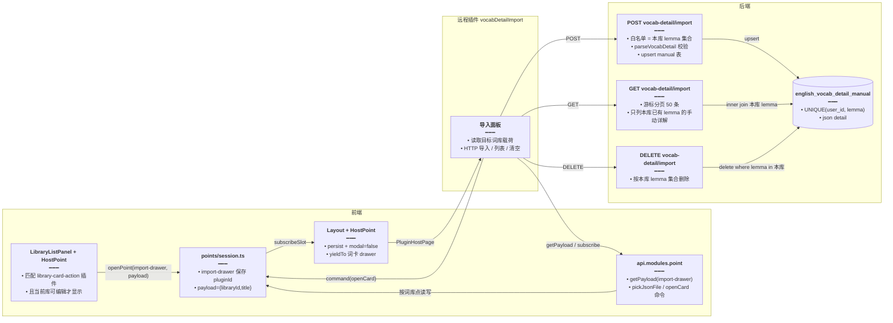
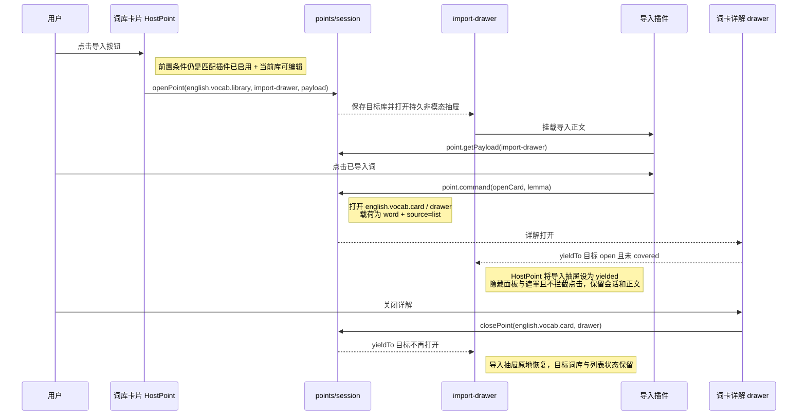

# 手动导入单词详解：JSON 批量入库与专属抽屉

> **状态**：已落地 | **日期**：2026-11-13 | **功能域**：英语学习
> **需求摘要**：词库卡片上新增「导入详解」按钮，打开右侧抽屉粘贴或上传 JSON，把单词详解批量写入**当前用户**的手动详解表；不进全站缓存、不影响其他用户。导入只接受本库已有的词面，校验失败的条目会跳过并回传样本。

> [!IMPORTANT]
> **2026-11-14 当前实现迁移**：导入宿主已从 `vocabDetailImport/session.ts`、`ImportDrawer.tsx`、`api.modules.vocabDetailImport` 与 `modules:vocabDetailImport`，迁到词库扩展点的 **`library-card-action` → `import-drawer` + `api.modules.point` + `modules:point`**。现行宿主总览见 [学习页扩展点](./学习页扩展点.md)，通用协议见 [声明式扩展点](../plugins/声明式扩展点.md)，Remote 五方法契约与选文件语义见 [统一 point 模块桥](../plugins/统一point模块桥.md)。
>
> **本文当前定位**：§4 的手动详解表、导入白名单、校验、upsert、删除与接口仍是当前后端主文档；Remote 导入面板业务记录仍有价值。§5 是 **2026-11-13 前端历史基线**，旧专属会话、抽屉和桥接代码中的“当前”不代表现行宿主。
>
> **当前用户行为**：词库卡片只有在 `library-card-action` 匹配到已启用插件且 `isOwned !== false`（库可编辑）时才显示导入按钮；`HostPoint` 把 `{ libraryId, title }` 写入 `import-drawer` 载荷。导入、列表和详解由声明式槽位协调，`import-drawer` 在词卡详解打开时按 `yieldTo` 隐藏让位，关闭详解后恢复。词库上下文按白名单只发布 `libraryId`，列表统计走 `stats` signal；无匹配插件的槽位不占位。

## 延伸阅读

- 同轮姊妹稿（多来源优先级与停止生成）：[单词详解缓存与抽屉.md](./单词详解缓存与抽屉.md)
- 同轮姊妹稿（列表绑定词库与 Redis 缓存）：[单词详解列表.md](./单词详解列表.md)
- 插件侧实现（提示词 / JSON 选择 / 导入统计 / 清空）：[单词详解导入插件.md](./单词详解导入插件.md)
- 插件注册与宿主接入：[单词详解插件接入.md](../plugins/单词详解插件接入.md)
- 业务页插件槽统一模板：[宿主插件集成指南](../plugins/宿主插件集成指南.md)

---

## 1. 背景与目标

全站缓存的详解由模型统一生成，质量稳定但**不可个性化**。用户有时想给特定词写自己的释义、搭配或例句，也可能从别的词典工具导出 JSON 后批量灌进来。本轮补一条**手动导入**链路：

1. **用户隔离**：手动详解写入 `english_vocab_detail_manual`，按 `(user_id, lemma)` 唯一，不进全站缓存、对其他用户不可见。
2. **只导入本库已有词**：导入前先取本库所有 lemma 做白名单，不在库里的词直接跳过并回传样本，避免脏数据。
3. **严格校验**：每条 detail 走 `parseVocabDetail` 校验结构，不合格跳过。
4. **幂等覆盖**：同一 `(user_id, lemma)` 重复导入直接 upsert 覆盖，并区分「新增」与「覆盖」计数。
5. **可整库删除**：按当前库的 lemma 集合批量删该用户的手动详解，不碰全站缓存。
6. **抽屉叠加**：导入抽屉与详解抽屉都挂在布局层，详解打开时导入抽屉隐藏遮罩与面板、不拦截点击，避免两个右滑抽屉互相抢焦点。

## 2. 改动范围与当前路径

后端行仍是当前实现索引；前端行已按 2026-11-14 的词库扩展点更新。旧 `ImportDrawer` 与专属模块桥只在 §5 留作历史档案。

| 层 | 路径 | 说明 |
| --- | --- | --- |
| 后端 | `apps/backend/src/services/english-learning/entity/english-vocab-detail-manual.entity.ts` | 手动详解表实体 |
| 后端 | `apps/backend/src/migrations/1794384000733-english_vocab_detail_manual.ts` | 建表迁移（占位，由 schema sync 或后续迁移建表） |
| 后端 | `apps/backend/src/services/english-learning/vocab-detail.service.ts` | `listImportedWords` / `importManualDetails` / `deleteManualDetails` |
| 后端 | `apps/backend/src/services/english-learning/english-learning.controller.ts` | `GET/POST/DELETE vocab-detail/import` |
| 后端 | `apps/backend/src/services/english-learning/english-learning.module.ts` | 实体注册 |
| 前端 | `apps/frontend/src/federation/host/HostPoint.tsx` | 渲染导入 action 与持久非模态抽屉，按 `yieldTo` 让位给词卡详解 |
| 前端 | `apps/frontend/src/federation/points/catalog.ts` | 声明 `library-card-action` 打开 `import-drawer`，以及让位、上下文和命令白名单 |
| 前端 | `apps/frontend/src/federation/points/session.ts` | 保存导入槽的插件与 `{ libraryId, title }` 载荷，协调覆盖 / 让位状态 |
| 前端 | `apps/frontend/src/federation/points/api.ts` | 提供 `getPayload` / `subscribe` / `command` 等 `api.modules.point` 能力 |
| 前端 | `apps/frontend/src/federation/points/commands.ts` | 绑定 `pickJsonFile` 与 `openCard` 命令 |
| 前端 | `apps/frontend/src/views/englishLearning/library/components/LibraryListPanel.tsx` | 以“匹配插件 + 可编辑”为条件渲染 `HostPoint` 导入按钮 |
| 前端 | `apps/frontend/src/views/englishLearning/Layout.tsx` | 按目录挂载导入抽屉，离开英语学习时统一关闭 |
| 前端 | `apps/frontend/src/federation/runtime/index.ts` | 以 `modules:point` 注入词库扩展点 API |
| 前端 | `apps/frontend/src/components/design/Drawer/index.tsx` | 承载 `modal` / 遮罩 / 外部交互等通用抽屉行为 |
| 前端 | `apps/frontend/src/components/ui/sheet.tsx` | `plainOverlay` 自绘遮罩 |
| 前端 | `apps/frontend/src/federation/host/PluginHostSurface.tsx` | 承载词库页面自挂的列表抽屉，与导入槽位协调 |

## 3. 实现思路

### 3.1 当前数据流（2026-11-14）



### 3.2 当前导入抽屉与详解抽屉的让位时序



### 3.3 关键决策与权衡

| 决策 | 备选 | 为什么选它 |
| --- | --- | --- |
| 手动详解单独建表 | 复用缓存表加 `user_id` 列 | 缓存表按 `cache_key` 唯一且跨用户共享；手动详解必须按用户隔离，单独表更干净 |
| 导入只接受本库已有 lemma | 允许导入任意词 | 手动详解要在「单词详解列表」里展示，列表基于本库 lemma 合并；不在库里的词没地方展示 |
| 用 `parseVocabDetail` 校验 | 只做 JSON.parse | 结构不合法的 detail 存进去会让前端渲染崩溃，必须严格校验 |
| 抽屉叠加用 `invisible` + 透明遮罩 | 关闭导入抽屉再开详解 | 关闭再重开要重新加载插件正文，体验差；隐藏保留状态更顺滑 |
| `modal={false}` | 保持默认模态 | 模态会锁焦点，详解抽屉在上面时无法操作；非模态 + 自绘遮罩可控制拦截 |

## 4. 后端实现

### 4.1 手动详解表实体

**来源**：`apps/backend/src/services/english-learning/entity/english-vocab-detail-manual.entity.ts`（**新增**）

```typescript
// TypeORM 装饰器：列、时间戳、实体、索引、主键
import {
	Column,
	CreateDateColumn,
	Entity,
	Index,
	PrimaryGeneratedColumn,
	UpdateDateColumn,
} from 'typeorm';
// 复用缓存表的 JSON 结构类型
import type { VocabDetail } from '../vocab-detail.parse';

/** 某个账号自己导入的单词详解。不进全站缓存。 */
@Entity('english_vocab_detail_manual')
// 按用户 + 词面唯一：同一用户同一词只能有一条手动详解
@Index('UQ_evdm_user_lemma', ['userId', 'lemma'], { unique: true })
export class EnglishVocabDetailManual {
	// UUID 主键
	@PrimaryGeneratedColumn('uuid')
	id!: string;

	// 所属用户 id，int 类型与用户表一致
	@Column({ name: 'user_id', type: 'int' })
	userId!: number;

	// 规范化后的词面（小写、去多余空格），与缓存表 lemma 对齐
	@Column({ type: 'varchar', length: 120 })
	lemma!: string;

	// 结构版本号，与缓存表共用 VOCAB_DETAIL_CACHE_VERSION，用于版本漂移清理
	@Column({ name: 'schema_version', type: 'varchar', length: 16 })
	schemaVersion!: string;

	// 完整详解 JSON，结构与缓存表完全一致
	@Column({ type: 'json' })
	detail!: VocabDetail;

	// 创建时间，自动维护
	@CreateDateColumn({ name: 'created_at', type: 'timestamp' })
	createdAt!: Date;

	// 更新时间，自动维护；列表按此倒序
	@UpdateDateColumn({ name: 'updated_at', type: 'timestamp' })
	updatedAt!: Date;
}
```

### 4.2 建表迁移

**来源**：`apps/backend/src/migrations/1794384000733-english_vocab_detail_manual.ts`（**新增**，占位迁移）

```typescript
// 迁移契约：接口 + 查询器
import { MigrationInterface, QueryRunner } from 'typeorm';

// 手动详解表迁移，类名含时间戳决定执行顺序
export class EnglishVocabDetailManual1794384000733
	// 实现迁移接口
	implements MigrationInterface
{
	// up：占位，实际建表由后续迁移或 schema sync 完成
	public async up(queryRunner: QueryRunner): Promise<void> {
	}

	// down：占位
	public async down(queryRunner: QueryRunner): Promise<void> {
	}
}
```

> 实际建表 SQL 由 `1794398252308-english_vocab_detail_regen.ts` 同类迁移给出（见 [单词详解缓存与抽屉.md](./单词详解缓存与抽屉.md) 重新生成章节），本迁移仅占位。

### 4.3 列表查询 `listImportedWords`

**来源**：`apps/backend/src/services/english-learning/vocab-detail.service.ts`（**新增**，约 L726–L822）

```typescript
	/** 本库已导入的手动详解。按更新时间倒序，每页 50 条。 */
	async listImportedWords(
		// 当前用户 id
		userId: number,
		// 词库 id
		libraryId: string,
		// 游标：上一页最后一条的 updatedAt|lemma
		cursor?: string,
	// 返回分页结果
	): Promise<ImportedWordPage> {
		// 非所有者 403，避免越权查看他人手动详解
		await this.assertOwner(userId, libraryId);
		// 有游标才解析，首页跳过
		const parsed = cursor ? parseImportCursor(cursor) : null;
		// 数据库类型：MySQL 用 JSON_EXTRACT，Postgres 用 ->>
		const type = this.manualRepo.manager.connection.options.type;
		// 取第一条释义作为列表摘要，兼容两种数据库语法
		let gloss = `JSON_UNQUOTE(JSON_EXTRACT(m.detail, '$.senses[0].glossZh'))`;
		// Postgres 语法：detail->'senses'->0->>'glossZh'
		if (type === 'postgres') {
			gloss = `m.detail->'senses'->0->>'glossZh'`;
		}
		// 子查询：本库所有非空 lemma，去重
		const lemmaSub = this.libraryItems
			.createQueryBuilder('i')
			// 去重，同一 lemma 只算一次
			.distinct(true)
			// 只选 lemma 列
			.select('i.lemma', 'lemma')
			// 限定当前词库
			.where('i.libraryId = :libraryId', { libraryId })
			// 空字符串不算有效 lemma
			.andWhere("i.lemma <> ''");
		// 主查询：手动详解表 inner join 本库 lemma 子查询
		const qb = this.manualRepo
			.createQueryBuilder('m')
			// 子查询作为派生表，条件是 lemma 相等
			.innerJoin(`(${lemmaSub.getQuery()})`, 'i', 'i.lemma = m.lemma')
			// 选词面
			.select('m.lemma', 'lemma')
			// 选更新时间
			.addSelect('m.updatedAt', 'updatedAt')
			// 选第一条释义作为摘要
			.addSelect(gloss, 'glossZh')
			// 限定当前用户
			.where('m.userId = :userId', { userId })
			// 只列当前结构版本
			.andWhere('m.schemaVersion = :v', { v: VOCAB_DETAIL_CACHE_VERSION })
			// 合并子查询参数
			.setParameters({
				...lemmaSub.getParameters(),
				userId,
				v: VOCAB_DETAIL_CACHE_VERSION,
			});
		// 总数：克隆查询器只 count，不影响主查询
		const counted = await qb
			.clone()
			// 只查计数
			.select('COUNT(*)', 'cnt')
			.getRawOne<{ cnt?: string | number }>();
		// 有游标时追加游标条件：时间更早，或时间相同但 lemma 更小
		if (parsed) {
			qb.andWhere(
				'(m.updatedAt < :t OR (m.updatedAt = :t AND m.lemma < :lemma))',
				{ t: new Date(parsed.updatedAt), lemma: parsed.lemma },
			);
		}
		// 取本页原始行，多取一条判断是否还有下一页
		const rows = await qb
			// 主排序：更新时间倒序
			.orderBy('m.updatedAt', 'DESC')
			// 次级排序：词面倒序，保证游标稳定
			.addOrderBy('m.lemma', 'DESC')
			// 多取一条用于判断 hasMore
			.limit(IMPORT_PAGE + 1)
			.getRawMany<{
				lemma?: unknown;
				updatedAt?: unknown;
				glossZh?: unknown;
			}>();
		// 多出一条即说明还有下一页
		const hasMore = rows.length > IMPORT_PAGE;
		// 有下一页就裁掉探测用的那条
		const page = hasMore ? rows.slice(0, IMPORT_PAGE) : rows;
		// 取本页最后一条，用于生成下一页游标
		const last = page.at(-1);
		// 下一页游标初始化为空
		let nextCursor: string | null = null;
		// 只有还有下一页且拿到最后一条时才生成游标
		if (hasMore && last) {
			nextCursor = `${new Date(last.updatedAt as string | Date).toISOString()}${LIST_CURSOR_SEP}${String(last.lemma)}`;
		}
		// 组装返回体
		return {
			// 行映射：统一类型转换
			items: page.map((row) => ({
				// 词面转字符串
				lemma: String(row.lemma),
				// 摘要只接受字符串，否则空串
				glossZh: typeof row.glossZh === 'string' ? row.glossZh : '',
				// 更新时间转 ISO 字符串
				updatedAt: new Date(row.updatedAt as string | Date).toISOString(),
			})),
			// 下一页游标
			nextCursor,
			// 全量条数
			total: Number(counted?.cnt) || 0,
		};
	}
```

### 4.4 导入 `importManualDetails`

**来源**：`apps/backend/src/services/english-learning/vocab-detail.service.ts`（**新增**，约 L834–L925）

```typescript
	async importManualDetails(
		// 当前用户 id
		userId: number,
		// 词库 id
		libraryId: string,
		// 待导入条目数组：{ word, detail }
		items: unknown[],
	): Promise<{
		// 新增条数
		imported: number;
		// 覆盖条数
		overwritten: number;
		// 不在本库的条数
		skippedNotInLibrary: number;
		// 校验失败的条数
		skippedInvalid: number;
		// 不在本库的样本（最多若干）
		skippedNotInLibrarySample: string[];
		// 校验失败的样本
		skippedInvalidSample: string[];
		// 被覆盖的样本
		overwrittenSample: string[];
	}> {
		// 单次最多 2000 条，防止请求体过大
		if (items.length > 2000) {
			throw new BadRequestException('一次最多导入 2000 条');
		}
		// 非所有者 403
		await this.assertOwner(userId, libraryId);
		// 白名单：本库所有 lemma 的集合
		const allowed = new Set(await this.lemmasInLibrary(libraryId));
		// 同一 lemma 多次出现时只保留最后一条
		const latest = new Map<string, VocabDetail>();
		// 不在本库的计数
		let skippedNotInLibrary = 0;
		// 校验失败的计数
		let skippedInvalid = 0;
		// 不在本库的样本数组
		const skippedNotInLibrarySample: string[] = [];
		// 校验失败的样本数组
		const skippedInvalidSample: string[] = [];
		// 样本收集工具：非空才 push
		const sample = (bucket: string[], word: string) => {
			if (word) bucket.push(word);
		};
		// 逐条处理
		for (const item of items) {
			// 只接受对象类型
			const row =
				item && typeof item === 'object'
					? (item as { word?: unknown; detail?: unknown })
					: null;
			// 词面只接受字符串
			const raw = typeof row?.word === 'string' ? row.word : '';
			// 规范化词面
			const lemma = normalizeVocabLemma(raw);
			// 不在白名单或词面为空，跳过
			if (!lemma || !allowed.has(lemma)) {
				skippedNotInLibrary += 1;
				sample(skippedNotInLibrarySample, raw.trim() || lemma);
				continue;
			}
			// 严格校验 detail 结构
			const detail = parseVocabDetail(row?.detail, lemma);
			// 校验失败，跳过
			if (!detail) {
				skippedInvalid += 1;
				sample(skippedInvalidSample, raw.trim() || lemma);
				continue;
			}
			// 合法则放入 latest，同 lemma 后到覆盖先到
			latest.set(lemma, detail);
		}
		// 没有合法条目，直接返回统计
		if (latest.size === 0) {
			return {
				imported: 0,
				overwritten: 0,
				skippedNotInLibrary,
				skippedInvalid,
				skippedNotInLibrarySample,
				skippedInvalidSample,
				overwrittenSample: [],
			};
		}
		// 查已有：哪些 lemma 已经有手动详解，用于区分新增/覆盖
		const had = new Set(
			(
				await this.manualRepo.find({
					// 限定当前用户 + 待导入 lemma 集合
					where: { userId, lemma: In([...latest.keys()]) },
					// 只选 id 和 lemma
					select: { id: true, lemma: true },
				})
			).map((row) => row.lemma),
		);
		// 新增计数
		let imported = 0;
		// 覆盖计数
		let overwritten = 0;
		// 被覆盖的样本
		const overwrittenSample: string[] = [];
		// 逐条 upsert
		for (const [lemma, detail] of latest) {
			await this.manualRepo.upsert(
				{
					userId,
					lemma,
					schemaVersion: VOCAB_DETAIL_CACHE_VERSION,
					detail,
				},
				// 冲突键：用户 + 词面
				['userId', 'lemma'],
			);
			// 已有则计覆盖
			if (had.has(lemma)) {
				overwritten += 1;
				overwrittenSample.push(lemma);
			} else {
				// 否则计新增
				imported += 1;
			}
			// 更新该用户该词的列表缓存（Redis 有序集合）
			await this.patchLemmaForUser(userId, lemma);
		}
		// 返回完整统计
		return {
			imported,
			overwritten,
			skippedNotInLibrary,
			skippedInvalid,
			skippedNotInLibrarySample,
			skippedInvalidSample,
			overwrittenSample,
		};
	}
```

### 4.5 删除 `deleteManualDetails`

**来源**：`apps/backend/src/services/english-learning/vocab-detail.service.ts`（**新增**，约 L929–L937）

```typescript
	async deleteManualDetails(
		// 当前用户 id
		userId: number,
		// 词库 id
		libraryId: string,
	// 返回删除条数
	): Promise<{ deleted: number }> {
		// 非所有者 403
		await this.assertOwner(userId, libraryId);
		// 取本库所有 lemma
		const lemmas = await this.lemmasInLibrary(libraryId);
		// 本库为空则直接返回 0
		if (lemmas.length === 0) return { deleted: 0 };
		// 按 lemma 集合删除该用户的手动详解，不碰全站缓存
		const result = await this.manualRepo.delete({
			userId,
			lemma: In(lemmas),
		});
		// 逐个更新列表缓存（从 Redis 有序集合移除）
		for (const lemma of lemmas) await this.patchLemmaForUser(userId, lemma);
		// 返回实际删除条数
		return { deleted: result.affected ?? 0 };
	}
```

### 4.6 接口层

**来源**：`apps/backend/src/services/english-learning/english-learning.controller.ts`（**改动后**，约 L1298–L1349）

```typescript
	/** 本库已导入的手动详解。不打模型，非所有者 403。 */
	// 路由：GET vocab-detail/import
	@Get('vocab-detail/import')
	async listVocabDetailImport(
		// 取当前登录用户
		@Req() req: AuthedRequest,
		// 词库 id，必填
		@Query('libraryId') libraryId?: string,
		// 游标
		@Query('cursor') cursor?: string,
	) {
		// 未登录 401
		const userId = req.user?.userId;
		if (userId == null) throw new UnauthorizedException('未授权');
		// libraryId 为空 400
		if (typeof libraryId !== 'string' || !libraryId.trim()) {
			throw new BadRequestException('libraryId');
		}
		// 空串当首页
		const pageCursor = typeof cursor === 'string' ? cursor.trim() : '';
		// 调服务层列表
		return this.vocabDetailService.listImportedWords(
			userId,
			libraryId.trim(),
			pageCursor || undefined,
		);
	}

	/** 手动导入详解。不写全站缓存，非所有者 403。 */
	// 路由：POST vocab-detail/import
	@Post('vocab-detail/import')
	async importVocabDetail(
		// 取当前登录用户
		@Req() req: AuthedRequest,
		// 请求体：libraryId + items 数组
		@Body()
		body: { libraryId?: unknown; items?: unknown },
	) {
		// 未登录 401
		const userId = req.user?.userId;
		if (userId == null) throw new UnauthorizedException('未授权');
		// libraryId 非字符串或 items 非数组，400
		if (typeof body?.libraryId !== 'string' || !Array.isArray(body.items)) {
			throw new BadRequestException('文件无效');
		}
		// 调服务层导入
		return this.vocabDetailService.importManualDetails(
			userId,
			body.libraryId,
			body.items,
		);
	}

	/** 按当前库词面删除该用户的手动详解，不删全站缓存。 */
	// 路由：DELETE vocab-detail/import
	@Delete('vocab-detail/import')
	async deleteVocabDetailImport(
		// 取当前登录用户
		@Req() req: AuthedRequest,
		// 词库 id，必填
		@Query('libraryId') libraryId?: string,
	) {
		// 未登录 401
		const userId = req.user?.userId;
		if (userId == null) throw new UnauthorizedException('未授权');
		// libraryId 为空 400
		if (typeof libraryId !== 'string' || !libraryId.trim()) {
			throw new BadRequestException('文件无效');
		}
		// 调服务层删除
		return this.vocabDetailService.deleteManualDetails(userId, libraryId);
	}
```

## 5. 前端实现（2026-11-13 历史基线）

> **历史代码阅读边界**：本节的 `federation/modules/vocabDetailImport/session.ts`、`ImportDrawer.tsx`、`openVocabImport`、`modules.vocabDetailImport` 与 `modules:vocabDetailImport` 均为迁移前记录，保留当时新增代码是为了追溯后端联调和叠层设计，**不是当前接入方式**。现行导入 action、`import-drawer` 载荷、`yieldTo` 与 `api.modules.point` 以 §2、§3 和两篇扩展点主文档为准；后端 §4 不受迁移影响。

### 5.1 导入抽屉会话单例（历史）

**来源**：`apps/frontend/src/federation/modules/vocabDetailImport/session.ts`（**新增**）

```typescript
// 导入目标：词库 id + 标题
export type VocabImportTarget = {
	libraryId: string;
	title: string;
};

// 会话状态：是否打开 + 目标库
type Session = {
	open: boolean;
	target: VocabImportTarget | null;
};

// 模块级会话缓存
let session: Session = { open: false, target: null };
// 订阅者集合
const listeners = new Set<() => void>();

// 通知所有订阅者
function emit(): void {
	for (const listener of [...listeners]) listener();
}

// 读会话副本，避免外部直接改内部对象
export function readVocabImportSession(): Session {
	return {
		open: session.open,
		target: session.target ? { ...session.target } : null,
	};
}

// 打开导入抽屉：必须有 libraryId
export function openVocabImport(target: VocabImportTarget): void {
	// libraryId 为空则忽略
	if (!target.libraryId.trim()) return;
	// 更新会话
	session = {
		open: true,
		target: { libraryId: target.libraryId, title: target.title },
	};
	// 通知订阅者
	emit();
}

// 关闭导入抽屉
export function closeVocabImport(): void {
	// 已经关闭且无目标则跳过，避免重复 emit
	if (!session.open && !session.target) return;
	// 清空状态
	session = { open: false, target: null };
	// 通知订阅者
	emit();
}

// 取当前目标库（插件用）
export function getTarget(): VocabImportTarget | null {
	return session.target ? { ...session.target } : null;
}

// 订阅会话变化，返回退订函数
export function subscribeVocabImport(listener: () => void): () => void {
	// 加入订阅集合
	listeners.add(listener);
	// 返回退订函数
	return () => listeners.delete(listener);
}
```

### 5.2 布局层唯一导入抽屉

**来源**：`apps/frontend/src/views/englishLearning/components/vocab/ImportDrawer.tsx`（**新增**）

```typescript
// 设计系统抽屉
import { Drawer } from '@design/Drawer';
// React hooks
import { useEffect, useRef, useState } from 'react';
// 联邦：插件槽、插件标题取词、样式域、已启用插件、门户目标声明
import {
	claimPluginPortalTarget,
	clearPluginPortalClaim,
	pickPluginLocaleText,
	styleRealmKey,
	useHostSurfacePlugins,
} from '@/federation';
// 插件宿主页面（加载远程插件正文）
import { PluginHostPage } from '@/federation/host/PluginHostPage';
// 详解会话：监听详解是否打开，用于叠加控制
import {
	readVocabDetailSession,
	subscribeVocabDetail,
} from '@/federation/modules/vocabDetail/session';
// 导入会话
import {
	closeVocabImport,
	readVocabImportSession,
	subscribeVocabImport,
} from '@/federation/modules/vocabDetailImport/session';
// 多语言
import { useI18n } from '@/hooks';
// 与详解抽屉共用宽度常量
import { vocabDrawerWidth } from './DetailDrawer';

/** 词库列表上唯一的导入抽屉。插件正文只加载一次。 */
export function VocabImportDrawer() {
	// 取当前语言，用于插件标题
	const { locale } = useI18n();
	// 取词库表面的导入插件
	const plugins = useHostSurfacePlugins('english.vocab.library');
	// 导入会话状态
	const [session, setSession] = useState(readVocabImportSession);
	// 详解是否打开：用于控制导入抽屉的叠加表现
	const [detailOpen, setDetailOpen] = useState(
		() => readVocabDetailSession().open,
	);

	// 订阅导入会话变化
	useEffect(
		() => subscribeVocabImport(() => setSession(readVocabImportSession())),
		[],
	);

	// 订阅详解会话变化，同步 detailOpen
	useEffect(
		() =>
			subscribeVocabDetail(() => {
				const next = readVocabDetailSession().open;
				setDetailOpen((prev) => (prev === next ? prev : next));
			}),
		[],
	);

	// 找到导入插件：id 为 vocabDetailImport 且 slot 为 library-card-action
	const plugin = plugins.find(
		(item) =>
			item.id === 'vocabDetailImport' &&
			item.host?.slot === 'library-card-action',
	);
	// 实际打开条件：会话打开且插件存在
	const open = session.open && Boolean(plugin);
	// 记录已声明的门户目标 id，用于清理
	const claimedId = useRef<string | null>(null);
	// 打开时声明门户目标，让插件正文挂载到正确位置
	if (open && plugin) {
		claimPluginPortalTarget(
			plugin.id,
			styleRealmKey(plugin.entry, plugin.remoteName, plugin.id),
		);
		claimedId.current = plugin.id;
	} else if (claimedId.current) {
		// 关闭时清理门户声明
		clearPluginPortalClaim(claimedId.current);
		claimedId.current = null;
	}

	// 插件被卸载时自动关闭导入抽屉
	useEffect(() => {
		if (session.open && !plugin) closeVocabImport();
	}, [plugin, session.open]);

	// 不跟详解抽屉抢滚动锁，只在导入自己打开时把页面滚定住
	useEffect(() => {
		// 未打开则不处理
		if (!open) return;
		// 记录原来的 overflow
		const prev = document.body.style.overflow;
		// 锁定页面滚动
		document.body.style.overflow = 'hidden';
		// 卸载时恢复
		return () => {
			document.body.style.overflow = prev;
		};
	}, [open]);

	// 抽屉标题：插件多语言标题，兜底用 id
	const title = plugin
		? pickPluginLocaleText(plugin.title, locale) || plugin.id
		: '';
	// 详解是否盖在上面：是则隐藏导入抽屉
	const covered = open && detailOpen;

	return (
		<Drawer
			// 受控打开
			open={open}
			// 非模态：不锁焦点，详解抽屉可以在上面操作
			modal={false}
			// 自绘遮罩，不走 Radix 默认遮罩
			plainOverlay
			// 详解盖着时遮罩透明且不拦截点击
			overlayClassName={
				covered ? 'pointer-events-none opacity-0' : undefined
			}
			// 详解盖着时面板隐藏
			className={covered ? 'invisible' : undefined}
			// 标题
			title={title}
			// 与详解抽屉同宽
			width={vocabDrawerWidth}
			// 内容区无内边距，插件自己控制
			bodyClassName="overflow-hidden p-0"
			// 点击遮罩：详解盖着时阻止默认关闭
			onInteractOutside={(event) => {
				if (covered) event.preventDefault();
			}}
			// 关闭处理
			onOpenChange={(next) => {
				// 只处理关闭
				if (!next) {
					// 详解盖着时不允许关闭导入抽屉
					if (detailOpen) return;
					// 清理门户声明
					if (claimedId.current) {
						clearPluginPortalClaim(claimedId.current);
						claimedId.current = null;
					}
					// 关闭会话
					closeVocabImport();
				}
			}}
		>
			{/* 插件存在才渲染正文 */}
			{plugin ? (
				<div className="h-full min-h-0">
					<PluginHostPage
						pluginId={plugin.id}
						part="drawer"
						className="h-full min-h-0"
					/>
				</div>
			) : null}
		</Drawer>
	);
}
```

### 5.2.1 Sheet 的 `plainOverlay`

**来源**：`apps/frontend/src/components/ui/sheet.tsx`（**改动后**，约 L45–L69）

**背景**：两个抽屉需要叠加。Radix 的 `Overlay` 在非模态下依旧是一层带模态语义的节点，嵌套两个 `Dialog` 时焦点与滚动会被互相抢；而完全不要遮罩又会让「导入」抽屉看起来悬空、点击面板外没有视觉反馈。需要一个「有视觉遮罩、但没有 Radix 模态行为」的中间态。

**改动前**：`SheetContent` 既不支持 `overlayClassName`，也不支持 `plainOverlay`，永远渲染不带任何定制的 `SheetOverlay`：

```tsx
// apps/frontend/src/components/ui/sheet.tsx（改动前，约 L45–L58）
function SheetContent({
	className,
	children,
	side = 'right',
	// 没有遮罩定制能力，只能整体接收 Content 的 props
	...props
}: React.ComponentProps<typeof SheetPrimitive.Content> & {
	side?: 'top' | 'right' | 'bottom' | 'left';
}) {
	return (
		<SheetPortal>
			{/* Radix 遮罩，带模态语义，且无法从外部改类名 */}
			<SheetOverlay />
			<SheetPrimitive.Content
				data-slot="sheet-content"
				className={cn(
					'[&>button]:hidden bg-theme-background border-theme/10 data-[state=open]:animate-in data-[state=closed]:animate-out fixed z-50 flex flex-col gap-4 shadow-lg transition ease-in-out data-[state=closed]:duration-300 data-[state=open]:duration-500',
					side === 'right' &&
						'data-[state=closed]:slide-out-to-right data-[state=open]:slide-in-from-right inset-y-0 right-0 h-full w-3/4 border-l sm:max-w-sm',
					className,
				)}
				{...props}
			>
				{children}
			</SheetPrimitive.Content>
		</SheetPortal>
	);
}
```

**改动后**：新增 `plainOverlay` 开关。开启时用普通 `div` 画一层同样颜色的遮罩，不进入 Radix 的 overlay 体系，于是两个抽屉各自独立控制显示与隐藏：

```tsx
// apps/frontend/src/components/ui/sheet.tsx（改动后，约 L45–L69）
function SheetContent({
	className,
	children,
	side = 'right',
	// 允许外部覆盖遮罩类名，叠加时用来改透明度和拦截行为
	overlayClassName,
	// 新增：改为自绘遮罩，不交给 Radix
	plainOverlay,
	...props
}: React.ComponentProps<typeof SheetPrimitive.Content> & {
	side?: 'top' | 'right' | 'bottom' | 'left';
	overlayClassName?: string;
	/** 不用 Radix 遮罩。非模态抽屉也要有一层能藏起来的遮罩 */
	plainOverlay?: boolean;
}) {
	return (
		<SheetPortal>
			{/* 自绘遮罩：颜色与 Radix 版一致，但没有模态语义 */}
			{plainOverlay ? (
				<div
					className={cn(
						'fixed inset-0 z-50 bg-theme-background/80',
						overlayClassName,
					)}
				/>
			) : (
				// 未开启时保持原有 Radix 遮罩，其他调用方零改动
				<SheetOverlay className={overlayClassName} />
			)}
			<SheetPrimitive.Content
				data-slot="sheet-content"
				className={cn(
					'[&>button]:hidden bg-theme-background border-theme/10 data-[state=open]:animate-in data-[state=closed]:animate-out fixed z-50 flex flex-col gap-4 shadow-lg transition ease-in-out data-[state=closed]:duration-300 data-[state=open]:duration-500',
					side === 'right' &&
						'data-[state=closed]:slide-out-to-right data-[state=open]:slide-in-from-right inset-y-0 right-0 h-full w-3/4 border-l sm:max-w-sm',
					side === 'left' &&
						'data-[state=closed]:slide-out-to-left data-[state=open]:slide-in-from-left inset-y-0 left-0 h-full w-3/4 border-r sm:max-w-sm',
					side === 'top' &&
						'data-[state=closed]:slide-out-to-top data-[state=open]:slide-in-from-top inset-x-0 top-0 h-auto border-b',
					side === 'bottom' &&
						'data-[state=closed]:slide-out-to-bottom data-[state=open]:slide-in-from-bottom inset-x-0 bottom-0 h-auto border-t',
					className,
				)}
				{...props}
			>
				{children}
			</SheetPrimitive.Content>
		</SheetPortal>
	);
}
```

**设计要点**：

- 遮罩颜色与 Radix 版保持 `bg-theme-background/80`，切换实现不改视觉。
- `plainOverlay` 是可选开关，未传时的行为与改动前完全一致，避免影响其他 Sheet 调用方。
- 叠加场景由调用方传入 `overlayClassName="pointer-events-none opacity-0"` 把遮罩藏起来，因此这层 `div` 必须支持外部类名覆盖。

### 5.3 词库卡片导入按钮

**来源**：`apps/frontend/src/views/englishLearning/library/components/LibraryListPanel.tsx`（**改动后**，约 L106–L110, L405–L412, L577–L599）

**改动前**：词库卡片操作区只有练习、导出、编辑、删除，没有导入按钮。

**改动后**：

```typescript
	// 取词库表面的导入插件
	const importPlugin = useHostSurfacePlugins('english.vocab.library').find(
		(plugin) =>
			// 插件 id 为 vocabDetailImport
			plugin.id === 'vocabDetailImport' &&
			// 槽位为 library-card-action
			plugin.host?.slot === 'library-card-action',
	);

	// ...

	// 是否显示导入按钮：仅单词库 + 所有者 + 插件启用
	const showImport =
		kind === 'vocab' && showEdit && Boolean(importPlugin);
	// 操作按钮总数：用于计算 hover 时右侧预留宽度
	const actionCount =
		practiceActions +
		1 +
		(showEdit ? 1 : 0) +
		(canDelete ? 1 : 0) +
		(showImport ? 1 : 0);

	// ...

	{/* 导入按钮：仅单词库所有者且插件启用时显示 */}
	{showImport && importPlugin && vocabLib ? (
		<Button
			// 幽灵按钮
			variant="ghost"
			// 小尺寸
			size="sm"
			// 点击：打开导入抽屉
			onClick={(e) => {
				// 阻止冒泡，避免触发卡片选中
				e.stopPropagation();
				// 打开导入抽屉，传入词库 id 与标题
				openVocabImport({
					libraryId: vocabLib.id,
					title: vocabLib.title?.trim() || '',
				});
			}}
			// 样式：与其它操作按钮一致
			className={cn(
				'h-7 w-7 shrink-0 rounded-md p-0 transition-colors',
				'text-textcolor/65 hover:border hover:border-teal-500/15 hover:bg-teal-500/10 hover:text-teal-500',
			)}
			// 无障碍标签：插件标题
			aria-label={
				pickPluginLocaleText(importPlugin.title, locale) ||
				importPlugin.id
			}
		>
			{/* 上传图标 */}
			<FileUp className="size-3.5" />
		</Button>
	) : null}
```

### 5.4 插件桥 `modules:vocabDetailImport`

**来源**：`apps/frontend/src/federation/runtime/index.ts`（**改动后**，约 L180–L186）

```typescript
		// 插件请求了 modules:vocabDetailImport 才注入
		if (allow.has('modules:vocabDetailImport')) {
			modules.vocabDetailImport = {
				// 取当前导入目标（词库 id + 标题）
				getTarget,
				// 订阅导入抽屉开关
				subscribe: subscribeVocabImport,
				// 点词打开详解：复用详解插件的打开逻辑
				open: openVocabDetailWord,
			};
		}
```

**变更摘要**：新增 `modules:vocabDetailImport` 桥，向导入插件暴露目标库信息、抽屉订阅和点词打开详解能力。

### 5.5 布局挂载

**来源**：`apps/frontend/src/views/englishLearning/Layout.tsx`（**改动后**）

```typescript
// 导入会话：离开英语学习时关闭
import { closeVocabImport } from '@/federation/modules/vocabDetailImport/session';
// 导入抽屉组件
import { VocabImportDrawer } from './components/vocab/ImportDrawer';

export default function Layout() {
	// ...
	// 离开英语学习时同时关闭详解与导入抽屉
	useEffect(() => {
		return () => {
			closeVocabDetail();
			closeVocabImport();
		};
	}, []);

	return (
		<div className="h-full min-h-0 w-full min-w-0">
			<Outlet />
			{/* 导入在前，详解后挂到 body，同一层叠时详解盖在上面 */}
			<VocabImportDrawer />
			<VocabDetailDrawer />
		</div>
	);
}
```

**变更摘要**：挂载 `VocabImportDrawer`，放在 `VocabDetailDrawer` 之前使详解层叠在导入之上；离开路由时关闭导入抽屉。

## 6. 兼容性与影响

- **接口**：`GET/POST/DELETE vocab-detail/import` 均需登录；非词库所有者返回 403。
- **数据隔离**：手动详解按 `(user_id, lemma)` 隔离，不进全站缓存，不影响其他用户。
- **导入上限**：单次最多 2000 条。
- **白名单**：只导入本库已有 lemma 的词，不在库里的词跳过并回传样本。
- **严格校验**：每条 detail 必须通过 `parseVocabDetail`，不合格跳过。
- **入口条件**：当前仅 `library-card-action` 有匹配已启用插件且 `isOwned !== false` 时显示；`HostPoint` 自身在无匹配插件时也不占位，可编辑判断仍由词库卡片负责。
- **槽位与权限**：导入目标存于 `english.vocab.library / import-drawer` 载荷，插件通过 `modules:point` 获得词库点的 `api.modules.point`；文件选择与打开详解只能调用目录允许的 `pickJsonFile` / `openCard` 命令。
- **抽屉叠加**：`import-drawer` 以 `persist + modal=false + yieldTo` 与详解抽屉同时保留会话；详解打开时导入隐藏且不拦截，关闭后原地恢复。

### 回归建议

1. 未启用匹配 `english.vocab.library / library-card-action` 的 `vocabDetailImport` 插件 → 词库卡片无导入按钮且不留占位；插件未获得 `modules:point` 时无 `api.modules.point`。
2. 非所有者打开公开库 → 即使导入插件已启用也无导入按钮（`showEdit = isOwned !== false`，`showImport` 同时要求匹配插件存在）。
3. 导入不在本库的词 → 返回 `skippedNotInLibrary` 计数与样本。
4. 导入结构不合法的 detail → 返回 `skippedInvalid` 计数与样本。
5. 重复导入同一词 → 返回 `overwritten` 计数与样本。
6. 打开导入抽屉后点词 → 详解抽屉盖在上面，导入抽屉不可见且不拦截。
7. 关闭详解 → 导入抽屉恢复可见。
8. 删除词库 → 该库的手动详解列表缓存被清除（`dropLibraryListCache`）。

## 7. 相关源码路径

| 说明 | 路径 |
| --- | --- |
| 手动详解实体 | `apps/backend/src/services/english-learning/entity/english-vocab-detail-manual.entity.ts` |
| 建表迁移 | `apps/backend/src/migrations/1794384000733-english_vocab_detail_manual.ts` |
| 导入服务 | `apps/backend/src/services/english-learning/vocab-detail.service.ts` |
| 导入接口 | `apps/backend/src/services/english-learning/english-learning.controller.ts` |
| 通用扩展点渲染与让位 | `apps/frontend/src/federation/host/HostPoint.tsx` |
| 导入槽位与能力目录 | `apps/frontend/src/federation/points/catalog.ts` |
| 导入槽会话与载荷 | `apps/frontend/src/federation/points/session.ts` |
| 扩展点 API | `apps/frontend/src/federation/points/api.ts` |
| 文件选择与 openCard 命令 | `apps/frontend/src/federation/points/commands.ts` |
| 词库卡片 | `apps/frontend/src/views/englishLearning/library/components/LibraryListPanel.tsx` |
| 布局挂载 | `apps/frontend/src/views/englishLearning/Layout.tsx` |
| `modules:point` 权限注入 | `apps/frontend/src/federation/runtime/index.ts` |
| 抽屉组件 | `apps/frontend/src/components/design/Drawer/index.tsx` |
| Sheet 组件 | `apps/frontend/src/components/ui/sheet.tsx` |
| 宿主槽位 | `apps/frontend/src/federation/host/PluginHostSurface.tsx` |

---

（若与仓库最新源码不一致，以源码为准）
