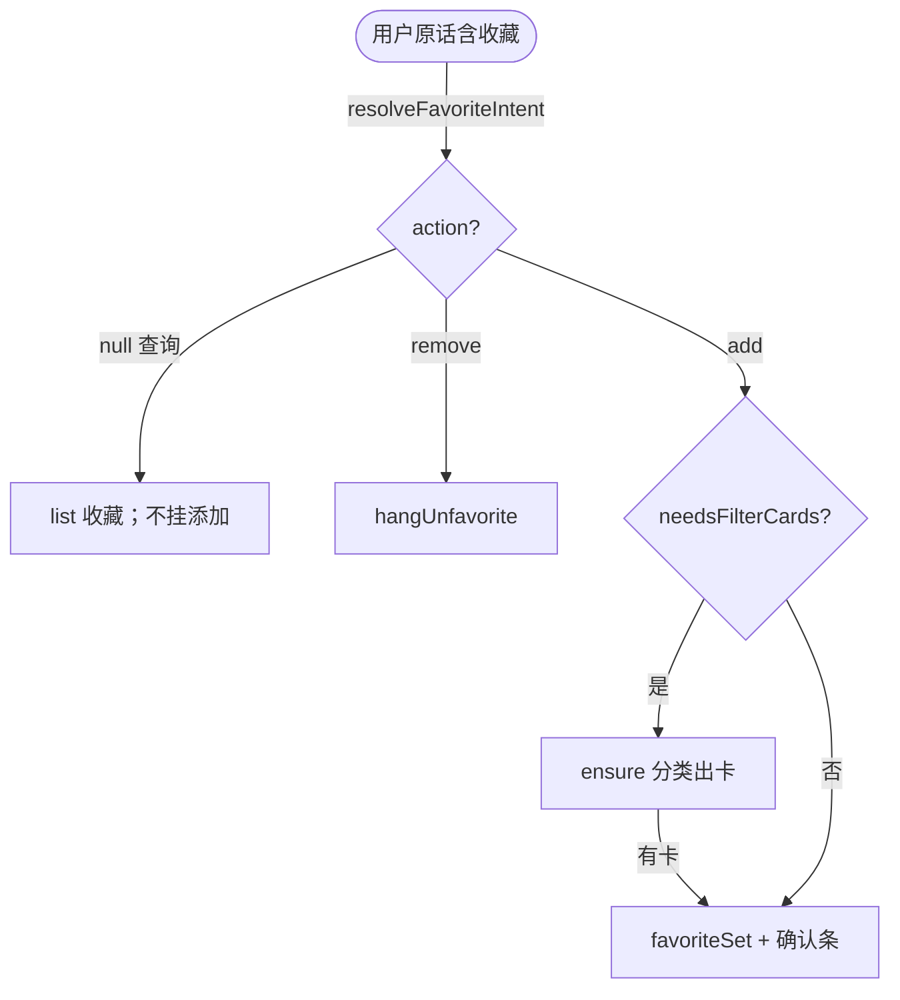

# 收藏意图总闸

> **文档角色**：英语 Agent 收藏域意图谓词与选卡主文档  
> **日期**：2026-10-31  
> **延伸阅读**：[语境意图总路由](./语境意图总路由.md)（总路由消费本闸）、[筛选卡续答与整类收藏](./筛选卡续答与整类收藏.md)

## 1. 背景与目标

基线 `favoriteAsk` 只认窄 SAVE_RE，且无法区分查询 / 取消 / 软添加；「当前收藏了哪些」会误挂确认，「那帮我取消」断窗，「需要收藏…关于…」缺卡就报「上面没有」。本轮在 `favorite-ask.ts` 落地 `resolveFavoriteIntent` 及配套谓词，供总路由与挂条共用。

## 2. 改动范围

- `apps/backend/src/services/agent/tools/english/favorite-ask.ts`（意图谓词、选卡、挂条文案）
- `apps/backend/src/services/agent/agent.service.ts`（读 `favorite_add` / `needsFilterCards` / `ensureFavoriteFilterCards`）

## 3. 实现思路

- **收藏域内优先级**：cancel → query → SAVE/soft-add。
- **名单不信模型散文**：`favoriteSet` 只收 `source=library`，窗口 richest；有筛选卡则丢整库卡。
- **复合句**：`favoriteNeedsFilterCards` 为真时先 `ensureFavoriteFilterCards` 再挂确认。



**读图要点**：查询与取消永不进添加挂条；关于类收藏必须先有库筛选卡。

## 4. 关键实现（改动前 / 改动后对比 + 注释）

### 4.1 `favoriteAsk` → `resolveFavoriteIntent`

**对比范围**：基线 `favoriteAsk` 全函数 vs 当前 `resolveFavoriteIntent` + 新 `favoriteAsk` 包装。

**改动前** · `apps/backend/src/services/agent/tools/english/favorite-ask.ts`（基线，约 L10–L23）

```typescript
// 旧拒绝收藏说法：仅少数「取消/不要」
const REJECT_RE = /取消收藏|移除收藏|不要收藏|别收藏/;
// 旧保存动词：覆盖面窄，认不出「都收藏 / 需要收藏」
const SAVE_RE =
	/进行收藏|加入收藏|收藏这些|收藏它们|收藏他们|帮我收藏|把.{0,24}收藏/;

/** 只看用户原话。查询「语句收藏」不算保存。 */
export function favoriteAsk(userText: string): FavoriteAsk | null {
	// 去空白
	const text = userText.trim();
	// 空句、取消句、无保存动词 → 不收藏
	if (!text || REJECT_RE.test(text) || !SAVE_RE.test(text)) return null;
	// 是否点名语句
	const classic = /语句|句子|经典句/.test(text);
	// 是否点名单词
	const vocab = /单词|词汇|词书/.test(text);
	// 只语句
	if (classic && !vocab) return { action: 'add', kind: 'classic' };
	// 只单词
	if (vocab && !classic) return { action: 'add', kind: 'vocab' };
	// 两侧或未点名 → card 指代
	return { action: 'add', kind: 'card' };
}
```

**改动后** · `apps/backend/src/services/agent/tools/english/favorite-ask.ts`（当前，约 L11–L120）

```typescript
// 收藏域结构化意图：add / remove / 查询(null)
export type FavoriteIntent = {
	// null 表示查询或非收藏操作
	action: 'add' | 'remove' | null;
	// both 表示词句一起
	side: 'vocab' | 'classic' | 'both' | 'card';
};

// 扩展保存动词：都收藏 / 再收藏 / 将…收藏
const SAVE_RE =
	/进行收藏|加入收藏|重新收藏|再收藏|又收藏|收藏这些|收藏它们|收藏他们|帮我收藏|把.{0,24}收藏|将.{0,12}收藏|都收藏|一起收藏/;
// 语句侧关键词
const CLASSIC_RE = /语句|句子|经典句/;
// 单词侧关键词
const VOCAB_RE = /单词|词汇|词书/;
// 盘点/疑问优先，避免「当前收藏了哪些」被打成 add
const FAVORITE_QUERY_RE =
	/收藏(列表|夹)|看看收藏|查看收藏|打开收藏|我的收藏|语句收藏里|单词收藏里|当前收藏|收藏了哪些|收藏了什么|有哪些收藏|有什么收藏|哪些单词和语句|收藏了哪些单词|收藏了哪些语句/;
// 无硬动词时的软添加
const SOFT_ADD_RE = /需要收藏|想收藏|要收藏|给我收藏/;
// 指代 + 收藏
const SOFT_REF_RE = /之前|上述|这些|它们|他们|刚才|刚刚/;

// 含「那帮我取消」：不进闸会断回扫窗
const CANCEL_RE =
	/取消收藏|移除收藏|不要收藏|别收藏|取消吧|(?:那)?(?:帮我)?取消(?:吧|掉|了)?$/;
// 同句还在找新内容则不当纯取消
const CANCEL_TOPIC_RE = /找出|生成|分类|关于|有关/;

// 没点名英文的取消；非 null 只表示取消意图
export function unfavoriteFromCards(
	userText: string,
): 'both' | 'vocab' | 'classic' | null {
	// 去空白
	const text = userText.trim();
	// 空句或含英文词 → 不当范围取消
	if (!text || /[A-Za-z]{2,}/.test(text)) return null;
	// 夹杂找词/生成话题，或未命中取消说法
	if (CANCEL_TOPIC_RE.test(text) || !CANCEL_RE.test(text)) return null;
	// 侧写：只语句 / 只单词 / 两侧
	const classic = CLASSIC_RE.test(text);
	const vocab = VOCAB_RE.test(text);
	if (vocab && !classic) return 'vocab';
	if (classic && !vocab) return 'classic';
	return 'both';
}

/** 询问已有收藏：不挂添加确认。 */
export function isFavoriteQuery(userText: string): boolean {
	const text = userText.trim();
	// 无「收藏」字样直接否
	if (!text || !/收藏/.test(text)) return false;
	// 显式盘点说法
	if (FAVORITE_QUERY_RE.test(text)) return true;
	// 疑问词 + 收藏
	if (/哪些|什么|多少|有没有|列出/.test(text) && /收藏/.test(text)) {
		// 「帮我收藏哪些」仍是保存
		if (SAVE_RE.test(text)) return false;
		return true;
	}
	return false;
}

/** 无 SAVE_RE 时的添加：需要收藏… / 指代 + 收藏。 */
export function isFavoriteSoftAdd(userText: string): boolean {
	const text = userText.trim();
	if (SOFT_ADD_RE.test(text)) return true;
	if (SOFT_REF_RE.test(text) && /收藏/.test(text)) return true;
	return false;
}

/** 收藏且关于类：必须先有筛选卡。 */
export function favoriteNeedsFilterCards(userText: string): boolean {
	const intent = resolveFavoriteIntent(userText);
	if (intent.action !== 'add') return false;
	return isCategoryAsk(userText);
}

/**
 * 本轮收藏意图总闸。取消优先；查询优先于添加。
 */
export function resolveFavoriteIntent(userText: string): FavoriteIntent {
	const text = userText.trim();
	if (!text) return { action: null, side: 'card' };
	const cancel = unfavoriteFromCards(text);
	if (cancel) return { action: 'remove', side: cancel };
	if (!/收藏/.test(text)) return { action: null, side: 'card' };
	if (isFavoriteQuery(text)) return { action: null, side: 'card' };
	const verb = SAVE_RE.test(text);
	const soft = isFavoriteSoftAdd(text);
	if (!verb && !soft) return { action: null, side: 'card' };
	const classic = CLASSIC_RE.test(text);
	const vocab = VOCAB_RE.test(text);
	if (classic && vocab) return { action: 'add', side: 'both' };
	if (vocab) return { action: 'add', side: 'vocab' };
	if (classic) return { action: 'add', side: 'classic' };
	return { action: 'add', side: 'card' };
}

/** 只看用户原话。查询不算保存。两侧都点名时 kind 仍是 card。 */
export function favoriteAsk(userText: string): FavoriteAsk | null {
	const intent = resolveFavoriteIntent(userText);
	if (intent.action !== 'add') return null;
	if (intent.side === 'vocab') return { action: 'add', kind: 'vocab' };
	if (intent.side === 'classic') return { action: 'add', kind: 'classic' };
	return { action: 'add', kind: 'card' };
}

/** 收藏句里同时写了单词和语句。 */
export function favoriteAsksBoth(userText: string): boolean {
	const intent = resolveFavoriteIntent(userText);
	return intent.action === 'add' && intent.side === 'both';
}
```

**变更摘要**：由单一 `favoriteAsk` 扩展为取消/查询/软添加分层；`favoriteAsk` 变为 add 投影。

### 4.2 挂条条件改读总路由 flags（摘录）

**对比范围**：轮末添加收藏分支条件。

**改动前**（基线：常直接 `favoriteAsk(dto.content)` 或未分查询）

```typescript
// 旧：只要 favoriteAsk 非空就尝试挂添加确认，查询说法易误入
if (favoriteAsk(dto.content) && !elSurface.openProposalId) {
	// ... favoriteSet + propose
}
```

**改动后** · `apps/backend/src/services/agent/agent.service.ts`（当前，约 L1675–L1720）

```typescript
// 只在总路由判定为添加收藏时挂条
if (
	dto.assistMode === 'english_learning' &&
	elSurface.intent?.kind === 'favorite_add' &&
	!elSurface.openProposalId &&
	businessSessionId
) {
	// ... hydrateScopeHistory / favoriteSet
	// 是否必须先分类出卡，来自总路由 flags
	const needsFilter = Boolean(elSurface.intent?.needsFilterCards);
	// 缺卡时补分类，禁止立刻「上面没有」
	if (needsFilter && (!plan || !plan.hang)) {
		await this.ensureFavoriteFilterCards({
			userId,
			userText: dto.content,
			side: elSurface.intent?.side ?? 'card',
			surface: elSurface,
			turnElResources,
			signal: abortController.signal,
			emit: (card) => {
				subscriber.next({
					type: 'elResourceList',
					data: forSse(card),
				});
			},
		});
		// ... 再算 favoriteSet
	}
}
```

**变更摘要**：挂条条件与 ensure 开关统一吃 `intent`，查询/生成不会进此分支。

## 5. 行为变化与兼容性

- 「我当前收藏了哪些」→ 查询，不弹确认。
- 「那帮我取消」→ 取消进闸，不断下一句「上述」选卡窗。
- 「需要收藏…关于家庭…」→ 先出筛选卡再确认；失败用软失败文案。
- 「将上述都收藏」→ 窗口 richest 库卡，不扫复习 other。

## 6. 测试与回归建议

| 用例 | 期望 |
|------|------|
| 当前收藏了哪些单词和语句 | 无添加确认 |
| 那帮我取消 → 再都收藏 | 确认条跟窗口筛选卡，非整库 107+51 |
| 需要收藏三年级…关于家庭 | 有卡或软失败，无「上面没有单词卡」 |

## 7. 相关源码路径

| 说明 | 路径 |
|------|------|
| 收藏意图谓词 | `apps/backend/src/services/agent/tools/english/favorite-ask.ts` |
| 挂条 / ensure | `apps/backend/src/services/agent/agent.service.ts` |
| 总路由消费 | `apps/backend/src/services/agent/tools/english/english-intent.ts` |

---

（若与仓库最新源码不一致，以源码为准）
