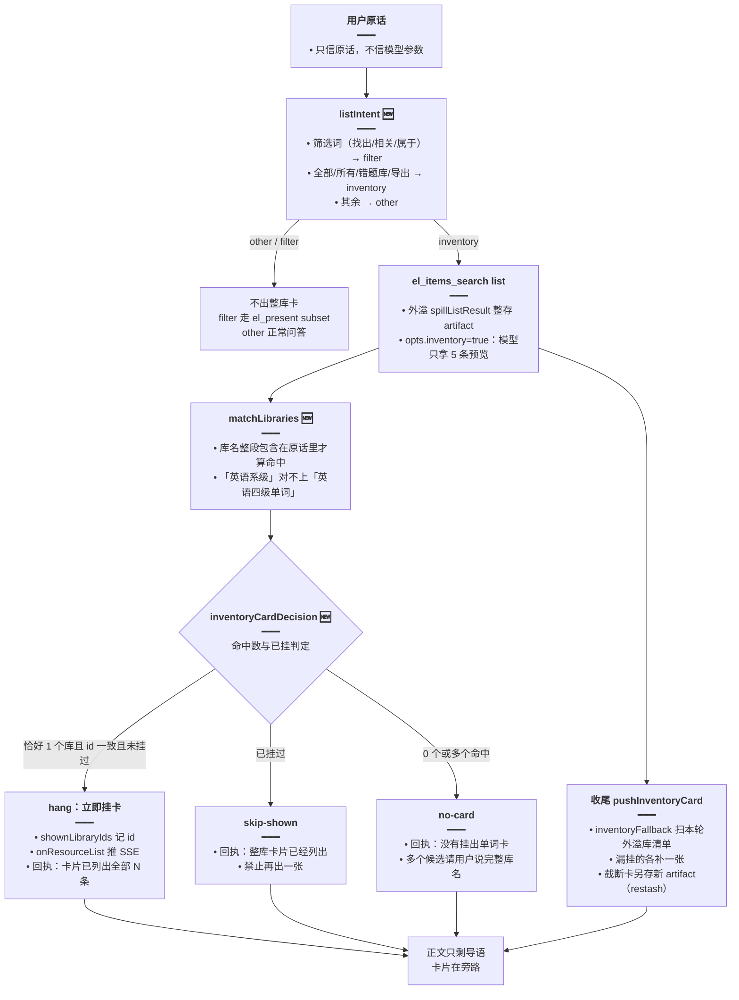

# 整库问法稳定出卡

> **路径**：`el-spill.ts` 已迁到 `apps/backend/src/services/agent/tools/english/spill.ts`；`english-learning-domain-tools.ts` 已迁到 `tools/english/domain-tools.ts`。下文代码块与行号对应迁前版本。
>
> 相关文档：
> - 规划稿：[整库全量出卡](../../ideas/english/整库全量出卡.md)、[整库稳定出卡](../../ideas/english/整库稳定出卡.md)、[意图决定出卡](../../ideas/english/意图决定出卡.md)
> - 姊妹功能：[英语 Agent 领域工具](./英语Agent领域工具.md)、[Agent 大结果旁路展示](./Agent大结果旁路展示.md)
> - 后继更新（2026-10-29）：[词句分类列出](./词句分类列出.md)、[筛选卡续答与整类收藏](./筛选卡续答与整类收藏.md)、[分类截断续批](./分类截断续批.md)
> - 复合意图补丁与通用化（2026-10-31）：[Agent复合意图通用化](./Agent复合意图通用化.md)
> - 意图帧 M3（2026-11-01）：[英语Agent意图帧](./英语Agent意图帧.md)——`INVENTORY_RE` 迁入 `intent-phrases.ts`（`listIntent` 改调 `inventoryPhraseHit`）、`FILTER_RE` 补「关于」、挂卡直判换 `planHas`；本文的 `listIntent` / `wantsLibraryCatalog` 代码块对应迁前版本

## 1. 背景与目标

「整库问法」指用户要求把一个库全部列出，例如「列出英语四级单词库的所有单词」「我的错题本里有哪些错题」。接入 `el_*` 工具后，这类问法暴露出三个不稳定：

- **猜库不稳**：模型自己决定查哪个库，多问几次可能每次猜的库都不一样。
- **重复出卡**：模型可能先 `el_items_search list` 再 `el_present`，同一个库挂出两张卡。
- **假出卡**：模型声称「已列出全部」，但实际什么卡都没挂。

本轮把出卡决策从模型手里收回后端：**只看用户原话**做意图判定与库名匹配，整库卡由后端在满足条件时直接挂上（模型回执里只剩一句「卡片已列出全部 N 条」）；收尾时再扫一遍「整库问法下还没挂出的库清单」，漏挂的自动补卡；模型只要说「没有挂出单词卡」就禁止它声称已生成。

目标：

- 原话恰好对上一个库（库名整段包含在原话里）才挂整库卡；0 个或多个匹配都不挂，杜绝模型猜库。
- 同一库一轮只挂一张卡；已挂过再问直接告知「整库卡片已经列出」。
- 整库问法下所有外溢的库清单在收尾时兜底补卡，模型漏调用工具也有卡。
- 整库卡前端直连库接口分页拉满（几千条也完整），不走 artifact 快照。
- 问「最早 / 最新一篇笔记」时，即使模型没调 `get` 也补一张笔记卡。

## 2. 改动范围

| 文件 | 改动 | 作用 |
| --- | --- | --- |
| `apps/backend/src/services/agent/el-spill.ts` | 新增 | `listIntent` / `matchLibraries` / `inventoryCardDecision` / `cardAlreadyShown` / `inventoryFallback` / `ElListSurface` |
| `apps/backend/src/services/agent/english-learning-domain-tools.ts` | 新增 | wrap 内整库挂卡分支、`loadCatalog` 库名清单缓存、`missingNoteCard` 笔记补卡 |
| `apps/backend/src/services/agent/agent.service.ts` | 修改 | `elSurface` 会话表面状态、`pushInventoryCard` 收尾补卡、流末 `missingNoteCard` 补笔记卡 |
| `apps/backend/src/services/agent/agent.prompt.ts` | 修改 | 提示词第 7 条整库出卡规则（「卡片已列出」/「没有挂出单词卡」话术约束） |
| `apps/frontend/src/components/design/Assistant/ResourceListBlock.tsx` | 新增 | 整库卡 `live` 直连分页拉满（见 [Agent 大结果旁路展示](./Agent大结果旁路展示.md) §4.20） |

## 3. 实现思路

### 3.1 出卡决策流程



### 3.2 要点

- **判定只看原话**：`listIntent` 与 `matchLibraries` 的输入都是 `dto.content`（用户原话），模型填的任何参数都不参与出卡决策——这是「稳定」的核心：同一句话无论模型怎么发挥，出卡结果一致。
- **筛选词优先于列出词**：`listIntent` 先测 `filter` 再测 `inventory`——「找出英语四级单词库里和人体相关的词」虽含库名与「找出」，但意图是筛选，不挂整库卡。
- **去重两级**：`shownLibraryIds` 记录本轮已挂的库 id / artifactId；`inventoryCardDecision` 返回 `skip-shown` 时改写模型回执文案，从话术上堵死「再出一张」。
- **兜底补卡**：`inventoryFallback` 在收尾（正常收尾与中断收尾）各跑一次，把本轮外溢过但还没挂的库清单补齐；被字符硬顶截尾的清单会**另存新 artifact**（`restash`），保证卡片数据与「已列出 N/M」标题一致。
- **笔记补卡独立成链**：问「最早 / 最新一篇笔记」时，流末由 `AgentService` 直接调 `missingNoteCard` 补一张单篇笔记卡，不依赖模型是否调了 `el_notes get`。

## 4. 关键代码与注释

### 4.1 意图判定：`listIntent`（`el-spill.ts`，新增）

> 来源：`apps/backend/src/services/agent/el-spill.ts`（新增文件，约 L23-L36）——改动后

```typescript
// 清单意图三分类：整库 / 筛选 / 其它
export type ListIntent = 'inventory' | 'filter' | 'other';

// 筛选特征词：出现即视为筛选，不再挂整库卡
const FILTER_RE = /找出|筛|相关|有关|哪些是|属于|人体|挑出|主题/;
// 整库特征词：要求「全部 / 整个库 / 导出 / 错题库」等全量语义
const INVENTORY_RE =
	// 命中「全部 / 所有 / 错题库」等任一词即判整库问法
	/全部|所有单词|所有词|整个库|导出|列出全部|哪些错题|有哪些错|错题库|我的错题|列出错题|重新练习/;
/** 「所有英语四级单词库中的单词」：库名隔在「所有」和「单词」之间 */
const ALL_WORDS_RE = /所有.{0,16}(单词|词条|的词)/;

/** 只看用户原话。筛选词优先于「列出 / 全部」。 */
export function listIntent(userText: string): ListIntent {
	// 先测筛选：含「找出 / 相关 / 属于」等词的一律不当整库
	if (FILTER_RE.test(userText)) return 'filter';
	// 再测整库：常规特征词或「所有……单词」的隔字形态
	if (INVENTORY_RE.test(userText) || ALL_WORDS_RE.test(userText)) return 'inventory';
	// 其余问法不涉及清单出卡
	return 'other';
}
```

### 4.2 库名匹配与会话表面状态（`el-spill.ts`，新增）

> 来源：`apps/backend/src/services/agent/el-spill.ts`（新增文件，约 L38-L56）——改动后

```typescript
// wrap 与 AgentService 共享的本轮出卡表面状态：跨工具调用持续更新
export type ElListSurface = {
	// 用户原话：所有判定的唯一输入
	userText: string;
	/** 索引类 list 外溢的全量，默认不推卡片 */
	libraryLists: ElResourceListPayload[];
	// 本轮是否已有卡片挂出
	presented: boolean;
	/** 本轮已经挂出的库或 artifact，同一 id 不再挂第二张 */
	shownLibraryIds: Set<string>;
	/** 库名清单，用来和原话做包含匹配 */
	catalog: { id: string; title: string }[];
	// 已缓存清单的种类（vocab / classic），换种类要重拉
	catalogKind?: 'vocab' | 'classic';
};

/** 库名整段出现在原话里才算命中。「英语系级」对不上「英语四级单词」。 */
export function matchLibraries(
	// 用户原话：匹配的唯一输入
	userText: string,
	// 候选库清单：只带 id 与库名
	libs: { id: string; title: string }[],
// 只返回原话完整包含库名的库
): { id: string; title: string }[] {
	// includes 整段包含：用户必须把库名完整说出来，防猜库
	return libs.filter((lib) => lib.title.length > 0 && userText.includes(lib.title));
}
```

### 4.3 出卡决策与去重（`el-spill.ts`，新增）

> 来源：`apps/backend/src/services/agent/el-spill.ts`（新增文件，约 L58-L82）——改动后

```typescript
/**
 * 整库词条卡只在原话恰好对上一个库、且该库本轮还没挂过时挂上。
 * 0 个或多个库名都不挂，避免模型每次猜不同的库。
 */
// 出卡三态判定：hang 挂卡 / skip-shown 已挂 / no-card 不挂
export function inventoryCardDecision(
	// 用户原话：意图与库名匹配的唯一输入
	userText: string,
	// 候选库名清单
	libs: { id: string; title: string }[],
	// 本次 list 实际查的库 id
	libraryId: string,
	// 本轮已挂出的库 id 集合
	shown: ReadonlySet<string>,
// 恰好命中唯一库且未挂过才返回 hang
): 'hang' | 'skip-shown' | 'no-card' {
	// 非整库问法直接不挂
	if (listIntent(userText) !== 'inventory') return 'no-card';
	// 用原话对库名清单做整段包含匹配
	const hits = matchLibraries(userText, libs);
	// 必须恰好命中一个库、且本次 list 的就是这个库；否则不挂
	if (hits.length !== 1 || hits[0].id !== libraryId) return 'no-card';
	// 本轮已挂过：告诉模型别再出第二张
	if (shown.has(libraryId)) return 'skip-shown';
	// 恰好命中且本轮未挂过：挂卡
	return 'hang';
}

/** 这些 id 都已经挂过卡。空列表不算已挂。 */
export function cardAlreadyShown(
	// 待检查的库 / artifact id 列表（可含空）
	ids: Array<string | undefined>,
	// 本轮已挂出的 id 集合
	shown: ReadonlySet<string>,
// 全部非空 id 都挂过才算已挂
): boolean {
	// 先过滤掉空 id，避免 undefined 干扰 every 判定
	const keys = ids.filter((id): id is string => !!id && id.length > 0);
	// 空列表不算「已挂」；非空则全部挂过才算
	return keys.length > 0 && keys.every((id) => shown.has(id));
}
```

### 4.4 收尾兜底补卡：`inventoryFallback`（`el-spill.ts`，新增）

> 来源：`apps/backend/src/services/agent/el-spill.ts`（新增文件，约 L337-L374，完整符号）——改动后

```typescript
/**
 * 整库问法里还没挂出的每一份清单各补一张。同一 id 用最后一次。
 * 筛选和讲解不补。restash：裁过尾的行必须另存 artifact。
 */
// 兜底补卡：返回待补载荷及是否需另存 artifact
export function inventoryFallback(
	// 用户原话：判定是否整库问法
	userText: string,
	// 本轮外溢过的全部清单
	libraryLists: ElResourceListPayload[],
	// 本轮已挂出的 id 集合
	shownIds: ReadonlySet<string>,
// 每份未挂清单对应一条补卡结果
): { payload: ElResourceListPayload; restash: boolean }[] {
	// 只在整库问法下补卡；筛选与讲解题不补
	if (listIntent(userText) !== 'inventory') return [];
	// 按 库id/artifactId 去重：同一清单多次外溢只留最后一次
	const byId = new Map<string, ElResourceListPayload>();
	// 遍历外溢清单做去重与已挂过滤
	for (const row of libraryLists) {
		// 清单身份：库 id 优先，退而 artifact id
		const id = row.libraryId ?? row.artifactId;
		// 已挂过的跳过
		if (shownIds.has(id)) continue;
		// 同 id 后写覆盖先写，只留最后一次外溢
		byId.set(id, row);
	}
	// 对去重后的每份清单生成补卡载荷
	return [...byId.values()].map((row) => {
		// 整库卡（词库 / 语料库）：前端直连拉满，截断标记直接清掉，无需另存
		if (
			// 只处理库来源的清单
			row.source === 'library' &&
			// 必须带库 id 前端才能直连拉满
			row.libraryId &&
			// 内容种类限词库 / 语料库
			(row.contentKind === 'vocab' || row.contentKind === 'classic')
		) {
			// 整库卡前端直连拉满：清掉截断标记，无需另存
			return { payload: { ...row, truncated: false }, restash: false };
		}
		// 非整库清单：按字符硬顶裁尾
		const items = row.items ?? [];
		// 按字符硬顶试裁，得到放得下的一组
		const fit = fitItemsByChars({ title: row.title }, items);
		// 没裁到：原 artifact 直接可用
		if (!fit.truncated) return { payload: row, restash: false };
		// 裁过尾：必须另存新 artifact，否则卡片拿到的是全量而标题写着「已列出 N/M」
		return {
			// 裁过尾：调用方必须另存新 artifact
			restash: true,
			// 裁尾后的补卡载荷
			payload: {
				// 继承原清单其余字段
				...row,
				// 换成裁尾后放得下的一组
				items: fit.items,
				// 如实标记已截断
				truncated: true,
				// 标题如实写「已列出 N / 共 M」
				title: `${row.title}（已列出 ${fit.items.length} / ${row.totalCount}）`,
			},
		};
	});
}
```

### 4.5 wrap 内的整库挂卡分支（`english-learning-domain-tools.ts`，新增）

`wrap` 主流程全量见 [英语 Agent 领域工具](./英语Agent领域工具.md)；这里摘录与整库出卡相关的判定与挂卡段。

> 来源：`apps/backend/src/services/agent/english-learning-domain-tools.ts`（新增文件，`wrap` 内挂卡段，约 L490-L567）——改动后

```typescript
// 索引类 / 检索类 op 不自动出卡（瘦索引留给模型筛选）
const hideCard = isIndexOp(name, op) || isSearchOp(name, op);
// 笔记单篇 get 单独走一条出卡链
const noteOpen = name === 'el_notes' && op === 'get';
// 整库问法 = 索引类 op + 原话命中 inventory 意图
const inventory =
	// 索引 / 检索类默认不自动出卡
	hideCard &&
	// 且确为索引类 op
	isIndexOp(name, op) &&
	// 且原话命中整库意图
	listIntent(deps.surface.userText) === 'inventory';
// 外溢：inventory 时模型只拿 5 条预览；slim/always 保证索引类必走外溢通道
const spilled = await spillListResult(
	// 工具名与 op 决定外溢通道
	name,
	// 工具调用上下文
	env,
	// 整存 artifact 的写入回调
	(row) => deps.artifacts.put(deps.userId, row),
	{
		// 索引类 / 笔记单篇只给模型瘦身预览
		slim: hideCard || noteOpen,
		// 索引类 / 笔记单篇必走外溢整存
		always: hideCard || noteOpen,
		// 整库问法：模型只拿 5 条预览
		inventory,
	},
);
// 外溢成功才进入挂卡判定
if (spilled) {
	// ...（笔记单篇 get 的出卡分支略，noteOpen 时单独处理）
	// 整库问法且查到具体库：做出卡决策
	if (inventory && name === 'el_items_search' && spilled.full.libraryId) {
		// 库种类决定拉哪套库名清单
		const kind = spilled.full.contentKind === 'classic' ? 'classic' : 'vocab';
		// 确保 surface.catalog 里有当前种类的库名清单
		await loadCatalog(kind);
		// 本次 list 命中的库 id
		const libraryId = spilled.full.libraryId;
		// 三板斧决策：hang / skip-shown / no-card
		const decision = inventoryCardDecision(
			// 用户原话
			deps.surface.userText,
			// 库名清单
			deps.surface.catalog,
			// 本次 list 的库
			libraryId,
			// 本轮已挂集合
			deps.surface.shownLibraryIds,
		);
		// hang：恰好命中唯一库且未挂过
		if (decision === 'hang') {
			// 记录已挂，防重复
			deps.surface.shownLibraryIds.add(libraryId);
			// 标记本轮已有卡挂出
			deps.surface.presented = true;
			// 进兜底清单（收尾 inventoryFallback 再去重）
			deps.surface.libraryLists.push(spilled.full);
			// 立即推 SSE 出卡
			deps.onResourceList?.(spilled.full);
		// 已挂过：只改话术，不再挂第二张
		} else if (decision === 'skip-shown') {
			// 改写回执：从话术上堵死「再出一张」
			spilled.model.message = '整库卡片已经列出，禁止再出一张。';
		// 决策为 no-card：走禁言回执分支
		} else {
			// no-card：告诉模型为什么没挂卡
			const hits = matchLibraries(
				// 用户原话
				deps.surface.userText,
				// 库名清单
				deps.surface.catalog,
			);
			// 按命中个数给出不同回执
			spilled.model.message =
				// 恰好对上一个库但 id 不一致：指引模型 list 正确的库
				hits.length === 1
					// 恰好命中一个：指引模型改 list 该库
					? `没有挂出单词卡。原话只对上「${hits[0].title}」。请 list 该库，禁止写已经生成，也不要写见上方或见下方。`
					// 0 个或多个命中：请用户说完整库名
					: '没有挂出单词卡。禁止写已经生成，也不要写见上方或见下方。请用户说出完整库名。';
		}
		// 回执已按决策改写，直接返回给模型
		return stringifyEnvelope(spilled.model);
	}
	// 其它整库清单（错题 / 收藏等）：直接挂卡并记录
	if (inventory) {
		// 进兜底清单，收尾 inventoryFallback 再复查
		deps.surface.libraryLists.push(spilled.full);
		// 标记本轮已有卡挂出
		deps.surface.presented = true;
		// 记录已挂 id，防同库重复挂
		deps.surface.shownLibraryIds.add(
			// 库 id 优先，退而 artifact id
			spilled.full.libraryId ?? spilled.full.artifactId,
		);
		// 立即推 SSE 出卡
		deps.onResourceList?.(spilled.full);
	// 非整库的索引类 op：不主动推卡
	} else if (isIndexOp(name, op)) {
		// 非整库的索引类：只进兜底清单，不主动推卡
		deps.surface.libraryLists.push(spilled.full);
	// 非隐藏卡场景：直接推卡
	} else if (!hideCard) deps.onResourceList?.(spilled.full);
	// 返回外溢后的模型回执
	return stringifyEnvelope(spilled.model);
}
```

### 4.6 库名清单缓存：`loadCatalog`（`english-learning-domain-tools.ts`，新增）

> 来源：`apps/backend/src/services/agent/english-learning-domain-tools.ts`（新增文件，`buildEnglishLearningDomainTools` 内 `loadCatalog` 闭包，约 L430-L446）——改动后

```typescript
// 本轮的库名清单缓存：决策只做包含匹配，只需 id + title
const loadCatalog = async (kind: 'vocab' | 'classic') => {
	// 同种类已拉过直接复用，一轮只拉一次
	if (deps.surface.catalogKind === kind && deps.surface.catalog.length > 0) {
		// 复用已缓存的同种类清单
		return deps.surface.catalog;
	}
	// 分页拉满库名（硬顶内），防库很多时漏匹配
	const all = await fetchAllPages(PAGE_LIBS, LIBS_HARD_CAP, async (limit, offset) => {
		// 按种类选词库表或语料库表
		const page =
			// 按种类分支选数据源
			kind === 'vocab'
				// 词库：分页查询
				? await deps.learning.listVocabularyLibraries(deps.userId, { limit, offset })
				// 语料库：分页查询
				: await deps.learning.listClassicQuotesLibraries(deps.userId, { limit, offset });
		// 适配 fetchAllPages 的返回结构
		return {
			// 只留匹配所需的最小字段
			items: page.items.map((it) => ({ id: it.id, title: it.title })),
		};
	});
	// 写入 surface，后续同种类复用
	deps.surface.catalog = all.items;
	// 记下清单种类，供下次复用判定
	deps.surface.catalogKind = kind;
	// 返回完整库名清单
	return all.items;
};
```

### 4.7 笔记补卡：`missingNoteCard`（`english-learning-domain-tools.ts`，新增）

用户问「最早 / 最新一篇笔记」时，即使模型没有调 `el_notes get`，流末也会补一张单篇笔记卡。配套的文本清洗函数把笔记 HTML 压成纯文本供卡片展示。

> 来源：`apps/backend/src/services/agent/english-learning-domain-tools.ts`（新增文件，`notePlain` / `noteLead` / `noteTitle` / `noteReadAsk`，约 L216-L262）——改动后

```typescript
// 把笔记 HTML 压成纯文本：剥标签、实体与多余空白（摘录，函数体节选）
function notePlain(html: string): string {
	// 链式清洗：从 HTML 到纯文本
	return html
		// 先剥 script / style 整段
		.replace(/<script[\s\S]*?<\/script>/gi, ' ')
		// style 整段同样剥掉
		.replace(/<style[\s\S]*?<\/style>/gi, ' ')
		// 再剥所有标签
		.replace(/<[^>]*>/g, ' ')
		// 常见实体归一为空格或原字符
		.replace(/&nbsp;/gi, ' ')
		// & 实体还原为原字符
		.replace(/&amp;/gi, '&')
		// 左尖括号实体抹成空格
		.replace(/&lt;/gi, ' ')
		// 右尖括号实体抹成空格
		.replace(/&gt;/gi, ' ')
		// 数字实体抹成空格
		.replace(/&#\d+;/g, ' ')
		// 其余具名实体一并抹掉
		.replace(/&[a-z]+;/gi, ' ')
		// 收敛连续空白
		.replace(/\s+/g, ' ')
		// 去首尾空白收尾
		.trim();
}

// 导语长度与分页页大小
const NOTE_LEAD = 24;
// 笔记列表分页页大小
const NOTE_PAGE = 100;

/** 给模型的开头。去掉链接和尖括号，只留 24 字。 */
export function noteLead(plain: string): string {
	// 链式清洗后截取导语
	return plain
		// 去 URL，防导语里出现长链接
		.replace(/https?:\/\/\S+/gi, ' ')
		// 去尖括号残留
		.replace(/[<>]/g, ' ')
		// 收敛连续空白
		.replace(/\s+/g, ' ')
		// 去首尾空白
		.trim()
		// 只留前 24 字
		.slice(0, NOTE_LEAD);
}

// 卡片标题：同口径清洗，空标题兜底「无标题」
function noteTitle(raw: string): string {
	// 同口径清洗标题文本
	const title = raw
		// 去 URL
		.replace(/https?:\/\/\S+/gi, ' ')
		// 去尖括号残留
		.replace(/[<>]/g, ' ')
		// 收敛连续空白
		.replace(/\s+/g, ' ')
		// 去首尾空白
		.trim();
	// 空标题兜底「无标题」
	return title || '无标题';
}

/** 本轮要看最早或最新的一篇。上一轮说过「卡片已列出」不算。 */
export function noteReadAsk(userText: string): 'earliest' | 'latest' | null {
	// 识别「最早 / 第一篇」与「最新 / 最后一篇 / 最近一篇」
	const earliest = /最早|第一篇/.test(userText);
	// 识别「最新 / 最后一篇 / 最近一篇」类说法
	const latest = /最新|最后一篇|最近一篇/.test(userText);
	// 两类都没提到：不是单篇阅读诉求
	if (!earliest && !latest) return null;
	// 必须同时出现「笔记 / 内容 / 一篇」，防「最早学英语是什么时候」误判
	if (!/笔记|内容|一篇/.test(userText)) return null;
	// 两类同时提到时按最早处理
	return earliest ? 'earliest' : 'latest';
}
```

> 来源：`apps/backend/src/services/agent/english-learning-domain-tools.ts`（新增文件，`missingNoteCard`，约 L264-L310，完整符号）——改动后

```typescript
/** 本轮没有笔记卡时，按原话补最早或最新的一篇。模型没再调用 get 也会挂上。 */
export async function missingNoteCard(
	// 笔记服务：分页拉列表、按 id 取全文
	notes: LearningNotesService,
	// 当前用户 id
	userId: number,
	// 用户原话：判定最早 / 最新诉求
	userText: string,
// 补不出卡时返回 null
): Promise<Omit<ElResourceListPayload, 'artifactId'> | null> {
	// 先判定是否单篇阅读诉求
	const which = noteReadAsk(userText);
	// 非单篇阅读诉求：不补卡
	if (!which) return null;
	// 分页拉满笔记列表（硬顶内），才能在全量里挑最早 / 最新
	const rows: Awaited<ReturnType<LearningNotesService['findPage']>>['list'] = [];
	// 逐页拉取直到拉满或撞硬顶
	for (let pageNo = 1; rows.length < USER_ROWS_HARD_CAP; pageNo += 1) {
		// 拉一页笔记列表
		const page = await notes.findPage(userId, { pageNo, pageSize: NOTE_PAGE });
		// 累积本轮已拉到的行
		rows.push(...page.list);
		// 拉满或不足一页即止
		if (rows.length >= page.total || page.list.length < NOTE_PAGE) break;
	}
	// 一篇都没有：不补卡
	if (!rows.length) return null;
	// 时间戳归一：非法值按 0，避免 NaN 比较
	const at = (v: Date | string) => {
		// 统一转毫秒时间戳
		const t = new Date(v).getTime();
		// 非法时间按 0，避免 NaN 参与比较
		return Number.isFinite(t) ? t : 0;
	};
	// 按创建时间挑出最早 / 最新一篇
	const picked = rows.reduce((best, row) => {
		// 按诉求方向比较当前行与最优行
		const better =
			// 最早取更小时间戳，最新取更大时间戳
			which === 'earliest' ? at(row.createdAt) < at(best.createdAt) : at(row.createdAt) > at(best.createdAt);
		// 更优则替换当前最优
		return better ? row : best;
	});
	// 列表行只有摘要，补卡要取完整正文
	const full = await notes.findOne(userId, picked.id);
	// 正文 HTML 压成纯文本
	const plain = notePlain(full.content ?? '');
	// 标题同口径清洗
	const title = noteTitle(full.title ?? '');
	// 拼单篇笔记卡载荷（artifactId 由调用方 put 时生成）
	return {
		// 卡片标题
		title,
		// 标记来源为笔记
		source: 'notes',
		// 单篇卡固定 1 条
		totalCount: 1,
		// 单篇不截断
		truncated: false,
		// 卡片只装这一篇
		items: [
			{
				// 笔记 id 供后续 el_notes get 定位
				id: full.id,
				// 卡片展示用标题
				titleZh: title,
				// 归属标记：本人 / 他人公开
				mine: full.isOwned ? '本人' : '他人公开',
				// 导语 24 字
				lead: noteLead(plain),
				// 纯文本正文进卡片行
				english: plain,
				// 更新时间统一转字符串
				updatedAt:
					// Date 对象走 ISO 序列化
					full.updatedAt instanceof Date
						// 转 ISO 字符串
						? full.updatedAt.toISOString()
						// 非 Date 直接字符串化，空值兜底空串
						: String(full.updatedAt ?? ''),
			},
		],
	};
}
```

调用点在 `AgentService` 主流结束后（约 L1110-L1137）：本轮还没有 `notes` 来源的卡时才补，补卡失败只记日志不影响收尾。

> 来源：`apps/backend/src/services/agent/agent.service.ts`（流末补笔记卡段，约 L1110-L1137）——改动后

```typescript
// 只在本届英语模式、且本轮还没挂过笔记卡时才考虑补卡
if (
	// 仅英语学习模式
	dto.assistMode === 'english_learning' &&
	// 且本轮还没挂过笔记卡
	!turnElResources.some((row) => row.source === 'notes')
) {
	// 补卡异常不能炸掉主流收尾
	try {
		// 判定是否「最早 / 最新一篇」诉求并挑出那篇
		const draft = await missingNoteCard(
			// 笔记服务
			this.learningNotesService,
			// 当前用户
			userId,
			// 用户原话
			dto.content,
		);
		// 判定出有可补的一篇才继续
		if (draft) {
			// 整存 artifact 拿 id
			const artifactId = await this.elArtifactStore.put(userId, draft);
			// 补上 artifactId 拼成完整载荷
			const payload = { ...draft, artifactId };
			// 进本轮清单快照并推卡
			turnElResources.push(payload);
			// 推 SSE 把卡挂到前端
			subscriber.next({ type: 'elResourceList', data: forSse(payload) });
		}
	// 兜住补卡异常
	} catch (e: unknown) {
		// 补卡失败不阻塞收尾，只记日志
		this.logger.warn?.(
			// 日志带错误详情便于排查
			`[AgentService] 补笔记卡失败: ${e instanceof Error ? e.message : e}`,
		);
	}
}
```

### 4.8 提示词整库规则片段（`agent.prompt.ts`）

提示词第 6~9 条完整前后对比见 [英语 Agent 领域工具](./英语Agent领域工具.md)；这里只摘录与整库出卡直接相关的片段。

> 来源：`apps/backend/src/services/agent/agent.prompt.ts`（`ENGLISH_LEARNING_SYSTEM_APPEND` 第 7 条片段）——改动后

```typescript
// el_libraries 规则：整库问法下回执给唯一库 id 就必须 list 它，禁止改选别的库
'el_libraries：list / compare（kind=vocab|classic）。整库问法下，回执给出唯一库 id 时必须对该 id 调用 el_items_search list，不要改选别的库。回执写「没有挂出单词卡」时禁止写已经生成，也不要写见上方或见下方。',
// el_items_search 规则：整库卡由 list 挂上；禁止再说「前若干条 / 未穷尽」
'el_items_search：list / search / sample。整库卡由 list 挂上：回执写「卡片已列出」时卡已经在，只说条数和可浏览或导出，不要写见上方或见下方。禁止再 el_present，禁止说一次最多若干条、展示上限或未穷尽。……',
// el_present 规则：整库卡由 list 挂上，不要为整库再调用 present
'el_present：{…}。……整库卡由 list 挂上，不要为整库再调用。没有回执「卡片已列出」就禁止写已经生成，也不要写见上方或见下方。讲解题不要出卡。',
```

### 4.9 前端整库卡拉满（引用）

整库卡（`source=library` 且带 `libraryId` 与 `contentKind`）在前端走 `live` 直连策略：不读 artifact 快照，直接按 `libraryId` 调词库 / 语料库接口以每页 1000 条循环拉满，边拉边渲染，虚拟滚动承载几千条。完整实现与注释见 [Agent 大结果旁路展示](./Agent大结果旁路展示.md) §4.20（`isLiveLibrary` 判定、`live` 拉取 effect、`Virtuoso` 渲染段）。

## 5. 行为变化

- **稳定性**：同一句话无论模型怎么调用工具，整库卡要么不挂、要么挂在唯一匹配的库上；重复问同一库只收到「整库卡片已经列出」。
- **模型话术**：回执文案直接约束模型——「卡片已列出全部 N 条」时禁止说「前若干条 / 未穷尽 / 见上方见下方」；「没有挂出单词卡」时禁止声称已生成。
- **整库数据完整性**：整库卡前端直连拉满，不受 artifact 字符硬顶影响；非整库兜底卡被截尾时标题如实写「已列出 N / 共 M」。
- **笔记单篇**：「最早 / 最新一篇笔记」类问题必定有卡，即使模型没调 `get`。

## 6. 风险与回归测试点

- **意图判定**：「列出英语四级单词库的所有单词」→ inventory；「找出英语四级单词库里和人体相关的词」→ filter（不出整库卡）；「所有英语四级单词库中的单词」（隔字形态）→ inventory。
- **库名匹配**：原话只写「四级」（库名「英语四级单词」）→ 不命中，回执请用户说完整库名；原话同时命中两个库 → 不挂卡。
- **去重**：同轮 list 两次同一库 → 第二次回执「整库卡片已经列出」；`el_present` 同库不再出第二张。
- **兜底补卡**：构造模型只调 list 未挂卡的场景（如 `hideCard` 分支漏挂），收尾必须补出；截尾清单补卡标题含「已列出 N / 共 M」。
- **笔记补卡**：问「我最早的一篇笔记」→ 流末补卡；本轮模型已 `get` 过笔记 → 不重复补；问「最早学英语」→ 不补。
- **提示词一致性**：模型在整库卡挂出后不应再出现「见上方」「已列出前 30 条」类话术。

---

若与仓库最新源码不一致，以源码为准。
