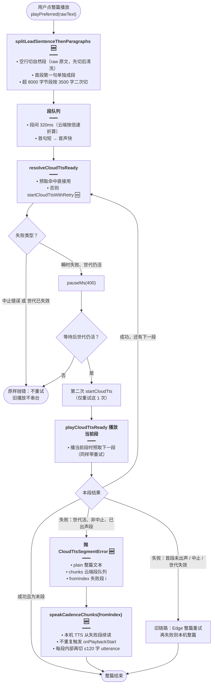
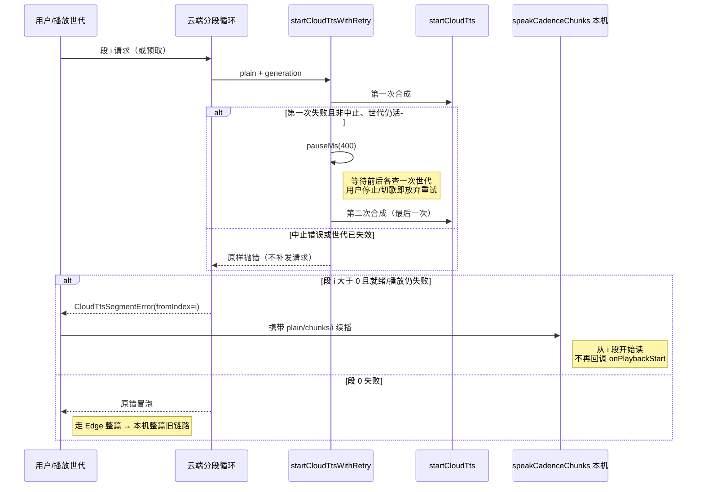

# 整篇朗读：首句领读分段、云端段重试与断点续播

> **文档角色（增量专题）**：为「每日阅读」整篇英文文章朗读新增一套分段与容错策略——首句单独成段快速首声、其余按空行段落合成（显著减少云端请求数）；同段云端失败先在 400ms 后重试 1 次；已出声之后某段再失败，本机 TTS 从失败段断点续播而非整篇重来；并新增按文章 id 隔离的磁盘缓存域 `daily_reading_<id>`。
>
> **延伸阅读**：[每日阅读生成调度.md](./每日阅读生成调度.md)（每日文章怎样生成出来）、[每日阅读前端.md](./每日阅读前端.md)（详情页播放入口与消费细节）、[TTS文件缓存L2持久化.md](./TTS文件缓存L2持久化.md)（`persistDisk` 与 Redis/uploads 二级缓存）、[EdgeTTS统一流式.md](./EdgeTTS统一流式.md)（云端失败后的 Edge 回退源）、[云端TTS分段管线.md](./云端TTS分段管线.md)（旧有句读分段 + 预取流水线）、[英语TTS播放.md](./英语TTS播放.md)（播放世代 generation 机制）。

---

## 1. 背景与目标

### 1.1 问题

- 每日阅读详情页支持对整篇英文文章点「播放」。既有云端朗读走 `splitTextForTtsCadence`：按句、再按子句切分，一篇数百词的文章会产生**几十次云端 HTTP 合成请求**。
- 请求多带来两个副作用：后端与第三方厂商（MiniMax / 讯飞 / Edge）压力大；任一中间段网络抖动都可能让整篇朗读中断，而旧逻辑一旦中断只能走「整篇 Edge → 整篇本机」，**用户已经听过的段落会被重读**。
- 首声延迟与请求数存在矛盾：段落越大请求越少，但首段越大首声越慢。

### 1.2 目标

1. **首句领读 + 段落分段**：首段第一句单独成段先出声（首声只等一句话），首段剩余与其余自然段各成一段；段落级请求把整篇的请求数从「几十句」降到「几段」。
2. **单段瞬时失败重试 1 次**：同一段云端合成失败后，等待 400ms 重试一次，吸收网络抖动；用户主动停止或切换播放（世代失效）绝不重试，防止旧播放串台。
3. **段级降级断点续播**：已出声之后某段云端失败，不再整篇重来，而是携带段索引抛出 `CloudTtsSegmentError`，由 `playPreferred` 调本机 TTS 从失败段 `fromIndex` 接着读。
4. **缓存按文章隔离**：新增 `daily_reading_<id>` 稳定缓存域，同一篇文章的整篇段落合成与逐词查读共用一份磁盘缓存。
5. **零侵入可选开关**：新行为由 `PlayPreferredOptions.leadThenParagraphs` 显式开启，听书、划词、试听等既有调用方不传即完全保持旧行为。

---

## 2. 改动范围

| 路径 | 说明 |
| ---- | ---- |
| `apps/frontend/src/utils/speech.ts` | 新增分段原语、段重试、段错误类型、本机块循环抽离；`playPreferred` 全分支透传与断点降级（约 +327 行） |
| `apps/frontend/src/views/englishLearning/utils/ttsCacheFolder.ts` | 新增 `ttsCacheScopeDailyReading(id)`（+4 行） |
| `apps/frontend/src/views/englishLearning/daily/components/DailyPlayIconButton.tsx` | 播放图标常显 teal，去掉未播放灰色态 |
| `apps/frontend/src/views/englishLearning/daily/constants/index.ts` | 测验选项字号 `text-sm` → `text-base` |

**未改**：后端 TTS 接口；`speech.ts` 既有函数对外签名（仅新增可选字段与新增导出函数）；除每日阅读详情页外无其它消费方改动。

---

## 3. 实现思路与权衡

### 3.1 为何是「首句领读 + 段落」，而不是按句或整篇

- **整篇一次合成**：请求数最少（1 次），但首段要等整篇 MP3 收齐才出声，首声延迟不可接受；且一旦中途网络失败，前面投入的合成/流量全部浪费。
- **按句打云端（旧 cadence）**：首声快，但一篇文章几十次 HTTP，请求开销与失败面都大。
- **折中落地**：`splitLeadSentenceThenParagraphs(raw)` 先按**空行**切自然段（必须在 `stripMarkdownForTts` 把空白压成一行之前切，否则段落边界丢失，因此该函数吃的是 **raw 原文**并逐段清洗），再把首段第一句（复用 `buildSentenceOffsetSpans` 定位句末跨度）单独成段：

  ```text
  [首段第一句] → [首段剩余] → [第二段] → [第三段] → …
  ```

  首句通常只有一二十个词，云端合成与下载都很快，用户点击后几乎立刻听到声音；之后的段落按空行边界成段，请求数约等于自然段数量。段间统一停顿 `PAUSE_AFTER_SENTENCE_MS = 320ms`（云端循环里还会除以期望倍速 `desiredPlaybackRate` 折算）。

- **超长段落二次切分**：云端单次合成硬上限是 `CLOUD_SINGLE_UTTERANCE_MAX_BYTES = 8000` 字节（与 Edge / 讯飞限额对齐）。某段 UTF-8 字节数超限则调 `splitLongText(text, 3500)` 按 **3500 字符**硬切。英文正文 UTF-8 基本单字节，3500 字符约 3.5KB，显著低于 8000 字节，给多字节符号、JSON 请求体外包装以及不同厂商更严的限额留出安全余量；硬切只在异常长段落发生，正常文章走不到。
- 识别不到句末标点时，`buildSentenceOffsetSpans(first)[0]?.end ?? first.length` 让**整段退化为首句**，不会因为切不出句而卡住。

### 3.2 云端单段重试：为什么恰好 1 次、400ms

- 新增内部 `startCloudTtsWithRetry(plain, generation, …)`：第一次 `startCloudTts` 抛错后，只有同时满足「**不是中止错误**」且「**播放世代仍活**」才会 `pauseMs(400)`，醒来再查一次世代，然后补发**最后一次**请求；第二次的成败直接交回上层，不再重试。
- **只重试 1 次**：要吸收的是连接重置、网关瞬时抖动这类「再来一次大概率成功」的故障；上游真的宕机时，多试只会把无音频等待线性放大，并延迟段级降级到本机的时机。
- **400ms**：短到用户几乎无感知（且下一段请求是在播放上一段期间预取的，重试窗口多数被播放过程并行掩盖），又足够让一次快速的网关/连接恢复发生。
- **中止识别**：`isAbortError` 既认标准 `DOMException` 的 `name === 'AbortError'`，也用 `/abort/i` 兜底 message——Tauri / 各 polyfill 下中止错误形态不一致。
- **世代双重检查**：世代（generation，见《英语TTS播放.md》）在等待前、等待后各查一次。旧播放被停止或用户已开始新播放时，重试请求即使晚到成功也不允许出声，否则会出现「旧文章的声音突然插播」的串台。

### 3.3 段级失败：抛带索引的错误，本机从断点续播

- 云端循环里有两处失败点：**段素材就绪**（`await pendingReady`）与**段 MP3 播放**（`playCloudTtsReady`）。旧版这两处错误直接冒泡，导致整篇失败。
- 新版在这两处 `try/catch`：若世代已失效、是中止错误、或 `i === 0`（第一段还没出声），**原样抛出**——这些情况继续走旧的「整篇 Edge → 整篇本机」链路最合理；只有「世代仍活、非中止、且 `i > 0`（用户已经听过至少一段）」才抛 `CloudTtsSegmentError`，携带三样东西：

  | 字段 | 用途 |
  | ---- | ---- |
  | `plain` | 整篇纯文本（段事件回调需要完整上下文） |
  | `chunks` | 云端切好的段队列（cadence 模式是首句/段落段；打包模式由 packs 现构一份） |
  | `fromIndex` | 失败段索引 `i`，本机从这里接着读 |

- `playPreferred` 捕获该错误后：提示云端降级 → `prepareLocalSpeechAfterCloud` 摘掉 Audio 元素并给 `speechSynthesis` settle 时间 → 调新抽出的 `speakCadenceChunks(plain, chunks, generation, hooks, fromIndex)`。本机不支持时抛 `NO_TTS`（Toast 已通知）。
- **断点语义细节**：
  - 块循环从 `fromIndex` 起，停顿条件由「`i > 0`」改为「`i > fromIndex`」——接续第一段之前不停顿；
  - `fromIndex > 0` 时不再触发 `onPlaybackStart`（早就出声了，不能让 UI 状态重置），但仍会清掉 `awaiting` 等待灯；
  - 每个 chunk 播放前内部再跑一次 `splitLongText(chunk.text, MAX_UTTERANCE_CHARS = 120)`：旧链路的 chunk 已被句读切到 ≤120 字符（再切是幂等的），而降级场景拿到的是云端尺寸的段落（可达 3500 字符 / 8000 字节），必须在本机 utterance 层切短，否则浏览器本机 TTS 会截断或静默失败。
- Edge 回退链路做了对等处理：Edge **整篇重试仍从第 0 段开始**（换源后语义上是一次新的云端尝试，代价可接受），若 Edge 也在已出声后段失败，同样用 `CloudTtsSegmentError` 走本机断点续播。

### 3.4 磁盘缓存域 `daily_reading_<id>`

- 新增 `ttsCacheScopeDailyReading(id)`，与 `vocab_<libraryId>` / `pack_<streamId>` 同构：只认稳定 id，不认可变标题，`trim()` 防空白污染。
- 每日阅读详情页两处播放（整篇朗读、点词查读）都传同一个 `cacheFolder`：整篇段落合成的 MP3 与该词单独合成的 MP3 同域存放，文本相同即可跨场景命中 L2 缓存（落盘机制详见《TTS文件缓存L2持久化.md》）。

### 3.5 消费方

- 唯一消费方是每日阅读详情页 `apps/frontend/src/views/englishLearning/dailyReading/Detail.tsx` 的整篇播放开关：显式传 `cloudSingleUtterance: false`（不用整段一次合成，走分段流水线）+ `leadThenParagraphs: true` + `persistDisk: true` + 文章 id 缓存域。调用细节与 UI 状态归属《每日阅读前端.md》，本篇不展开。

### 3.6 主流程（改动后）



**读图要点**：🆕 为本次新增节点。关键分叉有两个——重试闸（中止/世代双重判定）与段失败闸（首段失败走旧链路、已出声段失败走断点续播）。预取让 400ms 重试窗口大多与上一段播放并行。

### 3.7 重试与中止时序



---

## 4. 关键代码对比与注释

### 4.1 `splitLeadSentenceThenParagraphs`（新增导出原语）

**对比范围**：新函数完整定义（基线 `speech.ts` 中不存在，纯新增，仅贴改动后）。

**改动后** · `apps/frontend/src/utils/speech.ts`（当前，约 L187–L215）

```typescript
// 新增导出原语：把整篇 raw 原文切成「首句 + 首段剩余 + 其余段落」的朗读段
// 必须在空白被 stripMarkdownForTts 压成一行之前切，否则空行段落边界丢失
export function splitLeadSentenceThenParagraphs(
	// 入参：保留原始换行的文章文本，允许含 Markdown（逐段再清洗）
	raw: string,
// 返回节奏段数组（文本 + 段后停顿时长）
): TtsCadenceChunk[] {
	// 按「空行」切自然段：逐段剥 Markdown，并滤掉清洗后为空的段
	const paragraphs = raw
		// 兼容 CRLF/LF，空行中允许夹空白字符
		.split(/\r?\n\s*\r?\n/)
		// 每段单独清洗 Markdown（此时段落边界已切出，可安全压空白）
		.map((part) => stripMarkdownForTts(part))
		// 丢掉空段（纯分隔线/代码块被清洗后可能为空）
		.filter(Boolean);
	// 没有任何有效段落直接返回空数组，调用方据此结束播放
	if (paragraphs.length === 0) return [];
	// 取首段；?? '' 仅为 TS 空值收窄，空数组上一行已拦截
	const first = paragraphs[0] ?? '';
	// 定位首段第一句句末跨度；识别不到句末标点时退回整段长度（整段当首句）
	const leadEnd = buildSentenceOffsetSpans(first)[0]?.end ?? first.length;
	// 组装段文本序列：首句、首段剩余、其余自然段
	const texts = [
		// 首句：单独成段，保证首声只等一句话的合成量
		first.slice(0, leadEnd).trim(),
		// 首段剩余：首句之后的内容（首句即整段时此处为空，会被 filter 去掉）
		first.slice(leadEnd).trim(),
		// 其余自然段原样铺开
		...paragraphs.slice(1),
	// 滤掉空文本片
	].filter(Boolean);
	// 对每个文本段做云端限额校验，超限再二次硬切
	const pieces = texts.flatMap((text) => {
		// 用 UTF-8 字节数对齐云端限额（8000 字节），中文字符占 3 字节
		const bytes = new TextEncoder().encode(text).length;
		// 未超限额保持整段：请求数越少，整体等待与失败面越小
		if (bytes <= CLOUD_SINGLE_UTTERANCE_MAX_BYTES) return [text];
		// 超限按 3500 字符硬切：英文约 3.5KB，给多字节符号与 JSON 包体留余量
		return splitLongText(text, 3500);
	});
	// 映射成节奏段：除最后一段外，每段后停顿一个句读间隔
	return pieces.map((text, i) => ({
		// 段文本
		text,
		// 末段后不停顿；其余段后停 320ms
		pauseAfterMs: i === pieces.length - 1 ? 0 : PAUSE_AFTER_SENTENCE_MS,
	}));
}
```

**变更摘要**：纯新增。首句领读 + 段落分段的切分原语，云端与本机两条链路共用。

### 4.2 `PlayPreferredOptions` 新增 `leadThenParagraphs` 开关

**对比范围**：`PlayPreferredOptions` 类型声明（摘录：只保留与本次改动相邻的字段，前后切口一致）。

**改动前** · `apps/frontend/src/utils/speech.ts`（基线，约 L494–L537）

```typescript
// 对外播放选项类型：playPreferred 的全部可选入参
export type PlayPreferredOptions = {
	// 上方 preferLocal / speak / onCadenceChunk / onPlaybackProgress / prefetchedCloud 与改动后相同，对称省略
	// ...（未改动）
	// 云端整段一次合成开关（听书/听当前按段 TTS 使用），本字段本次不变
	cloudSingleUtterance?: boolean;
	// 下方 persistDisk / cacheFolder / cacheTitle / onPlaybackStart / onAwaitingPlayback 与改动后相同，对称省略
	// ...（未改动）
};
```

**改动后** · `apps/frontend/src/utils/speech.ts`（当前，约 L524–L572）

```typescript
// 对外播放选项类型：playPreferred 的全部可选入参
export type PlayPreferredOptions = {
	// 上方 preferLocal / speak / onCadenceChunk / onPlaybackProgress / prefetchedCloud 与基线相同，对称省略
	// ...（未改动）
	// 云端整段一次合成开关，行为不变
	cloudSingleUtterance?: boolean;
	// 新增开关：true 时首句单独合成、其余按空行段落合成
	/**
	 * 首句单独合成，其余按空行段落合成。
	 * 每日阅读用来缩短首声，并避免整篇按句打云端。
	 */
	// 仅每日阅读整篇朗读传 true；其它调用方不传即保持旧句读切分
	leadThenParagraphs?: boolean;
	// 下方 persistDisk / cacheFolder / cacheTitle / onPlaybackStart / onAwaitingPlayback 与基线相同，对称省略
	// ...（未改动）
};
```

**变更摘要**：仅新增一个可选布尔字段，默认 `undefined`（falsy），既有调用方零改动。

### 4.3 `CloudTtsPlaybackOptions` 透传字段

**对比范围**：内部云端播放入参类型完整定义。

**改动前** · `apps/frontend/src/utils/speech.ts`（基线，约 L548–L554）

```typescript
// 云端播放内部入参：播放钩子与云端专属字段交叉组成
type CloudTtsPlaybackOptions = CadencePlaybackHooks & {
	// 期望倍速（出声前写入 desiredPlaybackRate）
	rate?: number;
	// 整段一次合成开关
	singleUtterance?: boolean;
	// 允许后端写读磁盘缓存
	persistDisk?: boolean;
	// 稳定缓存目录键
	cacheFolder?: string;
	// 仅写 _meta.json 的展示标题
	cacheTitle?: string;
};
```

**改动后** · `apps/frontend/src/utils/speech.ts`（当前，约 L583–L590）

```typescript
// 云端播放内部入参：播放钩子与云端专属字段交叉组成
type CloudTtsPlaybackOptions = CadencePlaybackHooks & {
	// 期望倍速（出声前写入 desiredPlaybackRate）
	rate?: number;
	// 整段一次合成开关
	singleUtterance?: boolean;
	// 新增：首句领读 + 段落分段开关，由 PlayPreferredOptions 透传进来
	leadThenParagraphs?: boolean;
	// 允许后端写读磁盘缓存
	persistDisk?: boolean;
	// 稳定缓存目录键
	cacheFolder?: string;
	// 仅写 _meta.json 的展示标题
	cacheTitle?: string;
};
```

**变更摘要**：内部类型补一个字段，让分段选择能到达 `playCloudTtsCadenceSegments`。

### 4.4 `isAbortError` / `startCloudTtsWithRetry`（新增）与 `resolveCloudTtsReady`（改造）

**对比范围**：前两者为纯新增（仅贴改动后）；`resolveCloudTtsReady` 为改动前/后成对完整函数。

**改动后（新增）** · `apps/frontend/src/utils/speech.ts`（当前，约 L1601–L1606）

```typescript
// 新增：跨平台判断异常是否为「主动中止」
// fetch 标准中止是 name=AbortError 的 DOMException，Tauri/polyfill 可能只在 message 里写 abort
function isAbortError(e: unknown): boolean {
	// 空值或非对象不可能是中止异常，先排除
	if (!e || typeof e !== 'object') return false;
	// 读异常 name（容忍未知结构）
	const name = (e as { name?: string }).name;
	// 标准 DOMException 命中
	if (name === 'AbortError') return true;
	// 兜底：message 文本大小写不敏感匹配 abort
	return /abort/i.test(String((e as { message?: unknown }).message ?? ''));
}
```

**改动后（新增）** · `apps/frontend/src/utils/speech.ts`（当前，约 L1608–L1636）

```typescript
// 新增：同一段云端合成失败后只重试 1 次；用户停止/切歌/主动取消一律不重试
/** 同一段云端请求失败后再打一次。用户已停止或主动取消则不再打。 */
async function startCloudTtsWithRetry(
	// 本段纯文本
	plain: string,
	// 当前播放世代：重试前后都要校验，挡住旧播放的迟到重试
	generation: number,
	// 是否允许后端落盘
	persistDisk?: boolean,
	// 缓存目录键
	cacheFolder?: string,
	// 展示标题（写后端 _meta.json）
	cacheTitle?: string,
// 返回就绪的云端音频（缓存 Blob 或 live Response）
): Promise<CloudTtsReady> {
	// 第一次请求：与旧路径完全一致
	try {
		// signal 固定 undefined：重试生命周期由本函数与世代自管
		return await startCloudTts(
			// 本段文本
			plain,
			// 不传 AbortSignal
			undefined,
			// 落盘开关
			persistDisk,
			// 缓存目录
			cacheFolder,
			// 展示标题
			cacheTitle,
		);
	// 第一次失败：只有非中止且世代仍活才允许进入重试
	} catch (e) {
		// 主动中止或世代已失效（用户停止/开了新播放）：原样抛错，绝不补发
		if (isAbortError(e) || !isPlaybackGenerationActive(generation)) throw e;
		// 等待 400ms：吸收连接重置/网关瞬时抖动，又短到用户几乎无感
		await pauseMs(400);
		// 等待期间用户可能已停止：再查一次世代，失效则抛原错
		if (!isPlaybackGenerationActive(generation)) throw e;
		// 第二次（最后一次）请求，结果直接交回上层，不再套重试
		return startCloudTts(
			// 本段文本
			plain,
			// 不传 AbortSignal
			undefined,
			// 落盘开关
			persistDisk,
			// 缓存目录
			cacheFolder,
			// 展示标题
			cacheTitle,
		);
	}
}
```

**改动前** · `apps/frontend/src/utils/speech.ts`（基线，约 L1565–L1587）

```typescript
// 解析本段云端音频：预取命中直接复用，否则现场发一次请求
async function resolveCloudTtsReady(
	// 本段纯文本（用于与预取结果比对）
	chunkPlain: string,
	// 可选的预取 Promise
	prefetched?: Promise<TtsSentencePrefetch> | null,
	// 是否落盘
	persistDisk?: boolean,
	// 缓存目录
	cacheFolder?: string,
	// 展示标题
	cacheTitle?: string,
// 返回就绪音频
): Promise<CloudTtsReady> {
	// 有预取时先等预取结果
	if (prefetched) {
		// 预取失败不应影响播放，吞掉后走现场请求
		try {
			// 等待预取完成
			const hit = await prefetched;
			// 文本一致才算命中，直接复用其 ready
			if (hit.plain === chunkPlain) return hit.ready;
		// 预取 reject：吞掉错误，落到下方一次性现场请求
		} catch {
			// 预取失败则回退现场请求
		}
	}
	// 旧版现场请求只打一次，无世代、无重试
	return startCloudTts(
		// 本段文本
		chunkPlain,
		// 无 AbortSignal
		undefined,
		// 落盘开关
		persistDisk,
		// 缓存目录
		cacheFolder,
		// 展示标题
		cacheTitle,
	);
}
```

**改动后** · `apps/frontend/src/utils/speech.ts`（当前，约 L1638–L1661）

```typescript
// 解析本段云端音频：预取命中直接复用，否则走「带 1 次重试」的现场请求
async function resolveCloudTtsReady(
	// 本段纯文本（用于与预取结果比对）
	chunkPlain: string,
	// 新增入参：当前播放世代，透传给重试包装做串台防护
	generation: number,
	// 可选的预取 Promise
	prefetched?: Promise<TtsSentencePrefetch> | null,
	// 是否落盘
	persistDisk?: boolean,
	// 缓存目录
	cacheFolder?: string,
	// 展示标题
	cacheTitle?: string,
// 返回就绪音频
): Promise<CloudTtsReady> {
	// 有预取时先等预取结果
	if (prefetched) {
		// 预取失败不应影响播放，吞掉后走现场请求（现场请求带重试）
		try {
			// 等待预取完成
			const hit = await prefetched;
			// 文本一致才算命中，直接复用其 ready
			if (hit.plain === chunkPlain) return hit.ready;
		// 预取 reject：吞掉错误，落到下方带重试的现场请求
		} catch {
			// 预取失败则回退现场请求
		}
	}
	// 现场请求改走重试包装：400ms 后最多补 1 次，且受世代守护
	return startCloudTtsWithRetry(
		// 本段文本
		chunkPlain,
		// 播放世代
		generation,
		// 落盘开关
		persistDisk,
		// 缓存目录
		cacheFolder,
		// 展示标题
		cacheTitle,
	);
}
```

**变更摘要**：`resolveCloudTtsReady` 新增第二位参数 `generation`，现场请求由 `startCloudTts` 换成 `startCloudTtsWithRetry`；预取命中路径不变。

### 4.5 `playCloudTtsCadenceSegments`：分段选择 + 段失败抛出 + 预取带重试

**对比范围**：`playCloudTtsCadenceSegments` 全函数（摘录：倍速种子、`notifyPlaybackStart`、`singleUtterance` 分支、单块快路径中未改的播放部分用对称 `// ...（未改动）` 省略；多段循环为改动焦点，完整保留）。

**改动前** · `apps/frontend/src/utils/speech.ts`（基线，约 L2003–L2125）

```typescript
// 云端分段播放入口：按节奏段逐段合成/播放，播当前段时预取下一段
async function playCloudTtsCadenceSegments(
	// 入参：已清洗纯文本（旧版只收 strip 后的 plain）
	plain: string,
	// 入参：播放世代
	generation: number,
	// 入参：播放钩子与云端选项
	opts?: CloudTtsPlaybackOptions,
// 无返回值，逐段播放到结束或世代失效
): Promise<void> {
	// seedDesiredPlaybackRate、playbackStartNotified、notifyPlaybackStart 两版相同，对称省略
	// ...（未改动：倍速种子与 start 只通知一次）
	// singleUtterance 整段一次合成及超长打包分支两版相同，对称省略
	// ...（未改动：singleUtterance 分支）
	// 旧版固定按句/子句切分
	const chunks = splitTextForTtsCadence(plain);

	// 没有可用块直接结束
	if (chunks.length === 0) return;

	// 单块且不超过 120 字时走整段快路径
	if (
		// 只有一个块
		chunks.length === 1 &&
		// 且短于云端单次快路径字符门槛
		chunks[0].text.length <= MAX_SINGLE_CLOUD_TTS_CHARS
	// 两个条件同时满足才进入快路径
	) {
		// 段开始事件及后续世代校验/播放/结束事件两版相同，对称省略
		// ...（未改动：emitCadenceChunk start）
		// 旧版现场请求不感知世代、无重试
		const ready = await resolveCloudTtsReady(
			// 唯一段文本
			chunks[0].text,
			// 预取 Promise
			opts?.prefetchedCloud,
			// 落盘开关
			opts?.persistDisk,
			// 缓存目录
			opts?.cacheFolder,
			// 展示标题
			opts?.cacheTitle,
		);
		// 世代校验、playCloudTtsReady、emit end、return 两版相同，对称省略
		// ...（未改动：单块快路径播放与收尾）
	}

	// 多段场景：先为首段发起请求（旧版无世代、无重试）
	let pendingReady: Promise<CloudTtsReady> | null = resolveCloudTtsReady(
		// 首段文本
		chunks[0].text,
		// 预取 Promise
		opts?.prefetchedCloud,
		// 落盘开关
		opts?.persistDisk,
		// 缓存目录
		opts?.cacheFolder,
		// 展示标题
		opts?.cacheTitle,
	);

	// 旧版段循环：顺次播放，任何一段失败都直接冒泡（整篇失败）
	for (let i = 0; i < chunks.length; i += 1) {
		// 世代失效立即退出
		if (!isPlaybackGenerationActive(generation)) return;

		// 非首段：先点亮等待灯，再按段间停顿等待
		if (i > 0) {
			// 点亮 awaiting，表示本段 HTTP/canplay 尚未出声
			notifyAwaitingPlayback(opts?.onAwaitingPlayback, true);
			// 取上段段后停顿（缺省回退子句停顿），并按倍速折算
			const prevPause = chunks[i - 1]?.pauseAfterMs ?? PAUSE_AFTER_CLAUSE_MS;
			// 停顿后再继续下一段请求/播放
			await pauseMs(Math.max(0, Math.round(prevPause / desiredPlaybackRate)));
			// 停顿期间用户停止则退出
			if (!isPlaybackGenerationActive(generation)) return;
		}

		// 段开始事件（供 UI 高亮等）
		emitCadenceChunk(opts, plain, chunks, i, 'start');

		// 等待本段 MP3 就绪；旧版失败直接抛出
		const ready = await pendingReady!;
		// 出声前再校验世代
		if (!isPlaybackGenerationActive(generation)) return;

		// 预取下一段（末段置 null）；旧版直接 startCloudTts，无重试
		pendingReady =
			// 还有下一段才预取
			i + 1 < chunks.length
				// 有下一段：直接发起旧版一次性请求（无重试）
				? startCloudTts(
						// 下一段文本
						chunks[i + 1].text,
						// 无 AbortSignal
						undefined,
						// 落盘开关
						opts?.persistDisk,
						// 缓存目录
						opts?.cacheFolder,
						// 展示标题
						opts?.cacheTitle,
					)
				// 末段之后无下一段
				: null;

		// 播放本段 MP3；旧版播放失败同样直接抛出
		await playCloudTtsReady(ready, generation, undefined, undefined, () => {
			// 真正出声：灭掉等待灯
			notifyAwaitingPlayback(opts?.onAwaitingPlayback, false);
			// 仅首段出声时通知一次全局 start
			if (i === 0) notifyPlaybackStart();
		});
		// 播完校验世代
		if (!isPlaybackGenerationActive(generation)) return;
		// 段结束事件
		emitCadenceChunk(opts, plain, chunks, i, 'end');
	}
}
```

**改动后** · `apps/frontend/src/utils/speech.ts`（当前，约 L2077–L2226）

```typescript
// 云端分段播放入口：按节奏段逐段合成/播放，播当前段时预取下一段
async function playCloudTtsCadenceSegments(
	// 入参：lead 模式下是 raw 原文（保留空行边界），否则是已清洗 plain
	plain: string,
	// 入参：播放世代
	generation: number,
	// 入参：播放钩子与云端选项（新增 leadThenParagraphs）
	opts?: CloudTtsPlaybackOptions,
// 无返回值，逐段播放到结束或世代失效
): Promise<void> {
	// seedDesiredPlaybackRate、playbackStartNotified、notifyPlaybackStart 与基线相同，对称省略
	// ...（未改动：倍速种子与 start 只通知一次）
	// singleUtterance 整段一次合成及超长打包分支与基线相同，对称省略
	// ...（未改动：singleUtterance 分支）
	// 新版按开关选择切分：lead 模式首句+段落，否则旧句读切分
	const chunks = opts?.leadThenParagraphs
		// lead 分支：吃 raw 原文，函数内部按空行切段后再逐段清洗 Markdown
		? splitLeadSentenceThenParagraphs(plain)
		// 旧句读分支：对已清洗 plain 按句/子句切
		: splitTextForTtsCadence(plain);

	// 没有可用块直接结束
	if (chunks.length === 0) return;

	// 单块且不超过 120 字时走整段快路径
	if (
		// 只有一个块
		chunks.length === 1 &&
		// 且短于云端单次快路径字符门槛
		chunks[0].text.length <= MAX_SINGLE_CLOUD_TTS_CHARS
	// 两个条件同时满足才进入快路径
	) {
		// 段开始事件及后续播放/收尾与基线相同，对称省略
		// ...（未改动：emitCadenceChunk start）
		// 现场请求新增透传 generation，失败可享受 1 次重试
		const ready = await resolveCloudTtsReady(
			// 唯一段文本
			chunks[0].text,
			// 播放世代（新增实参）
			generation,
			// 预取 Promise
			opts?.prefetchedCloud,
			// 落盘开关
			opts?.persistDisk,
			// 缓存目录
			opts?.cacheFolder,
			// 展示标题
			opts?.cacheTitle,
		);
		// 世代校验、playCloudTtsReady、emit end、return 与基线相同，对称省略
		// ...（未改动：单块快路径播放与收尾）
	}

	// 多段场景：先为首段发起请求（新版带世代与重试）
	let pendingReady: Promise<CloudTtsReady> | null = resolveCloudTtsReady(
		// 首段文本
		chunks[0].text,
		// 播放世代（新增实参）
		generation,
		// 预取 Promise
		opts?.prefetchedCloud,
		// 落盘开关
		opts?.persistDisk,
		// 缓存目录
		opts?.cacheFolder,
		// 展示标题
		opts?.cacheTitle,
	);

	// 新版段循环：就绪/播放两处失败按「是否已出声」决定整篇失败还是段级降级
	for (let i = 0; i < chunks.length; i += 1) {
		// 世代失效立即退出
		if (!isPlaybackGenerationActive(generation)) return;

		// 非首段：先点亮等待灯，再按段间停顿等待
		if (i > 0) {
			// 点亮 awaiting，表示本段 HTTP/canplay 尚未出声
			notifyAwaitingPlayback(opts?.onAwaitingPlayback, true);
			// 取上段段后停顿（缺省回退子句停顿），并按倍速折算
			const prevPause = chunks[i - 1]?.pauseAfterMs ?? PAUSE_AFTER_CLAUSE_MS;
			// 停顿后再继续下一段请求/播放
			await pauseMs(Math.max(0, Math.round(prevPause / desiredPlaybackRate)));
			// 停顿期间用户停止则退出
			if (!isPlaybackGenerationActive(generation)) return;
		}

		// 段开始事件（供 UI 高亮等）
		emitCadenceChunk(opts, plain, chunks, i, 'start');

		// 本段就绪结果单独声明，便于在 catch 中改抛段错误
		let ready: CloudTtsReady;
		// 等待本段 MP3 就绪
		try {
			// 取预取/重试后的就绪音频
			ready = await pendingReady!;
		// 就绪失败：先判别是中止/世代问题/首段失败，还是已出声段失败
		} catch (e) {
			// 首段失败、用户已停止或主动中止：原样抛出，交旧链路处理
			if (
				// 等待期间世代失效
				!isPlaybackGenerationActive(generation) ||
				// 主动中止（非云端真实故障）
				isAbortError(e) ||
				// 第一段还没出声，谈不上「断点续播」
				i === 0
			// 命中任一情形：不可续播，原样抛错
			) {
				// 原样抛错：playPreferred 走 Edge/本机整篇回退
				throw e;
			}
			// 已出声之后的段失败：抛携带段索引的段错误，上层改本机从 i 续读
			throw new CloudTtsSegmentError(plain, chunks, i);
		}
		// 出声前再校验世代
		if (!isPlaybackGenerationActive(generation)) return;

		// 预取下一段（末段置 null）；新版预取同样套 1 次重试
		pendingReady =
			// 还有下一段才预取
			i + 1 < chunks.length
				// 有下一段：预取也走重试包装，失败可自恢复 1 次
				? startCloudTtsWithRetry(
						// 下一段文本
						chunks[i + 1].text,
						// 播放世代：重试受世代守护
						generation,
						// 落盘开关
						opts?.persistDisk,
						// 缓存目录
						opts?.cacheFolder,
						// 展示标题
						opts?.cacheTitle,
					)
				// 末段之后无下一段
				: null;

		// 本段播放结果也要捕获：MP3 解码/播放失败与请求失败同等处理
		try {
			// 播放本段 MP3
			await playCloudTtsReady(ready, generation, undefined, undefined, () => {
				// 真正出声：灭掉等待灯
				notifyAwaitingPlayback(opts?.onAwaitingPlayback, false);
				// 仅首段出声时通知一次全局 start
				if (i === 0) notifyPlaybackStart();
			});
		// 播放失败：判别规则与就绪失败完全一致
		} catch (e) {
			// 首段失败、用户已停止或主动中止：原样抛出
			if (
				// 播放期间世代失效
				!isPlaybackGenerationActive(generation) ||
				// 主动中止
				isAbortError(e) ||
				// 第一段未出声，走旧链路
				i === 0
			// 命中任一情形：不可续播，原样抛错
			) {
				// 原样抛错
				throw e;
			}
			// 已出声段播放失败：同样抛段错误，本机从 i 续读
			throw new CloudTtsSegmentError(plain, chunks, i);
		}
		// 播完校验世代
		if (!isPlaybackGenerationActive(generation)) return;
		// 段结束事件
		emitCadenceChunk(opts, plain, chunks, i, 'end');
	}
}
```

**变更摘要**：① 切分按 `leadThenParagraphs` 二选一；② 三处 `resolveCloudTtsReady` / 预取调用补 `generation` 且预取改走重试包装；③ 段就绪与段播放两处失败在「已出声段」转抛 `CloudTtsSegmentError`。

### 4.6 `playCloudTtsSingleUtterance`：透传 `generation` 到重试包装

**对比范围**：`playCloudTtsSingleUtterance` 全函数（摘录：句跨度、权重高亮、播放进度回调等未改部分对称省略，仅保留 `resolveCloudTtsReady` 调用切口）。

**改动前** · `apps/frontend/src/utils/speech.ts`（基线，约 L2216–L2222）

```typescript
// 整段一次合成播放（句高亮靠播放进度权重估算）；本次只改请求入参
async function playCloudTtsSingleUtterance(
	// 整段纯文本
	plain: string,
	// 播放世代
	generation: number,
	// 云端播放选项
	opts?: CloudTtsPlaybackOptions,
// 播完或世代失效即结束
): Promise<void> {
	// buildSentenceOffsetSpans / 权重前缀 / emitSentence / timeupdate 估算两版相同，对称省略
	// ...（未改动：句权重高亮逻辑）
	// 旧版整段请求不带世代，现场失败只打一次
	const ready = await resolveCloudTtsReady(
		// 整段文本
		plain,
		// 预取 Promise
		opts?.prefetchedCloud,
		// 落盘开关
		opts?.persistDisk,
		// 缓存目录
		opts?.cacheFolder,
		// 展示标题
		opts?.cacheTitle,
	);
	// 世代校验与 playCloudTtsReady 播放（含进度估算回调）两版相同，对称省略
	// ...（未改动）
}
```

**改动后** · `apps/frontend/src/utils/speech.ts`（当前，约 L2318–L2325）

```typescript
// 整段一次合成播放（句高亮靠播放进度权重估算）；本次只改请求入参
async function playCloudTtsSingleUtterance(
	// 整段纯文本
	plain: string,
	// 播放世代
	generation: number,
	// 云端播放选项
	opts?: CloudTtsPlaybackOptions,
// 播完或世代失效即结束
): Promise<void> {
	// buildSentenceOffsetSpans / 权重前缀 / emitSentence / timeupdate 估算与基线相同，对称省略
	// ...（未改动：句权重高亮逻辑）
	// 新版透传世代：现场失败可重试 1 次，重试受世代守护
	const ready = await resolveCloudTtsReady(
		// 整段文本
		plain,
		// 播放世代（新增实参）
		generation,
		// 预取 Promise
		opts?.prefetchedCloud,
		// 落盘开关
		opts?.persistDisk,
		// 缓存目录
		opts?.cacheFolder,
		// 展示标题
		opts?.cacheTitle,
	);
	// 世代校验与 playCloudTtsReady 播放（含进度估算回调）与基线相同，对称省略
	// ...（未改动）
}
```

**变更摘要**：仅新增一个 `generation` 实参；整段一次合成模式同样获得 1 次重试。

### 4.7 `playCloudTtsPackedSingleUtterances`：打包循环段失败转段错误

**对比范围**：`playCloudTtsPackedSingleUtterances` 全函数（摘录：句跨度与 packs 打包构建部分两版相同，对称省略；pack 播放循环完整保留）。

**改动前** · `apps/frontend/src/utils/speech.ts`（基线，约 L2267–L2341）

```typescript
// singleUtterance 超长时：按句切成不超上限的多个包，每包仍一次 HTTP
async function playCloudTtsPackedSingleUtterances(
	// 整段纯文本
	plain: string,
	// 播放世代
	generation: number,
	// 云端播放选项
	opts?: CloudTtsPlaybackOptions,
// 逐包播完或世代失效即结束
): Promise<void> {
	// buildSentenceOffsetSpans 与 packs 贪心打包构建两版相同，对称省略
	// ...（未改动：句跨度与按 8000 字节/840 字贪心打包）
	// 保存外层 cadence 回调，用于把包内句索引换算回整段句索引
	const parentOnCadence = opts?.onCadenceChunk;
	// 旧版逐包播放：任一包失败直接冒泡
	for (let i = 0; i < packs.length; i += 1) {
		// 世代失效立即退出
		if (!isPlaybackGenerationActive(generation)) return;
		// 第二包起重新点亮等待灯（首包出声后灯已灭）
		if (i > 0) notifyAwaitingPlayback(opts?.onAwaitingPlayback, true);
		// 当前包
		const pack = packs[i]!;
		// 包起始句在整段中的句索引（事件偏移用）
		const baseSi = sentenceIndexAtOffset(sentences, pack.start);
		// 旧版无 try/catch：失败直接冒泡
		await playCloudTtsSingleUtterance(pack.text, generation, {
			// 透传其余选项
			...opts,
			// 仅首包能吃预取，后续包预取必为 null
			prefetchedCloud: i === 0 ? opts?.prefetchedCloud : null,
			// 包出声时灭灯，且仅首包代表全局 start
			onPlaybackStart: () => {
				// 灭掉等待灯
				notifyAwaitingPlayback(opts?.onAwaitingPlayback, false);
				// 首包出声才回调全局 start
				if (i === 0) opts?.onPlaybackStart?.();
			},
			// 有外层 cadence 回调时，把包内句索引平移回整段句索引
			onCadenceChunk: parentOnCadence
				// 包内事件回调：加回包起始句偏移
				? (event) => {
						// 透传事件并加回包起始偏移
						parentOnCadence({
							// 其余事件字段原样
							...event,
							// 句索引 = 包偏移 + 包内索引
							sentenceIndex: baseSi + event.sentenceIndex,
						});
					}
				// 无外层回调时不给回调
				: undefined,
			// 播放进度事件同样做句索引平移
			onPlaybackProgress: opts?.onPlaybackProgress
				// 包内进度回调：同样加回句偏移
				? (event) => {
						// 透传进度并加回包起始偏移
						opts.onPlaybackProgress!({
							// 其余进度字段原样
							...event,
							// 句索引平移
							sentenceIndex: baseSi + event.sentenceIndex,
						});
					}
				// 无进度回调时不给
				: undefined,
		});
	}
}
```

**改动后** · `apps/frontend/src/utils/speech.ts`（当前，约 L2369–L2461）

```typescript
// singleUtterance 超长时：按句切成不超上限的多个包，每包仍一次 HTTP
async function playCloudTtsPackedSingleUtterances(
	// 整段纯文本
	plain: string,
	// 播放世代
	generation: number,
	// 云端播放选项
	opts?: CloudTtsPlaybackOptions,
// 逐包播完或世代失效即结束
): Promise<void> {
	// buildSentenceOffsetSpans 与 packs 贪心打包构建与基线相同，对称省略
	// ...（未改动：句跨度与按 8000 字节/840 字贪心打包）
	// 保存外层 cadence 回调，用于把包内句索引换算回整段句索引
	const parentOnCadence = opts?.onCadenceChunk;
	// 新版逐包播放：已出声包失败时转抛 CloudTtsSegmentError
	for (let i = 0; i < packs.length; i += 1) {
		// 世代失效立即退出
		if (!isPlaybackGenerationActive(generation)) return;
		// 第二包起重新点亮等待灯（首包出声后灯已灭）
		if (i > 0) notifyAwaitingPlayback(opts?.onAwaitingPlayback, true);
		// 当前包
		const pack = packs[i]!;
		// 包起始句在整段中的句索引（事件偏移用）
		const baseSi = sentenceIndexAtOffset(sentences, pack.start);
		// 新版包播放：捕获失败以区分首包与已出声包
		try {
			// 播放当前包（内部请求已自带 1 次重试）
			await playCloudTtsSingleUtterance(pack.text, generation, {
				// 透传其余选项
				...opts,
				// 仅首包能吃预取，后续包预取必为 null
				prefetchedCloud: i === 0 ? opts?.prefetchedCloud : null,
				// 包出声时灭灯，且仅首包代表全局 start
				onPlaybackStart: () => {
					// 灭掉等待灯
					notifyAwaitingPlayback(opts?.onAwaitingPlayback, false);
					// 首包出声才回调全局 start
					if (i === 0) opts?.onPlaybackStart?.();
				},
				// 有外层 cadence 回调时，把包内句索引平移回整段句索引
				onCadenceChunk: parentOnCadence
					// 包内事件回调：加回包起始句偏移
					? (event) => {
							// 透传事件并加回包起始偏移
							parentOnCadence({
								// 其余事件字段原样
								...event,
								// 句索引 = 包偏移 + 包内索引
								sentenceIndex: baseSi + event.sentenceIndex,
							});
						}
					// 无外层回调时不给回调
					: undefined,
				// 播放进度事件同样做句索引平移
				onPlaybackProgress: opts?.onPlaybackProgress
					// 包内进度回调：同样加回句偏移
					? (event) => {
							// 透传进度并加回包起始偏移
							opts.onPlaybackProgress!({
								// 其余进度字段原样
								...event,
								// 句索引平移
								sentenceIndex: baseSi + event.sentenceIndex,
							});
						}
					// 无进度回调时不给
					: undefined,
			});
		// 本包失败：先区分首包失败（整篇回退）与已出声包失败（段级降级）
		} catch (e) {
			// 首包失败、用户停止或主动中止：原样抛出走旧链路
			if (
				// 等待/播放期间世代失效
				!isPlaybackGenerationActive(generation) ||
				// 主动中止
				isAbortError(e) ||
				// 首包未出声，不能断点续播
				i === 0
			// 命中任一情形：不可续播，原样抛错
			) {
				// 原样抛错
				throw e;
			}
			// 已出声之后的包失败：用 packs 现构一份段队列交给本机续读
			throw new CloudTtsSegmentError(
				// 整段文本：本机续播的事件上下文
				plain,
				// 以每个包为一个段，包间给句读停顿
				packs.map((item) => ({
					// 包文本
					text: item.text,
					// 包间停顿 320ms
					pauseAfterMs: PAUSE_AFTER_SENTENCE_MS,
				})),
				// 从失败包 i 续读
				i,
			);
		}
	}
}
```

**变更摘要**：打包循环包了一层 `try/catch`；已出声包失败时以 packs 现构段队列抛 `CloudTtsSegmentError`，让整段合成模式的超长文本也能断点降级。

### 4.8 `speakTextWithGeneration` 改造与 `speakCadenceChunks` 抽出

**对比范围**：`speakTextWithGeneration` 改动前/后完整函数；`speakCadenceChunks` 为从其内部抽出的新函数（仅贴改动后）。

**改动前** · `apps/frontend/src/utils/speech.ts`（基线，约 L2583–L2649）

```typescript
// 本机朗读：句级分段、世代守护、语速处理与 cancel settle
async function speakTextWithGeneration(
	// 待朗读文本（允许含 Markdown）
	text: string,
	// 播放世代
	generation: number,
	// 本机朗读参数 + 节奏回调
	options?: SpeakOptions & CadencePlaybackHooks,
// 逐段读完或世代失效即结束
): Promise<void> {
	// 环境不支持本机 TTS 直接返回
	if (!isSpeechSupported()) return;

	// 清洗 Markdown 得到纯文本
	const plain = stripMarkdownForTts(text);
	// 空文本不播
	if (!plain) return;
	// 开工前校验世代
	if (!isPlaybackGenerationActive(generation)) return;

	// 等音色列表就绪（部分浏览器首次异步加载）
	await waitForVoicesReady();
	// 等待期间用户可能已停止
	if (!isPlaybackGenerationActive(generation)) return;
	// cancel 后 settle，避免 Chrome/Safari 首段无声
	await settleSpeechSynthesisAfterCancel();
	// settle 期间再查世代
	if (!isPlaybackGenerationActive(generation)) return;
	// 刷新缓存音色
	resetCachedLocalVoice();

	// 旧版固定按句/子句切分
	const chunks = splitTextForTtsCadence(plain);
	// 多段语速稍慢，单段用标准语速
	const chunkRate = chunks.length > 1 ? 0.86 : 0.9;
	// start 是否通知过（只通知一次）
	let playbackStartNotified = false;
	// 出声前清等待灯并保证 start 只回调一次
	/** 出声前清掉 waiting；onPlaybackStart 只通知一次 */
	const clearAwaitingAndNotifyStart = () => {
		// 灭掉等待灯
		notifyAwaitingPlayback(options?.onAwaitingPlayback, false);
		// 已通知过则不重复
		if (playbackStartNotified) return;
		// 标记已通知
		playbackStartNotified = true;
		// 回调真正出声
		options?.onPlaybackStart?.();
	};
	// 旧版段循环内联在本函数里，且只能从第 0 段开始
	for (let i = 0; i < chunks.length; i += 1) {
		// 每轮先查世代
		if (!isPlaybackGenerationActive(generation)) return;
		// 当前段
		const chunk = chunks[i];
		// 非首段先停顿
		if (i > 0) {
			// 取上段段后停顿，缺省回退子句停顿
			const prevPause = chunks[i - 1]?.pauseAfterMs ?? PAUSE_AFTER_CLAUSE_MS;
			// 停顿指定毫秒（本机停顿不按倍速折算）
			await pauseMs(prevPause);
			// 停顿期间用户停止则退出
			if (!isPlaybackGenerationActive(generation)) return;
		}
		// 段开始事件
		emitCadenceChunk(options, plain, chunks, i, 'start');
		// 灭灯并通知 start
		clearAwaitingAndNotifyStart();
		// 旧版直接朗读整段：句读切分已保证不超本机 utterance 长度
		await speakOneUtterance(chunk.text, generation, {
			// 倍速：多段 0.86，单段 0.9，可被 options.rate 覆盖
			rate: options?.rate ?? chunkRate,
			// 音调透传
			pitch: options?.pitch,
			// 音量透传
			volume: options?.volume,
		});
		// 播完校验世代（部分平台朗读中可被中断）
		if (!isPlaybackGenerationActive(generation)) return;
		// 段结束事件
		emitCadenceChunk(options, plain, chunks, i, 'end');
	}
}
```

**改动后** · `apps/frontend/src/utils/speech.ts`（当前，约 L2703–L2742）

```typescript
// 本机朗读：负责清洗/音色准备与分段，块循环委托给 speakCadenceChunks
async function speakTextWithGeneration(
	// 待朗读文本（lead 模式需保留 raw 原文）
	text: string,
	// 播放世代
	generation: number,
	// 本机朗读参数 + 节奏回调
	options?: SpeakOptions &
		// 交叉类型新增 leadThenParagraphs 开关
		CadencePlaybackHooks & { leadThenParagraphs?: boolean },
// 读完或世代失效即结束
): Promise<void> {
	// 环境不支持本机 TTS 直接返回
	if (!isSpeechSupported()) return;

	// 清洗 Markdown 得到纯文本（事件回调用）
	const plain = stripMarkdownForTts(text);
	// 空文本不播
	if (!plain) return;
	// 开工前校验世代
	if (!isPlaybackGenerationActive(generation)) return;

	// 等音色列表就绪
	await waitForVoicesReady();
	// 等待期间查世代
	if (!isPlaybackGenerationActive(generation)) return;
	// cancel 后 settle
	await settleSpeechSynthesisAfterCancel();
	// settle 后再查世代
	if (!isPlaybackGenerationActive(generation)) return;
	// 刷新缓存音色
	resetCachedLocalVoice();

	// 新版按开关选分段：lead 模式吃 raw 原文（保留空行边界），否则旧句读切分
	const chunks = options?.leadThenParagraphs
		// lead 分支：先按首句/段落切段，再把每段拆成不超过 120 字的短 utterance
		? splitLeadSentenceThenParagraphs(text).flatMap((chunk) => {
				// 段内按 120 字硬切，防本机 TTS 截断/静默失败
				const parts = splitLongText(chunk.text, MAX_UTTERANCE_CHARS);
				// 每个子片映射为一个 cadence 块
				return parts.map((part, i) => ({
					// 子片文本
					text: part,
					// 停顿归属字段
					pauseAfterMs:
						// 是否末片决定停顿归属
						i === parts.length - 1
							// 末片：保留该段的段后停顿（320ms 或 0）
							? chunk.pauseAfterMs
							// 中间子片：用子句停顿 280ms，保持段内连贯
							: PAUSE_AFTER_CLAUSE_MS,
				}));
			})
		// 旧句读分支：句/子句切分（产物已不超 120 字）
		: splitTextForTtsCadence(plain);
	// 块循环抽成独立函数：整篇播放与云端段失败续播共用同一份循环
	await speakCadenceChunks(plain, chunks, generation, options);
}
```

**改动后（新增）** · `apps/frontend/src/utils/speech.ts`（当前，约 L2744–L2783）

```typescript
// 新增：可复用的本机块循环；fromIndex 大于 0 表示从云端失败段断点续读
/** 从 fromIndex 起用本机语音接着读。fromIndex > 0 表示前面已经播过，不再触发 onPlaybackStart。 */
async function speakCadenceChunks(
	// 整篇纯文本（段事件的 plain 上下文）
	plain: string,
	// 待播块队列（句读小块或云端尺寸的段落块）
	chunks: TtsCadenceChunk[],
	// 播放世代
	generation: number,
	// 本机参数 + 节奏回调
	options?: SpeakOptions & CadencePlaybackHooks,
	// 起始块索引：默认 0（整篇），段降级时传失败段 i
	fromIndex = 0,
// 播完或世代失效即结束
): Promise<void> {
	// 多块语速稍慢，单块标准语速
	const chunkRate = chunks.length > 1 ? 0.86 : 0.9;
	// start 通知去重（续播场景开头还要被 fromIndex 拦一次）
	let playbackStartNotified = false;
	// 灭等待灯 + 保证 start 只通知一次
	const clearAwaitingAndNotifyStart = () => {
		// 无论是否续播，出声先灭等待灯
		notifyAwaitingPlayback(options?.onAwaitingPlayback, false);
		// 断点续播（前面云端已出声）或已通知过：都不再回调 start
		if (fromIndex > 0 || playbackStartNotified) return;
		// 标记已通知
		playbackStartNotified = true;
		// 首次出声回调
		options?.onPlaybackStart?.();
	};
	// 从 fromIndex 起顺次播放
	for (let i = fromIndex; i < chunks.length; i += 1) {
		// 每轮先查世代
		if (!isPlaybackGenerationActive(generation)) return;
		// 当前段（理论上必存在，防御性取值）
		const chunk = chunks[i];
		// 极端情况下数组空洞：跳过而非崩溃
		if (!chunk) continue;
		// 停顿条件由 i>0 改为 i>fromIndex：接续的第一段前不停顿
		if (i > fromIndex) {
			// 取上段段后停顿，缺省回退子句停顿
			const prevPause = chunks[i - 1]?.pauseAfterMs ?? PAUSE_AFTER_CLAUSE_MS;
			// 停顿指定毫秒
			await pauseMs(prevPause);
			// 停顿期间查世代
			if (!isPlaybackGenerationActive(generation)) return;
		}
		// 段开始事件（索引仍对原 chunks，高亮不断档）
		emitCadenceChunk(options, plain, chunks, i, 'start');
		// 灭灯并按续播语义决定是否通知 start
		clearAwaitingAndNotifyStart();
		// 段内再切 ≤120 字：句读小块切分幂等，云端尺寸的大段在此被切短
		const parts = splitLongText(chunk.text, MAX_UTTERANCE_CHARS);
		// 逐子片出声（同一 cadence 段内不停顿）
		for (const part of parts) {
			// 子片出声前再查世代
			if (!isPlaybackGenerationActive(generation)) return;
			// 朗读一个本机 utterance
			await speakOneUtterance(part, generation, {
				// 倍速：多块 0.86，单块 0.9，可被 options.rate 覆盖
				rate: options?.rate ?? chunkRate,
				// 音调透传
				pitch: options?.pitch,
				// 音量透传
				volume: options?.volume,
			});
		}
		// 整段播完校验世代
		if (!isPlaybackGenerationActive(generation)) return;
		// 段结束事件
		emitCadenceChunk(options, plain, chunks, i, 'end');
	}
}
```

**变更摘要**：块循环从 `speakTextWithGeneration` 抽出为 `speakCadenceChunks` 并新增 `fromIndex`；新增段内 `splitLongText` 二次切分（云端尺寸段降级时必需）；`speakTextWithGeneration` 在 lead 模式下改用首句/段落切分。

### 4.9 `CloudTtsSegmentError`（新增段错误类型）

**对比范围**：新类完整定义（基线不存在，纯新增，仅贴改动后）。

**改动后** · `apps/frontend/src/utils/speech.ts`（当前，约 L2785–L2798）

```typescript
// 新增：云端「已出声之后某段失败」的信号错误，携带本机续播所需的全部上下文
/** 云端某一段请求失败，且前面已经播出。本机只接这一段往后。 */
class CloudTtsSegmentError extends Error {
	// 整篇纯文本：续播时段事件仍以整篇为坐标
	readonly plain: string;
	// 云端切好的段队列：本机按同一队列续读，不重新切分
	readonly chunks: TtsCadenceChunk[];
	// 失败段索引：本机从这里接着读
	readonly fromIndex: number;

	// 构造段错误
	constructor(plain: string, chunks: TtsCadenceChunk[], fromIndex: number) {
		// 父类消息固定为 TTS_SEGMENT（排查日志用）
		super('TTS_SEGMENT');
		// 固定错误名，instanceof 之外仍可按 name 判别
		this.name = 'CloudTtsSegmentError';
		// 保存整篇文本
		this.plain = plain;
		// 保存段队列
		this.chunks = chunks;
		// 保存失败段索引
		this.fromIndex = fromIndex;
	}
}
```

**变更摘要**：纯新增内部错误类型，是云端循环与 `playPreferred` 降级分支之间的契约。

### 4.10 `playPreferred`：四分支透传 + 段降级/Edge 段降级

**对比范围**：`playPreferred` 全函数（摘录：空值校验、云端资格判定、世代 begin/prime、`cadenceHooks` 等未改部分对称省略；本机分支、`cloudPlayOpts`、整个 try/catch 完整保留）。

**改动前** · `apps/frontend/src/utils/speech.ts`（基线，约 L2676–L2776）

```typescript
// 统一播放入口：本机优先 / 云端优先，云端失败按 Edge → 本机回退
export async function playPreferred(
	// 待播放原文
	rawText: string,
	// 播放选项
	options?: PlayPreferredOptions,
// 播完、停止或彻底无 TTS 时结束
): Promise<void> {
	// plain 计算、空文本返回、useCloud 判定、session override、begin/prime、cadenceHooks 两版相同，对称省略
	// ...（未改动：播放前准备）
	// 本机优先分支：旧版调用不带 leadThenParagraphs
	if (!useCloud) {
		// 开工前查世代
		if (!isPlaybackGenerationActive(generation)) return;
		// 本机环境不支持则抛 NO_TTS
		if (!isSpeechSupported()) {
			// 抛出统一无 TTS 错误
			throwNoTts();
		}
		// 旧版本机播放：固定句读切分
		await speakTextWithGeneration(rawText, generation, {
			// 透传本机语音参数
			...speakOpts,
			// 透传节奏钩子
			...cadenceHooks,
		});
		// 本机分支结束
		return;
	}

	// 云端选项组装（旧版无 leadThenParagraphs，且固定收 plain）
	const cloudPlayOpts = {
		// 段事件钩子
		onCadenceChunk: options?.onCadenceChunk,
		// 播放进度钩子
		onPlaybackProgress: options?.onPlaybackProgress,
		// 预取 Promise
		prefetchedCloud: options?.prefetchedCloud,
		// 出声回调
		onPlaybackStart: options?.onPlaybackStart,
		// 等待灯回调
		onAwaitingPlayback: options?.onAwaitingPlayback,
		// 倍速
		rate: speakOpts?.rate,
		// 整段一次合成开关
		singleUtterance: options?.cloudSingleUtterance === true,
		// 落盘开关
		persistDisk: options?.persistDisk === true,
		// 缓存目录
		cacheFolder: options?.cacheFolder,
		// 展示标题
		cacheTitle: options?.cacheTitle,
	};

	// 旧版 catch 不看错误类型：任何失败都走 Edge 整篇 → 本机整篇
	try {
		// 旧版固定喂已清洗 plain
		await playCloudTtsCadenceSegments(plain, generation, cloudPlayOpts);
		// 云端成功结束
		return;
	// 云端整体失败：世代失效静默返回，否则进入 Edge 回退
	} catch {
		// 世代失效（用户停止/切歌）直接返回，不弹错不降级
		if (!isPlaybackGenerationActive(generation)) return;

		// 读用户偏好的云端源
		const preferred = loadMinimaxTtsUserPrefs().playbackSource;
		// 记录实际失败的源（Toast 文案用）
		const failedSource = effectiveCloudPlaybackSource();
		// MiniMax / 讯飞失败：本会话内改走 Edge（不复用已失败源的预取）
		if (
			// 偏好是 MiniMax 或讯飞
			(preferred === 'cloud' || preferred === 'xfyun') &&
			// 当前还没粘滞到 edge
			sessionCloudSourceOverride !== 'edge'
		// 两个条件同时满足才尝试 Edge
		) {
			// Edge 回退尝试
			try {
				// 会话内置 edge 覆盖
				sessionCloudSourceOverride = 'edge';
				// 弹「已切换 Edge」提示
				notifyCloudFallbackToEdge(failedSource);
				// 旧版 Edge 也固定从整篇第 0 段开始
				await playCloudTtsCadenceSegments(plain, generation, {
					// 其余云端选项保留
					...cloudPlayOpts,
					// 失败源的预取作废
					prefetchedCloud: null,
				});
				// Edge 成功结束
				return;
			// Edge 也失败：落最终本机整篇兜底
			} catch {
				// Edge 也失败：世代失效则静默返回
				if (!isPlaybackGenerationActive(generation)) return;
				// 重置 Toast 冷却，让最终本机失败提示能立刻弹出
				lastCloudTtsErrorToastAt = 0;
			}
		}

		// 最终本机兜底是否可用
		const canFallbackLocal = isSpeechSupported();
		// 弹云端失败 Toast（受冷却约束）
		notifyCloudTtsFallback(canFallbackLocal, failedSource);
		// 本机也不可用：抛 NO_TTS（Toast 已通知）
		if (!canFallbackLocal) {
			// 抛错结束
			throwNoTts({ cloudTtsNotified: true });
		}
		// 摘 Audio + settle speechSynthesis
		await prepareLocalSpeechAfterCloud(generation);
		// settle 后查世代
		if (!isPlaybackGenerationActive(generation)) return;
		// 旧版本机兜底：整篇从头读（不带 leadThenParagraphs）
		await speakTextWithGeneration(rawText, generation, {
			// 透传本机语音参数
			...speakOpts,
			// 透传节奏钩子
			...cadenceHooks,
		});
	}
}
```

**改动后** · `apps/frontend/src/utils/speech.ts`（当前，约 L2825–L2971）

```typescript
// 统一播放入口：本机优先 / 云端优先，云端失败按 段降级 / Edge / 本机 分层回退
export async function playPreferred(
	// 待播放原文（lead 模式需原样保留空行）
	rawText: string,
	// 播放选项（新增 leadThenParagraphs）
	options?: PlayPreferredOptions,
// 播完、停止或彻底无 TTS 时结束
): Promise<void> {
	// plain 计算、空文本返回、useCloud 判定、session override、begin/prime、cadenceHooks 与基线相同，对称省略
	// ...（未改动：播放前准备）
	// 本机优先分支：新版透传 leadThenParagraphs
	if (!useCloud) {
		// 开工前查世代
		if (!isPlaybackGenerationActive(generation)) return;
		// 本机环境不支持则抛 NO_TTS
		if (!isSpeechSupported()) {
			// 抛出统一无 TTS 错误
			throwNoTts();
		}
		// 本机播放：lead 模式按首句/段落切，否则旧句读切分
		await speakTextWithGeneration(rawText, generation, {
			// 透传本机语音参数
			...speakOpts,
			// 透传节奏钩子
			...cadenceHooks,
			// 显式布尔化，仅每日阅读整篇朗读为 true
			leadThenParagraphs: options?.leadThenParagraphs === true,
		});
		// 本机分支结束
		return;
	}

	// 云端选项组装（新增 leadThenParagraphs）
	const cloudPlayOpts = {
		// 段事件钩子
		onCadenceChunk: options?.onCadenceChunk,
		// 播放进度钩子
		onPlaybackProgress: options?.onPlaybackProgress,
		// 预取 Promise
		prefetchedCloud: options?.prefetchedCloud,
		// 出声回调
		onPlaybackStart: options?.onPlaybackStart,
		// 等待灯回调
		onAwaitingPlayback: options?.onAwaitingPlayback,
		// 倍速
		rate: speakOpts?.rate,
		// 整段一次合成开关
		singleUtterance: options?.cloudSingleUtterance === true,
		// 首句领读 + 段落分段开关
		leadThenParagraphs: options?.leadThenParagraphs === true,
		// 落盘开关
		persistDisk: options?.persistDisk === true,
		// 缓存目录
		cacheFolder: options?.cacheFolder,
		// 展示标题
		cacheTitle: options?.cacheTitle,
	};

	// 新版先识别段错误（断点续播），其余错误维持 Edge → 本机整篇链路
	try {
		// lead 模式必须喂 rawText（空行边界在 strip 后会丢），其余维持 plain
		await playCloudTtsCadenceSegments(
			// 按开关选原文/纯文本
			options?.leadThenParagraphs ? rawText : plain,
			// 播放世代
			generation,
			// 云端选项
			cloudPlayOpts,
		);
		// 云端成功结束
		return;
	// 云端失败：世代失效静默；段错误走断点续播；其余错误走 Edge 回退
	} catch (e) {
		// 世代失效直接返回
		if (!isPlaybackGenerationActive(generation)) return;

		// 段错误：已出声之后某段失败 → 本机从失败段断点续播，不重读
		if (e instanceof CloudTtsSegmentError) {
			// 本机兜底是否可用
			const canFallbackLocal = isSpeechSupported();
			// 按当前实际云端源弹降级 Toast
			notifyCloudTtsFallback(canFallbackLocal, effectiveCloudPlaybackSource());
			// 本机不可用：抛 NO_TTS（Toast 已通知）
			if (!canFallbackLocal) {
				// 抛错结束
				throwNoTts({ cloudTtsNotified: true });
			}
			// 摘掉 Audio 并 settle 本机语音
			await prepareLocalSpeechAfterCloud(generation);
			// settle 后查世代
			if (!isPlaybackGenerationActive(generation)) return;
			// 用错误携带的段队列从失败段续读
			await speakCadenceChunks(
				// 整篇文本（事件坐标）
				e.plain,
				// 云端切好的段队列
				e.chunks,
				// 播放世代
				generation,
				// 本机参数 + 节奏钩子
				{ ...speakOpts, ...cadenceHooks },
				// 从失败段 i 开始
				e.fromIndex,
			);
			// 续播结束
			return;
		}

		// 非段错误：读偏好源与失败源，维持旧的整篇 Edge 回退
		const preferred = loadMinimaxTtsUserPrefs().playbackSource;
		// 实际失败的源
		const failedSource = effectiveCloudPlaybackSource();
		// MiniMax / 讯飞挂了：同会话改走 Edge（勿复用已失败源的 prefetch）
		if (
			// 偏好是 MiniMax 或讯飞
			(preferred === 'cloud' || preferred === 'xfyun') &&
			// 尚未粘滞到 edge
			sessionCloudSourceOverride !== 'edge'
		// 两个条件同时满足才尝试 Edge
		) {
			// Edge 回退尝试
			try {
				// 会话内置 edge 覆盖
				sessionCloudSourceOverride = 'edge';
				// 弹切换提示
				notifyCloudFallbackToEdge(failedSource);
				// lead 模式同样喂 rawText；Edge 整篇从头开始（换源即新尝试）
				await playCloudTtsCadenceSegments(
					// 按开关选原文/纯文本
					options?.leadThenParagraphs ? rawText : plain,
					// 播放世代
					generation,
					// 选项：保留配置但作废预取
					{
						// 其余云端选项保留
						...cloudPlayOpts,
						// 失败源预取不可复用
						prefetchedCloud: null,
					},
				);
				// Edge 成功结束
				return;
			// Edge 失败：先判世代，再识别是否为已出声段失败
			} catch (edgeErr) {
				// Edge 尝试期间世代失效：静默返回
				if (!isPlaybackGenerationActive(generation)) return;
				// Edge 也在已出声段失败：同样走本机断点续播
				if (edgeErr instanceof CloudTtsSegmentError) {
					// 本机兜底是否可用
					const canFallbackLocal = isSpeechSupported();
					// Toast 明确失败源是 edge
					notifyCloudTtsFallback(canFallbackLocal, 'edge');
					// 本机不可用：抛 NO_TTS
					if (!canFallbackLocal) {
						// 抛错结束
						throwNoTts({ cloudTtsNotified: true });
					}
					// 摘 Audio + settle
					await prepareLocalSpeechAfterCloud(generation);
					// settle 后查世代
					if (!isPlaybackGenerationActive(generation)) return;
					// 从 Edge 的失败段续读
					await speakCadenceChunks(
						// 整篇文本
						edgeErr.plain,
						// 段队列（Edge 与主源切分一致或为 packs 现构）
						edgeErr.chunks,
						// 播放世代
						generation,
						// 本机参数 + 节奏钩子
						{ ...speakOpts, ...cadenceHooks },
						// 失败段索引
						edgeErr.fromIndex,
					);
					// 续播结束
					return;
				}
				// Edge 的非段错误：重置 Toast 冷却，落最终本机兜底
				lastCloudTtsErrorToastAt = 0;
			}
		}

		// 最终本机兜底是否可用
		const canFallbackLocal = isSpeechSupported();
		// 弹云端失败 Toast
		notifyCloudTtsFallback(canFallbackLocal, failedSource);
		// 本机也不可用：抛 NO_TTS
		if (!canFallbackLocal) {
			// 抛错结束
			throwNoTts({ cloudTtsNotified: true });
		}
		// 摘 Audio + settle
		await prepareLocalSpeechAfterCloud(generation);
		// settle 后查世代
		if (!isPlaybackGenerationActive(generation)) return;
		// 本机整篇兜底：lead 模式也按首句/段落切
		await speakTextWithGeneration(rawText, generation, {
			// 透传本机语音参数
			...speakOpts,
			// 透传节奏钩子
			...cadenceHooks,
			// 与云端同一组分段策略，保持听感一致
			leadThenParagraphs: options?.leadThenParagraphs === true,
		});
	}
}
```

**变更摘要**：① 本机分支、`cloudPlayOpts`、最终本机兜底三处统一透传 `leadThenParagraphs`；② 云端与 Edge 两条调用在 lead 模式改喂 `rawText`；③ 新增主源/Edge 两处 `CloudTtsSegmentError` 捕获 → `speakCadenceChunks(fromIndex)` 断点续播。

### 4.11 `ttsCacheScopeDailyReading`（新增缓存域）

**对比范围**：`ttsCacheFolder.ts` 中 `ttsCacheScopePack` 至新函数区域（文件很小，以 pack 作用域为同构锚点成对展示）。

**改动前** · `apps/frontend/src/views/englishLearning/utils/ttsCacheFolder.ts`（基线，约 L21–L23）

```typescript
// 词包流式练习的稳定缓存作用域（新增函数插在它之后）
export function ttsCacheScopePack(streamId: string): string {
	// 目录键形态 pack_<streamId>；trim 防空白污染，改标题不改目录
	return `pack_${streamId.trim()}`;
}
```

**改动后** · `apps/frontend/src/views/englishLearning/utils/ttsCacheFolder.ts`（当前，约 L21–L27）

```typescript
// 词包流式练习的稳定缓存作用域（位置锚点，实现不变）
export function ttsCacheScopePack(streamId: string): string {
	// 目录键形态 pack_<streamId>；trim 防空白污染
	return `pack_${streamId.trim()}`;
}

// 新增：每日阅读的稳定缓存作用域，整篇朗读与逐词查读共用
export function ttsCacheScopeDailyReading(id: string): string {
	// 目录键形态 daily_reading_<文章id>；只认稳定 id，trim 与其它 scope 同构
	return `daily_reading_${id.trim()}`;
}
```

**变更摘要**：纯新增 4 行（含空行）。同一篇文章内文本相同的合成结果可在整篇/逐词两个场景间共享 L2 磁盘缓存。

### 4.12 样式微调

#### 4.12.1 `DailyPlayIconButton`：图标常显 teal

**对比范围**：`DailyPlayIconButton` 组件（摘录：仅 `className` 片段，组件声明与闭合两版切口一致）。

**改动前** · `apps/frontend/src/views/englishLearning/daily/components/DailyPlayIconButton.tsx`（基线，约 L34–L37）

```tsx
// 每日阅读播放/停止图标按钮（声明与 Tooltip/Button 结构两版相同，对称省略）
export function DailyPlayIconButton({
	// 是否播放中（决定 Square/Volume2 图标）
	playing,
	// 无障碍/提示文案
	playLabel,
	// 点击回调
	onPlay,
// 组件 props 类型收尾
}: DailyPlayIconButtonProps) {
	// Tooltip 与 Button 其余属性两版相同，对称省略
	// ...（未改动）
	// 旧版样式：播放中 teal，未播放灰色（55% 不透明度）
	className={cn(
		// 尺寸/形状基础类
		PLAY_ICON_BTN,
		// 播放态高亮、空闲态灰
		playing ? 'text-teal-500' : 'text-textcolor/55',
	)}
	// 图标切换（Square / Volume2）与组件闭合两版相同，对称省略
	// ...（未改动）
}
```

**改动后** · `apps/frontend/src/views/englishLearning/daily/components/DailyPlayIconButton.tsx`（当前，约 L34–L37）

```tsx
// 每日阅读播放/停止图标按钮（声明与 Tooltip/Button 结构与基线相同，对称省略）
export function DailyPlayIconButton({
	// 是否播放中（决定 Square/Volume2 图标）
	playing,
	// 无障碍/提示文案
	playLabel,
	// 点击回调
	onPlay,
// 组件 props 类型收尾
}: DailyPlayIconButtonProps) {
	// Tooltip 与 Button 其余属性与基线相同，对称省略
	// ...（未改动）
	// 新版样式：不分播放态，图标常显 teal，hover 时提亮
	className={cn(
		// 尺寸/形状基础类
		PLAY_ICON_BTN,
		// 常显 teal-500，hover teal-400，可点性更强
		'text-teal-500 hover:text-teal-400',
	)}
	// 图标切换（Square / Volume2）与组件闭合与基线相同，对称省略
	// ...（未改动）
}
```

**变更摘要**：去掉空闲灰色态，播放入口在阅读页始终以主题色可见。

#### 4.12.2 `QUIZ_OPTION_CLASS`：选项字号放大

**对比范围**：常量完整定义（全文仅两行）。

**改动前** · `apps/frontend/src/views/englishLearning/daily/constants/index.ts`（基线，L1–L2）

```typescript
// 每日测验选项的完整样式类（单条常量）
export const QUIZ_OPTION_CLASS =
	// 旧版正文为 text-sm（14px）
	'h-auto min-h-11 w-full justify-start rounded-md border border-theme/10 bg-theme/5 px-3.5 py-2.5 text-left text-sm font-normal leading-snug shadow-none transition-colors hover:border-teal-500/35 hover:bg-teal-500/10 focus-visible:ring-teal-500/30';
```

**改动后** · `apps/frontend/src/views/englishLearning/daily/constants/index.ts`（当前，L1–L2）

```typescript
// 每日测验选项的完整样式类（单条常量）
export const QUIZ_OPTION_CLASS =
	// 新版正文为 text-base（16px）：英文选项可读性更好，其余类不变
	'h-auto min-h-11 w-full justify-start rounded-md border border-theme/10 bg-theme/5 px-3.5 py-2.5 text-left text-base font-normal leading-snug shadow-none transition-colors hover:border-teal-500/35 hover:bg-teal-500/10 focus-visible:ring-teal-500/30';
```

**变更摘要**：仅 `text-sm` → `text-base`。

---

## 5. 兼容性与影响

- **默认行为不变**：`leadThenParagraphs` 是可选字段，听书、听当前、划词、试听、电子书等既有调用方不传时走旧的 `splitTextForTtsCadence` 句读路径；`playPreferred` 入参也只有新增没有删除/改义。
- **重试只作用于「现场请求」**：预取 Promise 本身不套重试，但预取失败后 `resolveCloudTtsReady` 回退现场请求时仍享受 1 次重试；预取成功且文本命中时直接采用，不重复验证。
- **失败语义分层**：第一段（出声前）失败 = 整篇失败，沿用「Edge 整篇 → 本机整篇」旧链路；已出声段失败 = 段错误，本机断点续播。Edge 回退换源后从第 0 段重新开始，这是有意保留的语义（换源视为一次新的云端尝试）。
- **中止安全**：400ms 等待前后双重世代检查 + `isAbortError` 判别，旧播放的迟到重试不会再发出声音。
- **本机 utterance 长度**：新增的段内 `splitLongText(…, 120)` 对旧句读块幂等，只在云端尺寸段降级时真正生效。
- **缓存域**：`daily_reading_<id>` 为新目录前缀，不与 `vocab_` / `pack_` / 中文目录冲突；旧数据无需迁移。

---

## 6. 回归建议

1. **首声与分段**：每日阅读整篇播放，确认首句先出声；多段文章请求数约等于自然段数量；段间有可感知停顿；倍速下段间停顿随之缩短。
2. **超长段落**：构造无空行且超过 8000 字节 / 3500 字的段落，确认被二次切分且云端不拒、播放不缺段。
3. **段重试**：弱网/节流下播放整篇，观察单段失败 400ms 后自动重试成功、播放继续；重试期间不应出现重复音。
4. **中止与世代**：在等待重试的 400ms 窗口内点停止 / 立刻播另一篇，确认旧播放不再出声、无新请求落地播放。
5. **断点续播**：模拟第 2 段之后云端持续失败（或封禁云端域名），确认先尝试重试，随后 Toast 提示降级且**本机从失败段开始读**、`onPlaybackStart` 不二次触发、loading 灯不长亮；再分别验证主源失败与 Edge 失败两条路径。
6. **首段失败旧链路**：断网后点播放（第一段必失败），确认仍按 Edge → 本机整篇回退。
7. **缓存域**：同一篇文章整篇播放后点文中单词查读，确认相同文本命中磁盘缓存（见《TTS文件缓存L2持久化.md》的验证方式）。
8. **既有场景无回归**：听书/听当前（`cloudSingleUtterance`）、电子书「听当前」超长文本（packed 打包模式中途失败）、划词小文本（单块快路径）、设置页本机试听。
9. **样式**：播放按钮空闲/播放/hover 三态颜色；测验选项在中英文下的字号与布局不溢出。

---

## 7. 相关源码路径

| 说明 | 路径 |
| ---- | ---- |
| 分段原语、重试、段错误、块循环、入口降级（本次主改动） | `apps/frontend/src/utils/speech.ts` |
| 每日阅读缓存域 | `apps/frontend/src/views/englishLearning/utils/ttsCacheFolder.ts` |
| 唯一消费方（整篇 `togglePlay` / 逐词 `playWord`） | `apps/frontend/src/views/englishLearning/dailyReading/Detail.tsx` |
| 播放按钮样式 | `apps/frontend/src/views/englishLearning/daily/components/DailyPlayIconButton.tsx` |
| 测验选项字号 | `apps/frontend/src/views/englishLearning/daily/constants/index.ts` |

---

若与仓库最新源码不一致，以源码为准。
