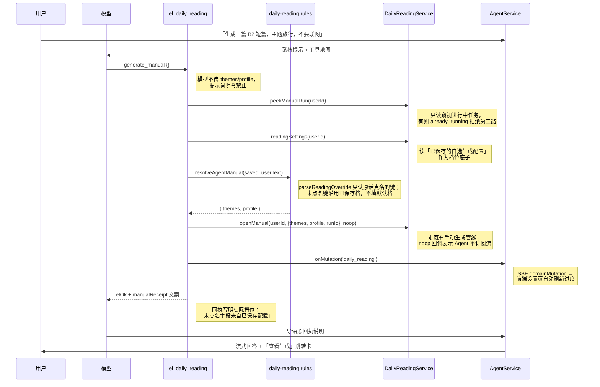

# 每日阅读 Agent 自选生成

> 相关文档：
> - 规划稿：[Agent 自选生成配置](../../ideas/english/Agent自选认配置.md)
> - 姊妹功能：[英语 Agent 领域工具](./英语Agent领域工具.md)、[Agent 大结果旁路展示](./Agent大结果旁路展示.md)
> - 已有专题：[每日阅读生成调度](./每日阅读生成调度.md)、[每日阅读前端](./每日阅读前端.md)、[每日阅读日推失败上限](./每日阅读日推失败上限.md)

## 1. 背景与目标

每日阅读此前有两条生成线：系统日推（cron 定时产出）与设置页手动「自选生成」。用户在英语侧栏对话里说「帮我生成一篇 B2 短篇，主题旅行，不要联网」时，Agent 只能口头回答，无法真正触发生成。

本轮给 Agent 的 `el_daily_reading` 工具补上 `generate_manual`：在对话里直接发起一次**自选生成**。核心约束是参数来源——**已保存的自选生成配置为底，用户原话点名的字段覆盖，模型填的参数一律不信任**；生成不写回设置、不触发系统日推、不干扰进行中的生成。

目标：

- 对话里一句话即可发起自选生成，回执如实说明这次实际用了什么档位。
- 原话支持点名：难度（初级 / 中级 / 高级 / 中高级 / A2-C1 / 随机）、篇幅（短 / 中 / 长篇）、侧重（附词汇 / 附语法 / 只读短文 / 随机）、题数（不出题 / 2 / 3 题 / 随机）、联网开关、主题（显式「主题是 X」或提及已保存主题）。
- 否定语义不误伤：「不要联网」「不是中级」里的词不命中；「中高级」不被「高级」抢匹配。
- 同一字段多次点名以最后出现为准（用户改口以后面的为准）。
- 已有手动生成进行中时拒绝第二路并给出查看入口；生成发起后广播 `domainMutation=daily_reading`，侧栏设置页自动刷新进度。

## 2. 改动范围

| 文件 | 改动 | 作用 |
| --- | --- | --- |
| `apps/backend/src/services/english-learning/daily-reading.rules.ts` | 修改 | 新增 `ReadingOverride` / `parseReadingOverride` / `resolveAgentManual` |
| `apps/backend/src/services/english-learning/english-daily-reading.service.ts` | 修改 | 新增 `peekManualRun` 只读窥视进行中的手动生成 |
| `apps/backend/src/services/agent/english-learning-domain-tools.ts` | 新增 | `el_daily_reading` 工具六个 op、`manualReceipt` 回执文案 |
| `apps/backend/src/services/agent/agent.prompt.ts` | 修改 | 提示词第 7 条 `el_daily_reading` 规则（禁传 themes/profile、禁触发系统日推、照回执说明档位） |

## 3. 实现思路

### 3.1 自选生成时序



### 3.2 要点

- **参数来源三原则**：已保存配置为底 → 原话点名覆盖 → 模型参数丢弃。`resolveAgentManual` 的输入只有 `saved` 与 `userText`，模型入参根本不参与。
- **位置感知匹配**：每个命中记录出现下标 `at`，同一字段多次点名取 `at` 最大者（后说为准）；`nearNo` 回看前两个字，命中词紧跟「不要 / 不是 / 别」时跳过。
- **主题两条路**：显式写法「主题是 / 用 / 改成 X、Y」优先；否则若原话整段提及了某个**已保存主题**（如已存「旅行见闻」，原话说「来一篇旅行见闻的」），用提及的已保存主题集合。
- **「恢复默认」是显式点名**：`默认配置 / 恢复默认` 出现时把各字段设为 `DEFAULT_PROFILE` 与 `DEFAULT_THEMES`——但出现在它**之后**的点名仍然覆盖默认（「恢复默认，但要长篇」最终是长篇）。
- **不写回设置**：`openManual` 只拿一份解析结果去跑生成，用户的自选生成配置保持不变，下次进设置页看到的还是自己保存的档位。
- **进度可追**：回执带 `navigate` UI 跳到设置页看进度；`gen_status` op 供模型追问「生成得怎么样了」时只读查询。

## 4. 关键代码与注释

### 4.1 覆盖类型与位置工具（`daily-reading.rules.ts`，新增）

> 来源：`apps/backend/src/services/english-learning/daily-reading.rules.ts`（新增段，约 L186-L216）——改动后

```typescript
/** 原话点名的键才出现。缺省表示沿用已保存的自选档，不能填默认档。 */
export type ReadingOverride = {
	// 主题集合：只有原话显式点名或提及已保存主题时才出现
	themes?: string[];
	// 难度：含 'random'
	level?: StoredProfile['level'];
	// 篇幅
	length?: StoredProfile['length'];
	// 侧重
	focus?: StoredProfile['focus'];
	// 题数
	questions?: StoredProfile['questions'];
	// 联网开关
	useWeb?: boolean;
};

// 回看命中词前两个字，判断是否紧跟否定词
function nearNo(text: string, at: number): boolean {
	// 截取命中位置之前最多两个字符，作为否定判断材料
	const pre = text.slice(Math.max(0, at - 2), at);
	// 前缀恰为「不要 / 不是」或以「别」结尾即视为否定语义
	return pre === '不要' || pre === '不是' || pre.endsWith('别');
}

// 收集正则全部命中位置；被否定或命中 skip 条件的丢弃
function hits(
	// 待扫描的原话全文
	text: string,
	// 命中正则，须带全局标志供 matchAll 使用
	re: RegExp,
	// 额外跳过条件：返回 true 则丢弃该位置的命中
	skip?: (at: number) => boolean,
	// 返回全部有效命中的下标数组
): number[] {
	// 收集通过检查的有效命中下标
	const out: number[] = [];
	// 遍历正则在原话里的全部命中
	for (const m of text.matchAll(re)) {
		// 本次命中的起始下标
		const at = m.index ?? 0;
		// 紧跟否定的命中不算点名
		if (nearNo(text, at) || skip?.(at)) continue;
		// 通过否定与 skip 检查，登记为有效命中
		out.push(at);
	}
	// 返回全部有效命中位置
	return out;
}

// 取最大下标；-1 表示没有命中，便于比较「谁在更后面」
function lastAt(list: number[]): number {
	// 空列表返回 -1，让「未命中」天然小于任何真实下标
	return list.length ? Math.max(...list) : -1;
}
```

### 4.2 原话解析：`parseReadingOverride`（`daily-reading.rules.ts`，新增）

> 来源：`apps/backend/src/services/english-learning/daily-reading.rules.ts`（新增函数，约 L218-L390，完整符号）——改动后

```typescript
/**
 * 自选生成的原话词表。只覆盖点名的字段。
 * savedThemes 用来认「原话里出现的已保存主题全文」。
 */
// 主入口：把用户原话解析成点名字典
export function parseReadingOverride(
	// 用户在对话里的原话
	userText: string,
	// 已保存的自选主题名，用于识别「原话提及已存主题」
	savedThemes: readonly string[] = [],
	// 只含原话点名的键；未点名键保持缺省
): ReadingOverride {
	// 兜底空串，避免对 undefined 做正则扫描
	const text = userText ?? '';
	// 只收集点名的键，返回前始终可能为空对象
	const said: ReadingOverride = {};
	// 难度命中带位置：多次点名取最后
	const levelHits: { at: number; value: StoredProfile['level'] }[] = [];
	// 中文档词表
	for (const m of text.matchAll(/中高级|初级|中级|高级|难度随机/g)) {
		// 命中的起始下标，多次点名时用于比先后
		const at = m.index ?? 0;
		// 「不要中级」这类否定点名跳过
		if (nearNo(text, at)) continue;
		// 「中高级」里的「高级」不单独命中：前一个字符是「中」则跳过
		if (m[0] === '高级' && text[at - 1] === '中') continue;
		// 把中文档词映射为存储档值
		const value =
			// 先判最长词「中高级」，避免被「高级」抢匹配
			m[0] === '中高级'
				// 中高级档值 B2
				? 'B2'
				// 再判「初级」
				: m[0] === '初级'
					// 初级档值 A2
					? 'A2'
					// 再判「中级」
					: m[0] === '中级'
						// 中级档值 B1
						? 'B1'
						// 再判「高级」
						: m[0] === '高级'
							// 高级档值 C1
							? 'C1'
							// 剩下即「难度随机」，落随机档
							: 'random';
		// 登记一次难度点名（带位置）
		levelHits.push({ at, value });
	}
	// 英文档词表：前后不能紧贴字母数字，防「B2B」这类误命中
	for (const m of text.matchAll(/A2|B1|B2|C1/gi)) {
		// 命中的起始下标
		const at = m.index ?? 0;
		// 命中词原文，大小写不定（如 b2）
		const word = m[0];
		// 命中词前一个字符，越界给空串
		const before = text[at - 1] ?? '';
		// 命中词后一个字符，越界给空串
		const after = text[at + word.length] ?? '';
		// 前后紧贴字母数字说明是更长标识符的一部分，丢弃
		if (/[A-Za-z0-9]/.test(before) || /[A-Za-z0-9]/.test(after)) continue;
		// 「不要 B2」这类否定点名跳过
		if (nearNo(text, at)) continue;
		// 登记一次英文档难度点名
		levelHits.push({
			// 命中位置，后说为准要用
			at,
			// 统一转大写对齐存储档类型
			value: word.toUpperCase() as StoredProfile['level'],
		});
	}
	// 至少一次难度点名才写入 said
	if (levelHits.length) {
		// 后说为准
		said.level = levelHits.reduce((a, b) => (b.at >= a.at ? b : a)).value;
	}
	// 篇幅词表：中英都认
	const lengthMap: [RegExp, StoredProfile['length']][] = [
		// 中文「短篇」点名 short
		[/短篇/g, 'short'],
		// 中文「中篇」点名 medium
		[/中篇/g, 'medium'],
		// 「长篇 / 长文」都点名 long
		[/长篇|长文/g, 'long'],
		// 英文 short 整词命中
		[/\bshort\b/gi, 'short'],
		// 英文 medium 整词命中
		[/\bmedium\b/gi, 'medium'],
		// 英文 long 整词命中
		[/\blong\b/gi, 'long'],
	];
	// 篇幅命中带位置：多次点名取最后
	const lengthHits: { at: number; value: StoredProfile['length'] }[] = [];
	// 逐条词表扫原话
	for (const [re, value] of lengthMap) {
		// 该词的全部有效命中登记（否定命中已被 hits 排掉）
		for (const at of hits(text, re)) lengthHits.push({ at, value });
	}
	// 至少一次篇幅点名才写入 said
	if (lengthHits.length) {
		// 后说为准：取 at 最大者的档值
		said.length = lengthHits.reduce((a, b) => (b.at >= a.at ? b : a)).value;
	}
	// 侧重：词汇 / 语法各记命中位置
	const vocabAt = [
		// 「附词汇」命中位置
		...hits(text, /附词汇/g),
		// 「只要词汇」命中位置
		...hits(text, /只要词汇/g),
	];
	// 语法类侧重命中位置集合
	const grammarAt = [
		// 「附语法」命中位置
		...hits(text, /附语法/g),
		// 「只要语法」命中位置
		...hits(text, /只要语法/g),
	];
	// 「只读短文」命中位置：与词汇/语法互斥
	const readingAt = hits(text, /只读短文/g);
	// 「侧重随机」命中位置：同样与词汇/语法互斥
	const focusRandomAt = hits(text, /侧重随机/g);
	// 词汇+语法的最大位置，与「只读 / 随机」的最大位置比先后
	const pairAt = Math.max(lastAt(vocabAt), lastAt(grammarAt));
	// 互斥项（只读 / 随机）的最晚点名位置
	const exclusiveAt = Math.max(lastAt(readingAt), lastAt(focusRandomAt));
	// 词汇与语法都点名且晚于互斥项：两者兼有
	if (vocabAt.length && grammarAt.length && pairAt > exclusiveAt) {
		// 两类都点名且在更后：两个都要
		said.focus = 'both';
	// 互斥项有点名且不早于组合项：互斥项胜出
	} else if (exclusiveAt >= 0 && exclusiveAt >= pairAt) {
		// 「只读短文 / 侧重随机」在更后：互斥项胜出
		said.focus = lastAt(focusRandomAt) > lastAt(readingAt) ? 'random' : 'reading';
	// 只有词汇或语法单一类点名时进入此分支
	} else if (vocabAt.length || grammarAt.length) {
		// 只有一类点名：取更后的那类
		said.focus = lastAt(vocabAt) >= lastAt(grammarAt) ? 'vocab' : 'grammar';
	}
	// 题数：不出题 / 随机 / 2 / 3
	const questionHits: { at: number; value: StoredProfile['questions'] }[] = [];
	// 「不出题 / 不要题」点名为 0 题
	for (const at of hits(text, /不出题|不要题/g)) {
		// 登记 0 题点名
		questionHits.push({ at, value: 0 });
	}
	// 「题数随机」点名为随机题数
	for (const at of hits(text, /题数随机/g)) {
		// 登记随机题数点名
		questionHits.push({ at, value: 'random' });
	}
	// 「两道 / 两题 / 2 题」点名为 2 题
	for (const at of hits(text, /两道|两题|2\s*题/g)) {
		// 登记 2 题点名
		questionHits.push({ at, value: 2 });
	}
	// 「三道 / 三题 / 3 题」点名为 3 题
	for (const at of hits(text, /三道|三题|3\s*题/g)) {
		// 登记 3 题点名
		questionHits.push({ at, value: 3 });
	}
	// 至少一次题数点名才写入 said
	if (questionHits.length) {
		// 后说为准：取 at 最大者的题数
		said.questions = questionHits.reduce((a, b) => (b.at >= a.at ? b : a)).value;
	}
	// 联网开关：关与开两组词；「不要联网」前缀「不」用 skip 排掉
	const webHits: { at: number; value: boolean }[] = [];
	// 关联网词组：命中即点名为关闭
	for (const at of hits(text, /关闭智能搜索|不要联网|别搜/g)) {
		// 登记关闭联网点名
		webHits.push({ at, value: false });
	}
	// 开联网词组；skip 排掉「不要联网」里「要联网」的误命中
	for (const at of hits(text, /开启智能搜索|要联网/g, (at) => text[at - 1] === '不')) {
		// 登记开启联网点名
		webHits.push({ at, value: true });
	}
	// 至少一次联网点名才写入 said
	if (webHits.length) {
		// 后说为准：取 at 最大者的开关值
		said.useWeb = webHits.reduce((a, b) => (b.at >= a.at ? b : a)).value;
	}
	// 主题解析：themeAt 记录当前生效主题的来源位置，后出现的覆盖先前的
	let themeAt = -1;
	// 当前生效的主题集合；undefined 表示原话未点名主题
	let themes: string[] | undefined;
	// 主题来源登记：只有不早于既有来源位置的新来源才覆盖
	const use = (at: number, list: string[]) => {
		// 后出现（含同位）的来源胜出
		if (at >= themeAt) {
			// 记录本次主题来源位置
			themeAt = at;
			// 记录本次生效的主题集合
			themes = list;
		}
	};
	// 「默认配置 / 恢复默认」：显式把各字段设为默认档；之后点名的仍覆盖
	for (const m of text.matchAll(/默认配置|恢复默认/g)) {
		// 默认词出现的下标
		const at = m.index ?? 0;
		// 「不要默认配置」这类否定不算
		if (nearNo(text, at)) continue;
		// 各字段：若其点名出现在默认词之后才保留点名，否则落默认
		said.level = said.level && levelHits.some((h) => h.at > at) ? said.level : DEFAULT_PROFILE.level;
		// 篇幅：点名晚于默认词才保留，否则落默认档
		said.length =
			// 已点名篇幅且存在晚于默认词的点名
			said.length && lengthHits.some((h) => h.at > at)
				// 保留更晚的原话点名
				? said.length
				// 否则落默认篇幅
				: DEFAULT_PROFILE.length;
		// 侧重：点名晚于默认词才保留，否则落默认档
		said.focus =
			// 已点名侧重为前提
			said.focus &&
			// 四类侧重命中里最晚者须晚于默认词
			Math.max(pairAt, exclusiveAt, lastAt(vocabAt), lastAt(grammarAt)) > at
				// 保留更晚的原话点名
				? said.focus
				// 否则落默认侧重
				: DEFAULT_PROFILE.focus;
		// 题数：点名晚于默认词才保留，否则落默认档
		said.questions =
			// 已点名题数（含 0）且点名晚于默认词
			said.questions !== undefined && questionHits.some((h) => h.at > at)
				// 保留更晚的原话点名
				? said.questions
				// 否则落默认题数
				: DEFAULT_PROFILE.questions;
		// 联网：点名晚于默认词才保留，否则落默认档
		said.useWeb =
			// 已点名联网开关且点名晚于默认词
			said.useWeb !== undefined && webHits.some((h) => h.at > at)
				// 保留更晚的原话点名
				? said.useWeb
				// 否则落默认联网开关
				: DEFAULT_PROFILE.useWeb;
		// 主题落默认主题集
		use(at, [...DEFAULT_THEMES]);
	}
	// 显式主题：「主题是 / 用 / 为 / 改成 / 设为 X、Y 和 Z」
	const explicitSpans: { start: number; end: number }[] = [];
	// 逐个扫描显式主题写法
	for (const m of text.matchAll(/主题(?:是|用|为|改成|设为)\s*([^，。；\n]{1,16})/g)) {
		// 显式主题写法的起始下标
		const at = m.index ?? 0;
		// 记录显式区间：已保存主题命中落在区间内的不重复收集
		explicitSpans.push({ start: at, end: at + m[0].length });
		// 「主题不是 X」这类否定跳过
		if (nearNo(text, at)) continue;
		// 顿号 / 逗号 / 「和」分词
		const parts = (m[1] ?? '')
			// 按顿号、逗号或「和」切分成多个主题段
			.split(/[、,，]|和/)
			// 去掉每段首尾空白
			.map((s) => s.trim())
			// 丢弃切分产生的空段
			.filter(Boolean);
		// 复用既有主题归一（长度 / 数量上限，见《每日阅读生成调度》）
		const list = normalizeThemeList(parts);
		// 归一成功则以本次显式主题为生效来源
		if (list) use(at, list);
	}
	// 已保存主题提及：原话整段出现某个已存主题全文即认
	const savedHits: { at: number; label: string }[] = [];
	// 逐个已存主题在原话里找出现位置
	for (const label of savedThemes) {
		// 空主题名无可匹配，跳过
		if (!label) continue;
		// 从文本头开始找该主题的每一次出现
		let from = 0;
		// 同一主题可能多次出现，逐个位置收集
		while (from <= text.length) {
			// 该主题从 from 起的下一次出现位置
			const at = text.indexOf(label, from);
			// 之后没有再出现，结束本主题的扫描
			if (at < 0) break;
			// 落在显式主题区间内或被否定的跳过
			const inside = explicitSpans.some(
				// 判断命中位置是否落在某个显式区间内
				(span) => at >= span.start && at < span.end,
			);
			// 非显式区间且非否定的提及才登记
			if (!inside && !nearNo(text, at)) savedHits.push({ at, label });
			// 从本次命中之后继续找下一处
			from = at + label.length;
		}
	}
	// 已存主题提及比先前的主题来源更靠后时胜出
	if (savedHits.length && lastAt(savedHits.map((h) => h.at)) > themeAt) {
		// 主题名去重集合
		const seen = new Set<string>();
		// 以提及的已存主题重建生效主题集
		themes = [];
		// 按出现顺序去重收集
		for (const hit of savedHits) {
			// 已收集过的主题跳过
			if (seen.has(hit.label)) continue;
			// 标记该主题已收集
			seen.add(hit.label);
			// 追加进生效主题集
			themes.push(hit.label);
		}
		// 更新主题来源位置为最晚提及处
		themeAt = lastAt(savedHits.map((h) => h.at));
	}
	// 原话点名过主题才写入 said
	if (themes) said.themes = themes;
	// 返回点名字典；未点名键保持缺省
	return said;
}
```

### 4.3 合成最终档位：`resolveAgentManual`（`daily-reading.rules.ts`，新增）

> 来源：`apps/backend/src/services/english-learning/daily-reading.rules.ts`（新增函数，约 L392-L408，完整符号）——改动后

```typescript
/** Agent 自选生成：已保存档为底，原话点名的键覆盖。不写回设置。 */
export function resolveAgentManual(
	// 用户已保存的自选生成配置，作为档位底子
	saved: { themes: string[]; profile: StoredProfile },
	// 用户本次对话原话，只有它点名的键才覆盖
	userText: string,
	// 返回合成后的完整主题集与档位
): { themes: string[]; profile: StoredProfile } {
	// 解析原话点名
	const said = parseReadingOverride(userText, saved.themes);
	// 合成最终结果：逐字段「点名优先，否则沿用已保存档」
	return {
		// 主题：没点名沿用已保存主题集
		themes: said.themes ?? saved.themes,
		// 五个档位字段同样按点名覆盖规则合成
		profile: {
			// 五个字段同规则：点名覆盖，否则沿用已保存档（不填默认档）
			level: said.level ?? saved.profile.level,
			// 篇幅：点名优先，否则沿用已保存档
			length: said.length ?? saved.profile.length,
			// 侧重：点名优先，否则沿用已保存档
			focus: said.focus ?? saved.profile.focus,
			// 题数：点名优先，否则沿用已保存档
			questions: said.questions ?? saved.profile.questions,
			// 联网开关：点名优先，否则沿用已保存档
			useWeb: said.useWeb ?? saved.profile.useWeb,
		},
	};
}
```

### 4.4 进行中任务只读窥视：`peekManualRun`（`english-daily-reading.service.ts`）

`generate_manual` 与 `gen_status` 都需要「看一眼有没有正在跑的手动生成」但不动它。既有 `findManual` 是私有方法，本轮加一个只读公开包装。

> 来源：`apps/backend/src/services/english-learning/english-daily-reading.service.ts`（新增方法，约 L638-L646）——改动后

```typescript
/** Agent 工具只读窥视：有进行中的手动生成则返回 runId/phase */
peekManualRun(
	// 目标用户 id
	userId: number,
	// 无进行中任务时返回 null
): { runId: string; phase: string } | null {
	// 复用私有 findManual 查当前用户的手动任务
	const run = this.findManual(userId);
	// 没有进行中的手动生成，返回空
	if (!run) return null;
	// 只暴露 id 与阶段，内部流句柄不外泄
	return { runId: run.id, phase: run.phase };
}
```

### 4.5 回执文案：`manualReceipt`（`english-learning-domain-tools.ts`，新增）

回执文案是「模型对用户说什么」的唯一依据——提示词要求照回执说明，所以回执必须把实际档位写全。

> 来源：`apps/backend/src/services/agent/english-learning-domain-tools.ts`（新增函数，约 L173-L215，完整符号）——改动后

```typescript
// 把本次实际生效的档位拼成人话回执
function manualReceipt(manual: {
	// 本次实际生效的主题候选集
	themes: string[];
	// 本次实际生效的档位
	profile: {
		// 难度档（A2/B1/B2/C1/random）
		level: string;
		// 篇幅档（short/medium/long/random）
		length: string;
		// 侧重档（vocab/grammar/both/reading/random）
		focus: string;
		// 题数档（0/2/3/random）
		questions: number | string;
		// 是否开启联网检索
		useWeb: boolean;
	};
	// 返回人话回执串
}): string {
	// 取档位简写，下面逐项中文化
	const p = manual.profile;
	// 篇幅中文化
	const length =
		// short 显示为「短篇」
		p.length === 'short'
			// 短篇文案
			? '短篇'
			// long 显示为「长篇」
			: p.length === 'long'
				// 长篇文案
				? '长篇'
				// random 显示为「随机」
				: p.length === 'random'
					// 随机文案
					? '随机'
					// 其余（medium）显示为「中篇」
					: '中篇';
	// 侧重中文化
	const focus =
		// vocab 显示为「附词汇」
		p.focus === 'vocab'
			// 附词汇文案
			? '附词汇'
			// grammar 显示为「附语法」
			: p.focus === 'grammar'
				// 附语法文案
				? '附语法'
				// both 显示为「附词汇加语法」
				: p.focus === 'both'
					// 双附文案
					? '附词汇加语法'
					// random 显示为「随机」
					: p.focus === 'random'
						// 随机文案
						? '随机'
						// 其余（reading）显示为「只读短文」
						: '只读短文';
	// 题数中文化
	const questions =
		// 0 表示不出题
		p.questions === 0
			// 不出题文案
			? '不出题'
			// random 显示为「随机」
			: p.questions === 'random'
				// 随机题数文案
				? '随机'
				// 其余数字直接拼「N 题」
				: `${p.questions} 题`;
	// 难度直接透传（A2/B1/B2/C1/随机）
	const level = p.level === 'random' ? '随机' : p.level;
	// 联网开关中文化
	const web = p.useWeb ? '开启智能搜索' : '关闭智能搜索';
	// 拼三段回执串：档位说明 + 免责说明
	return (
		// 第一段：主题候选、难度、篇幅
		`自选生成已开始。主题候选 ${manual.themes.join('、')}；难度 ${level}；篇幅 ${length}；` +
		// 第二段：侧重、理解题数、联网
		`侧重 ${focus}；理解题 ${questions}；联网 ${web}。` +
		// 关键免责：防止模型把已保存档说成用户刚指定的
		'未在原话里点名的字段来自已保存的自选生成配置。不要改成别的档，也不要说成系统日推。'
	);
}
```

### 4.6 工具实现：`el_daily_reading`（`english-learning-domain-tools.ts`，新增）

六个 op 里 `today/get/list/settings` 是只读查询，`gen_status/generate_manual` 是本轮新增的生成链路。摘录 `generate_manual` 与 `gen_status`（list 的 `literalMiss` 机制与 [Agent 大结果旁路展示](./Agent大结果旁路展示.md) 的瘦索引体系配套）。

> 来源：`apps/backend/src/services/agent/english-learning-domain-tools.ts`（新增文件，`el_daily_reading` 的 `gen_status` 与 `generate_manual` 分支，约 L1331-L1390）——改动后

```typescript
// gen_status：只读查进度，供模型回答「生成得怎么样了」
if (op === 'gen_status') {
	// 只读窥视当前用户是否有手动生成在跑
	const peek = deps.dailyReading.peekManualRun(deps.userId);
	// 有进行中任务则回 running 分支
	if (peek) {
		// 进行中：带回 runId 与阶段
		return elOk({ status: 'running', ...peek });
	}
	// 无进行中任务：回报 idle
	return elOk({ status: 'idle' });
}
// generate_manual：对话内发起一次自选生成
if (op === 'generate_manual') {
	// 防重闸：已有手动生成进行中直接拒绝，附查看入口
	const existing = deps.dailyReading.peekManualRun(deps.userId);
	// 已有进行中任务则拒绝第二路
	if (existing) {
		// 失败回执：错误码 + 文案 + 现场信息 + 跳转卡
		return elFail(
			// 错误码：供模型识别防重场景
			'already_running',
			// 给用户看的失败原因
			'已有自选生成进行中',
			// 附上进行中的任务现场信息
			{ runId: existing.runId, phase: existing.phase },
			// 附 UI 动作列表
			[
				{
					// 跳转类 UI 动作
					type: 'navigate',
					// 跳到每日阅读设置页
					href: '/english-learning/daily-reading/settings',
					// 卡片按钮文案
					label: '查看生成进度',
				},
			],
		);
	}
	// 读已保存的自选生成配置做底子
	const saved = await deps.dailyReading.readingSettings(deps.userId);
	// 原话点名覆盖；模型入参不参与
	const manual = resolveAgentManual(
		// 底子：已保存的主题集与档位
		{ themes: saved.themes, profile: saved.profile },
		// 覆盖来源：用户在对话里的原话
		deps.surface.userText,
	);
	// 本次生成的 runId
	const runId = randomUUID();
	// Agent 不订阅生成流，noop 占住回调位
	const noop = (_ev: Record<string, unknown>) => undefined;
	// 走既有手动生成管线；不写回设置
	deps.dailyReading.openManual(
		// 生成归属的用户 id
		deps.userId,
		// 本次合成后的主题、档位与 runId
		{ themes: manual.themes, profile: manual.profile, runId },
		// noop 回调：Agent 不订阅生成事件流
		noop,
	);
	// 广播领域变更：前端设置页监听后自动刷新进度
	deps.onMutation?.('daily_reading');
	// 成功回执：数据载荷 + 文案与 UI
	return elOk(
		{
			// 本次生成的 runId，供追问进度用
			runId,
			// 状态：已发起
			status: 'started',
			// 生成类型：手动自选
			kind: 'manual',
			// 实际生效的主题集
			themes: manual.themes,
			// 实际生效的档位
			profile: manual.profile,
		},
		{
			// 回执写明实际档位，模型照此说明
			message: manualReceipt(manual),
			// 附跳转卡：用户可去设置页看生成
			ui: [
				{
					// 跳转类 UI 动作
					type: 'navigate',
					// 跳到每日阅读设置页看进度
					href: '/english-learning/daily-reading/settings',
					// 卡片按钮文案
					label: '查看生成',
				},
			],
		},
	);
}
```

`list` 的要点（约 L1186-L1315）：`origin=all` 时并发拉「系统日推 + 手动生成」两路索引合并返回；`q` 只做标题 / 开头 24 字的子串过滤，且在筛选意图下字面未命中（`literalMiss`）时**回退返回全量索引**并附 `LITERAL_MISS` 文案（「字面未命中，索引仍是全量。请按标题、词面或释义筛选，不要宣称没有」），防止模型把「没匹配到」说成「没有日推」。

> 来源：`apps/backend/src/services/agent/english-learning-domain-tools.ts`（新增文件，`LITERAL_MISS` 常量，约 L125-L126）——改动后

```typescript
// 字面未命中统一文案：索引仍是全量，禁止模型宣称没有
const LITERAL_MISS =
	// 文案要点：索引仍是全量，禁止模型宣称没有
	'字面未命中，索引仍是全量。请按标题、词面或释义筛选，不要宣称没有。';
```

### 4.7 提示词规则（`agent.prompt.ts`）

> 来源：`apps/backend/src/services/agent/agent.prompt.ts`（`ENGLISH_LEARNING_SYSTEM_APPEND` 第 7 条 `el_daily_reading` 段）——改动后

```typescript
// 工具地图中的日推规则：list 形态、get 上限、generate_manual 三禁令与照回执说明
'el_daily_reading：today / get / list / settings / generate_manual / gen_status。list 用 origin=all，返回每篇 id、中英标题、日期和开头 24 字，不是 5 条预览。可选 q 只做标题/开头子串；回执写「字面未命中」时索引仍是全量，禁止宣称没有。筛选后 el_present 传 id。拿不准的篇最多 get 3 次，禁止逐篇 get。generate_manual 只做自选生成，不要传 themes 或 profile，禁止触发系统日推。回执里的档位才是这次用的；没在原话点名的字段来自已保存的自选生成配置。说明只能照回执，禁止把默认 B1 说成用户设置。',
```

## 5. 行为变化

- **新增能力**：对话里可发起每日阅读自选生成；生成进行中再问进度可答；已在生成时拒绝重复发起并给出入口。
- **参数可信**：实际档位只来自「已保存配置 + 原话点名」，回执逐项写明；模型无法把默认档伪称为用户设置，也无法触发系统日推。
- **设置不受影响**：Agent 发起生成不写回用户保存的自选生成配置。
- **联动刷新**：生成发起后 `domainMutation=daily_reading` 广播，侧栏设置页进度自动刷新（与 [英语 Agent 领域工具](./英语Agent领域工具.md) 的领域变更广播同一通道）。
- **兼容**：`el_daily_reading` 只在 `assistMode=english_learning` 注册；既有 today/get/list/settings 行为不变。

## 6. 风险与回归测试点

- **原话解析**：「B2 短篇附词汇，不要联网」→ level=B2/length=short/focus=vocab/useWeb=false；「不是中级，要高级」→ C1；「中高级」→ B2 且不重复命中「高级」；「恢复默认，但要长篇」→ 默认档 + long；「主题是旅行和美食」→ themes=[旅行, 美食]；原话提及已保存主题全文 → 用已存主题。
- **改口覆盖**：「短篇……不，长篇」→ long；「两道……三道题」→ 3。
- **防重**：生成进行中再喊一次 → `already_running` + 查看入口；`gen_status` 在 idle / running 两态各验一次。
- **不写回**：Agent 生成后打开设置页，保存的档位不变。
- **模型话术**：回执有「未点名字段来自已保存配置」时，回答不得声称「已按你的设置 B1」（除非用户原话点名 B1）。
- **字面未命中**：q 筛不到任何东西时回答不得说「没有日推」，应引导按标题 / 词面筛选。

---

若与仓库最新源码不一致，以源码为准。
