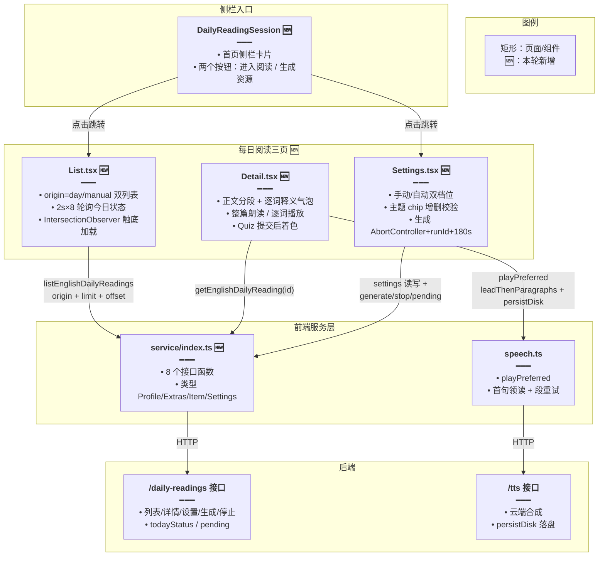
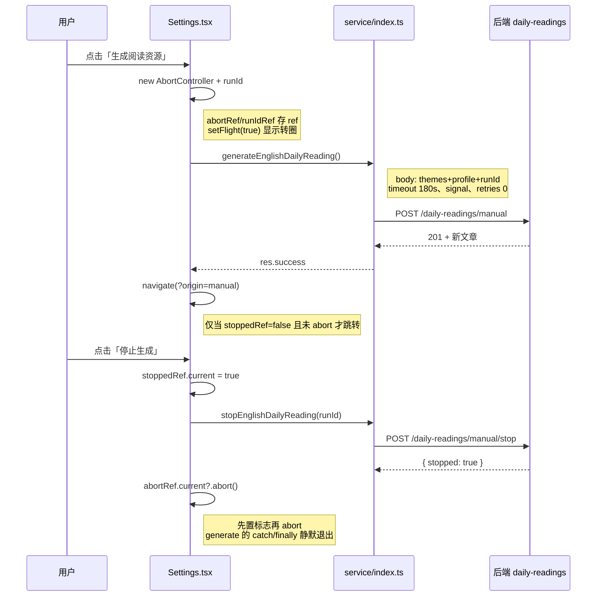

# 每日阅读前端

> **文档角色（增量专题）**：为「每日阅读」落地前端完整链路——英语侧栏新增入口卡片，路由挂载列表 / 详情 / 设置三页；列表页以 `origin=day|manual` 区分系统日推与手动生成，轮询今日生成状态并触底分页；详情页把逐词释义对齐到正文分段，支持整篇朗读与逐词查读，理解题前端提交后着色；设置页面向普通用户提供手动档位，向超管额外提供自动档位，生成操作带 180s 超时、可中止、可轮询恢复。
>
> **后继更新（2026-10-19）**：设置页手动生成已由「同步 POST + 180s 超时 + 轮询恢复」改造为 **SSE 流式生成**——正文边生成边预览（`StreamingMarkdownBody` 渲染 json 代码围栏）、每秒计时与 Token 用量实时显示、断线自动按 seq 续订（指数退避 1s→8s）、刷新后可直接接管在跑的生成，并新增「生成历史」Popover（可删除）。本篇 §1.2 目标 5 / §3.7 / §3.10 / §4.3 / §4.20 描述的生成链路是**旧同步方案**，仅作历史对照保留；最新实现以 [每日阅读流式生成.md](./每日阅读流式生成.md) 为准。
>
> **后继更新（2026-10-25）**：列表页移除手点「重试」按钮，`todayStatus` 新增 `exhausted` 终态；`generating` 时改为最长 10 分钟的自动轮询，`failed | exhausted` 统一显示「今天的短文暂时没有」。本篇 §3.2 与 §4.18 中关于「失败后展示重试按钮 / 8 次轮询后停止」的描述已被取代，详见 [每日阅读日推失败上限.md](./每日阅读日推失败上限.md) §4.21 与 §4.22。
>
> **延伸阅读**：[每日阅读日推失败上限.md](./每日阅读日推失败上限.md)（失败上限、尝试账本、15 分钟巡检、内部补生成、`exhausted` 终态与列表轮询改造）、[每日阅读流式生成.md](./每日阅读流式生成.md)（SSE 化、流式预览、断线续订、生成历史——**当前生效实现**）、[每日阅读生成加固.md](./每日阅读生成加固.md)（后端 429 重试、词级缺词补释义与生成档位落库）、[每日阅读界面重构.md](./每日阅读界面重构.md)（设置页/详情页组件化拆分、流式渲染节流与详情页双栏）、[每日阅读生成调度.md](./每日阅读生成调度.md)（后端每日 23:00 自动生成、手动生成接口与幂等）、[整篇朗读分段重试.md](./整篇朗读分段重试.md)（`playPreferred` 首句领读、段重试与断点续播）、[TTS文件缓存L2持久化.md](./TTS文件缓存L2持久化.md)（`persistDisk` 与磁盘缓存目录）、[每日阅读.md](../ideas/english/每日阅读.md)（功能设计稿）。

---

## 1. 背景与目标

### 1.1 问题

- 英语学习模块此前只有「今日记词」「语句库」「错题本」等词汇/语句级入口，缺少一篇可连贯阅读的短文场景。
- 用户想要每天读一篇难度、篇幅、主题都可配置的短文，并希望文章附带词汇表、语法点和理解题；生成耗时较长，需要可随时停止，也要能在弱网或刷新后看到「仍在生成」。
- 手动生成的文章与系统每日自动生成的文章需要分开浏览，且不能因为保存新设置而覆盖已发布的历史文章。

### 1.2 目标

1. **侧栏一键直达**：在英语学习首页侧栏新增「每日阅读」卡片，提供「进入阅读」「生成资源」两个按钮。
2. **双列表与状态轮询**：列表页用 URL `?origin=day|manual` 区分系统日推 / 手动生成；今日文章未就绪时显示生成中提示，生成中自动轮询（2026-10-25 起改为最长 10 分钟，失败与耗尽统一显示「今天的短文暂时没有」、不再提供重试按钮，见 §3.2）；滚动触底自动加载下一页。
3. **详情页阅读体验**：英文正文在上、中文折叠在下；逐词释义气泡可点单词弹出，支持逐词播放；整篇朗读走 `playPreferred` 的首句领读分段链路，与逐词播放共用同一磁盘缓存域。
4. **理解题前端着色**：选项顺序由后端生成时已打乱，前端只负责记录选择、全部作答后开放提交，提交后标绿正确项、标红错误项。
5. **设置页双档位**：普通用户只能维护「手动生成配置」；超管额外看到「自动生成配置」。主题支持增删（1–16 字、至少保留一项、禁 `<>`），`focus` 三键互斥组合，保存只影响未来文章。手动生成带 `AbortController` + `runId` + 180s 超时 + `retries: 0`，可停止；停止先置标志再调接口再 abort，避免竞态。**（2026-10-19 起已改为 SSE 流式：正文实时预览、Token 计数、断线 seq 续订、生成历史 Popover，见 [每日阅读流式生成.md](./每日阅读流式生成.md) §3.9 / §3.10）**

---

## 2. 改动范围

| 路径 | 说明 |
| ---- | ---- |
| `apps/frontend/src/router/routes.ts` | 新增 3 条 lazy 路由：`daily-reading`、`daily-reading/settings`、`daily-reading/:id` |
| `apps/frontend/src/service/api.ts` | 新增 3 个端点常量：列表/详情、手动生成、设置 |
| `apps/frontend/src/service/index.ts` | 新增 `EnglishDailyReadingProfile/Extras/Item/Settings` 类型与 8 个接口函数；`getLlmSettings` 增 `silent` 可选参数 |
| `apps/frontend/src/components/design/Header/index.tsx` | 每日阅读详情面包屑：英语学习 > 每日阅读 > 篇目标题，点中间级回列表并保留 `origin` |
| `apps/frontend/src/views/englishLearning/practice/components/shell/PracticePageShell.tsx` + `practice/types.ts` | 新增 `footer` 插槽，钉在滚动区下方；`Head` padding 由 `pl-4 pr-2` 改为 `px-4`，trailing 间距 `gap-2` → `gap-3` |
| `apps/frontend/src/views/englishLearning/components/shell/Head.tsx` | 文件头注释中示例 padding 同步改为 `px-4` |
| `apps/frontend/src/views/englishLearning/components/vocab/Card.tsx` | `ipa` 为空字符串时不渲染音标行，避免详情页词汇卡出现空行 |
| `apps/frontend/src/views/englishLearning/daily/components/DailyPlayIconButton.tsx` | 播放图标常显 teal，去掉未播放灰色态 |
| `apps/frontend/src/views/englishLearning/daily/constants/index.ts` | 测验选项字号 `text-sm` → `text-base` |
| `apps/frontend/src/views/englishLearning/sidebar/EnglishSidebar.tsx` | 挂载 `DailyReadingSession` |
| `apps/frontend/src/views/englishLearning/sidebar/components/EnglishSidebarHeader.tsx` | description 包 `span truncate` + `min-w-0 overflow-hidden`，防长文案溢出 |
| `apps/frontend/src/views/englishLearning/sidebar/sidebarAccents.ts` | 新增 `dailyReading` 渐变：`amber-700` → `rose-800` |
| `apps/frontend/src/components/ui/combobox.tsx` | 新增 `optionsPlacement: 'top' \| 'bottom'`，贴底时向上展开避免被父级 overflow 裁掉 |
| `apps/frontend/src/views/setting/llm/index.tsx` | 两处保存按钮的 `Spinner` 加 `text-white`，保证主题色按钮上可见 |
| `apps/frontend/src/views/englishLearning/utils/ttsCacheFolder.ts` | 新增 `ttsCacheScopeDailyReading(id)` |
| `apps/frontend/src/i18n/locales/zh-CN/englishLearning.ts`、`en-US/englishLearning.ts`、`zh-CN/route.ts`、`en-US/route.ts` | 新增 `dailyReading` 相关 key，本文仅摘录代表性条目，全量见 diff |
| `apps/frontend/src/views/englishLearning/dailyReading/List.tsx` | **纯新增**：列表页（约 427 行） |
| `apps/frontend/src/views/englishLearning/dailyReading/Detail.tsx` | **纯新增**：详情页（约 612 行） |
| `apps/frontend/src/views/englishLearning/dailyReading/Settings.tsx` | **纯新增**：设置页（约 787 行） |
| `apps/frontend/src/views/englishLearning/dailyReading/index.tsx` | **纯新增**：1 行 re-export，指向 `List` |
| `apps/frontend/src/views/englishLearning/sidebar/components/DailyReadingSession.tsx` | **纯新增**：侧栏入口卡片 |

**未改**：后端接口与数据库 schema（见《每日阅读生成调度.md》）；`speech.ts` 内部实现（见《整篇朗读分段重试.md》）；除上述文件外无其它前端改动。

---

## 3. 实现思路与关键设计

### 3.1 双列表：`origin=day|manual` 与 URL searchParam

- 列表页 `List.tsx` 把「系统日推」与「手动生成」抽象成同一个组件，通过 URL `?origin=day|manual` 区分。默认值是 `day`，`parseOrigin` 把任何非 `manual` 的值归一到 `day`，防止脏参数。
- 切换列表时用 `setSearchParams` 的函数式更新只替换 `origin`，并加 `replace: true` 避免在浏览器历史里留下中间态。
- 列表请求 `listEnglishDailyReadings` 携带 `origin` 与分页参数；`loadedOriginRef` 记录当前已加载列表的归属，若 `origin` 变了则把旧列表视为过期，防止把 A 列表的数据拼到 B 列表上。

### 3.2 今日状态：`ready / generating / exhausted` 与轮询

> **2026-10-25 调整**：本节已按最新实现重写。旧的「`failed` + 手点重试 + `retryLocked` 5 秒 + 8 次轮询」方案不再生效，代码对照见 [每日阅读日推失败上限.md](./每日阅读日推失败上限.md) §4.21。

- 后端列表接口返回的 `todayStatus` 收敛为三种：今日文章就绪 / 生成中 / 本轮已耗尽。列表页据此展示：
  - `ready`：正常列表；
  - `generating`：顶部生成中提示条，空列表时展示居中大图标；每 5 秒轮询一次列表，最长持续 10 分钟；
  - `failed | exhausted`：统一显示「今天的短文暂时没有」，不提供任何按钮——重试已改为由后端自动进行。
- 轮询没有「点一下再来一轮」的触发器：`Button`、`retryLocked`、`watch` 三个状态与相关逻辑都已删除，轮询只依赖 `todayStatus` 是否存在。
- 轮询的结束条件由时间上限控制（10 分钟），而不是次数上限；到点后停止请求，避免页面长时间挂着定时器。
- 既有的「8 次 × 5 秒」轮询 effect 仍在文件中保留，与新增的 10 分钟 effect 并存；两者条件相同，因此 `generating` 期间实际仍按约 5 秒的频率发请求。这一点已记入新专题的「风险与回归」，后续若收敛应删掉旧的 8 次那段。

### 3.3 触底加载：`IntersectionObserver` + 阈值

- 列表底部放一个 `h-px` 哨兵 `div`；`IntersectionObserver` 以 `ScrollArea` 的 viewport 为 root，`rootMargin` 底部外扩 `LIBRARY_LIST_AT_BOTTOM_THRESHOLD_PX`，让「快到底」提前触发加载。
- `fetchingMoreRef` 与 `hasMoreRef` 用 ref 存储，避免闭包读到旧值；加载中或已无更多时直接 return。
- 追加数据时做去重合并：若新页长度不小于旧缓存则整体替换，否则把旧缓存中不在新页里的条目补在后面，保证刷新或 origin 切换后列表顺序稳定。

### 3.4 详情页正文分段：`glossParagraphs` 对齐 `wordGloss`

- 后端 extras 里给 `wordGloss`：若干句「英文原句 + 逐词释义数组」。前端需要把这些句子挂回正文段落，但正文分段是展示真相，不能因为释义缺句就少一段英文。
- `glossParagraphs` 先按空行把 `bodyEn` 切成自然段，再在每段内用 `indexOf` 顺序匹配 `wordGloss` 的句子：匹配上的句子切成独立 `ShownSentence` 并携带 `words`；句间空隙与段尾残余作为 `words: null` 的普通文本保留。
- `used` 集合防止同一句释义被多个段落重复消费；`hits` 按在段内出现位置排序，保证切句顺序与原文一致。

### 3.5 `GlossSentence` 逐词 Popover 与滚动关闭

- 句子按空白切成 token，每个 token 剥离首尾标点得到 `bare`，再与 `words[at]` 做大小写不敏感比对：对不上就按普通文本渲染，对得上则渲染为可点击单词并消耗一个释义。
- 点击单词打开 `Popover` 显示词形、中文释义与播放按钮；`openKey` 全局唯一，任何时刻只开一个气泡。
- `openGloss` 的 `from` 参数用于解决「A 气泡关闭事件晚于 B 气泡打开事件」的竞态：只有关闭来源与当前打开 key 一致时才允许关闭。
- 气泡打开后给滚动容器与 `document` 各挂一个 `scroll` 监听（`capture: true` 覆盖嵌套滚动），任何滚动立即关闭气泡，避免气泡定位漂移。

### 3.6 Quiz：后端乱序，前端提交后着色

- `questions` 数组在生成时已由后端打乱选项顺序并记录正确答案下标 `answer`，前端不再二次乱序，保证刷新后选项位置稳定。
- 前端用 `picked` 记录每题选项；全部题目有选择后才开放提交按钮。提交后：正确选项标绿、选错的选项标红、未选的正确项也标绿，同时给容器加 `pointer-events-none` 禁止再改。

### 3.7 设置页双档位与生成控制

> **⚠️ 已被取代（2026-10-19）**：生成控制已由「同步 POST + `flight` 转圈 + 2s 轮询恢复」改造为 SSE 流式——`dailyReadingSse.ts` fetch 读取器按 seq 断点续订（指数退避），MobX store 以 `gen` 代数防竞态，UI 增加流式预览（`StreamPreview`）与实时耗时/Token（`StreamMeta`）及历史 Popover。最新实现见 [每日阅读流式生成.md](./每日阅读流式生成.md) §3.9 / §3.10 / §4.17–§4.20。以下内容为旧方案存档。

- 普通用户只看到「手动生成配置」；超管额外看到「自动生成配置」分区。两份配置共用 `ProfileFields` 组件，但 state 完全独立。
- 主题以 chip 形式增删：输入去重、压空白、长度 1–16、禁 `<>`，至少保留一项；删除到最后一个时 Toast 拦截。
- `focus` 三键互斥组合由 `nextFocus` 计算：`reading` 独占；`vocab` 与 `grammar` 可叠加成 `both`；再点已激活项会取消，若两者都取消则回落 `reading`。
- 「生成」按钮点击后：创建 `AbortController` 与 `runId` 存入 ref，`flight=true` 显示转圈；请求带 `timeout: 180_000`、`signal`、`retries: 0`，失败/超时/取消都走到同一个 finally。成功且未被停止则跳 `?origin=manual`。
- 页面加载后立即开始每 2 秒轮询 `manualPending`：若刷新或从别的页面回来发现仍在生成，按钮恢复「正在生成」态；轮询失败保留上次状态，避免闪烁。
- 「停止」按钮先 `stoppedRef.current = true` 再调 `stopEnglishDailyReading`，最后 `abort()`：即使 abort 早于接口返回，`generate` 的 catch/finally 也会因为 `stoppedRef` 而静默退出，不会把「已停止」当成错误 Toast 出来。

### 3.8 播放链路：整篇朗读与逐词查读共用缓存域

- 详情页 `togglePlay` 调 `playPreferred(row.bodyEn, { cloudSingleUtterance: false, leadThenParagraphs: true, persistDisk: true, cacheFolder: ttsCacheScopeDailyReading(row.id), cacheTitle: row.titleEn })`。
- `cloudSingleUtterance: false` 强制走分段流水线；`leadThenParagraphs: true` 让首句单独合成、其余按空行段落合成（首声快、请求少）；`persistDisk` 让云端结果落盘；`ttsCacheScopeDailyReading` 把缓存目录锁定为 `daily_reading_<id>`。
- 逐词播放 `playWord` 复用同一 `cacheFolder`，相同文本可直接命中磁盘缓存。分段与重试细节见《整篇朗读分段重试.md》，落盘机制见《TTS文件缓存L2持久化.md》。

### 3.9 页面结构与数据流



**读图要点**：🆕 为本次新增节点。三页都通过 `service/index.ts` 访问后端业务接口；详情页播放不走 `service`，而是直接走 `speech.ts` 的 `playPreferred`，再由 `speech.ts` 调 TTS 接口。

### 3.10 生成 / 停止时序

> **⚠️ 已被取代（2026-10-19）**：下图为旧同步方案时序；SSE 流式化后的前端时序（流式预览、断线续订、停止与半成品恢复）见 [每日阅读流式生成.md](./每日阅读流式生成.md) §3.11。



**读图要点**：停止路径刻意「先置标志、再调接口、最后 abort」——abort 会让 `generate` 的 await 抛中止错误，`stoppedRef` 保证该错误被静默吞掉而非 Toast。

---

## 4. 关键代码与注释

### 4.1 路由新增（routes.ts）

**对比范围**：`apps/frontend/src/router/routes.ts` 中 lazy 导入区与 `englishLearning` 子路由数组的新增项。

**改动前** · `apps/frontend/src/router/routes.ts`（基线，约 L28–L33）

```typescript
// 英语学习模块 lazy 导入：基线中 daily 页面之后直接是 daily/records，无 dailyReading 相关页面
const EnglishLearningDailyPage = lazy(
	// 动态导入每日一句页模块，构建期单独分包，首屏不加载
	() => import('@/views/englishLearning/daily'),
);
// 每日一句记录页 lazy 声明，与上方保持一致的路由组织方式
const EnglishLearningDailyRecordsPage = lazy(
	// 动态导入记录页模块
	() => import('@/views/englishLearning/daily/records'),
);
```

**改动前** · `apps/frontend/src/router/routes.ts`（基线，约 L346–L352）

```typescript
// 基线中 englishLearning 子路由 practice/reports/:id 之后直接是 daily，无 daily-reading 前缀
{
	// 子路由路径段，:id 捕获报告 id 供详情页取数
	path: 'practice/reports/:id',
	// 路由组件：练习报告详情页
	Component: EnglishLearningPracticeReportDetailPage,
	// 路由元信息对象，供 Header 面包屑取标题文案
	meta: {
		// 面包屑标题的 i18n key
		titleKey: 'englishLearning.practice.reportsTitle',
	},
},
// 下方 daily 路由与改动后相同，对称省略
// ...（未改动）
```

**改动后** · `apps/frontend/src/router/routes.ts`（当前，约 L31–L39）

```typescript
// 新增：每日阅读列表页 lazy 导入，指向 dailyReading/index.tsx（即 List.tsx）
const EnglishDailyReadingListPage = lazy(
	// 动态导入列表页模块（index.tsx 转发 List.tsx）
	() => import('@/views/englishLearning/dailyReading'),
);
// 新增：每日阅读设置页 lazy 导入
const EnglishDailyReadingSettingsPage = lazy(
	// 动态导入设置页模块
	() => import('@/views/englishLearning/dailyReading/Settings'),
);
// 新增：每日阅读详情页 lazy 导入
const EnglishDailyReadingDetailPage = lazy(
	// 动态导入详情页模块
	() => import('@/views/englishLearning/dailyReading/Detail'),
);
```

**改动后** · `apps/frontend/src/router/routes.ts`（当前，约 L359–L379）

```typescript
// 新增：每日阅读列表路由，path 不含参数，通过 ?origin=day|manual 区分列表
{
	// 子路由路径段：列表页，path 不含参数，通过 ?origin=day|manual 区分列表
	path: 'daily-reading',
	// 路由组件：上方 lazy 声明的列表页
	Component: EnglishDailyReadingListPage,
	// 路由元信息：标题 key 供 Header 面包屑取文案
	meta: {
		// 列表页面包屑标题的 i18n key
		titleKey: 'route.englishLearning.dailyReading.title',
	},
},
// 新增：设置页路由，放在列表之后、:id 之前，避免 :id 把 settings 吃掉
{
	// 设置页路径段：固定字面量 settings
	path: 'daily-reading/settings',
	// 路由组件：设置页
	Component: EnglishDailyReadingSettingsPage,
	// 路由元信息
	meta: {
		// 设置页面包屑标题的 i18n key
		titleKey: 'route.englishLearning.dailyReading.settings',
	},
},
// 新增：详情页路由，:id 捕获文章 id
{
	// 详情页路径段：:id 捕获文章 id 供详情页取数
	path: 'daily-reading/:id',
	// 路由组件：详情页
	Component: EnglishDailyReadingDetailPage,
	// 路由元信息
	meta: {
		// 详情页面包屑标题的 i18n key
		titleKey: 'route.englishLearning.dailyReading.detail',
	},
},
```

**变更摘要**：新增 3 条 lazy 路由；顺序上 `settings` 在 `:id` 之前，保证 `/daily-reading/settings` 不被 `:id` 误匹配（面包屑侧仍做了 `id !== 'settings'` 双保险）。

### 4.2 API 端点常量（api.ts）

**对比范围**：`apps/frontend/src/service/api.ts` 中 `ENGLISH_LEARNING_PRACTICE_REVIEW` 常量之后的新增区。

**改动前** · `apps/frontend/src/service/api.ts`（基线，约 L229–L234）

```typescript
/** 间隔复习：今日待复习统计、拉题、结算上报 */
export const ENGLISH_LEARNING_PRACTICE_REVIEW =
	// 复习接口路径值，单独成行保持声明对齐
	'/english-learning/practice/review';
// 练习报告端点常量声明
export const ENGLISH_LEARNING_PRACTICE_REPORTS =
	// 报告接口路径值
	'/english-learning/practice/reports';
```

**改动后** · `apps/frontend/src/service/api.ts`（当前，约 L229–L240）

```typescript
/** 间隔复习：今日待复习统计、拉题、结算上报 */
export const ENGLISH_LEARNING_PRACTICE_REVIEW =
	// 复习接口路径值，单独成行保持声明对齐
	'/english-learning/practice/review';
// 新增：每日阅读列表/详情基础端点，GET 列表、GET /:id 详情共用此前缀
export const ENGLISH_LEARNING_DAILY_READINGS =
	// 每日阅读集合端点路径
	'/english-learning/daily-readings';
// 新增：手动生成（POST）、停止（POST /stop）、pending 查询（GET）共用端点
export const ENGLISH_LEARNING_DAILY_READING_MANUAL =
	// 手动生成端点路径
	'/english-learning/daily-readings/manual';
// 新增：用户手动档位读写（GET/PUT）与超管自动档位（PUT /auto）共用端点
export const ENGLISH_LEARNING_DAILY_READING_SETTINGS =
	// 设置端点路径
	'/english-learning/daily-reading-settings';
// 练习报告端点常量，位置后移但值不变
export const ENGLISH_LEARNING_PRACTICE_REPORTS =
	// 报告接口路径值
	'/english-learning/practice/reports';
```

**变更摘要**：在复习与报告常量之间插入 3 个每日阅读端点，保持同前缀聚集。

### 4.3 类型与接口函数（service/index.ts）

> **⚠️ 已被取代（2026-10-19）**：`generateEnglishDailyReading` 已由 POST 改为 SSE GET 流（经 `dailyReadingSse.ts` 的 `streamEnglishDailyReadingManual` 读取），并新增 `listEnglishDailyReadingGens` / `removeEnglishDailyReadingGen` 历史接口；本节代码为旧方案存档，最新实现见 [每日阅读流式生成.md](./每日阅读流式生成.md) §4.17 / §4.18。

**对比范围**：`apps/frontend/src/service/index.ts` 中 `getEnglishPracticeReport` 之后、`removeEnglishPracticeReportsBatch` 之前的新增区（纯新增，仅贴改动后）。

#### 4.3.1 类型定义

**改动后（纯新增）** · `apps/frontend/src/service/index.ts`（当前，约 L2005–L2040）

```typescript
// 新增：每日阅读生成档位类型，level/length/focus/questions/useWeb 五元组
export type EnglishDailyReadingProfile = {
	// 难度档位
	level: 'A2' | 'B1' | 'B2' | 'C1';
	// 篇幅档位
	length: 'short' | 'medium' | 'long';
	// 学习侧重：只读短文 / 附词汇 / 附语法 / 词汇语法都附
	focus: 'reading' | 'vocab' | 'grammar' | 'both';
	// 理解题数量：0 / 2 / 3
	questions: 0 | 2 | 3;
	// 是否允许联网取材
	useWeb: boolean;
};

// 新增：文章 extras 结构，后端生成时写入，详情页据此渲染词汇/语法/理解题
export type EnglishDailyReadingExtras = {
	// 与生成档位对应的难度，便于详情页展示
	level: EnglishDailyReadingProfile['level'];
	// 与生成档位对应的篇幅
	length: EnglishDailyReadingProfile['length'];
	// 与生成档位对应的侧重
	focus: EnglishDailyReadingProfile['focus'];
	// 词汇表：单词 + 中文释义，渲染为词汇卡网格
	glossary?: { word: string; zh: string }[];
	// 逐词释义：按句给出英文原句与逐词数组，对齐到正文分段
	wordGloss?: { en: string; words: { w: string; zh: string }[] }[];
	// 旧版单条语法点，兼容保留
	grammarNote?: string;
	// 新版多条语法点，优先于 grammarNote 渲染
	grammarNotes?: string[];
	// 理解题：题干、已乱序选项、正确项下标
	questions?: { q: string; options: string[]; answer: number }[];
	// 参考来源列表（联网取材时）
	sources?: { title: string; url: string }[];
};

// 新增：每日阅读文章行结构
export type EnglishDailyReadingItem = {
	// 文章主键
	id: string;
	// 发布日期，格式如 2026-10-17
	publishDate: string;
	// 英文标题
	titleEn: string;
	// 中文标题
	titleZh: string;
	// 英文正文（含换行原文）
	bodyEn: string;
	// 中文正文
	bodyZh: string;
	// 来源类型：LLM 生成或联网取材
	sourceKind: 'llm' | 'web';
	// 旧版单来源 URL，兼容保留
	sourceUrl: string | null;
	// 旧版单来源标题，兼容保留
	sourceTitle: string | null;
	// 文章归属：系统日推或手动生成
	origin?: 'day' | 'manual';
	// 冗余难度，便于列表卡片展示（旧数据可为 null）
	level?: EnglishDailyReadingProfile['level'] | null;
	// 冗余篇幅，便于列表卡片展示（旧数据可为 null）
	length?: EnglishDailyReadingProfile['length'] | null;
	// 生成 extras，可能为 null（生成失败或旧数据）
	extras?: EnglishDailyReadingExtras | null;
};
```

#### 4.3.2 列表接口

**改动后（纯新增）** · `apps/frontend/src/service/index.ts`（当前，约 L2041–L2060）

```typescript
// 新增：拉取每日阅读列表，支持分页与 origin 过滤
export const listEnglishDailyReadings = async (options?: {
	// 每页条数
	limit?: number;
	// 偏移量，用于触底加载
	offset?: number;
	// 列表归属：系统日推或手动生成
	origin?: 'day' | 'manual';
	// 是否静默（不弹全局错误 Toast）
	silent?: boolean;
	// options 结束后进入函数体：统一走 http.get，错误 Toast 由 silent 控制
}) => {
	// 发起 GET 请求拉列表；泛型逐项声明返回体结构
	return await http.get<{
		// 当前页文章数组
		items: EnglishDailyReadingItem[];
		// 总条数，用于计算 hasMore
		totalCount?: number;
		// 今日文章状态：就绪 / 生成中 / 失败
		todayStatus: 'ready' | 'generating' | 'failed';
		// 今日文章详情（已发布时）
		today: EnglishDailyReadingItem | null;
	// 泛型结束并传入端点与请求配置
	}>(ENGLISH_LEARNING_DAILY_READINGS, {
		// query 参数对象：只序列化有值的字段，避免显式 undefined
		querys: {
			// limit 存在时才序列化进 query，避免显式传 undefined
			...(options?.limit != null ? { limit: options.limit } : {}),
			// offset 存在时才序列化进 query
			...(options?.offset != null ? { offset: options.offset } : {}),
			// origin 存在时才序列化进 query
			...(options?.origin ? { origin: options.origin } : {}),
		},
		// 静默标记透传：轮询调用不弹错误 Toast
		silent: options?.silent,
	});
};
```

#### 4.3.3 设置接口

**改动后（纯新增）** · `apps/frontend/src/service/index.ts`（当前，约 L2062–L2100）

```typescript
// 新增：每日阅读设置视图类型
export type EnglishDailyReadingSettings = {
	// 用户当前主题
	themes: string[];
	// 系统默认主题（用于「恢复默认」）
	defaults: string[];
	// 用户当前档位
	profile: EnglishDailyReadingProfile;
	// 系统默认档位
	profileDefaults: EnglishDailyReadingProfile;
	// 超管可见的自动档位；普通用户无此字段
	auto?: {
		// 自动档主题列表
		themes: string[];
		// 自动档档位
		profile: EnglishDailyReadingProfile;
	};
};

// 新增：读取设置
export const getEnglishDailyReadingSettings = async (options?: {
	// 是否静默
	silent?: boolean;
	// options 结束，进入函数体
}) => {
	// 发起 GET 请求读取设置视图
	return await http.get<EnglishDailyReadingSettings>(
		// 设置端点
		ENGLISH_LEARNING_DAILY_READING_SETTINGS,
		// 静默标记透传
		{ silent: options?.silent },
	);
};

// 新增：保存用户手动档位
export const saveEnglishDailyReadingSettings = async (body: {
	// 新主题列表
	themes: string[];
	// 新档位
	profile: EnglishDailyReadingProfile;
	// body 结束，进入函数体
}) => {
	// 发起 PUT 请求保存手动档位，返回最新设置视图
	return await http.put<EnglishDailyReadingSettings>(
		// 设置端点
		ENGLISH_LEARNING_DAILY_READING_SETTINGS,
		// 请求体：主题 + 档位
		body,
	);
};

// 新增：保存超管自动档位（仅超管可调用）
export const saveEnglishDailyReadingAutoSettings = async (body: {
	// 新主题列表
	themes: string[];
	// 新档位
	profile: EnglishDailyReadingProfile;
	// body 结束，进入函数体
}) => {
	// 发起 PUT 请求保存自动档位；返回体仅含回显字段，不含 defaults
	return await http.put<{
		// 保存后回显的主题
		themes: string[];
		// 保存后回显的档位
		profile: EnglishDailyReadingProfile;
	// 泛型结束并传入 /auto 端点与请求体
	}>(`${ENGLISH_LEARNING_DAILY_READING_SETTINGS}/auto`, body);
};
```

#### 4.3.4 生成 / 停止 / pending / 详情接口

**改动后（纯新增）** · `apps/frontend/src/service/index.ts`（当前，约 L2102–L2155）

```typescript
// 新增：手动生成一篇每日阅读
export const generateEnglishDailyReading = async (
	// 请求体：生成参数打包为一个对象传入
	body: {
		// 生成主题
		themes: string[];
		// 生成档位
		profile: EnglishDailyReadingProfile;
		// 幂等键：同一次点击生成同一个 runId，停止时按 runId 终止
		runId?: string;
	},
	// 请求可选项：全部可选，调用方按需传
	options?: {
		// 是否静默
		silent?: boolean;
		// 请求超时时间：生成耗时较长，调用方传 180s
		timeout?: number;
		// AbortSignal：停止按钮中断请求
		signal?: AbortSignal;
		// 重试次数：生成操作不允许自动重试，避免重复生成
		retries?: number;
	},
	// 函数体
) => {
	// 发起 POST 生成请求，泛型为文章行，返回新生成的文章
	return await http.post<EnglishDailyReadingItem>(
		// 手动生成端点
		ENGLISH_LEARNING_DAILY_READING_MANUAL,
		// 生成参数请求体
		body,
		// 请求配置：逐项透传调用方可选项，未传为 undefined 走 http 默认
		{
			// 静默标记透传
			silent: options?.silent,
			// 超时时间透传
			timeout: options?.timeout,
			// 中断信号透传
			signal: options?.signal,
			// 重试次数透传
			retries: options?.retries,
		},
	);
};

// 新增：停止当前手动生成
export const stopEnglishDailyReading = async (options?: {
	// 是否静默
	silent?: boolean;
	// 要停止的 runId；不传则停止当前用户所有手动生成
	runId?: string;
	// 函数体
}) => {
	// POST 停止端点，后端返回 stopped 标记是否成功停止
	return await http.post<{ stopped: boolean }>(
		// 停止端点 = 手动端点拼 /stop
		`${ENGLISH_LEARNING_DAILY_READING_MANUAL}/stop`,
		// 请求体只带 runId；undefined 时后端停止该用户全部手动生成
		{ runId: options?.runId },
		// 静默标记透传
		{ silent: options?.silent },
	);
};

// 新增：查询当前用户是否有手动生成正在进行（设置页 2s 轮询用）
export const getEnglishDailyReadingManualPending = async (options?: {
	// 是否静默
	silent?: boolean;
	// 函数体
}) => {
	// GET 手动端点，后端复用同路径返回 pending 标记
	return await http.get<{ pending: boolean }>(
		// pending 查询端点
		ENGLISH_LEARNING_DAILY_READING_MANUAL,
		// 静默标记透传：设置页 2s 轮询，不能弹错误 Toast
		{ silent: options?.silent },
	);
};

// 新增：按 id 获取单篇文章详情
export const getEnglishDailyReading = async (
	// 文章主键
	id: string,
	// 请求可选项：后台刷新时可静默
	options?: { silent?: boolean },
	// 函数体
) => {
	// GET 详情端点，返回完整文章行（含 extras）
	return await http.get<EnglishDailyReadingItem>(
		// id 需 encode，防止特殊字符破坏路径
		`${ENGLISH_LEARNING_DAILY_READINGS}/${encodeURIComponent(id)}`,
		// 静默标记透传
		{ silent: options?.silent },
	);
};
```

**变更摘要**：一次性新增 4 个类型与 8 个接口函数，覆盖列表、详情、设置读写、手动生成、停止、pending 查询。

### 4.4 `getLlmSettings` 新增 `silent` 可选参数

**对比范围**：`apps/frontend/src/service/index.ts` 中 `getLlmSettings` 完整函数。

**改动前** · `apps/frontend/src/service/index.ts`（基线，约 L3690–L3693）

```typescript
/** GET /settings/llm */
export const getLlmSettings = async () => {
	// 基线：直接 GET 设置端点，无可选项
	return await http.get<LlmSettingsView>(SETTINGS_LLM);
};
```

**改动后** · `apps/frontend/src/service/index.ts`（当前，约 L3846–L3851）

```typescript
/** GET /settings/llm */
// 新增可选 silent 参数：后台/轮询场景调用时不弹全局错误 Toast
export const getLlmSettings = async (options?: { silent?: boolean }) => {
	// GET 设置端点，第二参透传请求配置
	return await http.get<LlmSettingsView>(SETTINGS_LLM, {
		// 静默标记透传；不传为 undefined，行为与基线一致
		silent: options?.silent,
	});
};
```

**变更摘要**：仅新增可选 `silent` 参数并透传给 `http.get`；既有调用方不传时行为完全不变。

### 4.5 面包屑（Header/index.tsx）

**对比范围**：`apps/frontend/src/components/design/Header/index.tsx` 面包屑 `useMemo` 内，在「今日记词」分支之后新增的「每日阅读详情」分支。

**改动前** · `apps/frontend/src/components/design/Header/index.tsx`（基线，约 L265–L285）

```tsx
						}
						// 今日记词根节点压入面包屑
						trail.push(dailyRoot);
						// 命中今日记词会话路由时，再压入会话级标题
						if (dailySession) {
							// 会话级节点：标题随是否 /done 结算页切换
							trail.push({
								// 标题：按当前路径是否以 /done 结尾区分结算页与作答页
								label: location.pathname.endsWith('/done')
									// 结算页标题
									? t('englishLearning.practice.summaryTitle')
									// 作答页标题
									: t('englishLearning.practice.sessionCrumb'),
								// 节点路径带 search，点击回到当前会话状态
								path: `${location.pathname}${location.search}`,
							});
						}
				}

				// 基线：今日记词分支结束后直接走 trail 长度判断，无每日阅读分支
				if (trail.length >= 2) {
					// 面包屑至少两级时用 trail 渲染，标题交给路由 meta
					return { breadcrumbTrail: trail, headerTitle: undefined };
				}
```

**改动后** · `apps/frontend/src/components/design/Header/index.tsx`（当前，约 L277–L302）

```tsx
			// 新增：每日阅读详情分支——英语学习 > 每日阅读 > 篇目标题，点中间级回列表
			const dailyReadingDetail = matchPath(
				// 匹配模式：每日阅读详情路由，end 精确匹配
				{ path: '/english-learning/daily-reading/:id', end: true },
				// 待匹配的当前路径
				location.pathname,
			);
			// 命中详情路由、id 不是 settings（设置页走默认 meta 标题）、且已有上级 trail 才改写
			if (
				// 条件一：必须命中详情路由
				dailyReadingDetail &&
				// 条件二：id 不是 settings，设置页保持默认标题
				dailyReadingDetail.params.id !== 'settings' &&
				// 条件三：已有上级面包屑，保证有最后一级可改写
				trail.length > 0
			) {
				// 从 query 读 origin，决定回列表时落在哪个 tab
				const origin = new URLSearchParams(location.search).get('origin');
				// 把最后一级（路由 meta 给的默认标题）改写成「每日阅读」并指回列表
				trail[trail.length - 1] = {
					// 中间级标题固定为「每日阅读」
					label: t('route.englishLearning.dailyReading.title'),
					// 中间级路径：按 origin 指回对应 tab 的列表
					path:
						// 手动生成 tab 带 origin=manual
						origin === 'manual'
							// 手动来源：回 manual 列表
							? '/english-learning/daily-reading?origin=manual'
							// 默认回每日推送列表
							: '/english-learning/daily-reading',
				};
				// 篇目标题从 query.title 取，trim 防空；取不到显示「短文」兜底
				const passageTitle = new URLSearchParams(location.search)
					// 读 title 参数（详情页加载完成后写回 URL，见 4.19）
					.get('title')
					// trim 去首尾空白；无参数时为 undefined
					?.trim();
				// 压入当前页（路径含 search，保证刷新后仍是这篇）
				trail.push({
					// 末级标题：优先篇名，空则「短文」兜底
					label: passageTitle || t('englishLearning.dailyReading.passage'),
					// 末级路径带 search，保证刷新后仍是这篇
					path: `${location.pathname}${location.search}`,
				});
			}

			// 面包屑至少两级时用 trail 渲染，标题交给路由 meta
			if (trail.length >= 2) {
				// 返回 trail 与空标题，Header 渲染面包屑
				return { breadcrumbTrail: trail, headerTitle: undefined };
			}
```

**变更摘要**：新增详情页面包屑分支；中间级保留 `origin` 让返回落对 tab，末级用 query `title` 显示篇名（详情页加载完成后会把 `title` 写回 URL，见 4.19）。

### 4.6 `PracticePageShell` 新增 `footer` 插槽与样式调整

**对比范围**：`apps/frontend/src/views/englishLearning/practice/types.ts` 中 `PracticePageShellProps` 与 `apps/frontend/src/views/englishLearning/practice/components/shell/PracticePageShell.tsx` 完整组件。

#### 4.6.1 types.ts 新增 footer 字段

**改动前** · `apps/frontend/src/views/englishLearning/practice/types.ts`（基线，约 L164–L171）

```typescript
// 页面壳 props：标题/返回/右侧操作/内容/布局
export type PracticePageShellProps = {
	// 上方 title/subtitle/onBack/backLabel/headerRight 与改动后相同，对称省略
	// ...（未改动）
	children: ReactNode;
	/** fill：占满剩余高度（结算板）；start：顶对齐可滚动列表；center：垂直居中 */
	contentLayout?: 'center' | 'fill' | 'start';
	/** 作答页：隐藏壳顶栏、内容无内边距，由 Session 铺满白色区域 */
	flush?: boolean;
};
```

**改动后** · `apps/frontend/src/views/englishLearning/practice/types.ts`（当前，约 L164–L173）

```typescript
// 页面壳 props：标题/返回/右侧操作/内容/底部插槽/布局
export type PracticePageShellProps = {
	// 上方 title/subtitle/onBack/backLabel/headerRight 与基线相同，对称省略
	// ...（未改动）
	children: ReactNode;
	// 新增：钉在滚动区下方，不随内容滚动；设置页用来放「生成/停止」按钮
	/** 钉在滚动区下方，不随内容滚动 */
	footer?: ReactNode;
	/** fill：占满剩余高度（结算板）；start：顶对齐可滚动列表；center：垂直居中 */
	contentLayout?: 'center' | 'fill' | 'start';
	/** 作答页：隐藏壳顶栏、内容无内边距，由 Session 铺满白色区域 */
	flush?: boolean;
};
```

#### 4.6.2 PracticePageShell.tsx 组件

**改动前** · `apps/frontend/src/views/englishLearning/practice/components/shell/PracticePageShell.tsx`（基线，约 L10–L73）

```tsx
// 练习/列表通用页面壳：顶栏 + 滚动内容区
export function PracticePageShell({
	// 标题：副标题缺省时显示
	title,
	// 副标题：优先于 title 显示
	subtitle,
	// 返回回调：传入即显示返回按钮
	onBack,
	// 返回按钮文案
	backLabel,
	// 顶栏右侧操作区
	headerRight,
	// 页面内容
	children,
	// 内容布局：center 垂直居中 / fill 占满 / start 顶对齐
	contentLayout = 'center',
	// flush 模式：隐藏顶栏、内容无内边距铺满
	flush = false,
	// 解构结束，props 类型
}: PracticePageShellProps) {
	// fill 布局或 flush 模式下内容占满剩余高度
	const contentFill = contentLayout === 'fill' || flush;
	// start 布局顶对齐可滚动
	const contentStart = contentLayout === 'start';
	// 有返回/右操作/标题/副标题之一才显示顶栏；flush 模式恒不显示
	const showHeader =
		// flush 模式恒不显示顶栏
		!flush &&
		// 有返回回调时显示顶栏
		(onBack != null ||
			// 或有右侧操作区时显示
			headerRight != null ||
			// 或有标题时显示
			title != null ||
			// 或有副标题时显示
			subtitle != null);
	// 渲染壳结构
	return (
		// 最外层列容器：占满父级高度
		<div className="flex min-h-0 h-full w-full flex-col">
			// padding 容器：p-5.5、pt-0 顶贴边
			<div className="box-border flex h-full min-h-0 w-full min-w-0 flex-col p-5.5 pt-0">
				// 卡片容器：圆角 + 背景，overflow-hidden 收圆角
				<div className="flex min-h-0 min-w-0 flex-1 flex-col overflow-hidden rounded-md bg-theme-background">
					// 顶栏条件渲染
					{showHeader ? (
						// 通用顶栏组件
						<Head
							// 旧版：左 4 右 2，给右侧 trailing 让位
							className="pl-4 pr-2"
							// 返回回调透传
							onBack={onBack}
							// 返回文案透传
							backLabel={backLabel}
							// 右侧操作区透传
							trailing={headerRight}
							// 旧版：trailing 内部间距 gap-2
							trailingClassName="gap-2"
						// Head 开标签结束
						>
							// 字符串标题包 truncate span 防溢出
							{typeof (subtitle ?? title) === 'string' ? (
								// 可截断标题文本
								<span className="min-w-0 truncate">{subtitle ?? title}</span>
							// 非字符串标题直接渲染
							) : (
								// 自定义标题节点
								(subtitle ?? title)
							)}
						// 顶栏结束
						</Head>
					// 无顶栏要素时不渲染顶栏
					) : null}
					// 滚动内容区；下行源码注释说明 p-4 位置原因
					{/* p-4 在 Root：右侧留白给滚动条贴边；fill 时内容仍占满视口 */}
					// 滚动区组件
					<ScrollArea
						// 类名：min-h-0 flex-1 占满剩余高，非 flush 加 p-4
						className={cn('min-h-0 flex-1', !flush && 'p-4')}
						// viewport 类名按布局拼装
						viewportClassName={cn(
							// fill/flush：内容列 flex 占满
							contentFill &&
								// fill 布局的视口类
								'flex h-full min-h-0 flex-col [&>div]:flex! [&>div]:h-full! [&>div]:min-h-full! [&>div]:flex-col',
							// start：块级布局、禁滚动锚定
							contentStart &&
								// start 布局的视口类
								'h-full [overflow-anchor:none] [&>div]:block! [&>div]:min-h-0! [&>div]:h-auto! [&>div]:w-full! [&>div]:min-w-0!',
						)}
						// 滚动条位置：非 flush 时上下缩进 4
						scrollbarClassName={!flush ? '!top-4 !bottom-4 h-auto' : undefined}
					// ScrollArea 开标签结束
					>
						// 内容包裹 div
						<div
							// 内容类名按布局拼装
							className={cn(
								// 旧版：flex-1 让内容撑满滚动区
								'flex flex-1 flex-col',
								// flush 时允许收缩
								flush && 'min-h-0',
								// fill 时占满高并顶对齐
								contentFill && 'h-full min-h-0 justify-start',
								// start 时顶对齐
								contentStart && 'justify-start',
								// center 时最小满高并垂直居中
								!contentFill && !contentStart && 'min-h-full justify-center',
							)}
						// 内容 div 开标签结束
						>
							// 渲染页面内容
							{children}
						// 内容包裹 div 结束
						</div>
					// 滚动区结束
					</ScrollArea>
				// 卡片容器结束
				</div>
			// padding 容器结束
			</div>
		// 最外层结束
		</div>
	);
}
```

**改动后** · `apps/frontend/src/views/englishLearning/practice/components/shell/PracticePageShell.tsx`（当前，约 L10–L82）

```tsx
// 练习/列表通用页面壳：顶栏 + 滚动内容区 + 底部插槽
export function PracticePageShell({
	// 标题：副标题缺省时显示
	title,
	// 副标题：优先于 title 显示
	subtitle,
	// 返回回调：传入即显示返回按钮
	onBack,
	// 返回按钮文案
	backLabel,
	// 顶栏右侧操作区
	headerRight,
	// 页面内容
	children,
	// 新增：footer 插槽，渲染在 ScrollArea 下方、不随内容滚动
	footer,
	// 内容布局：center 垂直居中 / fill 占满 / start 顶对齐
	contentLayout = 'center',
	// flush 模式：隐藏顶栏、内容无内边距铺满
	flush = false,
	// 解构结束，props 类型
}: PracticePageShellProps) {
	// fill 布局或 flush 模式下内容占满剩余高度
	const contentFill = contentLayout === 'fill' || flush;
	// start 布局顶对齐可滚动
	const contentStart = contentLayout === 'start';
	// 有返回/右操作/标题/副标题之一才显示顶栏；flush 模式恒不显示
	const showHeader =
		// flush 模式恒不显示顶栏
		!flush &&
		// 有返回回调时显示顶栏
		(onBack != null ||
			// 或有右侧操作区时显示
			headerRight != null ||
			// 或有标题时显示
			title != null ||
			// 或有副标题时显示
			subtitle != null);
	// 渲染壳结构
	return (
		// 最外层列容器：占满父级高度
		<div className="flex min-h-0 h-full w-full flex-col">
			// padding 容器：p-5.5、pt-0 顶贴边
			<div className="box-border flex h-full min-h-0 w-full min-w-0 flex-col p-5.5 pt-0">
				// 卡片容器：圆角 + 背景，overflow-hidden 收圆角
				<div className="flex min-h-0 min-w-0 flex-1 flex-col overflow-hidden rounded-md bg-theme-background">
					// 顶栏条件渲染
					{showHeader ? (
						// 通用顶栏组件
						<Head
							// 改动：padding 由 pl-4 pr-2 改为 px-4，两侧留白一致
							className="px-4"
							// 返回回调透传
							onBack={onBack}
							// 返回文案透传
							backLabel={backLabel}
							// 右侧操作区透传
							trailing={headerRight}
							// 改动：trailing 间距由 gap-2 改为 gap-3，列表页多个右侧操作不挤
							trailingClassName="gap-3"
						// Head 开标签结束
						>
							// 字符串标题包 truncate span 防溢出
							{typeof (subtitle ?? title) === 'string' ? (
								// 可截断标题文本
								<span className="min-w-0 truncate">{subtitle ?? title}</span>
							// 非字符串标题直接渲染
							) : (
								// 自定义标题节点
								(subtitle ?? title)
							)}
						// 顶栏结束
						</Head>
					// 无顶栏要素时不渲染顶栏
					) : null}
					// 滚动内容区；下行源码注释说明 p-4 位置原因
					{/* p-4 在 Root：右侧留白给滚动条贴边；fill 时内容仍占满视口 */}
					// 滚动区组件
					<ScrollArea
						// 改动：补 h-full，footer 存在时滚动区仍占满剩余高度
						className={cn('h-full min-h-0 flex-1', !flush && 'p-4')}
						// viewport 类名按布局拼装
						viewportClassName={cn(
							// 改动：非 start 布局也走 flex 列，center/fill 在 footer 场景下高度计算正确
							(contentFill || !contentStart) &&
								// fill/center 布局的视口类
								'flex h-full min-h-0 flex-col [&>div]:flex! [&>div]:h-full! [&>div]:min-h-0! [&>div]:flex-col',
							// start：块级布局、禁滚动锚定
							contentStart &&
								// start 布局的视口类
								'h-full [overflow-anchor:none] [&>div]:block! [&>div]:min-h-0! [&>div]:h-auto! [&>div]:w-full! [&>div]:min-w-0!',
						)}
						// 滚动条位置：非 flush 时上下缩进 4
						scrollbarClassName={!flush ? '!top-4 !bottom-4 h-auto' : undefined}
					// ScrollArea 开标签结束
					>
						// 内容包裹 div
						<div
							// 内容类名按布局拼装
							className={cn(
								// 改动：去掉 flex-1，避免 footer 场景下内容把 footer 顶出可视区
								'flex flex-col',
								// flush 时允许收缩
								flush && 'min-h-0',
								// fill 时占满高并顶对齐
								contentFill && 'h-full min-h-0 justify-start',
								// start 时顶对齐
								contentStart && 'justify-start',
								// 改动：center 由 min-h-full 改为 h-full min-h-0 items-center justify-center，垂直居中更稳
								!contentFill &&
									// 非 fill 且非 start（即 center）时
									!contentStart &&
									// center 布局类：满高 + 水平垂直居中
									'h-full min-h-0 items-center justify-center',
							)}
						// 内容 div 开标签结束
						>
							// 渲染页面内容
							{children}
						// 内容包裹 div 结束
						</div>
					// 滚动区结束
					</ScrollArea>
					// 新增 footer 渲染；下行源码注释说明定位方式
					{/* 新增：footer 插槽，shrink-0 不被压缩，钉在滚动区下方 */}
					// 有 footer 才渲染底部容器
					{footer ? (
						// 底部容器：shrink-0 不压缩，非 flush 加内边距
						<div className={cn('shrink-0', !flush && 'px-4 pb-4 mt-2.5')}>
							// 渲染 footer 内容
							{footer}
						// 底部容器结束
						</div>
					// 无 footer 时不渲染
					) : null}
				// 卡片容器结束
				</div>
			// padding 容器结束
			</div>
		// 最外层结束
		</div>
	);
}
```

**变更摘要**：新增 `footer` 插槽；Head padding 与 trailing 间距统一；ScrollArea 与内容 div 的高度/flex 类调整，保证 footer 存在时布局不塌。`PracticePageShell` 的全部既有消费方（练习页、报告页等）不传 `footer`，视觉变化仅为 padding/间距微调。

### 4.7 Head.tsx 注释微调

**对比范围**：`apps/frontend/src/views/englishLearning/components/shell/Head.tsx` 文件头注释（仅一行示例文案变化，按「仅格式化/注释」处理，仍成对展示）。

**改动前** · `apps/frontend/src/views/englishLearning/components/shell/Head.tsx`（基线，L1–L3）

```typescript
/**
 * 英语学习会话页顶栏：返回 / 主内容 / 右侧操作。
 * 默认 px-2；用 className 覆盖 padding 等（如 pl-4 pr-2）。
 */
```

**改动后** · `apps/frontend/src/views/englishLearning/components/shell/Head.tsx`（当前，L1–L3）

```typescript
/**
 * 英语学习会话页顶栏：返回 / 主内容 / 右侧操作。
 * 默认 px-2；用 className 覆盖 padding 等（如 px-4）。
 */
```

**变更摘要**：仅更新注释示例，与 `PracticePageShell` 实际传入的 `px-4` 对齐，无运行时代码变化。

### 4.8 Card.tsx：`ipa` 为空时不渲染音标行

**对比范围**：`apps/frontend/src/views/englishLearning/components/vocab/Card.tsx` 中音标展示行。

**改动前** · `apps/frontend/src/views/englishLearning/components/vocab/Card.tsx`（基线，约 L173–L178）

```tsx
					// 基线：无条件渲染音标行，ipa 为空串时留下一行空白
					<div className="min-w-0 font-mono text-xs leading-snug text-teal-600/90 dark:text-teal-400/90">
						// 渲染换行后的音标文本
						{displayIpaWrapped(ipa)}
					// 音标行结束
					</div>
```

**改动后** · `apps/frontend/src/views/englishLearning/components/vocab/Card.tsx`（当前，约 L173–L179）

```tsx
					// 改动：ipa trim 后非空才渲染；每日阅读词汇卡无音标，避免空行占位
					{ipa.trim() ? (
						// 音标行容器
						<div className="min-w-0 font-mono text-xs leading-snug text-teal-600/90 dark:text-teal-400/90">
							// 渲染换行后的音标文本
							{displayIpaWrapped(ipa)}
						// 音标行结束
						</div>
					// 无音标时不渲染占位行
					) : null}
```

**变更摘要**：每日阅读详情页的词汇卡复用 `Card` 但后端不给 `ipa`；空串时不再渲染占位行。有音标的既有调用方不受影响。

### 4.9 DailyPlayIconButton：播放图标常显 teal

**对比范围**：`apps/frontend/src/views/englishLearning/daily/components/DailyPlayIconButton.tsx` 中按钮 `className` 片段（组件声明与图标切换两版相同，对称省略）。

**改动前** · `apps/frontend/src/views/englishLearning/daily/components/DailyPlayIconButton.tsx`（基线，约 L31–L40）

```tsx
// 播放/停止图标按钮：aria 属性与基线相同，对称省略
// ...（未改动）
								// 按钮类名拼装
								className={cn(
									// 按钮基础样式常量
									PLAY_ICON_BTN,
									// 旧版：播放中 teal，未播放灰色（55% 不透明度）
									playing ? 'text-teal-500' : 'text-textcolor/55',
								)}
							// 按钮开标签结束
							>
								// 播放中显示停止图标
								{playing ? (
									// 停止方块图标
									<Square className="size-4.5 fill-current" aria-hidden />
								// 图标另一分支与基线相同，对称省略
								// ...（未改动）
```

**改动后** · `apps/frontend/src/views/englishLearning/daily/components/DailyPlayIconButton.tsx`（当前，约 L31–L37）

```tsx
// 播放/停止图标按钮：aria 属性与基线相同，对称省略
// ...（未改动）
								// 按钮类名拼装
								className={cn(
									// 按钮基础样式常量
									PLAY_ICON_BTN,
									// 新版：不分播放态常显 teal，hover 提亮，可点性更强
									'text-teal-500 hover:text-teal-400',
								)}
							// 按钮开标签结束
							>
								// 播放中显示停止图标
								{playing ? (
									// 停止方块图标
									<Square className="size-4.5 fill-current" aria-hidden />
								// 图标另一分支与基线相同，对称省略
								// ...（未改动）
```

**变更摘要**：去掉空闲灰色态，播放入口在阅读页始终以主题色可见。

### 4.10 QUIZ_OPTION_CLASS：选项字号放大

**对比范围**：`apps/frontend/src/views/englishLearning/daily/constants/index.ts` 完整常量（全文仅两行）。

**改动前** · `apps/frontend/src/views/englishLearning/daily/constants/index.ts`（基线，L1–L2）

```typescript
// 每日测验选项的完整样式类（单条常量）
export const QUIZ_OPTION_CLASS =
	// 旧版正文为 text-sm（14px）
	'h-auto min-h-11 w-full justify-start rounded-md border border-theme/10 bg-theme/5 px-3.5 py-2.5 text-left text-sm font-normal leading-snug shadow-none transition-colors hover:border-teal-500/35 hover:bg-teal-500/10 focus-visible:ring-teal-500/30';
```

**改动后** · `apps/frontend/src/views/englishLearning/daily/constants/index.ts`（当前，L1–L2）

```typescript
// 每日测验选项的完整样式类（单条常量）
export const QUIZ_OPTION_CLASS =
	// 新版正文为 text-base（16px）：英文选项可读性更好，其余类不变
	'h-auto min-h-11 w-full justify-start rounded-md border border-theme/10 bg-theme/5 px-3.5 py-2.5 text-left text-base font-normal leading-snug shadow-none transition-colors hover:border-teal-500/35 hover:bg-teal-500/10 focus-visible:ring-teal-500/30';
```

**变更摘要**：仅 `text-sm` → `text-base`；详情页 Quiz 复用此常量，一并放大。

### 4.11 EnglishSidebar 挂载 DailyReadingSession

**对比范围**：`apps/frontend/src/views/englishLearning/sidebar/EnglishSidebar.tsx` 中 import 区与卡片渲染区。

**改动前** · `apps/frontend/src/views/englishLearning/sidebar/EnglishSidebar.tsx`（基线，约 L3–L7）

```tsx
// 语句库卡片
import { ClassicQuotesSection } from '../sections/classic';
// 词汇包卡片
import { VocabularyPackSection } from '../sections/vocabulary';
// 今日记词卡片
import { DailySession } from './components/DailySession';
// 英语来源卡片
import { EnglishSource } from './components/EnglishSource';
// 收藏卡片
import { FavoriteSession } from './components/FavoriteSession';
```

**改动前** · `apps/frontend/src/views/englishLearning/sidebar/EnglishSidebar.tsx`（基线，约 L41–L46）

```tsx
					// 语句库卡片
					<ClassicQuotesSection
						// 卡片标题
						title={t('englishLearning.library.classic.title')}
						// 卡片描述
						description={t('englishLearning.library.classic.descShort')}
					// 自闭合结束
					/>
					// 收藏卡片
					<FavoriteSession />
					// 错词本卡片
					<MistakeBookSession />
```

**改动后** · `apps/frontend/src/views/englishLearning/sidebar/EnglishSidebar.tsx`（当前，约 L3–L8）

```tsx
// 语句库卡片
import { ClassicQuotesSection } from '../sections/classic';
// 词汇包卡片
import { VocabularyPackSection } from '../sections/vocabulary';
// 新增：引入每日阅读入口卡片
import { DailyReadingSession } from './components/DailyReadingSession';
// 今日记词卡片
import { DailySession } from './components/DailySession';
// 英语来源卡片
import { EnglishSource } from './components/EnglishSource';
// 收藏卡片
import { FavoriteSession } from './components/FavoriteSession';
```

**改动后** · `apps/frontend/src/views/englishLearning/sidebar/EnglishSidebar.tsx`（当前，约 L42–L48）

```tsx
					// 语句库卡片
					<ClassicQuotesSection
						// 卡片标题
						title={t('englishLearning.library.classic.title')}
						// 卡片描述
						description={t('englishLearning.library.classic.descShort')}
					// 自闭合结束
					/>
					// 新增卡片位置说明，见下行源码注释
					{/* 新增：在语句库与收藏之间插入每日阅读入口 */}
					// 每日阅读入口卡片
					<DailyReadingSession />
					// 收藏卡片
					<FavoriteSession />
					// 错词本卡片
					<MistakeBookSession />
```

**变更摘要**：侧栏在语句库与收藏之间新增每日阅读入口，其它卡片顺序不变。

### 4.12 EnglishSidebarHeader：description 防溢出

**对比范围**：`apps/frontend/src/views/englishLearning/sidebar/components/EnglishSidebarHeader.tsx` 中 description 渲染分支。

**改动前** · `apps/frontend/src/views/englishLearning/sidebar/components/EnglishSidebarHeader.tsx`（基线，约 L45–L52）

```tsx
							// 有 description 才渲染描述行
							{description != null ? (
								// 旧版：description 直接渲染，长文案会把卡片撑宽
								<div className={cn(SIDEBAR_DESC, 'flex h-5 items-center gap-2')}>
									// 描述文本
									{description}
								// 描述行结束
								</div>
							// 无描述时不渲染
							) : null}
```

**改动后** · `apps/frontend/src/views/englishLearning/sidebar/components/EnglishSidebarHeader.tsx`（当前，约 L45–L55）

```tsx
							// 有 description 才渲染描述行
							{description != null ? (
								// 改动：容器加 min-w-0 overflow-hidden，配合子元素 truncate 防溢出
								<div
									// 容器类名拼装
									className={cn(
										// 描述基础样式常量
										SIDEBAR_DESC,
										// 布局类：min-w-0 + overflow-hidden 防溢出
										'flex h-5 min-w-0 items-center gap-2 overflow-hidden',
									)}
								// 容器开标签结束
								>
									// 改动说明，见下行源码注释
									{/* 改动：description 包一层 truncate span，文字超出省略号 */}
									// 可截断描述文本
									<span className="truncate">{description}</span>
								// 描述行结束
								</div>
							// 无描述时不渲染
							) : null}
```

**变更摘要**：「每日阅读」描述文案较长，加 `truncate` + `overflow-hidden` 保证卡片宽度稳定；其它卡片的短描述不受影响。

### 4.13 sidebarAccents：新增 dailyReading 渐变

**对比范围**：`apps/frontend/src/views/englishLearning/sidebar/sidebarAccents.ts` 中 `ENGLISH_SIDEBAR_ICON_GRADIENT` 与 `ENGLISH_SIDEBAR_BTN_GRADIENT` 对象尾部。

**改动前** · `apps/frontend/src/views/englishLearning/sidebar/sidebarAccents.ts`（基线，约 L22–L26）

```typescript
	// 错词本图标渐变
	mistakes: 'bg-linear-to-r from-rose-500 to-orange-500',
	// 报告图标渐变
	reports: 'bg-linear-to-r from-violet-500 to-fuchsia-500',
	// 基线：notes 为最后一个键，无 dailyReading
	notes: 'bg-linear-to-r from-sky-500 to-indigo-600',
// 对象字面量结束并断言为 const
} as const;
```

**改动前** · `apps/frontend/src/views/englishLearning/sidebar/sidebarAccents.ts`（基线，约 L47–L51）

```typescript
	// 基线：notes 按钮渐变为最后一项
	notes:
		// notes 按钮渐变值（含 hover 态）
		'bg-linear-to-r from-sky-500 to-indigo-600 hover:bg-linear-to-r hover:from-sky-400 hover:to-indigo-500',
// 对象字面量结束并断言为 const
} as const;
```

**改动后** · `apps/frontend/src/views/englishLearning/sidebar/sidebarAccents.ts`（当前，约 L22–L27）

```typescript
	// 错词本图标渐变
	mistakes: 'bg-linear-to-r from-rose-500 to-orange-500',
	// 报告图标渐变
	reports: 'bg-linear-to-r from-violet-500 to-fuchsia-500',
	// notes 图标渐变
	notes: 'bg-linear-to-r from-sky-500 to-indigo-600',
	// 新增：每日阅读图标渐变，amber-700 → rose-800
	dailyReading: 'bg-linear-to-r from-amber-700 to-rose-800',
// 对象字面量结束并断言为 const
} as const;
```

**改动后** · `apps/frontend/src/views/englishLearning/sidebar/sidebarAccents.ts`（当前，约 L48–L54）

```typescript
	// notes 按钮渐变键
	notes:
		// notes 按钮渐变值（含 hover 态）
		'bg-linear-to-r from-sky-500 to-indigo-600 hover:bg-linear-to-r hover:from-sky-400 hover:to-indigo-500',
	// 新增：每日阅读按钮渐变，hover 时两端各提一档亮度
	dailyReading:
		// 每日阅读按钮渐变值（含 hover 提亮）
		'bg-linear-to-r from-amber-700 to-rose-800 hover:bg-linear-to-r hover:from-amber-600 hover:to-rose-700',
// 对象字面量结束并断言为 const
} as const;
```

**变更摘要**：新增 `dailyReading` 键，图标与按钮共用同一色相（暖琥珀到玫瑰，区别于其它入口的冷色）。

### 4.14 combobox：新增 `optionsPlacement`

**对比范围**：`apps/frontend/src/components/ui/combobox.tsx` 中 `CreatableComboboxProps` 类型、组件入参解构与 listbox 定位类。

**改动前** · `apps/frontend/src/components/ui/combobox.tsx`（基线，约 L23–L28）

```typescript
	// 输入框类名
	inputClassName?: string;
	/** 输入框展示文案；不传则与 value 相同（value 仍为实际存储值） */
	displayValue?: string;
	/** 选项较多时 ScrollArea 固定高度（Tailwind）；选项少时不生效，高度随内容收缩 */
	optionsScrollHeightClassName?: string;
};
```

**改动前** · `apps/frontend/src/components/ui/combobox.tsx`（基线，约 L46–L52）

```tsx
	// 容器类名
	className,
	// 输入框类名
	inputClassName,
	// 展示文案
	displayValue,
	// 选项滚动高度类，有默认值
	optionsScrollHeightClassName = DEFAULT_OPTIONS_SCROLL_HEIGHT,
	// 解构结束，props 类型
}: CreatableComboboxProps) {
```

**改动前** · `apps/frontend/src/components/ui/combobox.tsx`（基线，约 L153–L158）

```tsx
									// 选项列表容器
									<div
										// ARIA 角色：列表框
										role="listbox"
										// 容器类名拼装
										className={cn(
											// 旧版：固定向下展开（top 贴输入框底部）
											'absolute top-[calc(100%+4px)] left-0 z-50 w-full',
											// 外观类：圆角边框背景阴影
											'rounded-md border border-theme/10 bg-theme-background shadow-md',
										)}
									// 容器开标签结束
									>
```

**改动后** · `apps/frontend/src/components/ui/combobox.tsx`（当前，约 L23–L30）

```typescript
	// 输入框类名
	inputClassName?: string;
	/** 输入框展示文案；不传则与 value 相同（value 仍为实际存储值） */
	displayValue?: string;
	// 新增：贴底时向上展开，避免被父级 overflow 裁掉
	/** 贴底时向上展开，避免被父级 overflow 裁掉 */
	optionsPlacement?: 'top' | 'bottom';
	/** 选项较多时 ScrollArea 固定高度（Tailwind）；选项少时不生效，高度随内容收缩 */
	optionsScrollHeightClassName?: string;
};
```

**改动后** · `apps/frontend/src/components/ui/combobox.tsx`（当前，约 L46–L53）

```tsx
	// 容器类名
	className,
	// 输入框类名
	inputClassName,
	// 展示文案
	displayValue,
	// 新增：默认 bottom，保持既有调用方行为
	optionsPlacement = 'bottom',
	// 选项滚动高度类，有默认值
	optionsScrollHeightClassName = DEFAULT_OPTIONS_SCROLL_HEIGHT,
	// 解构结束，props 类型
}: CreatableComboboxProps) {
```

**改动后** · `apps/frontend/src/components/ui/combobox.tsx`（当前，约 L156–L163）

```tsx
									// 选项列表容器
									<div
										// ARIA 角色：列表框
										role="listbox"
										// 容器类名拼装
										className={cn(
											// 改动：定位基类抽出，方向由 optionsPlacement 决定
											'absolute left-0 z-50 w-full',
											// 按展开方向二分：top 向上、bottom 向下
											optionsPlacement === 'top'
												// 向上展开：bottom 贴输入框顶部
												? 'bottom-[calc(100%+4px)]'
												// 向下展开：top 贴输入框底部（基线行为）
												: 'top-[calc(100%+4px)]',
											// 外观类：圆角边框背景阴影
											'rounded-md border border-theme/10 bg-theme-background shadow-md',
										)}
									// 容器开标签结束
									>
```

**变更摘要**：新增可选 `optionsPlacement`，默认 `bottom` 完全兼容旧调用方；传 `top` 时选项向上展开，解决输入框贴近容器底部时下拉被父级 overflow 裁切的问题。

### 4.15 llm 设置页：Spinner 加 `text-white`

**对比范围**：`apps/frontend/src/views/setting/llm/index.tsx` 中两处保存按钮内的 Spinner。

**改动前** · `apps/frontend/src/views/setting/llm/index.tsx`（基线，约 L982、L1245）

```tsx
// 保存按钮：saving 时显示 Spinner；旧版未指定颜色，主题色按钮上对比度不足
{saving ? <Spinner className="size-4" /> : null}
```

```tsx
// 向量库保存按钮：同上
{vectorSaving ? <Spinner className="size-4" /> : null}
```

**改动后** · `apps/frontend/src/views/setting/llm/index.tsx`（当前，约 L982、L1246–L1248）

```tsx
// 改动：Spinner 加 text-white，主题色按钮上保持白色可见
{saving ? <Spinner className="size-4 text-white" /> : null}
```

```tsx
// 改动：同上
{vectorSaving ? (
	// 加载指示器：白色，主题色按钮上可见
	<Spinner className="size-4 text-white" />
// 非保存中不渲染
) : null}
```

**变更摘要**：两处保存按钮的 Spinner 统一加 `text-white`；与设置页「生成」按钮的 Spinner 样式保持一致。

### 4.16 ttsCacheScopeDailyReading：新增缓存域

**对比范围**：`apps/frontend/src/views/englishLearning/utils/ttsCacheFolder.ts` 中 `ttsCacheScopePack` 至新函数区域（以 pack 作用域为同构锚点成对展示）。

**改动前** · `apps/frontend/src/views/englishLearning/utils/ttsCacheFolder.ts`（基线，约 L21–L25）

```typescript
// 词包流式练习的稳定缓存作用域（新增函数插在它之后）
export function ttsCacheScopePack(streamId: string): string {
	// 目录键形态 pack_<streamId>；trim 防空白污染，改标题不改目录
	return `pack_${streamId.trim()}`;
}
```

**改动后** · `apps/frontend/src/views/englishLearning/utils/ttsCacheFolder.ts`（当前，约 L21–L29）

```typescript
// 词包流式练习的稳定缓存作用域（位置锚点，实现不变）
export function ttsCacheScopePack(streamId: string): string {
	// 目录键形态 pack_<streamId>；trim 防空白污染
	return `pack_${streamId.trim()}`;
}

// 新增：每日阅读的稳定缓存作用域，整篇朗读与逐词查读共用
export function ttsCacheScopeDailyReading(id: string): string {
	// 目录键形态 daily_reading_<文章id>；只认稳定 id，trim 与其它 scope 同构
	return `daily_reading_${id.trim()}`;
}
```

**变更摘要**：纯新增 4 行（含空行）。同一篇文章内文本相同的合成结果可在整篇/逐词两个场景间共享 L2 磁盘缓存。

### 4.17 i18n 新增 key（摘录）

**对比范围**：`apps/frontend/src/i18n/locales/zh-CN/englishLearning.ts` 与 `zh-CN/route.ts` 中 `dailyReading` 相关 key。仅摘录代表性条目，全量（含 en-US 两份）见 diff。

**改动前** · `apps/frontend/src/i18n/locales/zh-CN/englishLearning.ts`（基线，约 L287–L290）

```typescript
	// 语料库入口文案
	'englishLearning.library.classic.bank': '语料库',
	// 语句库短描述
	'englishLearning.library.classic.descShort': '可导入语句，查看语料库',
	// 语句库标题
	'englishLearning.library.classic.title': '语句库',
	// 基线：语句库文案之后直接是删除确认文案，无 dailyReading 相关 key
	'englishLearning.library.deleteAction': '删除单词库',
```

**改动后** · `apps/frontend/src/i18n/locales/zh-CN/englishLearning.ts`（当前，约 L290–L305，摘录）

```typescript
	// 语料库入口文案
	'englishLearning.library.classic.bank': '语料库',
	// 语句库短描述
	'englishLearning.library.classic.descShort': '可导入语句，查看语料库',
	// 语句库标题
	'englishLearning.library.classic.title': '语句库',
	// 新增：每日阅读功能文案——侧栏卡片标题/描述/按钮
	'englishLearning.dailyReading.title': '每日阅读',
	// 侧栏卡片描述
	'englishLearning.dailyReading.desc': '每天读一篇英语短文',
	// 侧栏入口按钮
	'englishLearning.dailyReading.nav': '进入阅读',
	// 设置页入口按钮
	'englishLearning.dailyReading.settingsNav': '生成资源',
	// 新增：设置页标题与双档位说明
	'englishLearning.dailyReading.manualTitle': '手动生成配置',
	// 自动档位标题
	'englishLearning.dailyReading.autoTitle': '自动生成配置',
	// 新增：主题校验提示
	'englishLearning.dailyReading.themeInvalid':
		// 校验提示文案（超长换行）
		'主题需为 1 到 16 个字，至少保留一项',
	// 新增：列表页状态文案
	'englishLearning.dailyReading.generating': '今天的短文正在准备',
	// 生成失败文案
	'englishLearning.dailyReading.failed': '今天的短文没有生成成功',
	// 重试按钮
	'englishLearning.dailyReading.retry': '重试',
	// 其余约 50 条（level/length/focus/questions/quiz/showZh 等）与 diff 一致，摘录省略
	// ...（未展开）
	'englishLearning.library.deleteAction': '删除单词库',
```

**改动前** · `apps/frontend/src/i18n/locales/zh-CN/route.ts`（基线，约 L8–L11）

```typescript
	// 今日记词路由标题
	'route.englishLearning.daily.title': '今日记词',
	// 基线：今日记词标题之后直接是我的收藏，无每日阅读路由标题
	'route.englishLearning.favorites.title': '我的收藏',
```

**改动后** · `apps/frontend/src/i18n/locales/zh-CN/route.ts`（当前，约 L11–L14）

```typescript
	// 今日记词路由标题
	'route.englishLearning.daily.title': '今日记词',
	// 新增：每日阅读三页标题（列表/详情/设置）
	'route.englishLearning.dailyReading.title': '每日阅读',
	// 详情页路由标题
	'route.englishLearning.dailyReading.detail': '每日阅读',
	// 设置页路由标题
	'route.englishLearning.dailyReading.settings': '生成资源',
	// 我的收藏路由标题
	'route.englishLearning.favorites.title': '我的收藏',
```

**变更摘要**：中英文同步新增约 60 条 `englishLearning.dailyReading.*` 与 3 条 `route.englishLearning.dailyReading.*`；英文版见 `en-US/englishLearning.ts` 与 `en-US/route.ts`，语义一一对应。

### 4.18 List.tsx：列表页（纯新增全文）

> **⚠️ 部分被取代（2026-10-25）**：本节下方代码是列表页首次落地时的快照，其中 `Button` 重试按钮、`retryLocked` 防连点、`watch` 触发重轮询、`todayStatus` 只认 `ready/generating/failed` 等实现均已移除。当前实现改为「`failed | exhausted` 统一文案 + 最长 10 分钟自动轮询」，完整的改动前/后对照与逐行注释见 [每日阅读日推失败上限.md](./每日阅读日推失败上限.md) §4.21。

**对比范围**：`apps/frontend/src/views/englishLearning/dailyReading/List.tsx` 完整文件。基线中不存在，纯新增，仅贴改动后（全文收录，L1–L427）。

**改动后（纯新增）** · `apps/frontend/src/views/englishLearning/dailyReading/List.tsx`（当前，L1–L113）

```tsx
/**
 * 每日阅读列表：只展示已到发布日的篇目。生成在队列里，本页轮询状态。
 */
// 全屏 Loading 组件，首屏加载时展示
import Loading from '@design/Loading';
// 下拉菜单组件族，用于 origin（day/manual）切换菜单
import {
	// 下拉菜单根组件，受控开合
	DropdownMenu,
	// 下拉内容面板
	DropdownMenuContent,
	// 下拉菜单项
	DropdownMenuItem,
	// 触发器，asChild 透传到自定义按钮
	DropdownMenuTrigger,
// 从 ui 库导入下拉菜单组件族
} from '@ui/dropdown-menu';
// 通用按钮与轻提示
import { Button, Toast } from '@ui/index';
// 小型转圈图标，用于生成中提示与触底加载
import { Spinner } from '@ui/spinner';
// 本页用到的全部 lucide 图标
import {
	// 书本图标：空态与生成态主图标
	BookOpen,
	// 对勾图标：标记当前 origin 项
	Check,
	// 图层图标：系统日推项
	Layers,
	// 双层图标：手动生成项
	Layers2,
	// 菜单展开时的触发按钮图标
	PanelTopClose,
	// 菜单收起时的触发按钮图标
	PanelTopOpen,
	// 魔法棒图标：设置入口
	WandSparkles,
// 从 lucide 导入本页全部图标
} from 'lucide-react';
// React hooks
import { useCallback, useEffect, useMemo, useRef, useState } from 'react';
// 路由 hooks：跳转与 URL search 参数读写
import { useNavigate, useSearchParams } from 'react-router';
// 每页条数常量，与历史记录页共用
import { HISTORY_PAGE_SIZE } from '@/constants';
// i18n hook
import { useI18n } from '@/hooks';
// className 合并工具
import { cn } from '@/lib/utils';
// 文章行类型与列表接口
import {
	// 文章行类型
	type EnglishDailyReadingItem,
	// 列表分页查询接口
	listEnglishDailyReadings,
// 从 service 层导入类型与接口
} from '@/service';
// 触底阈值常量：距底部多少像素内视为「快到底」
import { LIBRARY_LIST_AT_BOTTOM_THRESHOLD_PX } from '../hooks/useListCornerFab';
// 通用页面壳（顶栏 + 滚动区）
import { PracticePageShell } from '../practice/components/shell';

// 列表归属类型：系统日推或手动生成
type ReadingOrigin = 'day' | 'manual';

// 解析 URL 中的 origin 参数：任何非 manual 的值都归一到 day，防脏参数
function parseOrigin(raw: string | null): ReadingOrigin {
	// 仅 manual 原样返回，其余一律归一为 day
	return raw === 'manual' ? 'manual' : 'day';
}

// origin 切换下拉菜单组件
function OriginMenu({
	// 当前选中的 origin
	origin,
	// 选择回调
	onSelect,
// 入参类型声明开块
}: {
	// 当前 origin 的类型
	origin: ReadingOrigin;
	// 选择回调签名
	onSelect: (origin: ReadingOrigin) => void;
}) {
	// 取 i18n 文案函数
	const { t } = useI18n();
	// 菜单开合状态，用于切换触发按钮上的开合图标
	const [open, setOpen] = useState(false);
	// 菜单项配置：id、文案 key、图标
	const items: {
		// 菜单项 id 类型
		id: ReadingOrigin;
		// 菜单项文案类型
		label: string;
		// 菜单项图标组件类型
		Icon: typeof Layers;
	// 菜单项配置数组开块
	}[] = [
		{
			// 系统日推项 id
			id: 'day',
			// 系统日推项文案
			label: t('englishLearning.dailyReading.day'),
			// 系统日推项图标
			Icon: Layers,
		},
		{
			// 手动生成项 id
			id: 'manual',
			// 手动生成项文案
			label: t('englishLearning.dailyReading.manual'),
			// 手动生成项图标
			Icon: Layers2,
		},
	];
	// 当前项：找不到时兜底第一项，保证触发按钮永远有文案
	const current = items.find((item) => item.id === origin) ?? items[0]!;
	// 触发按钮图标：菜单开显示收起、关显示展开
	const TriggerIcon = open ? PanelTopClose : PanelTopOpen;
	// 渲染受控下拉菜单
	return (
		// 下拉容器：open 受控，开合写回 state
		<DropdownMenu open={open} onOpenChange={setOpen}>
			// 触发器透传到自定义 Button
			<DropdownMenuTrigger asChild>
				// 触发按钮
				<Button
					// 声明 type 防触表单提交
					type="button"
					// 幽灵变体去背景
					variant="ghost"
					// 小尺寸
					size="sm"
					// 无障碍朗读当前项
					aria-label={current.label}
					// 无障碍开合态
					aria-expanded={open}
					// 合并触发按钮样式
					className={cn(
						// 触发按钮做成纯文字链样式：无背景、teal 色、hover 提亮
						'h-auto gap-1.5 px-0! py-0 text-sm font-medium text-teal-500 shadow-none',
						// 覆盖 Button 默认带图标时的左右内边距
						'has-[>svg]:px-0!',
						// hover 仅提亮文字不加背景
						'hover:bg-transparent hover:text-teal-400',
						// 去聚焦边框光环阴影，保持纯文字链观感
						'focus-visible:border-transparent focus-visible:ring-0 focus-visible:shadow-none',
						// 菜单打开时同样保持无背景纯提亮
						'data-[state=open]:bg-transparent data-[state=open]:text-teal-400 data-[state=open]:ring-0',
					)}
				// 触发按钮属性结束
				>
					// 开合状态图标，随 open 切换
					<TriggerIcon className="size-4 shrink-0 opacity-90" aria-hidden />
					// 当前列表名，超长截断
					<span className="max-w-36 truncate">{current.label}</span>
				// 触发按钮结束
				</Button>
			// 触发器结束
			</DropdownMenuTrigger>
			// 菜单面板：右对齐、偏移 6px、最小宽 36
			<DropdownMenuContent align="end" sideOffset={6} className="min-w-36">
				// 渲染两个 origin 菜单项
				{items.map((item) => {
					// 当前项打勾
					const active = origin === item.id;
					// 取出图标组件，大写变量供 JSX 渲染
					const Icon = item.Icon;
					// 渲染单个菜单项
					return (
						// 菜单项
						<DropdownMenuItem
							// 以 origin id 作 key
							key={item.id}
							// 图标与文案间距
							className="gap-2"
							// 选中即回调父级切换 origin
							onSelect={() => onSelect(item.id)}
						// 菜单项属性结束
						>
							// 菜单项图标
							<Icon className="size-4 shrink-0 opacity-90" aria-hidden />
							// 菜单项文案，截断防撑宽
							<span className="min-w-0 flex-1 truncate">{item.label}</span>
							// 当前项对勾图标
							<Check
								// 合并对勾样式
								className={cn(
									// 固定尺寸不压缩
									'size-3.5 shrink-0',
									// 非当前项隐藏勾但占位，保证对齐
									active ? 'opacity-100' : 'opacity-0',
								)}
								// 对勾仅装饰，读屏跳过
								aria-hidden
							// 对勾自闭合结束
							/>
						// 菜单项结束
						</DropdownMenuItem>
					);
				})}
			// 菜单面板结束
			</DropdownMenuContent>
		// 下拉容器结束
		</DropdownMenu>
	);
}

// 文章卡片样式：hover 时边框与背景转 teal
const CARD =
	// 卡片完整样式串：hover 时边框与背景转 teal，整卡可点
	'border-theme/10 bg-theme/5 hover:border-teal-500/35 hover:bg-teal-500/10 flex min-w-0 cursor-pointer flex-col gap-1 rounded-md border px-3 py-3 text-left transition-colors';

// 文字链样式：设置入口等
const LINK_CLASS =
	// 文字链完整样式串：teal 色、hover 提亮、不折行
	'flex shrink-0 cursor-pointer items-center gap-1.5 whitespace-nowrap text-sm font-medium text-teal-500 hover:text-teal-400';

// 每页条数，复用历史记录页常量
const PAGE = HISTORY_PAGE_SIZE;
```

**改动后（纯新增）** · `apps/frontend/src/views/englishLearning/dailyReading/List.tsx`（当前，L123–L240）

```tsx
// 列表页默认导出组件
export default function DailyReadingListPage() {
	// 取 i18n 文案函数
	const { t } = useI18n();
	// 路由跳转函数
	const navigate = useNavigate();
	// URL search 参数：origin 的唯一真相来源
	const [searchParams, setSearchParams] = useSearchParams();
	// 从 URL 解析当前 origin，URL 变化时自动重算
	const origin = useMemo(
		// 从 URL 读 origin 并归一
		() => parseOrigin(searchParams.get('origin')),
		// 依赖 URL 参数，变化即重算
		[searchParams],
	);
	// 已加载的文章列表
	const [items, setItems] = useState<EnglishDailyReadingItem[]>([]);
	// 今日文章状态：null 表示尚未拿到第一次响应
	const [todayStatus, setTodayStatus] = useState<
		// 今日状态联合类型行
		'ready' | 'generating' | 'failed' | null
	// 初始 null：尚未拿到首次响应
	>(null);
	// 首屏加载中
	const [loading, setLoading] = useState(true);
	// 触底加载更多中
	const [loadingMore, setLoadingMore] = useState(false);
	// 是否还有更多
	const [hasMore, setHasMore] = useState(false);
	// 总条数（标题右侧展示）
	const [totalCount, setTotalCount] = useState(0);
	// 首次加载是否完成：区分「首屏 Loading」与「后续静默刷新」
	const started = useRef(false);
	// 触底加载请求锁（ref 避免闭包旧值）
	const fetchingMoreRef = useRef(false);
	// hasMore 的 ref 镜像，供 observer 回调读取
	const hasMoreRef = useRef(false);
	// items 的 ref 镜像，供 observer/合并逻辑读取最新值
	const itemsRef = useRef<EnglishDailyReadingItem[]>([]);
	// 当前已加载列表归属的 origin，origin 变了旧数据即过期
	const loadedOriginRef = useRef(origin);
	// 列表底部哨兵元素
	const tailRef = useRef<HTMLDivElement>(null);
	// 轮询代数：点重试时 +1 触发轮询 effect 重建
	const [watch, setWatch] = useState(0);
	// 首屏错误文案
	const [pageError, setPageError] = useState<string | null>(null);
	// 失败重试 5 秒锁
	const [retryLocked, setRetryLocked] = useState(false);

	// 加载一页数据：offset 为偏移，append 表示是否追加到现有列表
	const load = useCallback(
		// 拉取函数：offset 为页偏移，append 表示是否追加
		async (offset: number, append: boolean) => {
			// 触底追加分支
			if (append) {
				// 追加时若已在加载或已无更多，直接跳过
				if (fetchingMoreRef.current || !hasMoreRef.current) return;
				// 上追加请求锁
				fetchingMoreRef.current = true;
				// 显示底部加载中转圈
				setLoadingMore(true);
			// 非追加且首屏未完成才显全屏 Loading
			} else if (!started.current) setLoading(true);
			// 请求体，异常走 catch 统一提示
			try {
				// 拉取当前 origin 的一页；silent 避免全局 Toast 与页面错误条重复
				const res = await listEnglishDailyReadings({
					// 每页条数
					limit: PAGE,
					// 页偏移
					offset,
					// 当前列表归属
					origin,
					// 静默请求：错误由页内处理，不弹全局 Toast
					silent: true,
				});
				// 响应体
				const data = res.data;
				// 容错：items 非数组时按空列表处理
				const next = Array.isArray(data?.items) ? data.items : [];
				// 容错：totalCount 非数字时按 null 处理
				const total =
					// totalCount 容错取值行：非数字按 null
					typeof data?.totalCount === 'number' ? data.totalCount : null;
				// origin 在本请求飞行期间被切换：旧数据整体丢弃
				const switched = loadedOriginRef.current !== origin;
				// 记录本次数据归属的 origin
				loadedOriginRef.current = origin;
				// 切换过 origin 则旧列表整体作废
				const prev = switched ? [] : itemsRef.current;
				// 合并：追加模式直接拼接；刷新模式若新数据更全则替换，否则保留旧缓存中不在新数据里的条目（防闪烁）
				const list = append
					// 追加模式：直接拼接
					? [...prev, ...next]
					// 刷新模式且新数据更全
					: prev.length <= next.length
						// 新数据更全则整体替换
						? next
						// 否则合并保留旧缓存
						: [
								// 先放新拉到的数据
								...next,
								// 再补旧缓存中不在新数据里的条目
								...prev.filter(
									// 按 id 去重过滤
									(item) => !next.some((row) => row.id === item.id),
								),
							];
				// 无 totalCount 时用「本页是否满页」估算 hasMore
				const more = total == null ? next.length >= PAGE : list.length < total;
				// 同步今日状态；接口缺字段时按 failed 展示重试条，让用户有入口
				setTodayStatus(data?.todayStatus ?? 'failed');
				// 成功后清页面错误条
				setPageError(null);
				// 无 totalCount 时用当前列表长度兜底
				setTotalCount(total ?? list.length);
				// 同步 hasMore 到 ref
				hasMoreRef.current = more;
				// 更新 hasMore 状态
				setHasMore(more);
				// 同步列表到 ref
				itemsRef.current = list;
				// 更新列表状态
				setItems(list);
				// 标记首屏已完成
				started.current = true;
			// 请求失败分支
			} catch (e) {
				// 错误文案：优先 Error.message，兜底 i18n 文案
				const message =
					// 优先 Error 实例判断行
					e instanceof Error
						// 取异常自身文案
						? e.message
						// 兜底 i18n 加载失败文案
						: t('englishLearning.dailyReading.loadFailed');
				// 仅首屏与刷新失败才置页面错误条
				if (!append) {
					// 首屏/刷新失败才展示页面级错误条；触底失败只 Toast
					setPageError(message);
				}
				// 同时弹轻提示
				Toast({ type: 'warning', title: message });
			// 无论成败统一收尾
			} finally {
				// 追加结束释放请求锁
				if (append) fetchingMoreRef.current = false;
				// 关全屏 Loading
				setLoading(false);
				// 关底部转圈
				setLoadingMore(false);
			}
		},
		// 依赖 origin 与文案函数：切 origin 重建 load
		[origin, t],
	);

	// 每次渲染同步 items 到 ref，保证 observer 回调读到最新值
	itemsRef.current = items;

	// 触底加载：观察哨兵元素，进入视口（含阈值外扩）即加载下一页
	useEffect(() => {
		// 取哨兵 DOM
		const node = tailRef.current;
		// 无哨兵或无更多时不注册
		if (!node || !hasMore) return;
		// 以 ScrollArea 的 viewport 为 root，保证在壳内滚动也能触发
		const root = node.closest('[data-slot="scroll-area-viewport"]');
		// 找不到滚动容器不注册观察
		if (!(root instanceof HTMLElement)) return;
		// 建交叉观察器
		const io = new IntersectionObserver(
			// 交叉回调
			(entries) => {
				// 哨兵不可见时不动作
				if (!entries.some((entry) => entry.isIntersecting)) return;
				// 触底追加加载下一页
				void load(itemsRef.current.length, true);
			},
			{
				// 观察根：滚动容器
				root,
				// 底部外扩阈值，「快到底」提前触发，用户无感
				rootMargin: `0px 0px ${LIBRARY_LIST_AT_BOTTOM_THRESHOLD_PX}px 0px`,
			},
		);
		// 开始观察哨兵
		io.observe(node);
		// 卸载时断开观察
		return () => io.disconnect();
	// 依赖 hasMore 列表长度 load 变化时重建观察
	}, [hasMore, items.length, load]);

	// 首屏与 origin 变化时加载第一页
	useEffect(() => {
		// 拉第一页
		void load(0, false);
	// load 变化即重拉，origin 切换也会触发
	}, [load]);

	// 失败重试锁：进入 failed 状态后 5 秒内禁止再点，防连点打爆后端
	useEffect(() => {
		// 非失败态直接解锁
		if (todayStatus !== 'failed') {
			// 解除重试锁
			setRetryLocked(false);
			// 提前返回不定定时器
			return;
		}
		// 进入失败态先上锁
		setRetryLocked(true);
		// 5 秒后自动解锁
		const timer = window.setTimeout(() => setRetryLocked(false), 5000);
		// 卸载或状态变化清定时器
		return () => window.clearTimeout(timer);
	// 仅随今日状态变化执行
	}, [todayStatus]);
```

**改动后（纯新增）** · `apps/frontend/src/views/englishLearning/dailyReading/List.tsx`（当前，L242–L427）

```tsx
	// 切换 origin：清空列表与分页状态，只改 URL（数据由 load effect 重新拉）
	const onSelectOrigin = useCallback(
		// 回调入参：目标 origin
		(next: ReadingOrigin) => {
			// 选当前项不动作
			if (next === origin) return;
			// 清 ref 镜像列表
			itemsRef.current = [];
			// 清状态列表，立即显空
			setItems([]);
			// 重置首屏标记，让新列表显全屏 Loading
			started.current = false;
			// 清 ref 镜像 hasMore
			hasMoreRef.current = false;
			// 清状态 hasMore
			setHasMore(false);
			// 写 URL 触发 load 重建拉取
			setSearchParams(
				// 函数式读旧参数
				(prev) => {
					// 函数式更新：只替换 origin，保留其它参数
					const params = new URLSearchParams(prev);
					// 写入新 origin
					params.set('origin', next);
					// 返回新参数对象
					return params;
				},
				// replace 避免历史里留下中间态
				{ replace: true },
			);
		},
		// 依赖当前 origin 与 setter
		[origin, setSearchParams],
	);

	// 今日文章生成中轮询：仅 day 列表且 generating 时，每 2s 拉一次，最多 8 次
	useEffect(() => {
		// 仅系统日推且生成中才轮询
		if (origin !== 'day' || todayStatus !== 'generating') return;
		// 已轮询次数
		let n = 0;
		// 每 2 秒一次的轮询定时器
		const timer = window.setInterval(() => {
			// 计数加一
			n += 1;
			// 超过 8 次自动停，避免无限轮询
			if (n > 8) {
				// 超 8 次停止轮询
				window.clearInterval(timer);
				// 不再拉取
				return;
			}
			// 静默重拉第一页
			void load(0, false);
		// 轮询间隔 2 秒
		}, 2000);
		// 卸载清轮询定时器
		return () => window.clearInterval(timer);
	// 依赖 origin 今日状态 load 与重试代数
	}, [origin, todayStatus, load, watch]);

	// 空列表且今日仍在生成：展示居中大图标态
	const preparingEmpty =
		// 条件一：系统日推列表
		origin === 'day' &&
		// 条件二：今日生成中
		todayStatus === 'generating' &&
		// 条件三：非加载中
		!loading &&
		// 条件四：列表为空
		items.length === 0;
	// 真正的空列表：非加载、非错误、非生成准备中
	const listEmpty =
		// 真空态判定行：非加载非错误非生成准备
		!loading && !pageError && items.length === 0 && !preparingEmpty;

	// 渲染页面壳
	return (
		// 通用页面壳
		<PracticePageShell
			// 标题插槽
			title={
				// 片段包裹标题与计数
				<>
					// 标题：随 origin 切换文案，超长截断
					<span className="min-w-0 truncate">
						// 标题文案按 origin 取值
						{t(
							// 手动列表用手动标题
							origin === 'manual'
								// 手动标题 key
								? 'englishLearning.dailyReading.listHeadingManual'
								// 系统日推标题 key
								: 'englishLearning.dailyReading.listHeadingDay',
						)}
					// 标题文本结束
					</span>
					// 有数据或已加载完才显示计数
					{items.length > 0 || (!loading && !pageError) ? (
						// 计数：总数 / 已加载数
						<span className="text-textcolor/50 shrink-0 text-sm font-normal">
							// 总数文案
							{t('englishLearning.dailyReading.listCount', {
								// 总数插值
								count: totalCount,
							// 文案结束并补空格
							})}{' '}
							// 分隔斜杠
							/{' '}
							// 已加载文案
							{t('common.loaded', {
								// 已加载数插值
								count: items.length,
								// 计数单位篇的插值
								type: t('englishLearning.dailyReading.countUnit'),
							})}
						// 计数文本结束
						</span>
					// 无数据不渲染计数
					) : null}
				// 片段结束
				</>
			}
			// 顶栏右侧插槽
			headerRight={
				// 右侧按钮横排容器
				<div className="flex items-center gap-3">
					// 设置入口文字链
					<button
						// 按钮类型
						type="button"
						// 文字链样式
						className={LINK_CLASS}
						// 无障碍标签
						aria-label={t('englishLearning.dailyReading.settingsNav')}
						// 点击跳设置页
						onClick={() => navigate('/english-learning/daily-reading/settings')}
					// 按钮属性结束
					>
						// 设置图标
						<WandSparkles className="size-4 shrink-0" aria-hidden />
						// 设置文案
						<span>{t('englishLearning.dailyReading.settingsNav')}</span>
					// 设置入口结束
					</button>
					// origin 切换菜单
					<OriginMenu origin={origin} onSelect={onSelectOrigin} />
				// 右侧容器结束
				</div>
			}
			// 内容区布局插槽
			contentLayout={
				// 首屏加载占满、空态居中、有列表顶对齐
				loading && items.length === 0
					// 首屏加载：占满居中
					? 'fill'
					// 空态分支
					: preparingEmpty || listEmpty
						// 空态居中
						? 'center'
						// 有列表顶对齐
						: 'start'
			}
		// 页面壳属性结束
		>
			// 已有列表时顶部生成中提示条条件
			{origin === 'day' && todayStatus === 'generating' && !preparingEmpty ? (
				// 已有列表时顶部生成中提示条
				<div className="mb-4 flex items-center gap-2 text-sm text-textcolor/70">
					// 生成中转圈
					<Spinner className="size-4" />
					// 生成中文案
					{t('englishLearning.dailyReading.generating')}
				// 提示条结束
				</div>
			// 非生成中不渲染
			) : null}
			// 空列表且生成中条件
			{preparingEmpty ? (
				// 空列表 + 生成中：居中大图标
				<div className="flex flex-col h-full justify-center items-center gap-3 text-center">
					// 大书本图标
					<BookOpen
						// 图标样式：大尺寸半透明跳动
						className="size-16 text-textcolor opacity-60 animate-bounce"
						// 装饰图标读屏跳过
						aria-hidden
					// 图标自闭合
					/>
					// 提示文案段落
					<p className="text-textcolor/60 text-sm">
						// 生成中文案
						{t('englishLearning.dailyReading.generating')}
					// 段落结束
					</p>
				// 居中容器结束
				</div>
			// 非准备态不渲染
			) : null}
			// 失败条条件：系统日推且今日失败
			{origin === 'day' && todayStatus === 'failed' ? (
				// 失败条：左侧文案，右侧 5s 锁重试按钮
				<div className="border-theme/10 bg-theme/5 mb-4 flex items-center justify-between gap-3 rounded-md border px-3 py-3 text-sm">
					// 失败文案
					<span>{t('englishLearning.dailyReading.failed')}</span>
					// 重试按钮
					<Button
						// 按钮类型
						type="button"
						// 描边变体
						variant="outline"
						// 小尺寸
						size="sm"
						// 5 秒锁内禁用
						disabled={retryLocked}
						// 点击重试
						onClick={() => {
							// watch +1 触发轮询 effect 重建，并立即拉一次
							setWatch((n) => n + 1);
							// 立即重拉第一页
							void load(0, false);
						}}
					// 按钮属性结束
					>
						// 重试文案
						{t('englishLearning.dailyReading.retry')}
					// 重试按钮结束
					</Button>
				// 失败条结束
				</div>
			// 非失败不渲染
			) : null}
			// 首屏全屏 Loading
			{loading && items.length === 0 ? <Loading /> : null}
			// 首屏错误态条件
			{!loading && pageError && items.length === 0 ? (
				// 首屏错误态
				<p className="text-textcolor/55 py-16 text-center text-sm">
					// 错误文案
					{pageError}
				// 段落结束
				</p>
			// 非错误态不渲染
			) : null}
			// 真空列表条件
			{listEmpty ? (
				// 真·空列表态
				<div className="flex h-full flex-col items-center justify-center gap-3 text-center">
					// 空态大图标
					<BookOpen
						// 图标样式：大尺寸半透明跳动
						className="size-16 text-textcolor opacity-60 animate-bounce"
						// 装饰图标读屏跳过
						aria-hidden
					// 图标自闭合
					/>
					// 空态文案段落
					<p className="text-textcolor/60 text-sm">
						// 空态文案
						{t('englishLearning.dailyReading.empty')}
					// 段落结束
					</p>
				// 空态容器结束
				</div>
			// 非空态不渲染
			) : null}
			// 有列表才渲染网格
			{items.length > 0 ? (
				// 卡片网格：auto-fill 自适应列数
				<div className="grid grid-cols-[repeat(auto-fill,minmax(min(100%,18rem),1fr))] gap-4">
					// 逐篇渲染卡片
					{items.map((item) => (
						// 卡片按钮：整卡可点
						<button
							// 文章 id 作 key
							key={item.id}
							// 按钮类型
							type="button"
							// 卡片样式
							className={CARD}
							// 点击进详情
							onClick={() => {
								// 跳详情：title 进 query 供面包屑展示；manual 列表带 origin
								const params = new URLSearchParams({ title: item.titleEn });
								// 手动列表详情带回 origin
								if (origin === 'manual') params.set('origin', 'manual');
								// 跳详情页
								navigate(
									// 详情路径：id 拼 query
									`/english-learning/daily-reading/${item.id}?${params}`,
								);
							}}
						// 卡片属性结束
						>
							// 英文标题
							<span className="text-textcolor truncate text-sm font-semibold sm:text-base">
								// 英文标题
								{item.titleEn}
							// 标题行结束
							</span>
							// 元信息行：日期 · 难度 · 篇幅 · 中文标题
							<span className="text-textcolor/50 truncate text-xs sm:text-sm">
								// 发布日期
								{item.publishDate}
								// 难度：有才拼接
								{item.level ? ` · ${item.level}` : ''}
								// 篇幅字段条件开
								{item.length
									// 有篇幅则拼翻译
									? ` · ${t(
											// 短篇判断
											item.length === 'short'
												// 短篇文案 key
												? 'englishLearning.dailyReading.lengthShort'
												// 长篇判断
												: item.length === 'long'
													// 长篇文案 key
													? 'englishLearning.dailyReading.lengthLong'
													// 中篇文案 key 兜底
													: 'englishLearning.dailyReading.lengthMedium',
										// 篇幅翻译收尾
										)}`
									// 无篇幅不拼
									: ''}
								// 中文标题：有才拼接
								{item.titleZh ? ` · ${item.titleZh}` : ''}
							// 元信息行结束
							</span>
						// 卡片结束
						</button>
					))}
				// 网格结束
				</div>
			// 无列表不渲染
			) : null}
			// 有更多才渲染哨兵
			{hasMore ? (
				// 触底哨兵：仅 hasMore 时渲染，IntersectionObserver 观察它
				<div ref={tailRef} className="h-px" aria-hidden />
			// 无更多不渲染
			) : null}
			// 触底加载中条件
			{loadingMore ? (
				// 触底加载中转圈
				<div className="text-textcolor/50 flex items-center justify-center gap-1.5 py-4 text-xs">
					// 加载中小转圈
					<Spinner className="size-3.5 text-textcolor/50" aria-hidden />
					// 加载更多文案
					{t('common.loadingMore')}
				// 加载条结束
				</div>
			// 非加载中不渲染
			) : null}
		// 页面壳结束
		</PracticePageShell>
	);
}
```

**变更摘要**：纯新增。列表页承担双列表切换、今日状态轮询、失败重试锁、触底分页四件事，全部状态围绕 URL `origin` 组织。

### 4.19 Detail.tsx：详情页（纯新增全文）

**对比范围**：`apps/frontend/src/views/englishLearning/dailyReading/Detail.tsx` 完整文件。基线中不存在，纯新增，仅贴改动后（全文收录，L1–L612）。

**改动后（纯新增）** · `apps/frontend/src/views/englishLearning/dailyReading/Detail.tsx`（当前，L1–L122）

```tsx
/**
 * 每日阅读详情：英文在上，中文在下，只朗读英文。
 */
// 全屏 Loading 组件
import Loading from '@design/Loading';
// 按钮、气泡卡片、轻提示
import {
	// 通用按钮
	Button,
	// 气泡根组件
	Popover,
	// 气泡内容面板
	PopoverContent,
	// 气泡触发器
	PopoverTrigger,
	// 轻提示
	Toast,
// 从 ui 库导入
} from '@ui/index';
// 本页用到的 lucide 图标：展开/收起中文、停止、播放
import {
	// 向下圆箭头：收起中文图标
	CircleChevronDown,
	// 向右圆箭头：展开中文图标
	CircleChevronRight,
	// 方块：停止播放图标
	Square,
	// 喇叭：播放图标
	Volume2,
// 从 lucide 导入图标
} from 'lucide-react';
// React hooks
import { useCallback, useEffect, useRef, useState } from 'react';
// 路由 hooks：读 :id 与 query
import { useParams, useSearchParams } from 'react-router';
// i18n hook
import { useI18n } from '@/hooks';
// className 合并工具
import { cn } from '@/lib/utils';
// 文章行/extras 类型与详情接口
import {
	// extras 扩展字段类型
	type EnglishDailyReadingExtras,
	// 文章行类型
	type EnglishDailyReadingItem,
	// 详情查询接口
	getEnglishDailyReading,
// 从 service 层导入
} from '@/service';
// 播放入口与全局停止
import { playPreferred, stopAllPlayback } from '@/utils/speech';
// 复用词汇卡（词汇表网格）
import { Card } from '../components/vocab/Card';
// 复用播放图标按钮
import { DailyPlayIconButton } from '../daily/components/DailyPlayIconButton';
// 复用测验选项样式常量
import { QUIZ_OPTION_CLASS } from '../daily/constants';
// 复用主操作按钮样式
import { PRACTICE_PRIMARY_ACTION_BTN_CLASS } from '../practice/constants';
// 每日阅读磁盘缓存域
import { ttsCacheScopeDailyReading } from '../utils/ttsCacheFolder';

// 小节标题样式
const SECTION = 'text-textcolor text-sm font-semibold';
// 面板样式：语法点等
const PANEL = 'border-theme/10 bg-theme/5 rounded-md border';

// 理解题组件：选项后端已乱序，前端只记录选择并提交后着色
function Quiz({
	// 解构入参：题目数组
	items,
// 入参类型开块
}: {
	// 题目数组（extras.questions）
	items: NonNullable<EnglishDailyReadingExtras['questions']>;
}) {
	// 取 i18n 文案函数
	const { t } = useI18n();
	// 每题已选选项下标：题号 → 选项号
	const [picked, setPicked] = useState<Record<number, number>>({});
	// 是否已提交
	const [submitted, setSubmitted] = useState(false);
	// 全部题都选了才允许提交
	const ready = items.every((_, index) => picked[index] != null);
	// 渲染测验区
	return (
		// 测验容器
		<section className="flex flex-col gap-3">
			// 小节标题：理解题
			<h2 className={SECTION}>{t('englishLearning.dailyReading.quiz')}</h2>
			// 逐题渲染
			{items.map((item, index) => {
				// 本题已选下标与是否答对
				const chosen = picked[index];
				// 是否答对
				const correct = chosen === item.answer;
				// 渲染单题
				return (
					// 单题容器
					<div key={index} className="flex flex-col gap-2">
						// 题干段落
						<p className="text-textcolor text-base leading-7">
							// 提交后显示对错标
							{submitted ? (
								// 提交后在题干前标 正确/错误
								<span
									// 合并对错标样式
									className={cn(
										// 与题干间距
										'mr-2',
										// 对绿错红
										correct ? 'text-teal-500' : 'text-rose-500',
									)}
								// 对错标属性结束
								>
									// 按对错取文案
									{correct
										// 答对文案
										? t('englishLearning.dailyReading.quizRight')
										// 答错文案
										: t('englishLearning.dailyReading.quizWrong')}
								// 对错标结束
								</span>
							// 未提交不渲染
							) : null}
							// 题干文本
							{item.q}
						// 题干结束
						</p>
						// 逐选项渲染
						{item.options.map((opt, optIndex) => {
							// 本选项是否被选中、是否为正确项
							const on = chosen === optIndex;
							// 本选项是否正确项
							const right = optIndex === item.answer;
							// 渲染选项按钮
							return (
								// 选项按钮
								<Button
									// 选项序号作 key
									key={optIndex}
									// 按钮类型
									type="button"
									// 幽灵变体
									variant="ghost"
									// 无障碍选中态
									aria-pressed={on}
									// 合并选项样式
									className={cn(
										// 选项基础样式常量
										QUIZ_OPTION_CLASS,
										// 提交后禁止再点
										submitted && 'pointer-events-none',
										// 提交前选中态：teal 高亮
										!submitted &&
											// 且被选中
											on &&
											// 提交前选中高亮样式
											'border-teal-500/40 bg-teal-500/15 hover:bg-teal-500/15',
										// 提交后正确项（不论是否选中）标绿
										submitted &&
											// 且为正确项
											right &&
											// 正确项标绿样式
											'border-teal-500/40 bg-teal-500/15 hover:bg-teal-500/15',
										// 提交后选错的项标红
										submitted &&
											// 且被选中
											on &&
											// 且非正确项
											!right &&
											// 选错标红样式
											'border-rose-500/35 bg-rose-500/10 text-rose-500 hover:bg-rose-500/10',
									)}
									// 点击选择或取消
									onClick={() =>
										// 函数式更新选择
										setPicked((prev) => {
											// 再点已选项 = 取消选择
											if (prev[index] === optIndex) {
												// 拷贝旧选择
												const next = { ...prev };
												// 删除本题记录实现取消
												delete next[index];
												// 返回新选择
												return next;
											}
											// 单题单选：覆盖旧值
											return { ...prev, [index]: optIndex };
										})
									}
								// 选项按钮属性结束
								>
									// 选项文本
									{opt}
								// 选项按钮结束
								</Button>
							);
						})}
					// 单题容器结束
					</div>
				);
			})}
			// 未提交才渲染提交钮
			{submitted ? null : (
				// 未提交才显示提交按钮；未答完禁用
				<Button
					// 按钮类型
					type="button"
					// 未答完禁用
					disabled={!ready}
					// 主按钮通栏样式
					className={cn('h-10 w-full', PRACTICE_PRIMARY_ACTION_BTN_CLASS)}
					// 点击提交
					onClick={() => setSubmitted(true)}
				// 按钮属性结束
				>
					// 提交文案
					{t('englishLearning.dailyReading.quizSubmit')}
				// 提交钮结束
				</Button>
			)}
		// 测验容器结束
		</section>
	);
}
```

**改动后（纯新增）** · `apps/frontend/src/views/englishLearning/dailyReading/Detail.tsx`（当前，L124–L289）

```tsx
// 逐词释义句子：把一句英文与逐词释义对齐渲染，单词可点出气泡
function GlossSentence({
	// 英文句子原文
	en,
	// 逐词释义数组（与句中实词按序对应）
	words,
	// 句子序号（参与生成气泡 key）
	sentenceIndex,
	// 当前打开的气泡 key（全局唯一）
	openKey,
	// 气泡开合回调；from 用于识别迟到的关闭事件
	onOpen,
	// 正在播放的词
	playingWord,
	// 播放回调
	onPlay,
	// 播放/停止的无障碍文案
	playLabel,
	// 解构：停止播报无障碍文案
	stopLabel,
// 入参类型开块
}: {
	// 英文句类型
	en: string;
	// 逐词释义类型
	words: { w: string; zh: string }[];
	// 句序号类型
	sentenceIndex: number;
	// 当前打开气泡 key 类型
	openKey: string | null;
	// 气泡开合回调类型
	onOpen: (key: string | null, from?: string) => void;
	// 播放中词类型
	playingWord: string | null;
	// 播放回调类型
	onPlay: (word: string) => void;
	// 播放无障碍文案类型
	playLabel: string;
	// 停止无障碍文案类型
	stopLabel: string;
}) {
	// 按空白切 token，保留空白本身（分隔符也进数组）
	const tokens = en.split(/(\s+)/);
	// 已消费的释义下标：只有比对成功才前进
	let at = 0;
	// 渲染句子
	return (
		// 行内句容器
		<span>
			// 逐 token 渲染
			{tokens.map((token, index) => {
				// 纯空白 token 原样渲染
				if (!token.trim()) return <span key={index}>{token}</span>;
				// 剥离首尾标点得到纯词，用于与释义比对
				const bare = token.replace(/^[^A-Za-z']+|[^A-Za-z']+$/g, '');
				// 当前待消费的释义
				const gloss = words[at];
				// 无词、无释义、或词对不上：按普通文本渲染，不消耗释义
				if (!bare || !gloss || bare.toLowerCase() !== gloss.w.toLowerCase()) {
					// 对不上的词按普通文本渲染，不消耗释义
					return <span key={index}>{token}</span>;
				}
				// 比对成功：消耗一个释义
				at += 1;
				// 气泡 key：句子序号 + 句内词序，全局唯一
				const key = `${sentenceIndex}-${at}`;
				// 本词气泡是否打开
				const open = openKey === key;
				// 本词是否播放中
				const playing = playingWord === gloss.w;
				// 渲染带气泡的词
				return (
					// 气泡根
					<Popover
						// token 序号作 key
						key={index}
						// 受控打开态
						open={open}
						// 关闭时带 from=key，让父级识别这是不是「当前气泡」的关闭
						onOpenChange={(next) => onOpen(next ? key : null, key)}
					// 气泡属性结束
					>
						// 触发器透传到词按钮
						<PopoverTrigger asChild>
							// 词按钮
							<button
								// 按钮类型
								type="button"
								// 合并词按钮样式
								className={cn(
									// 单词做成无边框文字按钮，hover/打开时转 teal
									'cursor-pointer bg-transparent p-0 text-inherit hover:text-teal-400',
									// 打开态高亮
									open && 'text-teal-500',
								)}
							// 词按钮属性结束
							>
								// 词文本：含原标点
								{token}
							// 词按钮结束
							</button>
						// 触发器结束
						</PopoverTrigger>
						// 气泡面板
						<PopoverContent
							// 上方弹出
							side="top"
							// 居中对齐
							align="center"
							// 偏移 8px
							sideOffset={8}
							// 面板尺寸样式
							className="w-auto max-w-64 px-3 py-2.5"
							// 阻止自动聚焦，避免页面滚动跳走
							onOpenAutoFocus={(event) => event.preventDefault()}
							// 关闭时同样阻止焦点还原，避免滚动跳走
							onCloseAutoFocus={(event) => event.preventDefault()}
						// 面板属性结束
						>
							// 气泡内容纵排
							<div className="flex flex-col gap-1">
								// 词形与播放钮横排
								<div className="flex items-center gap-1.5">
									// 词形
									<span className="text-textcolor text-base font-semibold leading-none">
										// 词形文本
										{gloss.w}
									// 词形结束
									</span>
									// 逐词播放/停止按钮
									<Button
										// 按钮类型
										type="button"
										// 幽灵变体
										variant="ghost"
										// 小尺寸
										size="sm"
										// 合并播放钮样式
										className={cn(
											// 方形小钮无阴影
											'size-6 shrink-0 rounded-md p-0 shadow-none',
											// 去聚焦边框与光环
											'focus-visible:border-transparent focus-visible:ring-0',
											// 播放中条件行
											playing
												// 播放中高亮
												? 'text-teal-500'
												// 默认弱色 hover 提亮
												: 'text-textcolor/55 hover:text-teal-400',
										)}
										// 无障碍文案按播放态取值
										aria-label={playing ? stopLabel : playLabel}
										// 点击播放本词
										onClick={() => onPlay(gloss.w)}
									// 播放钮属性结束
									>
										// 播放中显停止图标
										{playing ? (
											// 停止方块图标
											<Square className="size-3.5 fill-current" aria-hidden />
										// 否则显播放图标
										) : (
											// 播放喇叭图标
											<Volume2 className="size-3.5" aria-hidden />
										)}
									// 播放钮结束
									</Button>
								// 词形行结束
								</div>
								// 中文释义
								<span className="text-textcolor/70 text-sm leading-5">
									// 释义文本
									{gloss.zh}
								// 释义结束
								</span>
							// 气泡内容结束
							</div>
						// 面板结束
						</PopoverContent>
					// 气泡结束
					</Popover>
				);
			})}
		// 句容器结束
		</span>
	);
}

// 参考来源列表：优先 extras.sources 多来源，回退旧版单来源字段
function sourceList(
	// 入参：文章行
	row: EnglishDailyReadingItem,
// 返回标题加链接数组
): { title: string; url: string }[] {
	// 新版多来源直接返回
	if (row.extras?.sources?.length) return row.extras.sources;
	// 无旧字段返回空数组
	if (!row.sourceUrl) return [];
	// 旧单来源包成数组，标题缺省用 URL
	return [{ title: row.sourceTitle || row.sourceUrl, url: row.sourceUrl }];
}

// 把正文按空行切段，段内换行压成空格
function paragraphs(text: string): string[] {
	// 链式处理正文
	return text
		// 按空行切段
		.split(/\n\s*\n/)
		// 段内换行压成空格
		.map((part) => part.replace(/\s*\n\s*/g, ' ').trim())
		// 过滤空段
		.filter(Boolean);
}

// wordGloss 的单句结构
type GlossItem = { en: string; words: { w: string; zh: string }[] };
// 展示用句子：words 为 null 表示无释义的普通文本
type ShownSentence = { en: string; words: { w: string; zh: string }[] | null };

// 段内换行压平为单行
function flatParagraph(text: string): string {
	// 换行压空格并去首尾空白
	return text.replace(/\s*\n\s*/g, ' ').trim();
}

/**
 * 正文分段是展示真相。wordGloss 对得上的句子挂逐词释义，
 * 对不上的原文仍留在原段，避免释义缺句时英文少一段。
 */
// 把 wordGloss 对齐到正文分段，产出「段 → 句（可带释义）」二维结构
function glossParagraphs(
	// 英文正文原文
	bodyEn: string,
	// 后端给的逐词释义句数组
	gloss: GlossItem[],
// 返回段到句的二维结构
): ShownSentence[][] {
	// 已消费的释义下标，防止同一句被多段重复消费
	const used = new Set<number>();
	// 先分段再逐段对齐
	return paragraphs(bodyEn)
		// 处理单个段
		.map((part) => {
			// 段原文压平与转小写，用于大小写不敏感查找
			const raw = flatParagraph(part);
			// 小写副本供大小写不敏感查找
			const rawLower = raw.toLowerCase();
			// 段内命中的释义句及其出现位置
			const hits: { item: GlossItem; at: number }[] = [];
			// 遍历释义句找段内命中
			gloss.forEach((item, index) => {
				// 已消费的释义跳过
				if (used.has(index)) return;
				// 释义句空白归一后为空则跳过
				const en = item.en.replace(/\s+/g, ' ').trim();
				// 空释义跳过
				if (!en) return;
				// 在段内查找释义句
				const at = rawLower.indexOf(en.toLowerCase());
				// 未命中跳过
				if (at < 0) return;
				// 标记该释义已消费
				used.add(index);
				// 记录命中句与出现位置
				hits.push({ item: { en, words: item.words }, at });
			});
			// 按出现位置排序，保证切句顺序与原文一致
			hits.sort((a, b) => a.at - b.at);
			// 本段输出句数组
			const sentences: ShownSentence[] = [];
			// 切句游标
			let cursor = 0;
			// 按位置顺序切句
			for (const hit of hits) {
				// 命中句原文
				const en = hit.item.en;
				// 从 cursor 起再查一次，防止同句在段内出现时切错位置
				const at = rawLower.indexOf(en.toLowerCase(), cursor);
				// 找不到则跳过防御
				if (at < 0) continue;
				// 句前空隙：无释义的普通文本
				const gap = raw.slice(cursor, at).trim();
				// 句前空隙作为无释义普通句
				if (gap) sentences.push({ en: gap, words: null });
				// 命中句：保留原文大小写切片，挂释义
				sentences.push({
					// 从原文切片保留大小写
					en: raw.slice(at, at + en.length),
					// 挂上逐词释义
					words: hit.item.words,
				});
				// 游标推进到句尾
				cursor = at + en.length;
			}
			// 段尾残余：无释义普通文本
			const tail = raw.slice(cursor).trim();
			// 段尾残余作普通句
			if (tail) sentences.push({ en: tail, words: null });
			// 整段一句都没命中：原段整体作为普通文本保留
			if (!sentences.length && raw) sentences.push({ en: raw, words: null });
			// 返回本段句数组
			return sentences;
		})
		// 空段过滤
		.filter((block) => block.length > 0);
}
```

**改动后（纯新增）** · `apps/frontend/src/views/englishLearning/dailyReading/Detail.tsx`（当前，L291–L415）

```tsx
// 详情页默认导出组件
export default function DailyReadingDetailPage() {
	// 取 i18n 文案函数
	const { t } = useI18n();
	// 路由 :id
	const { id } = useParams<{ id: string }>();
	// query：title 写回（供面包屑）、origin 透传
	const [searchParams, setSearchParams] = useSearchParams();
	// 文章数据
	const [row, setRow] = useState<EnglishDailyReadingItem | null>(null);
	// 首屏加载中
	const [loading, setLoading] = useState(true);
	// 整篇播放中
	const [playing, setPlaying] = useState(false);
	// 正在播放的词（气泡内逐词播放）
	const [wordKey, setWordKey] = useState<string | null>(null);
	// 中文区展开态
	const [showZh, setShowZh] = useState(false);
	// 当前打开的释义气泡 key
	const [glossKey, setGlossKey] = useState<string | null>(null);
	// 滚动容器 ref，用于挂滚动关闭气泡监听
	const scrollerRef = useRef<HTMLDivElement>(null);
	// 气泡开合回调：from 用于丢弃「旧气泡迟到的关闭事件」
	const openGloss = useCallback((key: string | null, from?: string) => {
		// 函数式更新，读最新打开 key
		setGlossKey((current) => {
			// 关闭事件的来源不是当前打开的气泡：忽略（A 关闭晚于 B 打开的竞态）
			if (key === null && from && current !== from) return current;
			// 其余情况采用新 key
			return key;
		});
	}, []);
	// 气泡打开期间：任何滚动立即关闭气泡，避免定位漂移
	useEffect(() => {
		// 无打开气泡不挂监听
		if (!glossKey) return;
		// 滚动即关气泡
		const close = () => setGlossKey(null);
		// 页面内滚动容器
		const scroller = scrollerRef.current;
		// 页面内滚动容器
		scroller?.addEventListener('scroll', close, { passive: true });
		// document 级捕获，覆盖嵌套滚动
		document.addEventListener('scroll', close, {
			// 捕获阶段监听，覆盖嵌套滚动
			capture: true,
			// 被动监听不阻塞滚动
			passive: true,
		});
		// 清理函数：摘除监听
		return () => {
			// 摘容器滚动监听
			scroller?.removeEventListener('scroll', close);
			// 摘 document 捕获监听
			document.removeEventListener('scroll', close, { capture: true });
		};
	// 气泡开合变化时重挂监听
	}, [glossKey]);
	// 加载失败错误文案
	const [error, setError] = useState<string | null>(null);

	// 按 id 拉详情；id 变化重新拉
	useEffect(() => {
		// 无 id 直接结束加载
		if (!id) {
			// 关 Loading
			setLoading(false);
			// 不发请求
			return;
		}
		// 竞态取消标记
		let cancelled = false;
		// 自执行异步拉详情
		void (async () => {
			// 开 Loading
			setLoading(true);
			// 请求体
			try {
				// silent：错误由页面内错误条展示，不再弹全局 Toast
				const res = await getEnglishDailyReading(id, { silent: true });
				// 未取消才写状态
				if (!cancelled) {
					// 写入文章数据
					setRow(res.data ?? null);
					// 清错误
					setError(null);
				}
			// 失败分支
			} catch (e) {
				// 未取消才写错误
				if (!cancelled) {
					// 组装错误文案
					const message =
						// Error 实例判断行
						e instanceof Error
							// 取异常自身文案
							? e.message
							// 兜底不能阅读文案
							: t('englishLearning.dailyReading.notFound');
					// 已有同 id 数据时保留，避免闪烁；否则清空
					setRow((prev) => (prev?.id === id ? prev : null));
					// 写错误文案
					setError(message);
					// 弹轻提示
					Toast({ type: 'warning', title: message });
				}
			// 收尾
			} finally {
				// 未取消才关 Loading
				if (!cancelled) setLoading(false);
			}
		})();
		// 清理函数
		return () => {
			// 置取消标记防过期写入
			cancelled = true;
		};
	// id 变化重拉
	}, [id, t]);

	// 详情加载完成后把 title 写回 URL，供面包屑末级展示篇名
	useEffect(() => {
		// 取英文标题
		const title = row?.titleEn?.trim();
		// 无标题或 URL 已是最新时不写，避免无意义 history 记录
		if (!title || searchParams.get('title') === title) return;
		// 拷贝当前 query
		const next = new URLSearchParams(searchParams);
		// 写入标题
		next.set('title', title);
		// replace 写回不留历史记录
		setSearchParams(next, { replace: true });
	// 标题或 query 变化时检查
	}, [row?.titleEn, searchParams, setSearchParams]);

	// 整篇播放开关
	const togglePlay = useCallback(async () => {
		// 无正文不可播
		if (!row?.bodyEn) return;
		// 播放中分支
		if (playing) {
			// 播放中再点 = 停止
			stopAllPlayback();
			// 关播放态
			setPlaying(false);
			// 结束
			return;
		}
		// 开新播放前先停掉全局任何旧播放（含逐词）
		stopAllPlayback();
		// 清逐词播放标记
		setWordKey(null);
		// 置整篇播放态
		setPlaying(true);
		// 播放体
		try {
			// 播整篇英文
			await playPreferred(row.bodyEn, {
				// 不用整段一次合成，走分段流水线
				cloudSingleUtterance: false,
				// 首句领读 + 段落分段：首声快、请求少
				leadThenParagraphs: true,
				// 允许落盘，后续重播/逐词命中缓存
				persistDisk: true,
				// 按文章 id 隔离的磁盘缓存域
				cacheFolder: ttsCacheScopeDailyReading(row.id),
				// 缓存标题用篇名
				cacheTitle: row.titleEn,
			});
		// 失败分支
		} catch {
			// 播放失败（含环境不支持 TTS）：统一 Toast
			Toast({ type: 'warning', title: t('assistant.tts.unsupported') });
		// 收尾
		} finally {
			// 关播放态
			setPlaying(false);
		}
	// 依赖播放态数据与文案函数
	}, [playing, row, t]);

	// 逐词播放：点同一个词 = 停止
	const playWord = useCallback(
		// 入参：待播单词
		async (word: string) => {
			// 无数据不播
			if (!row) return;
			// 点同一词等于停止
			if (wordKey === word) {
				// 停全局播放
				stopAllPlayback();
				// 清词标记
				setWordKey(null);
				// 结束
				return;
			}
			// 开词播前停掉整篇
			stopAllPlayback();
			// 关整篇播放态
			setPlaying(false);
			// 置当前播放词
			setWordKey(word);
			// 播放体
			try {
				// 播单词
				await playPreferred(word, {
					// 允许落盘缓存
					persistDisk: true,
					// 与整篇共用同一缓存域：相同文本直接命中磁盘缓存
					cacheFolder: ttsCacheScopeDailyReading(row.id),
					// 缓存标题用单词
					cacheTitle: word,
				});
			// 失败分支
			} catch {
				// 统一 Toast 提示
				Toast({ type: 'warning', title: t('assistant.tts.unsupported') });
			// 收尾
			} finally {
				// 只清自己这次的 wordKey，避免清掉后起的播放
				setWordKey((current) => (current === word ? null : current));
			}
		},
		// 依赖数据文案与播放词
		[row, t, wordKey],
	);
```

**改动后（纯新增）** · `apps/frontend/src/views/englishLearning/dailyReading/Detail.tsx`（当前，L416–L612）

```tsx
	// 渲染详情页
	return (
		// 最外层纵排满高容器
		<div className="flex h-full min-h-0 w-full flex-col">
			// 内边距层：四周留白顶部不留
			<div className="box-border flex h-full min-h-0 w-full min-w-0 flex-col p-5.5 pt-0">
				// 圆角背景层
				<div className="flex min-h-0 min-w-0 flex-1 flex-col overflow-hidden rounded-md bg-theme-background">
					// 滚动容器：ref 用于滚动关闭气泡
					<div ref={scrollerRef} className="min-h-0 flex-1 overflow-auto p-6">
						// 加载中显全屏 Loading
						{loading ? <Loading /> : null}
						// 加载完无数据条件
						{!loading && !row ? (
							// 加载完成但无数据：错误文案或「这篇还不能阅读」
							<p className="text-sm text-textcolor/60">
								// 错误文案兜底不能阅读
								{error || t('englishLearning.dailyReading.notFound')}
							// 段落结束
							</p>
						// 有数据不渲染
						) : null}
						// 有数据渲染正文
						{row ? (
							// 正文栏：最大宽 2xl 居中
							<article className="mx-auto flex max-w-2xl flex-col gap-6">
								// 标题区块
								<div className="flex flex-col gap-2">
									// 英文标题
									<h1 className="text-xl font-semibold leading-snug">
										// 标题文本
										{row.titleEn}
										// 有正文才显播放钮
										{row.bodyEn ? (
											// 标题旁的整篇播放按钮
											<span className="ml-1 mb-1 inline-flex align-middle">
												// 整篇播放图标钮
												<DailyPlayIconButton
													// 播放态
													playing={playing}
													// 无障碍文案按态取值
													playLabel={
														// 播放中条件行
														playing
															// 停止文案
															? t('englishLearning.tts.stop')
															// 播放文案
															: t('englishLearning.dailyReading.play')
													}
													// 点击切换播放
													onPlay={() => void togglePlay()}
												// 播放钮自闭合
												/>
											// 播放钮容器结束
											</span>
										// 无正文不渲染
										) : null}
									// 标题结束
									</h1>
									// 元信息行：日期 · 来源（系统/手动） · 难度 · 篇幅
									<p className="text-sm text-textcolor/80">
										// 发布日期
										{row.publishDate}
										// 分隔点
										{' · '}
										// 来源文案取值
										{t(
											// 手动来源判断
											row.origin === 'manual'
												// 手动来源 key
												? 'englishLearning.dailyReading.manual'
												// 系统来源 key
												: 'englishLearning.dailyReading.originDay',
										)}
										// 难度：有才拼接
										{row.extras ? ` · ${row.extras.level}` : ''}
										// 篇幅条件开
										{row.extras?.length
											// 有篇幅拼翻译
											? ` · ${t(
													// 短篇判断
													row.extras.length === 'short'
														// 短篇文案 key
														? 'englishLearning.dailyReading.lengthShort'
														// 长篇判断
														: row.extras.length === 'long'
															// 长篇文案 key
															? 'englishLearning.dailyReading.lengthLong'
															// 中篇文案 key
															: 'englishLearning.dailyReading.lengthMedium',
												// 篇幅翻译收尾
												)}`
											// 无篇幅不拼
											: ''}
									// 元信息行结束
									</p>
								// 标题区块结束
								</div>
								// 有无逐词释义分支开
								{row.extras?.wordGloss?.length
									// 有释义分支说明行
									? // 有逐词释义：走 glossParagraphs 对齐渲染
										// 对齐正文与释义后逐段渲染
										glossParagraphs(row.bodyEn, row.extras.wordGloss).map(
											// 单段渲染
											(block, blockIndex) => (
												// 段落
												<p key={blockIndex} className="text-lg leading-7">
													// 段内逐句渲染
													{block.map((sentence, index) => (
														// 句容器：段号加句号作 key
														<span key={`${blockIndex}-${index}`}>
															// 句间空格
															{index > 0 ? ' ' : null}
															// 有释义走词气泡
															{sentence.words ? (
																// 带释义的句子：逐词可点
																<GlossSentence
																	// 句原文
																	en={sentence.en}
																	// 逐词释义
																	words={sentence.words}
																	// 段号×100+句号，保证 key 全局唯一
																	sentenceIndex={blockIndex * 100 + index}
																	// 当前打开气泡 key
																	openKey={glossKey}
																	// 气泡开合回调
																	onOpen={openGloss}
																	// 播放中词
																	playingWord={wordKey}
																	// 播放回调
																	onPlay={(word) => void playWord(word)}
																	// 播放无障碍文案开
																	playLabel={t(
																		// 播放文案 key
																		'englishLearning.vocab.playWord',
																	)}
																	// 停止无障碍文案
																	stopLabel={t('englishLearning.tts.stop')}
																// 句组件自闭合
																/>
															// 无释义分支
															) : (
																// 无释义普通文本
																sentence.en
															)}
														// 句容器结束
														</span>
													))}
												// 段落结束
												</p>
											),
										)
									// 无释义分支说明行
									: // 无逐词释义：按空行直接分段渲染
										// 逐段渲染
										paragraphs(row.bodyEn).map((part, index) => (
											// 段落
											<p key={index} className="text-lg leading-7">
												// 段文本
												{part}
											// 段落结束
											</p>
										))}
								// 中文区展开/收起开关
								<Button
									// 按钮类型
									type="button"
									// 链接变体
									variant="link"
									// 纯文字链样式：无背景 teal 色
									className="h-auto justify-start gap-1.5 px-0! py-0 has-[>svg]:px-0! text-sm font-medium text-teal-500 hover:text-teal-400"
									// 无障碍展开态
									aria-expanded={showZh}
									// 点击切换中文区展开
									onClick={() => setShowZh((v) => !v)}
								// 按钮属性结束
								>
									// 展开态显向下箭头
									{showZh ? (
										// 收起图标
										<CircleChevronDown
											// 图标尺寸
											className="size-4 shrink-0"
											// 装饰读屏跳过
											aria-hidden
										// 图标自闭合
										/>
									// 收起态显向右箭头
									) : (
										// 展开图标
										<CircleChevronRight
											// 图标尺寸
											className="size-4 shrink-0"
											// 装饰读屏跳过
											aria-hidden
										// 图标自闭合
										/>
									)}
									// 按展开态取按钮文案
									{showZh
										// 隐藏中文文案
										? t('englishLearning.dailyReading.hideZh')
										// 显示中文文案
										: t('englishLearning.dailyReading.showZh')}
								// 开关按钮结束
								</Button>
								// 展开才显中文标题
								{showZh ? (
									// 中文标题
									<p className="text-sm font-medium leading-7 text-textcolor/80">
										// 中文标题文本
										{row.titleZh}
									// 段落结束
									</p>
								// 收起不渲染
								) : null}
								// 中文正文分支开
								{showZh
									// 展开时进入中文正文分段渲染分支
									? // 中文正文分段
										// 中文逐段渲染
										paragraphs(row.bodyZh).map((part, index) => (
											// 中文段落
											<p
												// 段序号作 key
												key={index}
												// 中文段落样式
												className="text-sm leading-7 text-textcolor/80"
											// 段落属性结束
											>
												// 段文本
												{part}
											// 段落结束
											</p>
										))
									// 收起不渲染
									: null}
								// 有参考来源才渲染
								{sourceList(row).length ? (
									// 参考来源链接列表
									<div className="flex flex-col gap-1 text-sm">
										// 来源提示文字
										<span className="text-textcolor/80">
											// 提示文案
											{t('englishLearning.dailyReading.sourceHint')}
										// 提示结束
										</span>
										// 逐来源渲染链接
										{sourceList(row).map((source) => (
											// 来源链接
											<a
												// URL 作 key
												key={source.url}
												// 链接样式
												className="text-teal-500 underline"
												// 链接地址
												href={source.url}
												// 新窗口打开
												target="_blank"
												// 安全属性防反向标签劫持
												rel="noreferrer"
											// 链接属性结束
											>
												// 来源标题
												{source.title}
											// 链接结束
											</a>
										))}
									// 来源区结束
									</div>
								// 无来源不渲染
								) : null}
								// 有词汇表才渲染
								{row.extras?.glossary?.length ? (
									// 词汇表：复用词汇卡网格；ipa 传空串（Card 已兼容不渲染音标行）
									<section className="flex flex-col gap-3">
										// 小节标题
										<h2 className={SECTION}>
											// 词汇表文案
											{t('englishLearning.dailyReading.glossary')}
										// 标题结束
										</h2>
										// 词汇卡网格：自适应列数
										<div className="grid grid-cols-[repeat(auto-fill,minmax(min(100%,14rem),1fr))] gap-3">
											// 逐词渲染词汇卡
											{row.extras.glossary.map((item) => (
												// 词汇卡
												<Card
													// 词作 key
													key={item.word}
													// 卡内词形放大
													className="[&_[data-word]]:text-xl"
													// 卡数据开
													data={{
														// 词形
														word: item.word,
														// 音标留空：Card 不渲染音标行
														ipa: '',
														// 中文释义
														translationZh: item.zh,
													}}
													// 本词播放态
													playing={wordKey === item.word}
													// 播放切换回调
													onTogglePlay={() => void playWord(item.word)}
													// 播放无障碍文案开
													playLabels={{
														// 播放文案
														play: t('englishLearning.vocab.playWord'),
														// 停止文案
														stop: t('englishLearning.tts.stop'),
													}}
												// 词汇卡自闭合
												/>
											))}
										// 网格结束
										</div>
									// 词汇区结束
									</section>
								// 无词汇不渲染
								) : null}
								// 有语法点才渲染：新旧字段兼容
								{row.extras?.grammarNotes?.length || row.extras?.grammarNote ? (
									// 语法点：新版多条优先，回退旧版单条
									<section className="flex flex-col gap-3">
										// 小节标题
										<h2 className={SECTION}>
											// 语法点文案
											{t('englishLearning.dailyReading.grammar')}
										// 标题结束
										</h2>
										// 新版多条优先判断开
										{(row.extras.grammarNotes?.length
											// 用新版多条数组
											? row.extras.grammarNotes
											// 回退旧版单条包成数组
											: [row.extras.grammarNote!]
										// 逐条渲染
										).map((note) => (
											// 语法点段落
											<p
												// 文本作 key
												key={note}
												// 合并面板样式
												className={cn(
													// 面板基础样式
													PANEL,
													// 文本与内边距样式
													'text-textcolor/80 px-3 py-2.5 text-sm leading-7',
												)}
											// 段落属性结束
											>
												// 语法点文本
												{note}
											// 段落结束
											</p>
										))}
									// 语法区结束
									</section>
								// 无语法点不渲染
								) : null}
								// 有理解题才渲染
								{row.extras?.questions?.length ? (
									// 理解题
									<Quiz items={row.extras.questions} />
								// 无题不渲染
								) : null}
							// 正文栏结束
							</article>
						// 无数据不渲染
						) : null}
					// 滚动容器结束
					</div>
				// 圆角背景层结束
				</div>
			// 内边距层结束
			</div>
		// 最外层结束
		</div>
	);
}
```

**变更摘要**：纯新增。详情页把 extras 的四个可选块（逐词释义、词汇表、语法点、理解题）按存在性条件渲染；播放链路全部走 `playPreferred` + `daily_reading_<id>` 缓存域。

### 4.20 Settings.tsx：设置页（纯新增全文）

> **⚠️ 已被取代（2026-10-19）**：Settings.tsx 已改为 `observer` 组件并接入 MobX store——新增流式预览区（`StreamPreview`：`StreamingMarkdownBody` 渲染 ```json 代码围栏 + 粘底滚动）、`StreamMeta`（每秒计时 + Token 计数）、历史 Popover（`recordTitle` 抠第一段闭合 JSON 的标题 + `Confirm` 删除），生成/停止按钮语义更新。本节代码为旧方案存档，最新实现见 [每日阅读流式生成.md](./每日阅读流式生成.md) §4.19 / §4.20。

**对比范围**：`apps/frontend/src/views/englishLearning/dailyReading/Settings.tsx` 完整文件。基线中不存在，纯新增，仅贴改动后（全文收录，L1–L787）。

**改动后（纯新增）** · `apps/frontend/src/views/englishLearning/dailyReading/Settings.tsx`（当前，L1–L124）

```tsx
/**
 * 每日阅读设置：主题和生成档位。保存不重写已发布的短文。
 */
// 全屏 Loading 组件
import Loading from '@design/Loading';
// 表单控件与轻提示
import { Button, Input, RadioGroup, RadioGroupItem, Toast } from '@ui/index';
// 小型转圈图标
import { Spinner } from '@ui/spinner';
// 本页用到的 lucide 图标：列表入口、chip 删除
import { BookOpen, X } from 'lucide-react';
// React 类型与 hooks
import {
	// ReactNode 类型：插槽用
	type ReactNode,
	// useCallback 缓存回调
	useCallback,
	// useEffect 副作用
	useEffect,
	// useRef 可变引用
	useRef,
	// useState 状态
	useState,
// 从 React 导入类型与 hooks
} from 'react';
// 路由跳转
import { useNavigate } from 'react-router';
// i18n 与超管判定 hooks
import { useI18n, useIsSuperAdmin } from '@/hooks';
// className 合并工具
import { cn } from '@/lib/utils';
// 档位类型与设置/生成相关接口
import {
	// 档位类型
	type EnglishDailyReadingProfile,
	// 手动生成接口
	generateEnglishDailyReading,
	// 生成 pending 查询接口
	getEnglishDailyReadingManualPending,
	// 设置查询接口
	getEnglishDailyReadingSettings,
	// 自动档保存接口
	saveEnglishDailyReadingAutoSettings,
	// 手动档保存接口
	saveEnglishDailyReadingSettings,
	// 停止生成接口
	stopEnglishDailyReading,
// 从 service 层导入
} from '@/service';
// 请求错误文案提取（兼容各种错误形态）
import { getRequestErrorMessage } from '@/utils/fetch';
// 通用页面壳（本页用其 footer 插槽放生成按钮）
import { PracticePageShell } from '../practice/components/shell';
// 主操作按钮样式
import { PRACTICE_PRIMARY_ACTION_BTN_CLASS } from '../practice/constants';

// 表单小节标题样式
const LABEL = 'text-textcolor text-sm font-semibold';
// 选项选中态样式
const OPT_ON =
	// 选中态完整样式串：teal 描边与浅底
	'border-teal-500/40 bg-teal-500/15 text-textcolor hover:border-teal-500/40 hover:bg-teal-500/15';
// 选项未选中态样式
const OPT_OFF =
	// 未选中态完整样式串：主题描边浅底，hover 转 teal
	'border-theme/10 bg-theme/5 text-textcolor hover:border-teal-500/35 hover:bg-teal-500/10';
// 主按钮样式：组合基础类与主题主按钮类
const OPT_BTN = cn(
	// 通栏主按钮基础样式：高度居中与禁用态
	'flex h-10 w-full cursor-pointer items-center justify-center rounded-md text-base font-semibold disabled:cursor-not-allowed',
	// 叠加主题主按钮类
	PRACTICE_PRIMARY_ACTION_BTN_CLASS,
);

// focus 三键互斥组合计算：reading 独占；vocab/grammar 可叠加成 both
function nextFocus(
	// 当前 focus 值
	current: EnglishDailyReadingProfile['focus'],
	// 被点击的键
	key: 'reading' | 'vocab' | 'grammar',
// 返回新 focus 值
): EnglishDailyReadingProfile['focus'] {
	// 点 reading 直接独占
	if (key === 'reading') return 'reading';
	// 当前 vocab/grammar 是否处于激活（含 both）
	const vocab = current === 'vocab' || current === 'both';
	// grammar 是否激活含 both
	const grammar = current === 'grammar' || current === 'both';
	// 点已激活键 = 取消；点未激活键 = 叠加
	const nextVocab = key === 'vocab' ? !vocab : vocab;
	// grammar 新激活态：点它取反否则保持
	const nextGrammar = key === 'grammar' ? !grammar : grammar;
	// 两者都激活 = both
	if (nextVocab && nextGrammar) return 'both';
	// 仅 vocab 激活
	if (nextVocab) return 'vocab';
	// 仅 grammar 激活
	if (nextGrammar) return 'grammar';
	// 两者都取消时回落 reading，保证 focus 永不为空
	return 'reading';
}
// 主题 chip 样式：relative 供删除钮绝对定位
const CHIP =
	// chip 完整样式串：relative 供删除钮绝对定位
	'relative inline-flex h-8 items-center rounded-md border border-theme/10 bg-theme/5 px-3 text-base font-semibold text-textcolor';
// 文字链样式（含禁用态）
const LINK_CLASS =
	// 文字链完整样式串：含禁用态
	'flex shrink-0 cursor-pointer items-center gap-1.5 whitespace-nowrap text-sm font-medium text-teal-500 hover:text-teal-400 disabled:cursor-not-allowed disabled:opacity-50';
// 通用单选行组件：标签 + 横排选项格 + 可选右侧插槽
function OptionRow<T extends string>({
	// 选项组名（生成 radio id）
	name,
	// 小节标签
	label,
	// 当前值
	value,
	// 选项数组
	options,
	// 变更回调
	onChange,
	// 右侧插槽（本页用来放保存/重置按钮）
	trailing,
// 入参类型开块
}: {
	// 选项组名类型
	name: string;
	// 小节标签类型
	label: string;
	// 当前值类型
	value: T;
	// 选项数组类型
	options: { value: T; label: string }[];
	// 变更回调类型
	onChange: (value: T) => void;
	// 右侧插槽类型
	trailing?: ReactNode;
}) {
	// 单选组 JSX 缓存
	const radios = (
		// 单选组
		<RadioGroup
			// 受控值
			value={value}
			// 变更回传泛型值
			onValueChange={(next) => onChange(next as T)}
			// 合并网格样式
			className={cn(
				// 网格基础
				'grid gap-4',
				// 按选项数选列数：4 列 / 2 列 / 默认 3 列
				options.length === 4
					// 4 个选项用 4 列
					? 'grid-cols-4'
					// 2 个选项判断
					: options.length === 2
						// 2 列
						? 'grid-cols-2'
						// 默认 3 列
						: 'grid-cols-3',
			)}
		// 单选组属性结束
		>
			// 逐选项渲染
			{options.map((opt) => {
				// radio id 与选中态
				const id = `${name}-${opt.value}`;
				// 本项选中态
				const active = value === opt.value;
				// 渲染选项格
				return (
					// 整格 label 包裹
					<label
						// 选项值作 key
						key={opt.value}
						// 关联隐藏 radio
						htmlFor={id}
						// 合并格样式
						className={cn(
							// 整格可点：label 包 visually-hidden 的 radio
							'flex h-10 cursor-pointer items-center justify-center rounded-md border text-base font-semibold transition-colors',
							// 选中与未选中样式
							active ? OPT_ON : OPT_OFF,
						)}
					// label 属性结束
					>
						// 视觉隐藏的原生 radio
						<RadioGroupItem value={opt.value} id={id} className="sr-only" />
						// 选项文案
						{opt.label}
					// 选项格结束
					</label>
				);
			})}
		// 单选组结束
		</RadioGroup>
	);
	// 渲染小节
	return (
		// 小节容器
		<section className="flex min-w-0 flex-col gap-3">
			// 有右侧插槽分支
			{trailing ? (
				// 有右侧插槽：选项区与插槽横排
				<div className="flex min-w-0 items-stretch gap-4">
					// 选项区纵排
					<div className="flex min-w-0 flex-1 flex-col gap-3">
						// 小节标签
						<h2 className={LABEL}>{label}</h2>
						// 单选组
						{radios}
					// 选项区结束
					</div>
					// 右侧插槽
					{trailing}
				// 横排结束
				</div>
			// 无插槽分支
			) : (
				// 片段
				<>
					// 小节标签
					<h2 className={LABEL}>{label}</h2>
					// 单选组
					{radios}
				// 片段结束
				</>
			)}
		// 小节结束
		</section>
	);
}
```

**改动后（纯新增）** · `apps/frontend/src/views/englishLearning/dailyReading/Settings.tsx`（当前，L126–L338）

```tsx
// 档位表单组件：主题 chip + 难度/篇幅/侧重/题数/联网五组选项；手动与自动两档共用
function ProfileFields({
	// radio id 前缀（manual/auto 区分）
	idPrefix,
	// 主题列表与其 setter
	themes,
	// 解构：主题 setter
	setThemes,
	// 主题输入草稿与其 setter
	draft,
	// 解构：草稿 setter
	setDraft,
	// 档位与其 setter
	profile,
	// 解构：档位 setter
	setProfile,
	// 保存中禁用全部输入
	disabled,
	// 右侧操作插槽（保存/恢复默认）
	actions,
// 入参类型开块
}: {
	// id 前缀类型
	idPrefix: string;
	// 主题数组类型
	themes: string[];
	// 主题 setter 类型
	setThemes: (next: string[]) => void;
	// 草稿类型
	draft: string;
	// 草稿 setter 类型
	setDraft: (next: string) => void;
	// 档位类型
	profile: EnglishDailyReadingProfile;
	// 档位 setter 类型
	setProfile: (next: EnglishDailyReadingProfile) => void;
	// 禁用态类型
	disabled: boolean;
	// 操作插槽类型
	actions?: ReactNode;
}) {
	// 取 i18n 文案函数
	const { t } = useI18n();
	// 添加主题：校验长度/非法字符/去重
	const addTheme = () => {
		// 去首尾空白并把连续空白压成单空格
		const label = draft.trim().replace(/\s+/g, ' ');
		// 空输入直接返回
		if (!label) return;
		// 超 16 字或含尖括号（防 HTML 注入）：Toast 拦截
		if (label.length > 16 || /[<>]/.test(label)) {
			// 弹警告提示开
			Toast({
				// 警告类型
				type: 'warning',
				// 非法主题提示文案
				title: t('englishLearning.dailyReading.themeInvalid'),
			});
			// 中止添加
			return;
		}
		// 清空输入草稿
		setDraft('');
		// 已存在同名主题：只清输入不重复添加
		if (themes.includes(label)) return;
		// 追加新主题
		setThemes([...themes, label]);
	};
	// 渲染表单
	return (
		// 片段
		<>
			// 主题小节
			<section className="flex min-w-0 flex-col gap-3">
				// 主题小节标签
				<h2 className={LABEL}>{t('englishLearning.dailyReading.themes')}</h2>
				// 主题面板
				<div className="border-theme/10 bg-theme/5 flex flex-col gap-3 rounded-md border p-3">
					// chip 流式排列容器
					<div className="flex flex-wrap gap-3">
						// 逐主题渲染 chip
						{themes.map((theme) => (
							// 主题 chip：右上角小叉删除
							<span key={theme} className={CHIP}>
								// 主题文本
								{theme}
								// chip 删除钮
								<Button
									// 按钮类型
									type="button"
									// 幽灵变体
									variant="ghost"
									// 图标小尺寸
									size="icon-sm"
									// 保存中禁用
									disabled={disabled}
									// 无障碍标签含主题名
									aria-label={`${t('englishLearning.dailyReading.themeRemove')} ${theme}`}
									// 右上角圆形小叉定位样式
									className="absolute -top-2 -right-2 size-5 rounded-full border border-theme/10 bg-[color-mix(in_oklch,var(--theme-color)_5%,color-mix(in_oklch,var(--theme-color)_5%,var(--theme-background)))] p-0 text-textcolor/55 hover:border-teal-500 hover:bg-teal-600 hover:text-white"
									// 点击删除
									onClick={() => {
										// 只剩一个主题时禁止删除，保证列表非空
										if (themes.length <= 1) {
											// 弹警告提示开
											Toast({
												// 警告类型
												type: 'warning',
												// 提示文案
												title: t('englishLearning.dailyReading.themeInvalid'),
											});
											// 中止删除
											return;
										}
										// 过滤掉本主题
										setThemes(themes.filter((item) => item !== theme));
									}}
								// 删除钮属性结束
								>
									// 小叉图标
									<X className="size-3" aria-hidden />
								// 删除钮结束
								</Button>
							// chip 结束
							</span>
						))}
					// chip 区结束
					</div>
					// 主题输入行：输入框 + 添加按钮；Enter 也可添加
					<div className="border-theme/10 focus-within:border-teal-500/40 flex h-10 items-center overflow-hidden rounded-md border">
						// 主题输入框
						<Input
							// 受控草稿
							value={draft}
							// 限长 16 字
							maxLength={16}
							// 保存中禁用
							disabled={disabled}
							// 占位文案
							placeholder={t('englishLearning.dailyReading.themePlaceholder')}
							// 无边框嵌入行内样式
							className="h-10 min-w-0 flex-1 border-0 bg-transparent shadow-none focus-visible:border-transparent focus-visible:ring-0"
							// 输入更新草稿
							onChange={(e) => setDraft(e.target.value)}
							// 按键监听
							onKeyDown={(e) => {
								// Enter 键添加
								if (e.key === 'Enter') {
									// 阻止表单默认提交行为
									e.preventDefault();
									// 触发添加
									addTheme();
								}
							}}
						// 输入框自闭合
						/>
						// 添加按钮
						<Button
							// 按钮类型
							type="button"
							// 幽灵变体
							variant="ghost"
							// 空输入禁用
							disabled={disabled || !draft.trim()}
							// 右嵌按钮样式：左边框分隔
							className="text-textcolor/70 hover:text-textcolor h-10 w-20 shrink-0 rounded-none border-l border-theme/10 px-4 font-normal hover:bg-teal-500/10"
							// 点击添加
							onClick={addTheme}
						// 添加钮属性结束
						>
							// 添加文案
							{t('englishLearning.dailyReading.themeAdd')}
						// 添加钮结束
						</Button>
					// 输入行结束
					</div>
				// 主题面板结束
				</div>
			// 主题小节结束
			</section>
			// 难度与篇幅两列行
			<div className="grid grid-cols-2 gap-4">
				// 难度四选一
				<OptionRow
					// 难度组名
					name={`${idPrefix}-level`}
					// 难度标签
					label={t('englishLearning.dailyReading.level')}
					// 当前难度
					value={profile.level}
					// 四档难度映射为选项
					options={(['A2', 'B1', 'B2', 'C1'] as const).map((value) => ({
						// 选项值
						value,
						// 选项文案同值
						label: value,
					}))}
					// 更新难度
					onChange={(level) => setProfile({ ...profile, level })}
				// 难度行自闭合
				/>
				// 篇幅三选一
				<OptionRow
					// 篇幅组名
					name={`${idPrefix}-length`}
					// 篇幅标签
					label={t('englishLearning.dailyReading.length')}
					// 当前篇幅
					value={profile.length}
					// 篇幅选项开
					options={[
						{
							// 短篇值
							value: 'short',
							// 短篇文案
							label: t('englishLearning.dailyReading.lengthShort'),
						},
						{
							// 中篇值
							value: 'medium',
							// 中篇文案
							label: t('englishLearning.dailyReading.lengthMedium'),
						},
						{
							// 长篇值
							value: 'long',
							// 长篇文案
							label: t('englishLearning.dailyReading.lengthLong'),
						},
					]}
					// 更新篇幅
					onChange={(length) => setProfile({ ...profile, length })}
				// 篇幅行自闭合
				/>
			// 两列行结束
			</div>
			// 侧重与题数两列行
			<div className="grid grid-cols-2 gap-4">
				// 侧重小节
				<section className="flex min-w-0 flex-col gap-3">
					// 侧重小节标签
					<h2 className={LABEL}>{t('englishLearning.dailyReading.focus')}</h2>
					// 三键网格
					<div className="grid grid-cols-3 gap-4">
						{(
							[
								// 阅读键与文案 key
								['reading', 'englishLearning.dailyReading.focusReading'],
								// 词汇键与文案 key
								['vocab', 'englishLearning.dailyReading.focusVocab'],
								// 语法键与文案 key
								['grammar', 'englishLearning.dailyReading.focusGrammar'],
							// 断言为常量元组，供解构推断字面量类型
							] as const
						// 逐键渲染按钮
						).map(([key, labelKey]) => {
							// 当前键是否激活（vocab/grammar 含 both 态）
							const on =
								// reading 键判定行
								key === 'reading'
									// reading 独占判定
									? profile.focus === 'reading'
									// vocab 键判定
									: key === 'vocab'
										// vocab 激活含 both 判定
										? profile.focus === 'vocab' || profile.focus === 'both'
										// grammar 激活含 both 判定
										: profile.focus === 'grammar' || profile.focus === 'both';
							// 渲染侧重按钮
							return (
								// 侧重按钮
								<Button
									// 键作 key
									key={key}
									// 按钮类型
									type="button"
									// 幽灵变体
									variant="ghost"
									// 无障碍按压态
									aria-pressed={on}
									// 合并样式
									className={cn(
										// 基础格样式
										'h-10 w-full border text-base font-semibold',
										// 激活与未激活样式
										on ? OPT_ON : OPT_OFF,
									)}
									// 点击走 nextFocus 互斥组合计算
									onClick={() =>
										// 更新档位开
										setProfile({
											// 保留其它字段
											...profile,
											// 互斥组合计算新 focus
											focus: nextFocus(profile.focus, key),
										})
									}
								// 按钮属性结束
								>
									// 键文案
									{t(labelKey)}
								// 侧重按钮结束
								</Button>
							);
						})}
					// 三键网格结束
					</div>
				// 侧重小节结束
				</section>
				// 理解题数量三选一（值存 number，UI 用 string）
				<OptionRow
					// 题数组名
					name={`${idPrefix}-questions`}
					// 题数标签
					label={t('englishLearning.dailyReading.questions')}
					// number 转 string 供单选受控
					value={String(profile.questions) as '0' | '2' | '3'}
					// 题数选项开
					options={[
						{
							// 0 题值
							value: '0',
							// 0 题文案
							label: t('englishLearning.dailyReading.questions0'),
						},
						{
							// 2 题值
							value: '2',
							// 2 题文案
							label: t('englishLearning.dailyReading.questions2'),
						},
						{
							// 3 题值
							value: '3',
							// 3 题文案
							label: t('englishLearning.dailyReading.questions3'),
						},
					]}
					// 变更回调开
					onChange={(value) =>
						// 更新档位开
						setProfile({
							// 保留其它字段
							...profile,
							// string 转回 number 入库
							questions: Number(value) as 0 | 2 | 3,
						})
					}
				// 题数行自闭合
				/>
			// 两列行结束
			</div>
			// 联网取材开关；trailing 放保存/恢复默认按钮，与末行选项同排
			<OptionRow
				// 联网组名
				name={`${idPrefix}-useWeb`}
				// 联网标签
				label={t('englishLearning.dailyReading.useWeb')}
				// 布尔转开关值
				value={profile.useWeb ? 'on' : 'off'}
				// 开关选项开
				options={[
					{
						// 开值
						value: 'on',
						// 开文案
						label: t('englishLearning.dailyReading.useWebOn'),
					},
					{
						// 关值
						value: 'off',
						// 关文案
						label: t('englishLearning.dailyReading.useWebOff'),
					},
				]}
				// 开关转布尔更新
				onChange={(value) => setProfile({ ...profile, useWeb: value === 'on' })}
				// 右侧挂保存与恢复操作区
				trailing={actions}
			// 联网行自闭合
			/>
		// 片段结束
		</>
	);
}
```

**改动后（纯新增）** · `apps/frontend/src/views/englishLearning/dailyReading/Settings.tsx`（当前，L340–L560）

```tsx
// 空档位兜底：接口缺 profile 字段时使用
const EMPTY_PROFILE: EnglishDailyReadingProfile = {
	// 默认难度 B1
	level: 'B1',
	// 默认篇幅中篇
	length: 'medium',
	// 默认侧重阅读
	focus: 'reading',
	// 默认不出题
	questions: 0,
	// 默认联网取材
	useWeb: true,
};

// 主题数组相等性：长度与逐项相等（顺序敏感）
function sameThemes(a: string[], b: string[]) {
	// 长度相等且逐项相等
	return a.length === b.length && a.every((item, index) => item === b[index]);
}

// 档位相等性：五个字段全等
function sameProfile(
	// 档位 A
	a: EnglishDailyReadingProfile,
	// 档位 B
	b: EnglishDailyReadingProfile,
) {
	// 五字段全等判定开
	return (
		// 难度相等
		a.level === b.level &&
		// 篇幅相等
		a.length === b.length &&
		// 侧重相等
		a.focus === b.focus &&
		// 题数相等
		a.questions === b.questions &&
		// 联网相等
		a.useWeb === b.useWeb
	);
}

// 操作区组件：有改动显示「保存」，非默认显示「恢复默认」
function SettingActions({
	// 是否与已保存值不同
	dirty,
	// 是否与系统默认相同
	isDefault,
	// 保存中禁用
	disabled,
	// 保存回调
	onSave,
	// 恢复默认回调
	onReset,
// 入参类型开块
}: {
	// 脏标记类型
	dirty: boolean;
	// 默认标记类型
	isDefault: boolean;
	// 禁用类型
	disabled: boolean;
	// 保存回调类型
	onSave: () => void;
	// 恢复默认回调类型
	onReset: () => void;
}) {
	// 取 i18n 文案函数
	const { t } = useI18n();
	// 无改动且已是默认：整个操作区不渲染
	if (!dirty && isDefault) return null;
	// 渲染操作区
	return (
		// 操作区容器
		<div className="flex min-w-0 flex-1 flex-col gap-3">
			// 操作区标签
			<h2 className={LABEL}>{t('englishLearning.dailyReading.actions')}</h2>
			// 按钮网格
			<div
				// 合并网格样式
				className={cn(
					// 网格基础
					'grid gap-4',
					// 两个按钮都有时两列，否则单列
					dirty && !isDefault ? 'grid-cols-2' : 'grid-cols-1',
				)}
			// 网格属性结束
			>
				// 非默认显恢复钮
				{!isDefault ? (
					// 恢复默认钮
					<Button
						// 按钮类型
						type="button"
						// 幽灵变体
						variant="ghost"
						// 保存中禁用
						disabled={disabled}
						// 合并样式
						className={cn(
							// 基础格样式
							'h-10 w-full border text-base font-semibold',
							// 未选中样式
							OPT_OFF,
						)}
						// 点击恢复默认
						onClick={onReset}
					// 按钮属性结束
					>
						// 恢复默认文案
						{t('englishLearning.dailyReading.themeReset')}
					// 恢复钮结束
					</Button>
				// 已是默认不渲染
				) : null}
				// 有改动显保存钮
				{dirty ? (
					// 保存钮
					<button
						// 按钮类型
						type="button"
						// 保存中禁用
						disabled={disabled}
						// 主按钮样式
						className={OPT_BTN}
						// 点击保存
						onClick={onSave}
					// 按钮属性结束
					>
						// 保存文案
						{t('englishLearning.dailyReading.save')}
					// 保存钮结束
					</button>
				// 无改动不渲染
				) : null}
			// 按钮网格结束
			</div>
		// 操作区结束
		</div>
	);
}

// 设置页默认导出组件
export default function DailyReadingSettingsPage() {
	// 取 i18n 文案函数
	const { t } = useI18n();
	// 路由跳转函数
	const navigate = useNavigate();
	// 超管判定：决定是否渲染自动档位分区
	const isSuperAdmin = useIsSuperAdmin();
	// 手动档：编辑态 / 默认态 / 已保存态 三份
	const [themes, setThemes] = useState<string[]>([]);
	// 系统默认主题
	const [defaults, setDefaults] = useState<string[]>([]);
	// 手动档编辑态档位开
	const [profile, setProfile] =
		// 初始空档
		useState<EnglishDailyReadingProfile>(EMPTY_PROFILE);
	// 系统默认档位开
	const [profileDefaults, setProfileDefaults] =
		// 初始空档
		useState<EnglishDailyReadingProfile>(EMPTY_PROFILE);
	// 手动档已保存主题
	const [savedThemes, setSavedThemes] = useState<string[]>([]);
	// 手动档已保存档位开
	const [savedProfile, setSavedProfile] =
		// 初始空档
		useState<EnglishDailyReadingProfile>(EMPTY_PROFILE);
	// 手动档主题输入草稿
	const [draft, setDraft] = useState('');
	// 自动档：编辑态 / 已保存态（默认态与手动档共用 defaults/profileDefaults）
	const [autoThemes, setAutoThemes] = useState<string[]>([]);
	// 自动档编辑态档位开
	const [autoProfile, setAutoProfile] =
		// 初始空档
		useState<EnglishDailyReadingProfile>(EMPTY_PROFILE);
	// 自动档已保存主题
	const [savedAutoThemes, setSavedAutoThemes] = useState<string[]>([]);
	// 自动档已保存档位开
	const [savedAutoProfile, setSavedAutoProfile] =
		// 初始空档
		useState<EnglishDailyReadingProfile>(EMPTY_PROFILE);
	// 自动档主题输入草稿
	const [autoDraft, setAutoDraft] = useState('');
	// 首屏加载中
	const [loading, setLoading] = useState(true);
	// 手动档保存中
	const [saving, setSaving] = useState(false);
	// 自动档保存中
	const [autoSaving, setAutoSaving] = useState(false);
	// 生成请求飞行中
	const [flight, setFlight] = useState(false);
	// 后端确认仍在生成（轮询得到）
	const [pending, setPending] = useState(false);
	// 生成按钮转圈态 = 本地飞行 或 后端 pending
	const generating = flight || pending;
	// 生成请求的 AbortController
	const abortRef = useRef<AbortController | null>(null);
	// 本次生成的 runId（停止时按它终止）
	const runIdRef = useRef<string | null>(null);
	// 用户已点停止：让 generate 的 catch/finally 静默退出
	const stoppedRef = useRef(false);
	// 首屏加载错误
	const [error, setError] = useState<string | null>(null);
	// 生成错误（footer 上方红色条）
	const [generateError, setGenerateError] = useState<string | null>(null);

	// 首屏拉取设置：手动档、默认档、（超管的）自动档一次到位
	useEffect(() => {
		// 竞态取消标记
		let cancelled = false;
		// 静默拉取设置
		void getEnglishDailyReadingSettings({ silent: true })
			// 成功分支
			.then((res) => {
				// 已取消或无数据不写入
				if (cancelled || !res.data) return;
				// 主题兜底空数组
				const nextThemes = res.data.themes ?? [];
				// 档位兜底空档
				const nextProfile = res.data.profile ?? EMPTY_PROFILE;
				// 编辑态与已保存态同步初始化
				setThemes(nextThemes);
				// 同步已保存主题
				setSavedThemes(nextThemes);
				// 写系统默认主题
				setDefaults(res.data.defaults ?? []);
				// 写编辑态档位
				setProfile(nextProfile);
				// 同步已保存档位
				setSavedProfile(nextProfile);
				// 写系统默认档位
				setProfileDefaults(res.data.profileDefaults ?? EMPTY_PROFILE);
				// 超管才有 auto 字段
				if (res.data.auto) {
					// 自动档主题兜底
					const nextAutoThemes = res.data.auto.themes ?? [];
					// 自动档档位兜底
					const nextAutoProfile = res.data.auto.profile ?? EMPTY_PROFILE;
					// 写自动档编辑态主题
					setAutoThemes(nextAutoThemes);
					// 同步自动档已存主题
					setSavedAutoThemes(nextAutoThemes);
					// 写自动档编辑态档位
					setAutoProfile(nextAutoProfile);
					// 同步自动档已存档位
					setSavedAutoProfile(nextAutoProfile);
				}
				// 清错误
				setError(null);
			})
			// 失败分支
			.catch((e) => {
				// 未取消才写错误
				if (!cancelled) {
					// 写错误文案开
					setError(
						// Error 实例判断行
						e instanceof Error
							// 取异常自身文案
							? e.message
							// 兜底加载失败文案
							: t('englishLearning.dailyReading.loadFailed'),
					);
				}
			})
			// 收尾
			.finally(() => {
				// 未取消才关 Loading
				if (!cancelled) setLoading(false);
			});
		// 清理函数
		return () => {
			// 置取消标记
			cancelled = true;
		};
	// 仅挂载时拉一次
	}, [t]);
```

**改动后（纯新增）** · `apps/frontend/src/views/englishLearning/dailyReading/Settings.tsx`（当前，L561–L787）

```tsx
	// 保存手动档：用接口返回值回写编辑态与已保存态（后端可能做归一化）
	const persist = useCallback(
		// 入参：待存主题与档位
		async (nextThemes: string[], nextProfile: EnglishDailyReadingProfile) => {
			// 开保存态
			setSaving(true);
			// 请求体
			try {
				// 调手动档保存接口开
				const res = await saveEnglishDailyReadingSettings({
					// 主题
					themes: nextThemes,
					// 档位
					profile: nextProfile,
				});
				// 回写主题：接口返回优先
				const storedThemes = res.data?.themes ?? nextThemes;
				// 回写档位：接口返回优先
				const storedProfile = res.data?.profile ?? nextProfile;
				// 写编辑态主题
				setThemes(storedThemes);
				// 写已存主题
				setSavedThemes(storedThemes);
				// 写编辑态档位
				setProfile(storedProfile);
				// 写已存档位
				setSavedProfile(storedProfile);
				// 默认档也可能随后端策略更新
				if (res.data?.defaults) setDefaults(res.data.defaults);
				// 有默认档回包才更新
				if (res.data?.profileDefaults)
					// 写默认档
					setProfileDefaults(res.data.profileDefaults);
				// 成功提示开
				Toast({
					// 成功类型
					type: 'success',
					// 已保存文案
					title: t('englishLearning.dailyReading.settingsSaved'),
				});
			// 失败分支
			} catch {
				// http 层已弹出服务端错误，这里不再重复提示
			} finally {
				// 关保存态
				setSaving(false);
			}
		},
		// 依赖文案函数
		[t],
	);

	// 保存自动档：与 persist 同构，只回写自动档状态
	const persistAuto = useCallback(
		// 入参：待存主题与档位
		async (nextThemes: string[], nextProfile: EnglishDailyReadingProfile) => {
			// 开自动档保存态
			setAutoSaving(true);
			// 请求体
			try {
				// 调自动档保存接口开
				const res = await saveEnglishDailyReadingAutoSettings({
					// 主题
					themes: nextThemes,
					// 档位
					profile: nextProfile,
				});
				// 回写主题：接口返回优先
				const storedThemes = res.data?.themes ?? nextThemes;
				// 回写档位：接口返回优先
				const storedProfile = res.data?.profile ?? nextProfile;
				// 写自动档编辑态主题
				setAutoThemes(storedThemes);
				// 写自动档已存主题
				setSavedAutoThemes(storedThemes);
				// 写自动档编辑态档位
				setAutoProfile(storedProfile);
				// 写自动档已存档位
				setSavedAutoProfile(storedProfile);
				// 成功提示开
				Toast({
					// 成功类型
					type: 'success',
					// 已保存文案
					title: t('englishLearning.dailyReading.settingsSaved'),
				});
			// 失败分支
			} catch {
				// http 层已弹出服务端错误
			} finally {
				// 关自动档保存态
				setAutoSaving(false);
			}
		},
		// 依赖文案函数
		[t],
	);

	// 手动档脏标记：与已保存态不同
	const dirty =
		// 主题或档位与已存不同即脏
		!sameThemes(themes, savedThemes) || !sameProfile(profile, savedProfile);
	// 手动档是否等于系统默认
	const isDefault =
		// 与系统默认完全一致
		sameThemes(themes, defaults) && sameProfile(profile, profileDefaults);
	// 自动档脏标记
	const autoDirty =
		// 自动档主题不同判定行
		!sameThemes(autoThemes, savedAutoThemes) ||
		// 或档位不同
		!sameProfile(autoProfile, savedAutoProfile);
	// 自动档是否等于系统默认（与手动档共用默认）
	const autoIsDefault =
		// 自动档主题同默认判定行
		sameThemes(autoThemes, defaults) &&
		// 且档位同默认
		sameProfile(autoProfile, profileDefaults);

	// pending 轮询：每 2s 查一次后端是否仍在生成，刷新页面后恢复「正在生成」态
	useEffect(() => {
		// 竞态取消标记
		let cancelled = false;
		// 单次 pending 查询
		const tick = async () => {
			// 请求体
			try {
				// 查手动生成 pending 开
				const res = await getEnglishDailyReadingManualPending({
					// 静默
					silent: true,
				});
				// 未取消才写状态
				if (!cancelled) {
					// 用户已点停止：忽略后端的 pending=true，立即解除转圈
					setPending(stoppedRef.current ? false : res.data?.pending === true);
				}
			// 失败分支
			} catch {
				// 轮询失败时保留上一次的生成状态，避免按钮闪烁
			}
		};
		// 进页面立即查一次
		void tick();
		// 每 2 秒轮询一次
		const timer = window.setInterval(() => void tick(), 2000);
		// 清理函数
		return () => {
			// 置取消标记
			cancelled = true;
			// 清轮询定时器
			window.clearInterval(timer);
		};
	}, []);

	// 手动生成：AbortController + runId + 180s 超时 + 不重试
	const generate = useCallback(async () => {
		// 新一次生成：先清停止标志
		stoppedRef.current = false;
		// 本次生成的中止器
		const ac = new AbortController();
		// 本次生成的 runId
		const runId = crypto.randomUUID();
		// 存中止器供停止用
		abortRef.current = ac;
		// 存 runId 供停止用
		runIdRef.current = runId;
		// 开请求飞行态
		setFlight(true);
		// 清生成错误
		setGenerateError(null);
		// 请求体
		try {
			// 调生成接口开
			const res = await generateEnglishDailyReading(
				{
					// 手动档主题
					themes,
					// 手动档档位
					profile,
					// 本次 runId
					runId,
				},
				// 静默加 180 秒超时加可中止加不重试
				{ silent: true, timeout: 180_000, signal: ac.signal, retries: 0 },
			);
			// 已停止/已中止：静默退出
			if (stoppedRef.current || ac.signal.aborted) return;
			// 业务失败分支
			if (!res.success) {
				// 后端业务失败：错误条展示
				setGenerateError(
					// 错误文案：接口 message 优先
					res.message || t('englishLearning.dailyReading.generateFailed'),
				);
				// 不跳转
				return;
			}
			// 成功：跳到手动生成列表
			navigate('/english-learning/daily-reading?origin=manual');
		// 异常分支
		} catch (e) {
			// 已停止或已中止静默退出
			if (stoppedRef.current || ac.signal.aborted) return;
			// 提取请求错误文案
			const message = getRequestErrorMessage(e);
			// 停止接口返回的「已停止」不算错误
			if (message === '已停止') return;
			// 写生成错误
			setGenerateError(message);
		// 收尾
		} finally {
			// 用户已停止分支
			if (stoppedRef.current) {
				// 已停止：直接清 pending，不再查接口
				setPending(false);
			// 正常结束分支
			} else {
				// 确认 pending 请求体
				try {
					// 正常结束：以接口为准确认是否还有 pending（可能后端排队中）
					const res = await getEnglishDailyReadingManualPending({
						// 静默
						silent: true,
					});
					// 以接口为准写 pending
					setPending(res.data?.pending === true);
				// 查询失败分支
				} catch {
					// 查不到时按未在生成处理，避免按钮一直转
					setPending(false);
				}
			}
			// 关飞行态
			setFlight(false);
		}
	// 依赖跳转档位主题与文案
	}, [navigate, profile, themes, t]);

	// 停止生成：先置标志、再调停止接口、最后 abort
	const stopGenerate = useCallback(async () => {
		// 先置标志：让 generate 的 catch/finally 全部静默
		stoppedRef.current = true;
		// 立即解除转圈
		setPending(false);
		// 停止接口请求体
		try {
			// 调停止生成接口开
			await stopEnglishDailyReading({
				// 静默
				silent: true,
				// 带 runId 精确终止本次
				runId: runIdRef.current ?? undefined,
			});
		// 失败分支
		} catch {
			// 停止接口失败：回滚标志，允许用户再试
			stoppedRef.current = false;
		}
		// 最后 abort：中断 HTTP 等待
		abortRef.current?.abort();
		// 关飞行态
		setFlight(false);
	}, []);

	// 渲染设置页
	return (
		// 页面壳
		<PracticePageShell
			// 标题插槽
			title={
				// 标题文本
				<span className="text-textcolor min-w-0 truncate text-base font-semibold">
					// 标题文案
					{t('englishLearning.dailyReading.settingsHint')}
				// 标题结束
				</span>
			}
			// 加载占满与正常顶对齐切换
			contentLayout={loading ? 'fill' : 'start'}
			// footer 插槽
			footer={
				// footer 插槽：生成错误条 + 生成/停止主按钮，钉在滚动区下方
				!loading && !error ? (
					// footer 内容限宽容器
					<div className="mx-auto flex w-full max-w-5xl flex-col gap-2">
						// 有生成错误显错误条
						{generateError ? (
							// 错误条横排
							<div className="flex items-center justify-between gap-2">
								// 错误文案段落
								<p
									// 红色截断样式
									className="min-w-0 flex-1 truncate text-sm text-rose-500"
									// hover 显示全文
									title={generateError}
								// 段落属性结束
								>
									// 错误文本
									{generateError}
								// 段落结束
								</p>
								// 关闭错误钮
								<Button
									// 按钮类型
									type="button"
									// 幽灵变体
									variant="ghost"
									// 图标小尺寸
									size="icon-sm"
									// 透明小叉样式，负边距贴右
									className="size-7 -mr-2 shrink-0 bg-transparent p-0 text-textcolor/55 shadow-none hover:bg-transparent hover:text-rose-500"
									// 无障碍标签
									aria-label={t('englishLearning.dailyReading.dismissError')}
									// 点击清除错误
									onClick={() => setGenerateError(null)}
								// 按钮属性结束
								>
									// 小叉图标
									<X className="size-4" aria-hidden />
								// 关闭钮结束
								</Button>
							// 错误条结束
							</div>
						// 无错误不渲染
						) : null}
						// 生成与停止主按钮
						<Button
							// 按钮类型
							type="button"
							// 生成期间允许点（用于停止）；仅保存中且非生成时禁用
							disabled={saving && !generating}
							// 合并主钮样式
							className={cn(
								// 通栏基础样式
								'h-10 w-full text-base font-semibold',
								// 主题主按钮类
								PRACTICE_PRIMARY_ACTION_BTN_CLASS,
							)}
							// 点击分发
							onClick={() => {
								// 生成中点击等于停止
								if (generating) {
									// 调停止
									void stopGenerate();
									// 结束
									return;
								}
								// 否则调生成
								void generate();
							}}
						// 主钮属性结束
						>
							// 生成中显白色转圈
							{generating ? <Spinner className="size-4 text-white" /> : null}
							// 文案按生成态取值开
							{generating
								// 停止生成文案
								? t('englishLearning.dailyReading.stopGenerate')
								// 生成文案
								: t('englishLearning.dailyReading.generate')}
						// 主钮结束
						</Button>
					// footer 容器结束
					</div>
				// 加载或错误时无 footer
				) : undefined
			}
			// 顶栏右侧插槽
			headerRight={
				// 顶栏右侧：回列表入口
				!loading && !error ? (
					// 列表入口钮
					<button
						// 按钮类型
						type="button"
						// 文字链样式
						className={LINK_CLASS}
						// 点击回列表页
						onClick={() => navigate('/english-learning/daily-reading')}
					// 按钮属性结束
					>
						// 列表图标
						<BookOpen className="size-4 shrink-0 mt-0.5" aria-hidden />
						// 入口文案
						<span>{t('englishLearning.dailyReading.openList')}</span>
					// 入口钮结束
					</button>
				// 加载或错误时不渲染
				) : undefined
			}
		// 页面壳属性结束
		>
			// 首屏 Loading
			{loading ? <Loading /> : null}
			// 加载失败条件
			{!loading && error ? (
				// 首屏加载失败
				<p className="text-textcolor/55 py-16 text-center text-sm">{error}</p>
			// 无错误不渲染
			) : null}
			// 正常态条件
			{!loading && !error ? (
				// 表单限宽容器
				<div className="mx-auto flex w-full max-w-5xl flex-col gap-5">
					// 超管显手动档分区标题
					{isSuperAdmin ? (
						// 超管才显示手动档分区标题（普通用户页面只有一组表单，无需标题）
						<div className="flex min-w-0 items-center gap-3">
							// 手动档标题
							<h2 className={cn(LABEL, 'shrink-0')}>
								// 标题文案
								{t('englishLearning.dailyReading.manualTitle')}
							// 标题结束
							</h2>
							// 右侧说明
							<p className="text-textcolor/55 ml-auto min-w-0 text-right text-sm">
								// 说明文案
								{t('englishLearning.dailyReading.manualHint')}
							// 说明结束
							</p>
						// 分区头结束
						</div>
					// 非超管不渲染
					) : null}
					// 手动档表单（所有用户可见）
					<ProfileFields
						// 手动档 id 前缀
						idPrefix="manual"
						// 手动档主题
						themes={themes}
						// 主题 setter
						setThemes={setThemes}
						// 手动档草稿
						draft={draft}
						// 草稿 setter
						setDraft={setDraft}
						// 手动档档位
						profile={profile}
						// 档位 setter
						setProfile={setProfile}
						// 保存中禁用
						disabled={saving}
						// 操作插槽
						actions={
							// 脏或非默认才显操作区
							dirty || !isDefault ? (
								// 操作区组件
								<SettingActions
									// 脏标记
									dirty={dirty}
									// 默认标记
									isDefault={isDefault}
									// 保存中禁用
									disabled={saving}
									// 保存当前编辑态
									onSave={() => void persist(themes, profile)}
									// 恢复默认即保存默认值
									onReset={() => void persist(defaults, profileDefaults)}
								// 操作区自闭合
								/>
							// 否则无操作区
							) : undefined
						}
					// 手动档表单自闭合
					/>
					// 自动档分区条件：仅超管
					{isSuperAdmin ? (
						// 自动档分区：仅超管可见
						<section className="border-theme/10 flex flex-col gap-5 border-t pt-5">
							// 分区头横排
							<div className="flex min-w-0 items-center gap-3">
								// 自动档标题
								<h2 className={cn(LABEL, 'shrink-0')}>
									// 标题文案
									{t('englishLearning.dailyReading.autoTitle')}
								// 标题结束
								</h2>
								// 右侧说明
								<p className="text-textcolor/55 ml-auto min-w-0 text-right text-sm">
									// 说明文案
									{t('englishLearning.dailyReading.autoHint')}
								// 说明结束
								</p>
							// 分区头结束
							</div>
							// 自动档表单
							<ProfileFields
								// 自动档 id 前缀
								idPrefix="auto"
								// 自动档主题
								themes={autoThemes}
								// 主题 setter
								setThemes={setAutoThemes}
								// 自动档草稿
								draft={autoDraft}
								// 草稿 setter
								setDraft={setAutoDraft}
								// 自动档档位
								profile={autoProfile}
								// 档位 setter
								setProfile={setAutoProfile}
								// 保存中禁用
								disabled={autoSaving}
								// 操作插槽
								actions={
									// 自动档脏或非默认才显
									autoDirty || !autoIsDefault ? (
										// 操作区组件
										<SettingActions
											// 自动档脏标记
											dirty={autoDirty}
											// 自动档默认标记
											isDefault={autoIsDefault}
											// 保存中禁用
											disabled={autoSaving}
											// 保存自动档
											onSave={() => void persistAuto(autoThemes, autoProfile)}
											// 恢复默认开
											onReset={() =>
												// 保存默认值
												void persistAuto(defaults, profileDefaults)
											}
										// 操作区自闭合
										/>
									// 否则无操作区
									) : undefined
								}
							// 自动档表单自闭合
							/>
						// 自动档分区结束
						</section>
					// 非超管不渲染
					) : null}
				// 表单容器结束
				</div>
			// 非正常态不渲染
			) : null}
		// 页面壳结束
		</PracticePageShell>
	);
}
```

**变更摘要**：纯新增。设置页把「读设置 → 双档编辑 → 保存/恢复默认 → 手动生成 → 停止/pending 轮询」串成闭环，生成按钮借助 `PracticePageShell` 新增的 `footer` 插槽钉在页面底部。

### 4.21 index.tsx 与 DailyReadingSession（纯新增）

**对比范围**：`apps/frontend/src/views/englishLearning/dailyReading/index.tsx` 与 `apps/frontend/src/views/englishLearning/sidebar/components/DailyReadingSession.tsx` 两个完整文件。基线中均不存在，纯新增，仅贴改动后。

**改动后（纯新增）** · `apps/frontend/src/views/englishLearning/dailyReading/index.tsx`（当前，L1）

```tsx
// 路由 lazy 导入的落点：默认导出即列表页（详情/设置由路由直接按路径引用）
export { default } from './List';
```

**改动后（纯新增）** · `apps/frontend/src/views/englishLearning/sidebar/components/DailyReadingSession.tsx`（当前，L1–L33）

```tsx
// 书本图标：每日阅读卡片主图标
import { BookOpen } from 'lucide-react';
// 路由跳转
import { useNavigate } from 'react-router';
// i18n hook
import { useI18n } from '@/hooks';
// 侧栏图标渐变常量
import { ENGLISH_SIDEBAR_ICON_GRADIENT } from '../sidebarAccents';
// 侧栏通用卡片壳
import { EnglishSidebarCard } from './EnglishSidebarCard';

/** 首页侧栏：每日阅读。设置在独立页，这里只负责跳转。 */
// 每日阅读侧栏入口卡片：无内部状态，纯跳转
export function DailyReadingSession() {
	// 取 i18n 文案函数
	const { t } = useI18n();
	// 路由跳转函数
	const navigate = useNavigate();

	// 渲染侧栏卡片
	return (
		// 侧栏通用卡片壳
		<EnglishSidebarCard
			// @container 让卡片内文案按容器宽度自适应换行
			className="@container min-w-0"
			// 书本主图标
			icon={BookOpen}
			// 新增 dailyReading 渐变（amber-700 → rose-800）
			iconGradient={ENGLISH_SIDEBAR_ICON_GRADIENT.dailyReading}
			// 卡片标题
			title={t('englishLearning.dailyReading.title')}
			// 卡片描述
			description={t('englishLearning.dailyReading.desc')}
			// 操作按钮数组开
			actions={[
				{
					// 主按钮：进列表
					label: t('englishLearning.dailyReading.nav'),
					// 点击跳列表页
					onClick: () => navigate('/english-learning/daily-reading'),
					// 按钮渐变键
					gradientKey: 'dailyReading',
				},
				{
					// 次按钮：进设置
					label: t('englishLearning.dailyReading.settingsNav'),
					// 点击跳设置页
					onClick: () => navigate('/english-learning/daily-reading/settings'),
					// 按钮渐变键
					gradientKey: 'dailyReading',
				},
			]}
		// 卡片自闭合
		/>
	);
}
```

**变更摘要**：两个纯新增小文件。`index.tsx` 让路由的 `dailyReading` 目录导入解析到列表页；`DailyReadingSession` 复用侧栏卡片壳，只声明图标、渐变与两个跳转按钮。

---

## 5. 兼容性与影响

- **路由**：新增路径 `daily-reading*` 与既有路由无交集；`settings` 在 `:id` 之前注册，且面包屑做了 `id !== 'settings'` 双保险。
- **`PracticePageShell`**：`footer` 为可选字段，既有消费方不传；padding `pl-4 pr-2` → `px-4` 与 `gap-2` → `gap-3` 是全局微调，练习/报告页视觉仅间距略变。
- **`Card`**：`ipa.trim()` 为空才不渲染音标行；有音标的既有场景（词库、生词本）不受影响。
- **`combobox`**：`optionsPlacement` 默认 `bottom`，既有调用方零改动。
- **`getLlmSettings`**：仅新增可选参数，既有调用方签名兼容。
- **`speech.ts` / 播放**:`leadThenParagraphs` 只在本详情页传 `true`；其它播放场景（听书、划词等）行为不变（见《整篇朗读分段重试.md》)。
- **i18n**：纯新增 key，不改动既有文案；中英文已同步。
- **数据兼容**：详情页对 `extras` 全字段做可选渲染，`grammarNote`（旧单条）/`grammarNotes`（新多条）、`sourceUrl`（旧）/`extras.sources`（新）均有回退，旧数据不会白屏。
- **权限**：自动档位仅超管可见且接口侧也有权限校验；普通用户即使手动调 `saveEnglishDailyReadingAutoSettings` 也会被后端拒绝。

---

## 6. 回归建议

1. **入口与路由**：英语首页侧栏出现「每日阅读」卡片（琥珀→玫瑰渐变图标），两个按钮分别进列表与设置；直接访问 `/english-learning/daily-reading/settings` 不被 `:id` 吃掉，面包屑不显示「每日阅读 > 篇名」。
2. **双列表**：列表页切换「系统日推 / 手动生成」，URL `origin` 同步变化且替换历史；刷新后落在正确 tab；两列表数据互不串。
3. **今日状态**：制造 generating 状态（如生成中刷新页面）确认提示条存在且会持续轮询（2026-10-25 起最长 10 分钟）；后端返回 exhausted 时确认显示「今天的短文暂时没有」且页面没有重试按钮。
4. **触底加载**：准备超过一页的数据，滚动到底部附近自动加载下一页，无重复条目，「共 N 篇 / 已加载 M 篇」计数正确。
5. **详情页渲染**：含全部 extras 的文章按 正文（逐词可点）→ 中文折叠 → 来源 → 词汇 → 语法 → 理解题 顺序渲染；extras 部分缺失（旧数据）时对应块不渲染、不报错。
6. **逐词气泡**：点单词出气泡，点词播放/停止；打开气泡后滚动页面气泡立即关闭；快速连点两个词只保留后一个气泡。
7. **整篇朗读**：点标题旁播放，首句先出声；再点停止；播放中点某个词，整篇停止转为词播。
8. **Quiz**：选项位置刷新后不变；未答完提交按钮禁用；提交后正确项绿、错选项红、不可再改。
9. **设置页**：主题增删（Enter/按钮）、删到最后一个被拦截、超长/含 `<>` 被拦截；focus 三键组合（vocab+grammar=both，全取消回 reading）；保存与恢复默认按 dirty/isDefault 显隐。
10. **生成/停止**：点生成按钮转圈、文案变「停止生成」；点停止后按钮立即恢复且无错误 Toast；生成成功跳手动列表可见新文章；生成中刷新页面，按钮恢复「正在生成」。
11. **超管分区**：超管可见手动/自动两个分区且独立保存；普通用户只见手动档。
12. **既有页面**：练习页、报告页布局无塌陷（PracticePageShell 调整）；词库卡片音标正常；LLM 设置页保存按钮转圈为白色。

---

## 7. 相关源码路径

| 说明 | 路径 |
| ---- | ---- |
| 列表页（origin 双列表、轮询、触底） | `apps/frontend/src/views/englishLearning/dailyReading/List.tsx` |
| 详情页（分段对齐、逐词气泡、播放、Quiz） | `apps/frontend/src/views/englishLearning/dailyReading/Detail.tsx` |
| 设置页（双档位、生成/停止、pending 轮询） | `apps/frontend/src/views/englishLearning/dailyReading/Settings.tsx` |
| 目录导出（指向 List） | `apps/frontend/src/views/englishLearning/dailyReading/index.tsx` |
| 侧栏入口卡片 | `apps/frontend/src/views/englishLearning/sidebar/components/DailyReadingSession.tsx` |
| 路由注册 | `apps/frontend/src/router/routes.ts` |
| 端点常量 + 接口函数 + 类型 | `apps/frontend/src/service/api.ts`、`apps/frontend/src/service/index.ts` |
| 面包屑分支 | `apps/frontend/src/components/design/Header/index.tsx` |
| 页面壳 footer 插槽 | `apps/frontend/src/views/englishLearning/practice/components/shell/PracticePageShell.tsx`、`apps/frontend/src/views/englishLearning/practice/types.ts` |
| 词汇卡空音标兼容 | `apps/frontend/src/views/englishLearning/components/vocab/Card.tsx` |
| 播放按钮样式 / 测验字号 | `apps/frontend/src/views/englishLearning/daily/components/DailyPlayIconButton.tsx`、`apps/frontend/src/views/englishLearning/daily/constants/index.ts` |
| 侧栏挂载 / 头部防溢出 / 渐变 | `apps/frontend/src/views/englishLearning/sidebar/EnglishSidebar.tsx`、`.../components/EnglishSidebarHeader.tsx`、`.../sidebarAccents.ts` |
| combobox 向上展开 | `apps/frontend/src/components/ui/combobox.tsx` |
| TTS 磁盘缓存域 | `apps/frontend/src/views/englishLearning/utils/ttsCacheFolder.ts` |
| i18n（中英各两份） | `apps/frontend/src/i18n/locales/zh-CN/englishLearning.ts`、`en-US/englishLearning.ts`、`zh-CN/route.ts`、`en-US/route.ts` |

---

若与仓库最新源码不一致，以源码为准。
