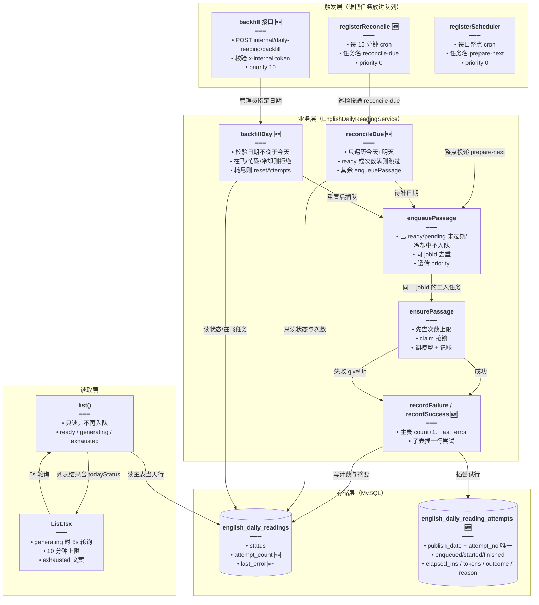
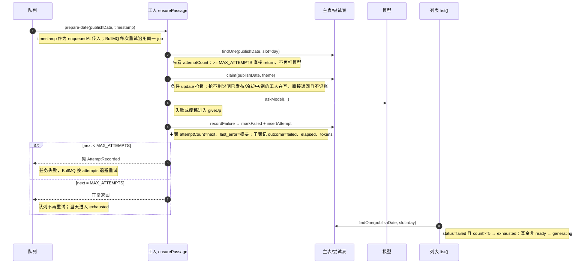

# 每日阅读：系统日推失败上限、尝试记账与按日补生成

> **文档角色（增量专题）**：把系统日推（`slot='day'`）从「失败就无限重试、前端只能转圈」改造成一条**有上限、有账本、可人工补**的生成链路：每天最多自动尝试 5 次，每次尝试单独落一行记录（入队时刻、开始/结束时刻、耗时、Token、结果与原因），失败摘要写回主表；主表新增 `attempt_count` / `last_error`。同时新增每 15 分钟的 `reconcile-due` 巡检只补今天与明天、内部补生成接口 `POST /internal/daily-reading/backfill`（密钥校验 + 管理员重置次数 + 高优先级入队），列表的当天状态收敛为 `ready | generating | exhausted`，前端去掉手点「重试」，改为最多 10 分钟的自动轮询并在耗尽后显示「今天的短文暂时没有」。
>
> **姊妹篇**：[每日阅读生成调度.md](./每日阅读生成调度.md)（队列、`claim` 抢锁、23 点调度与启动补队）、[每日阅读生成加固.md](./每日阅读生成加固.md)（429 退避重试、词级补释义、Token 分路计数）、[每日阅读流式生成.md](./每日阅读流式生成.md)（自选生成的 SSE 与生成历史）、[每日阅读前端.md](./每日阅读前端.md)（列表/详情/设置页）、[每日阅读界面重构.md](./每日阅读界面重构.md)（组件化与详情页双栏）、[每日阅读自定义入队时间.md](./每日阅读自定义入队时间.md)（`autoHour` 与 cron 重注册）。

---

## 一、要解决什么问题

系统日推由 BullMQ 的 `prepare-next` 任务在设定整点触发，失败后靠 `FAIL_COOLDOWN_MS=5s` 冷却重新入队。旧实现有三个缺口：

1. **没有失败上限**：模型或检索持续报错时，任务会按冷却无限次重试，既烧 Token 又让当天状态永远停在 `generating`，用户只看到「今天的短文正在准备」。
2. **没有执行台账**：失败原因只写进日志、主表只留一个 `status='failed'`，事后无法回答「今天到底跑了几个工人、每次多久、花了多少 Token、最后一次为什么失败」。
3. **缺口只能等下一次整点**：若当天/明天某次生成彻底失败，没有任何兜底巡检，也不会补历史缺口；运维只能等 23 点或改配置触发重注册。

目标是把「自动重试」变成**有限次、可观测、可人工介入**：自动最多 5 次；每次尝试一行账；耗尽后列表给出明确终态；巡检每 15 分钟兜底今天/明天；管理员可对任意历史日期重置次数并插队补生成。

## 二、核心思路

- **上限与队列 attempts 对齐**：`MAX_ATTEMPTS = 5`，与 BullMQ `JOB_OPTS.attempts` 是同一个数，避免「队列已放弃、业务还在重试」或反过来的错位。
- **次数记在主表，明细记在子表**：`english_daily_readings.attempt_count` 是当前这一轮的计数，`attempt_count >= 5` 即终态；`english_daily_reading_attempts` 按 `(publish_date, attempt_no)` 唯一，一行一次执行，成功也记一行，禁止删除历史账。
- **失败也要记账，且不计「抢锁失败」**：只有真正抢到 `claim` 并开始打模型的执行才写尝试行；抢不到（已被别的工人接手/已发布）直接返回，不污染计数。
- **失败后主动抛错让队列重试**：未达上限时 `giveUp()` 记账后抛 `AttemptRecorded`，交给 BullMQ 按 `attempts` 退避重试；已达上限则正常返回，任务算成功结束，队列不再重试。
- **列表只读、巡检补队**：`list()` 不再产生任何入队副作用；补队职责交给 15 分钟一次的 `reconcileDue()`（只补今天与明天，跳过硬上限）和启动时的 `enqueuePassage(duePublishDate(...))`。
- **人工补生成单独入口**：内部 HTTP 接口用 `x-internal-token` 与 `DAILY_READING_INTERNAL_TOKEN` 做定长安全比较；对耗尽日期先把 `attempt_count` 清零、把 `startedAt` 拨出冷却，再以 `BACKFILL_PRIORITY=10`（数字越大越靠后）入队，避免挤掉今天/明天的自动任务（自动任务统一 `priority: 0`）。
- **前端去掉「点一下重试」**：重试本就不该由用户触发；改为 `generating` 时每 5 秒拉一次、最多 10 分钟；`failed | exhausted` 都显示同一句「今天的短文暂时没有」，不再暴露内部状态差异。

### 2.1 架构与职责



### 2.2 一次自动生成的生命周期



## 三、改动范围

| 层 | 文件（相对本仓根） | 改动 |
| --- | --- | --- |
| 常量 | `apps/backend/src/services/english-learning/daily-reading.constants.ts` | 新增 `MAX_ATTEMPTS`、`BACKFILL_PRIORITY` |
| 实体 | `.../entity/english-daily-reading.entity.ts` | 新增 `attemptCount`、`lastError` |
| 实体 | `.../entity/english-daily-reading-attempt.entity.ts` | 新建尝试记录表 |
| 迁移 | `apps/backend/src/migrations/1792900000000-english_daily_reading_attempts.ts` | 新列 + 新表 |
| 服务 | `.../english-daily-reading.service.ts` | 巡检、失败上限、记账、补生成、列表状态、优先级 |
| 控制器 | `.../daily-reading-internal.controller.ts` | 新建内部补生成接口 |
| 模块 | `.../english-learning.module.ts` | 注册新实体与新控制器 |
| 配置 | `apps/backend/src/factorys/app-config.factory.ts` | 新增 `DAILY_READING_INTERNAL_TOKEN` 校验 |
| 工人 | `.../english-daily-reading.processor.ts` | 路由 `reconcile-due`、传 `job.timestamp` |
| 前端 | `apps/frontend/src/views/englishLearning/dailyReading/List.tsx` | 去重试按钮、10 分钟轮询、exhausted 文案 |
| 前端 | `.../i18n/locales/{zh-CN,en-US}/englishLearning.ts` | 新增 `exhausted` 文案 |
| 前端 | `apps/frontend/src/service/index.ts` | `todayStatus` 类型加 `exhausted` |

## 四、代码对比与逐行注释

> 本节所有代码块均从**本仓（dnhyxc-ai）根**计算路径；「改动前」取自 `git show HEAD:<path>`，「改动后」为当前工作区。行号为撰写时的近似位置。

### 4.1 失败上限与补生成优先级（`daily-reading.constants.ts`，纯新增）

来源：`apps/backend/src/services/english-learning/daily-reading.constants.ts` **改动后** 约 L8–L11。

```typescript
// 本轮自动失败上限：与 BullMQ 任务 opts.attempts 保持一致，业务计数与队列重试次数不会各说各话
export const MAX_ATTEMPTS = 5;
// 管理员补历史时使用的队列优先级：BullMQ 数字越小越先跑，0 留给今天/明天的自动任务，补历史排在其后
export const BACKFILL_PRIORITY = 10;
```

**变更摘要**：新增两个常量，分别承载「自动重试上限」与「人工补队的低优先级」语义。

### 4.2 主表新增失败计数与失败摘要（`english-daily-reading.entity.ts`）

来源：`apps/backend/src/services/english-learning/entity/english-daily-reading.entity.ts` **改动前** 约 L36–L41。

```typescript
// 生成状态：pending 表示工人正在写，ready 表示可读，failed 表示这一轮最后一次尝试失败
@Column({ type: 'varchar', length: 16, default: 'pending' })
// 字段声明：类型收窄到 DailyReadingStatus，写入其它字符串会在编译期报错
status!: DailyReadingStatus;

// 状态翻转时间：claim 用它判断 pending 是否卡死，markFailed 会把它重置为失败时刻
@Column({ name: 'started_at', type: 'datetime', precision: 6 })
// 字段声明：Date 实例，落库为 datetime(6)，毫秒精度用于冷却判断
startedAt!: Date;
```

来源：`apps/backend/src/services/english-learning/entity/english-daily-reading.entity.ts` **改动后** 约 L36–L48。

```typescript
// 生成状态：pending 表示工人正在写，ready 表示可读，failed 表示这一轮最后一次尝试失败
@Column({ type: 'varchar', length: 16, default: 'pending' })
// 字段声明：类型收窄到 DailyReadingStatus，写入其它字符串会在编译期报错
status!: DailyReadingStatus;

// 本轮已失败次数：成功后保留，只有管理员补生成或新一天的新行才会从 0 开始；达到 MAX_ATTEMPTS 即终态
@Column({ name: 'attempt_count', type: 'int', default: 0 })
// 字段声明：非空数字，default 0 让迁移后的存量行立即有值，避免业务侧到处判空
attemptCount!: number;

// 最后一次失败摘要：最多 500 字，供排障快速看原因；逐次明细仍以尝试表为准
@Column({ name: 'last_error', type: 'varchar', length: 500, nullable: true })
// 字段声明：成功时为 null，失败时写截断后的错误摘要，长度与迁移里的 varchar(500) 对齐
lastError!: string | null;

// 状态翻转时间：claim 用它判断 pending 是否卡死，markFailed 会把它重置为失败时刻
@Column({ name: 'started_at', type: 'datetime', precision: 6 })
// 字段声明：Date 实例，落库为 datetime(6)，毫秒精度用于冷却判断
startedAt!: Date;
```

**变更摘要**：在 `status` 与 `started_at` 之间插入两列。`attemptCount` 用 `default: 0` 兼容存量行；`lastError` 可空，成功时不清空（保留最近一次失败线索）。

### 4.3 尝试记录实体（`english-daily-reading-attempt.entity.ts`，纯新增）

来源：`apps/backend/src/services/english-learning/entity/english-daily-reading-attempt.entity.ts` **改动后** 约 L1–L38。

```typescript
// 引入 TypeORM 的列/实体/索引/主键装饰器，声明这张只追加不更新的账本表
import { Column, Entity, Index, PrimaryGeneratedColumn } from 'typeorm';

// 实体说明：一行代表某个发布日的一次工人执行，自选生成不走这张表，避免两套语义混在一张账上
/** 系统日推一轮工人执行。自选生成不写这里。 */
// 映射到数据库表名：复数形式与其它英语学习表命名风格一致
@Entity('english_daily_reading_attempts')
// 联合唯一索引：同一天内 attempt_no 不重复，保证并发插入时账本序号不打架
@Index('uq_english_daily_reading_attempts', ['publishDate', 'attemptNo'], {
	// 声明该索引唯一，数据库层兜底防重
	unique: true,
// 装饰器参数结束
})
// 尝试记录实体类：只描述字段，不含业务方法
export class EnglishDailyReadingAttempt {
	// 自增主键：bigint 避免长期累积后 int 溢出，TypeORM 以字符串返回大整数
	@PrimaryGeneratedColumn({ type: 'bigint' })
	// 字段声明：字符串类型承接 bigint，前端/日志里不会因 JS number 精度丢失
	id!: string;
	
	// 发布日：与主表 english_daily_readings.publish_date 同一口径，都是上海日历日 YYYY-MM-DD
	@Column({ name: 'publish_date', type: 'varchar', length: 10 })
	// 字段声明：定长 10 的字符串，与主表可做等值关联，避免跨表比较时补零格式不一致
	publishDate!: string;
	
	// 当天第几次尝试：从 1 开始，由 nextAttemptNo 通过 MAX+1 计算，配合唯一索引防并发重号
	@Column({ name: 'attempt_no', type: 'int' })
	// 字段声明：数字类型，参与唯一索引与「最大号 + 1」查询
	attemptNo!: number;
	
	// 入队时刻：取队列任务的 timestamp；缺省时退化为本次开始时刻，用于计算排队时长
	@Column({ name: 'enqueued_at', type: 'datetime', precision: 3 })
	// 字段声明：Date 实例，与 startedAt 相减即可得到排队等待时长
	enqueuedAt!: Date;
	
	// 开始时刻：真正抢到锁、准备调用模型的时间，用于计算执行耗时
	@Column({ name: 'started_at', type: 'datetime', precision: 3 })
	// 字段声明：Date 实例，是计算 elapsedMs 的起点
	startedAt!: Date;
	
	// 结束时刻：成功或失败落账的时间，精确到毫秒便于定位慢请求
	@Column({ name: 'finished_at', type: 'datetime', precision: 3 })
	// 字段声明：Date 实例，是计算 elapsedMs 的终点
	finishedAt!: Date;
	
	// 执行耗时（毫秒）：由 finished - started 计算并保证非负，便于直接 SQL 排序最慢的生成
	@Column({ name: 'elapsed_ms', type: 'int', default: 0 })
	// 字段声明：非空数字，default 0 保证历史插入不会因漏传而报错
	elapsedMs!: number;
	
	// 本次消耗 Token：正文、附件与逐词释义三段累计，取整后写入，用于成本排查
	@Column({ type: 'int', default: 0 })
	// 字段声明：整数直接聚合求和，避免浮点误差
	tokens!: number;
	
	// 结果：ready 表示这一轮成功出稿，failed 表示这一轮失败；成功也记一行，才能看见成功前的失败次数
	@Column({ type: 'varchar', length: 16 })
	// 字段声明：只允许 ready/failed 两个字面量，杜绝写入 pending 之类的中间态
	outcome!: 'ready' | 'failed';
	
	// 失败原因：成功时为 null；失败时存截断到 500 字的错误摘要，与主表 last_error 同源
	@Column({ type: 'varchar', length: 500, nullable: true })
	// 字段声明：可空字符串，成功行不写原因，避免把空串当失败线索
	reason!: string | null;
```

**变更摘要**：新表只做「追加写」，没有更新/删除逻辑；`outcome='ready'` 也要落一行，这样一次成功前失败了几次可直接 `COUNT(*) WHERE outcome='failed'` 得到。

### 4.4 迁移脚本（`1792900000000-english_daily_reading_attempts.ts`，纯新增）

> 源码中的建表 SQL 写在多行模板字符串内，无法在字符串内部插入中文注释；下面把每条语句合并为单行，仅调整排版，语义与源码一致。

来源：`apps/backend/src/migrations/1792900000000-english_daily_reading_attempts.ts` **改动后** 约 L1–L40。

```typescript
// 从 TypeORM 引入迁移接口与执行器类型，供 up/down 使用
import { MigrationInterface, QueryRunner } from 'typeorm';

// 迁移类：类名带时间戳，TypeORM 按名称排序执行，保证新列与新表在多实例滚动发布时只跑一次
export class EnglishDailyReadingAttempts1792900000000 implements MigrationInterface {
	// 迁移名：与类名一致，记录到 migrations 表用于判断是否已执行
	name = 'EnglishDailyReadingAttempts1792900000000';
	
	// 升级：先给主表加两列，再建尝试表；顺序固定，回滚时反向执行
	public async up(queryRunner: QueryRunner): Promise<void> {
		// 主表加失败计数列：default 0 让存量行立即有值，避免应用读到 null 还要到处判空
		await queryRunner.query(
			// SQL 文本：加 int 列并给默认值，一条语句完成结构变更与存量回填
			`ALTER TABLE \`english_daily_readings\` ADD \`attempt_count\` int NOT NULL DEFAULT 0`,
		// 语句结束
		);
		// 主表加失败摘要列：允许 NULL，表示这一轮还没失败过，也兼容历史行
		await queryRunner.query(
			// SQL 文本：可空 varchar(500)，与实体 lastError 的长度约束一一对应
			`ALTER TABLE \`english_daily_readings\` ADD \`last_error\` varchar(500) NULL`,
		// 语句结束
		);
		// 建尝试表：字段与实体一一对应，datetime(3) 保留毫秒，便于精确算耗时
		await queryRunner.query(
			// SQL 文本：一条 CREATE TABLE 同时建表与唯一索引，避免先建表再补索引的半成品状态
			`CREATE TABLE \`english_daily_reading_attempts\` (\`id\` bigint NOT NULL AUTO_INCREMENT, \`publish_date\` varchar(10) NOT NULL, \`attempt_no\` int NOT NULL, \`enqueued_at\` datetime(3) NOT NULL, \`started_at\` datetime(3) NOT NULL, \`finished_at\` datetime(3) NOT NULL, \`elapsed_ms\` int NOT NULL DEFAULT 0, \`tokens\` int NOT NULL DEFAULT 0, \`outcome\` varchar(16) NOT NULL, \`reason\` varchar(500) NULL, UNIQUE INDEX \`uq_english_daily_reading_attempts\` (\`publish_date\`, \`attempt_no\`), PRIMARY KEY (\`id\`)) ENGINE=InnoDB`,
		// 语句结束
		);
	// 方法结束
	}
	
	// 回滚：先删尝试表再删主表列，与 up 严格相反，避免残留半套结构
	public async down(queryRunner: QueryRunner): Promise<void> {
		// 删除尝试表：账本整体回滚
		await queryRunner.query(`DROP TABLE \`english_daily_reading_attempts\``);
		// 删除失败摘要列
		await queryRunner.query(
			// SQL 文本：先撤可空列，回滚顺序与 up 的第二条相反
			`ALTER TABLE \`english_daily_readings\` DROP COLUMN \`last_error\``,
		// 语句结束
		);
		// 删除失败计数列
		await queryRunner.query(
			// SQL 文本：最后撤默认值列，保证 down 完成后回到迁移前结构
			`ALTER TABLE \`english_daily_readings\` DROP COLUMN \`attempt_count\``,
		// 语句结束
		);
	// 方法结束
	}
// 类结束
}
```

**变更摘要**：新迁移与实体同批上线；`up` 幂等由 TypeORM 迁移表保证，不要在应用启动时再补 DDL。

### 4.5 启动注册：新增 15 分钟巡检（`onApplicationBootstrap`）

来源：`apps/backend/src/services/english-learning/english-daily-reading.service.ts` **改动前** 约 L257–L266。

```typescript
// 应用启动钩子：调度注册失败不能挡住进程启动，否则整个后端都起不来
async onApplicationBootstrap(): Promise<void> {
	// 整体兜住异常：队列没就绪时只告警，手动生成等其它能力继续可用
	try {
		// 读取超管维护的自动档位与整点，决定 cron 与应补日期
		const saved = await this.loadAutoSettings();
		// 注册（或改写）每日整点调度器
		await this.registerScheduler(saved.hour);
		// 启动即补一次「应发布日」：覆盖进程停机错过了整点的情况
		await this.enqueuePassage(duePublishDate(saved.hour));
	// 捕获注册/入队异常
	} catch (e) {
		// 队列连不上时定时篇先缺着，不挡住进程启动。手动生成不依赖这次注册。
		this.logger.warn('[EnglishDailyReading] 调度未注册', e);
	// 异常处理结束
	}
// 方法结束
}
```

来源：`apps/backend/src/services/english-learning/english-daily-reading.service.ts` **改动后** 约 L279–L289。

```typescript
// 应用启动钩子：调度注册失败不能挡住进程启动，否则整个后端都起不来
async onApplicationBootstrap(): Promise<void> {
	// 整体兜住异常：队列没就绪时只告警，手动生成等其它能力继续可用
	try {
		// 读取超管维护的自动档位与整点，决定 cron 与应补日期
		const saved = await this.loadAutoSettings();
		// 注册（或改写）每日整点调度器
		await this.registerScheduler(saved.hour);
		// 新增：注册每 15 分钟的缺口巡检，弥补单次整点任务失败后再无兜底的问题
		await this.registerReconcile();
		// 启动即补一次「应发布日」：覆盖进程停机错过了整点的情况
		await this.enqueuePassage(duePublishDate(saved.hour));
	// 捕获注册/入队异常
	} catch (e) {
		// 队列连不上时定时篇先缺着，不挡住进程启动。手动生成不依赖这次注册。
		this.logger.warn('[EnglishDailyReading] 调度未注册', e);
	// 异常处理结束
	}
// 方法结束
}
```

**变更摘要**：只加一行 `registerReconcile()`；放在 `registerScheduler` 之后、启动补队之前，保证巡检先就位。

### 4.6 整点调度器补 `priority: 0`（`registerScheduler`）

来源：`apps/backend/src/services/english-learning/english-daily-reading.service.ts` **改动前** 约 L268–L280。

```typescript
/** 同一 scheduler id，改整点只换 cron，不会新旧两档一起响。 */
// 注册每日整点任务：hour 由超管配置决定
private async registerScheduler(hour: number): Promise<void> {
	// 兜底校验：非 0–23 的脏值一律按 23 点处理，避免生成非法 cron
	const h = hour >= 0 && hour <= 23 ? hour : 23;
	// 用固定 scheduler id 覆盖式注册，改整点不会留下旧 cron
	await this.queue.upsertJobScheduler(
		// 调度器 id：全站唯一
		'daily-reading-next',
		// cron 表达式与时区：按上海时间每天 h 点触发
		{ pattern: `0 ${h} * * *`, tz: 'Asia/Shanghai' },
		// 任务定义
		{
			// 任务名：工人类按名字决定生成明天还是指定日期
			name: 'prepare-next',
			// 无额外数据：日期由工人按上海今天推算明天
			data: {},
			// 任务参数：重试次数、退避等统一来自 JOB_OPTS
			opts: JOB_OPTS,
		// 任务定义结束
		},
	);
// 方法结束
}
```

来源：`apps/backend/src/services/english-learning/english-daily-reading.service.ts` **改动后** 约 L291–L303。

```typescript
/** 同一 scheduler id，改整点只换 cron，不会新旧两档一起响。 */
// 注册每日整点任务：hour 由超管配置决定
private async registerScheduler(hour: number): Promise<void> {
	// 兜底校验：非 0–23 的脏值一律按 23 点处理，避免生成非法 cron
	const h = hour >= 0 && hour <= 23 ? hour : 23;
	// 用固定 scheduler id 覆盖式注册，改整点不会留下旧 cron
	await this.queue.upsertJobScheduler(
		// 调度器 id：全站唯一
		'daily-reading-next',
		// cron 表达式与时区：按上海时间每天 h 点触发
		{ pattern: `0 ${h} * * *`, tz: 'Asia/Shanghai' },
		// 任务定义
		{
			// 任务名：工人类按名字决定生成明天还是指定日期
			name: 'prepare-next',
			// 无额外数据：日期由工人按上海今天推算明天
			data: {},
			// 显式声明 priority 0：与巡检一致，确保自动任务排在管理员补历史（10）之前
			opts: { ...JOB_OPTS, priority: 0 },
		// 任务定义结束
		},
	);
// 方法结束
}
```

**变更摘要**：`JOB_OPTS` 原样展开后追加 `priority: 0`，语义上把「自动任务」钉在最高优先级档。

### 4.7 巡检任务注册（`registerReconcile`，纯新增）

来源：`apps/backend/src/services/english-learning/english-daily-reading.service.ts` **改动后** 约 L305–L316。

```typescript
/** 每 15 分钟只补今天和明天。历史缺口不在这里入队。 */
// 注册缺口巡检：用独立 scheduler id，与整点任务互不影响
private async registerReconcile(): Promise<void> {
	// 覆盖式注册，重复启动或滚动发布不会叠加多条巡检
	await this.queue.upsertJobScheduler(
		// 调度器 id：与 daily-reading-next 区分，便于单独排查
		'daily-reading-reconcile',
		// cron：每 15 分钟一次，时区固定上海，频次足以覆盖一次整点失败后的当天窗口
		{ pattern: '*/15 * * * *', tz: 'Asia/Shanghai' },
		// 任务定义
		{
			// 任务名：工人类见到这个名字直接转 reconcileDue，不进入普通生成分支
			name: 'reconcile-due',
			// 无额外数据：巡检日期由服务端按上海今天自行计算
			data: {},
			// 与自动任务同优先级，保证巡检本身不会被人工补历史挤到很后面
			opts: { ...JOB_OPTS, priority: 0 },
		// 任务定义结束
		},
	);
// 方法结束
}
```

**变更摘要**：巡检任务不携带日期，避免出现「注册时算好的日期」过期问题；每次执行都实时算今天与明天。

### 4.8 巡检执行体（`reconcileDue`，纯新增）

来源：`apps/backend/src/services/english-learning/english-daily-reading.service.ts` **改动后** 约 L318–L329。

```typescript
// 巡检入口：只关心今天与明天，历史缺口交给管理员补生成，避免一次巡检查全表
async reconcileDue(): Promise<void> {
	// 两个目标日期：今天用于补救当天失败，明天用于整点任务未成功时的提前量
	const dates = [shanghaiToday(), addCalendarDays(shanghaiToday(), 1)];
	// 逐日处理：只有两天，循环成本可忽略
	for (const date of dates) {
		// 查当天定时篇行，判定是否已就绪或已耗尽
		const row = await this.repo.findOne({
			// 按发布日 + 定时槽位定位，手动篇不参与巡检
			where: { publishDate: date, slot: DAY_SLOT },
		// 查询结束
		});
		// 已就绪无需补；次数已达上限说明这一轮已判死，也不应在巡检里继续烧模型
		if (row?.status === 'ready' || (row?.attemptCount ?? 0) >= MAX_ATTEMPTS) {
			// 跳过该日期，继续看下一天
			continue;
		// 跳过分支结束
		}
		// 其余情况（无行 / pending / 失败未满）统一交给入队去判定冷却与去重
		await this.enqueuePassage(date);
	// 循环结束
	}
// 方法结束
}
```

**变更摘要**：巡检本身不做「是否在飞」的复杂判断，全部复用 `enqueuePassage` 的既有冷却/去重规则，避免两套判定漂移。

### 4.9 工人主流程：上限前置、Token 统计与失败记账（`ensurePassage`）

来源：`apps/backend/src/services/english-learning/english-daily-reading.service.ts` **改动前** 约 L282–L351。

```typescript
/** 工人入口。publishDate 已由调用方钉死。 */
// 生成入口：只有队列工人会调用，入参日期由任务或工人推算后固定传入
async ensurePassage(publishDate: string): Promise<void> {
	// 队列任务的日期必须是 YYYY-MM-DD，否则直接丢弃，避免写错 slot=day 那一行。
	if (!/^\d{4}-\d{2}-\d{2}$/.test(publishDate)) return;
	// 读超管自动档位与主题库，决定这一篇用什么配置
	const saved = await this.loadAutoSettings();
	// 按发布日从主题库中取当天主题，保证同一天多实例拿到同一主题
	const theme = themeForDate(publishDate, saved.themes);
	// 把存储档位（可能含 random）解析成这次实际使用的难度/篇幅/侧重
	const profile = resolveProfile(saved.profile);
	// 抢锁：条件 update 把该日行从 pending 超龄或 failed 冷却外翻成 pending
	const owned = await this.claim(publishDate, theme);
	// 抢不到说明今天这行已就绪，或还在冷却。不能接着写，否则会覆盖已发布正文。
	if (!owned) return;
	// 包住整段生成：任何异常都要把当天标失败，交给队列按冷却重试
	try {
		// 读最近若干篇的规范化正文，用于后面查重（防止连续两天写同一篇）
		const recent = await this.recentNorms({ publishDate });
		// 取材：按主题联网检索或直接返回空片段，决定这次是 web 还是纯模型
		const material = await this.loadMaterial(theme, profile.useWeb);
		// 第一次调用模型写正文，附带主题、档位与取材片段
		let parsed = await this.askModel(
			// 目标发布日：正文里的日期信息与查重窗口都依赖它
			publishDate,
			// 当天主题
			theme,
			// 本次档位（难度/篇幅/侧重/题数）
			profile,
			// 联网取材片段，空串表示纯模型生成
			material.snippet,
			// 第一次没有废稿原因，传 null
			null,
		// 调用参数结束
		);
		// 取出草稿；解析失败时为 null
		let draft = parsed?.draft ?? null;
		// 有草稿就过校验，没有草稿直接记为 json 原因（模型没返回合法 JSON）
		let reason = draft
			// 真值分支：有草稿就做废稿校验，返回首个不合格原因
			? rejectPassage(draft, recent, material.snippet)
			// 假值分支：没有草稿说明模型没给出合法 JSON，统一记为 json
			: 'json';
		// 有原因说明第一次不合格或没解析出来，再给模型一次机会
		if (reason) {
			// 只重写一次。第二次仍不合格就废稿，不再循环打模型。
			parsed = await this.askModel(
				// 同一个发布日
				publishDate,
				// 同一个主题
				theme,
				// 同一档位
				profile,
				// 同一份取材片段，保证重写仍围绕当天材料
				material.snippet,
				// 把第一次的不合格原因回传给模型，要求针对性修正
				reason,
			// 调用参数结束
			);
			// 取第二次草稿
			draft = parsed?.draft ?? null;
			// 再校验一次：仍不合格则保留原因，进入失败分支
			reason = draft
				// 真值分支：第二次草稿同样跑废稿校验
				? rejectPassage(draft, recent, material.snippet)
				// 假值分支：第二次仍未给出合法 JSON，继续按 json 处理
				: 'json';
		// 重写分支结束
		}
		// 没有草稿或仍有不合格原因：这一轮按失败处理
		if (!draft || reason) {
			// 定时篇失败会清空标题正文。手动路径不能调用这个方法。
			await this.markFailed(publishDate);
			// 日志里留 300 字样本，便于事后判断是结构错还是内容不合格
			const sample = draft ? JSON.stringify(draft).slice(0, 300) : '';
			// 记录废稿原因与样本，排障时不必再复现模型
			this.logger.warn(
				// 模板文本：拼出发布日、原因与样本，便于用 publishDate 检索当天的全部废稿
				`[EnglishDailyReading] 废稿 publishDate=${publishDate} reason=${reason ?? 'json'} ${sample}`,
			);
			// 正常返回：队列认为任务成功，不会再重试
			return;
		// 失败分支结束
		}
		// 去掉零宽字符，避免正文里混入不可见字符影响朗读与查词
		const bodyEn = stripZw(draft.bodyEn);
		// 生成附件学习块（词汇/语法/题目/逐词释义等），内部会继续调模型
		const extras = await this.finishReading(bodyEn, profile);
		// 把成品写回当天定时篇行：此时才允许列表读到这篇
		await this.repo.update(
			// 只按发布日 + 定时槽位更新，绝不碰手动篇
			{ publishDate, slot: DAY_SLOT },
			// 落库字段
			{
				// 状态翻成 ready，列表开始可见
				status: 'ready',
				// 英文标题截断到 80 字，避免超长标题撑破卡片
				titleEn: stripZw(draft.titleEn).slice(0, 80),
				// 中文标题同样截断，保持与列宽匹配
				titleZh: stripZw(draft.titleZh).slice(0, 80),
				// 英文正文
				bodyEn,
				// 中文正文
				bodyZh: stripZw(draft.bodyZh),
				// 来源类型：有取材片段算 web，否则算 llm
				sourceKind: material.snippet ? 'web' : 'llm',
				// 原文链接（若有）
				sourceUrl: material.sourceUrl,
				// 原文标题（若有）
				sourceTitle: material.sourceTitle,
				// 主题
				theme,
				// 附件学习块，并把取材来源合并进去供详情页展示
				extras: this.withSources(extras, material.sources),
			// 落库字段结束
			},
		);
	// 捕获生成阶段的任何异常
	} catch (e) {
		// 模型或检索抛错时也把今天标失败，队列按冷却再入队，避免一直卡在 pending。
		await this.markFailed(publishDate);
		// 继续抛出原异常，让 BullMQ 感知任务失败并触发重试
		throw e;
	// 异常处理结束
	}
// 方法结束
}
```

来源：`apps/backend/src/services/english-learning/english-daily-reading.service.ts` **改动后** 约 L331–L440。

```typescript
/** 工人入口。publishDate 已由调用方钉死。enqueuedAt 是队列任务的 timestamp。 */
// 生成入口：新增 enqueuedAt 参数，用于记录一次执行从入队到开始的排队时长
async ensurePassage(publishDate: string, enqueuedAt?: number): Promise<void> {
	// 队列任务的日期必须是 YYYY-MM-DD，否则直接丢弃，避免写错 slot=day 那一行。
	if (!/^\d{4}-\d{2}-\d{2}$/.test(publishDate)) return;
	// 先读当天行：只为了看本轮失败次数，判断是否已经判死
	const prior = await this.repo.findOne({
		// 与主流程一致，只认定时槽位
		where: { publishDate, slot: DAY_SLOT },
	// 查询结束
	});
	// 本轮已满。队列多投递的一次直接结束，不再打模型。
	if ((prior?.attemptCount ?? 0) >= MAX_ATTEMPTS) return;
	// 读超管自动档位与主题库，决定这一篇用什么配置
	const saved = await this.loadAutoSettings();
	// 按发布日从主题库中取当天主题，保证同一天多实例拿到同一主题
	const theme = themeForDate(publishDate, saved.themes);
	// 把存储档位（可能含 random）解析成这次实际使用的难度/篇幅/侧重
	const profile = resolveProfile(saved.profile);
	// 记下本次开始时刻：成功/失败落账都要用它算耗时
	const started = new Date();
	// 抢锁：条件 update 把该日行从 pending 超龄或 failed 冷却外翻成 pending
	const owned = await this.claim(publishDate, theme);
	// 抢不到说明今天这行已就绪，或还在冷却。不写尝试行。
	if (!owned) return;
	// Token 计数器：tokens 存已结算总量，open 存当前这一路还没结算的增量
	const usage = { tokens: 0, open: 0 };
	// 用量回调：模型流式返回时不断上报总用量，这里区分「进行中」与「已结算」避免重复累加
	const onUsage = (total: number, done?: boolean) => {
		// 取整并兜底负数，防止模型返回异常值污染账本
		const n = Math.max(0, Math.floor(total));
		// done 表示这一路请求结束，需要把增量并入总量
		if (done) {
			// 累加这一路的最终用量
			usage.tokens += n;
			// 清空未结算增量，避免下一次 spent 重复加
			usage.open = 0;
			// 结束本次回调
			return;
		// 结算分支结束
		}
		// 请求进行中：只更新当前增量，等结束时才并入总量
		usage.open = n;
	// 回调结束
	};
	// 结算函数：把还在进行中的增量并进总量并返回总额，失败/成功落账前调用
	const spent = () => {
		// 并入当前未结算增量
		usage.tokens += usage.open;
		// 清空增量，保证多次调用不会重复累计
		usage.open = 0;
		// 返回本次执行的累计 Token
		return usage.tokens;
	// 结算函数结束
	};
	// 标记本次失败是否已经记账：用于 catch 中区分「主动记账后抛错」与「意外异常」
	let recorded = false;
	// 统一的失败处理：先记账、再决定是抛错让队列重试还是安静结束
	const giveUp = async (reason: string) => {
		// 先置标记，避免 catch 拿到 AttemptRecorded 后又重复记一次
		recorded = true;
		// 写主表计数与摘要、并往尝试表插一行 failed 账
		const next = await this.recordFailure(
			// 出问题的发布日
			publishDate,
			// 失败原因（已截断或兜底文案）
			reason,
			// 本次开始时刻
			started,
			// 队列任务时间戳，用于排队时长
			enqueuedAt,
			// 本次已消耗 Token
			spent(),
		// 记账调用结束
		);
		// 未达上限：抛错交给队列重试；抛错能让 BullMQ 正确累计 attempts
		if (next < MAX_ATTEMPTS) {
			// 用失败原因构造错误对象，日志里可直接看到业务原因
			const err = new Error(reason);
			// 用固定 name 标记「这次失败已经记过账」，catch 中据此避免重复记账
			err.name = 'AttemptRecorded';
			// 抛出后由 BullMQ 标记任务失败并按 attempts 退避重试
			throw err;
		// 重试分支结束
		}
	// 失败处理结束
	};
	// 包住整段生成：异常统一走 giveUp，保证每次执行都留下账
	try {
		// 读最近若干篇的规范化正文，用于后面查重（防止连续两天写同一篇）
		const recent = await this.recentNorms({ publishDate });
		// 取材：按主题联网检索或直接返回空片段，决定这次是 web 还是纯模型
		const material = await this.loadMaterial(theme, profile.useWeb);
		// 第一次调用模型写正文，并把用量回调传进去累计 Token
		let parsed = await this.askModel(
			// 目标发布日：正文里的日期信息与查重窗口都依赖它
			publishDate,
			// 当天主题
			theme,
			// 本次档位（难度/篇幅/侧重/题数）
			profile,
			// 联网取材片段，空串表示纯模型生成
			material.snippet,
			// 第一次没有废稿原因，传 null
			null,
			// 新增：把模型用量上报给本次执行，用于尝试表记账
			{ onUsage },
		// 调用参数结束
		);
		// 取出草稿；解析失败时为 null
		let draft = parsed?.draft ?? null;
		// 有草稿就过校验，没有草稿直接记为 json 原因（模型没返回合法 JSON）
		let reason = draft
			// 真值分支：有草稿就做废稿校验，返回首个不合格原因
			? rejectPassage(draft, recent, material.snippet)
			// 假值分支：没有草稿说明模型没给出合法 JSON，统一记为 json
			: 'json';
		// 有原因说明第一次不合格或没解析出来，再给模型一次机会
		if (reason) {
			// 只重写一次。第二次仍不合格就废稿，不再循环打模型。
			parsed = await this.askModel(
				// 同一个发布日
				publishDate,
				// 同一个主题
				theme,
				// 同一档位
				profile,
				// 同一份取材片段，保证重写仍围绕当天材料
				material.snippet,
				// 把第一次的不合格原因回传给模型，要求针对性修正
				reason,
				// 新增：第二次调用同样累计 Token
				{ onUsage },
			// 调用参数结束
			);
			// 取第二次草稿
			draft = parsed?.draft ?? null;
			// 再校验一次：仍不合格则保留原因，进入失败分支
			reason = draft
				// 真值分支：第二次草稿同样跑废稿校验
				? rejectPassage(draft, recent, material.snippet)
				// 假值分支：第二次仍未给出合法 JSON，继续按 json 处理
				: 'json';
		// 重写分支结束
		}
		// 没有草稿或仍有不合格原因：这一轮按失败处理
		if (!draft || reason) {
			// 日志里留 300 字样本，便于事后判断是结构错还是内容不合格
			const sample = draft ? JSON.stringify(draft).slice(0, 300) : '';
			// 记录废稿原因与样本，排障时不必再复现模型
			this.logger.warn(
				// 模板文本：拼出发布日、原因与样本，便于用 publishDate 检索当天的全部废稿
				`[EnglishDailyReading] 废稿 publishDate=${publishDate} reason=${reason ?? 'json'} ${sample}`,
			);
			// 统一失败处理：未达上限抛错重试，达上限则安静结束
			await giveUp(reason ?? 'json');
			// 结束本次执行；未达上限时上一行已抛错，这里只覆盖已达上限的情况
			return;
		// 失败分支结束
		}
		// 去掉零宽字符，避免正文里混入不可见字符影响朗读与查词
		const bodyEn = stripZw(draft.bodyEn);
		// 生成附件学习块（词汇/语法/题目/逐词释义等），同样累计 Token
		const extras = await this.finishReading(bodyEn, profile, { onUsage });
		// 把成品写回当天定时篇行：此时才允许列表读到这篇
		await this.repo.update(
			// 只按发布日 + 定时槽位更新，绝不碰手动篇
			{ publishDate, slot: DAY_SLOT },
			// 落库字段
			{
				// 状态翻成 ready，列表开始可见
				status: 'ready',
				// 英文标题截断到 80 字，避免超长标题撑破卡片
				titleEn: stripZw(draft.titleEn).slice(0, 80),
				// 中文标题同样截断，保持与列宽匹配
				titleZh: stripZw(draft.titleZh).slice(0, 80),
				// 英文正文
				bodyEn,
				// 中文正文
				bodyZh: stripZw(draft.bodyZh),
				// 来源类型：有取材片段算 web，否则算 llm
				sourceKind: material.snippet ? 'web' : 'llm',
				// 原文链接（若有）
				sourceUrl: material.sourceUrl,
				// 原文标题（若有）
				sourceTitle: material.sourceTitle,
				// 主题
				theme,
				// 附件学习块，并把取材来源合并进去供详情页展示
				extras: this.withSources(extras, material.sources),
			// 落库字段结束
			},
		);
		// 成功也要记一行账：记录耗时与 Token，成功前的失败次数由此可查
		await this.recordSuccess(publishDate, started, enqueuedAt, spent());
	// 捕获生成阶段的任何异常
	} catch (e) {
		// 已经主动记账过（或抛的就是记账标记）时直接再抛，避免把一次失败记成两次
		if (recorded || (e instanceof Error && e.name === 'AttemptRecorded')) {
			// 原样抛出：让队列按 attempts 重试，或让已达上限的任务正常结束
			throw e;
		// 已记账分支结束
		}
		// 意外异常：转成可读原因后统一记账（未达上限会抛错重试）
		await giveUp(attemptReason(e));
	// 异常处理结束
	}
// 方法结束
}
```

**变更摘要**：新增「次数上限前置判断」「开始时刻 + Token 累计」「`giveUp` 统一失败处理」「成功/失败各记一行账」；把原来散落的 `markFailed(publishDate)` 两处调用替换成 `giveUp`，并把「未达上限抛错、达上限安静结束」的策略收在一处。抢锁失败不记账，仍然保持只读语义。

### 4.10 入队支持优先级（`enqueuePassage`）

来源：`apps/backend/src/services/english-learning/english-daily-reading.service.ts` **改动前** 约 L353–L386。

```typescript
/** 入队。 */
// 入队入口：所有触发方（启动、整点、巡检、列表旧逻辑）最终都走这里
async enqueuePassage(publishDate: string): Promise<void> {
	// 查当天行：已发布、未过期 pending、冷却中的 failed 都不应重复入队
	const row = await this.repo.findOne({
		// 只针对定时槽位
		where: { publishDate, slot: DAY_SLOT },
	// 查询结束
	});
	// 已发布不再入队。pending 未过期、failed 仍在冷却时也不入队，避免两台工人同时写同一天。
	if (row?.status === 'ready') return;
	// 计算距 startedAt 的时长；无行视为无限久，必然允许入队
	const age = row ? Date.now() - new Date(row.startedAt).getTime() : Infinity;
	// pending 未过期：说明别的工人正在写，别抢
	if (row?.status === 'pending' && age < PENDING_STALE_MS) return;
	// failed 还在冷却：等冷却过去再试，避免失败后立刻重打模型
	if (row?.status === 'failed' && age < FAIL_COOLDOWN_MS) return;
	// 按 jobId 查队列里是否已有同一天任务
	const existing = await this.queue.getJob(publishDate);
	// 已存在时按状态决定「保留」还是「删掉重建」
	if (existing) {
		// 还在排队或执行就不再加。已经结束的旧任务先删掉，否则同 jobId 加不进去。
		const state = await existing.getState();
		// 四种在飞状态都表示任务尚未结束
		if (
			// 等待被消费
			state === 'waiting' ||
			// 正在执行
			state === 'active' ||
			// 延时/退避等待中
			state === 'delayed' ||
			// 优先级队列中排队
			state === 'prioritized'
		) {
			// 已有在飞任务，直接返回，避免同一天两个工人
			return;
		// 在飞分支结束
		}
		// 旧任务已结束：删掉它，否则同 jobId 无法重新添加
		await existing.remove().catch(() => undefined);
	// 已存在分支结束
	}
	// jobId 用日期，同一天在队列里只有一个任务。
	await this.queue.add(
		// 任务名：工人据名字识别为指定日期生成
		'prepare-date',
		// 任务数据：只带发布日
		{ publishDate },
		// 任务参数
		{
			// 用日期当 jobId，实现同一天天然去重
			jobId: publishDate,
			// 重试次数、退避等统一配置
			...JOB_OPTS,
		// 任务参数结束
		},
	);
// 方法结束
}
```

来源：`apps/backend/src/services/english-learning/english-daily-reading.service.ts` **改动后** 约 L442–L479。

```typescript
/** 入队。priority 默认 0。管理员补历史传 BACKFILL_PRIORITY。 */
// 入队入口：新增可选参数，调用方按场景决定队列优先级
async enqueuePassage(
	// 目标发布日
	publishDate: string,
	// 可选参数：未传时按自动任务的默认优先级处理
	opts?: { priority?: number },
// 方法签名结束
): Promise<void> {
	// 查当天行：已发布、未过期 pending、冷却中的 failed 都不应重复入队
	const row = await this.repo.findOne({
		// 只针对定时槽位
		where: { publishDate, slot: DAY_SLOT },
	// 查询结束
	});
	// 已发布不再入队。pending 未过期、failed 仍在冷却时也不入队，避免两台工人同时写同一天。
	if (row?.status === 'ready') return;
	// 计算距 startedAt 的时长；无行视为无限久，必然允许入队
	const age = row ? Date.now() - new Date(row.startedAt).getTime() : Infinity;
	// pending 未过期：说明别的工人正在写，别抢
	if (row?.status === 'pending' && age < PENDING_STALE_MS) return;
	// failed 还在冷却：等冷却过去再试，避免失败后立刻重打模型
	if (row?.status === 'failed' && age < FAIL_COOLDOWN_MS) return;
	// 按 jobId 查队列里是否已有同一天任务
	const existing = await this.queue.getJob(publishDate);
	// 已存在时按状态决定「保留」还是「删掉重建」
	if (existing) {
		// 还在排队或执行就不再加。已经结束的旧任务先删掉，否则同 jobId 加不进去。
		const state = await existing.getState();
		// 四种在飞状态都表示任务尚未结束
		if (
			// 等待被消费
			state === 'waiting' ||
			// 正在执行
			state === 'active' ||
			// 延时/退避等待中
			state === 'delayed' ||
			// 优先级队列中排队
			state === 'prioritized'
		) {
			// 已有在飞任务，直接返回，避免同一天两个工人
			return;
		// 在飞分支结束
		}
		// 旧任务已结束：删掉它，否则同 jobId 无法重新添加
		await existing.remove().catch(() => undefined);
	// 已存在分支结束
	}
	// jobId 用日期，同一天在队列里只有一个任务。
	await this.queue.add(
		// 任务名：工人据名字识别为指定日期生成
		'prepare-date',
		// 任务数据：只带发布日
		{ publishDate },
		// 任务参数
		{
			// 用日期当 jobId，实现同一天天然去重
			jobId: publishDate,
			// 重试次数、退避等统一配置
			...JOB_OPTS,
			// 新增：优先级透传；自动任务 0、管理员补历史 10，数字越小越先跑
			priority: opts?.priority ?? 0,
		// 任务参数结束
		},
	);
// 方法结束
}
```

**变更摘要**：只增加一个可选参数与 `priority` 字段，其余冷却/去重判定完全保留，避免为了补历史另写一套入队逻辑。

### 4.11 列表当天状态：只读与 `exhausted`（`list`）

来源：`apps/backend/src/services/english-learning/english-daily-reading.service.ts` **改动前** 约 L388–L445。

```typescript
// 列表读取：按 origin 区分系统日推与自选生成，分页返回
async list(
	// 当前用户：自选生成列表需要按主人过滤
	userId: number,
	// 每页条数
	limit: number,
	// 偏移量
	offset: number,
	// 列表来源：默认系统日推
	origin: 'day' | 'manual' = 'day',
// 方法签名结束
): Promise<DailyReadingList> {
	// 今天（上海日历日）
	const today = shanghaiToday();
	// 查当天定时篇行，决定 todayStatus
	const todayRow = await this.repo.findOne({
		// 按发布日 + 定时槽位定位
		where: { publishDate: today, slot: DAY_SLOT },
	// 查询结束
	});
	// 没有今天这行时保持 failed，不入队，避免列表打开就生成、状态一直转圈。
	let todayStatus: DailyReadingList['todayStatus'] = 'failed';
	// 成品在：状态 ready
	if (todayRow?.status === 'ready') todayStatus = 'ready';
	// 失败过：冷却内报 failed，出冷却报 generating 并顺手补一次队
	else if (todayRow?.status === 'failed') {
		// 距失败时刻的时长
		const age = Date.now() - new Date(todayRow.startedAt).getTime();
		// 冷却内 failed，出冷却算生成中
		todayStatus = age < FAIL_COOLDOWN_MS ? 'failed' : 'generating';
		// 出冷却：列表读取顺手入队，这是旧实现的隐式副作用
		if (todayStatus === 'generating') {
			// 入队失败忽略，不能影响列表返回
			await this.enqueuePassage(today).catch(() => undefined);
		// 补队分支结束
		}
	// 失败分支结束
	// 行还在写：按是否卡死决定补不补队
	} else if (todayRow?.status === 'pending') {
		// pending 距今时长
		const age = Date.now() - new Date(todayRow.startedAt).getTime();
		// 卡死超龄才补队，正常情况下由工人自己跑完
		if (age >= PENDING_STALE_MS) {
			// 补队失败忽略
			await this.enqueuePassage(today).catch(() => undefined);
		// 补队分支结束
		}
		// 对外统一报生成中
		todayStatus = 'generating';
	// pending 分支结束
	}
	// 列表只返回 ready。生成中的 pending 半成品不能变成一条坏文章。
	const visible = this.repo
		// 用 QueryBuilder 便于按 origin 追加不同过滤条件
		.createQueryBuilder('row')
		// 基础条件：只取已成品
		.where('row.status = :status', { status: 'ready' })
		// 且不晚于今天：未来篇目不提前暴露
		.andWhere('row.publishDate <= :today', { today });
	// 自选生成列表：按主人过滤且排除定时槽位
	if (origin === 'manual') {
		// 手动列表只看本人、且 slot 不是 day。系统日推走另一条查询。
		visible
			// 排除定时篇
			.andWhere('row.slot != :day', { day: DAY_SLOT })
			// 只取本人的篇目
			.andWhere('row.userId = :userId', { userId });
	// 系统日推列表：只取定时槽位
	} else {
		// 定时篇不带 userId，全员可见
		visible.andWhere('row.slot = :day', { day: DAY_SLOT });
	// 分支结束
	}
	// 并行取当前页数据与总数，减少一次往返
	const [rows, totalCount] = await Promise.all([
		// 当前页
		visible
			// 克隆查询，避免复用同一 builder 的排序影响计数
			.clone()
			// 按发布日倒序：最新在前
			.orderBy('row.publishDate', 'DESC')
			// 同一天再按创建时间倒序，保证顺序稳定
			.addOrderBy('row.createdAt', 'DESC')
			// 取 limit 条
			.take(limit)
			// 跳过 offset 条
			.skip(offset)
			// 执行查询
			.getMany(),
		// 总数统计
		visible.clone().getCount(),
	// 并行结束
	]);
	// 今天的成品视图：只有 ready 才有，避免把半成品塞给详情入口
	const todayView =
		// 三元分支：只有 status=ready 才转视图，其余一律返回 null
		todayRow?.status === 'ready' ? this.toView(todayRow) : null;
	// 组装返回体
	return {
		// 列表项逐条转视图
		items: rows.map((r) => this.toView(r)),
		// 总数
		totalCount,
		// 当天状态：前端据此轮询或给终态文案
		todayStatus,
		// 今日篇目（无成品时为 null）
		today: todayView,
	// 返回体结束
	};
// 方法结束
}
```

来源：`apps/backend/src/services/english-learning/english-daily-reading.service.ts` **改动后** 约 L481–L531。

```typescript
// 列表读取：按 origin 区分系统日推与自选生成，分页返回
async list(
	// 当前用户：自选生成列表需要按主人过滤
	userId: number,
	// 每页条数
	limit: number,
	// 偏移量
	offset: number,
	// 列表来源：默认系统日推
	origin: 'day' | 'manual' = 'day',
// 方法签名结束
): Promise<DailyReadingList> {
	// 今天（上海日历日）
	const today = shanghaiToday();
	// 查当天定时篇行，决定 todayStatus
	const todayRow = await this.repo.findOne({
		// 按发布日 + 定时槽位定位
		where: { publishDate: today, slot: DAY_SLOT },
	// 查询结束
	});
	// 列表只读。今天缺篇或失败由补队和队列重试，不在这里入队。
	let todayStatus: DailyReadingList['todayStatus'] = 'generating';
	// 成品在：状态 ready
	if (todayRow?.status === 'ready') todayStatus = 'ready';
	// 失败且次数已满：这一轮已判死，给前端一个明确终态
	else if (
		// 必须是失败状态
		todayRow?.status === 'failed' &&
		// 且本轮失败次数达到上限
		(todayRow.attemptCount ?? 0) >= MAX_ATTEMPTS
	) {
		// 终态：前端显示「今天的短文暂时没有」，不再自动轮询
		todayStatus = 'exhausted';
	// 终态分支结束
	}
	// 列表只返回 ready。生成中的 pending 半成品不能变成一条坏文章。
	const visible = this.repo
		// 用 QueryBuilder 便于按 origin 追加不同过滤条件
		.createQueryBuilder('row')
		// 基础条件：只取已成品
		.where('row.status = :status', { status: 'ready' })
		// 且不晚于今天：未来篇目不提前暴露
		.andWhere('row.publishDate <= :today', { today });
	// 自选生成列表：按主人过滤且排除定时槽位
	if (origin === 'manual') {
		// 手动列表只看本人、且 slot 不是 day。系统日推走另一条查询。
		visible
			// 排除定时篇
			.andWhere('row.slot != :day', { day: DAY_SLOT })
			// 只取本人的篇目
			.andWhere('row.userId = :userId', { userId });
	// 系统日推列表：只取定时槽位
	} else {
		// 定时篇不带 userId，全员可见
		visible.andWhere('row.slot = :day', { day: DAY_SLOT });
	// 分支结束
	}
	// 并行取当前页数据与总数，减少一次往返
	const [rows, totalCount] = await Promise.all([
		// 当前页
		visible
			// 克隆查询，避免复用同一 builder 的排序影响计数
			.clone()
			// 按发布日倒序：最新在前
			.orderBy('row.publishDate', 'DESC')
			// 同一天再按创建时间倒序，保证顺序稳定
			.addOrderBy('row.createdAt', 'DESC')
			// 取 limit 条
			.take(limit)
			// 跳过 offset 条
			.skip(offset)
			// 执行查询
			.getMany(),
		// 总数统计
		visible.clone().getCount(),
	// 并行结束
	]);
	// 今天的成品视图：只有 ready 才有，避免把半成品塞给详情入口
	const todayView =
		// 三元分支：只有 status=ready 才转视图，其余一律返回 null
		todayRow?.status === 'ready' ? this.toView(todayRow) : null;
	// 组装返回体
	return {
		// 列表项逐条转视图
		items: rows.map((r) => this.toView(r)),
		// 总数
		totalCount,
		// 当天状态：ready / generating / exhausted
		todayStatus,
		// 今日篇目（无成品时为 null）
		today: todayView,
	// 返回体结束
	};
// 方法结束
}
```

**变更摘要**：`todayStatus` 默认值由 `failed` 改为 `generating`，并彻底删除两处 `enqueuePassage` 副作用；失败分支新增 `attemptCount >= MAX_ATTEMPTS → exhausted`。同时类型定义（约 L102）从 `'ready' | 'generating' | 'failed'` 改为 `'ready' | 'generating' | 'exhausted'`，不再对外暴露 `failed`。

### 4.12 管理端按日补生成（`backfillDay`，纯新增）

来源：`apps/backend/src/services/english-learning/english-daily-reading.service.ts` **改动后** 约 L1225–L1259。

```typescript
// 补生成入口：指定日期补一次系统日推，供内部接口调用，也便于脚本复用
async backfillDay(publishDate: string): Promise<{
	// 是否接受了这次补生成请求
	ok: boolean;
	// 是否已投递队列（与 ok 同时为 true 时表示在排队或已在跑）
	queued?: boolean;
	// 拒绝原因：future / ready / busy / cooldown
	reason?: string;
// 返回类型结束
}> {
	// 先校验日期格式与范围：非法格式或未来日期一律拒绝，避免写出越权的未来篇
	if (!isPublishDate(publishDate) || publishDate > shanghaiToday()) {
		// 未来日期与非法日期统一归为 future，调用方不必区分
		return { ok: false, reason: 'future' };
	// 校验分支结束
	}
	// 读当天行，判断是否已成品/正在写/冷却中
	const row = await this.repo.findOne({
		// 只补定时槽位，手动篇不提供补生成
		where: { publishDate, slot: DAY_SLOT },
	// 查询结束
	});
	// 已成品：无需补，直接告诉调用方
	if (row?.status === 'ready') return { ok: false, reason: 'ready' };
	// 队列里已有在飞任务：视为已受理，避免重复投递
	if (await this.jobInFlight(publishDate)) return { ok: true, queued: true };
	// 距 startedAt 的时长；无行视为无限久
	const age = row ? Date.now() - new Date(row.startedAt).getTime() : Infinity;
	// 正常生成中的 pending：明确拒绝，避免管理员操作打断工人
	if (row?.status === 'pending' && age < PENDING_STALE_MS) {
		// 忙碌：让调用方稍后再试
		return { ok: false, reason: 'busy' };
	// 忙碌分支结束
	}
	// 失败但还没到上限且仍在冷却：让调用方等冷却，避免刚失败就重打模型
	if (
		// 必须是失败状态
		row?.status === 'failed' &&
		// 次数未达上限（达上限的是另一条重置分支）
		(row.attemptCount ?? 0) < MAX_ATTEMPTS &&
		// 仍在冷却窗口内
		age < FAIL_COOLDOWN_MS
	) {
		// 冷却中：稍后再试
		return { ok: false, reason: 'cooldown' };
	// 冷却分支结束
	}
	// 本轮已耗尽：管理员补生成视为开启新一轮，先清计数并把 startedAt 拨出冷却
	if (row && (row.attemptCount ?? 0) >= MAX_ATTEMPTS) {
		// 只清计数，不删除历史尝试行
		await this.resetAttempts(publishDate);
	// 重置分支结束
	}
	// 入队：使用较低优先级，避免挤掉今天/明天的自动任务
	try {
		// 带优先级投递；内部会再次走冷却/去重判定
		await this.enqueuePassage(publishDate, { priority: BACKFILL_PRIORITY });
	// 入队异常处理
	} catch (e) {
		// 入队报错但任务其实已在飞：按成功受理返回，避免调用方误以为要重试
		if (await this.jobInFlight(publishDate)) return { ok: true, queued: true };
		// 真正失败：原样抛出，交给接口层返回 5xx
		throw e;
	// 异常处理结束
	}
	// 正常受理
	return { ok: true, queued: true };
// 方法结束
}
```

**变更摘要**：补生成是「显式动作」，因此比自动链路多一层日期校验与三种拒因（future/ready/busy/cooldown），并在耗尽时先重置再入队。

### 4.13 在飞判定与重置本轮次数（`jobInFlight` / `resetAttempts`，纯新增）

来源：`apps/backend/src/services/english-learning/english-daily-reading.service.ts` **改动后** 约 L1261–L1282。

```typescript
// 判定某天是否已有队列任务在飞：补生成接口用它避免重复投递
private async jobInFlight(publishDate: string): Promise<boolean> {
	// 用 jobId 取任务，jobId 就是发布日
	const existing = await this.queue.getJob(publishDate);
	// 没有任务：肯定不在飞
	if (!existing) return false;
	// 有任务就看状态
	const state = await existing.getState();
	// 只有这四个状态表示尚未结束
	return (
		// 等待被消费
		state === 'waiting' ||
		// 正在执行
		state === 'active' ||
		// 退避/延时等待
		state === 'delayed' ||
		// 优先级队列中
		state === 'prioritized'
	// 返回判定结果
	);
// 方法结束
}

/** 只清本轮次数，并把 startedAt 拨出冷却。不删尝试行。 */
// 重置本轮失败计数：管理员补生成时调用，历史账本保留
private async resetAttempts(publishDate: string): Promise<void> {
	// 主表更新：计数归零 + 把 startedAt 挪到冷却窗口之前
	await this.repo.update(
		// 只改定时槽位
		{ publishDate, slot: DAY_SLOT },
		// 更新字段
		{
			// 次数归零：开启新一轮自动尝试额度
			attemptCount: 0,
			// 往前拨 6 秒（冷却 5 秒 + 1 秒余量），确保紧接着的 enqueuePassage 不会被冷却挡回
			startedAt: new Date(Date.now() - FAIL_COOLDOWN_MS - 1000),
		// 更新字段结束
		},
	);
// 方法结束
}
```

**变更摘要**：`jobInFlight` 与 `enqueuePassage` 内部的在飞判定口径一致；`resetAttempts` 故意不删 `english_daily_reading_attempts`，保证「第几次尝试」与历史耗时/Tokens 仍可回溯。

### 4.14 尝试记账（`recordFailure` / `recordSuccess` / `insertAttempt` / `nextAttemptNo`，纯新增）

来源：`apps/backend/src/services/english-learning/english-daily-reading.service.ts` **改动后** 约 L1284–L1358。

```typescript
// 记一次失败：先写主表计数与摘要，再插一行尝试账
private async recordFailure(
	// 发布日
	publishDate: string,
	// 失败原因（调用方已截断或给兜底文案）
	reason: string,
	// 本次开始时刻
	started: Date,
	// 队列任务时间戳（可能为空）
	enqueuedAt: number | undefined,
	// 本次已消耗 Token
	tokens: number,
// 返回本轮累计失败次数
): Promise<number> {
	// 读当前行拿旧计数，避免在内存里维护跨进程状态
	const row = await this.repo.findOne({
		// 只认定时槽位
		where: { publishDate, slot: DAY_SLOT },
	// 查询结束
	});
	// 本轮新计数：旧值 + 1
	const next = (row?.attemptCount ?? 0) + 1;
	// 原因统一截断到 500，与列宽一致，避免写库报错
	const text = reason.slice(0, 500);
	// 主表标失败：清空标题正文、写计数与摘要、重置 startedAt（冷却起点）
	await this.markFailed(publishDate, text, next);
	// 尝试表插一行历史账
	await this.insertAttempt({
		// 发布日
		publishDate,
		// 结果：失败
		outcome: 'failed',
		// 失败原因
		reason: text,
		// 开始时刻
		started,
		// 入队时刻
		enqueuedAt,
		// Token 用量
		tokens,
	// 插入参数结束
	});
	// 返回新计数，供调用方判断是否达上限
	return next;
// 方法结束
}

// 记一次成功：主表已在调用方更新为 ready，这里只补尝试账
private async recordSuccess(
	// 发布日
	publishDate: string,
	// 本次开始时刻
	started: Date,
	// 队列任务时间戳（可能为空）
	enqueuedAt: number | undefined,
	// 本次已消耗 Token
	tokens: number,
// 无返回值
): Promise<void> {
	// 插一行成功账：成功也记，才能看到「第几次才成功」
	await this.insertAttempt({
		// 发布日
		publishDate,
		// 结果：成功
		outcome: 'ready',
		// 成功没有失败原因
		reason: null,
		// 开始时刻
		started,
		// 入队时刻
		enqueuedAt,
		// Token 用量
		tokens,
	// 插入参数结束
	});
// 方法结束
}

// 尝试表插入：统一计算结束时刻、耗时与序号，失败只告警不影响主流程
private async insertAttempt(input: {
	// 发布日
	publishDate: string;
	// 结果
	outcome: 'ready' | 'failed';
	// 失败原因（成功为 null）
	reason: string | null;
	// 开始时刻
	started: Date;
	// 入队时刻
	enqueuedAt: number | undefined;
	// Token 用量
	tokens: number;
// 参数类型结束
}): Promise<void> {
	// 结束时刻：记账这一刻
	const finished = new Date();
	// 整段兜住：账本写失败不能反过来影响生成结果
	try {
		// 取当天下一个序号；查询 MAX+1 并靠唯一索引兜底并发
		const attemptNo = await this.nextAttemptNo(input.publishDate);
		// 插入一行账
		await this.attempts.insert({
			// 发布日
			publishDate: input.publishDate,
			// 当天第几次
			attemptNo,
			// 入队时刻：没有任务时间戳时退化为开始时刻，保证非空
			enqueuedAt: new Date(input.enqueuedAt ?? input.started.getTime()),
			// 开始时刻
			startedAt: input.started,
			// 结束时刻
			finishedAt: finished,
			// 耗时：保证非负，避免时钟回拨写出负数
			elapsedMs: Math.max(0, finished.getTime() - input.started.getTime()),
			// Token：取整并保证非负
			tokens: Math.max(0, Math.floor(input.tokens)),
			// 结果
			outcome: input.outcome,
			// 失败原因
			reason: input.reason,
		// 插入字段结束
		});
	// 插入异常处理
	} catch (e) {
		// 只告警：账本失败不阻断生成，也不让队列误判任务失败
		this.logger.warn('[EnglishDailyReading] 尝试记录未写入', e);
	// 异常处理结束
	}
// 方法结束
}

// 计算当天下一个尝试序号：MAX+1，配合唯一索引防止并发重号
private async nextAttemptNo(publishDate: string): Promise<number> {
	// 用 QueryBuilder 做聚合查询，避免把整表行读进内存
	const raw = await this.attempts
		// 别名 row 用于拼条件
		.createQueryBuilder('row')
		// 取当天最大序号；COALESCE 让「还没有账」时返回 0
		.select('COALESCE(MAX(row.attemptNo), 0)', 'max')
		// 只统计同一天
		.where('row.publishDate = :publishDate', { publishDate })
		// 取原始值；MySQL 聚合可能返回字符串
		.getRawOne<{ max: string | number | null }>();
	// 转数字后 +1；空值兜底为 0
	return Number(raw?.max ?? 0) + 1;
// 方法结束
}
```

**变更摘要**：四个方法把「主表状态」与「尝试账本」解耦：主表负责对外状态，账本负责排障与成本；账本写失败只降级为告警。

### 4.15 失败落库补计数与摘要（`markFailed`）

来源：`apps/backend/src/services/english-learning/english-daily-reading.service.ts` **改动前** 约 L1139–L1152。

```typescript
// 把定时篇标失败：清空标题正文，避免半成品被列表或详情读到
private async markFailed(publishDate: string): Promise<void> {
	// 只清定时篇。手动稿走 markRowFailed，不能把标题正文写成空串。
	await this.repo.update(
		// 只按发布日 + 定时槽位更新
		{ publishDate, slot: DAY_SLOT },
		// 失败时写入的字段
		{
			// 状态翻成 failed
			status: 'failed',
			// 重置开始时刻：作为冷却计时起点
			startedAt: new Date(),
			// 英文标题清空
			titleEn: '',
			// 中文标题清空
			titleZh: '',
			// 英文正文清空
			bodyEn: '',
			// 中文正文清空
			bodyZh: '',
		// 字段结束
		},
	);
// 方法结束
}
```

来源：`apps/backend/src/services/english-learning/english-daily-reading.service.ts` **改动后** 约 L1360–L1379。

```typescript
// 把定时篇标失败：清空标题正文，避免半成品被列表或详情读到
private async markFailed(
	// 发布日
	publishDate: string,
	// 失败原因：写入主表摘要
	reason: string,
	// 本轮新的失败次数：由 recordFailure 计算后传入
	attemptCount: number,
// 方法签名结束
): Promise<void> {
	// 只清定时篇。手动稿走 markRowFailed，不能把标题正文写成空串。
	await this.repo.update(
		// 只按发布日 + 定时槽位更新
		{ publishDate, slot: DAY_SLOT },
		// 失败时写入的字段
		{
			// 状态翻成 failed
			status: 'failed',
			// 重置开始时刻：作为冷却计时起点
			startedAt: new Date(),
			// 英文标题清空
			titleEn: '',
			// 中文标题清空
			titleZh: '',
			// 英文正文清空
			bodyEn: '',
			// 中文正文清空
			bodyZh: '',
			// 新增：写入本轮累计失败次数，供列表判 exhausted 与巡检跳过
			attemptCount,
			// 新增：写入失败摘要，列表/排障可直接读到最近一次原因
			lastError: reason.slice(0, 500),
		// 字段结束
		},
	);
// 方法结束
}
```

**变更摘要**：`markFailed` 从「只翻状态」变成「状态 + 计数 + 摘要」一次写清，保证列表、巡检、补生成看到的失败信息一致。

### 4.16 两个纯函数（`attemptReason` / `isPublishDate`，纯新增）

来源：`apps/backend/src/services/english-learning/english-daily-reading.service.ts` **改动后** 约 L240–L254。

```typescript
// 把任意异常转成可落库的失败原因：非 Error 或空消息时给兜底文案
function attemptReason(e: unknown): string {
	// 是 Error 且有非空消息：截断到 500 字后返回，避免超列宽
	if (e instanceof Error && e.message.trim()) return e.message.slice(0, 500);
	// 其余情况（字符串、空消息、undefined）统一用中文兜底
	return '生成失败';
// 函数结束
}

// 校验发布日：必须是合法的 YYYY-MM-DD 日历日，挡住 2026-02-30 这类格式对但不存在的日期
function isPublishDate(value: string): boolean {
	// 先卡格式，避免 split 出奇怪结果
	if (!/^\d{4}-\d{2}-\d{2}$/.test(value)) return false;
	// 拆出年月日并转数字
	const [year, month, day] = value.split('-').map(Number);
	// 用 UTC 构造日期：只做日历回读，不受服务器时区影响
	const date = new Date(Date.UTC(year, month - 1, day));
	// 回读三个字段与输入一致才算合法（构造会自动进位，如 2 月 30 日变成 3 月 2 日）
	return (
		// 年一致
		date.getUTCFullYear() === year &&
		// 月一致（getUTCMonth 从 0 开始，所以要减 1 比较）
		date.getUTCMonth() === month - 1 &&
		// 日一致
		date.getUTCDate() === day
	// 返回校验结果
	);
// 函数结束
}
```

**变更摘要**：两个函数都在模块顶层，无副作用；`isPublishDate` 只校验「是不是日历日」，是否允许未来由 `backfillDay` 另行判断。

### 4.17 内部补生成接口（`daily-reading-internal.controller.ts`，纯新增）

来源：`apps/backend/src/services/english-learning/daily-reading-internal.controller.ts` **改动后** 约 L1–L34。

```typescript
// 引入 Node 内置的定长比较：避免普通字符串比较被计时攻击猜出密钥
import { timingSafeEqual } from 'node:crypto';
// 从 Nest 引入请求体、控制器、请求头、POST 与未授权异常
import {
	// 读取 JSON 请求体
	Body,
	// 声明控制器路由前缀
	Controller,
	// 读取自定义请求头
	Headers,
	// 声明 POST 端点
	Post,
	// 密钥错误时抛 401
	UnauthorizedException,
// 引入结束
} from '@nestjs/common';
// 复用每日阅读服务里的补生成逻辑
import { EnglishDailyReadingService } from './english-daily-reading.service';

// 密钥校验：未配置或未携带都判失败，长度不同直接短路，最后做定长安全比较
function tokenOk(got: string | undefined, expected: string | undefined): boolean {
	// 任一方为空都不放行：避免「没配置密钥」被当成「无需鉴权」
	if (!expected || !got) return false;
	// 把请求头转成 Buffer 供 timingSafeEqual 使用
	const a = Buffer.from(got);
	// 把期望密钥转成 Buffer
	const b = Buffer.from(expected);
	// 长度不同直接返回：timingSafeEqual 要求等长，也顺便早退
	if (a.length !== b.length) return false;
	// 定长比较：耗时不随前缀匹配长度变化，降低侧信道风险
	return timingSafeEqual(a, b);
// 函数结束
}

/** 管理后台补生成。不走用户登录，只认内部密钥。 */
// 控制器：路由前缀 /internal/daily-reading，刻意与用户端 daily-readings 分开
@Controller('internal/daily-reading')
// 控制器类：只暴露补生成一个端点，不含任何用户身份逻辑
export class DailyReadingInternalController {
	// 注入每日阅读服务：接口只做鉴权与参数转发
	constructor(private readonly dailyReading: EnglishDailyReadingService) {}

	// 补生成端点：POST /internal/daily-reading/backfill
	@Post('backfill')
	// 方法签名：从请求头取密钥，从请求体取日期
	async backfill(
		// 读取自定义请求头 x-internal-token
		@Headers('x-internal-token') token: string | undefined,
		// 读取请求体：publishDate 可缺省，由服务层判为非法并拒绝
		@Body() body: { publishDate?: string },
	// 方法签名结束
	) {
		// 与环境变量里的密钥比对；未配置时 tokenOk 恒为 false，接口等同关闭
		if (!tokenOk(token, process.env.DAILY_READING_INTERNAL_TOKEN)) {
			// 统一抛 401，不暴露「密钥没配」与「密钥不对」的差异
			throw new UnauthorizedException();
		// 鉴权失败分支结束
		}
		// 交给服务层：日期校验、在飞判定、重置次数与入队都在那里完成
		return this.dailyReading.backfillDay(body?.publishDate ?? '');
	// 方法结束
	}
// 类结束
}
```

**变更摘要**：新增独立控制器而不是把端点塞进用户端控制器，避免误挂用户 JWT 守卫；密钥缺失即等于功能关闭，属于安全的默认值。

### 4.18 环境变量校验（`app-config.factory.ts`）

来源：`apps/backend/src/factorys/app-config.factory.ts` **改动前** 约 L43。

```typescript
// 检索重排服务地址：可选，留空表示不启用重排
SILICONFLOW_RERANK_URL: Joi.string().uri().optional().allow(''),
```

来源：`apps/backend/src/factorys/app-config.factory.ts` **改动后** 约 L43–L44。

```typescript
// 检索重排服务地址：可选，留空表示不启用重排
SILICONFLOW_RERANK_URL: Joi.string().uri().optional().allow(''),
// 内部补生成密钥：可选且允许空串；未配置时对应接口恒 401，不影响其它功能启动
DAILY_READING_INTERNAL_TOKEN: Joi.string().optional().allow(''),
```

**变更摘要**：只做「允许存在」的声明，不强制配置；避免新增必填项导致存量部署启动失败。

### 4.19 工人路由两个任务名（`english-daily-reading.processor.ts`）

来源：`apps/backend/src/services/english-learning/english-daily-reading.processor.ts` **改动前** 约 L24–L37。

```typescript
// 工人消费入口：同一队列里可能有两种任务，需要按 name 分流
async process(job: Job<JobData>): Promise<void> {
	// 整点任务或没带日期的任务：统一生成「明天」
	const publishDate =
		// 名字是 prepare-next 或数据里没有 publishDate
		job.name === 'prepare-next' || !job.data?.publishDate
			// 按上海今天 +1 天计算
			? addCalendarDays(shanghaiToday(), 1)
			// 否则用任务里带的日期
			: job.data.publishDate;
	// 记录本次要生成的日期与任务 id，方便与队列面板对照
	this.logger.log(
		// 模板文本：日期 + job id，是排查一次生成属于哪个任务的最小信息
		`[EnglishDailyReading] 生成 publishDate=${publishDate} job=${job.id}`,
	);
	// 进入生成主流程
	await this.dailyReading.ensurePassage(publishDate);
// 方法结束
}
```

来源：`apps/backend/src/services/english-learning/english-daily-reading.processor.ts` **改动后** 约 L24–L37。

```typescript
// 工人消费入口：同一队列里可能有两种任务，需要按 name 分流
async process(job: Job<JobData>): Promise<void> {
	// 巡检任务：不生成文章，只检查今天/明天缺口并补队
	if (job.name === 'reconcile-due') {
		// 交给服务层执行巡检；内部会决定哪些日期需要入队
		await this.dailyReading.reconcileDue();
		// 巡检结束直接返回，避免落入下面的「生成明天」分支
		return;
	// 巡检分支结束
	}
	// 整点任务或没带日期的任务：统一生成「明天」
	const publishDate =
		// 名字是 prepare-next 或数据里没有 publishDate
		job.name === 'prepare-next' || !job.data?.publishDate
			// 按上海今天 +1 天计算
			? addCalendarDays(shanghaiToday(), 1)
			// 否则用任务里带的日期
			: job.data.publishDate;
	// 记录本次要生成的日期与任务 id，方便与队列面板对照
	this.logger.log(
		// 模板文本：日期 + job id，是排查一次生成属于哪个任务的最小信息
		`[EnglishDailyReading] 生成 publishDate=${publishDate} job=${job.id}`,
	);
	// 新增：把任务入队时间戳传下去，用于尝试表的 enqueuedAt 与排队时长
	await this.dailyReading.ensurePassage(publishDate, job.timestamp);
// 方法结束
}
```

**变更摘要**：必须先分流 `reconcile-due` 再算日期，否则巡检任务会被当成「生成明天」多打一次模型；`job.timestamp` 是 BullMQ 注入的任务创建时间，重试时保持不变。

### 4.20 模块注册新实体与控制器（`english-learning.module.ts`）

来源：`apps/backend/src/services/english-learning/english-learning.module.ts` **改动前** 约 L10–L80（摘录）。

```typescript
// 用户端英语学习控制器
import { EnglishLearningController } from './english-learning.controller';
// ...
		// 每日阅读主表
		EnglishDailyReading,
		// ...
	],
// ...
// 只注册用户端控制器
controllers: [EnglishLearningController],
```

来源：`apps/backend/src/services/english-learning/english-learning.module.ts` **改动后** 约 L10–L80（摘录）。

```typescript
// 新增：内部补生成控制器，只走密钥鉴权
import { DailyReadingInternalController } from './daily-reading-internal.controller';
// 用户端英语学习控制器
import { EnglishLearningController } from './english-learning.controller';
// ...
		// 每日阅读主表
		EnglishDailyReading,
		// 新增：尝试记录表，供 Service 注入 Repository
		EnglishDailyReadingAttempt,
		// ...
	],
// ...
// 同时注册两个控制器：用户端与内部运维端分开
controllers: [EnglishLearningController, DailyReadingInternalController],
```

**变更摘要**：实体不注册就注入不了 `Repository<EnglishDailyReadingAttempt>`；控制器不注册则 `/internal/daily-reading/backfill` 不生效（404）。

### 4.21 列表页去掉重试按钮并加长轮询（`List.tsx`）

来源：`apps/frontend/src/views/englishLearning/dailyReading/List.tsx` **改动前** 约 L5、L38–L56。

```typescript
// 旧实现使用 Button 渲染「重试」按钮
import { Button, Toast } from '@ui/index';
// ...
// 当天状态：只有 ready / generating / failed
const [todayStatus, setTodayStatus] = useState<
	// 联合类型：三态加 null，null 表示还没拿到接口结果
	'ready' | 'generating' | 'failed' | null
	// 泛型收束：初始值为 null，避免默认值谎报「生成中」
>(null);
// ...
// 重试计数器：点一次重试就让轮询 effect 重新计时
const [watch, setWatch] = useState(0);
// ...
// 重试按钮冷却锁：避免连点
const [retryLocked, setRetryLocked] = useState(false);
```

来源：`apps/frontend/src/views/englishLearning/dailyReading/List.tsx` **改动后** 约 L5、L38–L46。

```typescript
// 不再需要 Button：重试入口整体移除
import { Toast } from '@ui/index';
// ...
// 当天状态：新增 exhausted 终态，对应后端「本轮尝试已耗尽」
const [todayStatus, setTodayStatus] = useState<
	// 联合类型：三态加 exhausted 与 null，null 表示还没拿到接口结果
	'ready' | 'generating' | 'failed' | 'exhausted' | null
	// 泛型收束：初始值为 null，避免默认值谎报「生成中」
>(null);
// ...
// 重试计数器与冷却锁一并删除：没有手点重试，就不再需要驱动 effect 的额外状态
```

**变更摘要**：`watch` / `retryLocked` 两个仅供「手点重试」使用的状态被删除，状态类型增加 `exhausted`。

来源：`apps/frontend/src/views/englishLearning/dailyReading/List.tsx` **改动前** 约 L138–L146。

```typescript
// 旧 effect：失败后给 5 秒可重试窗口，并把重试按钮置灰/恢复
useEffect(() => {
	// 不在失败态：立刻解除冷却
	if (todayStatus !== 'failed') {
		// 解锁重试按钮
		setRetryLocked(false);
		// 不注册定时器
		return;
	// 非失败分支结束
	}
	// 失败态：先锁住按钮
	setRetryLocked(true);
	// 5 秒后自动解锁，避免连续点击反复入队
	const timer = window.setTimeout(() => setRetryLocked(false), 5000);
	// 卸载或状态变化时清掉定时器
	return () => window.clearTimeout(timer);
	// 依赖 todayStatus：状态一变就重新判断是否还需要冷却
}, [todayStatus]);
```

来源：`apps/frontend/src/views/englishLearning/dailyReading/List.tsx` **改动后** 约 L136–L147。

```typescript
// 新 effect：生成中自动轮询，最多 10 分钟，替代「用户手点重试」
useEffect(() => {
	// 只在系统日推且生成中时轮询；其它来源/状态不需要刷新
	if (origin !== 'day' || todayStatus !== 'generating') return;
	// 记下轮询起点，用于计算 10 分钟上限
	const startedAt = Date.now();
	// 每 5 秒拉一次列表，更新当天状态与篇目
	const timer = window.setInterval(() => {
		// 超过 10 分钟停止轮询，避免后台标签页无限请求
		if (Date.now() - startedAt > 10 * 60 * 1000) {
			// 清掉定时器
			window.clearInterval(timer);
			// 结束本次回调
			return;
		// 超时分支结束
		}
		// 静默刷新第一页，不展示整页 loading
		void load(0, false);
	// 间隔结束
	}, 5000);
	// 依赖变化或卸载时清理定时器
	return () => window.clearInterval(timer);
// 依赖：来源、当天状态与 load 引用
}, [origin, todayStatus, load]);
```

**变更摘要**：轮询条件从「失败」改为「生成中」，时长上限从「无」变为 10 分钟；引入 `startedAt` 后不再需要在依赖里放计数器。

来源：`apps/frontend/src/views/englishLearning/dailyReading/List.tsx` **改动前** 约 L168–L180。

```typescript
// 旧轮询 effect：生成中每 5 秒刷新，最多 8 次；watch 变化时重新计数
useEffect(() => {
	// 只在系统日推且生成中时轮询
	if (origin !== 'day' || todayStatus !== 'generating') return;
	// 已轮询次数
	let n = 0;
	// 每 5 秒刷新一次列表
	const timer = window.setInterval(() => {
		// 次数 +1
		n += 1;
		// 超过 8 次（约 40 秒）停止，旧实现认为足够覆盖一次生成
		if (n > 8) {
			// 清掉定时器
			window.clearInterval(timer);
			// 结束本次回调
			return;
		// 停止分支结束
		}
		// 静默刷新第一页
		void load(0, false);
	// 间隔结束
	}, 5000);
	// 卸载或状态变化时清理
	return () => window.clearInterval(timer);
// 依赖：watch 用于「手点重试」后重新开始计数
}, [origin, todayStatus, load, watch]);
```

来源：`apps/frontend/src/views/englishLearning/dailyReading/List.tsx` **改动后** 约 L169–L181。

```typescript
// 既有轮询 effect：仍保留 8 次上限，与新增的 10 分钟 effect 同时存在
useEffect(() => {
	// 只在系统日推且生成中时轮询
	if (origin !== 'day' || todayStatus !== 'generating') return;
	// 已轮询次数
	let n = 0;
	// 每 5 秒刷新一次列表
	const timer = window.setInterval(() => {
		// 次数 +1
		n += 1;
		// 超过 8 次停止
		if (n > 8) {
			// 清掉定时器
			window.clearInterval(timer);
			// 结束本次回调
			return;
		// 停止分支结束
		}
		// 静默刷新第一页
		void load(0, false);
	// 间隔结束
	}, 5000);
	// 卸载或状态变化时清理
	return () => window.clearInterval(timer);
// 依赖已去掉 watch：没有手点重试，不再需要外部计数器触发重启
}, [origin, todayStatus, load]);
```

**变更摘要**：旧 effect 仅删掉 `watch` 依赖，`8 次 / 40 秒` 的上限仍在；它与 4.21 新增的 `10 分钟` effect 条件相同，会同时每 5 秒各拉一次（见「风险与回归」第 1 条）。

来源：`apps/frontend/src/views/englishLearning/dailyReading/List.tsx` **改动前** 约 L254–L270。

```typescript
// 旧渲染：失败时显示原因 + 可点重试按钮
{origin === 'day' && todayStatus === 'failed' ? (
	// 失败提示条：左文右按钮
	<div className="border-theme/10 bg-theme/5 mb-4 flex items-center justify-between gap-3 rounded-md border px-3 py-3 text-sm">
		// 失败文案
		<span>{t('englishLearning.dailyReading.failed')}</span>
		// 重试按钮：5 秒冷却内禁用
		<Button
			// 普通按钮，避免表单默认提交
			type="button"
			// 描边样式，弱化主操作
			variant="outline"
			// 小尺寸，贴合提示条高度
			size="sm"
			// 冷却期内禁用
			disabled={retryLocked}
			// 点击后重载并让轮询 effect 重新计数
			onClick={() => {
				// 计数器 +1：作为轮询 effect 的依赖触发重启
				setWatch((n) => n + 1);
				// 立刻拉一次，按钮反馈更即时
				void load(0, false);
			// 点击处理结束
			}}
		>
			// 按钮文案
			{t('englishLearning.dailyReading.retry')}
		// 按钮结束
		</Button>
	// 提示条结束
	</div>
// 仅系统日推且失败时显示
) : null}
```

来源：`apps/frontend/src/views/englishLearning/dailyReading/List.tsx` **改动后** 约 L255–L260。

```typescript
// 新渲染：失败与耗尽都只给一句终态文案，不再提供手点重试
{origin === 'day' &&
// 两种终态合并展示：前端不需要区分「失败但还有额度」与「额度耗尽」
(todayStatus === 'failed' || todayStatus === 'exhausted') ? (
	// 提示条：去掉按钮，改为单行说明
	<div className="border-theme/10 bg-theme/5 mb-4 rounded-md border px-3 py-3 text-sm">
		// 统一文案：今天的短文暂时没有
		<span>{t('englishLearning.dailyReading.exhausted')}</span>
	// 提示条结束
	</div>
// 非终态不显示
) : null}
```

**变更摘要**：`failed` 与 `exhausted` 共用同一句文案，避免把内部重试额度暴露给用户；移除按钮后 `Button` 依赖也一并删除。

### 4.22 文案与接口类型（i18n 与 `service/index.ts`）

来源：`apps/frontend/src/i18n/locales/zh-CN/englishLearning.ts` **改动前** 约 L367–L369。

```typescript
// 失败文案：旧版配合重试按钮使用
'englishLearning.dailyReading.failed': '今天的短文没有生成成功',
// 重试按钮文案
'englishLearning.dailyReading.retry': '重试',
```

来源：`apps/frontend/src/i18n/locales/zh-CN/englishLearning.ts` **改动后** 约 L367–L370。

```typescript
// 失败文案保留：历史 key 仍被其它地方引用
'englishLearning.dailyReading.failed': '今天的短文没有生成成功',
// 新增：失败与耗尽统一展示的终态文案，刻意不承诺「马上就好」
'englishLearning.dailyReading.exhausted': '今天的短文暂时没有',
// 重试按钮文案保留，但列表页已不再使用
'englishLearning.dailyReading.retry': '重试',
```

来源：`apps/frontend/src/i18n/locales/en-US/englishLearning.ts` **改动前** 约 L400–L401。

```typescript
// 英文失败文案
'englishLearning.dailyReading.failed':
	// 具体文案：沿用旧翻译，不因本次改动调整措辞
	'Today’s passage could not be prepared',
// 英文重试按钮文案
'englishLearning.dailyReading.retry': 'Retry',
```

来源：`apps/frontend/src/i18n/locales/en-US/englishLearning.ts` **改动后** 约 L400–L403。

```typescript
// 英文失败文案保留
'englishLearning.dailyReading.failed':
	// 具体文案：沿用旧翻译，不因本次改动调整措辞
	'Today’s passage could not be prepared',
// 新增：英文终态文案，语义与中文一致，不暗示可以手动重试
'englishLearning.dailyReading.exhausted':
	// 具体文案：语义为「今天暂时没有」，与中文终态一致且不承诺可重试
	'Today’s passage is not available yet',
// 英文重试按钮文案保留，但列表页已不再使用
'englishLearning.dailyReading.retry': 'Retry',
```

来源：`apps/frontend/src/service/index.ts` **改动前** 约 L2053。

```typescript
// 旧类型：当天状态只有三种
todayStatus: 'ready' | 'generating' | 'failed';
```

来源：`apps/frontend/src/service/index.ts` **改动后** 约 L2053。

```typescript
// 新类型：增加 exhausted；failed 仍保留，用于兼容旧版后端或过渡期
todayStatus: 'ready' | 'generating' | 'failed' | 'exhausted';
```

**变更摘要**：新增文案不改旧 key，避免其它页面引用报错；前端 service 类型保留 `failed` 是为了不破坏旧后端响应，运行时新后端不会再返回它。

## 五、行为变化与兼容

### 5.1 对用户可见的变化

| 场景 | 改动前 | 改动后 | 依据 |
| --- | --- | --- | --- |
| 当天生成失败 | 列表停在 `generating`，一直显示「正在准备」；无上限地重试 | 自动重试到第 5 次后进入终态，显示「今天的短文暂时没有」 | `ensurePassage` 上限前置 + `list` 的 `exhausted` 判定 |
| 列表轮询 | 8 次 × 5 秒 ≈ 40 秒后停止；失败后需手点「重试」 | `generating` 时最长 10 分钟自动轮询；不再提供重试按钮 | `List.tsx` 新增 10 分钟 effect、去掉 `Button` 与 `retryLocked` |
| 当天/明天漏生成 | 只能等下一次整点 cron | 每 15 分钟巡检兜底，只补今天与明天 | `registerReconcile` / `reconcileDue` |
| 历史某天缺稿 | 无入口 | 管理员调内部接口即可重置次数并插队补生成 | `backfillDay` + `DailyReadingInternalController` |
| 失败原因排查 | 只有应用日志 | 主表 `last_error` 摘要 + 子表每次执行的耗时/Token/结果 | `markFailed` / `recordFailure` |

### 5.2 接口契约变化

- **`list` 的 `todayStatus`**：后端运行时只会返回 `ready`、`generating`、`exhausted` 三种，`failed` 不再出现；前端 `service/index.ts` 的类型仍保留 `failed`，属于过渡期兼容，不影响编译与旧响应解析。
- **内部补生成接口**：`POST /internal/daily-reading/backfill`，要求请求头 `x-internal-token` 与配置项 `DAILY_READING_INTERNAL_TOKEN` 完全一致（定长安全比较）。配置未填或为空时，任何请求都会被判 401；也就是说该接口默认关闭，需要显式配置才会启用。
- **任务负载**：工人新增识别任务名 `reconcile-due`；`prepare-next` 与按日期任务会把 `job.timestamp` 作为 `enqueuedAt` 传入 `ensurePassage`，尝试行里的「入队时刻」由此得到，而不是在工人内重新取当前时间。

### 5.3 部署与数据前置

1. **先跑迁移再发代码**：新代码会读写 `attempt_count`、`last_error` 与 `english_daily_reading_attempts`，迁移未执行时实体查询会直接报列不存在。
2. **老数据无需回填**：`attempt_count` 默认 0、`last_error` 可空，历史行天然表示「这一轮还没开始计数」，不需要补脚本。
3. **需要人工补生成时再配密钥**：不配置 `DAILY_READING_INTERNAL_TOKEN` 不影响自动链路，只是内部接口始终拒绝。
4. **时区不变**：巡检 cron 仍按 `Asia/Shanghai` 解释，与整点调度保持一致，「今天/明天」由 `shanghaiToday()` 与 `addCalendarDays()` 计算，不读服务器本地时区。

## 六、风险与回归

### 6.1 已知风险

1. **列表页两段轮询并存**：`List.tsx` 中新增的 10 分钟轮询与既有的「8 次、每次 5 秒」轮询条件相同，两段 effect 会同时生效，`generating` 期间实际发请求的频率仍约 5 秒一次，但请求总量上限被 10 分钟那段放大。当前实现没有合并两段，属于行为可接受但不够干净的状态；若后续要收敛，应保留 10 分钟那段并删除旧的 8 次那段。
2. **巡检只补今天与明天**：`reconcileDue()` 的日期数组固定为「今天、明天」，历史缺口不会被自动补上，必须走内部接口；不要把巡检当成全量补偿。
3. **重置不清账本**：`resetAttempts()` 只把主表 `attempt_count` 归零并拨动 `startedAt`，不删除子表历史尝试行。重置后新一轮的 `attempt_no` 由 `nextAttemptNo()` 取「已有最大号 + 1」继续递增，因此账本上会看到同一 `publish_date` 跨越两轮的多行记录，计数与账本行数不再一一对应，这是设计取舍而非缺陷。
4. **账本写入失败只告警**：`insertAttempt()` 内部捕获异常并记日志，不阻断主流程；极端情况下主表计数已加、子表缺行，排查时应以主表 `last_error` 和应用日志为准。
5. **`attempt_no` 并发取号依赖唯一索引**：`nextAttemptNo()` 是「查最大号 + 1」，并发下可能撞号；表上的 `(publish_date, attempt_no)` 唯一索引会把重复插入挡掉，表现为该次账本写入失败并告警。工人并发度为 1，正常单实例下不会触发，多实例部署时需要知悉。
6. **内部接口无频率限制**：只做密钥校验，没有限流与审计；不要把密钥下发到浏览器或公开环境。

### 6.2 回归检查清单

- **迁移**：执行迁移后确认 `english_daily_readings` 多出 `attempt_count`、`last_error`，`english_daily_reading_attempts` 表与唯一索引存在。
- **正常路径**：当天无数据时，整点任务一次生成成功，主表 `attempt_count` 为 1、子表新增一行 `outcome=success`。
- **失败路径**：人为让模型连续失败，观察主表计数从 1 递增到 5、每次一行失败账；第 5 次后任务不再被队列重试，列表返回 `exhausted`。
- **巡检**：清空今天或明天的当天行，等待 15 分钟，确认巡检把任务重新入队；已 `ready` 或计数已满的日期不被重复投递。
- **补生成**：配置密钥后调用内部接口，耗尽日期被重置并插队；未配置密钥时返回 401。
- **前端**：`generating` 时列表自动刷新且最多 10 分钟；耗尽后显示「今天的短文暂时没有」，页面无重试按钮。
- **多语言**：中文与英文文案均出现，且英文不暗示可以手动重试。

## 七、相关源码路径

| 角色 | 路径（相对本仓根） |
| --- | --- |
| 常量 | `apps/backend/src/services/english-learning/daily-reading.constants.ts` |
| 主表实体 | `apps/backend/src/services/english-learning/entity/english-daily-reading.entity.ts` |
| 尝试表实体 | `apps/backend/src/services/english-learning/entity/english-daily-reading-attempt.entity.ts` |
| 迁移 | `apps/backend/src/migrations/1792900000000-english_daily_reading_attempts.ts` |
| 服务 | `apps/backend/src/services/english-learning/english-daily-reading.service.ts` |
| 内部接口 | `apps/backend/src/services/english-learning/daily-reading-internal.controller.ts` |
| 工人 | `apps/backend/src/services/english-learning/english-daily-reading.processor.ts` |
| 模块 | `apps/backend/src/services/english-learning/english-learning.module.ts` |
| 配置校验 | `apps/backend/src/factorys/app-config.factory.ts` |
| 列表页 | `apps/frontend/src/views/englishLearning/dailyReading/List.tsx` |
| 中文文案 | `apps/frontend/src/i18n/locales/zh-CN/englishLearning.ts` |
| 英文文案 | `apps/frontend/src/i18n/locales/en-US/englishLearning.ts` |
| 接口类型 | `apps/frontend/src/service/index.ts` |

---

若与仓库最新源码不一致，以源码为准。
