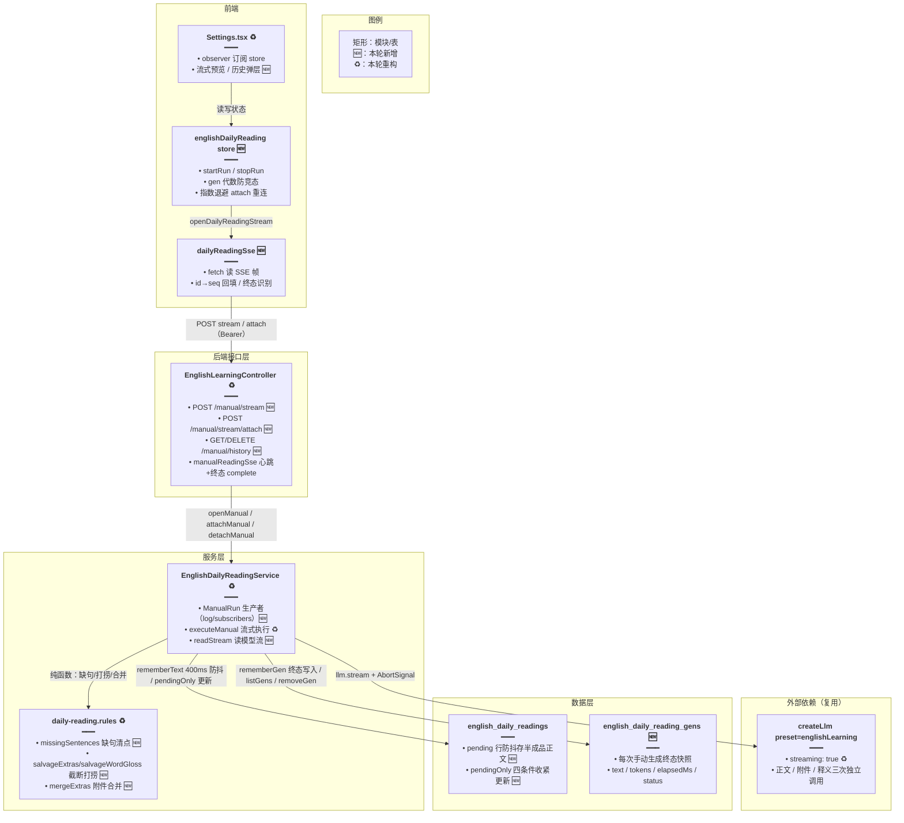
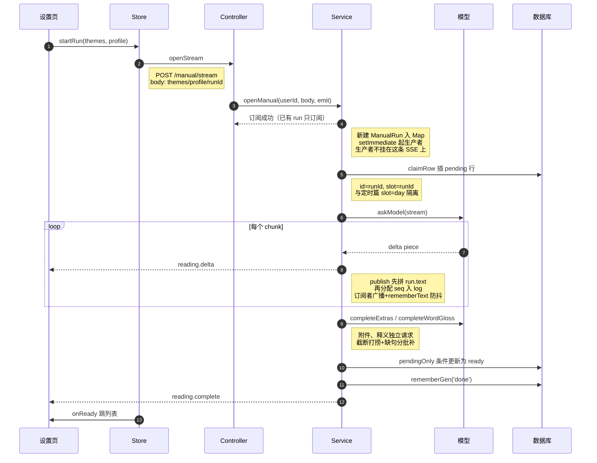
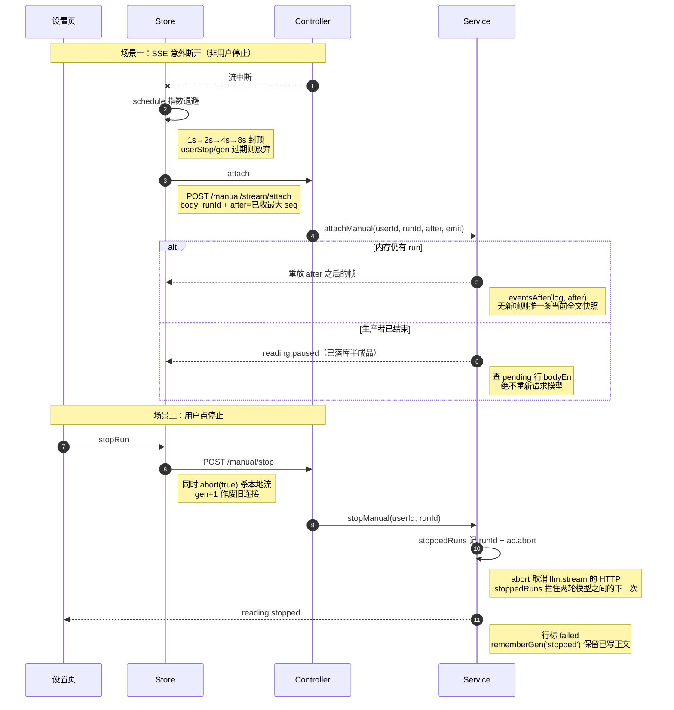

# 每日阅读流式生成与生成历史

> **文档角色（增量专题）**：把每日阅读「手动生成」从一次性同步 POST 改造为 SSE 流式生成——后端 `ManualRun` 单进程生产者持续推帧（snapshot/delta/usage），前端 MobX store 断线自动续订（attach + seq 游标重放），刷新页面生成在后台继续；新增 `english_daily_reading_gens` 历史表记录每次手动生成的全文 / Token / 耗时 / 终态，设置页新增「生成输出」实时预览弹层与「生成历史」回看 / 删除弹层；正文与学习附件（词汇表 / 语法笔记 / 理解题）、逐词释义拆成独立模型请求，截断时按已闭合 JSON 对象打捞，缺句按 4 句一批补全。
>
> **延伸阅读**：[每日阅读生成调度.md](./每日阅读生成调度.md)（定时生成调度、claim 抢锁、双档位设置——手动生成章节已被本篇取代）、[每日阅读前端.md](./每日阅读前端.md)（列表 / 详情页与设置页基础——生成控制章节已被本篇取代）、[每日阅读生成加固.md](./每日阅读生成加固.md)（在生产者模型上叠加 429 退避重试、词级缺词补释义、释义批级容错与生成档位落库）、[每日阅读界面重构.md](./每日阅读界面重构.md)（设置页/详情页组件化拆分、流式渲染节流与详情页双栏阅读列表）、[整篇朗读分段重试.md](./整篇朗读分段重试.md)（详情页整篇朗读链路）、[英语Agent流式性能隔离.md](./英语Agent流式性能隔离.md)（另一处 SSE 流式实践）。

---

## 1. 背景与目标

### 1.1 问题

- **同步接口撑不住生成时长**：手动生成走 `POST /manual` 同步接口，前端给 180s 超时，nginx 还要专门配两段 180s 长超时 location；模型一旦更慢就直接 504，而短文其实可能已经入库，用户看到的却是失败。
- **生成过程完全黑盒**：用户点「生成」后只能盯着转圈，看不到模型正在写什么、写了多少、花了多少 Token；弱网或刷新后只能靠每 2 秒轮询 `pending` 接口恢复按钮状态，体验断裂。
- **停止语义粗糙**：旧实现里「页面断开」与「用户停止」共用同一个 `AbortController`，刷新页面会把后端正在跑的模型调用也一起停掉；停止后已生成的半截正文直接随 failed 清空，无法回看。
- **一次请求要全部学习块**：正文、词汇表、语法笔记、理解题、逐词释义全部塞在同一个模型调用里。免费模型（glm-4-flash 系）输出到 8192 token 上限附近时整段 JSON 被截断，逐词释义经常缺句；只有 flash 模型会补一次释义，其余模型的缺漏没有任何兜底；词汇表等附件缺失时也没有补救。
- **没有生成历史**：用户停止或失败后，已写出的内容不留任何痕迹，无法回看上次写到了哪里。

### 1.2 目标

1. **流式生成可见**：手动生成改走 SSE（`POST /manual/stream`），模型每输出一段就推一帧 `reading.delta`，前端实时把原文渲染成 JSON 代码块预览，并实时显示已耗时与 Token 数。
2. **断线可续、刷新不停**：SSE 断开只取消订阅，不 abort 模型调用；前端凭 `runId + seq` 走 `POST /manual/stream/attach` 续订，只重放错过的帧；半成品正文按 400ms 防抖落库，进程重启后仍能读到已写部分并收到 `paused` 终态。
3. **停止仍是硬停止**：停止按钮走独立接口 abort 模型 HTTP，行标 failed，已写正文作为 `stopped` 历史保留，可回看。
4. **附件与释义独立请求**：`askModel` 只写短文（标题 + 正文 + 译文）；词汇表 / 语法笔记 / 理解题由 `completeExtras` 独立请求、空类再补一次；逐词释义对**所有**模型独立请求，缺句按 `GLOSS_BATCH=4` 分批补；JSON 截断时用括号配平打捞已闭合对象，不整段作废。
5. **生成历史可管理**：每次手动生成（完成 / 停止 / 暂停）落一行 `english_daily_reading_gens`，设置页「生成历史」弹层可回看全文快照、删除单条记录。
6. **去掉 nginx 长超时特例**：流式接口即时返回、按帧推送，不再需要为手动生成单独放宽 `proxy_read_timeout`。

---

## 2. 改动范围

| 路径 | 说明 |
| ---- | ---- |
| `apps/backend/src/services/english-learning/entity/english-daily-reading-gen.entity.ts` | **纯新增**：生成历史表实体 `EnglishDailyReadingGen` |
| `apps/backend/src/migrations/1792700000000-english_daily_reading_gen.ts` | **纯新增**：建表迁移（含 `(user_id, started_at)` 索引） |
| `apps/backend/src/services/english-learning/english-learning.module.ts` | 改动：TypeORM 注册新实体 |
| `apps/backend/src/services/english-learning/english-learning.controller.ts` | 改动：删除 `GET /manual`（pending 查询）与 `POST /manual`（同步生成），新增 4 个端点（stream / attach / history / 删除历史）+ 私有 `manualReadingSse` |
| `apps/backend/src/services/english-learning/english-daily-reading.service.ts` | 大改：`ManualRun` 生产者模型、`openManual/attachManual/detachManual`、`executeManual`（重构自 `generateManual`）、`readStream` 流式读取、`completeExtras/completeWordGloss/fillExtras` 附件独立请求、`rememberGen/listGens/removeGen` 历史、`claimRow/pendingOnly/rememberText/flushText/pauseManual` 落库与续订辅助 |
| `apps/backend/src/services/english-learning/daily-reading.rules.ts` | 改动：新增 `GLOSS_BATCH`、`missingSentences`、`salvageWordGloss`、`salvageExtras`、`mergeExtras`、`extrasRequested`、`requestedExtraKeys`、`emptyExtraKeys`；`pickExtras` 题目采纳条件放宽 |
| `apps/backend/nginx.conf` | 改动：删除两处手动生成 180s 长超时 location（流式化后不再需要） |
| `apps/frontend/src/utils/dailyReadingSse.ts` | **纯新增**：fetch 版 SSE 读取器（id→seq 回填、终态帧识别、onIncomplete 回调） |
| `apps/frontend/src/store/englishDailyReading.ts` | **纯新增**：MobX 全局 store（startRun/stopRun、代数防竞态、指数退避重连、帧合并） |
| `apps/frontend/src/store/resetUserState.ts` | 改动：切账号时 `resetOnUserSwitch` |
| `apps/frontend/src/service/api.ts` | 改动：新增 3 个端点常量（stream / attach / history） |
| `apps/frontend/src/service/index.ts` | 改动：删除 `generateEnglishDailyReading` 与 `getEnglishDailyReadingManualPending`，新增 `DailyReadingGen` 类型、`listEnglishDailyReadingGens`、`removeEnglishDailyReadingGen` |
| `apps/frontend/src/views/englishLearning/dailyReading/Settings.tsx` | 大改：页面 observer 化；生成控制迁入 store；新增 `StreamMeta`（耗时 / Token）、`StreamPreview`（JSON 代码块流式渲染 + 粘底滚动）、生成历史 Popover（列表 / 回看 / 删除确认） |
| `apps/frontend/src/views/englishLearning/dailyReading/Detail.tsx` | 微调：词汇卡类名 `[&_[data-word]]:text-xl` → `**:data-word:text-xl`（Tailwind v4 语法） |
| `apps/frontend/src/i18n/locales/zh-CN/englishLearning.ts`、`en-US/englishLearning.ts` | 改动：新增 8 个 key（查看生成输出 / 生成历史 / 删除记录 / 生成信息 / 生成时间 / Token 数） |

**未改**：定时生成调度（`ensurePassage` 主流程仅把附件 / 释义调用换成新拆分方法）、列表与详情读取路径、双档位设置读写。

---

## 3. 实现思路与关键设计

### 3.1 总体架构



**读图要点**：生产者（`executeManual` 内的模型调用）**不挂在任何一条 SSE 上**——SSE 只是「订阅者」，断开只从 `run.subscribers` 删除自己的 emit；只有「停止」接口会 abort 模型 HTTP。历史表与文章表分离：文章表只放 ready 成品，历史表放每次生成的全文快照（含停止 / 暂停的半成品）。

### 3.2 SSE 帧协议与 seq 重放

- 帧类型：`reading.snapshot`（全量替换预览，`reset: true` 表示新一轮模型开始）、`reading.delta`（增量追加）、`reading.usage`（Token 数刷新）、`reading.keepalive`（心跳）、终态四帧 `reading.complete / error / stopped / paused`。
- 每个真实帧带 `runId + seq`（run 内单调递增）；controller 把 `seq` 写成 SSE 的 `id:` 行，前端断线重连时把已收到的最大 `seq` 作为 `after` 传给 attach，服务端 `eventsAfter` 只重放更大的帧，**同一段 delta 不会被拼两次**。
- `keepalive` 帧由 controller 每 `PACK_SSE_KEEPALIVE_INTERVAL_MS` 发一次，不带 seq（不进 log、不参与重放），只防代理断连。
- 终态帧延后一拍 `queueMicrotask` 再 `complete()`：先把帧发出去，再关流，避免订阅方清理函数把最后一帧吃掉。

### 3.3 ManualRun：单进程生产者模型

- `manualRuns: Map<userId字符串, ManualRun>` 每人同时只有一篇在写；`ManualRun` 持有 `ac`（只被停止接口 abort）、`phase`（search/draft/gloss）、`text`（已拼出的模型原文）、`tokens`、`startedAt`、`seq`、`log`（全部帧，供重放）、`subscribers`（当前连着的页面 emit 集合）。
- `openManual`：参数非法 / 已停止直接回错误帧；**已有 run 时新点击只订阅不重开**（避免重复插行、重复打模型）；否则建 run、插内存、订阅，然后 `setImmediate` 起生产者——生产者与这条 SSE 解耦。
- `attachManual`：内存有 run 就按 `after` 重放后续订；没有 run 走 `pauseManual`——查 pending 行把已落库的半成品推回去并给 `paused` 终态，**绝不重新请求模型**（进程重启后模型不可能接着跑）。
- `detachManual`：SSE 断开只删订阅，并把当前 `text` 立即落库（`flushText`），模型继续跑。
- ponytail（已知限制）：`log` 随 run 驻留内存，多实例部署要搬到 Redis；`stoppedRuns` 只留最近 30 个。

### 3.4 半成品落库：400ms 防抖 + 断开即冲

- `rememberText`：每次 snapshot/delta 后重置一个 400ms 定时器，把 `run.text` 写进 `pendingOnly` 命中的 pending 行——高频 delta 不会每帧打库；条件更新保证发布后不会被半成品盖掉。
- `flushText`：detach / 上游 hangup 时立刻清定时器并落库，不等那 400ms。
- `pendingOnly(runId, userId)`：`{ id, userId, status: 'pending', slot: runId }` 四条件同时成立才允许更新——已发布文章、定时篇、别人的行都摸不到。

### 3.5 停止：abort + stoppedRuns 双通道

- `stopManual`：先把 runId 放进 `stoppedRuns`（拦住「停止落在两轮模型之间」的下一次 HTTP），再 `run.ac.abort()` 取消正在进行的 `llm.stream`，清防抖计时器、行标 failed、`rememberGen(run, 'stopped')`、推 `reading.stopped`、移出 Map。
- 停止先于 open 到达时：`stoppedRuns` 已记下 runId，`openManual` 一进来就回 `reading.stopped`，不插行不打模型。
- `executeManual` 的 catch 分支按顺序区分三种终结：① abort/stopped → 标失败 + stopped 帧；② `isHangup`（上游自己断：AbortError/terminated/ECONNRESET/EPIPE/socket hang up 等）→ 冲库 + `rememberGen('paused')` + paused 帧，**不自动再开模型**；③ 其余异常 → 标失败（业务拒绝已在抛出前标过）+ `rememberGen('error')` + error 帧（`failText` 只把业务异常文案透出，模型 / 网络错误统一「生成失败」，不漏堆栈）。

### 3.6 Token 计数：流式粗算 + 供应商用量替换

- 流式过程中没有权威用量：`tokenUnits` 按字符粗算（码点 >127 记 4 单位，否则 1 单位），提示词在请求发出时先记一笔，正文每到一段往上加，`onUsage(live(), false)` 只更新内存不刷帧。
- 每个 chunk 尝试 `chunkUsage` 读取三种供应商格式（`usage_metadata` 优先、`response_metadata.usage` 次之）；单次调用结束用 `onUsage(total, true)` 把该次总量换成精确值（`settled += callTotal`），并推 `reading.usage` 帧让页面刷新数字。

### 3.7 附件与逐词释义：独立请求 + 截断打捞 + 缺句分批补

- `askModel` 提示词收窄：只要 `titleEn/titleZh/bodyEn/bodyZh`，显式声明不要任何附件——正文与附件解耦后，附件失败不废正文，正文也不再被超长附件顶到 8192 上限。
- `completeExtras`（词汇表 / 语法笔记 / 理解题）：`extrasRequested` 先挡掉「只阅读且 0 题」；第一轮 `fillExtras` 按 `requestedExtraKeys` 全量要，失败或截断用 `salvageExtras` 打捞已闭合条目；`emptyExtraKeys` 找出仍空的类，第二轮只补这些键，`mergeExtras` 合并时**先拿到的优先**（避免补请求盖掉已合格条目）。
- `completeWordGloss`（逐词释义）：不再区分模型（原 `completeFlashGloss` 只伺候 flash），所有模型都独立请求一次；`missingSentences` 用「整句无释义行或句中仍有词无中文」判定缺句；缺句按 `GLOSS_BATCH=4` 分批再要（四句的逐词 JSON 稳定在 8192 一半以下），某批颗粒无收就停，已拿到的保留。
- 打捞器（`salvageWordGloss` / `salvageExtras`）：在截断的原始文本里定位 `"wordGloss"` / `"glossary"` 等键的 `[`，逐个找 `{`/`"` 起头的元素，用 `balancedObjectEnd` / `balancedStringEnd` 做括号 / 引号配平（处理字符串内转义），配平成功才 `JSON.parse` 收下；末尾半截直接丢掉。
- 只有 flash 模型在重写短文时把第二次全文**接在第一次下面**（`continueBelow` 补一个换行 delta），其余模型用 `beginModel` 清空预览重来——免费模型重写时倾向续写，清屏反而会让它重头来过浪费 token。

### 3.8 生成历史落库

- `rememberGen(run, status)`：只在终态写一行；`error` 不记（没有可回看正文）；正文与 Token 都空也不记；同一 runId 再写走 `save` 覆盖。写失败只打日志，不影响主流程。
- `listGens` 按 `startedAt` 倒序返回本人非 error 记录；`removeGen` 用 `{ id, userId }` 双条件删除，别人的 id 删不到。
- 文章表与历史表职责分离：文章表 pending 行在发布 / 失败后即完结，历史行永久保留全文快照供回看。

### 3.9 前端 store：代数防竞态与指数退避重连

- `englishDailyReading` 是全局 MobX 单例（`makeAutoObservable`）：离开设置页不拆连接，刷新不记上次输出（这次生成在服务端后台继续，重新打开页面后由 attach 续上）。
- `gen` 代数：每次 `connect` 自增，帧回调与 `onIncomplete` 里都校验 `my !== this.gen` 直接丢弃——旧连接的晚到帧不会污染新 run；拿到新 abort 函数时代数已过期则立即 `abort(true)` 杀掉刚建立的连接。
- `schedule`：非用户主动的断流（`onIncomplete`）按 `1s→2s→4s→8s` 封顶指数退避后走 attach 续订；收到 snapshot/delta 帧即清零 `failAttempt`。
- `onFrame` 合并规则：`seq` 只增不减；`snapshot` 带 `reset` 或更长才替换文本；`delta` 直接追加；`paused` 帧的文本只在更长时采用；`complete` 调 `ready` 回调（设置页注入的跳列表动作）；`finish` 统一结算耗时、清计时器、`historyRev+1` 触发历史列表刷新。
- `stopRun`：`userStop` 置位阻止 schedule 再续、`gen+1` 作废旧连接、清 UI 状态、`abort(true)` 杀流、调停止接口，finally 里 `historyRev+1`（停止的历史行已落库）。

### 3.10 设置页：流式预览与历史弹层

- 页面改为 `observer`，生成相关本地 state（flight/pending/resumeWatch/abortRef/runIdRef/stoppedRef）全部删除，直接从 store 读 `generating/paused/text/error/tokens/startedAt/runId`。
- 「生成输出」弹层（`Popover` 锚在底部按钮区）：`StreamMeta` 每秒刷新耗时、实时 Token；`StreamPreview` 把原文包进 ```` ```json ```` 代码围栏用 `StreamingMarkdownBody` 渲染（生成中围栏不封口，结束后补上），`useStickToBottomScroll` 保持粘底；历史回看模式下展示选中记录的快照与只读元信息。
- 「生成历史」弹层：当前在跑的 run 作为带转圈的 live 行置顶，其余来自 `listEnglishDailyReadingGens`；行标题用 `recordTitle` 从快照第一段已闭合 JSON 里抠 `titleZh/titleEn`（抠不到用开始时间）；删除走 `Confirm` 二次确认后调 `removeEnglishDailyReadingGen`。
- 生成完成（store 的 `onReady`）自动跳 `?origin=manual` 列表页。

### 3.11 手动生成时序（流式版）



断线续订与停止时序：



---

## 4. 关键代码对比与注释

### 4.1 controller：手动端点重构（`english-learning.controller.ts`）

**对比范围**：手动生成相关的 5 个端点 + 新增私有方法 `manualReadingSse`（摘录）。

**改动前** · `apps/backend/src/services/english-learning/english-learning.controller.ts`（基线，约 L2927–L2966）

```typescript
// 查询本人手动稿是否还在写：前端设置页每 2 秒轮询它恢复「正在生成」按钮态
@Get('daily-readings/manual')
async manualReadingPending(@Req() req: AuthedRequest) {
	// 未登录一律 401，手动篇按用户隔离
	if (req.user?.userId == null) {
		throw new UnauthorizedException('未授权');
	}
	// 查 90 秒窗口内是否有 pending 手动行
	const pending = await this.dailyReadingService.manualPending(
		req.user.userId,
	);
	// 只回一个布尔，列表数据仍走原列表接口
	return { success: true, data: { pending } };
}
```

（基线中另有 `POST daily-readings/manual` 同步生成端点 `createManualReading`，全文见 §4.6 的 `generateManual` 调用方对比。）

**改动后** · `apps/backend/src/services/english-learning/english-learning.controller.ts`（当前，约 L2927–L3012）

```typescript
// 删除本人一条生成历史：双条件传参，别人的 id 删不到
@Delete('daily-readings/manual/history/:id')
async removeManualGen(@Req() req: AuthedRequest, @Param('id') id: string) {
	// 未登录一律 401
	if (req.user?.userId == null) {
		throw new UnauthorizedException('未授权');
	}
	// service 内用 { id, userId } 双条件 delete，越权删除天然落空
	await this.dailyReadingService.removeGen(req.user.userId, id);
	// 幂等返回：不存在也回 removed，前端只负责刷新列表
	return { success: true, data: { removed: true } };
}

// 列出生成本人的手动生成历史（新的在前），供设置页历史弹层渲染
@Get('daily-readings/manual/history')
async listManualGens(@Req() req: AuthedRequest) {
	// 未登录一律 401
	if (req.user?.userId == null) {
		throw new UnauthorizedException('未授权');
	}
	// service 过滤掉 error 记录并映射成前端视图
	const data = await this.dailyReadingService.listGens(req.user.userId);
	// 原样透传数组
	return { success: true, data };
}

// 手动生成的 SSE 入口：开新生成或订阅已有 run
@Post('daily-readings/manual/stream')
// Nest 的 SSE 装饰器：返回值 Observable 按 Server-Sent Events 写出
@Sse()
// 关掉 nginx 代理缓冲，帧才能即时到达浏览器
@Header('X-Accel-Buffering', 'no')
// 禁缓存禁转换，保证流式语义
@Header('Cache-Control', 'no-cache, no-transform')
streamManualReading(
	@Req() req: AuthedRequest,
	@Body() body: { themes?: unknown; profile?: unknown; runId?: unknown },
): Observable<{ data: Record<string, unknown>; id?: string }> {
	// 从 JWT 取用户 id，未登录直接 401
	const userId = req.user?.userId;
	if (userId == null) throw new UnauthorizedException('未授权');
	// 走统一 SSE 包装：心跳 + 终态延后 complete
	return this.manualReadingSse(userId, (emit) => {
		// openManual 内部完成校验 / 订阅 / 起生产者
		this.dailyReadingService.openManual(userId, body ?? {}, emit);
	});
}

// 断线续订入口：按 runId + after 游标重放错过的帧
@Post('daily-readings/manual/stream/attach')
@Sse()
@Header('X-Accel-Buffering', 'no')
@Header('Cache-Control', 'no-cache, no-transform')
attachManualReading(
	@Req() req: AuthedRequest,
	@Body() body: { runId?: unknown; after?: unknown },
): Observable<{ data: Record<string, unknown>; id?: string }> {
	// 同样要求登录
	const userId = req.user?.userId;
	if (userId == null) throw new UnauthorizedException('未授权');
	return this.manualReadingSse(userId, (emit) => {
		// attachManual 只重放与续订，绝不重开模型
		this.dailyReadingService.attachManual(
			userId,
			body?.runId,
			body?.after,
			emit,
		);
	});
}
```

新增私有 SSE 包装（当前，约 L2995–L3034）：

```typescript
/** 一条 SSE：马上有心跳，断开只取消订阅。终态延后 complete，避免拆掉清理函数。 */
// 私有方法：把 open/attach 两个端点共用的 Observable 骨架收敛到一处
private manualReadingSse(
	userId: number,
	open: (emit: (data: Record<string, unknown>) => void) => void,
): Observable<{ data: Record<string, unknown>; id?: string }> {
	// 返回 RxJS Observable，Nest 的 @Sse 会订阅它并逐帧写出
	return new Observable((subscriber) => {
		// 本地关闭标志：终态或写出异常后置位，后续帧直接丢弃
		let closed = false;
		// 心跳计时器句柄，终态与退订时都要清
		let timer: ReturnType<typeof setInterval> | undefined;
		// emit 是 service 推帧的唯一通道
		const emit = (data: Record<string, unknown>) => {
			// 已关闭的流不再写，避免向已 complete 的 subscriber 推帧抛错
			if (closed) return;
			// seq 转字符串做 SSE 的 id 行，前端用它做断线重连的 after 游标
			const seq = typeof data.seq === 'number' ? String(data.seq) : undefined;
			try {
				// 有序号的帧带 id 写出；心跳等无序号帧只写 data
				subscriber.next(seq ? { id: seq, data } : { data });
			} catch {
				// 写出失败说明连接已坏：置位 closed，后续帧全部丢弃
				closed = true;
				return;
			}
			const type = data.type;
			// 四个终态帧任一出现就准备收流
			if (
				type === 'reading.complete' ||
				type === 'reading.error' ||
				type === 'reading.stopped' ||
				type === 'reading.paused'
			) {
				// 先置位再清心跳，保证不会再有 keepalive 帧插在终态后面
				closed = true;
				if (timer) clearInterval(timer);
				// 延后一拍 complete：让终态帧先被订阅方处理完，再触发其清理函数
				queueMicrotask(() => {
					if (!subscriber.closed) subscriber.complete();
				});
			}
		};
		// 周期性心跳帧：防止中间代理因长时间无数据而断连；不进 service 的 log，不参与重放
		timer = setInterval(() => {
			emit({ type: 'reading.keepalive' });
		}, PACK_SSE_KEEPALIVE_INTERVAL_MS);
		// 调用方把业务 emit 接进 service（open 或 attach）
		open(emit);
		// 退订清理：标志置位、清心跳、把这条 emit 从 run 的订阅者集合里摘掉；模型调用继续跑
		return () => {
			closed = true;
			if (timer) clearInterval(timer);
			this.dailyReadingService.detachManual(userId, emit);
		};
	});
}
```

**变更摘要**：删除「pending 轮询查询」与「同步生成」两个端点，改为 SSE 双端点（stream 开新 / attach 续订）+ 历史两个端点；`manualReadingSse` 把心跳、seq→id、终态延后 complete、退订只摘订阅的骨架收敛一处。

### 4.2 生成历史表：entity 与 migration（纯新增）

**改动后** · `apps/backend/src/services/english-learning/entity/english-daily-reading-gen.entity.ts`（纯新增全文）

```typescript
// TypeORM 装饰器：列、实体、索引、主键
import { Column, Entity, Index, PrimaryColumn } from 'typeorm';

// 终态四种：完成 / 被停止 / 出错 / 上游断开暂停；error 不落库，类型上仍保留以便 service 传参统一
export type DailyReadingGenStatus = 'done' | 'stopped' | 'error' | 'paused';

/** 某个用户一次手动生成的弹窗快照。进行中的那次不写这里。 */
// 表名 english_daily_reading_gens：与文章表 english_daily_readings 分离，职责是「每次生成的回看快照」
@Entity('english_daily_reading_gens')
// 历史列表按人查、按开始时间倒序，联合索引直接覆盖该查询
@Index('idx_english_daily_reading_gens_user', ['userId', 'startedAt'])
export class EnglishDailyReadingGen {
	// 主键用 runId（UUID varchar36）：与这次生成的 run、文章 pending 行同一 id，便于对账
	@PrimaryColumn({ type: 'varchar', length: 36 })
	id!: string;

	// 属主用户 id：listGens / removeGen 都按它过滤，天然按人隔离
	@Column({ name: 'user_id', type: 'int' })
	userId!: number;

	// 生成全文快照：mediumtext 容纳长文 + 附件 JSON，停止 / 暂停的半成品也存在这里
	@Column({ type: 'mediumtext' })
	text!: string;

	// 本次生成累计 Token：流式粗算起步、供应商精确值收尾后的最终数
	@Column({ type: 'int', default: 0 })
	tokens!: number;

	// 耗时毫秒：终态用 Date.now() - startedAt 结算，历史弹层直接展示
	@Column({ name: 'elapsed_ms', type: 'int', default: 0 })
	elapsedMs!: number;

	// 生成开始时刻：datetime(3) 保留毫秒，列表按它倒序
	@Column({ name: 'started_at', type: 'datetime', precision: 3 })
	startedAt!: Date;

	// 终态：done / stopped / paused（error 由 service 拦下不落库）
	@Column({ type: 'varchar', length: 16 })
	status!: DailyReadingGenStatus;
}
```

**改动后** · `apps/backend/src/migrations/1792700000000-english_daily_reading_gen.ts`（纯新增全文）

```typescript
// TypeORM 迁移接口与执行器类型
import { MigrationInterface, QueryRunner } from 'typeorm';

// 迁移类名带时间戳版本，保证执行顺序
export class EnglishDailyReadingGen1792700000000 implements MigrationInterface {
	// TypeORM 迁移元数据用名
	name = 'EnglishDailyReadingGen1792700000000';

	// 建表与索引
	public async up(queryRunner: QueryRunner): Promise<void> {
		// 建历史表：列定义与实体一一对应；mediumtext 放全文快照
		await queryRunner.query(
			`CREATE TABLE \`english_daily_reading_gens\` (
				\`id\` varchar(36) NOT NULL,
				\`user_id\` int NOT NULL,
				\`text\` mediumtext NOT NULL,
				\`tokens\` int NOT NULL DEFAULT 0,
				\`elapsed_ms\` int NOT NULL DEFAULT 0,
				\`started_at\` datetime(3) NOT NULL,
				\`status\` varchar(16) NOT NULL,
				PRIMARY KEY (\`id\`)
			) ENGINE=InnoDB`,
		);
		// 建 (user_id, started_at) 联合索引：历史列表「按人查、按时间倒序」的直接覆盖索引
		await queryRunner.query(
			`CREATE INDEX \`idx_english_daily_reading_gens_user\` ON \`english_daily_reading_gens\` (\`user_id\`, \`started_at\`)`,
		);
	}

	// 回滚：先删索引再删表
	public async down(queryRunner: QueryRunner): Promise<void> {
		// 显式删索引，避免某些版本 drop table 时索引残留报错
		await queryRunner.query(
			`DROP INDEX \`idx_english_daily_reading_gens_user\` ON \`english_daily_reading_gens\``,
		);
		// 删表
		await queryRunner.query(`DROP TABLE \`english_daily_reading_gens\``);
	}
}
```

module 注册（`english-learning.module.ts`，改动前后均为实体列表项，仅摘录增量）：

```typescript
// 改动后新增 import：把生成历史实体引进模块
import { EnglishDailyReadingGen } from './entity/english-daily-reading-gen.entity';
// ...（其余 import 未改动）
// TypeOrmModule.forFeature 列表中新增一行：让 service 能 @InjectRepository 注入 gens 仓库
// 改动后新增注册项：
EnglishDailyReadingGen,
```

### 4.3 service：`ManualRun` 与流式基础辅助（纯新增）

**改动后** · `apps/backend/src/services/english-learning/english-daily-reading.service.ts`（当前，约 L79–L171）

```typescript
// 手动生成的三个阶段：检索 / 写短文 / 补释义，快照帧带它让前端区分进度
type ManualPhase = 'search' | 'draft' | 'gloss';
// 推帧函数签名：service 内部 publish / subscribe 与 controller 的 SSE 写出之间的唯一通道
type ManualEmit = (data: Record<string, unknown>) => void;

// 一次手动生成的全部运行时状态
type ManualRun = {
	// 只由停止接口 abort。刷新关掉页面 SSE 时不调用它。
	ac: AbortController;
	// 行主键，与客户端 runId、slot 相同，用来和已发布文章隔开。
	id: string;
	// 属主：Map 键、落库条件都用它
	userId: number;
	// 当前阶段，暂停帧与重连快照都要带上
	phase: ManualPhase;
	// 已拼出的模型原文，快照用全文，delta 往这里追加。
	text: string;
	// 已展示的累计 token。流式过程中随输出增加，单次调用结束时换成供应商用量。
	tokens: number;
	// 这次生成开始的时间，终态写入历史时用来算耗时。
	startedAt: number;
	// 本进程内递增。SSE id 用它，重连只补更大的序号。
	seq: number;
	/** 本 run 的帧。同一页断开后按 seq 重放。ponytail: 随 run 删除；多实例要搬到 Redis。 */
	log: Array<Record<string, unknown> & { seq: number }>;
	// 当前还连着的页面。断开只删这里的一个 emit，不结束上面的模型调用。
	subscribers: Set<ManualEmit>;
};

// 重连时丢掉客户端已经画过的帧，避免同一段 delta 再拼一次。
function eventsAfter<T extends { seq: number }>(log: T[], after: number): T[] {
	// 只保留序号大于 after 的帧；after 来自客户端已收到的最大 seq
	return log.filter((event) => event.seq > after);
}

// 模型流一个 chunk 可能是字符串，也可能是带 text 的内容块。这里收成要追加的正文。
function chunkText(chunk: { content?: unknown }): string {
	const content = chunk.content;
	// 字符串形态直接就是增量文本
	if (typeof content === 'string') return content;
	// 非数组形态（空 / 对象）没有可拆文本
	if (!Array.isArray(content)) return '';
	// 数组形态逐块拼接
	let out = '';
	for (const part of content) {
		// 字符串块直接拼
		if (typeof part === 'string') {
			out += part;
		} else if (part && typeof part === 'object' && 'text' in part) {
			// 对象块取 text 字段，缺省按空串
			out += String((part as { text?: unknown }).text ?? '');
		}
	}
	return out;
}

// 流式模型每个 chunk 返回的 usage 字段有好几种格式。
// 最全的是 usage_metadata，其次是 response_metadata，最后是 usage。
function chunkUsage(chunk: object): number | null {
	// 把 chunk 收窄成可能带两种用量字段的形态
	const row = chunk as {
		usage_metadata?: {
			input_tokens?: number;
			output_tokens?: number;
			total_tokens?: number;
		};
		response_metadata?: {
			usage?: {
				prompt_tokens?: number;
				completion_tokens?: number;
				total_tokens?: number;
			};
		};
	};
	// 优先读 LangChain 标准的 usage_metadata
	const um = row.usage_metadata;
	if (
		um &&
		(typeof um.input_tokens === 'number' ||
			typeof um.output_tokens === 'number' ||
			typeof um.total_tokens === 'number')
	) {
		// 输入 / 输出分别取整并兜底 0
		const prompt = Math.max(0, Math.floor(um.input_tokens ?? 0));
		const completion = Math.max(0, Math.floor(um.output_tokens ?? 0));
		// total 缺失时用输入 + 输出合成
		return Math.max(0, Math.floor(um.total_tokens ?? prompt + completion));
	}
	// 其次读 OpenAI 风格的 response_metadata.usage
	const usage = row.response_metadata?.usage;
	if (
		usage &&
		(typeof usage.prompt_tokens === 'number' ||
			typeof usage.completion_tokens === 'number' ||
			typeof usage.total_tokens === 'number')
	) {
		const prompt = Math.max(0, Math.floor(usage.prompt_tokens ?? 0));
		const completion = Math.max(0, Math.floor(usage.completion_tokens ?? 0));
		return Math.max(0, Math.floor(usage.total_tokens ?? prompt + completion));
	}
	// 两种形态都没有：这次 chunk 不提供用量
	return null;
}

// ponytail: 流式中按字符粗算（中文约 1 token，英文约 4 字 1 token）。这次调用结束若带回供应商用量，会整次换成那个数。
function tokenUnits(text: string): number {
	let units = 0;
	// 逐码点扫描：非 ASCII（>127）按 4 单位记，ASCII 按 1 单位记，供 live() 除以 4 估 token
	for (const ch of text) units += (ch.codePointAt(0) ?? 0) > 127 ? 4 : 1;
	return units;
}
```

### 4.4 service：`openManual` / `attachManual` / `detachManual`（纯新增）

**改动后** · `apps/backend/src/services/english-learning/english-daily-reading.service.ts`（当前，约 L335–L435）

```typescript
/** 开始一篇手动稿。占用看内存里的 run，不看 90 秒窗口。 */
// 同步方法：校验、建 run、订阅，然后用 setImmediate 异步起生产者；返回值立即给 controller
openManual(
	userId: number,
	input: { themes?: unknown; profile?: unknown; runId?: unknown },
	emit: ManualEmit,
): void {
	// 主题列表归一化（去重 / 压空白 / 长度校验）
	const themes = normalizeThemeList(input?.themes);
	// runId 必须来自前端：它是 run、文章行、历史行三者的共同主键
	const runId = this.parseRunId(input?.runId);
	// 主题或 runId 不合法：直接回错误帧，不建任何状态
	if (!themes || !runId) {
		emit({ type: 'reading.error', message: '主题不合法', runId });
		return;
	}
	// 停止请求比这次 open 先到（弱网下 stop 的 HTTP 先落）：直接回 stopped，不插行不打模型
	if (this.stoppedRuns.has(runId)) {
		// 消费掉这条停止记录，避免影响下一条同 runId 的生成
		this.stoppedRuns.delete(runId);
		emit({ type: 'reading.stopped', runId });
		return;
	}
	// 这个用户已经有一篇在写：新点击只订阅它，避免再插一篇、再开一次模型
	const existing = this.findManual(userId);
	if (existing) {
		this.subscribe(existing, emit, 0);
		return;
	}
	// 建一次新 run 的全部初始状态
	const run: ManualRun = {
		ac: new AbortController(),
		id: runId,
		userId,
		phase: 'search',
		text: '',
		tokens: 0,
		startedAt: Date.now(),
		seq: 0,
		log: [],
		subscribers: new Set(),
	};
	// 入 Map：attach / stop / detach 都靠它找到这次 run
	this.manualRuns.set(this.runKey(userId), run);
	// 当前这条 SSE 立即成为订阅者，after=0 表示先收一条当前全文快照
	this.subscribe(run, emit, 0);
	// 档位归一化放到建 run 之后：非法 profile 回默认值，不影响 run 的建立
	const profile = normalizeProfile(input?.profile);
	// 生产者不挂在这条 SSE 上。页面断开只会 detach，这里的模型调用继续。
	setImmediate(() => {
		void this.executeManual(userId, run, themes, profile);
	});
}

/** 当前页连接中途断开后续订。内存里没有这次生成就停住，不重新请求模型。 */
attachManual(
	userId: number,
	runIdRaw: unknown,
	afterRaw: unknown,
	emit: ManualEmit,
): void {
	// runId 仅用于日志与 paused 帧带回；真正的定位仍按 userId 找 run
	const runId = this.parseRunId(runIdRaw);
	// after 游标：客户端已收到的最大 seq，重放从它的下一条开始
	const after = this.parseAfter(afterRaw);
	const run = this.findManual(userId);
	if (run) {
		// 只重放 after 之后的帧再接着听，不调用 executeManual。
		this.subscribe(run, emit, after);
		return;
	}
	// 内存里没有这次生成（生产者已结束或进程重启）：走暂停路径推回半成品
	void this.pauseManual(userId, runId, emit);
}

/** 套接字断开只取消这一条订阅，模型继续跑。 */
detachManual(userId: number, emit: ManualEmit): void {
	const run = this.findManual(userId);
	// run 已结束（finally 已移出 Map）时没有可摘的订阅
	if (!run) return;
	// 从订阅者集合删除这一条 emit，其它页面（若有）不受影响
	run.subscribers.delete(emit);
	// 断开时立刻把当前全文落库，不等 400ms 防抖：刷新后 attach 查库能拿到最新半成品
	if (run.text) this.flushText(run);
}
```

辅助小方法（当前，约 L437–L465）：

```typescript
// Map 键统一成字符串：JWT 的 sub 可能是数字或字符串
private runKey(userId: number): string {
	return String(userId);
}

// 按用户找当前 run；没有返回 undefined
private findManual(userId: number): ManualRun | undefined {
	return this.manualRuns.get(this.runKey(userId));
}

// 解析续订游标
private parseAfter(raw: unknown): number {
	// 没有合法游标时按 0 处理，订阅方只收当前全文，避免把旧 delta 再拼上去。
	const value = typeof raw === 'number' ? raw : Number(raw);
	// 非数、负数、零都归一到 0
	if (!Number.isFinite(value) || value <= 0) return 0;
	return Math.floor(value);
}

/** 只改这一条还没发布的手动行。ready 和定时篇不在条件里。 */
private pendingOnly(runId: string, userId: number) {
	return {
		// 主键 = runId
		id: runId,
		// 属主 = 当前用户，防越权改到别人的行
		userId,
		// 只命中 pending：ready / failed 的行一律不动
		status: 'pending' as const,
		// slot = runId：定时篇（slot='day'）与别的手动行都被排除
		slot: runId,
	};
}
```

### 4.5 service：`publish` / `subscribe` / `beginModel` / `continueBelow`（纯新增）

**改动后** · `apps/backend/src/services/english-learning/english-daily-reading.service.ts`（当前，约 L467–L535）

```typescript
// 所有帧的唯一出口：维护 run 状态、分配 seq、入 log、广播、触发落库
private publish(run: ManualRun, data: Record<string, unknown>): void {
	// 先改内存里的全文，再分配序号。订阅者拿到的帧和日志是同一条。
	if (data.type === 'reading.snapshot') {
		// 快照帧带阶段时同步更新 run.phase，attach 重放时前端能恢复到正确阶段
		if (typeof data.phase === 'string') {
			run.phase = data.phase as ManualPhase;
		}
		// 快照是全量替换：直接覆盖 run.text
		run.text = typeof data.text === 'string' ? data.text : '';
	} else if (data.type === 'reading.delta' && typeof data.text === 'string') {
		// delta 是增量追加
		run.text += data.text;
	}
	// 递增 seq 作为本帧序号
	const seq = ++run.seq;
	// runId 和 seq 写进帧，SSE 的 id 用 seq，客户端用它做下次 after。
	const frame = { ...data, runId: run.id, seq };
	// 入日志供断线重放
	run.log.push(frame);
	// 广播给当前所有订阅者；复制一份集合避免 emit 内退订导致迭代错乱
	for (const emit of [...run.subscribers]) emit(frame);
	// 文本类帧且当前有内容时，触发 400ms 防抖落库
	if (
		(data.type === 'reading.delta' || data.type === 'reading.snapshot') &&
		run.text
	) {
		this.rememberText(run);
	}
}

/** 把这条 SSE 接上已有日志。after 为 0 时只推当前全文，避免把检查点再拼一遍。 */
private subscribe(run: ManualRun, emit: ManualEmit, after: number): void {
	// after<=0：新订阅，只推一条「不占序号、不进 log」的当前全文快照
	if (after <= 0) {
		// 这条快照不经过 publish，不占新序号，也不进 log，避免和后面的 delta 各拼一遍。
		run.subscribers.add(emit);
		emit({
			type: 'reading.snapshot',
			phase: run.phase,
			text: run.text,
			tokens: run.tokens,
			runId: run.id,
			seq: run.seq,
		});
		return;
	}
	// after>0：断线重连，先算出没看过的帧
	const replay = eventsAfter(run.log, after);
	run.subscribers.add(emit);
	if (!replay.length) {
		// 客户端已经跟上最新序号。再推一条当前全文，后面的 delta 仍会进这个订阅者。
		emit({
			type: 'reading.snapshot',
			phase: run.phase,
			text: run.text,
			tokens: run.tokens,
			runId: run.id,
			seq: run.seq,
		});
		return;
	}
	// 按序重放错过的帧
	for (const event of replay) emit(event);
}

// 新一轮模型开始时清空预览。只在生产者里调用，attach 不能走这里。
private beginModel(run: ManualRun, phase: 'draft' | 'gloss'): void {
	this.publish(run, {
		type: 'reading.snapshot',
		phase,
		text: '',
		reset: true,
	});
}

/** flash 的下一轮接在已有输出下面，不把上一轮清掉。 */
private continueBelow(run: ManualRun): void {
	// 还没有任何文本时不需要补分隔
	if (!run.text) return;
	// 已以换行结尾就只补一个换行，否则空一行，让两轮输出在预览里自然分段
	const gap = run.text.endsWith('\n') ? '\n' : '\n\n';
	this.publish(run, { type: 'reading.delta', text: gap });
}
```

### 4.6 service：`executeManual`（由 `generateManual` 重构，前后对比）

**对比范围**：`generateManual` 全函数（改动前）→ `executeManual` 全函数（改动后）。两侧均对称摘录「建立 run → 插行 → 两轮成稿 → 附件 / 释义 → 发布 / 异常」主干，省略已展示的 shouldStop 重复行。

**改动前** · `apps/backend/src/services/english-learning/english-daily-reading.service.ts`（基线，约 L327–L460，`generateManual` 摘录）

```typescript
/** 按这次提交的档位再写一篇，不写入设置。发布日是今天，不碰定时篇。 */
async generateManual(
	input: {
		themes?: unknown;
		profile?: unknown;
		runId?: unknown;
	},
	userId: number,
): Promise<DailyReadingView> {
	// 主题与档位校验
	const themes = normalizeThemeList(input?.themes);
	if (!themes) throw new BadRequestException('主题不合法');
	const profile = normalizeProfile(input?.profile);
	const runId = this.parseRunId(input?.runId);
	// 停止先到时直接拒绝
	if (runId && this.stoppedRuns.has(runId)) {
		this.stoppedRuns.delete(runId);
		throw new BadRequestException('已停止');
	}
	// 90 秒窗口内有 pending 手动行就视为「正在生成」，拒绝并发的第二篇
	if (await this.hasFreshManual(userId)) {
		throw new ConflictException('正在生成');
	}
	const today = shanghaiToday();
	// 读当天定时篇主题，手动篇避开它
	const dayRow = await this.repo.findOne({
		where: { publishDate: today, slot: DAY_SLOT },
	});
	const theme = pickManualTheme(themes, dayRow?.theme || null);
	const id = randomUUID();
	const ac = new AbortController();
	// 每人一篇：userId 为键存 ac/id/runId
	this.manualRuns.set(userId, { ac, id, runId });
	// 停止恰好在登记后到达：立刻 abort
	if (runId && this.stoppedRuns.has(runId)) ac.abort();
	try {
		// 插 pending 行前再看一次停止
		if (this.shouldStop(runId, ac.signal)) {
			throw new BadRequestException('已停止');
		}
		// 插 pending 占位行：slot=行 id，与定时篇共存
		await this.repo.insert({
			id,
			publishDate: today,
			slot: id,
			userId,
			status: 'pending',
			startedAt: new Date(),
			titleEn: '',
			titleZh: '',
			bodyEn: '',
			bodyZh: '',
			sourceKind: 'llm',
			sourceUrl: null,
			sourceTitle: null,
			theme,
		});
		if (this.shouldStop(runId, ac.signal)) {
			await this.markRowFailed(id);
			throw new BadRequestException('已停止');
		}
		// 近期正文查重与联网取材
		const recent = await this.recentNorms({ userId });
		const material = await this.loadMaterial(theme, profile.useWeb);
		if (this.shouldStop(runId, ac.signal)) {
			await this.markRowFailed(id);
			throw new BadRequestException('已停止');
		}
		// 第一次请求模型：同步 invoke，一次性拿回全部 JSON
		let parsed = await this.askModel(
			today,
			theme,
			profile,
			material.snippet,
			null,
			{ signal: ac.signal, userId },
		);
		let draft = parsed?.draft ?? null;
		let reason = draft
			? rejectPassage(draft, recent, material.snippet)
			: 'json';
		// 不合格带原因重写一次
		if (reason) {
			if (this.shouldStop(runId, ac.signal)) {
				await this.markRowFailed(id);
				throw new BadRequestException('已停止');
			}
			parsed = await this.askModel(
				today,
				theme,
				profile,
				material.snippet,
				reason,
				{ signal: ac.signal, userId },
			);
			draft = parsed?.draft ?? null;
			reason = draft
				? rejectPassage(draft, recent, material.snippet)
				: 'json';
		}
		// 两次都不合格：标失败并拒绝
		if (!draft || reason) {
			await this.markRowFailed(id);
			const fail = reason ?? 'json';
			const sample = draft ? JSON.stringify(draft).slice(0, 300) : '';
			this.logger.warn(
				`[EnglishDailyReading] 手动生成废稿 user=${userId} reason=${fail} sample=${sample}`,
			);
			throw new BadRequestException(rejectReasonText(fail));
		}
		if (this.shouldStop(runId, ac.signal)) {
			await this.markRowFailed(id);
			throw new BadRequestException('已停止');
		}
		const bodyEn = stripZw(draft.bodyEn);
		// 仅 flash 模型补一次逐词释义
		const extras = await this.completeFlashGloss(
			bodyEn,
			pickExtras(parsed?.payload, bodyEn, profile),
			parsed?.modelName ?? '',
			{ signal: ac.signal, userId },
		);
		// 发布：按 id 更新为 ready
		await this.repo.update(
			{ id },
			{
				status: 'ready',
				titleEn: stripZw(draft.titleEn).slice(0, 80),
				titleZh: stripZw(draft.titleZh).slice(0, 80),
				bodyEn,
				bodyZh: stripZw(draft.bodyZh),
				sourceKind: material.snippet ? 'web' : 'llm',
				sourceUrl: material.sourceUrl,
				sourceTitle: material.sourceTitle,
				theme,
				extras: this.withSources(extras, material.sources),
			},
		);
		// 同步接口直接返回成品视图
		const row = await this.repo.findOne({ where: { id } });
		if (!row) throw new NotFoundException('文章不存在');
		return this.toView(row);
	} catch (e) {
		// 停止与 abort 统一记 failed 后抛「已停止」
		if (this.isAbort(e, ac.signal)) {
			await this.markRowFailed(id);
			throw new BadRequestException('已停止');
		}
		// 业务异常原样抛
		if (e instanceof BadRequestException || e instanceof NotFoundException)
			throw e;
		// 其余异常标失败后继续抛
		await this.markRowFailed(id);
		throw e;
	} finally {
		// 清停止记录、按 ac 身份移出 Map
		if (runId) this.stoppedRuns.delete(runId);
		if (this.manualRuns.get(userId)?.ac === ac)
			this.manualRuns.delete(userId);
	}
}
```

**改动后** · `apps/backend/src/services/english-learning/english-daily-reading.service.ts`（当前，约 L537–L760，`executeManual` 摘录）

```typescript
/** 按这次提交的档位写一篇。发布日是今天，不碰定时篇，也不接另一条已有行重跑模型。 */
// 私有异步生产者：由 openManual 的 setImmediate 触发，与任何一条 SSE 解耦
private async executeManual(
	userId: number,
	run: ManualRun,
	themes: string[],
	profile: ReadingProfile,
): Promise<void> {
	// 已结算的供应商用量合计：每次调用 done 时累加
	let settled = 0;
	// 用量回调：callTotal 为一次调用的总量；done=true 表示该次结束结算；paint=true 强制刷帧
	const onUsage = (callTotal: number, done = false, paint = false) => {
		if (!callTotal) return;
		if (done) settled += callTotal;
		// 进行中显示「已结算 + 本次粗算」，结束时换成精确累计
		run.tokens = done ? settled : settled + callTotal;
		// 非结束且非强制刷新时只更新内存，不打帧
		if (!done && !paint) return;
		try {
			this.publish(run, { type: 'reading.usage', tokens: run.tokens });
		} catch {
			// 订阅者抛错不影响计数。下一段正文仍会带上当前 token。
		}
	};
	// 增量回调：把模型输出的一段原文推成 delta 帧
	const onDelta = (piece: string) => {
		try {
			this.publish(run, {
				type: 'reading.delta',
				text: piece,
				tokens: run.tokens,
			});
		} catch {
			// 某个订阅者抛错不能中断模型。这段增量仍留在 run.text 里。
			// 页面已经断开。模型这次调用继续写，下一个 attach 再订阅。
		}
	};
	try {
		// 插行、检索、重写、补释义之前都看一次。停止落在两轮模型之间时不再发下一次 HTTP。
		if (this.shouldStop(run.id, run.ac.signal)) {
			throw new BadRequestException('已停止');
		}
		// 插 pending 行或沿用同 runId 的已有行，返回选定主题
		const theme = await this.claimRow(userId, run, themes);
		const { ac, id } = run;
		const today = shanghaiToday();
		if (this.shouldStop(id, ac.signal))
			throw new BadRequestException('已停止');
		// 近期正文查重与联网取材
		const recent = await this.recentNorms({ userId });
		const material = await this.loadMaterial(theme, profile.useWeb);
		if (this.shouldStop(id, ac.signal))
			throw new BadRequestException('已停止');
		// 清空预览并宣布进入写短文阶段
		this.beginModel(run, 'draft');
		// 第一次请求模型：流式读取，delta 实时推帧
		let parsed = await this.askModel(
			today,
			theme,
			profile,
			material.snippet,
			null,
			{ signal: ac.signal, userId, onDelta, onUsage },
		);
		let draft = parsed?.draft ?? null;
		let reason = draft
			? rejectPassage(draft, recent, material.snippet)
			: 'json';
		// 不合格带原因重写一次
		if (reason) {
			if (this.shouldStop(id, ac.signal))
				throw new BadRequestException('已停止');
			// flash 的第二次全文接在第一次下面。其它模型仍换成新稿。
			if (isFlashGlossModel(parsed?.modelName ?? '')) this.continueBelow(run);
			else this.beginModel(run, 'draft');
			parsed = await this.askModel(
				today,
				theme,
				profile,
				material.snippet,
				reason,
				{ signal: ac.signal, userId, onDelta, onUsage },
			);
			draft = parsed?.draft ?? null;
			reason = draft
				? rejectPassage(draft, recent, material.snippet)
				: 'json';
		}
		// 两次都不合格：标失败并推错误帧
		if (!draft || reason) {
			// 重写后仍不合格。标失败并告诉页面原因，不把半成品改成 ready。
			await this.markRowFailed(id, userId);
			const fail = reason ?? 'json';
			const sample = draft ? JSON.stringify(draft).slice(0, 300) : '';
			this.logger.warn(
				`[EnglishDailyReading] 手动生成废稿 user=${userId} reason=${fail} sample=${sample}`,
			);
			throw new BadRequestException(rejectReasonText(fail));
		}
		if (this.shouldStop(id, ac.signal))
			throw new BadRequestException('已停止');
		const bodyEn = stripZw(draft.bodyEn);
		// 附件独立请求：词汇表 / 语法笔记 / 理解题；onSecond 让第二轮输出接在已有预览下面
		const attached = await this.completeExtras(bodyEn, profile, {
			signal: ac.signal,
			userId,
			onDelta,
			onUsage,
			onSecond: () => this.continueBelow(run),
		});
		if (this.shouldStop(id, ac.signal))
			throw new BadRequestException('已停止');
		// 逐词释义独立请求：所有模型都补，缺句分批再要
		const extras = await this.completeWordGloss(bodyEn, attached, {
			signal: ac.signal,
			userId,
			onDelta,
			onUsage,
			onSecond: () => this.continueBelow(run),
		});
		// 发布：pendingOnly 四条件更新，行已不是 pending 时 affected=0
		const saved = await this.repo.update(this.pendingOnly(id, userId), {
			status: 'ready',
			titleEn: stripZw(draft.titleEn).slice(0, 80),
			titleZh: stripZw(draft.titleZh).slice(0, 80),
			bodyEn,
			bodyZh: stripZw(draft.bodyZh),
			sourceKind: material.snippet ? 'web' : 'llm',
			sourceUrl: material.sourceUrl,
			sourceTitle: material.sourceTitle,
			theme,
			extras: this.withSources(extras, material.sources),
		});
		if (!saved.affected) {
			// 行已不是 pending（被停止或已发布）。不能改写，也不发 complete。
			this.logger.warn(
				`[EnglishDailyReading] 跳过发布 id=${id}，行已不是 pending`,
			);
			return;
		}
		// 写历史并推完成帧
		await this.rememberGen(run, 'done');
		this.publish(run, { type: 'reading.complete', id });
	} catch (e) {
		// run 已被移出 Map（停止接口自己处理了终态）：直接安静返回
		if (this.findManual(userId) !== run) return;
		// 停止接口已经 abort。这里补失败标记和 stopped，不再当成模型报错。
		if (run.ac.signal.aborted || this.stoppedRuns.has(run.id)) {
			await this.markRowFailed(run.id, userId);
			await this.rememberGen(run, 'stopped');
			this.publish(run, { type: 'reading.stopped' });
			return;
		}
		// 上游自己断了。停住并留下已写正文，不自动再开一次模型。
		if (this.isHangup(e)) {
			console.warn('[EnglishDailyReading] 上游断开', e);
			this.flushText(run);
			await this.rememberGen(run, 'paused');
			this.publish(run, {
				type: 'reading.paused',
				phase: run.phase,
				text: run.text,
			});
			return;
		}
		// 业务拒绝已经在抛出前标过失败。其余异常在这里标，避免 pending 一直占着。
		if (
			!(e instanceof BadRequestException || e instanceof NotFoundException)
		) {
			await this.markRowFailed(run.id, userId);
		}
		await this.rememberGen(run, 'error');
		this.publish(run, {
			type: 'reading.error',
			message: this.failText(e),
		});
	} finally {
		// 清防抖计时器、消费停止记录
		this.clearTextTimer(run.id);
		this.stoppedRuns.delete(run.id);
		// 生产者结束就移出 Map。之后的 attach 会走 paused，不会假装流还在。
		if (this.findManual(userId) === run) {
			this.manualRuns.delete(this.runKey(userId));
		}
	}
}
```

**变更摘要**：同步返回视图 → 事件驱动推帧；占用判定从「90 秒窗口查库」改为「内存 run 命中即订阅」；模型调用从 `invoke` 改 `stream` 并接 onDelta/onUsage；附件与释义拆为 `completeExtras` / `completeWordGloss`；发布与标失败都收紧到 `pendingOnly` 四条件；异常按 stopped / hangup(paused) / error 三分支终结，终态写历史表。

### 4.7 service：`stopManual` 与 `isHangup` / `failText`（前后对比）

**对比范围**：`stopManual` 方法体（对称摘录核心分支）。

**改动前** · `apps/backend/src/services/english-learning/english-daily-reading.service.ts`（基线，约 L462–L486）

```typescript
// 停止接口：先记 runId 再 abort，最后把 pending 行标失败
async stopManual(userId: number, runId?: string): Promise<boolean> {
	if (runId) {
		// 先记停止，拦住两轮模型之间的下一次请求
		if (this.stoppedRuns.size > 30) this.stoppedRuns.clear();
		this.stoppedRuns.add(runId);
	}
	const run = this.manualRuns.get(userId);
	// run 存在且 runId 匹配（或未指定）才 abort
	if (run && (!runId || run.runId === runId)) {
		run.ac.abort();
		// 直接把 pending 行标失败；此时行里还没有正文，清空也无所谓
		await this.repo.update(
			{ id: run.id, status: 'pending', userId },
			{ status: 'failed', startedAt: new Date() },
		);
		return true;
	}
	// 内存没有 run 时，把 90 秒窗口内的 pending 行翻成 failed
	await this.failFreshPending(userId);
	return true;
}
```

**改动后** · `apps/backend/src/services/english-learning/english-daily-reading.service.ts`（当前，约 L777–L815）

```typescript
async stopManual(userId: number, runId?: string): Promise<boolean> {
	if (runId) {
		// 先记 runId：停止先于 open 到达时 openManual 会直接回 stopped
		if (this.stoppedRuns.size > 30) this.stoppedRuns.clear();
		this.stoppedRuns.add(runId);
	}
	const run = this.findManual(userId);
	// 排障日志：记录停止命中情况与当前 Map 键，便于定位「停不掉」
	console.warn('[EnglishDailyReading] 停止生成', {
		userId: String(userId),
		runId,
		hit: Boolean(run),
		keys: [...this.manualRuns.keys()],
	});
	if (run) {
		// 双通道都打上：stoppedRuns 拦下一轮 HTTP，abort 取消当前流
		this.stoppedRuns.add(run.id);
		// 这个 abort 会取消已经交给 llm.stream 的那次 HTTP。对不上 run 时不会执行。
		run.ac.abort();
		// 清防抖并立即把行标失败，不再等 executeManual 的 catch
		this.clearTextTimer(run.id);
		await this.markRowFailed(run.id, run.userId);
		// 停止的半成品也写入历史，设置页可以回看写到了哪里
		await this.rememberGen(run, 'stopped');
		this.publish(run, { type: 'reading.stopped' });
		this.manualRuns.delete(this.runKey(run.userId));
		return true;
	}
	// 内存里没有这次生成。模型请求取消不了，只尝试把还 pending 的那行标失败。
	if (runId) await this.markRowFailed(runId, userId);
	return true;
}
```

新增判定与文案（当前，约 L867–L900）：

```typescript
/** 上游连接自己断了。用户停止已在调用方按 signal 分开，这里命中后发 paused，不自动再请求模型。 */
private isHangup(e: unknown): boolean {
	if (!e || typeof e !== 'object') return false;
	// AbortError 且 signal 未 aborted（调用方已先排除）即视为上游断
	const name = (e as { name?: string }).name ?? '';
	if (name === 'AbortError') return true;
	// 覆盖常见断连文案：terminated / ECONNRESET / EPIPE / socket hang up / Premature close 等
	const message = String((e as { message?: unknown }).message ?? '');
	return /abort|terminated|ECONNRESET|EPIPE|socket hang up|other side closed|Premature close|UND_ERR/i.test(
		message,
	);
}

private failText(e: unknown): string {
	// 业务异常把原因给页面。模型或网络错误不把内部堆栈发到 SSE。
	if (e instanceof BadRequestException || e instanceof NotFoundException) {
		const res = e.getResponse();
		// 字符串响应直接用
		if (typeof res === 'string' && res.trim()) return res;
		// 对象响应取 message
		if (res && typeof res === 'object' && 'message' in res) {
			const message = (res as { message: unknown }).message;
			if (typeof message === 'string' && message.trim()) return message;
		}
	}
	// 非业务异常统一兜底文案
	return '生成失败';
}
```

**变更摘要**：停止时新增「写 stopped 历史 + 推 stopped 帧 + 立即移出 Map」；删除 `failFreshPending`（90 秒窗口翻 failed 的粗放做法）；内存无 run 时只按 runId 精准标失败。

### 4.8 service：`claimRow` / `pauseManual` / `rememberText` / `flushText`（纯新增）

**改动后** · `apps/backend/src/services/english-learning/english-daily-reading.service.ts`（当前，约 L1091–L1180）

```typescript
/** 只插入这次 runId 的 pending 行。不改已发布行，也不把别的 pending 拿来重跑模型。 */
private async claimRow(
	userId: number,
	run: ManualRun,
	themes: string[],
): Promise<string> {
	// 先查这个 runId 是否已有行（弱网重发 open 时会命中）
	const mine = await this.repo.findOne({ where: { id: run.id, userId } });
	if (mine?.status === 'pending') {
		// 同一 runId 还在写。沿用原来的主题，不新插一行。
		return mine.theme || pickManualTheme(themes, null);
	}
	// 同 runId 已 ready/failed：这次生成早已结束，拒绝重跑
	if (mine) throw new BadRequestException('生成已结束');
	const today = shanghaiToday();
	// 手动篇主题避开当天定时篇
	const dayRow = await this.repo.findOne({
		where: { publishDate: today, slot: DAY_SLOT },
	});
	const theme = pickManualTheme(themes, dayRow?.theme || null);
	// slot 用 run.id，不会撞上定时篇的 day，也不会改到别的已发布行。
	await this.repo.insert({
		id: run.id,
		publishDate: today,
		slot: run.id,
		userId,
		status: 'pending',
		startedAt: new Date(),
		titleEn: '',
		titleZh: '',
		bodyEn: '',
		bodyZh: '',
		sourceKind: 'llm',
		sourceUrl: null,
		sourceTitle: null,
		theme,
	});
	return theme;
}

/** 进程里没有生产者。把已落库的半成品推回去，不请求模型。 */
private async pauseManual(
	userId: number,
	hinted: string | null,
	emit: ManualEmit,
): Promise<void> {
	// 提示的 runId 已被停止：直接终态
	if (hinted && this.stoppedRuns.has(hinted)) {
		emit({ type: 'reading.stopped', runId: hinted });
		return;
	}
	// 查库前再确认一次内存（竞态：attach 与 open 几乎同时到达）
	const current = this.findManual(userId);
	if (current) {
		this.subscribe(current, emit, 0);
		return;
	}
	// 查这个 runId 的 pending 行，拿已落库的半成品正文
	const row = hinted
		? await this.repo.findOne({
				where: { id: hinted, userId, status: 'pending' },
			})
		: null;
	if (this.findManual(userId)) {
		// 查库期间生产者才出现。改去订阅它，不能把即将开始的流标成 paused。
		this.attachManual(userId, hinted, 0, emit);
		return;
	}
	emit({
		// 终态。客户端停转并留下这段正文，不会自动再点生成。
		type: 'reading.paused',
		phase: 'draft',
		text: row?.bodyEn || '',
		runId: hinted,
	});
}

private rememberText(run: ManualRun): void {
	// 400ms 内多次 delta 只落一次库。条件仍是 pending，发布后的正文不会被半成品盖掉。
	const prev = this.textTimers.get(run.id);
	if (prev) clearTimeout(prev);
	this.textTimers.set(
		run.id,
		setTimeout(() => {
			this.textTimers.delete(run.id);
			void this.repo.update(this.pendingOnly(run.id, run.userId), {
				bodyEn: run.text,
			});
		}, 400),
	);
}

private flushText(run: ManualRun): void {
	// 断开或上游中断时立刻把当前全文写入 pending 行，不等那 400ms。
	this.clearTextTimer(run.id);
	if (!run.text) return;
	void this.repo.update(this.pendingOnly(run.id, run.userId), {
		bodyEn: run.text,
	});
}

private clearTextTimer(id: string): void {
	const prev = this.textTimers.get(id);
	if (prev) clearTimeout(prev);
	this.textTimers.delete(id);
}
```

### 4.9 service：`readStream`（纯新增）

**改动后** · `apps/backend/src/services/english-learning/english-daily-reading.service.ts`（当前，约 L1560–L1660）

```typescript
// 统一的流式读取：把 llm.stream 的 chunk 收成全文，同时推 delta 与用量
private async readStream(
	llm: Awaited<ReturnType<typeof createLlm>>,
	messages: Array<SystemMessage | HumanMessage>,
	signal: AbortSignal | undefined,
	onDelta?: (piece: string) => void,
	onUsage?: (total: number, done?: boolean, paint?: boolean) => void,
): Promise<string> {
	if (signal?.aborted) {
		// 进入读流前已停止。不再向供应商发这次请求。
		const err = new Error('aborted');
		err.name = 'AbortError';
		throw err;
	}
	// full 累积全文；usage 记供应商精确值；units 记粗算单位
	let full = '';
	let usage = 0;
	let units = 0;
	// 提示词先计入粗算：请求发出时页面就能看到非零 token
	for (const message of messages) {
		if (typeof message.content === 'string')
			units += tokenUnits(message.content);
	}
	const live = () => Math.ceil(units / 4);
	// 请求发出时先按提示词计一笔，正文每到一段再往上加。供应商用量要等这次流结束才有。
	onUsage?.(live(), false, true);
	// 这个 signal 只有停止按钮会 abort。刷新不碰它，所以可以交给这一次请求。
	const iterable = await llm.stream(
		messages,
		signal ? { signal } : undefined,
	);
	// noted 保证「已中断」日志只打一次
	let noted = false;
	const noteStop = () => {
		if (noted || !signal?.aborted) return;
		noted = true;
		this.logger.warn('[EnglishDailyReading] 模型请求已中断');
	};
	// abort 时主动关闭迭代器：让底层 HTTP 立即断开，不等供应商把流推完
	const cancel = () => {
		noteStop();
		void Promise.resolve(
			(iterable as AsyncIterator<unknown>).return?.(undefined),
		).catch(() => {});
	};
	signal?.addEventListener('abort', cancel);
	// stream() 返回前就已经 abort 的话，监听器不会补发，这里立刻关掉迭代器。
	if (signal?.aborted) cancel();
	try {
		for await (const chunk of iterable) {
			// 停止后不再把后续 token 拼进预览。循环外再抛 AbortError，调用方走 stopped。
			if (signal?.aborted) break;
			// 每个 chunk 都尝试取供应商用量，有就记下来
			const used = chunkUsage(chunk);
			if (used) usage = used;
			const piece = chunkText(chunk);
			if (!piece) continue;
			// 粗算单位随正文递增，并推一帧内存刷新（不打 SSE）
			units += tokenUnits(piece);
			onUsage?.(live(), false);
			full += piece;
			onDelta?.(piece);
		}
	} catch (e) {
		if (signal?.aborted) {
			// 流被 abort 打断：先用精确值或粗算值结算，再抛统一 AbortError
			const total = usage || live();
			if (total) onUsage?.(total, true);
			noteStop();
			const err = new Error('aborted');
			err.name = 'AbortError';
			throw err;
		}
		throw e;
	} finally {
		signal?.removeEventListener('abort', cancel);
	}
	// 本次调用结束：用供应商精确值（没有就用粗算）做 done 结算
	const total = usage || live();
	if (total) onUsage?.(total, true);
	if (signal?.aborted) {
		// 正常读完但期间被停止：同样抛 AbortError 走 stopped 分支
		noteStop();
		const err = new Error('aborted');
		err.name = 'AbortError';
		throw err;
	}
	return full;
}
```

### 4.10 service：`askModel`（invoke → stream，提示词收窄）

**对比范围**：`askModel` 全函数（对称摘录：建客户端 / 提示词 / 调用与解析三段）。

**改动前** · `apps/backend/src/services/english-learning/english-daily-reading.service.ts`（基线，约 L798–L885）

```typescript
private async askModel(
	publishDate: string,
	theme: string,
	profile: ReadingProfile,
	snippet: string | null,
	previousReject: string | null,
	opts?: { signal?: AbortSignal; userId?: number },
): Promise<{
	draft: PassageDraft;
	payload: Record<string, unknown>;
	modelName: string;
} | null> {
	const signal = opts?.signal;
	if (signal?.aborted) {
		const err = new Error('aborted');
		err.name = 'AbortError';
		throw err;
	}
	// 非流式客户端：一次性拿完整 JSON
	const llm = await createLlm(
		this.configService,
		{
			preset: 'englishLearning',
			userId: opts?.userId,
			streaming: false,
			temperature: 0.7,
			defaultTemperature: 0.7,
			maxTokens: 8192,
			maxTokensPolicy: 'default',
			modelKwargs: { response_format: { type: 'json_object' } },
			abortSignal: signal,
		},
		this.llmConfigService,
	);
	// 篇幅提示行（短 / 中 / 长三档）
	const lengthLine =
		profile.length === 'short'
			? 'bodyEn is 90-130 English words, 2-3 paragraphs separated by a blank line. Each paragraph has several sentences. Do not put a blank line after every sentence.'
			: profile.length === 'long'
				? 'bodyEn is about 190 English words (160-220), 3-4 paragraphs separated by a blank line. Each paragraph has several sentences. Do not put a blank line after every sentence.'
				: 'bodyEn is 120-180 English words, 2-4 paragraphs separated by a blank line. Each paragraph has several sentences. Do not put a blank line after every sentence.';
	// 附件提示按档位拼装：词汇表 / 语法笔记 / 理解题都塞进同一次调用
	const extraKeys = [
		profile.focus === 'vocab' || profile.focus === 'both'
			? `glossary: up to ${glossaryLimit(profile.length)} objects {word, zh}; each word must appear in bodyEn; pick advanced, precise, high-value words a learner would look up, not basic everyday words`
			: '',
		profile.focus === 'grammar' || profile.focus === 'both'
			? 'grammarNotes: up to 3 different Chinese sentences, each within 120 characters, each about one grammar pattern in the passage'
			: '',
		profile.questions > 0
			? `questions: exactly ${profile.questions} objects {q, options, answer}; options has 3 strings; answer is 0, 1, or 2`
			: '',
	].filter(Boolean);
	const system = [
		`Write an original CEFR ${profile.level} English reading passage for learners.`,
		// 一次性声明全部键：正文 + 逐词释义 + 附件
		`Return one JSON object with keys titleEn, titleZh, bodyEn, bodyZh, wordGloss${extraKeys.length ? `, ${extraKeys.join(', ')}` : ''}.`,
		lengthLine,
		'bodyZh is the Chinese translation of the whole passage.',
		'wordGloss: one object per bodyEn sentence, in order, {en, words}. words lists every word in en in order as {w, zh}. Skip punctuation. zh is a short Chinese gloss of w as used in that sentence, within 8 Chinese characters, including small words such as a, the, of.',
		profile.focus === 'vocab' || profile.focus === 'both'
			? 'Write bodyEn with advanced, precise vocabulary so the glossary can list those words.'
			: '',
		// ...（主题 / 取材 / 重写原因等其余提示行与改动后相同，对称省略）
	]
		.filter(Boolean)
		.join('\n\n');
	// 同步调用：整段 JSON 一次拿回
	const res = await llm.invoke(
		[new SystemMessage(system), new HumanMessage(user)],
		signal ? { signal } : undefined,
	);
	// content 可能是字符串或内容块数组，统一收成文本
	const text =
		typeof res.content === 'string'
			? res.content
			: Array.isArray(res.content)
				? res.content
						.map((p) =>
							p && typeof p === 'object' && 'text' in p
								? String((p as { text?: string }).text ?? '')
								: '',
						)
						.join('')
				: '';
	const payload = parseModelObject(text);
	const draft = parsePassageJson(text);
	// 解析失败整体返回 null：调用方无法区分「模型名」
	if (!payload || !draft) return null;
	const named = llm as { model?: string; modelName?: string };
	return {
		draft,
		payload,
		modelName: named.modelName ?? named.model ?? '',
	};
}
```

**改动后** · `apps/backend/src/services/english-learning/english-daily-reading.service.ts`（当前，约 L1255–L1330）

```typescript
private async askModel(
	publishDate: string,
	theme: string,
	profile: ReadingProfile,
	snippet: string | null,
	previousReject: string | null,
	opts?: {
		signal?: AbortSignal;
		userId?: number;
		onDelta?: (piece: string) => void;
		onUsage?: (total: number, done?: boolean, paint?: boolean) => void;
	},
): Promise<{
	draft: PassageDraft | null;
	payload: Record<string, unknown> | null;
	modelName: string;
}> {
	const signal = opts?.signal;
	if (signal?.aborted) {
		// 停止发生在创建客户端之前。不再发这次 HTTP。
		const err = new Error('aborted');
		err.name = 'AbortError';
		throw err;
	}
	const llm = await createLlm(
		this.configService,
		{
			preset: 'englishLearning',
			userId: opts?.userId,
			// 流式开关打开：chunk 经 readStream 推给页面
			streaming: true,
			temperature: 0.7,
			defaultTemperature: 0.7,
			maxTokens: 8192,
			maxTokensPolicy: 'default',
			modelKwargs: { response_format: { type: 'json_object' } },
		},
		this.llmConfigService,
	);
	// 篇幅提示行与改动前一致
	const lengthLine =
		profile.length === 'short'
			? 'bodyEn is 90-130 English words, 2-3 paragraphs separated by a blank line. Each paragraph has several sentences. Do not put a blank line after every sentence.'
			: profile.length === 'long'
				? 'bodyEn is about 190 English words (160-220), 3-4 paragraphs separated by a blank line. Each paragraph has several sentences. Do not put a blank line after every sentence.'
				: 'bodyEn is 120-180 English words, 2-4 paragraphs separated by a blank line. Each paragraph has several sentences. Do not put a blank line after every sentence.';
	const system = [
		`Write an original CEFR ${profile.level} English reading passage for learners.`,
		// 收窄到只写短文四键
		'Return one JSON object with keys titleEn, titleZh, bodyEn, bodyZh.',
		// 显式排除附件与释义：它们由独立请求补，避免一次调用顶到 token 上限
		'Do not include glossary, grammarNotes, questions, or wordGloss.',
		lengthLine,
		'bodyZh is the Chinese translation of the whole passage.',
		profile.focus === 'vocab' || profile.focus === 'both'
			? 'Write bodyEn with advanced, precise vocabulary so the glossary can list those words.'
			: '',
		// ...（主题 / 取材 / 重写原因等其余提示行与改动前相同，对称省略）
	]
		.filter(Boolean)
		.join('\n\n');
	// 流式读取：delta 实时推帧，返回完整原文
	const text = await this.readStream(
		llm,
		[new SystemMessage(system), new HumanMessage(user)],
		signal,
		opts?.onDelta,
		opts?.onUsage,
	);
	const payload = parseModelObject(text);
	const draft = parsePassageJson(text);
	const named = llm as { model?: string; modelName?: string };
	const modelName = named.modelName ?? named.model ?? '';
	// 流式过程只累积原文。整篇 JSON 不完整时当废稿，由调用方决定是否重试。模型名仍要带回去，第二次才能接在下面。
	if (!payload || !draft) return { draft: null, payload: null, modelName };
	return { draft, payload, modelName };
}
```

**变更摘要**：`streaming: false` → `true`；调用从 `llm.invoke` 改 `llm.stream`（经 `readStream`）；提示词只留短文四键并显式排除附件；返回值从「解析失败整体 null」改为「draft/payload 可空但 modelName 必带」——调用方重写时需要模型名决定接写还是清屏。

### 4.11 service：`completeFlashGloss` → `completeExtras` + `fillExtras`（前后对比）

**对比范围**：`completeFlashGloss` 全函数 → `completeExtras` 全函数 + `fillExtras` 全函数。旧函数已删除，新函数纯新增。

**改动前** · `apps/backend/src/services/english-learning/english-daily-reading.service.ts`（基线，约 L896–L960）

```typescript
/** flash 且有词没释义时再请求一次。失败或停止都不改已合格的正文。 */
private async completeFlashGloss(
	bodyEn: string,
	extras: ReadingExtras,
	modelName: string,
	opts?: { signal?: AbortSignal; userId?: number },
): Promise<ReadingExtras> {
	// 不是 flash 就直接跳过，释义已经一次写全
	if (!isFlashGlossModel(modelName)) return extras;
	// 数正文词与 gloss 的缺口：0 则直接返回
	const missing = missingGlossCount(bodyEn, extras.wordGloss);
	if (missing === 0) return extras;
	if (opts?.signal?.aborted) {
		const err = new Error('aborted');
		err.name = 'AbortError';
		throw err;
	}
	this.logger.warn(
		`[EnglishDailyReading] 释义不全 model=${modelName} missing=${missing}`,
	);
	try {
		// 一次补全：独立提示
		const filled = await this.fillWordGloss(bodyEn, opts);
		if (!filled?.length) return extras;
		// 合并：同句补全优先
		const wordGloss = mergeWordGloss(extras.wordGloss, filled);
		return wordGloss ? { ...extras, wordGloss } : extras;
	} catch (e) {
		// 停止才抛，补失败保留已合格的正文
		if (opts?.signal?.aborted || this.isAbort(e, opts?.signal)) throw e;
		this.logger.warn('[EnglishDailyReading] 释义补全失败', e);
		return extras;
	}
}
```

**改动后** · `apps/backend/src/services/english-learning/english-daily-reading.service.ts`（当前，约 L1340–L1450）

```typescript
/** 短文已合格。附件截断或失败都不废正文。停止仍向上抛。 */
private async completeExtras(
	bodyEn: string,
	profile: ReadingProfile,
	opts?: {
		signal?: AbortSignal;
		userId?: number;
		onDelta?: (piece: string) => void;
		onUsage?: (total: number, done?: boolean, paint?: boolean) => void;
		onSecond?: () => void;
	},
): Promise<ReadingExtras> {
	// 基础类型骨架，后续只往里补附件
	const base: ReadingExtras = {
		level: profile.level,
		length: profile.length,
		focus: profile.focus,
	};
	// 只阅读且不出题时，不浪费 token 去要空附件
	if (!extrasRequested(profile)) return base;
	let extras = base;
	// 传给各次 fillExtras 的公共选项（不含 onSecond：仅第二轮时由调用方注入）
	const callOpts = {
		signal: opts?.signal,
		userId: opts?.userId,
		onDelta: opts?.onDelta,
		onUsage: opts?.onUsage,
	};
	// 本地闭包：停止则抛 AbortError，统一走外层 catch 分支
	const aborted = () => {
		if (!opts?.signal?.aborted) return;
		const err = new Error('aborted');
		err.name = 'AbortError';
		throw err;
	};
	try {
		aborted();
		// 若有第二轮，先接在已有预览下面，不把短文预览清掉
		opts?.onSecond?.();
		// 第一轮：请求全部附件键
		const first = await this.fillExtras(bodyEn, profile, callOpts);
		// 解析成功就 pickExtras 裁剪；解析失败则 salvageExtras 打捞已闭合条目
		extras =
			first.ok && first.payload
				? pickExtras(first.payload, bodyEn, profile)
				: salvageExtras(first.raw, bodyEn, profile);
		// 检查哪些附件类还空
		const missing = emptyExtraKeys(extras, profile);
		if (!missing.length) return extras;
		aborted();
		// 第二轮：只补空的类
		opts?.onSecond?.();
		const second = await this.fillExtras(bodyEn, profile, {
			...callOpts,
			keys: missing,
		});
		const more =
			second.ok && second.payload
				? pickExtras(second.payload, bodyEn, profile)
				: salvageExtras(second.raw, bodyEn, profile);
		// 合并时先拿到的优先：避免补请求盖掉已合格条目
		return mergeExtras(extras, more);
	} catch (e) {
		// 停止仍向上抛，让 executeManual 停掉整条生成
		if (opts?.signal?.aborted || this.isAbort(e, opts?.signal)) throw e;
		this.logger.warn('[EnglishDailyReading] 附件补全失败', e);
		// 非停止异常：保留已有的合格附件，不废正文
		return extras;
	}
}

/** 只写这次列出的附件。正文已定稿，不让模型再输出正文。 */
private async fillExtras(
	bodyEn: string,
	profile: ReadingProfile,
	opts?: {
		signal?: AbortSignal;
		userId?: number;
		onDelta?: (piece: string) => void;
		onUsage?: (total: number, done?: boolean, paint?: boolean) => void;
		keys?: ReadingExtraKey[];
	},
): Promise<{
	ok: boolean;
	payload: Record<string, unknown> | null;
	raw: string;
}> {
	const signal = opts?.signal;
	if (signal?.aborted) {
		const err = new Error('aborted');
		err.name = 'AbortError';
		throw err;
	}
	// 传了 keys 用传入的（补第二轮），否则用 profile 决定的全量
	const keys = opts?.keys?.length ? opts.keys : requestedExtraKeys(profile);
	const llm = await createLlm(
		this.configService,
		{
			preset: 'englishLearning',
			userId: opts?.userId,
			streaming: true,
			temperature: 0.7,
			defaultTemperature: 0.7,
			maxTokens: 8192,
			maxTokensPolicy: 'default',
			modelKwargs: { response_format: { type: 'json_object' } },
		},
		this.llmConfigService,
	);
	// 按 keys 生成人类可读的 prompt 行
	const lines = keys.map((key) => {
		if (key === 'glossary') {
			return `glossary: up to ${glossaryLimit(profile.length)} objects {word, zh}; each word must appear in the passage; pick advanced, precise, high-value words a learner would look up, not basic everyday words`;
		}
		if (key === 'grammarNotes') {
			return 'grammarNotes: up to 3 different Chinese sentences, each within 120 characters, each about one grammar pattern in the passage';
		}
		return `questions: exactly ${profile.questions} objects {q, options, answer}; options has 3 strings; answer is 0, 1, or 2`;
	});
	const system = [
		// 锁定正文不重复输出，节省 token
		'The English passage is fixed. Do not repeat it in the output.',
		// 只返回列出的键，避免正文混入
		`Return one JSON object with keys ${keys.join(', ')} only.`,
		// 排除正文字段：旧模型有时忽略「only」约束，再强调一次
		'Do not include titleEn, titleZh, bodyEn, bodyZh, or wordGloss.',
		...lines,
	].join('\n');
	// 流式读取附件：delta 仍可推帧（前端看到附件开始输出）
	const text = await this.readStream(
		llm,
		[new SystemMessage(system), new HumanMessage(bodyEn)],
		signal,
		opts?.onDelta,
		opts?.onUsage,
	);
	const payload = parseModelObject(text);
	// ok = payload 非空（能结构化解析）
	return { ok: Boolean(payload), payload, raw: text };
}
```

**变更摘要**：从「flash 专属补释义」扩展为「所有模型附件 + 释义双独立请求」；两轮策略（全量要 → 空类补）+ 截断打捞（`salvageExtras`）+ 合并时先拿到优先；正文永不因附件/释义失败被废。

### 4.12 service：`completeWordGloss` + `fillWordGloss`（重构，前后对比）

**对比范围**：`completeWordGloss` 与 `fillWordGloss` 全函数。旧版 `fillWordGloss` 与 `completeFlashGloss` 内联版本前后已对比（§4.11 的 `completeFlashGloss` 内联调用 `fillWordGloss`），此处贴新版独立方法。

**改动后** · `apps/backend/src/services/english-learning/english-daily-reading.service.ts`（当前，约 L1450–L1560）

```typescript
/** 短文已合格。释义截断或失败都不废正文。停止仍向上抛。 */
private async completeWordGloss(
	bodyEn: string,
	extras: ReadingExtras,
	opts?: {
		signal?: AbortSignal;
		userId?: number;
		onDelta?: (piece: string) => void;
		onUsage?: (total: number, done?: boolean, paint?: boolean) => void;
		onSecond?: () => void;
	},
): Promise<ReadingExtras> {
	// 释义结果：逐批次补全过程中持续积累
	let gloss: ReadingExtras['wordGloss'];
	// 公共选项
	const glossOpts = {
		signal: opts?.signal,
		userId: opts?.userId,
		onDelta: opts?.onDelta,
		onUsage: opts?.onUsage,
	};
	// 本地闭包：停止则抛
	const aborted = () => {
		if (!opts?.signal?.aborted) return;
		const err = new Error('aborted');
		err.name = 'AbortError';
		throw err;
	};
	try {
		aborted();
		// 第一轮释义接在短文预览下面（或定时篇的空白下面）
		opts?.onSecond?.();
		gloss = (await this.fillWordGloss(bodyEn, glossOpts)).gloss;
		// 按正文句子清点：整句无释义行，或句中仍有词没有中文，都算缺句
		const missing = missingSentences(bodyEn, gloss);
		if (missing.length) {
			this.logger.warn(
				`[EnglishDailyReading] 释义不全 missing=${missing.length}`,
			);
		}
		// 按 GLOSS_BATCH=4 分批补：每批不足半张 maxToken，降低截断概率
		for (let i = 0; i < missing.length; i += GLOSS_BATCH) {
			aborted();
			opts?.onSecond?.();
			const part = await this.fillWordGloss(bodyEn, {
				...glossOpts,
				sentences: missing.slice(i, i + GLOSS_BATCH),
			});
			// 这一批没有可解析的句子就停：后面句子不会再产生可用结果
			if (!part.gloss?.length) break;
			// 合并到已积累的释义中：同句优先保留先拿到的
			gloss = mergeWordGloss(gloss, part.gloss);
		}
		// 只要有至少一句释义，就放回 extras；没有则不增加 wordGloss 键
		return gloss?.length ? { ...extras, wordGloss: gloss } : extras;
	} catch (e) {
		// 停止要往上抛，让整次生成停掉。补释义失败则保留已经合格的正文。
		if (opts?.signal?.aborted || this.isAbort(e, opts?.signal)) throw e;
		this.logger.warn('[EnglishDailyReading] 释义补全失败', e);
		// 已经有部分释义就保留，没有完全保留正文原文
		return gloss?.length ? { ...extras, wordGloss: gloss } : extras;
	}
}

/** 只补 wordGloss。正文已定稿。sentences 有值时只给这一批句子。 */
private async fillWordGloss(
	bodyEn: string,
	opts?: {
		signal?: AbortSignal;
		userId?: number;
		onDelta?: (piece: string) => void;
		onUsage?: (total: number, done?: boolean, paint?: boolean) => void;
		sentences?: string[];
	},
): Promise<{ gloss: ReadingExtras['wordGloss']; raw: string }> {
	const signal = opts?.signal;
	if (signal?.aborted) {
		const err = new Error('aborted');
		err.name = 'AbortError';
		throw err;
	}
	const llm = await createLlm(
		this.configService,
		{
			preset: 'englishLearning',
			userId: opts?.userId,
			streaming: true,
			temperature: 0.7,
			defaultTemperature: 0.7,
			maxTokens: 8192,
			maxTokensPolicy: 'default',
			modelKwargs: { response_format: { type: 'json_object' } },
		},
		this.llmConfigService,
	);
	// 是否分句补：有 sentences 时只传入这批句子，正文作上下文
	const sentences = opts?.sentences ?? [];
	const system = [
		'The English text is fixed. Do not rewrite it.',
		'Return one JSON object with the key wordGloss only.',
		'wordGloss: one object per sentence, in order, {en, words}. words lists every word in en in order as {w, zh}. Skip punctuation. zh is a short Chinese gloss of w as used in that sentence, within 8 Chinese characters, including small words such as a, the, of.',
		// 分句时追加提示：只给这批句子补 gloss，不写别的
		sentences.length
			? 'Copy each en exactly. Gloss only the sentences in the user message.'
			: '',
	]
		.filter(Boolean)
		.join('\n');
	// 全量时以完整正文为 user message；分句时以这批句子为 user message
	const text = await this.readStream(
		llm,
		[
			new SystemMessage(system),
			new HumanMessage(sentences.length ? sentences.join('\n') : bodyEn),
		],
		signal,
		opts?.onDelta,
		opts?.onUsage,
	);
	const payload = parseModelObject(text);
	// 能解析就用 pickWordGloss 裁剪；不能解析则 salvageWordGloss 打捞已闭合句子
	const gloss =
		pickWordGloss(payload?.wordGloss, bodyEn) ??
		salvageWordGloss(text, bodyEn);
	// 返回原始 raw：补全批次里截断打捞需要它
	return { gloss, raw: text };
}
```

**变更摘要**：从「flash 专属一次补」改为「全模型 + 缺句分批补（4 句一批）」；新增 `missingSentences` 按正文句子级精确判定缺口；截断时 `salvageWordGloss` 保留已闭合句；任何批次颗粒无收即停。

### 4.13 service：`markRowFailed` 收紧 + `rememberGen` / `listGens` / `removeGen`（纯新增）

**对比范围**：`markRowFailed` 旧版（无条件按 id 更新）→ 新版（`pendingOnly` 四条件）。

**改动前** · `apps/backend/src/services/english-learning/english-daily-reading.service.ts`（基线，约 L663–L682）

```typescript
private async markRowFailed(id: string): Promise<void> {
	await this.repo.update(
		{ id },
		{
			status: 'failed',
			startedAt: new Date(),
			// 旧版清空标题正文：失败时令 titleEn/titleZh/bodyEn/bodyZh 全归零
			titleEn: '',
			titleZh: '',
			bodyEn: '',
			bodyZh: '',
		},
	);
}
```

**改动后** · `apps/backend/src/services/english-learning/english-daily-reading.service.ts`（当前，约 L1046–L1065）

```typescript
/**
 * 把这一次手动生成标成失败。
 * 更新条件是 pendingOnly：主键、主人、status=pending、slot=这次 runId 四条同时成立才改。
 * 已经发布的文章和定时篇不在条件里，标题和正文也不清空。
 * affected 为 0 说明这行已经不是 pending，只打日志，不再换一个 id 去改。
 */
private async markRowFailed(id: string, userId: number): Promise<void> {
	// 条件更新：只命中同 runId + 同 userId + pending + slot=runId 的行
	const saved = await this.repo.update(this.pendingOnly(id, userId), {
		status: 'failed',
		startedAt: new Date(),
		// 不再清空 bodyEn：已写正文由 rememberText/flushText 保留，可由历史回看
	});
	if (!saved.affected) {
		this.logger.warn(
			`[EnglishDailyReading] 跳过失败标记 id=${id}，行已不是 pending`,
		);
	}
}
```

历史读写（当前，约 L815–L895）：

```typescript
/** 这个用户已结束的手动生成，新的在前。 */
async listGens(userId: number) {
	// 过滤掉 error：error 没有可回看正文，不浪费列表空间
	const rows = await this.gens.find({
		where: { userId, status: Not('error') },
		order: { startedAt: 'DESC' },
	});
	// 映射成前端视图类型：数字与日期都转 number，前端不需要处理 Date 对象
	return rows.map((row) => ({
		id: row.id,
		text: row.text,
		tokens: row.tokens,
		elapsed: row.elapsedMs,
		startedAt: row.startedAt.getTime(),
		status: row.status,
	}));
}

/** 只删这个用户自己的一条。别人的 id 删不到。 */
async removeGen(userId: number, id: string): Promise<void> {
	// runId 格式校验：防止传空字符串或非法 id 误删
	if (!this.parseRunId(id)) return;
	await this.gens.delete({ id, userId });
}

/** 终态写一条。失败不记，没有可回看的正文。同一 run 再写会覆盖。正文和 Token 都空则不记。 */
private async rememberGen(
	run: ManualRun,
	status: DailyReadingGenStatus,
): Promise<void> {
	// error 不记：没有成品也没法回看；仅 stopped / done / paused 才有意义
	if (status === 'error') return;
	const text = run.text ?? '';
	if (!text.trim() && !run.tokens) return;
	try {
		// save 在 upsert 语义下：同 runId 再写覆盖旧行（如 attach 后同一 run 再完成）
		await this.gens.save({
			id: run.id,
			userId: run.userId,
			text,
			tokens: run.tokens,
			// 从 run.startedAt（number）计算耗时；保底 0 避免负值
			elapsedMs: Math.max(0, Date.now() - run.startedAt),
			startedAt: new Date(run.startedAt),
			status,
		});
	} catch (e) {
		// 写失败不影响主流程：不要因历史写入异常把生成流程卡住
		this.logger.warn('[EnglishDailyReading] 生成历史未写入', e);
	}
}
```

**变更摘要**：`markRowFailed` 从「无条件按 id 更新并清空正文」改为「pendingOnly 四条件收紧 + 不清正文」；新增 `listGens`/`removeGen` 历史 CRD 与 `rememberGen` 终态写入。

### 4.14 rules：缺句清点与截断打捞（纯新增）

**改动后** · `apps/backend/src/services/english-learning/daily-reading.rules.ts`（当前，约 L346–L518）

```typescript
// 一批缺句的句数。四句的逐词 JSON 停在 8192 的一半以下，降低截断概率。
export const GLOSS_BATCH = 4;

// 句号后的大写才切句。Mr. / U.S. 可能被切开；用 includesEither 兜住，不引入分句库。
function passageSentences(bodyEn: string): string[] {
	return stripZw(bodyEn)
		// 先按空行切成自然段
		.split(/\n\s*\n/)
		.flatMap((paragraph) =>
			paragraph
				// 按句号/感叹号/问号后接大写切句（英文正句标准切分）
				.split(/(?<=[.!?])\s+(?=[A-Z])/)
				// 归一化空白
				.map((sentence) => sentence.replace(/\s+/g, ' ').trim())
				// 过滤空串
				.filter(Boolean),
		);
}

// 判断两个句子是否覆盖彼此：归一化空白后做双向子串包含（非严格相等，容错大小写与空白差异）
function includesEither(sentence: string, en: string): boolean {
	const left = sentence.replace(/\s+/g, ' ').trim().toLowerCase();
	const right = en.replace(/\s+/g, ' ').trim().toLowerCase();
	// 太短时不做子串匹配，避免 "a" 被误判覆盖所有含 a 的句子
	if (Math.min(left.length, right.length) < 8) return false;
	return left.includes(right) || right.includes(left);
}

// 句子里的词是否都有中文释义：按出现次数逐词扣减，任一剩余 >0 算仍缺
function sentenceStillMissing(
	sentence: string,
	words: { w: string; zh: string }[],
): boolean {
	// 用 Map 统计当前句子已有的 gloss 频次
	const have = new Map<string, number>();
	for (const item of words) {
		const key = item.w.toLowerCase();
		have.set(key, (have.get(key) ?? 0) + 1);
	}
	// 逐个扣减正文词：扣完仍剩说明该词缺释义
	for (const token of passageWords(sentence)) {
		const key = token.toLowerCase();
		const left = have.get(key) ?? 0;
		if (left <= 0) return true;
		have.set(key, left - 1);
	}
	return false;
}

// 单行释义是否覆盖整句：既有匹配句又有所有词都有中文
function isCovered(
	sentence: string,
	rows: NonNullable<ReadingExtras['wordGloss']>,
): boolean {
	const hit = rows.find((row) => includesEither(sentence, row.en));
	return !!hit && !sentenceStillMissing(sentence, hit.words);
}

/** 还要再请求的句子。整句没有释义，或句中仍有词没有中文，都算缺。 */
export function missingSentences(
	bodyEn: string,
	gloss: ReadingExtras['wordGloss'],
): string[] {
	const rows = gloss ?? [];
	// 按正文句子逐一检查：没被完全覆盖的进缺句列表
	return passageSentences(bodyEn).filter((sentence) => !isCovered(sentence, rows));
}

// 在原始文本里找配平的对象闭合位置：处理嵌套与字符串内转义
function balancedObjectEnd(text: string, open: number): number {
	let depth = 0;
	let inString = false;
	let escaped = false;
	for (let i = open; i < text.length; i += 1) {
		const ch = text[i];
		if (inString) {
			if (escaped) escaped = false;
			else if (ch === '\\') escaped = true;
			else if (ch === '"') inString = false;
			continue;
		}
		if (ch === '"') {
			inString = true;
			continue;
		}
		if (ch === '{') depth += 1;
		else if (ch === '}') {
			depth -= 1;
			// depth 回 0 说明本对象已完整闭合
			if (depth === 0) return i;
		}
	}
	return -1;
}

// 从截断的原始文本里提取已配平的 wordGloss 对象数组
function closedGlossObjects(raw: string): unknown[] {
	const keyAt = raw.indexOf('"wordGloss"');
	if (keyAt < 0) return [];
	const start = raw.indexOf('[', keyAt);
	if (start < 0) return [];
	const out: unknown[] = [];
	let i = start + 1;
	while (i < raw.length) {
		const ch = raw[i];
		// 跳过空白与逗号
		if (ch === ' ' || ch === '\n' || ch === '\r' || ch === '\t' || ch === ',') {
			i += 1;
			continue;
		}
		// 不以 { 开头：数组已结束或截断到非对象位置，停止
		if (ch !== '{') break;
		const end = balancedObjectEnd(raw, i);
		if (end < 0) break;
		try {
			// 只收已配平可解析的对象；截断的丢掉
			out.push(JSON.parse(raw.slice(i, end + 1)));
		} catch {
			break;
		}
		i = end + 1;
	}
	return out;
}

/** 整段 JSON 被截断时，留下括号已经配平的句子。末尾半截丢掉。 */
export function salvageWordGloss(
	raw: string,
	bodyEn: string,
): ReadingExtras['wordGloss'] {
	// 先打捞闭合对象，再用 pickWordGloss 按正文句子裁剪去重
	return pickWordGloss(closedGlossObjects(raw), bodyEn);
}

// 附件键的截断打捞：同样使用括号/引号配平，支持对象数组与字符串数组
function closedArrayItems(raw: string, key: string): unknown[] | undefined {
	const keyAt = raw.indexOf(`"${key}"`);
	if (keyAt < 0) return undefined;
	const start = raw.indexOf('[', keyAt);
	if (start < 0) return undefined;
	const out: unknown[] = [];
	let i = start + 1;
	while (i < raw.length) {
		const ch = raw[i];
		if (ch === ' ' || ch === '\n' || ch === '\r' || ch === '\t' || ch === ',') {
			i += 1;
			continue;
		}
		if (ch === ']') break;
		// 只收 { 或 " 开头的元素；其它形态说明数组截断到奇怪位置，停
		if (ch !== '{' && ch !== '"') break;
		// 对象用 balancedObjectEnd，字符串用 balancedStringEnd
		const end = ch === '{' ? balancedObjectEnd(raw, i) : balancedStringEnd(raw, i);
		if (end < 0) break;
		try {
			out.push(JSON.parse(raw.slice(i, end + 1)));
		} catch {
			break;
		}
		i = end + 1;
	}
	return out;
}

/** 整段 JSON 被截断时，留下已闭合的词汇、语法和题目。末尾半截丢掉。 */
export function salvageExtras(
	raw: string,
	bodyEn: string,
	profile: ReadingProfile,
): ReadingExtras {
	const payload: Record<string, unknown> = {};
	// 逐个键打捞已闭合条目
	const glossary = closedArrayItems(raw, 'glossary');
	const grammarNotes = closedArrayItems(raw, 'grammarNotes');
	const questions = closedArrayItems(raw, 'questions');
	if (glossary) payload.glossary = glossary;
	if (grammarNotes) payload.grammarNotes = grammarNotes;
	if (questions) payload.questions = questions;
	// 再用 pickExtras 做去重 / 裁剪 / 题目乱序
	return pickExtras(payload, bodyEn, profile);
}

/** 只阅读且不出题时不发附件请求。 */
export function extrasRequested(profile: ReadingProfile): boolean {
	return profile.focus !== 'reading' || profile.questions > 0;
}

/** 这次设置要的附件键。补空类时只取其中为空的那些。 */
export function requestedExtraKeys(profile: ReadingProfile): ReadingExtraKey[] {
	const keys: ReadingExtraKey[] = [];
	if (profile.focus === 'vocab' || profile.focus === 'both') keys.push('glossary');
	if (profile.focus === 'grammar' || profile.focus === 'both') keys.push('grammarNotes');
	if (profile.questions > 0) keys.push('questions');
	return keys;
}

/** 某一类一个都没有才需要再要。已有若干条就不补。 */
export function emptyExtraKeys(
	extras: ReadingExtras,
	profile: ReadingProfile,
): ReadingExtraKey[] {
	return requestedExtraKeys(profile).filter((key) => {
		if (key === 'glossary') return !extras.glossary?.length;
		if (key === 'grammarNotes') return !extras.grammarNotes?.length;
		return !extras.questions?.length;
	});
}

/** 同一类两次都有时留下先拿到的，避免补请求盖掉已合格的条目。 */
export function mergeExtras(first: ReadingExtras, second: ReadingExtras): ReadingExtras {
	const extras: ReadingExtras = {
		level: first.level,
		length: first.length,
		focus: first.focus,
	};
	// 先拿到的优先：length > 0 即不替换
	const glossary = first.glossary?.length ? first.glossary : second.glossary;
	const grammarNotes = first.grammarNotes?.length
		? first.grammarNotes
		: second.grammarNotes;
	const questions = first.questions?.length ? first.questions : second.questions;
	const wordGloss = first.wordGloss?.length ? first.wordGloss : second.wordGloss;
	if (glossary?.length) extras.glossary = glossary;
	if (grammarNotes?.length) extras.grammarNotes = grammarNotes;
	if (questions?.length) extras.questions = questions;
	if (wordGloss?.length) extras.wordGloss = wordGloss;
	return extras;
}
```

### 4.15 rules：`pickExtras` 题目采纳条件放宽（前后对比）

**对比范围**：`pickExtras` 内题目采纳条件单行（对称摘录）。

**改动前** · `apps/backend/src/services/english-learning/daily-reading.rules.ts`（基线，约 L500–L507）

```typescript
		if (questions.length === profile.questions) {
			extras.questions = questions.slice(0, profile.questions);
		}
```

**改动后** · `apps/backend/src/services/english-learning/daily-reading.rules.ts`（当前，约 L610–L617）

```typescript
		// 只要有题就采纳（可能是截断打捞或模型少给了题），再用 slice 截到用户要求的数量
		if (questions.length > 0) {
			extras.questions = questions.slice(0, profile.questions);
		}
```

**变更摘要**：从「题目数必须严格等于要求数」改为「只要有题就采纳」——截断打捞时可能只恢复了部分题目，丢弃它们太浪费；`slice` 保证数量不超过用户设定。

### 4.16 nginx.conf：删除手动生成 180s 长超时（纯删除）

**改动前** · `apps/backend/nginx.conf`（基线，约 L144–L156 与 L848–L862）

```nginx
# 手动生成要等模型写完。默认 60s 会先回 504，短文却已经入库。与前端 180s 对齐。
location = /api/english-learning/daily-readings/manual {
  proxy_set_header  Host  $http_host;
  proxy_set_header  X-Real-IP $remote_addr;
  proxy_set_header  REMOTE-HOST $remote_addr;
  proxy_set_header  X-Forwarded-For $proxy_add_x_forwarded_for;
  proxy_set_header  X-Forwarded-Proto $scheme;
  proxy_read_timeout 180s;
  proxy_send_timeout 180s;
  proxy_pass  https://172.17.0.1:9112;
}
```

（同文另一段 9002 server 也有相同 `location`，结构一致。）

**改动后**：两处 `location = /api/english-learning/daily-readings/manual` 及其注释**全部删除**，流式接口即时返回，`proxy_read_timeout` 使用全局默认值即可。

**变更摘要**：流式化后不再需要为手动生成单独放宽超时；删去 nginx 的两段特殊 location。

### 4.17 前端 service：接口函数重构（前后对比）

**改动前** · `apps/frontend/src/service/index.ts`（基线，约 L2100–L2132）

```typescript
// 同步生成：带 180s 超时、retries:0、AbortSignal
export const generateEnglishDailyReading = async (
	body: {
		themes: string[];
		profile: EnglishDailyReadingProfile;
		runId?: string;
	},
	options?: {
		silent?: boolean;
		timeout?: number;
		signal?: AbortSignal;
		retries?: number;
	},
) => {
	return await http.post<EnglishDailyReadingItem>(
		ENGLISH_LEARNING_DAILY_READING_MANUAL,
		body,
		{
			silent: options?.silent,
			timeout: options?.timeout,
			signal: options?.signal,
			retries: options?.retries,
		},
	);
};

// 轮询查 pending：每 2 秒刷新按钮态
export const getEnglishDailyReadingManualPending = async (options?: {
	silent?: boolean;
}) => {
	return await http.get<{ pending: boolean }>(
		ENGLISH_LEARNING_DAILY_READING_MANUAL,
		{ silent: options?.silent },
	);
};
```

**改动后** · `apps/frontend/src/service/index.ts`（当前，约 L2100–L2135）

```typescript
// 生成历史记录视图：与后端实体字段一一对应
export type DailyReadingGen = {
	id: string;
	text: string;
	tokens: number;
	elapsed: number;
	startedAt: number;
	status: 'done' | 'stopped' | 'error' | 'paused';
};

// 列出生成历史：设置页历史弹层用；silent 防止列表加载失败时 Toast 干扰
export const listEnglishDailyReadingGens = async () => {
	return await http.get<DailyReadingGen[]>(
		ENGLISH_LEARNING_DAILY_READING_MANUAL_HISTORY,
		{ silent: true },
	);
};

// 删除单条历史：id 编码入 URL，后端按 { id, userId } 双条件删除
export const removeEnglishDailyReadingGen = async (id: string) => {
	return await http.delete<{ removed: boolean }>(
		`${ENGLISH_LEARNING_DAILY_READING_MANUAL_HISTORY}/${encodeURIComponent(id)}`,
	);
};
```

api 端点新增（`apps/frontend/src/service/api.ts`，当前，约 L233–L242）：

```typescript
// SSE 开新：同 POST 但走 fetch，不走 http 包装器
export const ENGLISH_LEARNING_DAILY_READING_MANUAL_STREAM =
	'/english-learning/daily-readings/manual/stream';
// SSE 续订：attach + after
export const ENGLISH_LEARNING_DAILY_READING_MANUAL_ATTACH =
	'/english-learning/daily-readings/manual/stream/attach';
// 历史列表
export const ENGLISH_LEARNING_DAILY_READING_MANUAL_HISTORY =
	'/english-learning/daily-readings/manual/history';
```

**变更摘要**：删除 `generateEnglishDailyReading`（同步 POST）与 `getEnglishDailyReadingManualPending`（轮询查询），新增 `listGens` / `removeGens` 及三个端点常量；生成走 `dailyReadingSse` 不再过 `http` 包装器。

### 4.18 前端 `dailyReadingSse.ts`（纯新增全文）

**改动后** · `apps/frontend/src/utils/dailyReadingSse.ts`（纯新增全文）

```typescript
// 环境常量：后端根地址
import { BASE_URL } from '@/constants';
// 登录态失效时通知路由层弹出登录提示
import { notifyUnauthorized } from '@/router/authSession';
// 跨平台 fetch（桌面端走 Tauri HTTP，浏览器走原生 fetch）
import { getPlatformFetch } from '@/utils/fetch';

// SSE 帧结构：与后端 publish 的数据结构对齐
export type ReadingFrame = {
	type: string;
	text?: string;
	message?: string;
	reset?: boolean;
	seq?: number;
	tokens?: number;
};

// 四个终态帧：出现任一即视为生成结束，不再继续等待
const TERMINAL = new Set([
	'reading.complete',
	'reading.error',
	'reading.stopped',
	'reading.paused',
]);

// 从 localStorage 读 token：SSE 不能走拦截器，需手动拼 Authorization
function readToken(): string {
	if (typeof window === 'undefined') return '';
	return localStorage.getItem('token') || '';
}

// 把后端返回的未知对象收窄成 ReadingFrame，缺失字段用缺省值兜底
function asFrame(raw: Record<string, unknown>): ReadingFrame {
	return {
		type: typeof raw.type === 'string' ? raw.type : '',
		text: typeof raw.text === 'string' ? raw.text : undefined,
		message: typeof raw.message === 'string' ? raw.message : undefined,
		reset: raw.reset === true,
		seq: typeof raw.seq === 'number' ? raw.seq : undefined,
		tokens: typeof raw.tokens === 'number' ? raw.tokens : undefined,
	};
}

/** 读一条每日阅读 SSE。返回的 abort(true) 表示用户停止，不触发 onIncomplete。 */
export async function openDailyReadingStream(options: {
	path: string;
	body: Record<string, unknown>;
	onFrame: (frame: ReadingFrame) => void;
	onIncomplete: () => void;
}): Promise<(fromUser?: boolean) => void> {
	// AbortController：由返回的 abort 函数触发；用户停止时标为 userAbort=true
	const controller = new AbortController();
	let userAbort = false;
	// terminal 标志：收到终态帧或流自然关闭后，不再触发 onIncomplete
	let terminal = false;
	// 可读流读取器，失败时清理
	let reader: ReadableStreamDefaultReader<Uint8Array> | undefined;

	// 建立连接失败（4xx/5xx）的本地处理：401 通知登录态失效，其它 client error 直接透 error 帧，服务端 error 触发 onIncomplete
	const failOpen = (status: number) => {
		if (status === 401) {
			notifyUnauthorized();
			options.onFrame({ type: 'reading.error', message: '请先登录后再试' });
			return;
		}
		if (status >= 400 && status < 500) {
			options.onFrame({
				type: 'reading.error',
				message: `HTTP ${status}`,
			});
			return;
		}
		options.onIncomplete();
	};

	try {
		// 取平台化 fetch
		const platformFetch = await getPlatformFetch();
		const response = await platformFetch(BASE_URL + options.path, {
			method: 'POST',
			headers: {
				// SSE 仍需认证，走 Bearer token
				Authorization: `Bearer ${readToken()}`,
				'Content-Type': 'application/json',
			},
			body: JSON.stringify(options.body),
			signal: controller.signal,
		});
		if (!response.ok) {
			failOpen(response.status);
		} else {
			reader = response.body?.getReader();
			if (!reader) {
				options.onIncomplete();
			} else {
				const current = reader;
				// 启动异步读取循环，与外层 await 解耦：外层拿到 abort 函数即可返回
				void (async () => {
					const decoder = new TextDecoder('utf-8');
					let buffer = '';
					let eventId = '';
					// 处理单行：可能是 id 行或 data 行
					const take = (line: string): boolean => {
						const trimmed = line.trim();
						if (trimmed.startsWith('id:')) {
							// SSE 标准：id 行值暂存，下一 data 帧用它
							eventId = trimmed.slice(3).trim();
							return false;
						}
						if (!trimmed.startsWith('data:')) return false;
						// data 行去前缀后解析 JSON
						const dataStr = trimmed.slice(5).trimStart();
						if (!dataStr) return false;
						try {
							const frame = asFrame(JSON.parse(dataStr) as Record<string, unknown>);
							// 把 SSE id（eventId）回填到 seq 字段：前端用它做 after 游标
							const fromId = Number(eventId);
							eventId = '';
							if (frame.seq == null && Number.isFinite(fromId) && fromId > 0) {
								frame.seq = fromId;
							}
							// 心跳帧直接丢弃，不暴露给业务层
							if (!frame.type || frame.type === 'reading.keepalive') return false;
							options.onFrame(frame);
							// 终态帧置位 terminal，外层读取循环将中断
							if (TERMINAL.has(frame.type)) {
								terminal = true;
								return true;
							}
						} catch {
							return false;
						}
						return false;
					};
					try {
						readLoop: while (true) {
							const { done, value } = await current.read();
							if (value) {
								buffer += decoder.decode(value, { stream: true });
								const lines = buffer.split('\n');
								// 最后一行可能不完整，留在 buffer
								buffer = lines.pop() || '';
								for (const line of lines) {
									if (take(line)) break readLoop;
								}
							}
							if (done) {
								// 流已结束，处理 buffer 剩余内容
								const tail = buffer.trim();
								if (tail) {
									for (const line of tail.split('\n')) {
										if (take(line)) break;
									}
								}
								break;
							}
						}
						// 循环正常结束但未收到终态：非用户停止时触发 onIncomplete，由 store 走续订
						if (!terminal && !userAbort) options.onIncomplete();
					} catch (err: unknown) {
						// 读取循环异常：AbortError 且用户主动停止 → 静默退出
						const aborted =
							err instanceof DOMException && err.name === 'AbortError';
						if (aborted && userAbort) return;
						// 非主动停止且未收到终态 → 触发续订
						if (!userAbort && !terminal) options.onIncomplete();
					}
				})();
			}
		}
	} catch (err: unknown) {
		// 建立连接阶段异常：主动停止忽略，其它触发续订
		if (!(err instanceof DOMException && err.name === 'AbortError')) {
			if (!userAbort) options.onIncomplete();
		}
	}

	// 返回的 abort 函数：fromUser=true 表示用户停止，不触发 onIncomplete
	return (fromUser?: boolean) => {
		if (fromUser) userAbort = true;
		void reader?.cancel().catch(() => {});
		controller.abort();
	};
}
```

### 4.19 前端 `englishDailyReading` store（纯新增全文）

**改动后** · `apps/frontend/src/store/englishDailyReading.ts`（纯新增全文）

```typescript
/**
 * 每日阅读手动生成的当前页状态。离开设置页不拆连接。
 * 刷新不记上次输出，这次生成在后台继续。
 */
import { makeAutoObservable, runInAction } from 'mobx';
// EnglishDailyReadingProfile 作为生成参数类型
import type { EnglishDailyReadingProfile } from '@/service';
// 停止接口：SSE 断开不停止模型，停止按钮才调它
import { stopEnglishDailyReading } from '@/service';
// SSE 端点常量
import {
	ENGLISH_LEARNING_DAILY_READING_MANUAL_ATTACH,
	ENGLISH_LEARNING_DAILY_READING_MANUAL_STREAM,
} from '@/service/api';
import {
	type ReadingFrame,
	openDailyReadingStream,
} from '@/utils/dailyReadingSse';

class EnglishDailyReading {
	// 是否正在生成中（收到 snapshot/delta 期间）
	generating = false;
	// 已拼出的模型原文（快照全量 / delta 增量合并后的结果）
	text = '';
	// 已收到的最大 seq，续订时作为 after 游标
	seq = 0;
	// 错误文案：终态 error 或连接错误时写入
	error: string | null = null;
	// 暂停态：上游断开或进程重启后 attach 返回 paused
	paused = false;
	// 生成开始时间：用于流式计时（非历史模式）
	startedAt: number | null = null;
	// 历史记录里的耗时：流式结束后结算
	elapsed = 0;
	// 已消耗 Token（粗算或供应商精确值）
	tokens = 0;
	// 历史列表刷新版本号：变化时 Settings 页会重新拉取 listGens
	historyRev = 0;
	// gen 代数：每次 connect 自增，防止旧连接的晚到帧污染新 run
	private gen = 0;
	// 当前活跃 runId：startRun 生成，stopRun / finish 清空
	private activeId: string | null = null;
	// 非主动断流的失败重试次数：决定 schedule 的退避时间
	private failAttempt = 0;
	// 用户是否点过停止：true 时不再自动续订
	private userStop = false;
	// schedule 的定时器句柄
	private timer = 0;
	// 当前 SSE 的 abort 函数
	private reader: ((fromUser?: boolean) => void) | null = null;
	// 生成完成后的回调：设置页注入跳列表动作
	private ready: (() => void) | null = null;

	constructor() {
		makeAutoObservable(this);
	}

	// 计算属性：活跃 runId
	get runId(): string | null {
		return this.activeId;
	}

	// 注入完成回调：设置页挂载时注入，卸载时清空
	setOnReady(fn: (() => void) | null) {
		this.ready = fn;
	}

	// 手动清除错误文案（点 X 关闭错误条）
	clearError() {
		this.error = null;
	}

	// 开始一次新的手动生成
	startRun(themes: string[], profile: EnglishDailyReadingProfile) {
		// 已有 run 时不重复开新：避免多次点击产生多个 run
		if (this.generating) return;
		const runId = crypto.randomUUID();
		this.activeId = runId;
		this.userStop = false;
		this.failAttempt = 0;
		this.generating = true;
		this.text = '';
		this.seq = 0;
		this.paused = false;
		this.error = null;
		this.startedAt = Date.now();
		this.elapsed = 0;
		this.tokens = 0;
		// 走 stream 端点开新连接
		this.connect(ENGLISH_LEARNING_DAILY_READING_MANUAL_STREAM, {
			themes,
			profile,
			runId,
		});
	}

	// 组装 attach 续订所需的 body
	private attachBody(): { runId: string; after: number } | null {
		if (!this.activeId) return null;
		return { runId: this.activeId, after: this.seq };
	}

	// 用户点停止：清理本地状态 + 通知后端 + 阻止自动续订
	stopRun() {
		this.userStop = true;
		this.gen += 1;
		window.clearTimeout(this.timer);
		const runId = this.activeId ?? undefined;
		this.activeId = null;
		this.generating = false;
		this.paused = false;
		this.text = '';
		this.startedAt = null;
		this.elapsed = 0;
		this.tokens = 0;
		const abort = this.reader;
		this.reader = null;
		// fromUser=true：告诉 SSE 这是用户主动停止，不触发 onIncomplete
		abort?.(true);
		// 调后端停止接口（可 cancel，失败不影响本地状态）
		void stopEnglishDailyReading({ silent: true, runId }).finally(() => {
			runInAction(() => {
				// 停止后历史表已更新，触发历史列表刷新
				this.historyRev += 1;
			});
		});
	}

	// 切换账号时重置：切到另一个用户时停止当前 run 并清空回调
	resetOnUserSwitch() {
		this.stopRun();
		this.ready = null;
		this.error = null;
	}

	// 统一连接入口：path 可以是 stream 或 attach
	private connect(path: string, body: Record<string, unknown>) {
		// 代数自增：旧连接的帧如果晚到，会因 my !== this.gen 被丢弃
		const my = ++this.gen;
		const prev = this.reader;
		this.reader = null;
		// 杀掉旧连接（若存在）：防止同一个 run 出现多条并发 SSE
		prev?.(true);
		void openDailyReadingStream({
			path,
			body,
			// 帧回调：代数校验 + 分发
			onFrame: (frame) => {
				if (my !== this.gen) return;
				this.onFrame(frame);
			},
			// 流意外中断：代数校验 + 自动续订
			onIncomplete: () => {
				if (my !== this.gen || this.userStop || !this.activeId) return;
				this.schedule(my);
			},
		}).then((abort) => {
			if (my !== this.gen) {
				// 拿到 abort 时连接已经过期：立即杀掉，不保存句柄
				abort(true);
				return;
			}
			this.reader = abort;
		});
	}

	// 指数退避续订：1s → 2s → 4s → 8s 封顶
	private schedule(my: number) {
		// 最多退避到 8 秒：避免弱网下疯狂重连
		const delay = Math.min(8000, 1000 * 2 ** this.failAttempt);
		this.failAttempt += 1;
		window.clearTimeout(this.timer);
		this.timer = window.setTimeout(() => {
			// 代数过期或用户已停止：放弃续订
			if (my !== this.gen || this.userStop) return;
			const body = this.attachBody();
			// 没有活跃 runId 时无法 attach
			if (!body) return;
			this.connect(ENGLISH_LEARNING_DAILY_READING_MANUAL_ATTACH, body);
		}, delay);
	}

	// 帧分发：按类型更新 store 状态
	private onFrame(frame: ReadingFrame) {
		runInAction(() => {
			// seq 只增不减：乱序帧按最大序号处理
			if (typeof frame.seq === 'number' && frame.seq > this.seq) {
				this.seq = frame.seq;
			}
			if (typeof frame.tokens === 'number') this.tokens = frame.tokens;
			if (frame.type === 'reading.paused') {
				// paused 帧带当前全文：只在比本地更长时替换，避免旧 attach 快照覆盖新 delta
				const next = frame.text ?? '';
				if (next.length > this.text.length) this.text = next;
				this.paused = true;
				this.finish();
				return;
			}
			if (frame.type === 'reading.snapshot' || frame.type === 'reading.delta') {
				// 收到正常文本帧：失败重试清零
				this.failAttempt = 0;
				if (frame.type === 'reading.snapshot') {
					// reset=true 或新文本更长时替换；非 reset 且更短时忽略（避免重放覆盖新内容）
					const next = frame.text ?? '';
					if (frame.reset || next.length >= this.text.length) this.text = next;
				} else {
					// delta 直接追加
					this.text += frame.text ?? '';
				}
				return;
			}
			if (frame.type === 'reading.error') {
				this.error = frame.message || '生成失败';
				this.finish();
				return;
			}
			if (frame.type === 'reading.complete') {
				this.finish();
				// 调用注入的 ready 回调：设置页自动跳列表
				this.ready?.();
				return;
			}
			if (frame.type === 'reading.stopped') this.finish();
		});
	}

	// 统一收尾：计算耗时、停定时器、清 reader、刷新历史
	private finish() {
		if (this.startedAt) this.elapsed = Date.now() - this.startedAt;
		this.startedAt = null;
		this.generating = false;
		this.activeId = null;
		this.historyRev += 1;
		window.clearTimeout(this.timer);
		this.reader = null;
	}
}

export const englishDailyReadingStore = new EnglishDailyReading();
export default englishDailyReadingStore;
```

### 4.20 前端 `Settings.tsx`：生成控制重构 + 流式预览 / 历史弹层

**对比范围**：`Settings.tsx` 中「生成控制与轮询」旧逻辑 → observer + store + 新增 UI 组件（对称摘录核心段）。旧版生成控制代码见 §4.20 改动前；新版提取 store 驱动 + StreamMeta/StreamPreview/历史 Popover。

**改动前** · `apps/frontend/src/views/englishLearning/dailyReading/Settings.tsx`（基线，约 L255–L265 与 L400–L475，摘录关键状态与生成函数）

```typescript
// 旧版本地状态：flight（生成请求中）、pending（轮询还在写）、resumeWatch（轮询触发器）
const [flight, setFlight] = useState(false);
const [pending, setPending] = useState(false);
const [resumeWatch, setResumeWatch] = useState(0);
const generating = flight || pending;
const abortRef = useRef<AbortController | null>(null);
const runIdRef = useRef<string | null>(null);
const stoppedRef = useRef(false);
const [error, setError] = useState<string | null>(null);
const [generateError, setGenerateError] = useState<string | null>(null);

// 每 2 秒轮询 pending：刷新 / 返回设置页时恢复按钮态
useEffect(() => {
	let cancelled = false;
	let timer = 0;
	const tick = async () => {
		try {
			const res = await getEnglishDailyReadingManualPending({ silent: true });
			if (cancelled) return;
			// 已手动停止时忽略 pending 结果
			const isPending = !stoppedRef.current && res.data?.pending === true;
			setPending(isPending);
			if (isPending && !timer) {
				timer = window.setInterval(() => void tick(), 2000);
			}
			if (!isPending && timer) {
				window.clearInterval(timer);
				timer = 0;
			}
		} catch {
			// 查询失败时保留上一次的生成状态
		}
	};
	void tick();
	return () => {
		cancelled = true;
		window.clearInterval(timer);
	};
}, [resumeWatch]);

// 生成：同步 POST，180s 超时，retries:0
const generate = useCallback(async () => {
	stoppedRef.current = false;
	const ac = new AbortController();
	const runId = crypto.randomUUID();
	abortRef.current = ac;
	runIdRef.current = runId;
	setFlight(true);
	setGenerateError(null);
	try {
		const res = await generateEnglishDailyReading(
			{ themes, profile, runId },
			{ silent: true, timeout: 180_000, signal: ac.signal, retries: 0 },
		);
		if (stoppedRef.current || ac.signal.aborted) return;
		if (!res.success) {
			setGenerateError(res.message || t('englishLearning.dailyReading.generateFailed'));
			return;
		}
		navigate('/english-learning/daily-reading?origin=manual');
	} catch (e) {
		if (stoppedRef.current || ac.signal.aborted) return;
		const message = getRequestErrorMessage(e);
		if (message === '已停止') return;
		setGenerateError(message);
	} finally {
		if (stoppedRef.current) {
			setPending(false);
		} else {
			// 生成结束后立刻查一次 pending，确保按钮状态最终一致
			try {
				const res = await getEnglishDailyReadingManualPending({ silent: true });
				const isPending = res.data?.pending === true;
				setPending(isPending);
				if (isPending) setResumeWatch((n) => n + 1);
			} catch {
				setPending(false);
			}
		}
		setFlight(false);
	}
}, [navigate, profile, themes, t]);

// 停止：先置停止标志、再调接口、再 abort
const stopGenerate = useCallback(async () => {
	stoppedRef.current = true;
	setPending(false);
	try {
		await stopEnglishDailyReading({ silent: true, runId: runIdRef.current ?? undefined });
	} catch {
		stoppedRef.current = false;
	}
	abortRef.current?.abort();
	setFlight(false);
}, []);
```

**改动后** · `apps/frontend/src/views/englishLearning/dailyReading/Settings.tsx`（当前，约 L256–L640，摘录核心重构段）

```typescript
// 页面 observer 化：MobX store 变化自动驱动重渲染
export default observer(function DailyReadingSettingsPage() {
	const { t } = useI18n();
	const navigate = useNavigate();
	const isSuperAdmin = useIsSuperAdmin();
	// ... 原有 themes / profile / draft / saving 等状态保留
	const [error, setError] = useState<string | null>(null);
	// 流式预览弹层开关
	const [streamOpen, setStreamOpen] = useState(false);
	// 历史弹层开关
	const [historyOpen, setHistoryOpen] = useState(false);
	// 当前选中的历史记录 id（用于预览回看）
	const [selectedId, setSelectedId] = useState<string | null>(null);
	// 待删除历史记录 id（用于 Confirm 弹窗）
	const [deleteId, setDeleteId] = useState<string | null>(null);
	// 历史列表：来自接口，由 historyRev 驱动刷新
	const [records, setRecords] = useState<DailyReadingGen[]>([]);
	// 所有生成相关状态从 store 读取，不再本地维护
	const generating = englishDailyReadingStore.generating;
	const paused = englishDailyReadingStore.paused;
	const preview = englishDailyReadingStore.text;
	const generateError = englishDailyReadingStore.error;
	const historyRev = englishDailyReadingStore.historyRev;
	const runId = englishDailyReadingStore.runId;
	// 有流式内容或暂停态时展示预览按钮
	const showStream = generating || (paused && Boolean(preview));
	// 当前选中记录（非正在生成的那条）
	const selected = records.find((row) => row.id === selectedId) ?? null;
	// 是否处于历史回看模式（选中了一条已结束记录）
	const historyView = Boolean(
		selected && (!generating || selected.id !== runId),
	);
	// 有历史记录或正在生成时展示历史按钮
	const showHistory = records.length > 0 || generating;
	// 正在生成的行：作为 live 行置顶在历史列表中
	const liveRow =
		generating && runId
			? {
					id: runId,
					text: preview,
					startedAt: englishDailyReadingStore.startedAt ?? Date.now(),
					live: true as const,
				}
			: null;
	// 历史列表行：live 行置顶 + 其余已完成记录（排除 live 行去重）
	const historyRows = [
		...(liveRow ? [liveRow] : []),
		...records
			.filter((row) => row.id !== liveRow?.id)
			.map((row) => ({
				id: row.id,
				text: row.text,
				startedAt: row.startedAt,
				live: false as const,
			})),
	];

	// 历史列表拉取：historyRev 变化时触发（生成完成 / 停止 / 切账号后）
	useEffect(() => {
		let cancelled = false;
		void listEnglishDailyReadingGens()
			.then((res) => {
				if (!cancelled) setRecords(Array.isArray(res.data) ? res.data : []);
			})
			.catch(() => {});
		return () => {
			cancelled = true;
		};
	}, [historyRev]);

	// 生成完成回调：自动跳转到手动列表页
	useEffect(() => {
		englishDailyReadingStore.setOnReady(() => {
			navigate('/english-learning/daily-reading?origin=manual');
		});
		return () => {
			englishDailyReadingStore.setOnReady(null);
		};
	}, [navigate]);

	// 底部按钮区：生成 / 停止 / 历史 / 预览 四个入口
	// ...（render 中已内联到 JSX，此处从 JSX 中摘录关键交互逻辑）
	// 生成按钮 onClick：
	//   generating ? englishDailyReadingStore.stopRun() : englishDailyReadingStore.startRun(themes, profile)
	// 历史按钮 onClick：setSelectedId(null) / setStreamOpen(false) / setHistoryOpen(true)
	// 预览按钮 onClick：setSelectedId(null) / setStreamOpen(true)
	// 历史行 onClick：setSelectedId(row.id) / setStreamOpen(true) / setHistoryOpen(false)
	// 历史行删除 onClick：event.stopPropagation() / setDeleteId(row.id)
	// Confirm onConfirm：removeEnglishDailyReadingGen(id) / setRecords / setSelectedId(null)
```

新增 UI 组件（纯新增，摘录 `StreamMeta` / `StreamPreview` 与辅助函数）：

```typescript
/** 短文 JSON 后面还会接释义。只取第一段已闭合的对象，避免整段解析失败后退回时间。 */
function firstJsonObject(text: string): string | null {
	const start = text.indexOf('{');
	if (start < 0) return null;
	let depth = 0;
	let inString = false;
	let escaped = false;
	for (let i = start; i < text.length; i += 1) {
		const ch = text[i];
		if (inString) {
			if (escaped) escaped = false;
			else if (ch === '\\') escaped = true;
			else if (ch === '"') inString = false;
			continue;
		}
		if (ch === '"') { inString = true; continue; }
		if (ch === '{') depth += 1;
		else if (ch === '}') {
			depth -= 1;
			if (depth === 0) return text.slice(start, i + 1);
		}
	}
	return null;
}

// 从快照文本里抠标题：优先中文标题，其次英文标题，再其次开始时间
function recordTitle(text: string, startedAt: number): string {
	const slice = firstJsonObject(text);
	if (slice) {
		try {
			const data = JSON.parse(slice) as {
				titleZh?: unknown;
				titleEn?: unknown;
				answer?: { titleZh?: unknown; titleEn?: unknown };
			};
			const title =
				data.titleZh ??
				data.answer?.titleZh ??
				data.titleEn ??
				data.answer?.titleEn;
			if (typeof title === 'string' && title.trim()) return title.trim();
		} catch {
			// 第一段还不是完整 JSON 时，列表用开始时间。
		}
	}
	return new Date(startedAt).toLocaleString();
}

// 格式化毫秒为 mm:ss 或 hh:mm:ss
function formatElapsed(ms: number): string {
	const total = Math.max(0, Math.floor(ms / 1000));
	const h = Math.floor(total / 3600);
	const m = Math.floor((total % 3600) / 60);
	const s = total % 60;
	const pad = (n: number) => String(n).padStart(2, '0');
	if (h > 0) return `${h}:${pad(m)}:${pad(s)}`;
	return `${pad(m)}:${pad(s)}`;
}

// 流式元信息条：耗时与 Token 实时展示
function StreamMeta({
	startedAt,
	elapsed,
	tokens,
}: {
	startedAt: number | null;
	elapsed: number;
	tokens: number;
}) {
	const { t } = useI18n();
	// 流式模式：每秒刷新当前时间；历史模式：显示 elapsed 定值
	const [now, setNow] = useState(() => Date.now());
	useEffect(() => {
		if (!startedAt) return;
		const id = window.setInterval(() => setNow(Date.now()), 1000);
		return () => window.clearInterval(id);
	}, [startedAt]);
	const ms = startedAt ? Math.max(0, now - startedAt) : elapsed;
	return (
		<div className="flex justify-between px-3 pt-2 pb-3 border-b border-theme/10 text-textcolor">
			<div className="text-base">
				{t('englishLearning.dailyReading.titleGenerationInfo')}
			</div>
			<div className="flex gap-4 text-textcolor/65">
				<div className="flex items-center">
					<div className="text-sm">
						{t('englishLearning.dailyReading.elapsed')}：
					</div>
					<div className="mt-0.5 text-sm tabular-nums">{formatElapsed(ms)}</div>
				</div>
				<div className="flex items-center">
					<div className="text-sm">
						{t('englishLearning.dailyReading.tokens')}：
					</div>
					<div className="mt-0.5 text-sm tabular-nums">
						{tokens.toLocaleString()}
					</div>
				</div>
			</div>
		</div>
	);
}

// 流式预览区：JSON 代码围栏 + Markdown 渲染 + 粘底滚动
function StreamPreview({
	text,
	generating,
}: {
	text: string;
	generating: boolean;
}) {
	const { t } = useI18n();
	const { theme } = useTheme();
	const rootRef = useRef<HTMLDivElement>(null);
	// 粘底滚动：生成中自动滚到底；暂停/结束后保留位置
	const { viewportRef, scrollViewportHandlers } = useStickToBottomScroll({
		isStreaming: generating,
		contentRevision: text,
		idleFlushKey: generating ? null : 'paused',
	});
	// MarkdownParser：复用聊天消息的高亮主题与代码块工具栏
	const parser = useMemo(
		() =>
			new MarkdownParser({
				enableChatCodeFenceToolbar: true,
				chatCodeFenceToolbarTexts: {
					copy: t('common.copy'),
					download: t('common.download'),
				},
				enableMermaid: false,
				highlightTheme: getChatMarkdownHighlightTheme(theme),
			}),
		[theme, t],
	);
	// 挂载后绑定代码块下载动作
	useEffect(() => {
		const el = rootRef.current;
		if (!el) return;
		return bindMarkdownCodeFenceActions(el, {
			onDownload(payload) {
				void downloadChatCodeBlock(payload.block, payload.lang);
			},
		});
	}, []);
	// 生成中时围栏不封口（末尾不加 ```），让代码块保持未闭合；结束后补回闭合
	const markdown = text
		? `\`\`\`json\n${text}${generating ? '' : '\n```'}`
		: '';
	return (
		<ScrollArea
			ref={viewportRef}
			className="h-full min-w-0 flex-1"
			viewportClassName="[overflow-anchor:none]"
			scrollbarClassName="right-0 w-1.5 border-l-0 p-0"
			{...scrollViewportHandlers}
		>
			<div
				ref={rootRef}
				data-stick-scroll-content
				className="p-3 [&_.chat-md-code-block]:my-0"
			>
				{markdown ? (
					<StreamingMarkdownBody
						markdown={markdown}
						parser={parser}
						preferDark={theme === 'black'}
						isStreaming={generating}
						t={t}
						className="min-w-0 w-full mb-2.5 max-w-full [&_.streaming-md-body]:min-w-0 [&_.markdown-body]:text-textcolor/90! [&_.markdown-body]:rounded-md"
					/>
				) : null}
				{generating ? (
					<div className="flex items-center">
						<Spinner className="mr-2 h-4 w-4 text-textcolor/50" />
						<span className="text-sm text-textcolor/50">
							{t('chat.assistant.generating')}
						</span>
					</div>
				) : null}
			</div>
		</ScrollArea>
	);
}
```

**变更摘要**：本地状态全部迁入 MobX store；删除 2 秒轮询 pending 与同步 POST 生成；新增流式预览弹层（粘底 JSON 代码块渲染）与历史弹层（回看 / 删除）；页面改为 `observer`。

### 4.21 前端小改：`resetUserState`、`i18n`、`Detail.tsx` 类名

**改动后** · `apps/frontend/src/store/resetUserState.ts`（当前，约 L30–L34）

```typescript
// 新增导入：每日阅读 store 的账号切换重置
import englishDailyReadingStore from './englishDailyReading';
// ...
// 切账号时调用：停止当前生成并清空回调，避免串号
englishDailyReadingStore.resetOnUserSwitch();
```

i18n 新增 key（`zh-CN/englishLearning.ts` + `en-US/englishLearning.ts`，改动行摘录）：

```typescript
'englishLearning.dailyReading.showStream': '查看生成输出',
'englishLearning.dailyReading.history': '生成历史',
'englishLearning.dailyReading.deleteHistory': '删除这条记录',
'englishLearning.dailyReading.deleteHistoryTitle': '删除这条生成记录？',
'englishLearning.dailyReading.deleteHistoryDesc': '删除后无法在历史里再查看。',
'englishLearning.dailyReading.titleGenerationInfo': '资源生成信息',
'englishLearning.dailyReading.elapsed': '生成时间',
'englishLearning.dailyReading.tokens': '消耗 Token 数',
```

`Detail.tsx` 微改（当前，约 L561–L565）：

```typescript
// 旧 Tailwind 任意变体语法 → 新版嵌套任意变体（v4 兼容）
className="**:data-word:text-xl"
// 原：className="[&_[data-word]]:text-xl"
```

---

## 5. 兼容性与影响

1. **API 变动**：
   - `GET /api/english-learning/daily-readings/manual`（pending 查询）已删除：旧版前端仍调用会 404，需确保同时发版。
   - `POST /api/english-learning/daily-readings/manual`（同步生成）已删除：同上。
   - 新增 `POST /manual/stream`、`POST /manual/stream/attach`、`GET /manual/history`、`DELETE /manual/history/:id`：nginx 不再需要特殊超时 location。
2. **nginx 去配置**：删除两段 180s 长超时 location；流式接口按默认 `proxy_read_timeout`（60s）即时返回心跳，不会触发 504。
3. **数据库**：`english_daily_readings` 表 schema 不变；新增 `english_daily_reading_gens` 表不影响已有数据。
4. **前端状态迁移**：`Settings.tsx` 从「flight/pending/resumeWatch + abortRef/runIdRef」改为纯 store 驱动；旧版轮询逻辑已删除，不能再降级回同步生成。
5. **向后兼容性**：定时生成 `ensurePassage` 主流程接口不变（只是内部把附件/释义调用换成新方法），列表 / 详情读取路径不变。

---

## 6. 风险与回归

- **多实例部署**：`ManualRun` 的 `log` 只存在单进程内存；若前端连到实例 A、断开后续订到实例 B，B 无法重放 A 的日志，会走 `pauseManual` 回退到已落库半成品。需在后续版本把 log 搬到 Redis。
- **SSE 代理缓冲**：nginx 必须关闭 `proxy_buffering`（已在全局开启 `X-Accel-Buffering: no`），若前端用户走企业级代理，仍可能遇到中间代理缓冲导致延迟。目前用 `reading.keepalive` 心跳缓解。
- **Token 计数偏差**：`tokenUnits` 按字符粗算，与供应商真实 token 可能有 ±30% 偏差；最终由 `chunkUsage` 替换为精确值，但供应商不返回 usage 时偏差会持续到结束。
- **缺句分批补全**：`GLOSS_BATCH=4` 按经验设定，若未来模型 maxToken 收紧或句子过长，可能需要下调。可通过观察日志中 `释义不全 missing=N` 的分布动态调整。
- **建议回归路径**：
  1. 设置页点「生成」→ 观察流式预览出现 delta 与 usage 帧 → 等 `reading.complete` → 列表自动跳转。
  2. 生成中途断网/刷新页面 → 回来观察按钮恢复「正在生成」→ 预览自动续上（attach）。
  3. 生成中途点「停止」→ 观察 `reading.stopped` → 行标 failed → 历史列表出现 stopped 记录。
  4. 弱网场景（模拟 upstream disconnect）→ 观察 `reading.paused` → 刷新后 attach 显示已写正文。
  5. 定时生成（23:00 调度或手动触发队列 Worker）→ 确认附件与释义仍正确产出且正文不废。

---

## 7. 相关源码路径

| 说明 | 路径 |
| ---- | ---- |
| 后端 controller | `apps/backend/src/services/english-learning/english-learning.controller.ts` |
| 后端 service | `apps/backend/src/services/english-learning/english-daily-reading.service.ts` |
| 后端 rules | `apps/backend/src/services/english-learning/daily-reading.rules.ts` |
| 生成历史实体 | `apps/backend/src/services/english-learning/entity/english-daily-reading-gen.entity.ts` |
| 建表迁移 | `apps/backend/src/migrations/1792700000000-english_daily_reading_gen.ts` |
| module 注册 | `apps/backend/src/services/english-learning/english-learning.module.ts` |
| nginx 配置 | `apps/backend/nginx.conf` |
| 前端 SSE 读取器 | `apps/frontend/src/utils/dailyReadingSse.ts` |
| 前端 MobX store | `apps/frontend/src/store/englishDailyReading.ts` |
| 前端设置页 | `apps/frontend/src/views/englishLearning/dailyReading/Settings.tsx` |
| 前端 service | `apps/frontend/src/service/index.ts` |
| 前端 api 常量 | `apps/frontend/src/service/api.ts` |
| 前端 resetUserState | `apps/frontend/src/store/resetUserState.ts` |
| 前端详情页 | `apps/frontend/src/views/englishLearning/dailyReading/Detail.tsx` |
| 前端 i18n（中） | `apps/frontend/src/i18n/locales/zh-CN/englishLearning.ts` |
| 前端 i18n（英） | `apps/frontend/src/i18n/locales/en-US/englishLearning.ts` |

---

（若与仓库最新源码不一致，以源码为准）
