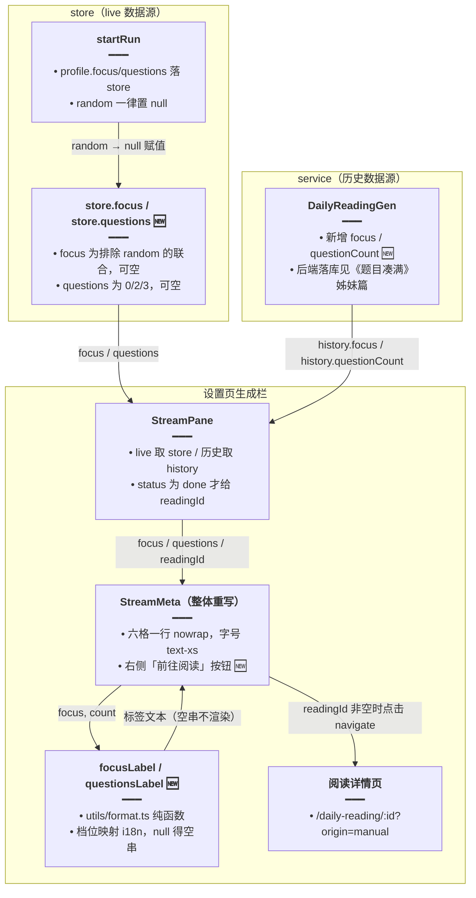

# 每日阅读生成元信息

> 文档角色：本篇是「每日阅读」生成元信息专题，覆盖设置页生成栏流式面板的元信息行由「难度/篇幅/耗时/Token」扩为「难度/篇幅/侧重/理解题 + 耗时/Token」：store 在 `startRun` 快照 `focus`/`questions`（random 置 null）、历史记录类型 `DailyReadingGen` 新增 `focus`/`questionCount`、标签工具 `focusLabel`/`questionsLabel` 落 `utils/format.ts`、`StreamMeta` 整体重写为一行 nowrap 布局，并对已完成的历史生成记录提供「前往阅读」按钮直达正文。
> 姊妹篇：SSE 协议见 [每日阅读流式生成](./每日阅读流式生成.md)；补请求与 429 重试见 [每日阅读生成加固](./每日阅读生成加固.md)；设置页分栏结构见 [每日阅读界面重构](./每日阅读界面重构.md)；level/length 的 random→null 改写见 [每日阅读随机档位](./每日阅读随机档位.md)；定时入队整点见 [每日阅读自定义入队时间](./每日阅读自定义入队时间.md)；篇目删除见 [每日阅读篇目删除](./每日阅读篇目删除.md)；调度注册见 [每日阅读生成调度](./每日阅读生成调度.md)；前端整体结构见 [每日阅读前端](./每日阅读前端.md)；`focus`/`questionCount` 的后端落库与题目凑满见 [每日阅读题目凑满](./每日阅读题目凑满.md)；语法说明结构化见 [每日阅读语法说明结构化](./每日阅读语法说明结构化.md)。

## 一、要解决什么问题

1. **元信息行只讲了一半**：设置页有「学习侧重」「理解题」两个档位，但生成中面板与历史记录面板的元信息行只有「难度/篇幅/耗时/Token」。用户回看时无法确认这一次到底带没带词汇/语法、设定几道题，只能点进详情页翻附件区。
2. **两条数据源都缺字段**：live 态的 store 只快照了 level/length，历史态的 `DailyReadingGen` 也只有 level/length——面板想显示侧重与题数，两条路都取不到数据。
3. **看完历史记录回不到正文**：历史面板展示的是生成当时的快照，用户确认「这条生成得不错」后想读正文，得退出面板去阅读列表里手动翻找，缺一条从记录直达篇目的路径。
4. **随机档语义要统一**：level/length 已约定 random → null → 格子不渲染（见 [每日阅读随机档位](./每日阅读随机档位.md)），focus/questions 若另立规矩（比如显示「随机」二字），一行六种格子两套语义，既吵又不一致。

## 二、核心思路

1. **store 在 `startRun` 快照 focus/questions，random 置 null**：与 level/length 同一拍落字段，面板 live 态直接订 store，无需等后端回包。**权衡①——random 显示为空而不是「随机」二字**：元信息行是「本次实际用了什么档」的回执，随机档在抽完之前没有确定值，写「随机」反而像已定档；且 `null → ''` 是既有 `lengthLabel` 的惯例，`focusLabel`/`questionsLabel` 沿用同一惯例，四种格子一套规矩，行内只剩确定档 + 耗时/Token。
2. **历史记录类型补 `focus`/`questionCount`**：`DailyReadingGen` 的两个新字段由后端落库（细节见 [每日阅读题目凑满](./每日阅读题目凑满.md)，本篇不展开后端），前端类型加上两个可空字段，`StreamPane` 的 `Pick` 扩展后历史态取 `history.focus`/`history.questionCount`；live 与历史两条路在 `StreamMeta` 的同一个 props 口汇合，组件不分数据来源。
3. **标签函数放 `utils/format.ts`**：`focusLabel`/`questionsLabel` 与既有 `lengthLabel` 同构（档位值 → i18n 文案，null → ''），组件不带映射逻辑；`both` 的「附词汇 · 附语法」组合拼接只此一处，别处要显示可直接复用。**权衡③——不放组件内联**：元信息格是纯展示，映射放组件里会让 props 类型与 i18n key 搅进 JSX；抽成纯函数后 `StreamMeta` 只关心「空串不渲染」。
4. **`StreamMeta` 重写为一行 nowrap + 前往阅读按钮**：格子从 4 个变 6 个，原「左右两块」的右块必然换行；改为左侧标题 + 元信息一行 `flex-nowrap`、元信息字号降到 `text-xs`、每格 `whitespace-nowrap`，右侧腾出位置放「前往阅读」按钮（BookOpen 图标 + teal-500）。**权衡②——只有 `status === 'done'` 的历史记录给 `readingId`**：stopped/error/paused 是残篇或根本没有成篇，详情页没有可读正文；live 态连篇目 id 都还不存在，同样不显示按钮。
5. **i18n 补 `questions1`**：题数档出现 1 题（题数设定的落库与凑满见 [每日阅读题目凑满](./每日阅读题目凑满.md)），zh-CN/en-US 各补一个键，缺键时 `questionsLabel` 的 `count === 1` 分支会显示原始 key。

## 三、实现链路



**读图要点**：元信息的关口只有两个——`startRun` 把档位快照进 store（live 数据源），`DailyReadingGen` 类型承认后端落库的两个新字段（历史数据源）；两路在 `StreamPane` 汇合后经同一组 `focusLabel`/`questionsLabel` 翻译成文案，空串即不渲染，因此随机档与缺键的老历史记录自动退化为少格显示。「前往阅读」的开关只有一个判断：`history?.status === 'done'`。

## 四、代码对比

### 4.1 `format.ts` 新增 `focusLabel` / `questionsLabel`

**对比范围**：`apps/frontend/src/views/englishLearning/dailyReading/utils/format.ts` 全文（改动前约 L1–L20）；`focusLabel`、`questionsLabel` 为纯新增（改动后约 L22–L46）。既有 `formatElapsed`/`lengthLabel` 逐字未动，改动后不再重复摘录。

来源：`apps/frontend/src/views/englishLearning/dailyReading/utils/format.ts` **改动前** 约 L1–L20（`formatElapsed`、`lengthLabel`，全文）

```ts
// 耗时格式化：毫秒数格式化为 m:ss 或 h:mm:ss，供元信息行的耗时格使用。
export function formatElapsed(ms: number): string {
	// 毫秒换算成总秒数，负值按 0 兜底。
	const total = Math.max(0, Math.floor(ms / 1000));
	// 拆出小时数。
	const h = Math.floor(total / 3600);
	// 拆出不足一小时的分钟数。
	const m = Math.floor((total % 3600) / 60);
	// 拆出不足一分钟的秒数。
	const s = total % 60;
	// 两位补零工具：分与秒显示为 05 而不是 5。
	const pad = (n: number) => String(n).padStart(2, '0');
	// 超过一小时时带小时位输出。
	if (h > 0) return `${h}:${pad(m)}:${pad(s)}`;
	// 一小时以内只输出 分:秒。
	return `${pad(m)}:${pad(s)}`;
}

// 篇幅档标签：short/medium/long 映射 i18n 文案，null 返回空串表示该格不显示。
export function lengthLabel(
	// 篇幅档：允许 null 表示本次生成没记下档位（含随机档）。
	length: 'short' | 'medium' | 'long' | null,
	// i18n 取词函数。
	t: (key: string) => string,
// 返回标签文案；档位未知时返回空串。
): string {
	// 短篇档取「短篇」文案。
	if (length === 'short') return t('englishLearning.dailyReading.lengthShort');
	// 中篇档判断。
	if (length === 'medium')
		// 返回中篇文案。
		return t('englishLearning.dailyReading.lengthMedium');
	// 长篇档取「长篇」文案。
	if (length === 'long') return t('englishLearning.dailyReading.lengthLong');
	// 未知档位（含 null）返回空串，调用处不渲染篇幅格。
	return '';
}
```

来源：`apps/frontend/src/views/englishLearning/dailyReading/utils/format.ts` **改动后（纯新增）** 约 L22–L46（`focusLabel`、`questionsLabel`）

```ts
// 侧重档标签：reading/vocab/grammar/both 映射 i18n 文案，both 组合两词，null 返回空串。
export function focusLabel(
	// 侧重档：允许 null 表示随机档或未记录。
	focus: 'reading' | 'vocab' | 'grammar' | 'both' | null,
	// i18n 取词函数。
	t: (key: string) => string,
// 返回侧重文案；null 时返回空串。
): string {
	// 两者都要时的分支。
	if (focus === 'both') {
		// 返回「附词汇 · 附语法」组合文案。
		return `${t('englishLearning.dailyReading.focusVocab')} · ${t('englishLearning.dailyReading.focusGrammar')}`;
	}
	// 只带词汇时取「附词汇」。
	if (focus === 'vocab') return t('englishLearning.dailyReading.focusVocab');
	// 只带语法时的分支。
	if (focus === 'grammar')
		// 返回附语法文案。
		return t('englishLearning.dailyReading.focusGrammar');
	// 只读短文时的分支。
	if (focus === 'reading')
		// 返回只读短文文案。
		return t('englishLearning.dailyReading.focusReading');
	// null（随机档）返回空串，调用处不渲染侧重格。
	return '';
}

// 理解题数标签：0/1/2/3 映射 i18n 文案，null 返回空串表示该格不显示。
export function questionsLabel(
	// 题数：允许 null 表示随机档或未记录。
	count: number | null,
	// i18n 取词函数。
	t: (key: string) => string,
// 返回题数文案；null 返回空串，0 走「不出题」。
): string {
	// null（含运行时缺键的 undefined）不显示理解题格。
	if (count == null) return '';
	// 3 题及以上统一取 questions3 文案（当前档位上限即 3）。
	if (count >= 3) return t('englishLearning.dailyReading.questions3');
	// 2 题取 questions2 文案。
	if (count === 2) return t('englishLearning.dailyReading.questions2');
	// 1 题取新增的 questions1 文案。
	if (count === 1) return t('englishLearning.dailyReading.questions1');
	// 0 题取「不出题」文案。
	return t('englishLearning.dailyReading.questions0');
}
```

**变更摘要**：两个新函数与既有 `lengthLabel` 同构——档位进、文案出、null 得空串；`both` 的「附词汇 · 附语法」组合与 `count >= 3` 的归一并排写死，组件侧不需要任何映射分支。`formatElapsed`/`lengthLabel` 未动。

### 4.2 store 类字段新增 `focus` / `questions`

**对比范围**：`apps/frontend/src/store/englishDailyReading.ts` 类字段区（改动前约 L27–L29，改动后约 L27–L31）；level/length 的 `Exclude<…, 'random'>` 收窄属 [每日阅读随机档位](./每日阅读随机档位.md)，本篇只标位置；其余字段未改动，对称省略。

来源：`apps/frontend/src/store/englishDailyReading.ts` **改动前** 约 L27–L29（类字段 `historyRev`/`level`/`length`）

```ts
	// ...（generating/text/seq 等其余字段未改动，对称省略）
	// 历史记录版本号：每次生成结束自增，驱动历史列表重取。
	historyRev = 0;
	// 本次难度档：直接引用 profile 的 level 联合（含 random），允许 null。
	level: EnglishDailyReadingProfile['level'] | null = null;
	// 本次篇幅档：同上。
	length: EnglishDailyReadingProfile['length'] | null = null;
	// ...（buf/paint 等私有字段未改动，对称省略）
```

来源：`apps/frontend/src/store/englishDailyReading.ts` **改动后** 约 L27–L31（类字段，新增 `focus`/`questions`）

```ts
	// ...（generating/text/seq 等其余字段未改动，对称省略）
	// 历史记录版本号保持不变。
	historyRev = 0;
	// 难度档收窄为排除 random 的联合：store 只记抽完的具体档（属《每日阅读随机档位.md》，本篇只标位置）。
	level: Exclude<EnglishDailyReadingProfile['level'], 'random'> | null = null;
	// 篇幅档同理收窄。
	length: Exclude<EnglishDailyReadingProfile['length'], 'random'> | null = null;
	// 新增：本次侧重档，排除 random，null 表示这次选了随机。
	focus: Exclude<EnglishDailyReadingProfile['focus'], 'random'> | null = null;
	// 新增：本次理解题数设定，只可能是 0/2/3 或 null（随机）。
	questions: 0 | 2 | 3 | null = null;
	// ...（buf/paint 等私有字段未改动，对称省略）
```

**变更摘要**：新增两个可空公开字段，`makeAutoObservable` 会自动包成 observable，`StreamPane` 的 observer 组件直接订即可；类型上与 level/length 一样排除 `random`，从声明处保证 store 里不会出现「随机」这个值。

### 4.3 store `startRun` 记录 `focus` / `questions`

**对比范围**：`startRun` 中计时清零到发起连接的赋值段（改动前约 L85–L94，改动后约 L87–L98）；level/length 两行的 random→null 改写属 [每日阅读随机档位](./每日阅读随机档位.md)，本篇对称省略，只聚焦新增的 focus/questions 两行。

来源：`apps/frontend/src/store/englishDailyReading.ts` **改动前** 约 L85–L94（`startRun` 赋值段）

```ts
		// 计时起点：此刻开始累计耗时。
		this.startedAt = Date.now();
		// 耗时清零。
		this.elapsed = 0;
		// token 计数清零。
		this.tokens = 0;
		// ...（level/length 两行直接落 profile 原值，其 random→null 改写属《每日阅读随机档位.md》，本篇对称省略）
		// 连接手动生成 SSE 流，带上主题、档位与本次 runId。
		this.connect(ENGLISH_LEARNING_DAILY_READING_MANUAL_STREAM, {
			// 主题列表原样传给后端。
			themes,
			// 档位 profile 原样上送（含 random，由后端抽签）。
			profile,
			// 本次生成的 runId，断线重连时辨认归属。
			runId,
		});
```

来源：`apps/frontend/src/store/englishDailyReading.ts` **改动后** 约 L87–L98（`startRun` 赋值段）

```ts
		// 计时起点：此刻开始累计耗时，与基线一致。
		this.startedAt = Date.now();
		// 耗时清零，与基线一致。
		this.elapsed = 0;
		// token 计数清零，与基线一致。
		this.tokens = 0;
		// ...（level/length 两行的 random→null 改写属《每日阅读随机档位.md》，本篇对称省略）
		// 新增：侧重档落 store，random 置 null——抽完前没有确定值，元信息行对应格不渲染。
		this.focus = profile.focus === 'random' ? null : profile.focus;
		// 新增：理解题数落 store，random 置 null，同理不渲染题数格。
		this.questions = profile.questions === 'random' ? null : profile.questions;
		// 连接手动生成 SSE 流，与基线一致。
		this.connect(ENGLISH_LEARNING_DAILY_READING_MANUAL_STREAM, {
			// 主题列表原样传给后端，与基线一致。
			themes,
			// 档位 profile 原样上送（含 random，由后端抽签），与基线一致。
			profile,
			// 本次生成的 runId，断线重连时辨认归属，与基线一致。
			runId,
		});
```

**变更摘要**：`focus`/`questions` 与 level/length 同拍落定——生成一开始就把「这次实际是什么档」钉在 store 里，流式过程中不变；`random` 一律归一成 `null`，显示层只认「有值渲染、空值跳过」。

### 4.4 `StreamMeta` 组件整体重写

**对比范围**：`apps/frontend/src/views/englishLearning/dailyReading/components/StreamMeta.tsx` 全文（改动前约 L1–L64，改动后约 L1–L99）；整个组件重写，props 新增 `focus`/`questions`/`readingId`，布局由左右两块改为一行 nowrap，右侧新增「前往阅读」按钮。

来源：`apps/frontend/src/views/englishLearning/dailyReading/components/StreamMeta.tsx` **改动前** 约 L1–L64（`StreamMeta` 全文）

```tsx
// 副作用与状态钩子；基线没有导航与图标需求。
import { useEffect, useState } from 'react';
// i18n 钩子。
import { useI18n } from '@/hooks';
// 标签工具只有耗时与篇幅两个；基线还没有 focusLabel/questionsLabel。
import { formatElapsed, lengthLabel } from '../utils/format';

// 生成元信息行：难度/篇幅/耗时/Token 四格，纯展示无跳转。
export function StreamMeta({
	// live 计时起点；历史记录态为 null。
	startedAt,
	// 已结束时的总耗时毫秒。
	elapsed,
	// 已消耗 token 数。
	tokens,
	// 难度档文本。
	level,
	// 篇幅档。
	length,
// props 类型：五个字段，无侧重/题数/跳转 id。
}: {
	// live 计时起点允许 null。
	startedAt: number | null;
	// 总耗时毫秒。
	elapsed: number;
	// token 数。
	tokens: number;
	// 难度档文本允许 null。
	level: string | null;
	// 篇幅档允许 null。
	length: 'short' | 'medium' | 'long' | null;
// 类型声明结束，进入组件体。
}) {
	// 取词函数。
	const { t } = useI18n();
	// now 驱动每秒重渲染，让耗时实时跳动。
	const [now, setNow] = useState(() => Date.now());
	// 有 startedAt 才开秒表。
	useEffect(() => {
		// 历史态 startedAt 为 null，不开定时器。
		if (!startedAt) return;
		// 每秒刷新一次 now。
		const id = window.setInterval(() => setNow(Date.now()), 1000);
		// 卸载或 startedAt 变化时清掉旧定时器。
		return () => window.clearInterval(id);
	// 只依赖 startedAt。
	}, [startedAt]);
	// 进行中用 now-startedAt 实时算，结束后用固定的 elapsed。
	const ms = startedAt ? Math.max(0, now - startedAt) : elapsed;
	// 篇幅标签，空串不渲染篇幅格。
	const passage = lengthLabel(length, t);
	// 渲染左右两块布局。
	return (
		// 整行容器：左右两块布局，标题在左、元信息在右，justify-between 撑开。
		<div className="flex justify-between gap-4 px-3 pt-2 pb-3 border-b border-theme/10 text-textcolor">
			// 左块容器：只有标题。
			<div className="flex min-w-0 items-center gap-4">
				// 标题：text-base 较大字号。
				<div className="shrink-0 text-base">
					// 「资源生成信息」标题走 i18n。
					{t('englishLearning.dailyReading.titleGenerationInfo')}
				// 结束标题。
				</div>
			// 结束左块。
			</div>
			// 右块：四格元信息横向排。
			<div className="flex gap-4 text-textcolor/65">
				// 难度格：level 为空不渲染。
				{level ? (
					// 难度格容器。
					<div className="flex items-center text-sm text-textcolor/65">
						// 「难度：」标签。
						<span>{t('englishLearning.dailyReading.level')}：</span>
						// 难度值原样显示。
						<span>{level}</span>
					// 结束难度格。
					</div>
				// level 为空渲染空。
				) : null}
				// 篇幅格：passage 为空串不渲染。
				{passage ? (
					// 篇幅格容器。
					<div className="flex items-center text-sm text-textcolor/65">
						// 「篇幅：」标签。
						<span>{t('englishLearning.dailyReading.length')}：</span>
						// 篇幅文案。
						<span>{passage}</span>
					// 结束篇幅格。
					</div>
				// passage 为空串渲染空。
				) : null}
				// 耗时格：始终渲染。
				<div className="flex items-center">
					// 「生成时间：」标签。
					<div className="text-sm">
						// 标签文案走 i18n，带全角冒号。
						{t('englishLearning.dailyReading.elapsed')}：
					// 结束耗时标签。
					</div>
					// 耗时值：等宽数字防跳动。
					<div className="mt-0.5 text-sm tabular-nums">{formatElapsed(ms)}</div>
				// 结束耗时格。
				</div>
				// Token 格：始终渲染。
				<div className="flex items-center">
					// 「消耗 Token 数：」标签。
					<div className="text-sm">
						// 标签文案走 i18n，带全角冒号。
						{t('englishLearning.dailyReading.tokens')}：
					// 结束 Token 标签。
					</div>
					// Token 值容器。
					<div className="mt-0.5 text-sm tabular-nums">
						// 千分位格式化后显示。
						{tokens.toLocaleString()}
					// 结束 Token 值。
					</div>
				// 结束 Token 格。
				</div>
			// 结束右块。
			</div>
		// 结束整行容器。
		</div>
	);
}
```

来源：`apps/frontend/src/views/englishLearning/dailyReading/components/StreamMeta.tsx` **改动后** 约 L1–L99（`StreamMeta` 全文）

```tsx
// 新增：「前往阅读」按钮的书本图标。
import { BookOpen } from 'lucide-react';
// 副作用与状态钩子，与基线一致。
import { useEffect, useState } from 'react';
// 新增：跳转按钮需要路由导航。
import { useNavigate } from 'react-router';
// i18n 钩子，与基线一致。
import { useI18n } from '@/hooks';
// 标签工具新增 focusLabel/questionsLabel 两个入口，统一来自 utils/format。
import {
	// 侧重档 → 文案。
	focusLabel,
	// 耗时格式化，与基线一致。
	formatElapsed,
	// 篇幅档 → 文案，与基线一致。
	lengthLabel,
	// 题数 → 文案。
	questionsLabel,
// 工具统一引自 utils/format，组件不带映射逻辑。
} from '../utils/format';

// 生成元信息行：难度/篇幅/侧重/理解题 + 耗时/Token，右侧可带「前往阅读」。
export function StreamMeta({
	// live 计时起点；历史态为 null，与基线一致。
	startedAt,
	// 结束后的总耗时，与基线一致。
	elapsed,
	// token 数，与基线一致。
	tokens,
	// 难度档文本，与基线一致。
	level,
	// 篇幅档，与基线一致。
	length,
	// 新增：侧重档。
	focus,
	// 新增：理解题数。
	questions,
	// 新增：可跳转的篇目 id，null 不显示按钮。
	readingId,
// props 类型同步扩三个字段。
}: {
	// live 计时起点允许 null。
	startedAt: number | null;
	// 总耗时毫秒。
	elapsed: number;
	// token 数。
	tokens: number;
	// 难度档文本允许 null。
	level: string | null;
	// 篇幅档允许 null。
	length: 'short' | 'medium' | 'long' | null;
	// 新增：侧重档联合类型，允许 null。
	focus: 'reading' | 'vocab' | 'grammar' | 'both' | null;
	// 新增：题数允许 null。
	questions: number | null;
	// 新增：跳转目标 id 允许 null。
	readingId: string | null;
// 类型声明结束，进入组件体。
}) {
	// 取词函数。
	const { t } = useI18n();
	// 新增：导航函数，点「前往阅读」跳详情页。
	const navigate = useNavigate();
	// now 驱动每秒重渲染，让耗时实时跳动，与基线一致。
	const [now, setNow] = useState(() => Date.now());
	// 有 startedAt 才开秒表，与基线一致。
	useEffect(() => {
		// 历史态 startedAt 为 null，不开定时器。
		if (!startedAt) return;
		// 每秒刷新一次 now。
		const id = window.setInterval(() => setNow(Date.now()), 1000);
		// 卸载或 startedAt 变化时清掉旧定时器。
		return () => window.clearInterval(id);
	// 只依赖 startedAt。
	}, [startedAt]);
	// 进行中实时算耗时，结束后用固定 elapsed，与基线一致。
	const ms = startedAt ? Math.max(0, now - startedAt) : elapsed;
	// 篇幅标签，空串不渲染，与基线一致。
	const passage = lengthLabel(length, t);
	// 新增：侧重标签，随机档（null）得空串。
	const focusText = focusLabel(focus, t);
	// 新增：题数标签，随机档（null）得空串。
	const questionsText = questionsLabel(questions, t);
	// 渲染单行元信息与可选跳转按钮。
	return (
		// 整行：标题+元信息在左、跳转按钮在右；items-center 垂直对齐，overflow-hidden 防溢出。
		<div className="flex items-center justify-between gap-3 overflow-hidden border-b border-theme/10 px-3 py-2.5 text-textcolor">
			// 左块：标题与元信息同行 nowrap 排列；flex-1 占满剩余宽，min-w-0 允许收缩。
			<div className="flex min-w-0 flex-1 flex-nowrap items-center gap-3">
				// 标题降到 text-sm 并 nowrap，给六格元信息腾宽度。
				<div className="shrink-0 whitespace-nowrap text-sm">
					// 「资源生成信息」标题走 i18n。
					{t('englishLearning.dailyReading.titleGenerationInfo')}
				// 结束标题。
				</div>
				// 元信息行：六格横向不换行，字号降到 text-xs。
				<div className="flex min-w-0 flex-nowrap items-center gap-2 text-xs text-textcolor/65">
					// 难度格：为空不渲染，与基线一致。
					{level ? (
						// 难度格容器：nowrap 防格内换行。
						<div className="flex items-center whitespace-nowrap">
							// 「难度：」标签。
							<span>{t('englishLearning.dailyReading.level')}：</span>
							// 难度值。
							<span>{level}</span>
						// 结束难度格。
						</div>
					// level 为空渲染空。
					) : null}
					// 篇幅格：空串不渲染，与基线一致。
					{passage ? (
						// 篇幅格容器 nowrap。
						<div className="flex items-center whitespace-nowrap">
							// 「篇幅：」标签。
							<span>{t('englishLearning.dailyReading.length')}：</span>
							// 篇幅文案。
							<span>{passage}</span>
						// 结束篇幅格。
						</div>
					// passage 为空串渲染空。
					) : null}
					// 新增侧重格：focusText 为空串不渲染。
					{focusText ? (
						// 侧重格容器 nowrap。
						<div className="flex items-center whitespace-nowrap">
							// 「学习侧重：」标签。
							<span>{t('englishLearning.dailyReading.focus')}：</span>
							// 侧重文案。
							<span>{focusText}</span>
						// 结束侧重格。
						</div>
					// focusText 为空串渲染空。
					) : null}
					// 新增理解题格：questionsText 为空串不渲染。
					{questionsText ? (
						// 题数格容器 nowrap。
						<div className="flex items-center whitespace-nowrap">
							// 「理解题：」标签。
							<span>{t('englishLearning.dailyReading.questions')}：</span>
							// 题数文案。
							<span>{questionsText}</span>
						// 结束题数格。
						</div>
					// questionsText 为空串渲染空。
					) : null}
					// 耗时格：始终渲染，同样 nowrap。
					<div className="flex items-center whitespace-nowrap">
						// 「生成时间：」标签。
						<span>{t('englishLearning.dailyReading.elapsed')}：</span>
						// 耗时值：等宽数字防跳动。
						<span className="tabular-nums">{formatElapsed(ms)}</span>
					// 结束耗时格。
					</div>
					// Token 格：始终渲染。
					<div className="flex items-center whitespace-nowrap">
						// 「消耗 Token 数：」标签。
						<span>{t('englishLearning.dailyReading.tokens')}：</span>
						// Token 值：千分位格式化。
						<span className="tabular-nums">{tokens.toLocaleString()}</span>
					// 结束 Token 格。
					</div>
				// 结束元信息行。
				</div>
			// 结束左块。
			</div>
			// 前往阅读按钮：仅 readingId 非空（已完成历史记录）时渲染。
			{readingId ? (
				// 按钮元素。
				<button
					// 显式声明非提交按钮，避免表单场景误提交。
					type="button"
					// 样式：teal-500 主色、hover 变浅、shrink-0 不被挤压、nowrap。
					className="flex shrink-0 cursor-pointer items-center gap-1.5 whitespace-nowrap text-sm font-medium text-teal-500 hover:text-teal-400"
					// 点击跳阅读详情页。
					onClick={() =>
						// 执行路由跳转。
						navigate(
							// 路径插 readingId，origin=manual 标记来源为手动生成页。
							`/english-learning/daily-reading/${readingId}?origin=manual`,
						)
					}
				>
					// 书本图标：-mb-1 视觉对齐文字基线，aria-hidden 免读屏。
					<BookOpen className="size-4 shrink-0 -mb-1" aria-hidden />
					// 「前往阅读」文案走 i18n。
					{t('englishLearning.dailyReading.openReading')}
				// 结束按钮。
				</button>
			// readingId 为空（live 态或未完成记录）不渲染按钮。
			) : null}
		// 结束整行容器。
		</div>
	);
}
```

**变更摘要**：布局从「左标题 / 右四格」两块改为「标题 + 六格元信息」一行 nowrap——标题降 `text-sm`、元信息降 `text-xs`、每格 `whitespace-nowrap`、外层 `overflow-hidden`，为右侧「前往阅读」按钮腾位；耗时/Token 两格由「标签 div + 值 div」改为同行 span，与新增格同一结构；按钮仅 `readingId` 非空时渲染，点击 `navigate` 到 `/english-learning/daily-reading/${readingId}?origin=manual`。

### 4.5 `StreamPane` 数据源扩展与 `readingId`

**对比范围**：`apps/frontend/src/views/englishLearning/dailyReading/components/StreamPane.tsx` 全文（改动前约 L1–L38，改动后约 L1–L53）；`history` 的 `Pick` 扩展 `id`/`status`/`focus`/`questionCount`，新增 focus/questions 二路选择与 `readingId` 放行判断。

来源：`apps/frontend/src/views/englishLearning/dailyReading/components/StreamPane.tsx` **改动前** 约 L1–L38（`StreamPane` 全文）

```tsx
// mobx 观察者：订阅 store 字段自动重渲染。
import { observer } from 'mobx-react';
// 历史记录类型。
import type { DailyReadingGen } from '@/service';
// 手动生成 store 单例。
import englishDailyReadingStore from '@/store/englishDailyReading';
// 元信息行子组件。
import { StreamMeta } from './StreamMeta';
// 正文预览子组件。
import { StreamPreview } from './StreamPreview';

/** 预览自己读正文。父组件传历史记录时不订进行中的 text。 */
// 流式面板：live 读 store，历史读 props；基线只透传五个展示字段。
export const StreamPane = observer(function StreamPane({
	// 历史记录；null 表示看进行中的 live。
	history,
// props 类型。
}: {
	// 只取展示所需字段。
	history: Pick<
		// 从历史记录类型里挑。
		DailyReadingGen,
		// 基线五字段，无 id/status/focus/questionCount。
		'text' | 'elapsed' | 'tokens' | 'level' | 'length'
	// 允许 null 表示 live 态。
	> | null;
// 类型声明结束，进入组件体。
}) {
	// 无历史记录即 live 态。
	const live = history == null;
	// 只有 live 才可能正在生成。
	const generating = live && englishDailyReadingStore.generating;
	// 正文：live 订 store 的流式 text，历史用落库 text。
	const text = live ? englishDailyReadingStore.text : history.text;
	// 计时起点只有 live 有，历史为 null（走固定 elapsed）。
	const startedAt = live ? englishDailyReadingStore.startedAt : null;
	// 耗时：live 取实时累计，历史取落库值。
	const elapsed = live ? englishDailyReadingStore.elapsed : history.elapsed;
	// token 数：live 取实时，历史取落库。
	const tokens = live ? englishDailyReadingStore.tokens : history.tokens;
	// 难度档：live 取 store，历史取记录。
	const level = live ? englishDailyReadingStore.level : history.level;
	// 篇幅档：live 取 store，历史取记录。
	const length = live ? englishDailyReadingStore.length : history.length;
	// 渲染元信息行与正文预览区。
	return (
		// 片段容器，无额外包裹。
		<>
			// 元信息行。
			<StreamMeta
				// 计时起点下传。
				startedAt={startedAt}
				// 耗时下传。
				elapsed={elapsed}
				// token 数下传。
				tokens={tokens}
				// 难度档下传。
				level={level}
				// 篇幅档下传。
				length={length}
			/>
			// 正文预览区固定高度。
			<div className="flex h-65">
				// 正文预览组件。
				<StreamPreview text={text} generating={generating} />
			// 结束预览区。
			</div>
		// 结束片段。
		</>
	);
});
```

来源：`apps/frontend/src/views/englishLearning/dailyReading/components/StreamPane.tsx` **改动后** 约 L1–L53（`StreamPane` 全文）

```tsx
// mobx 观察者：订阅 store 字段自动重渲染，与基线一致。
import { observer } from 'mobx-react';
// 历史记录类型，与基线一致。
import type { DailyReadingGen } from '@/service';
// 手动生成 store 单例，与基线一致。
import englishDailyReadingStore from '@/store/englishDailyReading';
// 元信息行子组件，与基线一致。
import { StreamMeta } from './StreamMeta';
// 正文预览子组件，与基线一致。
import { StreamPreview } from './StreamPreview';

/** 预览自己读正文。父组件传历史记录时不订进行中的 text。 */
// 流式面板：扩展 Pick 字段，并新增 focus/questions/readingId 三个透传。
export const StreamPane = observer(function StreamPane({
	// 历史记录；null 表示看进行中的 live，与基线一致。
	history,
// props 类型。
}: {
	// 取展示与跳转所需字段。
	history: Pick<
		// 从历史记录类型里挑。
		DailyReadingGen,
		// 新增：跳转按钮要记录 id。
		| 'id'
		// 新增：只有 done 状态允许跳转。
		| 'status'
		// 正文，与基线一致。
		| 'text'
		// 耗时，与基线一致。
		| 'elapsed'
		// token 数，与基线一致。
		| 'tokens'
		// 难度档，与基线一致。
		| 'level'
		// 篇幅档，与基线一致。
		| 'length'
		// 新增：历史态侧重档。
		| 'focus'
		// 新增：历史态题数。
		| 'questionCount'
	// 允许 null 表示 live 态。
	> | null;
// 类型声明结束，进入组件体。
}) {
	// 无历史记录即 live 态，与基线一致。
	const live = history == null;
	// 只有 live 才可能正在生成，与基线一致。
	const generating = live && englishDailyReadingStore.generating;
	// 正文：live 订 store 的流式 text，历史用落库 text，与基线一致。
	const text = live ? englishDailyReadingStore.text : history.text;
	// 计时起点只有 live 有，与基线一致。
	const startedAt = live ? englishDailyReadingStore.startedAt : null;
	// 耗时二选一，与基线一致。
	const elapsed = live ? englishDailyReadingStore.elapsed : history.elapsed;
	// token 二选一，与基线一致。
	const tokens = live ? englishDailyReadingStore.tokens : history.tokens;
	// 难度二选一，与基线一致。
	const level = live ? englishDailyReadingStore.level : history.level;
	// 篇幅二选一，与基线一致。
	const length = live ? englishDailyReadingStore.length : history.length;
	// 新增：侧重二选一——live 取 store 新字段，历史取记录新字段。
	const focus = live ? englishDailyReadingStore.focus : history.focus;
	// 新增：题数二选一。
	const questions = live
		// live 取 store 新字段。
		? englishDailyReadingStore.questions
		// 历史取记录的 questionCount（与实际题数组分开的设定值）。
		: history.questionCount;
	// 渲染元信息行与正文预览区。
	return (
		// 片段容器，无额外包裹，与基线一致。
		<>
			// 元信息行。
			<StreamMeta
				// 计时起点下传，与基线一致。
				startedAt={startedAt}
				// 耗时下传，与基线一致。
				elapsed={elapsed}
				// token 数下传，与基线一致。
				tokens={tokens}
				// 难度档下传，与基线一致。
				level={level}
				// 篇幅档下传，与基线一致。
				length={length}
				// 新增：侧重档下传。
				focus={focus}
				// 新增：题数下传。
				questions={questions}
				// 新增：仅已完成历史记录给 id；live、进行中、失败、停止均为 null，按钮不显示。
				readingId={history?.status === 'done' ? history.id : null}
			/>
			// 正文预览区固定高度，与基线一致。
			<div className="flex h-65">
				// 正文预览组件，与基线一致。
				<StreamPreview text={text} generating={generating} />
			// 结束预览区。
			</div>
		// 结束片段。
		</>
	);
});
```

**变更摘要**：`Pick` 增加四个键正好对应两个新需求——`focus`/`questionCount` 喂给元信息行，`id`/`status` 喂给跳转判断；`readingId` 的放行条件收敛为一行 `history?.status === 'done' ? history.id : null`，live 态（`history` 为 null）经可选链自然落到 null。

### 4.6 `DailyReadingGen` 类型新增 `focus` / `questionCount`

**对比范围**：`apps/frontend/src/service/index.ts` 中 `DailyReadingGen` 类型声明（改动前约 L2103–L2113，改动后约 L2108–L2119）；其中 level/length 的索引来源由 `EnglishDailyReadingProfile` 换成 `EnglishDailyReadingExtras`（已排除 random）属 [每日阅读随机档位](./每日阅读随机档位.md)，本篇只标位置。

来源：`apps/frontend/src/service/index.ts` **改动前** 约 L2103–L2113（`DailyReadingGen`）

```ts
// 手动生成历史记录类型：历史列表接口的返回元素。
export type DailyReadingGen = {
	// 记录 id：删除与跳转的凭据。
	id: string;
	// 生成的正文全文。
	text: string;
	// 消耗 token 数。
	tokens: number;
	// 总耗时毫秒。
	elapsed: number;
	// 生成开始时间戳。
	startedAt: number;
	// 记录状态：完成/手动停止/失败/暂停。
	status: 'done' | 'stopped' | 'error' | 'paused';
	// 难度档：直接索引 profile 联合（含 random），允许 null。
	level: EnglishDailyReadingProfile['level'] | null;
	// 篇幅档：同上。
	length: EnglishDailyReadingProfile['length'] | null;
};
```

来源：`apps/frontend/src/service/index.ts` **改动后** 约 L2108–L2119（`DailyReadingGen`）

```ts
// 手动生成历史记录类型：历史列表接口的返回元素。
export type DailyReadingGen = {
	// 记录 id 保持不变。
	id: string;
	// 正文全文保持不变。
	text: string;
	// token 数保持不变。
	tokens: number;
	// 耗时保持不变。
	elapsed: number;
	// 开始时间戳保持不变。
	startedAt: number;
	// 状态联合保持不变。
	status: 'done' | 'stopped' | 'error' | 'paused';
	// 难度档改索引 Extras（已排除 random），属《每日阅读随机档位.md》，本篇只标位置。
	level: EnglishDailyReadingExtras['level'] | null;
	// 篇幅档同理改索引 Extras。
	length: EnglishDailyReadingExtras['length'] | null;
	// 新增：本次侧重档，索引 Extras 联合，null 表示随机或未记录。
	focus: EnglishDailyReadingExtras['focus'] | null;
	// 新增：本次理解题数设定，与实际凑满的题数组分开（后端落库细节见《每日阅读题目凑满.md》）。
	questionCount: 0 | 2 | 3 | null;
};
```

**变更摘要**：`focus`/`questionCount` 是后端已落库的字段（落库与题目凑满细节见 [每日阅读题目凑满](./每日阅读题目凑满.md)，本篇不展开后端），前端类型补齐后 `StreamPane` 的 `Pick` 才取得出历史态的侧重与题数。

### 4.7 i18n 新增 `questions1`

**对比范围**：`apps/frontend/src/i18n/locales/zh-CN/englishLearning.ts` 与 `apps/frontend/src/i18n/locales/en-US/englishLearning.ts` 的 questions 键组（zh-CN 改动前约 L310–L316、改动后约 L312–L319；en-US 改动前约 L341–L347、改动后约 L343–L350）；周边键上下文对称保留，两文件其余键的文案改动属其它姊妹篇，不在本篇范围。

来源：`apps/frontend/src/i18n/locales/zh-CN/englishLearning.ts` **改动前** 约 L310–L316（questions 键组）

```ts
	// 「附词汇」选项文案，both 组合也复用它。
	'englishLearning.dailyReading.focusVocab': '附词汇',
	// 「附语法」选项文案。
	'englishLearning.dailyReading.focusGrammar': '附语法',
	// 「理解题」设置项与元信息格标签。
	'englishLearning.dailyReading.questions': '理解题',
	// 0 题文案「不出题」。
	'englishLearning.dailyReading.questions0': '不出题',
	// 2 题文案；基线没有 1 题键。
	'englishLearning.dailyReading.questions2': '2 题',
	// 3 题文案。
	'englishLearning.dailyReading.questions3': '3 题',
	// 「联网取材」选项文案，位置锚点。
	'englishLearning.dailyReading.useWeb': '联网取材',
```

来源：`apps/frontend/src/i18n/locales/zh-CN/englishLearning.ts` **改动后** 约 L312–L319（questions 键组）

```ts
	// 「附词汇」选项文案保持不变。
	'englishLearning.dailyReading.focusVocab': '附词汇',
	// 「附语法」选项文案保持不变。
	'englishLearning.dailyReading.focusGrammar': '附语法',
	// 「理解题」标签保持不变。
	'englishLearning.dailyReading.questions': '理解题',
	// 0 题文案保持不变。
	'englishLearning.dailyReading.questions0': '不出题',
	// 新增：1 题文案，供 questionsLabel 的 count===1 分支取词。
	'englishLearning.dailyReading.questions1': '1 题',
	// 2 题文案保持不变。
	'englishLearning.dailyReading.questions2': '2 题',
	// 3 题文案保持不变。
	'englishLearning.dailyReading.questions3': '3 题',
	// 「联网取材」选项文案保持不变。
	'englishLearning.dailyReading.useWeb': '联网取材',
```

来源：`apps/frontend/src/i18n/locales/en-US/englishLearning.ts` **改动前** 约 L341–L347（questions 键组）

```ts
	// 英文「附词汇」文案。
	'englishLearning.dailyReading.focusVocab': 'With vocabulary',
	// 英文「附语法」文案。
	'englishLearning.dailyReading.focusGrammar': 'With grammar',
	// 英文「理解题」标签。
	'englishLearning.dailyReading.questions': 'Questions',
	// 英文 0 题文案。
	'englishLearning.dailyReading.questions0': 'None',
	// 英文 2 题文案；基线没有 1 题键。
	'englishLearning.dailyReading.questions2': '2',
	// 英文 3 题文案。
	'englishLearning.dailyReading.questions3': '3',
	// 英文「联网取材」文案，位置锚点。
	'englishLearning.dailyReading.useWeb': 'Use web notes',
```

来源：`apps/frontend/src/i18n/locales/en-US/englishLearning.ts` **改动后** 约 L343–L350（questions 键组）

```ts
	// 英文「附词汇」文案保持不变。
	'englishLearning.dailyReading.focusVocab': 'With vocabulary',
	// 英文「附语法」文案保持不变。
	'englishLearning.dailyReading.focusGrammar': 'With grammar',
	// 英文「理解题」标签保持不变。
	'englishLearning.dailyReading.questions': 'Questions',
	// 英文 0 题文案保持不变。
	'englishLearning.dailyReading.questions0': 'None',
	// 新增：英文 1 题文案，元信息格显示「Questions：1」。
	'englishLearning.dailyReading.questions1': '1',
	// 英文 2 题文案保持不变。
	'englishLearning.dailyReading.questions2': '2',
	// 英文 3 题文案保持不变。
	'englishLearning.dailyReading.questions3': '3',
	// 英文「联网取材」文案保持不变。
	'englishLearning.dailyReading.useWeb': 'Use web notes',
```

**变更摘要**：两语言各补一个 `questions1` 键，插在 `questions0` 与 `questions2` 之间保持键序递增；缺这个键时 `questionsLabel` 的 `count === 1` 分支会把原始 key 显示出来。

## 五、行为变化

1. **live 与历史两种数据源在 `StreamMeta` 汇合**：live 态（`history == null`）的侧重/题数取 store 的 `focus`/`questions`——`startRun` 时随 profile 落定，流式过程中不变；历史态取 `DailyReadingGen.focus`/`questionCount`——后端落库的当时设定。两路在 `StreamPane` 里二选一后走同一组 props，组件内部不分来源。
2. **random 档显示为空格**：level/length/focus/questions 任一档选了随机，对应字段即 null，标签函数得空串，该格不渲染——行内只剩确定档 + 耗时/Token，与 `lengthLabel` 既有惯例一致，不出现「随机」字样。
3. **进行中/失败/停止无跳转按钮**：`readingId` 只在 `history?.status === 'done'` 时为记录 id，其余情况（live 态、stopped、error、paused）一律 null，「前往阅读」按钮不渲染；只有已完成的历史记录可一键跳到 `/english-learning/daily-reading/${id}?origin=manual`。
4. **布局变化**：元信息由「左标题 / 右四格」两块改为「标题 + 六格」一行 nowrap，标题降 `text-sm`、元信息降 `text-xs`；耗时/Token 两格由「标签 div + 值 div」改为与新增格同构的同行 span。
5. **老历史记录自动退化**：升级前落库的记录没有 `focus`/`questionCount` 键，运行时取到 `undefined`——`focusLabel` 全分支不命中得 `''`，`questionsLabel` 的 `count == null` 对 `undefined` 同样成立得 `''`，老记录自动只显示旧四格，不报错。
6. **1 题档有了文案**：新增 `questions1` 键后，1 题档在元信息行显示「理解题：1 题」（英文「Questions：1」），不再回退成原始 key。

## 六、风险与回归清单

1. **一行六格的空间压力**：`whitespace-nowrap` + `overflow-hidden` 意味着窄窗口下右侧格子会被截断且无横向滚动；`both`（附词汇 · 附语法）+ 3 题是最宽组合。回归点：最小侧栏宽度、both+3 题档观察元信息行截断是否可接受。
2. **全随机时行很空**：四档全随机时只剩耗时/Token 两格，视觉上偏空——这是设计选择而非缺陷。回归点：全随机生成一次，确认不出现「random」「undefined」「null」字样。
3. **老记录缺键靠运行时落空**：`history.focus`/`history.questionCount` 对老数据是 `undefined`，依赖两个标签函数的空串分支兜底；若后端某天对老记录回填默认值（如 0），题数格会显示「不出题」——语义正确但属行为变化。回归点：升级前的历史记录打开确认只显示旧四格。
4. **`readingId` 仅 done 放行**：paused 记录若后续补跑成 done，历史列表刷新后按钮出现属预期；stopped/error 永远无按钮。回归点：三种非 done 状态各看一条记录确认无按钮，done 记录点击后详情页打开且 `origin=manual` 生效（返回落点回设置页）。
5. **`questions1` 缺键风险**：本仓仅 zh-CN/en-US 两个 locale 文件，均已补键；若日后新增语言漏补，1 题档会显示原始 key。回归点：切英文界面看 1 题档显示「Questions：1」。
6. **store 字段与类型声明脱节风险**：`questions` 声明为 `0 | 2 | 3 | null`，但赋值来自 `profile.questions` 的三元结果，类型上依赖 `EnglishDailyReadingProfile['questions']` 排除 random 后恰为 `0 | 2 | 3`；题数档未来加新值（如 5）时类型会报错提示同步。回归点：改题数档位联合时确认 store 字段类型同步收紧。

若与仓库最新源码不一致，以源码为准。
