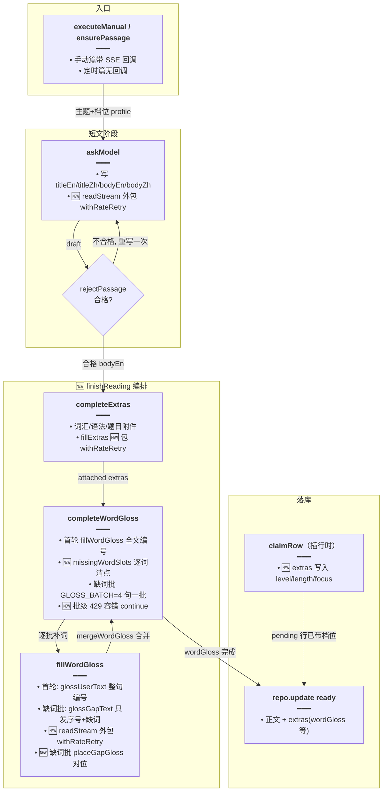
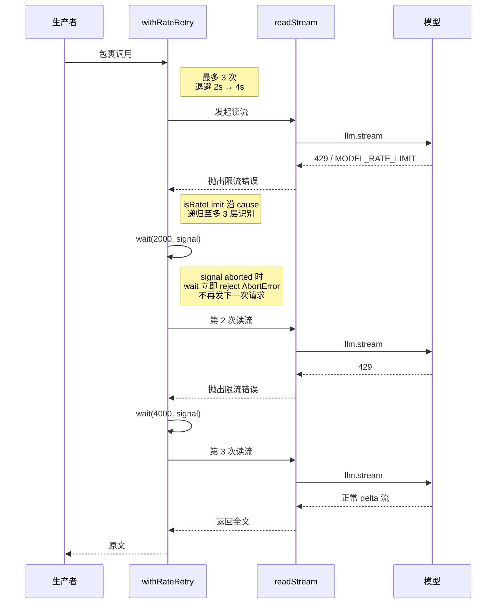
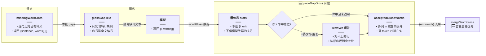

# 每日阅读生成加固

> 文档角色：本篇是「每日阅读」后端生成链路的加固专题，覆盖 429 限流退避重试、词级缺词补释义协议、释义批级容错、生成档位落库与历史回显、Token 分路计数五项实现。
> 姊妹篇：前端组件化与详情页双栏见 [每日阅读界面重构](./每日阅读界面重构.md)；SSE 流式协议与生产者模型见 [每日阅读流式生成](./每日阅读流式生成.md)；定时调度与冷却见 [每日阅读生成调度](./每日阅读生成调度.md)；页面展示见 [每日阅读前端](./每日阅读前端.md)；语法说明对象化与正文摘录校验见 [每日阅读语法说明结构化](./每日阅读语法说明结构化.md)；理解题按设定凑满与 `questionCount` 落库见 [每日阅读题目凑满](./每日阅读题目凑满.md)；失败上限、尝试账本与按日补生成见 [每日阅读日推失败上限](./每日阅读日推失败上限.md)。

> **后继更新（2026-10-25）**：本篇的 429 退避重试只管「单次执行内的重试」；系统日推又在其外层加了**跨执行的失败上限**（自动最多 5 次、每次一行尝试账本、耗尽后报 `exhausted`）。两者位置不同、互不影响：`withRateRetry` 在工人内部消化限流，`MAX_ATTEMPTS` 在队列层决定还要不要再跑一个工人。详见 [每日阅读日推失败上限.md](./每日阅读日推失败上限.md)。

## 一、要解决什么问题

手动生成一篇每日阅读要串行走完「写短文 → 补附件 → 逐词释义 → 缺词补释义」四段模型请求。线上暴露三类问题：

1. **429 限流直接废稿**：任何一段撞上账户限流（`status 429` / `MODEL_RATE_LIMIT`），整次生成按失败收尾，用户看到的是「生成失败」，没有重试。
2. **补释义整句重发、对位常挂错句**：旧协议按「整句缺失」重发完整英文句，让模型自己抄回 `en` 原句对位。模型常把句子改几个词、或把返回的 `en` 写成别的句，导致 `mergeWordGloss` 对不上、已合格的释义被补全结果反向覆盖。
3. **生成历史看不到档位**：生成时选了 A2/B1/C1 与短/中/长篇，历史列表与详情页却回显不出这次用的是什么档位，无法追溯。

## 二、核心思路

1. **限流识别只看结构不看文案**：`isRateLimit` 只认 `status === 429` 与 LangChain 的 `lc_error_code === 'MODEL_RATE_LIMIT'`，并沿 `cause` 链递归至多 3 层，不靠错误消息猜。
2. **重试只包「这一次流」**：新增 `withRateRetry`，连同首次最多 3 次，退避 2s → 4s；只包 `askModel` / `fillExtras` / `fillWordGloss` 内部的 `readStream` 调用，重试不跨阶段、不重建短文。`wait` 对 AbortSignal 敏感，停止按钮一到立刻 reject，不再发下一次请求。
3. **缺词协议从「整句」降到「词级」**：`missingSentences`（整句缺失）换成 `missingWordSlots`（逐词清点，返回 `{sentence, words[]}[]`）。首轮给模型的编号文本 `glossUserText` 是「序号. 整句」；缺词批 `glossGapText` 只发「序号. 缺词列表」，模型不必再抄整句，输出量与出错面都大幅缩小。
4. **对位不信模型写的序号**：缺词批用 `placeGapGloss` 按本批自己维护的 `{i, en}` 槽位表挂回；模型常把唯一一行改成 `i:1`，对不上槽位的行进入 leftover，按顺序填剩余空位。解析失败时再用 `closedGlossObjects` 打捞已闭合对象兜底。
5. **已合格正文优先于补全**：`mergeSentenceWords` 把取词优先级从「补全优先」反转为「首轮合格优先」，补全结果只填还空着的词位，不再反向覆盖。
6. **附件与释义统一收口**：新增 `finishReading` 编排「先附件、再释义」，定时篇与手动篇两个入口共用，避免两处各写一套两段调用。
7. **档位随 pending 行落库**：`claimRow` 插行时把 `{level, length, focus}` 写进 `extras`，`listGens` 用一次 IN 查询把对应 readings 行的档位并回历史记录，详情页与历史列表都能回显。
8. **Token 分路计数**：`trackUsage` 工厂给每一路模型调用发一个 lane id，在途用量按 lane 记账，`settled + pending` 汇总，避免两轮调用之间把在途 token 重复累加。

## 三、实现链路

### 3.1 主流程（改动后）



### 3.2 429 退避重试时序



### 3.3 缺词补释义对位流程



## 四、代码对比

### 4.1 限流识别 isRateLimit 与退避等待 wait（纯新增）

`isRateLimit` 只按结构识别限流，不看错误文案；`wait` 让退避窗口也能被停止按钮打断。

来源：`apps/backend/src/services/english-learning/english-daily-reading.service.ts` **改动后** 约 L199–L231（模块级函数 `isRateLimit` / `wait`）。

```ts
/** 认出账户限流。只看状态码和 LangChain 错误码，不按文案猜。 */
// 递归识别限流：网关与 LangChain 常把 429 包在 cause 里，depth 限制最多挖 3 层，防止异常对象成环时死循环。
function isRateLimit(err: unknown, depth = 0): boolean {
	// 非对象错误（如字符串）没有 status / lc_error_code 可看；depth 超 3 层也不再往下挖。
	if (!err || typeof err !== 'object' || depth > 3) return false;
	// 收成可选字段记录，下面只读这三个键，不碰其它属性。
	const o = err as {
		status?: number;
		lc_error_code?: string;
		cause?: unknown;
	};
	// HTTP 状态码 429 或 LangChain 归一化错误码 MODEL_RATE_LIMIT，二者居一即认定为账户限流。
	if (o.status === 429 || o.lc_error_code === 'MODEL_RATE_LIMIT') return true;
	// 当前层没认出来就往 cause 里再挖一层，包了好几层的网关错误也能识别。
	return isRateLimit(o.cause, depth + 1);
}

/** 退避等待。停止信号一到就结束，不再发下一次请求。 */
// 退避等待封装成 Promise：setTimeout 到点 resolve；期间 signal abort 则 reject，让 withRateRetry 立刻停下。
function wait(ms: number, signal?: AbortSignal): Promise<void> {
	// 进入等待前已经停止：直接 reject AbortError，连定时器都不起，避免无谓多等 2 秒。
	if (signal?.aborted) {
		// 与浏览器 abort 约定保持同名错误，调用方用 name === 'AbortError' 统一识别。
		const err = new Error('aborted');
		// 错误名写成 AbortError，executeManual 的 catch 会按「停止」而不是「生成失败」处理。
		err.name = 'AbortError';
		// 返回已拒绝的 Promise，withRateRetry 的 await 会直接抛出。
		return Promise.reject(err);
	}
	// 正常路径：起定时器并挂 abort 监听，两个出口谁先到达谁结束这个 Promise。
	return new Promise((resolve, reject) => {
		// 到点定时器：先摘掉 abort 监听再 resolve，避免 resolve 后监听器还挂在 signal 上泄漏。
		const timer = setTimeout(() => {
			// 等待正常结束，abort 监听已经没用了，移除它。
			signal?.removeEventListener('abort', onAbort);
			// 退避窗口结束，让 withRateRetry 进入下一次尝试。
			resolve();
		}, ms);
		// abort 处理器：停掉还没到的定时器并按 AbortError 拒绝，下一次模型请求不会再发出。
		const onAbort = () => {
			// 停止信号到了，退避还没结束，清掉定时器，不再 resolve。
			clearTimeout(timer);
			// 同样构造 AbortError，保持与上面提前停止分支一致的错误形态。
			const err = new Error('aborted');
			// 名字对齐 AbortError 约定。
			err.name = 'AbortError';
			// 拒绝 Promise，withRateRetry 的 await wait(...) 在这里抛出。
			reject(err);
		};
		// once: true 保证监听器触发一次后自动摘除，配合 resolve 分支的手动移除，两条路都不留监听器。
		signal?.addEventListener('abort', onAbort, { once: true });
	});
}
```

### 4.2 重试包装 withRateRetry（纯新增）

只重试「这一次流」，成功不等待；429 才等 2 秒、4 秒，连同首次最多 3 次。

来源：`apps/backend/src/services/english-learning/english-daily-reading.service.ts` **改动后** 约 L915–L938（方法 `withRateRetry`）。

```ts
	/** 只重试这一次流。成功不等待。429 才等 2 秒、4 秒，连同首次最多 3 次。 */
	// 泛型包装：run 是「发起一次读流」的闭包，signal 透传停止信号；返回 run 的成功结果。
	private async withRateRetry<T>(
		// 被包裹的一次模型读流调用，通常是 () => this.readStream(...)。
		run: () => Promise<T>,
		// 停止信号：退避等待与是否继续重试都要看它。
		signal?: AbortSignal,
	): Promise<T> {
		// attempt 从 0 数到 2，共三次机会；第三次仍失败就不再等，直接抛出。
		for (let attempt = 0; attempt < 3; attempt += 1) {
			try {
				// 发起这一次读流；成功就直接返回结果，不做任何等待。
				return await run();
			} catch (err) {
				// 四种情况不重试：已停止、错误本身是 abort、已是最后一次、或根本不是限流——原样抛出交给上层。
				if (
					signal?.aborted ||
					this.isAbort(err, signal) ||
					attempt === 2 ||
					!isRateLimit(err)
				) {
					throw err;
				}
				// 退避时长：第 1 次失败后等 2000ms，第 2 次失败后等 4000ms（2 的幂放大）。
				const delay = 2000 * 2 ** attempt;
				// 打一条警告日志，便于在线上日志里确认重试确实发生过、等了多久。
				this.logger.warn(`[EnglishDailyReading] 限流，${delay / 1000}秒后重试`);
				// 等待退避窗口；期间用户点停止会让 wait 抛 AbortError，循环就此终止。
				await wait(delay, signal);
			}
		}
		// 理论上到不了这里（attempt === 2 的分支已抛出），留一个兜底错误满足类型检查。
		throw new Error('rate limit');
	}
```

### 4.3 askModel / fillExtras / fillWordGloss 三处包上重试

三处改动形态一致：`readStream` 调用外包一层 `withRateRetry`，其余提示词、参数不动。此处以 `askModel` 为例给出对比，另两处只列变更摘要。

来源：`apps/backend/src/services/english-learning/english-daily-reading.service.ts` **改动前** 约 L1326–L1332（`askModel` 内发起读流段，摘录）。

```ts
		// 直接发起读流；撞上 429 时错误一路抛到 executeManual，整次生成按失败收尾。
		const text = await this.readStream(
			// 已建好的流式 LLM 客户端。
			llm,
			// 系统提示 + 用户提示两条消息。
			[new SystemMessage(system), new HumanMessage(user)],
			// 停止信号透传给 llm.stream。
			signal,
			// 正文增量回调，供 SSE 预览。
			opts?.onDelta,
			// 用量回调，供 token 计数。
			opts?.onUsage,
		);
```

来源：`apps/backend/src/services/english-learning/english-daily-reading.service.ts` **改动后** 约 L1410–L1420（`askModel` 内发起读流段，摘录）。

```ts
		// 读流包进 withRateRetry：429 时在原地等 2s/4s 重发同一次请求，不再把整次生成打失败。
		const text = await this.withRateRetry(
			// 被重试的闭包：每重试一次就重新调一次 readStream，消息与回调不变。
			() =>
				this.readStream(
					llm,
					[new SystemMessage(system), new HumanMessage(user)],
					signal,
					opts?.onDelta,
					opts?.onUsage,
				),
			// 停止信号同时给重试器：退避期间点停止会让 wait 抛 AbortError，不再发下一次。
			signal,
		);
```

**变更摘要**：`fillExtras`（附件补全）与 `fillWordGloss`（逐词释义）内的 `readStream` 调用做了完全相同的包装（改动后分别约 L1585–L1595、L1709–L1722），闭包形态、`signal` 透传与 `askModel` 一致，不再重复贴出。

### 4.4 缺词清点：missingSentences → missingWordSlots

旧协议把「整句没有释义，或句中仍有词没有中文」都算作缺句，补释义时整句重发；新协议逐词清点，只把真正缺中文的词挑出来。

来源：`apps/backend/src/services/english-learning/daily-reading.rules.ts` **改动前** 约 L368–L403（`sentenceStillMissing` / `isCovered` / `missingSentences`）。

```ts
// 判断一句里是否还有词没有中文释义：按词频记账，正文每遇到一个词就扣一次，扣不动就是缺。
function sentenceStillMissing(
	// 正文切出的一句英文。
	sentence: string,
	// 这一句已有的 {w, zh} 词表。
	words: { w: string; zh: string }[],
): boolean {
	// 词面小写 → 剩余次数的账本；同一个词出现多次要有多条释义才够扣。
	const have = new Map<string, number>();
	// 把已有释义全部登记进账本。
	for (const item of words) {
		const key = item.w.toLowerCase();
		have.set(key, (have.get(key) ?? 0) + 1);
	}
	// 按正文顺序逐词扣账。
	for (const token of passageWords(sentence)) {
		const key = token.toLowerCase();
		const left = have.get(key) ?? 0;
		// 扣到 0 还要扣，说明这个词没有释义，整句判定为仍缺。
		if (left <= 0) return true;
		have.set(key, left - 1);
	}
	// 全部词都扣动了，这句的释义完整。
	return false;
}

// 一句是否已被释义覆盖：先按 includesEither 找到对应行，再看这行是否还缺词。
function isCovered(
	sentence: string,
	rows: NonNullable<ReadingExtras['wordGloss']>,
): boolean {
	const hit = rows.find((row) => includesEither(sentence, row.en));
	return !!hit && !sentenceStillMissing(sentence, hit.words);
}

/** 还要再请求的句子。整句没有释义，或句中仍有词没有中文，都算缺。 */
// 旧缺句协议出口：返回完整英文句子数组，补释义请求把整句再发给模型。
export function missingSentences(
	bodyEn: string,
	gloss: ReadingExtras['wordGloss'],
): string[] {
	const rows = gloss ?? [];
	return passageSentences(bodyEn).filter(
		(sentence) => !isCovered(sentence, rows),
	);
}
```

来源：`apps/backend/src/services/english-learning/daily-reading.rules.ts` **改动后** 约 L369–L431（`glossUserText` / `missingWordSlots` / `glossGapText`；`sentenceStillMissing`、`isCovered`、`missingSentences` 已删除）。

```ts
/** 给模型的编号文本。序号是全文里的编号。 */
// 首轮释义请求的用户消息：全文逐句编上 1 起始的序号，模型按序号回 {i, words}，不用再抄整句。
export function glossUserText(bodyEn: string): string {
	return passageSentences(bodyEn)
		.map((sentence, index) => `${index + 1}. ${sentence}`)
		.join('\n');
}

/** 一句里还没有中文的词。已有释义的词不在这里。 */
// 新缺词协议出口：返回 {sentence, words[]}[]，sentence 用于本端定位槽位，words 是真正缺中文的词列表。
export function missingWordSlots(
	// 已定稿的英文正文，切句口径与编号一致。
	bodyEn: string,
	// 首轮已入库的逐词释义，可能是 undefined。
	gloss: ReadingExtras['wordGloss'],
): { sentence: string; words: string[] }[] {
	// 空释义按空数组处理，下面 find 会全部落空，整篇都记为缺。
	const rows = gloss ?? [];
	// 收集还缺词的句子。
	const out: { sentence: string; words: string[] }[] = [];
	// 逐句清点，切句顺序与 glossUserText 的编号顺序一致。
	for (const sentence of passageSentences(bodyEn)) {
		// 用双向包含找到这句已有的释义行；找不到时 hit 是 undefined，words 按空处理。
		const hit = rows.find((row) => includesEither(sentence, row.en));
		// 词频账本：同一个词在这句出现几次，就要有几条释义才够扣。
		const have = new Map<string, number>();
		// 登记这句已有释义的词频。
		for (const item of hit?.words ?? []) {
			const key = item.w.toLowerCase();
			have.set(key, (have.get(key) ?? 0) + 1);
		}
		// 这句真正缺中文的词，按正文出现顺序收集，重复出现的词会重复入列。
		const words: string[] = [];
		// 逐词扣账，扣不动的词就是缺词。
		for (const token of passageWords(sentence)) {
			const key = token.toLowerCase();
			const left = have.get(key) ?? 0;
			// 没有剩余次数：这个词缺中文，记入缺词列表。
			if (left <= 0) words.push(token);
			// 还有剩余次数：扣掉一次，下一次同名词再判断。
			else have.set(key, left - 1);
		}
		// 只有真的缺词的句子才进结果，完整句不再重发。
		if (words.length) out.push({ sentence, words });
	}
	return out;
}

/** 补词请求只带序号和缺词。序号仍是全文里的编号。 */
// 缺词批的用户消息：每行只发「序号. 缺词 缺词」，模型输出量从整句缩到几个词，429 与截断概率都随之下降。
export function glossGapText(
	// 全文正文，用来把 sentence 反查成全文编号。
	bodyEn: string,
	// 本批缺词槽位，来自 missingWordSlots。
	gaps: { sentence: string; words: string[] }[],
): string {
	// 全文切句，编号与首轮 glossUserText 完全一致。
	const all = passageSentences(bodyEn);
	// 同一句话在正文里重复出现时，findIndex 会命中同一个序号；used 记录已占用的下标，保证一句一个号。
	const used = new Set<number>();
	// 待发给模型的行。
	const lines: string[] = [];
	// 逐槽位反查编号。
	for (const gap of gaps) {
		// 在未占用的句子里找与 gap.sentence 完全相等的下标。
		const index = all.findIndex(
			(item, i) => !used.has(i) && item === gap.sentence,
		);
		// 反查不到（正文在释义后被动过）就跳过这个槽位，不硬挂。
		if (index < 0) continue;
		// 占住这个下标，重复的相同句会拿到下一个序号。
		used.add(index);
		// 行格式：「序号. 缺词1 缺词2」，与提示词约定的 {i, words} 对应。
		lines.push(`${index + 1}. ${gap.words.join(' ')}`);
	}
	return lines.join('\n');
}
```

**变更摘要**：删除 `sentenceStillMissing` / `isCovered` / `missingSentences` 三个整句级函数；新增全文编号文本 `glossUserText`、词级清点 `missingWordSlots`、缺词编号文本 `glossGapText`。`missingGlossCount` 保留（仅日志用途），仍按词频口径统计。

### 4.5 glossFromIndex 序号映射（纯新增）

模型可以回 `{i: 序号, words}` 替代 `{en, words}`；有 `en` 时保持原对照，只有序号时换成切句结果。

来源：`apps/backend/src/services/english-learning/daily-reading.rules.ts` **改动后** 约 L376–L386（函数 `glossFromIndex`）。

```ts
/** 已有 en 就保持原对照。只有序号时换成切句结果，越界则空。 */
// 把模型返回的一行解析成正文里的那句英文：优先沿用 en 原句，缺 en 时用 i 序号查切句结果。
export function glossFromIndex(
	// 模型返回的单行，可能带 en（旧格式）或 i（新格式）或两者都有。
	row: Record<string, unknown>,
	// 与请求编号同口径的切句数组，下标 0 对应序号 1。
	sentences: string[],
): string {
	// 旧格式自带英文原句：去掉零宽字符后直接用，不再看序号。
	const en = typeof row.en === 'string' ? stripZw(row.en) : '';
	// 有原句就原样返回，保持与旧版 pickWordGloss 一致的对照行为。
	if (en) return en;
	// 新格式只给序号：必须是数字才继续，字符串序号在这里视为没有序号。
	const index = typeof row.i === 'number' ? row.i : Number.NaN;
	// 非整数序号（如 1.5、"1" 转不进 number 分支）无法对位，返回空串让调用方丢弃。
	if (!Number.isInteger(index)) return '';
	// 序号是 1 起始，映射到下标要减 1；越界时 ?? '' 返回空串，同样会被调用方丢弃。
	return sentences[index - 1] ?? '';
}
```

### 4.6 pickWordGloss 支持序号格式

首轮与打捞都走 `pickWordGloss`：新增对 `{i, words}` 的支持，同序号去重，词校验不变。

来源：`apps/backend/src/services/english-learning/daily-reading.rules.ts` **改动前** 约 L514–L544（函数 `pickWordGloss`）。

```ts
// 把模型的 wordGloss 收成可入库的 {en, words}。只认 en 原句对照，对不上正文的整句丢掉。
export function pickWordGloss(
	raw: unknown,
	bodyEn: string,
): ReadingExtras['wordGloss'] | undefined {
	if (!Array.isArray(raw)) return undefined;
	const body = stripZw(bodyEn).toLowerCase();
	const out: NonNullable<ReadingExtras['wordGloss']> = [];
	for (const item of raw) {
		if (out.length >= 40) break;
		if (!item || typeof item !== 'object') continue;
		const row = item as Record<string, unknown>;
		const en = typeof row.en === 'string' ? stripZw(row.en) : '';
		const enNorm = en.toLowerCase().replace(/\s+/g, ' ');
		if (!en || en.length > 600 || !body.replace(/\s+/g, ' ').includes(enNorm))
			continue;
		const wordsRaw = Array.isArray(row.words) ? row.words : [];
		const words: { w: string; zh: string }[] = [];
		for (const piece of wordsRaw) {
			if (words.length >= 80) break;
			if (!piece || typeof piece !== 'object') continue;
			const cell = piece as Record<string, unknown>;
			const w = typeof cell.w === 'string' ? stripZw(cell.w) : '';
			const zh = typeof cell.zh === 'string' ? stripZw(cell.zh) : '';
			if (!w || w.length > 40 || !zh || zh.length > 24) continue;
			if (!/[一-鿿]/.test(zh) || !inBody(en, w)) continue;
			words.push({ w, zh });
		}
		if (words.length > 0) out.push({ en, words });
	}
	return out.length > 0 ? out : undefined;
}
```

来源：`apps/backend/src/services/english-learning/daily-reading.rules.ts` **改动后** 约 L543–L617（函数 `pickWordGloss`）。

```ts
// 把模型的 wordGloss 收成可入库的 {en, words}。序号和旧的英文原句都收，对不上正文的整句丢掉。
export function pickWordGloss(
	// 模型给出的句子数组。截断抢救也可能把未解析完的片段传进来。
	raw: unknown,
	// 已经定稿的英文正文。句子必须能在这里找到，词也必须出现在对应句里。
	bodyEn: string,
	// 没有合格句子时返回 undefined，调用方不会把空的 wordGloss 写进 extras。
): ReadingExtras['wordGloss'] | undefined {
	// 不是数组就无法逐句看 en、i 和 words，直接当成这次没有释义。
	if (!Array.isArray(raw)) return undefined;
	// 编号和落库用同一套切句，模型返回的 1 才对应正文第一句。
	const sentences = passageSentences(bodyEn);
	// 整篇去掉零宽字符并转小写，后面用包含关系确认这句确实来自这篇正文。
	const body = stripZw(bodyEn).toLowerCase();
	// 同一个序号只收第一次。重复的 i 不再挂第二份词表。
	const usedIndex = new Set<number>();
	// 通过正文对照和词校验的句子。详情页只读这里的 en 和 words。
	const out: NonNullable<ReadingExtras['wordGloss']> = [];
	// 按模型给出的顺序收。先出现的序号占住后，后面的重复项会被跳过。
	for (const item of raw) {
		// 单篇最多留 40 句，避免模型写出远超正文的释义列表。
		if (out.length >= 40) break;
		// 空位或非对象拿不到 en、i、words，跳过这一项，继续看后面的句子。
		if (!item || typeof item !== 'object') continue;
		// 收成字段记录，后面分别读取英文原句、序号和词表。
		const row = item as Record<string, unknown>;
		// 旧格式自带英文原句。有这段就沿用原来的对照，不用序号改写它。
		const direct = typeof row.en === 'string' ? stripZw(row.en) : '';
		// 新格式的序号必须是数字。缺字段或写成字符串都视为没有序号。
		const index = typeof row.i === 'number' ? row.i : Number.NaN;
		// 没有英文原句时才依赖序号。序号不是整数，或这个序号已经用过，这句不要。
		if (!direct) {
			if (!Number.isInteger(index) || usedIndex.has(index)) continue;
			// 先占住序号。后面词校验失败也不会让同一个 i 再挂到另一份词表。
			usedIndex.add(index);
			// 结束只靠序号的这一支。带 en 的旧格式不进这里。
		}
		// 有 en 就用 en。只有合法序号时换成切出来的那一句，越界序号会变成空串。
		const en = glossFromIndex(row, sentences);
		// 对照前压掉多余空白并转小写，避免模型多写的换行让同一句对不上。
		const enNorm = en.toLowerCase().replace(/\s+/g, ' ');
		// 空句、超过 600 字，或压空白后的正文里找不到这句，都不能挂词，否则详情会错位。
		if (!en || en.length > 600 || !body.replace(/\s+/g, ' ').includes(enNorm))
			// 这句对不上正文，丢掉，继续看模型给出的下一句。
			continue;
		// words 不是数组就当成这句没有词，下面的循环不会收集任何词。
		const wordsRaw = Array.isArray(row.words) ? row.words : [];
		// 只留下能在这句里对上的词。入库后的每一项仍是 {w, zh}。
		const words: { w: string; zh: string }[] = [];
		// 按模型给出的词序收集，缺词判断才能按出现次数对齐。
		for (const piece of wordsRaw) {
			// 一句最多 80 个词，挡住把标点或重复项无限列下去。
			if (words.length >= 80) break;
			// 词项必须是对象，否则没有 w 和 zh 可取。
			if (!piece || typeof piece !== 'object') continue;
			// 取出这一项的词面和中文，后面分别检查长度和是否在句中。
			const cell = piece as Record<string, unknown>;
			// 词面只收字符串，并去掉零宽字符。其它类型当成这个词不存在。
			const w = typeof cell.w === 'string' ? stripZw(cell.w) : '';
			// 中文释义同样只收字符串。空串会在下一行被丢掉。
			const zh = typeof cell.zh === 'string' ? stripZw(cell.zh) : '';
			// 词面或释义为空、词面超过 40、释义超过 24，都不是能展示的逐词释义。
			if (!w || w.length > 40 || !zh || zh.length > 24) continue;
			// 释义里要有汉字，并且 w 必须作为整词出现在这句里，避免把别的句子的词挂过来。
			if (!/[一-鿿]/.test(zh) || !inBody(en, w)) continue;
			// 这个词通过校验，按模型顺序放进这句的词表。
			words.push({ w, zh });
			// 结束这一句的词过滤，words 里只剩能挂上正文的词。
		}
		// 一个词都没留下的句子不入库。详情里这句会继续显示纯英文。
		if (words.length > 0) out.push({ en, words });
		// 结束对模型句子数组的遍历，out 是准备写入 extras 的释义。
	}
	// 整段都没有合格句子时返回 undefined，调用方不会把空数组写进 extras。
	return out.length > 0 ? out : undefined;
}
```

**变更摘要**：新增 `sentences` 切句与 `usedIndex` 去重；无 `en` 的行必须给出未用过的整数 `i`，经 `glossFromIndex` 换回正文原句后再走原有的正文包含与逐词校验。带 `en` 的旧格式行为不变。

### 4.7 acceptedGlossWords 多词拆分（纯新增）

缺词批模型偶尔把多个词合在一个 `w` 里返回；入库前按空白拆成 token 逐个校验。

来源：`apps/backend/src/services/english-learning/daily-reading.rules.ts` **改动后** 约 L624–L644（函数 `acceptedGlossWords`）。

```ts
// 把缺词批返回的一行 words 收成可入库的 {w, zh}：多词合写的 w 会拆开，逐个校验「在句且像词」。
function acceptedGlossWords(
	// 模型给这一行的 words 字段，类型未知，先按数组判断。
	wordsRaw: unknown,
	// 这一行对应的正文原句（槽位里的 en），用来校验每个词确实在句中。
	en: string,
): { w: string; zh: string }[] {
	// 通过校验的词表，顺序保持模型给出的顺序。
	const words: { w: string; zh: string }[] = [];
	// words 不是数组：这一行没有可用词，直接返回空表。
	if (!Array.isArray(wordsRaw)) return words;
	// 逐个词项校验。
	for (const piece of wordsRaw) {
		// 一句最多 80 个词，与 pickWordGloss 的上限一致。
		if (words.length >= 80) break;
		// 非对象词项没有 w / zh 可取，跳过。
		if (!piece || typeof piece !== 'object') continue;
		// 收成字段记录，分别读词面与释义。
		const cell = piece as Record<string, unknown>;
		// 词面只收字符串并去零宽字符。
		const w = typeof cell.w === 'string' ? stripZw(cell.w) : '';
		// 释义只收字符串并去零宽字符。
		const zh = typeof cell.zh === 'string' ? stripZw(cell.zh) : '';
		// 词面或释义为空、释义超过 24 字、释义里没有汉字，都不是能展示的中文释义。
		if (!w || !zh || zh.length > 24 || !/[一-鿿]/.test(zh)) continue;
		// 模型有时把 "the cat" 合写一个 w：按空白拆开，每个 token 独立校验入库，释义共用同一个 zh。
		for (const token of w.split(/\s+/)) {
			// 拆开后同样受 80 词上限约束。
			if (words.length >= 80) break;
			// 空 token、超长 token、或不在原句里的 token 都不收，防止把别的句子的词挂过来。
			if (!token || token.length > 40 || !inBody(en, token)) continue;
			// 校验通过：单个 token 入库。
			words.push({ w: token, zh });
		}
	}
	return words;
}
```

### 4.8 placeGapGloss 缺词批对位（纯新增）

模型常把缺词批唯一一行的序号改成 `i:1`。`placeGapGloss` 用本批自建槽位表对位，对不上的 leftover 按顺序填空位；解析失败时用打捞文本兜底。

来源：`apps/backend/src/services/english-learning/daily-reading.rules.ts` **改动后** 约 L646–L696（函数 `placeGapGloss`）。

```ts
/**
 * 缺词批挂回这批句子。模型常把唯一一行改成 i:1，按原序号对上才收，对不上就按顺序挂。
 */
// 缺词批结果对位入口：raw 是解析出的 wordGloss 数组，salvageText 是原始文本（解析失败时打捞用）。
export function placeGapGloss(
	// 模型返回的 wordGloss 字段（可能不是数组）。
	raw: unknown,
	// 已定稿正文，切句口径与发请求时的编号一致。
	bodyEn: string,
	// 本批发出去的缺词槽位，与 glossGapText 的入参是同一份。
	gaps: { sentence: string; words: string[] }[],
	// 原始输出文本：raw 不是数组时用 closedGlossObjects 打捞已闭合对象。
	salvageText?: string,
): ReadingExtras['wordGloss'] | undefined {
	// 全文切句，用来把 gap.sentence 反查成序号。
	const all = passageSentences(bodyEn);
	// 重复句占用控制，与 glossGapText 同口径，保证反查出的序号就是发请求时的序号。
	const used = new Set<number>();
	// 本批槽位表：{i, en}，i 是全文编号，en 是正文原句。
	const slots: { i: number; en: string }[] = [];
	// 逐槽位反查编号并登记。
	for (const gap of gaps) {
		// 在未占用的句子里找与 gap.sentence 完全相等的下标。
		const at = all.findIndex(
			(item, n) => !used.has(n) && item === gap.sentence,
		);
		// 反查不到就跳过，这个槽位不参与本批对位。
		if (at < 0) continue;
		// 占住下标，重复句拿下一个序号。
		used.add(at);
		// 序号 1 起始，与发给模型的行号一致。
		slots.push({ i: at + 1, en: all[at] });
	}
	// 一个槽位都建不起来（正文变了）就没有可对位的东西，直接返回。
	if (!slots.length) return undefined;
	// 模型输出先按数组用；不是数组时尝试从原文打捞已闭合的 {...} 对象。
	let list = Array.isArray(raw) ? raw : [];
	// 解析失败且有原文：打捞 wordGloss 数组里括号已配平的句子对象。
	if (!list.length && salvageText) list = closedGlossObjects(salvageText);
	// 只留对象项，字符串、null 等无法带 i / words。
	const items = list.filter(
		(item): item is Record<string, unknown> =>
			!!item && typeof item === 'object',
	);
	// 序号 → 槽位的索引，按 i 命中本批句子。
	const slotByI = new Map(slots.map((slot) => [slot.i, slot]));
	// 已命中过的序号：同一个 i 只挂第一份词表。
	const taken = new Set<number>();
	// 序号 → 校验后的词表。
	const wordsAt = new Map<number, { w: string; zh: string }[]>();
	// 对不上槽位的行收集起来，后面按顺序补空位。
	const leftover: Record<string, unknown>[] = [];
	// 先按序号对位。
	for (const row of items) {
		// i 兼容数字与数字字符串（模型偶尔写成 "3"）。
		const i = typeof row.i === 'number' ? row.i : Number(row.i);
		// 查本批槽位。
		const slot = slotByI.get(i);
		// 命中且这个序号还没被占用：收下这行词。
		if (slot && !taken.has(i)) {
			// 占住序号，防止重复行覆盖。
			taken.add(i);
			// 词表经过 acceptedGlossWords 校验（多词拆分、在句校验）后挂到槽位。
			wordsAt.set(i, acceptedGlossWords(row.words, slot.en));
		} else leftover.push(row);
	}
	// 还没挂到词的空槽位。
	const open = slots.filter((slot) => !taken.has(slot.i));
	// leftover 按模型返回顺序依次填空位：模型改写序号时（如唯一一行写成 i:1），词仍能挂回正确的句子。
	leftover.forEach((row, n) => {
		// 第 n 个 leftover 对第 n 个空位；空位用完就丢。
		const slot = open[n];
		if (!slot) return;
		// 同样先校验词再挂位。
		wordsAt.set(slot.i, acceptedGlossWords(row.words, slot.en));
	});
	// 按槽位顺序输出：只有真收到词的槽位才进结果，空槽位不会让这句拿到空词表。
	const out = slots.flatMap((slot) => {
		const words = wordsAt.get(slot.i) ?? [];
		return words.length ? [{ en: slot.en, words }] : [];
	});
	// 全部槽位都没收到词时返回 undefined，让调用方决定合并或放弃。
	return out.length ? out : undefined;
}
```

### 4.9 mergeSentenceWords 优先级反转

旧版补全结果优先，会把首轮已合格的释义顶掉；新版首轮合格优先，补全只填空位。

来源：`apps/backend/src/services/english-learning/daily-reading.rules.ts` **改动前** 约 L498–L512（函数 `mergeSentenceWords`）。

```ts
// 合并一句的两份词表：补全结果优先取词，首轮结果只在补全没有这个词时兜底。
function mergeSentenceWords(
	en: string,
	first: { w: string; zh: string }[],
	fill: { w: string; zh: string }[],
): { w: string; zh: string }[] {
	const fillQueue = wordQueues(fill);
	const firstQueue = wordQueues(first);
	const words: { w: string; zh: string }[] = [];
	for (const token of passageWords(en)) {
		const key = token.toLowerCase();
		// 先从补全队列取：同一词两边都有时，补全的释义覆盖首轮的。
		const zh = fillQueue.get(key)?.shift() ?? firstQueue.get(key)?.shift();
		if (zh) words.push({ w: token, zh });
	}
	return words;
}
```

来源：`apps/backend/src/services/english-learning/daily-reading.rules.ts` **改动后** 约 L526–L540（函数 `mergeSentenceWords`）。

```ts
// 合并一句的两份词表：首轮已合格的释义优先，补全结果只填首轮还空着的词位。
function mergeSentenceWords(
	en: string,
	first: { w: string; zh: string }[],
	fill: { w: string; zh: string }[],
): { w: string; zh: string }[] {
	const fillQueue = wordQueues(fill);
	const firstQueue = wordQueues(first);
	const words: { w: string; zh: string }[] = [];
	for (const token of passageWords(en)) {
		const key = token.toLowerCase();
		// 先从首轮队列取：已通过正文校验的释义不再被缺词批反向覆盖；首轮没有这个词时才用补全的。
		const zh = firstQueue.get(key)?.shift() ?? fillQueue.get(key)?.shift();
		if (zh) words.push({ w: token, zh });
	}
	return words;
}
```

**变更摘要**：仅交换 `firstQueue` 与 `fillQueue` 的取用顺序。配合新协议「缺词批只补真正缺中文的词」，覆盖语义从「补全为准」修正为「已合格为准」。

### 4.10 finishReading 统一编排（纯新增）与两个调用点

定时篇与手动篇原本各写「completeExtras + completeWordGloss」两段调用；新增 `finishReading` 收口，并把 `base`（level/length/focus）传进释义阶段。

来源：`apps/backend/src/services/english-learning/english-daily-reading.service.ts` **改动后** 约 L1430–L1472（方法 `finishReading`）。

```ts
	/** 短文已合格后先附件、再释义。同一篇同时只有一路模型请求。停止仍向上抛。 */
	// 编排「附件 → 释义」两段补全：定时篇不传 opts（无 SSE），手动篇把流式回调透传下去。
	private async finishReading(
		// 已定稿英文正文。
		bodyEn: string,
		// 本次生成档位，决定附件种类与释义篇幅。
		profile: ReadingProfile,
		opts?: {
			signal?: AbortSignal;
			userId?: number;
			onDelta?: (piece: string) => void;
			onUsage?: (total: number, done?: boolean, paint?: boolean) => void;
			onSecond?: () => void;
		},
	): Promise<ReadingExtras> {
		// 档位三元组是 extras 的必带键：即使附件与释义都为空，入库 extras 也能回显这次用的 level/length/focus。
		const base: ReadingExtras = {
			level: profile.level,
			length: profile.length,
			focus: profile.focus,
		};
		// signal 与 userId 是「车道」信息：定时篇没有这两项，手动篇有；单独抽出便于两段补全共用。
		const lane = opts
			? { signal: opts.signal, userId: opts.userId }
			: undefined;
		// 第一段：附件（词汇/语法/题目）。流式回调只在手动篇存在，lane 为空时整个 opts 传 undefined。
		const attached = await this.completeExtras(
			bodyEn,
			profile,
			lane && {
				...lane,
				onDelta: opts?.onDelta,
				onUsage: opts?.onUsage,
				onSecond: opts?.onSecond,
			},
		);
		// 第二段：逐词释义。base 传入保证释义失败时 extras 仍带档位。
		const glossExtras = await this.completeWordGloss(
			bodyEn,
			base,
			lane && {
				...lane,
				onDelta: opts?.onDelta,
				onUsage: opts?.onUsage,
				onSecond: opts?.onSecond,
			},
		);
		// 释义结果并入附件结果；没有合格释义时只回附件（内含档位）。
		const gloss = glossExtras.wordGloss;
		return gloss?.length ? { ...attached, wordGloss: gloss } : attached;
	}
```

`ensurePassage`（定时篇）调用点对比：

来源：`apps/backend/src/services/english-learning/english-daily-reading.service.ts` **改动前** 约 L285–L287（`ensurePassage` 内补全段，摘录）。

```ts
		// 两段调用分散在入口里：先附件，附件结果再喂给释义。
		const bodyEn = stripZw(draft.bodyEn);
		const attached = await this.completeExtras(bodyEn, profile);
		const extras = await this.completeWordGloss(bodyEn, attached);
```

来源：`apps/backend/src/services/english-learning/english-daily-reading.service.ts` **改动后** 约 L322–L323（`ensurePassage` 内补全段，摘录）。

```ts
		// 两段补全收口到 finishReading：定时篇不传流式回调。
		const bodyEn = stripZw(draft.bodyEn);
		const extras = await this.finishReading(bodyEn, profile);
```

`executeManual`（手动篇）调用点对比：

来源：`apps/backend/src/services/english-learning/english-daily-reading.service.ts` **改动前** 约 L693–L709（`executeManual` 内补全段，摘录）。

```ts
			const bodyEn = stripZw(draft.bodyEn);
			// 手动篇的两段调用：每段都要把同一套流式回调再拼一遍。
			const attached = await this.completeExtras(bodyEn, profile, {
				signal: ac.signal,
				userId,
				onDelta,
				onUsage,
				onSecond: () => this.continueBelow(run),
			});
			if (this.shouldStop(id, ac.signal))
				throw new BadRequestException('已停止');
			const extras = await this.completeWordGloss(bodyEn, attached, {
				signal: ac.signal,
				userId,
				onDelta,
				onUsage,
				onSecond: () => this.continueBelow(run),
			});
```

来源：`apps/backend/src/services/english-learning/english-daily-reading.service.ts` **改动后** 约 L740–L747（`executeManual` 内补全段，摘录）。

```ts
			const bodyEn = stripZw(draft.bodyEn);
			// 收口到 finishReading：流式回调只在这里传一次，编排内部向两段补全分发。
			const extras = await this.finishReading(bodyEn, profile, {
				signal: ac.signal,
				userId,
				onDelta,
				onUsage,
				onSecond: () => this.continueBelow(run),
			});
```

**变更摘要**：两个入口的「两段调用」合并为一次 `finishReading`。注意改动后 `executeManual` 删掉了两段之间的那次 `shouldStop` 检查——停止检测改由 `completeWordGloss` 内部的 `aborted()` 承担，语义不变。

### 4.11 claimRow 档位落库

插 pending 行时把本次档位写进 `extras`，生成结束后该行即携带档位信息。

来源：`apps/backend/src/services/english-learning/english-daily-reading.service.ts` **改动前** 约 L1095–L1129（方法 `claimRow`）。

```ts
	/** 只插入这次 runId 的 pending 行。不改已发布行，也不把别的 pending 拿来重跑模型。 */
	private async claimRow(
		userId: number,
		run: ManualRun,
		themes: string[],
	): Promise<string> {
		const mine = await this.repo.findOne({ where: { id: run.id, userId } });
		if (mine?.status === 'pending') {
			// 同一 runId 还在写。沿用原来的主题，不新插一行。
			return mine.theme || pickManualTheme(themes, null);
		}
		if (mine) throw new BadRequestException('生成已结束');
		const today = shanghaiToday();
		const dayRow = await this.repo.findOne({
			where: { publishDate: today, slot: DAY_SLOT },
		});
		const theme = pickManualTheme(themes, dayRow?.theme || null);
		// slot 用 run.id，不会撞上定时篇的 day，也不会改到别的已发布行。
		await this.repo.insert({
			id: run.id,
			publishDate: today,
			slot: run.id,
			userId,
			status: 'pending',
			startedAt: new Date(),
			titleEn: '',
			titleZh: '',
			bodyEn: '',
			bodyZh: '',
			sourceKind: 'llm',
			sourceUrl: null,
			sourceTitle: null,
			theme,
		});
		return theme;
	}
```

来源：`apps/backend/src/services/english-learning/english-daily-reading.service.ts` **改动后** 约 L1172–L1213（方法 `claimRow`）。

```ts
	/** 只插入这次 runId 的 pending 行。不改已发布行，也不把别的 pending 拿来重跑模型。 */
	private async claimRow(
		userId: number,
		run: ManualRun,
		themes: string[],
		// 新增入参：本次提交的档位，插行时随 extras 落库。
		profile: ReadingProfile,
	): Promise<string> {
		const mine = await this.repo.findOne({ where: { id: run.id, userId } });
		if (mine?.status === 'pending') {
			// 同一 runId 还在写。沿用原来的主题，不新插一行。
			return mine.theme || pickManualTheme(themes, null);
		}
		if (mine) throw new BadRequestException('生成已结束');
		const today = shanghaiToday();
		const dayRow = await this.repo.findOne({
			where: { publishDate: today, slot: DAY_SLOT },
		});
		const theme = pickManualTheme(themes, dayRow?.theme || null);
		// slot 用 run.id，不会撞上定时篇的 day，也不会改到别的已发布行。
		await this.repo.insert({
			id: run.id,
			publishDate: today,
			slot: run.id,
			userId,
			status: 'pending',
			startedAt: new Date(),
			titleEn: '',
			titleZh: '',
			bodyEn: '',
			bodyZh: '',
			sourceKind: 'llm',
			sourceUrl: null,
			sourceTitle: null,
			theme,
			// 档位在插行时就落库：生成中途暂停/失败，pending 行也能看到这次用的是什么档位。
			extras: {
				level: profile.level,
				length: profile.length,
				focus: profile.focus,
			},
		});
		return theme;
	}
```

**变更摘要**：新增 `profile` 入参（`executeManual` 调用处同步改为 `this.claimRow(userId, run, themes, profile)`），insert 时写入只含档位三元组的 `extras`。生成成功后 `repo.update` 会用完整 extras 覆盖它，口径一致。

### 4.12 listGens 档位回显

生成历史接口把 readings 行的档位并回每条记录，前端历史列表可直接展示。

来源：`apps/backend/src/services/english-learning/english-daily-reading.service.ts` **改动前** 约 L804–L817（方法 `listGens`）。

```ts
	/** 这个用户已结束的手动生成，新的在前。 */
	async listGens(userId: number) {
		const rows = await this.gens.find({
			where: { userId, status: Not('error') },
			order: { startedAt: 'DESC' },
		});
		return rows.map((row) => ({
			id: row.id,
			text: row.text,
			tokens: row.tokens,
			elapsed: row.elapsedMs,
			startedAt: row.startedAt.getTime(),
			status: row.status,
		}));
	}
```

来源：`apps/backend/src/services/english-learning/english-daily-reading.service.ts` **改动后** 约 L841–L870（方法 `listGens`）。

```ts
	/** 这个用户已结束的手动生成，新的在前。 */
	async listGens(userId: number) {
		const rows = await this.gens.find({
			where: { userId, status: Not('error') },
			order: { startedAt: 'DESC' },
		});
		// 历史记录的 id 就是 readings 行的 id（同一次 run），收集起来做一次 IN 查询。
		const ids = rows.map((row) => row.id);
		// 用一次查询把对应 readings 行的 extras 取出来；没有记录时跳过查询。
		const readings = ids.length
			? await this.repo
					.createQueryBuilder('row')
					.select(['row.id', 'row.extras'])
					.where('row.userId = :userId', { userId })
					.andWhere('row.id IN (:...ids)', { ids })
					.getMany()
			: [];
		// id → extras 的索引，下面 map 里 O(1) 查档位。
		const extrasById = new Map(readings.map((row) => [row.id, row.extras]));
		return rows.map((row) => {
			// 本次 run 对应的 readings 行 extras；生成中途删除文章时为 undefined。
			const extras = extrasById.get(row.id);
			return {
				id: row.id,
				text: row.text,
				tokens: row.tokens,
				elapsed: row.elapsedMs,
				startedAt: row.startedAt.getTime(),
				status: row.status,
				// 档位回显：读不到对应行或旧数据没有 extras 时给 null，前端不展示。
				level: extras?.level ?? null,
				length: extras?.length ?? null,
			};
		});
	}
```

**变更摘要**：新增一次 `IN` 查询取 readings 的 extras，返回结构增加 `level` / `length` 两个可空字段。旧历史数据没有 extras 时回 `null`，前端按「无档位」处理，兼容旧记录。

### 4.13 Token 分路计数 trackUsage

旧版 `onUsage` 只有一个 `settled` 累加器，两轮模型调用之间会把在途 token 重复计入；新版给每路调用发 lane id，在途与已结分账。

来源：`apps/backend/src/services/english-learning/english-daily-reading.service.ts` **改动前** 约 L611–L622（`executeManual` 内 `onUsage` 定义段，摘录）。

```ts
		let settled = 0;
		// 单一累加器：done 时加进 settled，没 done 时按 settled + 当前值展示。
		const onUsage = (callTotal: number, done = false, paint = false) => {
			if (!callTotal) return;
			if (done) settled += callTotal;
			run.tokens = done ? settled : settled + callTotal;
			if (!done && !paint) return;
			try {
				this.publish(run, { type: 'reading.usage', tokens: run.tokens });
			} catch {
				// 订阅者抛错不影响计数。下一段正文仍会带上当前 token。
			}
		};
```

来源：`apps/backend/src/services/english-learning/english-daily-reading.service.ts` **改动后** 约 L646–L668（`executeManual` 内 `trackUsage` 定义段，摘录）。

```ts
		let settled = 0;
		// 在途用量按 lane 记账：lane id → 该路最近一次上报的 token 数。
		const lanes = new Map<number, number>();
		let usageId = 0;
		// 同一篇里的模型请求是串行的，一路记完再记下一路。
		const trackUsage = () => {
			// 每一路调用拿到唯一 id，用于在 lanes 里找到自己的在途记录。
			const id = ++usageId;
			return (callTotal: number, done = false, paint = false) => {
				if (!callTotal) return;
				if (done) {
					// 这路结束：从在途账本删掉，计入已结总量，避免下一路再把它加一遍。
					lanes.delete(id);
					settled += callTotal;
				} else lanes.set(id, callTotal);
				// 在途总量 = 各路最近一次上报之和；run.tokens = 已结 + 在途。
				const pending = [...lanes.values()].reduce((sum, n) => sum + n, 0);
				run.tokens = settled + pending;
				if (!done && !paint) return;
				try {
					this.publish(run, { type: 'reading.usage', tokens: run.tokens });
				} catch {
					// 订阅者抛错不影响计数。下一段正文仍会带上当前 token。
				}
			};
		};
		// 本篇共用的用量回调：askModel / finishReading 里的所有读流都往这一个 lane 序列里记。
		const onUsage = trackUsage();
```

**变更摘要**：`onUsage` 从「单变量闭包」改为「`trackUsage` 工厂 + lane Map」。`done=true` 时把该 lane 的在途值结算进 `settled` 并从 `lanes` 删除，修掉了两轮调用衔接时 token 被重复累加的问题。当前各读流共用 `trackUsage()` 返回的第一个回调，lane 机制为后续并行调用预留。

### 4.14 释义批级 429 容错

缺词批其中一批三次重试仍限流时，跳过这批继续补下一批，而不是整次释义失败。

来源：`apps/backend/src/services/english-learning/english-daily-reading.service.ts` **改动前** 约 L1465–L1518（方法 `completeWordGloss`）。

```ts
	/** 短文已合格。释义截断或失败都不废正文。停止仍向上抛。 */
	private async completeWordGloss(
		bodyEn: string,
		extras: ReadingExtras,
		opts?: {
			signal?: AbortSignal;
			userId?: number;
			onDelta?: (piece: string) => void;
			onUsage?: (total: number, done?: boolean, paint?: boolean) => void;
			onSecond?: () => void;
		},
	): Promise<ReadingExtras> {
		let gloss: ReadingExtras['wordGloss'];
		const glossOpts = {
			signal: opts?.signal,
			userId: opts?.userId,
			onDelta: opts?.onDelta,
			onUsage: opts?.onUsage,
		};
		const aborted = () => {
			if (!opts?.signal?.aborted) return;
			const err = new Error('aborted');
			err.name = 'AbortError';
			throw err;
		};
		try {
			aborted();
			// 释义接在短文预览下面。定时篇没有预览，这次调用是空的。
			opts?.onSecond?.();
			gloss = (await this.fillWordGloss(bodyEn, glossOpts)).gloss;
			// 旧口径：按整句清点缺失，返回完整句子数组。
			const missing = missingSentences(bodyEn, gloss);
			if (missing.length) {
				this.logger.warn(
					`[EnglishDailyReading] 释义不全 missing=${missing.length}`,
				);
			}
			for (let i = 0; i < missing.length; i += GLOSS_BATCH) {
				aborted();
				opts?.onSecond?.();
				// 缺词批失败会直接抛到外层 catch：已合并的释义保留，但后面的批不再补。
				const part = await this.fillWordGloss(bodyEn, {
					...glossOpts,
					sentences: missing.slice(i, i + GLOSS_BATCH),
				});
				// 这一批没有可解析的句子就停。后面的批不再请求，已有释义保留。
				if (!part.gloss?.length) break;
				gloss = mergeWordGloss(gloss, part.gloss);
			}
			return gloss?.length ? { ...extras, wordGloss: gloss } : extras;
		} catch (e) {
			// 停止要往上抛，让整次生成停掉。补释义失败则保留已经合格的正文。
			if (opts?.signal?.aborted || this.isAbort(e, opts?.signal)) throw e;
			this.logger.warn('[EnglishDailyReading] 释义补全失败', e);
			return gloss?.length ? { ...extras, wordGloss: gloss } : extras;
		}
	}
```

来源：`apps/backend/src/services/english-learning/english-daily-reading.service.ts` **改动后** 约 L1600–L1664（方法 `completeWordGloss`）。

```ts
	/** 短文已合格。释义截断或失败都不废正文。停止仍向上抛。 */
	private async completeWordGloss(
		bodyEn: string,
		extras: ReadingExtras,
		opts?: {
			signal?: AbortSignal;
			userId?: number;
			onDelta?: (piece: string) => void;
			onUsage?: (total: number, done?: boolean, paint?: boolean) => void;
			onSecond?: () => void;
		},
	): Promise<ReadingExtras> {
		let gloss: ReadingExtras['wordGloss'];
		const glossOpts = {
			signal: opts?.signal,
			userId: opts?.userId,
			onDelta: opts?.onDelta,
			onUsage: opts?.onUsage,
		};
		const aborted = () => {
			if (!opts?.signal?.aborted) return;
			const err = new Error('aborted');
			err.name = 'AbortError';
			throw err;
		};
		try {
			aborted();
			// 释义接在短文预览下面。定时篇没有预览，这次调用是空的。
			opts?.onSecond?.();
			gloss = (await this.fillWordGloss(bodyEn, glossOpts)).gloss;
			// 新口径：按词清点缺失，返回 {sentence, words[]}[]，只补真正缺中文的词。
			const gaps = missingWordSlots(bodyEn, gloss);
			if (gaps.length) {
				this.logger.warn(
					`[EnglishDailyReading] 释义缺词 sentences=${gaps.length}`,
				);
			}
			for (let i = 0; i < gaps.length; i += GLOSS_BATCH) {
				aborted();
				opts?.onSecond?.();
				try {
					const part = await this.fillWordGloss(bodyEn, {
						...glossOpts,
						gaps: gaps.slice(i, i + GLOSS_BATCH),
					});
					// 这一批没有可解析的词就停。限流耗尽不算这种空结果，下面继续下一批。
					if (!part.gloss?.length) break;
					gloss = mergeWordGloss(gloss, part.gloss);
				} catch (e) {
					if (opts?.signal?.aborted || this.isAbort(e, opts?.signal)) throw e;
					// 这一批 429 用尽后仍补后面的句。其它错误交给外层，留下已有释义。
					if (isRateLimit(e)) {
						this.logger.warn('[EnglishDailyReading] 释义本批限流，继续下一批');
						continue;
					}
					throw e;
				}
			}
			return gloss?.length ? { ...extras, wordGloss: gloss } : extras;
		} catch (e) {
			// 停止要往上抛，让整次生成停掉。补释义失败则保留已经合格的正文。
			if (opts?.signal?.aborted || this.isAbort(e, opts?.signal)) throw e;
			this.logger.warn('[EnglishDailyReading] 释义补全失败', e);
			return gloss?.length ? { ...extras, wordGloss: gloss } : extras;
		}
	}
```

**变更摘要**：缺失清点换成 `missingWordSlots`（入参名同步从 `sentences` 改为 `gaps`）；批循环内新增 try/catch——单批三次重试仍限流时打日志 `continue` 补下一批，停止与其余错误行为不变。

### 4.15 fillWordGloss 提示词与对位重写

首轮与缺词批共用同一函数：提示词明确 `{i, words}` 格式并禁止把句子编号当 key；缺词批不再信模型回传的序号，改用 `placeGapGloss` 对位。

来源：`apps/backend/src/services/english-learning/english-daily-reading.service.ts` **改动前** 约 L1521–L1578（方法 `fillWordGloss`）。

```ts
	/** 只补 wordGloss。正文已定稿。sentences 有值时只给这一批句子。 */
	private async fillWordGloss(
		bodyEn: string,
		opts?: {
			signal?: AbortSignal;
			userId?: number;
			onDelta?: (piece: string) => void;
			onUsage?: (total: number, done?: boolean, paint?: boolean) => void;
			sentences?: string[];
		},
	): Promise<{ gloss: ReadingExtras['wordGloss']; raw: string }> {
		const signal = opts?.signal;
		if (signal?.aborted) {
			const err = new Error('aborted');
			err.name = 'AbortError';
			throw err;
		}
		const llm = await createLlm(
			this.configService,
			{
				preset: 'englishLearning',
				userId: opts?.userId,
				streaming: true,
				temperature: 0.7,
				defaultTemperature: 0.7,
				maxTokens: 8192,
				maxTokensPolicy: 'default',
				modelKwargs: { response_format: { type: 'json_object' } },
			},
			this.llmConfigService,
		);
		const sentences = opts?.sentences ?? [];
		const system = [
			'The English text is fixed. Do not rewrite it.',
			'Return one JSON object with the key wordGloss only.',
			'wordGloss: one object per sentence, in order, {en, words}. words lists every word in en in order as {w, zh}. Skip punctuation. zh is a short Chinese gloss of w as used in that sentence, within 8 Chinese characters, including small words such as a, the, of.',
			sentences.length
				? 'Copy each en exactly. Gloss only the sentences in the user message.'
				: '',
		]
			.filter(Boolean)
			.join('\n');
		const text = await this.readStream(
			llm,
			[
				new SystemMessage(system),
				new HumanMessage(sentences.length ? sentences.join('\n') : bodyEn),
			],
			signal,
			opts?.onDelta,
			opts?.onUsage,
		);
		const payload = parseModelObject(text);
		// 整段解析失败时，已闭合的句子仍留下，避免这些句子再生成一遍。
		const gloss =
			pickWordGloss(payload?.wordGloss, bodyEn) ??
			salvageWordGloss(text, bodyEn);
		return { gloss, raw: text };
	}
```

来源：`apps/backend/src/services/english-learning/english-daily-reading.service.ts` **改动后** 约 L1666–L1730（方法 `fillWordGloss`）。

```ts
	/** 只补 wordGloss。正文已定稿。sentences 有值时只给这一批句子。 */
	private async fillWordGloss(
		bodyEn: string,
		opts?: {
			signal?: AbortSignal;
			userId?: number;
			onDelta?: (piece: string) => void;
			onUsage?: (total: number, done?: boolean, paint?: boolean) => void;
			// 缺词批槽位：只带 {sentence, words[]}，不再发整句让模型抄回。
			gaps?: { sentence: string; words: string[] }[];
		},
	): Promise<{ gloss: ReadingExtras['wordGloss']; raw: string }> {
		const signal = opts?.signal;
		if (signal?.aborted) {
			const err = new Error('aborted');
			err.name = 'AbortError';
			throw err;
		}
		const llm = await createLlm(
			this.configService,
			{
				preset: 'englishLearning',
				userId: opts?.userId,
				streaming: true,
				temperature: 0.7,
				defaultTemperature: 0.7,
				maxTokens: 8192,
				maxTokensPolicy: 'default',
				modelKwargs: { response_format: { type: 'json_object' } },
			},
			this.llmConfigService,
		);
		const gaps = opts?.gaps ?? [];
		// 用户消息两种形态：缺词批发「序号+缺词」，首轮发「序号+整句」。
		const numbered = gaps.length
			? glossGapText(bodyEn, gaps)
			: glossUserText(bodyEn);
		const system = [
			'The English text is fixed. Do not rewrite it or copy the sentences into the output.',
			'Return one JSON object with the key wordGloss only.',
			// 明确数组形态并给样例，禁止把句子编号当 key（模型曾输出 {"1":[...]} 导致整批解析丢弃）。
			'wordGloss must be an array. Copy this shape: {"wordGloss":[{"i":1,"words":[{"w":"Cats","zh":"猫"}]}]}. Do not use sentence numbers as keys, like {"1":[...]}.',
			gaps.length
				? 'wordGloss: one object per numbered line, {i, words}. i is the number. words lists only the words on that line, in the same order, as {w, zh}. zh is a short Chinese gloss within 8 Chinese characters. Do not add words that are not on the line.'
				: 'wordGloss: one object per numbered sentence, {i, words}. i is the number before the sentence. words lists every word in that sentence in order as {w, zh}. Skip punctuation. zh is a short Chinese gloss of w as used in that sentence, within 8 Chinese characters, including small words such as a, the, of.',
		].join('\n');
		// 读流外包限流重试：释义阶段撞上 429 不再整次失败。
		const text = await this.withRateRetry(
			() =>
				this.readStream(
					llm,
					[
						new SystemMessage(system),
						new HumanMessage(numbered || bodyEn),
					],
					signal,
					opts?.onDelta,
					opts?.onUsage,
				),
			signal,
		);
		const payload = parseModelObject(text);
		// 缺词批不信模型自己写的序号。它经常把第 9 句改成 i:1，挂错句后整句被丢掉。
		const gloss = gaps.length
			? placeGapGloss(payload?.wordGloss, bodyEn, gaps, text)
			: (pickWordGloss(payload?.wordGloss, bodyEn) ??
				salvageWordGloss(text, bodyEn));
		return { gloss, raw: text };
	}
```

**变更摘要**：入参 `sentences?: string[]` 换成 `gaps?: {sentence, words[]}[]`；用户消息与提示词按「首轮 / 缺词批」分叉；读流包 `withRateRetry`；缺词批结果走 `placeGapGloss` 对位（解析失败时内部用原文打捞），首轮保持 `pickWordGloss ?? salvageWordGloss` 不变。

## 五、行为变化与兼容

- **接口返回**：`listGens` 增加 `level` / `length`（可空）；旧数据无 extras 回 `null`，前端按无档位处理，无破坏性变更。
- **落库数据**：手动篇 pending 行从插行起即带 `extras.{level,length,focus}`；ready 后被完整 extras 覆盖。定时篇 extras 仍由 `finishReading` 产出，档位齐全。
- **模型协议**：wordGloss 提示词改为 `{i, words}` 形态；`pickWordGloss` 同时兼容旧 `{en, words}`，打捞逻辑不变。
- **失败语义**：429 三次重试用尽后行为与旧版一致（按失败/保留已有释义处理）；缺词批单批限流降级为「跳过这批」，不会让已合格的释义丢失。
- **与失败上限的关系（2026-10-25）**：单次执行内 429 退避用尽后，该次执行按失败记账；是否再跑下一次由队列层的 `MAX_ATTEMPTS=5` 决定（见 [每日阅读日推失败上限](./每日阅读日推失败上限.md)）。重试不再无限进行，耗尽后列表报 `exhausted`，前端显示「今天的短文暂时没有」。

## 六、风险与回归

- 手动生成撞 429：观察日志应出现「限流，2秒后重试 / 4秒后重试」，页面不应直接失败。
- 退避期间点停止：应立即收尾为 stopped，不应在 2s/4s 后再发一次请求。
- 系统日推撞 429：单次执行内先本地退避 3 次；仍失败则计一次失败，最多累计 5 次后停机，期间每一项都会在 `english_daily_reading_attempts` 留一行。
- 长文（long 档）逐词释义：检查缺词批每批 ≤ 4 句、缺词行只含缺词；详情页句内点词释义应与正文对齐无错位。
- 重复句（正文出现两句完全相同的句子）：缺词批序号分配应一句一个号，释义不串句。
- 历史列表：新生成记录展示档位徽标；旧记录（无 extras）不展示档位且不报错。
- Token 计数：短文 → 附件 → 释义三段衔接处，usage 帧不应出现跳变（重复累加）。

---

若与仓库最新源码不一致，以源码为准。
