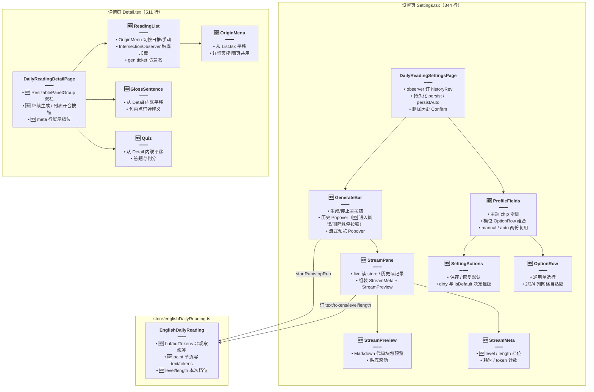

# 每日阅读界面重构

> 文档角色：本篇是「每日阅读」前端专题，覆盖设置页与详情页的组件化拆分、Store 流式渲染节流、详情页双栏阅读列表、生成档位与历史记录回显四块实现。
> 姊妹篇：后端 429 重试与词级补释义见 [每日阅读生成加固](./每日阅读生成加固.md)；SSE 流式协议见 [每日阅读流式生成](./每日阅读流式生成.md)；定时调度见 [每日阅读生成调度](./每日阅读生成调度.md)；页面结构沿革见 [每日阅读前端](./每日阅读前端.md)；随机档位见 [每日阅读随机档位](./每日阅读随机档位.md)；自动整点见 [每日阅读自定义入队时间](./每日阅读自定义入队时间.md)；手动篇删除见 [每日阅读篇目删除](./每日阅读篇目删除.md)。

## 一、要解决什么问题

1. **单文件膨胀失控**：设置页 `Settings.tsx` 一个文件 1130 行，塞着底栏生成条、历史 Popover、流式预览、主题编辑、档位单选、保存按钮组；详情页 `Detail.tsx` 612 行，内联了 Quiz、GlossSentence、正文分段等五个纯函数组件/工具。改动任何一处都要在几百行无关代码里翻找。
2. **流式渲染卡顿**：SSE delta 帧每个 chunk 都直接 `runInAction` 改可观察 `text`，MobX 每帧触发一次组件重渲染，长文流式时主线程被渲染占满。
3. **详情页只能单篇看**：读完一篇想换另一篇要退回列表页再点进来，来回跳转。
4. **历史记录只能看回放**：设置页历史 Popover 里的已完成记录只有「看流式回放 / 删除」，没有「直接读这篇」的入口；也看不到当时用的难度与篇幅档位。

## 二、核心思路

1. **按职责拆组件**：设置页拆出 `GenerateBar`（底栏生成条 + 历史 + 流式预览）、`ProfileFields`（主题 + 档位表单）、`SettingActions`（保存/恢复默认）、`OptionRow`（通用单选行）、`classes.ts`（共享样式常量）；详情页拆出 `Quiz`、`GlossSentence`、`ReadingList`；纯函数下沉到 `utils/`（`body.tsx` / `format.ts` / `origin.ts` / `profile.ts` / `recordTitle.ts`）。拆完 `Settings.tsx` 1130 → 344 行、`Detail.tsx` 612 → 511 行。
2. **渲染节流复用既有方案**：Store 引入 `createStreamingMobxPatchScheduler`（知识库流式性能方案的既有设施）：delta 帧先拼进**非观察**的 `buf`/`bufTokens`，`paint.schedule()` 节流后才在 `runInAction` 里写可观察 `text`/`tokens`；终态帧 `paint.flush()` 保证最后一帧不丢。`makeAutoObservable` 第三个参数把 `buf`/`bufTokens`/`paint` 标成非观察，避免缓冲字段也触发订阅。
3. **详情页双栏**：`ResizablePanelGroup` 横向分栏，左栏挂新组件 `ReadingList`（篇目列表，含来源切换、触底加载），右栏是原文章区。`key` 随 `listOpen` 变化重建分栏，避免关掉再打开时左栏宽度粘在旧值。
4. **档位随数据走**：后端 `listGens` 已回传 `level`/`length`（见姊妹篇），前端 `DailyReadingGen` 类型补这两个字段；Store 在 `startRun` 时记下本次档位；`StreamMeta`（流式面板元信息行）与详情页 meta 行统一展示。

## 三、组件结构（改动后）



## 四、代码对比

### 4.1 Store 渲染节流：onFrame 拆成 takeText + 节流落笔

旧版每个 SSE 帧都在 `runInAction` 里直接改可观察字段，一个 chunk 一次重渲染；新版先把文本拼进非观察缓冲，节流后才落进可观察 `text`。

来源：`apps/frontend/src/store/englishDailyReading.ts` **改动前**（方法 `onFrame`，基线版本，经 `git diff` 还原）。

```ts
	// 旧版一帧一动作：frame 到达即 runInAction 改可观察 text/tokens，高频 delta 帧帧触发渲染。
	private onFrame(frame: ReadingFrame) {
		// 整个帧处理包在一个 action 里。
		runInAction(() => {
			// 记录最大序号，断线重连用 after 补帧。
			if (typeof frame.seq === 'number' && frame.seq > this.seq) {
				this.seq = frame.seq;
			}
			// token 数直接写可观察字段，每个带用量的帧都触发一次订阅。
			if (typeof frame.tokens === 'number') this.tokens = frame.tokens;
			// 暂停帧：只留更长的那份正文，然后收尾。
			if (frame.type === 'reading.paused') {
				const next = frame.text ?? '';
				if (next.length > this.text.length) this.text = next;
				this.paused = true;
				this.finish();
				return;
			}
			// 快照/增量帧：清重试计数后直接改 text。
			if (frame.type === 'reading.snapshot' || frame.type === 'reading.delta') {
				this.failAttempt = 0;
				if (frame.type === 'reading.snapshot') {
					const next = frame.text ?? '';
					if (frame.reset || next.length >= this.text.length) this.text = next;
				} else {
					this.text += frame.text ?? '';
				}
				return;
			}
			// 错误帧：展示消息并收尾。
			if (frame.type === 'reading.error') {
				this.error = frame.message || '生成失败';
				this.finish();
				return;
			}
			// 完成帧：收尾并通知设置页跳详情。
			if (frame.type === 'reading.complete') {
				this.finish();
				this.ready?.();
				return;
			}
			// 停止帧只收尾。
			if (frame.type === 'reading.stopped') this.finish();
		});
	}
```

来源：`apps/frontend/src/store/englishDailyReading.ts` **改动后** 约 L170–L209（方法 `takeText` 与 `onFrame`）。

```ts
	// 文本归并独立成 takeText：只碰非观察缓冲 buf/bufTokens，不触发任何 MobX 订阅，帧率再高也只是字符串拼接。
	private takeText(frame: ReadingFrame) {
		// 记录最大序号，断线重连用 after 补帧。
		if (typeof frame.seq === 'number' && frame.seq > this.seq) {
			this.seq = frame.seq;
		}
		// token 先进缓冲，等节流落笔时才进可观察 tokens。
		if (typeof frame.tokens === 'number') this.bufTokens = frame.tokens;
		// 快照与暂停帧都是「全量替换」语义。
		if (frame.type === 'reading.snapshot' || frame.type === 'reading.paused') {
			const next = frame.text ?? '';
			// 暂停帧只留更长的正文；快照帧带 reset 或更长才替换，防止旧快照盖掉新正文。
			const replace =
				frame.type === 'reading.paused'
					? next.length > this.buf.length
					: Boolean(frame.reset) || next.length >= this.buf.length;
			if (replace) this.buf = next;
			return;
		}
		// 增量帧直接拼到缓冲尾部。
		if (frame.type === 'reading.delta') this.buf += frame.text ?? '';
	}

	// 帧入口：先归并文本，再按帧类型决定节流落笔还是立即落笔收尾。
	private onFrame(frame: ReadingFrame) {
		// 任何帧都先过文本归并，保证 buf 始终是最新全文。
		this.takeText(frame);
		// 快照/增量帧：清重试计数，排一次节流落笔后立刻返回，渲染频率由调度器决定。
		if (frame.type === 'reading.snapshot' || frame.type === 'reading.delta') {
			this.failAttempt = 0;
			this.paint.schedule();
			return;
		}
		// 非四类终态帧（如 usage）到这里直接忽略，不停留。
		if (
			frame.type !== 'reading.paused' &&
			frame.type !== 'reading.error' &&
			frame.type !== 'reading.complete' &&
			frame.type !== 'reading.stopped'
		) {
			return;
		}
		// 终态帧必须 flush：把缓冲里最后一截正文立刻写进可观察字段，界面不留尾巴。
		this.paint.flush();
		// 暂停帧要立起 paused 标志，底栏据此显示「已暂停」。
		if (frame.type === 'reading.paused') this.paused = true;
		// 错误帧把消息放上错误条。
		if (frame.type === 'reading.error') {
			this.error = frame.message || '生成失败';
		}
		// 四类终态统一收尾：算耗时、清计时器、推历史刷新。
		this.finish();
		// 完成帧额外通知设置页跳详情。
		if (frame.type === 'reading.complete') this.ready?.();
	}
```

**变更摘要**：`onFrame` 里直接改可观察字段的逻辑拆成「`takeText` 只写缓冲 + `paint.schedule()` 节流落笔」；四类终态（paused/error/complete/stopped）先 `paint.flush()` 再收尾，保证最后一帧正文不丢。

### 4.2 Store 构造器与缓冲字段（前后对比）

来源：`apps/frontend/src/store/englishDailyReading.ts` **改动前**（字段声明与构造器，基线版本，经 `git diff` 还原）。

```ts
	// 旧版没有缓冲字段与档位字段，全部字段都可观察。
	generating = false;
	text = '';
	seq = 0;
	error: string | null = null;
	paused = false;
	startedAt: number | null = null;
	elapsed = 0;
	tokens = 0;
	historyRev = 0;
	// ...（gen/activeId/failAttempt/userStop/timer/reader/ready 等私有字段未改动，对称省略）

	constructor() {
		// 全字段可观察：高频写入的 text 每次变更都通知订阅组件。
		makeAutoObservable(this);
	}
```

来源：`apps/frontend/src/store/englishDailyReading.ts` **改动后** 约 L18–L57（字段声明与构造器）。

```ts
	generating = false;
	text = '';
	seq = 0;
	error: string | null = null;
	paused = false;
	startedAt: number | null = null;
	elapsed = 0;
	tokens = 0;
	historyRev = 0;
	// 本次生成的档位：startRun 时从提交的 profile 记下，StreamMeta 展示用。
	level: EnglishDailyReadingProfile['level'] | null = null;
	length: EnglishDailyReadingProfile['length'] | null = null;
	/** 本帧已拼好的原文。界面只看 text，不订这个字段。 */
	// 非观察缓冲：delta 帧先进这里，节流后才写可观察 text。
	private buf = '';
	// token 缓冲，与 buf 同节奏落笔。
	private bufTokens = 0;
	// 节流调度器：构造器里创建，! 断言是因为 makeAutoObservable 之后才赋值。
	private paint!: ReturnType<typeof createStreamingMobxPatchScheduler>;
	// ...（gen/activeId/failAttempt/userStop/timer/reader/ready 等私有字段未改动，对称省略）

	constructor() {
		// 第三个参数把缓冲与调度器标成非观察：它们的高频变化不触发订阅组件重渲染。
		makeAutoObservable<
			EnglishDailyReading,
			'buf' | 'bufTokens' | 'paint'
		>(this, {
			buf: false,
			bufTokens: false,
			paint: false,
		});
		// 调度器回调：真正落笔时把缓冲一次性写进可观察字段，包一个 runInAction 满足 MobX 严格模式。
		this.paint = createStreamingMobxPatchScheduler(() => {
			runInAction(() => {
				this.text = this.buf;
				this.tokens = this.bufTokens;
			});
		});
	}
```

**变更摘要**：新增可观察档位字段 `level`/`length` 与非观察缓冲 `buf`/`bufTokens`/`paint`；构造器创建节流调度器。`startRun`/`stopRun` 同步补了 `paint.cancel()`/`paint.flush()` 与缓冲清零、`level = profile.level` 等三行赋值（diff 逐行可见，正文从略）。

### 4.3 类型与 i18n

`DailyReadingGen` 补档位字段，与后端 `listGens` 返回对齐。

来源：`apps/frontend/src/service/index.ts` **改动前** 约 L2107 附近（类型 `DailyReadingGen`）。

```ts
// 生成历史一条记录：改动前没有档位信息。
export type DailyReadingGen = {
	id: string;
	text: string;
	tokens: number;
	elapsed: number;
	startedAt: number;
	status: 'done' | 'stopped' | 'error' | 'paused';
};
```

来源：`apps/frontend/src/service/index.ts` **改动后** 约 L2107 附近（类型 `DailyReadingGen`）。

```ts
// 生成历史一条记录：新增 level/length，后端读不到 extras 时给 null。
export type DailyReadingGen = {
	id: string;
	text: string;
	tokens: number;
	elapsed: number;
	startedAt: number;
	status: 'done' | 'stopped' | 'error' | 'paused';
	// 本次生成的难度档位；旧历史为 null，界面不展示。
	level: EnglishDailyReadingProfile['level'] | null;
	// 本次生成的篇幅档位；旧历史为 null，界面不展示。
	length: EnglishDailyReadingProfile['length'] | null;
};
```

i18n 双语各新增 4 键（纯新增，两文件改动对称）：

来源：`apps/frontend/src/i18n/locales/zh-CN/englishLearning.ts` **改动后** 约 L349 与 L367–L369（新增键，摘录）。

```ts
		// 历史记录悬停「进入阅读」按钮的 aria-label。
		'englishLearning.dailyReading.openReading': '进入阅读',
		// 详情页标题行「继续生成」按钮的提示与 aria-label。
		'englishLearning.dailyReading.continueGenerate': '继续生成',
		// 详情页打开左侧篇目列表按钮的提示。
		'englishLearning.dailyReading.listShow': '打开阅读列表',
		// 详情页关闭左侧篇目列表按钮的提示。
		'englishLearning.dailyReading.listHide': '关闭阅读列表',
```

来源：`apps/frontend/src/i18n/locales/en-US/englishLearning.ts` **改动后** 约 L380 与 L401–L403（新增键，摘录）。

```ts
		// 中文键的英文镜像，四键一一对应。
		'englishLearning.dailyReading.openReading': 'Open reading',
		'englishLearning.dailyReading.continueGenerate': 'Continue generating',
		'englishLearning.dailyReading.listShow': 'Open reading list',
		'englishLearning.dailyReading.listHide': 'Hide reading list',
```

### 4.4 List.tsx 抽出 OriginMenu 与 origin 工具

列表页内联的 `ReadingOrigin`/`parseOrigin`/`OriginMenu` 整体平移到 `utils/origin.ts` 与 `components/OriginMenu.tsx`，供列表页与详情页左栏共用。

来源：`apps/frontend/src/views/englishLearning/dailyReading/List.tsx` **改动前** 约 L5–L118（文件头部内联定义，经 `git diff` 还原）。

```tsx
// 下拉菜单组件只在列表页内联使用。
import {
	DropdownMenu,
	DropdownMenuContent,
	DropdownMenuItem,
	DropdownMenuTrigger,
} from '@ui/dropdown-menu';
import { Button, Toast } from '@ui/index';
import { Spinner } from '@ui/spinner';
// 图标全集包含 OriginMenu 用到的五个。
import {
	BookOpen,
	Check,
	Layers,
	Layers2,
	PanelTopClose,
	PanelTopOpen,
	WandSparkles,
} from 'lucide-react';
import { useCallback, useEffect, useMemo, useRef, useState } from 'react';
import { useNavigate, useSearchParams } from 'react-router';
import { HISTORY_PAGE_SIZE } from '@/constants';
import { useI18n } from '@/hooks';
import { cn } from '@/lib/utils';
import {
	type EnglishDailyReadingItem,
	listEnglishDailyReadings,
} from '@/service';
import { LIBRARY_LIST_AT_BOTTOM_THRESHOLD_PX } from '../hooks/useListCornerFab';
import { PracticePageShell } from '../practice/components/shell';

// 来源类型与解析原本只在列表页可用。
type ReadingOrigin = 'day' | 'manual';

function parseOrigin(raw: string | null): ReadingOrigin {
	return raw === 'manual' ? 'manual' : 'day';
}

// 来源切换菜单内联在列表页：约 70 行 JSX，详情页想用只能复制。
function OriginMenu({
	origin,
	onSelect,
}: {
	origin: ReadingOrigin;
	onSelect: (origin: ReadingOrigin) => void;
}) {
	// ...（菜单本体与现 components/OriginMenu.tsx 完全一致，纯平移，见 4.9）
}
```

来源：`apps/frontend/src/views/englishLearning/dailyReading/List.tsx` **改动后** 约 L1–L21（文件头部 import 区）。

```tsx
// 下拉菜单与五个菜单图标随 OriginMenu 一起搬走，import 收窄。
import Loading from '@design/Loading';
import { Button, Toast } from '@ui/index';
import { Spinner } from '@ui/spinner';
import { BookOpen, WandSparkles } from 'lucide-react';
import { useCallback, useEffect, useMemo, useRef, useState } from 'react';
import { useNavigate, useSearchParams } from 'react-router';
import { HISTORY_PAGE_SIZE } from '@/constants';
import { useI18n } from '@/hooks';
import {
	type EnglishDailyReadingItem,
	listEnglishDailyReadings,
} from '@/service';
import { LIBRARY_LIST_AT_BOTTOM_THRESHOLD_PX } from '../hooks/useListCornerFab';
import { PracticePageShell } from '../practice/components/shell';
// 来源菜单从新位置引入，详情页左栏复用同一份。
import { OriginMenu } from './components/OriginMenu';
// 类型与解析函数下沉到 utils/origin.ts。
import { type ReadingOrigin, parseOrigin } from './utils/origin';
```

**变更摘要**：`ReadingOrigin`/`parseOrigin`/`OriginMenu` 纯平移，逻辑零改动；`List.tsx` 只剩列表自身职责。平移目标见 4.9。

### 4.5 Settings.tsx 页脚抽出 GenerateBar

设置页的底栏（错误条 + 生成按钮 + 历史 Popover + 流式预览 Popover）原本约 250 行 JSX 内联在 `footer` prop 里；抽成 `GenerateBar` 后页脚只剩一组 props。

来源：`apps/frontend/src/views/englishLearning/dailyReading/Settings.tsx` **改动前** 约 L843–L905（`PracticePageShell` 的 `footer` prop 起始段，摘录；内联 JSX 全长约 250 行，至历史行删除按钮后对称省略）。

```tsx
			<PracticePageShell
				title={
					<span className="text-textcolor min-w-0 truncate text-base font-semibold">
						{t('englishLearning.dailyReading.settingsHint')}
					</span>
				}
				contentLayout={loading ? 'fill' : 'start'}
				footer={
					!loading && !error ? (
						// 底栏整段内联：流式 Popover、错误条、生成按钮、历史 Popover 全在页脚里展开。
						<Popover
							open={streamOpen && (historyView || showStream)}
							onOpenChange={setStreamOpen}
						>
							<PopoverAnchor asChild>
								<div className="mx-auto flex w-full max-w-5xl flex-col gap-2">
									{generateError ? (
										<div className="flex items-center justify-between gap-2">
											<p
												className="min-w-0 flex-1 truncate text-sm text-rose-500"
												title={generateError}
											>
												{generateError}
											</p>
											<Button
												type="button"
												variant="ghost"
												size="icon-sm"
												className="size-7 -mr-2 shrink-0 bg-transparent p-0 text-textcolor/55 shadow-none hover:bg-transparent hover:text-rose-500"
												aria-label={t(
													'englishLearning.dailyReading.dismissError',
												)}
												onClick={() => englishDailyReadingStore.clearError()}
											>
												<X className="size-4" aria-hidden />
											</Button>
										</div>
									) : null}
									<div className="flex items-center gap-2">
										<Button
											type="button"
											disabled={saving && !generating}
											className={cn(
												'h-10 min-w-0 flex-1 text-base font-semibold',
												PRACTICE_PRIMARY_ACTION_BTN_CLASS,
											)}
											onClick={() => {
												setSelectedId(null);
												setStreamOpen(false);
												if (generating) {
													englishDailyReadingStore.stopRun();
													return;
												}
												englishDailyReadingStore.startRun(themes, profile);
											}}
										>
											{/* 生成中显示转圈与停止文案 */}
											{generating ? (
												<Spinner className="size-4 text-white" />
											) : null}
											{generating
												? t('englishLearning.dailyReading.stopGenerate')
												: t('englishLearning.dailyReading.generate')}
										</Button>
										{/* ...（历史 Popover 与流式预览 Popover 约 180 行，与新 GenerateBar.tsx 中段一致，对称省略） */}
									</div>
								</div>
							</PopoverAnchor>
							{/* ...（流式预览 PopoverContent，对称省略） */}
						</Popover>
					) : undefined
				}
				// ...（headerRight 与 children 未改动，对称省略）
			>
```

来源：`apps/frontend/src/views/englishLearning/dailyReading/Settings.tsx` **改动后** 约 L230–L253（`PracticePageShell` 的 `footer` prop 段，摘录范围与上文对称）。

```tsx
			<PracticePageShell
				title={
					<span className="text-textcolor min-w-0 truncate text-base font-semibold">
						{t('englishLearning.dailyReading.settingsHint')}
					</span>
				}
				contentLayout={loading ? 'fill' : 'start'}
				footer={
					!loading && !error ? (
						// 底栏收口为一个组件：Settings 只传入状态与回调，不再关心 Popover 结构。
						<GenerateBar
							saving={saving}
							themes={themes}
							profile={profile}
							records={records}
							streamOpen={streamOpen}
							setStreamOpen={setStreamOpen}
							historyOpen={historyOpen}
							setHistoryOpen={setHistoryOpen}
							selectedId={selectedId}
							setSelectedId={setSelectedId}
							setDeleteId={setDeleteId}
						/>
					) : undefined
				}
				// ...（headerRight 与 children 未改动，对称省略）
			>
```

**变更摘要**：`footer` prop 从约 250 行内联 JSX 缩为一次 `<GenerateBar>` 调用；`Settings.tsx` 保留「数据加载、持久化、删除确认」三类职责，底栏交互全部移交。同步地，内联的 `StreamMeta`/`StreamPreview`/`firstJsonObject`/`recordTitle`/`formatElapsed`/`nextFocus`/`sameThemes`/`sameProfile`/`OptionRow`/`SettingActions`/`ProfileFields`/`LABEL`/`OPT_ON`/`OPT_OFF`/`OPT_BTN` 全部移出本文件（平移目标见 4.7–4.10 与 4.13–4.15）。

### 4.6 GenerateBar 底栏组件（纯新增）

底栏只订生成状态，进行中的历史行不扫全文；历史行悬停新增「进入阅读 / 删除」操作。

来源：`apps/frontend/src/views/englishLearning/dailyReading/components/GenerateBar.tsx` **改动后** 全文（组件 `GenerateBar`）。

```tsx
import {
	Button,
	Popover,
	PopoverAnchor,
	PopoverContent,
	PopoverTrigger,
	ScrollArea,
} from '@ui/index';
import { Spinner } from '@ui/spinner';
// BookOpen 是「进入阅读」图标，Trash2 是删除图标。
import { BookOpen, History, ScrollText, Trash2, X } from 'lucide-react';
import { observer } from 'mobx-react';
import { useNavigate } from 'react-router';
import { useI18n } from '@/hooks';
import { cn } from '@/lib/utils';
import type { DailyReadingGen, EnglishDailyReadingProfile } from '@/service';
import englishDailyReadingStore from '@/store/englishDailyReading';
import { PRACTICE_PRIMARY_ACTION_BTN_CLASS } from '../../practice/constants';
import { OPT_OFF, OPT_ON } from './classes';
import { recordTitle } from '../utils/recordTitle';
import { StreamPane } from './StreamPane';

/** 底栏只订生成状态。进行中的历史行不扫全文。 */
// observer 只订阅 generating/paused/error/runId 四个可观察字段，历史记录由父组件 props 传入。
export const GenerateBar = observer(function GenerateBar({
	saving,
	themes,
	profile,
	records,
	streamOpen,
	setStreamOpen,
	historyOpen,
	setHistoryOpen,
	selectedId,
	setSelectedId,
	setDeleteId,
}: {
	saving: boolean;
	themes: string[];
	profile: EnglishDailyReadingProfile;
	records: DailyReadingGen[];
	streamOpen: boolean;
	setStreamOpen: (open: boolean) => void;
	historyOpen: boolean;
	setHistoryOpen: (open: boolean) => void;
	selectedId: string | null;
	setSelectedId: (id: string | null) => void;
	setDeleteId: (id: string | null) => void;
}) {
	const { t } = useI18n();
	// 「进入阅读」需要路由跳转。
	const navigate = useNavigate();
	// 订阅四个可观察字段：生成中、已暂停、错误、当前 runId。
	const generating = englishDailyReadingStore.generating;
	const paused = englishDailyReadingStore.paused;
	const generateError = englishDailyReadingStore.error;
	const runId = englishDailyReadingStore.runId;
	// 有在跑的流，或暂停后留有正文时，底栏显示「查看流」按钮。
	const showStream =
		generating || (paused && englishDailyReadingStore.text.length > 0);
	// 选中的历史记录；查看历史回放时流式 Popover 展示这条而不是实时流。
	const selected = records.find((row) => row.id === selectedId) ?? null;
	// 选中项存在、且不是正在生成的这条时，按「历史回放」模式展示。
	const historyView = Boolean(
		selected && (!generating || selected.id !== runId),
	);
	// 有历史记录或正在生成时才显示历史入口。
	const showHistory = records.length > 0 || generating;
	// 正在生成的这条在历史列表最顶部合成一条 live 行，不等落库。
	const liveRow =
		generating && runId
			? {
					id: runId,
					startedAt: englishDailyReadingStore.startedAt ?? Date.now(),
					live: true as const,
				}
			: null;
	// 历史行 = live 行 + 已落库记录（去掉与 live 同 id 的那条，避免重复）。
	const historyRows = [
		...(liveRow ? [liveRow] : []),
		...records
			.filter((row) => row.id !== liveRow?.id)
			.map((row) => ({
				id: row.id,
				text: row.text,
				startedAt: row.startedAt,
				status: row.status,
				live: false as const,
			})),
	];
	return (
		<Popover
			open={streamOpen && (historyView || showStream)}
			onOpenChange={setStreamOpen}
		>
			<PopoverAnchor asChild>
				<div className="mx-auto flex w-full max-w-5xl flex-col gap-2">
					{generateError ? (
						<div className="flex items-center justify-between gap-2">
							<p
								className="min-w-0 flex-1 truncate text-sm text-rose-500"
								title={generateError}
							>
								{generateError}
							</p>
							<Button
								type="button"
								variant="ghost"
								size="icon-sm"
								className="size-7 -mr-2 shrink-0 bg-transparent p-0 text-textcolor/55 shadow-none hover:bg-transparent hover:text-rose-500"
								aria-label={t('englishLearning.dailyReading.dismissError')}
								onClick={() => englishDailyReadingStore.clearError()}
							>
								<X className="size-4" aria-hidden />
							</Button>
						</div>
					) : null}
					<div className="flex items-center gap-2">
						<Button
							type="button"
							disabled={saving && !generating}
							className={cn(
								'h-10 min-w-0 flex-1 text-base font-semibold',
								PRACTICE_PRIMARY_ACTION_BTN_CLASS,
							)}
							onClick={() => {
								setSelectedId(null);
								setStreamOpen(false);
								if (generating) {
									englishDailyReadingStore.stopRun();
									return;
								}
								englishDailyReadingStore.startRun(themes, profile);
							}}
						>
							{generating ? <Spinner className="size-4 text-white" /> : null}
							{generating
								? t('englishLearning.dailyReading.stopGenerate')
								: t('englishLearning.dailyReading.generate')}
						</Button>
						{showHistory ? (
							<Popover open={historyOpen} onOpenChange={setHistoryOpen}>
								<PopoverTrigger asChild>
									<Button
										type="button"
										variant="ghost"
										size="icon"
										aria-expanded={historyOpen}
										aria-label={t('englishLearning.dailyReading.history')}
										className={cn(
											'size-10 shrink-0 border',
											historyOpen ? OPT_ON : OPT_OFF,
										)}
									>
										<History className="size-4" aria-hidden />
									</Button>
								</PopoverTrigger>
								<PopoverContent
									side="top"
									align="end"
									sideOffset={8}
									className="w-72 overflow-hidden p-0"
								>
									<ScrollArea
										className="w-full"
										style={{
											height: Math.min(336, historyRows.length * 56),
										}}
									>
										{historyRows.map((row) => (
											<div
												key={row.id}
												className="group relative flex h-14 items-center hover:bg-teal-500/10"
											>
												<Button
													type="button"
													variant="ghost"
													className={cn(
														'h-14 min-w-0 flex-1 justify-start rounded-none bg-transparent px-3 hover:bg-transparent',
														row.live && 'pr-8',
													)}
													onClick={() => {
														setSelectedId(row.id);
														setStreamOpen(true);
														setHistoryOpen(false);
													}}
												>
													<span className="flex min-w-0 flex-1 flex-col items-start gap-1">
														<span
															className={cn(
																'w-full truncate text-left text-sm',
																row.live
																	? ''
																	: row.status === 'done'
																		? 'group-hover:pr-14'
																		: 'group-hover:pr-8',
															)}
														>
															{row.live
																? t(
																		'englishLearning.dailyReading.generatingManual',
																	)
																: recordTitle(row.text, row.startedAt)}
														</span>
														<span className="w-full truncate text-left text-xs text-textcolor/45">
															{new Date(row.startedAt).toLocaleString()}
														</span>
													</span>
												</Button>
												{row.live ? (
													<Spinner className="mr-2 size-4 shrink-0 text-textcolor" />
												) : (
													// 非 live 行悬停时浮出操作组：done 行多一个「进入阅读」，其余只有删除。
													<div className="absolute top-2 right-2 flex items-center gap-0.5 opacity-0 pointer-events-none transition-opacity duration-150 group-hover:pointer-events-auto group-hover:opacity-100">
														{row.status === 'done' ? (
															<Button
																type="button"
																variant="ghost"
																size="sm"
																className="h-7 w-7 shrink-0 rounded-md p-0 text-textcolor/65 transition-colors hover:border hover:border-teal-500/20 hover:bg-teal-500/10 hover:text-teal-500"
																aria-label={t(
																	'englishLearning.dailyReading.openReading',
																)}
																onClick={(event) => {
																	// 阻止冒泡：点图标不再触发行点击（打开回放）。
																	event.stopPropagation();
																	// 跳详情页并带 origin=manual，详情页左栏据此默认看手动列表。
																	navigate(
																		`/english-learning/daily-reading/${row.id}?origin=manual`,
																	);
																}}
															>
																<BookOpen className="size-3.5" aria-hidden />
															</Button>
														) : null}
														<Button
															type="button"
															variant="ghost"
															size="sm"
															className="h-7 w-7 shrink-0 rounded-md p-0 text-textcolor/65 transition-colors hover:border hover:border-destructive/10 hover:bg-destructive/10 hover:text-destructive"
															aria-label={t(
																'englishLearning.dailyReading.deleteHistory',
															)}
															onClick={(event) => {
																// 同样阻止冒泡，删除确认由 Settings 页的 Confirm 承接。
																event.stopPropagation();
																setDeleteId(row.id);
															}}
														>
															<Trash2 className="size-3.5" aria-hidden />
														</Button>
													</div>
												)}
											</div>
										))}
									</ScrollArea>
								</PopoverContent>
							</Popover>
						) : null}
						{showStream ? (
							<PopoverTrigger asChild>
								<Button
									type="button"
									variant="ghost"
									size="icon"
									aria-expanded={streamOpen && !historyView}
									aria-label={t('englishLearning.dailyReading.showStream')}
									className={cn(
										'size-10 shrink-0 border',
										streamOpen && !historyView ? OPT_ON : OPT_OFF,
									)}
									onClick={(event) => {
										setSelectedId(null);
										if (historyView) {
											// 历史回放开着时点「查看流」：阻止 Popover 默认开合，手动切回实时流。
											event.preventDefault();
											setStreamOpen(true);
										}
									}}
								>
									<ScrollText className="size-4" aria-hidden />
								</Button>
							</PopoverTrigger>
						) : null}
					</div>
				</div>
			</PopoverAnchor>
			<PopoverContent
				side="top"
				align="start"
				sideOffset={8}
				className="w-(--radix-popover-trigger-width) overflow-hidden p-0"
			>
				<StreamPane history={historyView && selected ? selected : null} />
			</PopoverContent>
		</Popover>
	);
});
```

**变更摘要**：相对旧内联版有三处实质变化——① 历史行高 40→56px，改为「标题 + 时间」两行（`recordTitle` + `toLocaleString`）；② 非 live 行新增悬停操作组（done 行「进入阅读」+ 所有行「删除」，浮出层用 `group-hover` 控制显隐与 `pointer-events`）；③ 行容器从 `pr-1.5` 固定按钮位改为 `group relative` 绝对定位操作组。其余结构与旧内联版一致。

### 4.7 设置表单字段区拆出 classes / OptionRow / SettingActions

`Settings.tsx` 内联的样式常量与三个表单组件（`OptionRow` 泛型单选行、`SettingActions` 操作按钮组、`ProfileFields` 档位字段区）原样平移到 `dailyReading/components/`，逻辑零改动，属于纯移动（豁免成对对比，贴改动后全文并注明来源行号）。

**改动后**：`apps/frontend/src/views/englishLearning/dailyReading/components/classes.ts`（全文，内容平移自改动前 `Settings.tsx` 约 L55–L59 的三个模块级常量）

```ts
// 小节标题的统一样式：设置页所有字段区共用，集中到 classes.ts 后多个组件复用同一份。
export const LABEL = 'text-textcolor text-sm font-semibold';
// 选中态选项样式：teal 描边与浅底色，hover 保持选中态颜色防止闪烁。
export const OPT_ON =
	'border-teal-500/40 bg-teal-500/15 text-textcolor hover:border-teal-500/40 hover:bg-teal-500/15';
// 未选中态选项样式：主题色浅底，hover 时给出 teal 提示表示可点。
export const OPT_OFF =
	'border-theme/10 bg-theme/5 text-textcolor hover:border-teal-500/35 hover:bg-teal-500/10';
```

**改动后**：`apps/frontend/src/views/englishLearning/dailyReading/components/OptionRow.tsx`（全文，组件平移自改动前 `Settings.tsx` 约 L264–L329 的内联 `OptionRow`）

```tsx
// RadioGroup 提供可访问的单选语义（键盘方向键切换），视觉上当按钮组用。
import { RadioGroup, RadioGroupItem } from '@ui/index';
// trailing 插槽的类型：允许调用方在选项行右侧追加任意节点（设置页用来放保存按钮组）。
import type { ReactNode } from 'react';
// 条件拼接 className 的工具。
import { cn } from '@/lib/utils';
// 平移后改为从 classes.ts 引常量，避免与 ProfileFields 各存一份。
import { LABEL, OPT_OFF, OPT_ON } from './classes';

// 泛型单选行：T 约束为 string，调用方传入字面量联合类型即可获得类型安全的 onChange。
export function OptionRow<T extends string>({
	// RadioGroup 的 name 前缀，用来拼每个选项的 id（label htmlFor 关联）。
	name,
	// 字段区标题文本。
	label,
	// 当前选中值。
	value,
	// 可选项列表。
	options,
	// 选中变化回调。
	onChange,
	// 右侧追加插槽（可选）。
	trailing,
}: {
	name: string;
	label: string;
	value: T;
	options: { value: T; label: string }[];
	onChange: (value: T) => void;
	trailing?: ReactNode;
}) {
	// 先组装单选组 JSX：trailing 存在与否只影响外层布局，不影响单选组本身，故抽成变量复用。
	const radios = (
		<RadioGroup
			value={value}
			// RadioGroup 回调给出 string，收窄回调入的泛型 T。
			onValueChange={(next) => onChange(next as T)}
			className={cn(
				'grid gap-4',
				// 按选项个数决定列数：4 选项一行四个、2 选项一行两个，其余（3 个）一行三个，保持按钮等宽。
				options.length === 4
					? 'grid-cols-4'
					: options.length === 2
						? 'grid-cols-2'
						: 'grid-cols-3',
			)}
		>
			{options.map((opt) => {
				// 每个选项的 DOM id：name 前缀保证同页多个 OptionRow 不撞 id。
				const id = `${name}-${opt.value}`;
				// 是否当前选中项，决定套 OPT_ON 还是 OPT_OFF。
				const active = value === opt.value;
				return (
					// 用 label 包整个按钮区域：点击文字任意处都触发选择，命中区域比单选圈大得多。
					<label
						key={opt.value}
						htmlFor={id}
						className={cn(
							'flex h-10 cursor-pointer items-center justify-center rounded-md border text-base font-semibold transition-colors',
							active ? OPT_ON : OPT_OFF,
						)}
					>
						{/* 原生单选圈视觉隐藏（sr-only），样式全由外层 label 承担，但保留可访问性。 */}
						<RadioGroupItem value={opt.value} id={id} className="sr-only" />
						{opt.label}
					</label>
				);
			})}
		</RadioGroup>
	);
	return (
		<section className="flex min-w-0 flex-col gap-3">
			{trailing ? (
				// 有右侧插槽时：标题 + 单选组占左侧弹性区，trailing 与之等高对齐（设置页 useWeb 行的保存按钮）。
				<div className="flex min-w-0 items-stretch gap-4">
					<div className="flex min-w-0 flex-1 flex-col gap-3">
						<h2 className={LABEL}>{label}</h2>
						{radios}
					</div>
					{trailing}
				</div>
			) : (
				// 无插槽时就是普通的「标题在上、选项在下」纵排。
				<>
					<h2 className={LABEL}>{label}</h2>
					{radios}
				</>
			)}
		</section>
	);
}
```

**改动后**：`apps/frontend/src/views/englishLearning/dailyReading/components/SettingActions.tsx`（全文，组件平移自改动前 `Settings.tsx` 约 L570–L621 的内联 `SettingActions`；`OPT_BTN` 常量平移自同文件约 L60–L63）

```tsx
import { Button } from '@ui/index';
import { useI18n } from '@/hooks';
import { cn } from '@/lib/utils';
// 主按钮配色复用练习页的统一主操作样式，保持全站 CTA 一致；平移后路径层级变浅，改为 ../../。
import { PRACTICE_PRIMARY_ACTION_BTN_CLASS } from '../../practice/constants';
// 平移后从 classes.ts 引共享样式常量。
import { LABEL, OPT_OFF } from './classes';

// 保存按钮样式：基础交互（整宽、圆角、禁用态）与练习页主操作配色拼接。
const OPT_BTN = cn(
	'flex h-10 w-full cursor-pointer items-center justify-center rounded-md text-base font-semibold disabled:cursor-not-allowed',
	PRACTICE_PRIMARY_ACTION_BTN_CLASS,
);

// 操作按钮组：仅当「有改动」或「当前非默认档位」时才出现，避免恒显一对无效按钮。
export function SettingActions({
	// 表单是否有未保存改动（决定「保存」显隐）。
	dirty,
	// 当前档位是否等于默认档位（决定「恢复默认」显隐）。
	isDefault,
	// 生成中禁用两个按钮，防止保存与生成并发。
	disabled,
	// 保存回调。
	onSave,
	// 恢复默认回调。
	onReset,
}: {
	dirty: boolean;
	isDefault: boolean;
	disabled: boolean;
	onSave: () => void;
	onReset: () => void;
}) {
	const { t } = useI18n();
	// 既无改动又已是默认档位：两个按钮都无事可做，整个区域不渲染。
	if (!dirty && isDefault) return null;
	return (
		<div className="flex min-w-0 flex-1 flex-col gap-3">
			<h2 className={LABEL}>{t('englishLearning.dailyReading.actions')}</h2>
			<div
				className={cn(
					'grid gap-4',
					// 两按钮同时存在时等宽两列，只剩一个时单列占满，不留半格空白。
					dirty && !isDefault ? 'grid-cols-2' : 'grid-cols-1',
				)}
			>
				{!isDefault ? (
					// 非默认档位才提供「恢复默认」，默认档位下该操作无意义。
					<Button
						type="button"
						variant="ghost"
						disabled={disabled}
						className={cn(
							'h-10 w-full border text-base font-semibold',
							OPT_OFF,
						)}
						onClick={onReset}
					>
						{t('englishLearning.dailyReading.themeReset')}
					</Button>
				) : null}
				{dirty ? (
					// 有改动才出现「保存」；用原生 button 套 OPT_BTN，与练习页主按钮视觉完全一致。
					<button
						type="button"
						disabled={disabled}
						className={OPT_BTN}
						onClick={onSave}
					>
						{t('englishLearning.dailyReading.save')}
					</button>
				) : null}
			</div>
		</div>
	);
}
```

**变更摘要**：三个组件与 `OPT_BTN` 常量均为逐字平移（`OPT_BTN` 从 `Settings.tsx` 模块级移到 `SettingActions.tsx` 内聚）；唯一差异是 import 路径随目录层级调整（`../practice/constants` → `../../practice/constants`）与共享样式改从 `./classes` 引入。

### 4.8 ProfileFields 字段区组件（纯移动）

`ProfileFields` 从 `Settings.tsx` 内联（改动前约 L331–L543）平移到独立文件，签名与实现逐字一致；`CHIP` 常量（改动前 `Settings.tsx` 约 L260）随之平移到组件旁。平移后 `Settings.tsx` 只保留「数据装配 + 调用」，字段区实现细节全部内聚到组件文件。

**改动后**：`apps/frontend/src/views/englishLearning/dailyReading/components/ProfileFields.tsx`（全文，组件平移自改动前 `Settings.tsx` 约 L331–L543，`CHIP` 平移自约 L260）

```tsx
import { Button, Input, Toast } from '@ui/index';
// 主题 chip 右上角的删除小圆钮图标。
import { X } from 'lucide-react';
// actions 插槽类型。
import type { ReactNode } from 'react';
import { useI18n } from '@/hooks';
import { cn } from '@/lib/utils';
import type { EnglishDailyReadingProfile } from '@/service';
// 侧重点三键互斥翻转逻辑抽到 utils/profile，平移后改为从 utils 引入。
import { nextFocus } from '../utils/profile';
// 共享样式常量。
import { LABEL, OPT_OFF, OPT_ON } from './classes';
// 复用泛型单选行。
import { OptionRow } from './OptionRow';

// 主题 chip 样式：relative 是为了让删除小圆钮能绝对定位到 chip 右上角外侧。
const CHIP =
	'relative inline-flex h-8 items-center rounded-md border border-theme/10 bg-theme/5 px-3 text-base font-semibold text-textcolor';

// 档位字段区：主题增删 + level/length/focus/questions/useWeb 五行配置。
export function ProfileFields({
	// RadioGroup name 前缀：设置页与自动生成弹层可能同时渲染本组件，调用方给不同前缀防 id 冲突。
	idPrefix,
	// 主题列表与其 setter（受控）。
	themes,
	setThemes,
	// 新主题输入框草稿与其 setter。
	draft,
	setDraft,
	// 档位对象与其 setter。
	profile,
	setProfile,
	// 生成中整体禁用。
	disabled,
	// 追加在 useWeb 行右侧的插槽（设置页传 SettingActions）。
	actions,
}: {
	idPrefix: string;
	themes: string[];
	setThemes: (next: string[]) => void;
	draft: string;
	setDraft: (next: string) => void;
	profile: EnglishDailyReadingProfile;
	setProfile: (next: EnglishDailyReadingProfile) => void;
	disabled: boolean;
	actions?: ReactNode;
}) {
	const { t } = useI18n();
	// 添加主题：收敛空白、校验长度与尖括号、去重，全部在前端先做掉，避免脏数据进档位。
	const addTheme = () => {
		// 连续空白折成单个空格，防止「a  b」与「a b」被当成两个主题。
		const label = draft.trim().replace(/\s+/g, ' ');
		if (!label) return;
		// 超 16 字或含尖括号（防注入到提示词模板）视为非法。
		if (label.length > 16 || /[<>]/.test(label)) {
			Toast({
				type: 'warning',
				title: t('englishLearning.dailyReading.themeInvalid'),
			});
			return;
		}
		// 先清空草稿再判重：重复添加时输入框也应复位，符合「提交即清空」直觉。
		setDraft('');
		if (themes.includes(label)) return;
		setThemes([...themes, label]);
	};
	return (
		<>
			<section className="flex min-w-0 flex-col gap-3">
				<h2 className={LABEL}>{t('englishLearning.dailyReading.themes')}</h2>
				<div className="border-theme/10 bg-theme/5 flex flex-col gap-3 rounded-md border p-3">
					<div className="flex flex-wrap gap-3">
						{themes.map((theme) => (
							<span key={theme} className={CHIP}>
								{theme}
								<Button
									type="button"
									variant="ghost"
									size="icon-sm"
									disabled={disabled}
									aria-label={`${t('englishLearning.dailyReading.themeRemove')} ${theme}`}
									className="absolute -top-2 -right-2 size-5 rounded-full border border-theme/10 bg-[color-mix(in_oklch,var(--theme-color)_5%,color-mix(in_oklch,var(--theme-color)_5%,var(--theme-background)))] p-0 text-textcolor/55 hover:border-teal-500 hover:bg-teal-600 hover:text-white"
									onClick={() => {
										// 至少保留一个主题：后端按主题轮换出题，空列表会让生成器无题可用。
										if (themes.length <= 1) {
											Toast({
												type: 'warning',
												title: t('englishLearning.dailyReading.themeInvalid'),
											});
											return;
										}
										setThemes(themes.filter((item) => item !== theme));
									}}
								>
									<X className="size-3" aria-hidden />
								</Button>
							</span>
						))}
					</div>
					<div className="border-theme/10 focus-within:border-teal-500/40 flex h-10 items-center overflow-hidden rounded-md border">
						<Input
							value={draft}
							// 与 addTheme 的长度校验一致，输入层就截断。
							maxLength={16}
							disabled={disabled}
							placeholder={t('englishLearning.dailyReading.themePlaceholder')}
							className="h-10 min-w-0 flex-1 border-0 bg-transparent shadow-none focus-visible:border-transparent focus-visible:ring-0"
							onChange={(e) => setDraft(e.target.value)}
							onKeyDown={(e) => {
								// 回车等同点「添加」，省去鼠标移动。
								if (e.key === 'Enter') {
									e.preventDefault();
									addTheme();
								}
							}}
						/>
						<Button
							type="button"
							variant="ghost"
							// 空草稿禁点，防止添加空主题。
							disabled={disabled || !draft.trim()}
							className="text-textcolor/70 hover:text-textcolor h-10 w-20 shrink-0 rounded-none border-l border-theme/10 px-4 font-normal hover:bg-teal-500/10"
							onClick={addTheme}
						>
							{t('englishLearning.dailyReading.themeAdd')}
						</Button>
					</div>
				</div>
			</section>
			<div className="grid grid-cols-2 gap-4">
				{/* 难度等级：固定 CEFR 四档，label 即值本身。 */}
				<OptionRow
					name={`${idPrefix}-level`}
					label={t('englishLearning.dailyReading.level')}
					value={profile.level}
					options={(['A2', 'B1', 'B2', 'C1'] as const).map((value) => ({
						value,
						label: value,
					}))}
					onChange={(level) => setProfile({ ...profile, level })}
				/>
				{/* 篇幅档位：三档，label 走 i18n。 */}
				<OptionRow
					name={`${idPrefix}-length`}
					label={t('englishLearning.dailyReading.length')}
					value={profile.length}
					options={[
						{
							value: 'short',
							label: t('englishLearning.dailyReading.lengthShort'),
						},
						{
							value: 'medium',
							label: t('englishLearning.dailyReading.lengthMedium'),
						},
						{
							value: 'long',
							label: t('englishLearning.dailyReading.lengthLong'),
						},
					]}
					onChange={(length) => setProfile({ ...profile, length })}
				/>
			</div>
			<div className="grid grid-cols-2 gap-4">
				<section className="flex min-w-0 flex-col gap-3">
					<h2 className={LABEL}>{t('englishLearning.dailyReading.focus')}</h2>
					<div className="grid grid-cols-3 gap-4">
						{(
							[
								['reading', 'englishLearning.dailyReading.focusReading'],
								['vocab', 'englishLearning.dailyReading.focusVocab'],
								['grammar', 'englishLearning.dailyReading.focusGrammar'],
							] as const
						).map(([key, labelKey]) => {
							// 高亮规则：reading 是「两者都不要」的兜档位；vocab/grammar 在 both 时同时高亮。
							const on =
								key === 'reading'
									? profile.focus === 'reading'
									: key === 'vocab'
										? profile.focus === 'vocab' || profile.focus === 'both'
										: profile.focus === 'grammar' || profile.focus === 'both';
							return (
								<Button
									key={key}
									type="button"
									variant="ghost"
									aria-pressed={on}
									className={cn(
										'h-10 w-full border text-base font-semibold',
										on ? OPT_ON : OPT_OFF,
									)}
									// vocab/grammar 可叠加成 both、也可双灭回 reading，翻转逻辑在 nextFocus。
									onClick={() =>
										setProfile({
											...profile,
											focus: nextFocus(profile.focus, key),
										})
									}
								>
									{t(labelKey)}
								</Button>
							);
						})}
					</div>
				</section>
				{/* 理解题数量：0/2/3 三档，profile 存 number、OptionRow 用 string，进出各转一次。 */}
				<OptionRow
					name={`${idPrefix}-questions`}
					label={t('englishLearning.dailyReading.questions')}
					value={String(profile.questions) as '0' | '2' | '3'}
					options={[
						{
							value: '0',
							label: t('englishLearning.dailyReading.questions0'),
						},
						{
							value: '2',
							label: t('englishLearning.dailyReading.questions2'),
						},
						{
							value: '3',
							label: t('englishLearning.dailyReading.questions3'),
						},
					]}
					onChange={(value) =>
						setProfile({
							...profile,
							questions: Number(value) as 0 | 2 | 3,
						})
					}
				/>
			</div>
			{/* 联网开关：trailing 挂操作按钮组，让「保存」与最后一行字段同排，少占一屏高度。 */}
			<OptionRow
				name={`${idPrefix}-useWeb`}
				label={t('englishLearning.dailyReading.useWeb')}
				value={profile.useWeb ? 'on' : 'off'}
				options={[
					{
						value: 'on',
						label: t('englishLearning.dailyReading.useWebOn'),
					},
					{
						value: 'off',
						label: t('englishLearning.dailyReading.useWebOff'),
					},
				]}
				onChange={(value) => setProfile({ ...profile, useWeb: value === 'on' })}
				trailing={actions}
			/>
		</>
	);
}
```

**变更摘要**：逐字平移，无逻辑差异；`nextFocus` 改从 `../utils/profile` 引入（见 §4.12），样式常量改从 `./classes` 引入。

### 4.9 Detail.tsx：双栏布局与标题行按钮组

详情页的改动是实质重构：① 内联的 `Quiz` / `GlossSentence` 与四个正文工具函数全部拆出（见 §4.10、§4.13）；② 正文区外层套 `ResizablePanelGroup`，左侧可开合 `ReadingList`；③ 标题行从「标题内联播放钮」改为「标题 + 右侧按钮组（播放 / 继续生成 / 列表开合）」；④ 正文容器随 `listOpen` 切换内边距。

**改动前**：`apps/frontend/src/views/englishLearning/dailyReading/Detail.tsx` 约 L4–L35（import 区）

```tsx
/**
 * 每日阅读详情：英文在上，中文在下，只朗读英文。
 */
import Loading from '@design/Loading';
// Popover 三件套服务于内联 GlossSentence 的点词弹层。
import {
	Button,
	Popover,
	PopoverContent,
	PopoverTrigger,
	Toast,
} from '@ui/index';
// Square/Volume2 是内联 GlossSentence 的播放/停止图标。
import {
	CircleChevronDown,
	CircleChevronRight,
	Square,
	Volume2,
} from 'lucide-react';
import { useCallback, useEffect, useRef, useState } from 'react';
// 旧版无跳转需求，只读路由参数。
import { useParams, useSearchParams } from 'react-router';
import { useI18n } from '@/hooks';
import { cn } from '@/lib/utils';
import {
	// EnglishDailyReadingExtras 仅被内联 Quiz 的 props 类型引用。
	type EnglishDailyReadingExtras,
	type EnglishDailyReadingItem,
	getEnglishDailyReading,
} from '@/service';
import { playPreferred, stopAllPlayback } from '@/utils/speech';
import { Card } from '../components/vocab/Card';
import { DailyPlayIconButton } from '../daily/components/DailyPlayIconButton';
// 内联 Quiz 的选项样式常量。
import { QUIZ_OPTION_CLASS } from '../daily/constants';
// 内联 Quiz 的提交按钮样式常量。
import { PRACTICE_PRIMARY_ACTION_BTN_CLASS } from '../practice/constants';
import { ttsCacheScopeDailyReading } from '../utils/ttsCacheFolder';
```

**改动后**：`apps/frontend/src/views/englishLearning/dailyReading/Detail.tsx` 约 L4–L38（import 区）

```tsx
/**
 * 每日阅读详情：英文在上，中文在下，只朗读英文。
 */
import Loading from '@design/Loading';
// 新增：两个标题行按钮的悬停提示。
import Tooltip from '@design/Tooltip';
// Popover/Square/Volume2 随 GlossSentence 拆出而移除。
import { Button, Toast } from '@ui/index';
import {
	CircleChevronDown,
	CircleChevronRight,
	// 新增：列表开合按钮图标（关/开两态）。
	PanelLeftClose,
	PanelLeftOpen,
	// 新增：「继续生成」按钮图标。
	WandSparkles,
} from 'lucide-react';
import { useCallback, useEffect, useRef, useState } from 'react';
// 新增 useNavigate：「继续生成」跳设置页、列表点击跳详情。
import { useNavigate, useParams, useSearchParams } from 'react-router';
// 新增：双栏可拖拽分栏组件。
import {
	ResizableHandle,
	ResizablePanel,
	ResizablePanelGroup,
} from '@/components/ui/resizable';
import { useI18n } from '@/hooks';
import { cn } from '@/lib/utils';
import {
	// Extras 类型随 Quiz 拆出而不再需要。
	type EnglishDailyReadingItem,
	getEnglishDailyReading,
} from '@/service';
import { playPreferred, stopAllPlayback } from '@/utils/speech';
import { Card } from '../components/vocab/Card';
import { DailyPlayIconButton } from '../daily/components/DailyPlayIconButton';
// QUIZ_OPTION_CLASS / PRACTICE_PRIMARY_ACTION_BTN_CLASS 随 Quiz 拆出而移除。
import { ttsCacheScopeDailyReading } from '../utils/ttsCacheFolder';
// 新增：拆出的句内点词组件。
import { GlossSentence } from './components/GlossSentence';
// 新增：拆出的理解题组件。
import { Quiz } from './components/Quiz';
// 新增：左栏阅读列表组件。
import { ReadingList } from './components/ReadingList';
// 新增：正文工具函数改从 utils/body 引入（原先内联在本文件）。
import { glossParagraphs, paragraphs, renderText, sourceList } from './utils/body';
// 新增：来源类型与解析（原先内联在 List.tsx）。
import { type ReadingOrigin, parseOrigin } from './utils/origin';
```

**变更摘要**：import 随拆分「出四个、进七个」；新增 `Tooltip`、`useNavigate`、`resizable` 三处实质依赖。

**改动前**：`apps/frontend/src/views/englishLearning/dailyReading/Detail.tsx` 约 L291–L301（组件声明与 state 区）

```tsx
export default function DailyReadingDetailPage() {
	const { t } = useI18n();
	const { id } = useParams<{ id: string }>();
	const [searchParams, setSearchParams] = useSearchParams();
	// 当前阅读记录。
	const [row, setRow] = useState<EnglishDailyReadingItem | null>(null);
	const [loading, setLoading] = useState(true);
	// 整篇朗读状态。
	const [playing, setPlaying] = useState(false);
	// 正在播放的单词（用于高亮对应按钮）。
	const [wordKey, setWordKey] = useState<string | null>(null);
	// 中文译文展开态。
	const [showZh, setShowZh] = useState(false);
	// 当前打开的点词弹层 key。
	const [glossKey, setGlossKey] = useState<string | null>(null);
	// 正文滚动容器：点词弹层打开时监听滚动即关闭。
	const scrollerRef = useRef<HTMLDivElement>(null);
	// ...（openGloss、数据加载、togglePlay、playWord 等未改动，对称省略）
}
```

**改动后**：`apps/frontend/src/views/englishLearning/dailyReading/Detail.tsx` 约 L40–L56（组件声明与 state 区）

```tsx
export default function DailyReadingDetailPage() {
	const { t } = useI18n();
	// 新增：按钮组与列表点击的跳转入口。
	const navigate = useNavigate();
	const { id } = useParams<{ id: string }>();
	const [searchParams, setSearchParams] = useSearchParams();
	const [row, setRow] = useState<EnglishDailyReadingItem | null>(null);
	const [loading, setLoading] = useState(true);
	const [playing, setPlaying] = useState(false);
	const [wordKey, setWordKey] = useState<string | null>(null);
	const [showZh, setShowZh] = useState(false);
	const [glossKey, setGlossKey] = useState<string | null>(null);
	// 新增：左栏列表开合态，默认关（保持旧版单栏阅读体验为默认）。
	const [listOpen, setListOpen] = useState(false);
	// 新增：当前列表来源（今日/手动），初值取自 URL query，保证从设置页带 origin 进入时列表直接对位。
	const [origin, setOrigin] = useState<ReadingOrigin>(() =>
		parseOrigin(searchParams.get('origin')),
	);
	// 新增：标记 origin 是否已被 URL 或用户确定过；记录加载回来发现是 manual 时才允许回填一次，避免覆盖用户手动切换。
	const originSeeded = useRef(searchParams.get('origin') != null);
	const scrollerRef = useRef<HTMLDivElement>(null);
	// ...（openGloss、数据加载、togglePlay、playWord 等未改动，对称省略）
}
```

**变更摘要**：新增 `navigate`、`listOpen`、`origin`、`originSeeded` 四个状态；既有 state 逐项保留。

以下两个回调与 origin 回填 effect 为纯新增：

**改动后**：`apps/frontend/src/views/englishLearning/dailyReading/Detail.tsx` 约 L112–L167（`origin` 回填 effect 与 `onOrigin` / `onOpenReading`，纯新增）

```tsx
	// 记录加载完成后：URL 没带 origin 且记录本身是手动生成时，把列表来源回填为 manual，让打开列表时落在正确的组。
	useEffect(() => {
		if (originSeeded.current || row?.origin !== 'manual') return;
		originSeeded.current = true;
		setOrigin('manual');
	}, [row?.origin]);

	// ...（滚动复位、标题回写 URL、togglePlay 等未改动，省略）

	// 列表里切换来源：标记已确定（阻止后续回填覆盖用户选择），再更新 state。
	const onOrigin = useCallback((next: ReadingOrigin) => {
		originSeeded.current = true;
		setOrigin(next);
	}, []);

	// 列表点击打开另一篇：保持当前 origin 上下文拼 query，manual 组的记录跳转后列表仍停在 manual。
	const onOpenReading = useCallback(
		(item: EnglishDailyReadingItem) => {
			// title 写入 query 供窗口标题使用（与既有行为一致）。
			const params = new URLSearchParams({ title: item.titleEn });
			if (origin === 'manual') params.set('origin', 'manual');
			navigate(`/english-learning/daily-reading/${item.id}?${params}`);
		},
		[navigate, origin],
	);
```

**改动前**：`apps/frontend/src/views/englishLearning/dailyReading/Detail.tsx` 约 L416–L465（return 布局：外层容器、标题行、meta 行；对称摘录，下文「译文/来源/词汇/语法/测验」段未改动故省略）

```tsx
	return (
		<div className="flex h-full min-h-0 w-full flex-col">
			<div className="box-border flex h-full min-h-0 w-full min-w-0 flex-col p-5.5 pt-0">
				<div className="flex min-h-0 min-w-0 flex-1 flex-col overflow-hidden rounded-md bg-theme-background">
					{/* 旧版：单栏滚动容器，固定 p-6 内边距。 */}
					<div ref={scrollerRef} className="min-h-0 flex-1 overflow-auto p-6">
						{loading ? <Loading /> : null}
						{!loading && !row ? (
							<p className="text-sm text-textcolor/60">
								{error || t('englishLearning.dailyReading.notFound')}
							</p>
						) : null}
						{row ? (
							<article className="mx-auto flex max-w-2xl flex-col gap-6">
								<div className="flex flex-col gap-2">
									{/* 旧版标题行：播放钮内联在标题末尾，长标题会把按钮挤到换行处。 */}
									<h1 className="text-xl font-semibold leading-snug">
										{row.titleEn}
										{row.bodyEn ? (
											<span className="ml-1 mb-1 inline-flex align-middle">
												<DailyPlayIconButton
													playing={playing}
													playLabel={
														playing
															? t('englishLearning.tts.stop')
															: t('englishLearning.dailyReading.play')
													}
													onPlay={() => void togglePlay()}
												/>
											</span>
										) : null}
									</h1>
									{/* 旧版 meta 行：日期 + 来源 + 等级 + 篇幅（等级/篇幅字段见《每日阅读生成加固》§4.12）。 */}
									<p className="text-sm text-textcolor/80">
										{row.publishDate}
										{' · '}
										{t(
											row.origin === 'manual'
												? 'englishLearning.dailyReading.manual'
												: 'englishLearning.dailyReading.originDay',
										)}
										{row.extras ? ` · ${row.extras.level}` : ''}
										{row.extras?.length
											? ` · ${t(
													row.extras.length === 'short'
														? 'englishLearning.dailyReading.lengthShort'
														: row.extras.length === 'long'
															? 'englishLearning.dailyReading.lengthLong'
															: 'englishLearning.dailyReading.lengthMedium',
												)}`
											: ''}
									</p>
								</div>
								{/* 正文渲染分支：无释义时整段原文直出，URL 不断行（见 §4.10 的连带问题）。 */}
								{row.extras?.wordGloss?.length
									? glossParagraphs(row.bodyEn, row.extras.wordGloss).map(
											(block, blockIndex) => (
												<p key={blockIndex} className="text-lg leading-7">
													{block.map((sentence, index) => (
														<span key={`${blockIndex}-${index}`}>
															{index > 0 ? ' ' : null}
															{sentence.words ? (
																<GlossSentence
																	en={sentence.en}
																	words={sentence.words}
																	sentenceIndex={blockIndex * 100 + index}
																	openKey={glossKey}
																	onOpen={openGloss}
																	playingWord={wordKey}
																	onPlay={(word) => void playWord(word)}
																	playLabel={t(
																		'englishLearning.vocab.playWord',
																	)}
																	stopLabel={t('englishLearning.tts.stop')}
																/>
															) : (
																// 无释义的句子原样输出字符串。
																sentence.en
															)}
														</span>
													))}
												</p>
											),
										)
									: paragraphs(row.bodyEn).map((part, index) => (
											<p key={index} className="text-lg leading-7">
												{part}
											</p>
										))}
								{/* ...（译文展开、来源、词汇卡、语法、Quiz 段未改动，对称省略） */}
							</article>
						) : null}
					</div>
				</div>
			</div>
		</div>
	);
}
```

**改动后**：`apps/frontend/src/views/englishLearning/dailyReading/Detail.tsx` 约 L195–L511（return 布局；对称摘录，省略段与改动前一致）

```tsx
	return (
		<div className="flex h-full min-h-0 w-full flex-col">
			<div className="box-border flex h-full min-h-0 w-full min-w-0 flex-col p-5.5 pt-0">
				<div className="flex min-h-0 min-w-0 flex-1 flex-col overflow-hidden rounded-md bg-theme-background">
				{/*
				 * key 随 listOpen 重建分栏，避免关上再打开时左栏宽度粘住。
				 */}
				<ResizablePanelGroup
					// 开合用不同 key：强制 react-resizable-panels 卸载重建，丢掉记忆住的拖拽宽度，重新吃 defaultLayout。
					key={listOpen ? 'daily-reading-with-list' : 'daily-reading-article'}
					// id 同样随开合切换，避免 autoSaveId 式的外部缓存把旧宽度带回来。
					id={listOpen ? 'daily-reading-split' : 'daily-reading-only'}
					orientation="horizontal"
					className="min-h-0 min-w-0 flex-1"
					// 打开时左 28% 右 72%，关闭时右栏 100%。
					defaultLayout={
						listOpen
							? {
									'daily-reading-list': 28,
									'daily-reading-article': 72,
								}
							: { 'daily-reading-article': 100 }
					}
				>
					{listOpen ? (
						<>
							<ResizablePanel
								id="daily-reading-list"
								defaultSize="28%"
								// 最小 18% 防止列表被拖没，最大 42% 防止挤压正文阅读宽度。
								minSize="18%"
								maxSize="42%"
								className="min-h-0 min-w-0"
							>
								<ReadingList
									currentId={id ?? ''}
									origin={origin}
									onOrigin={onOrigin}
									onOpen={onOpenReading}
								/>
							</ResizablePanel>
							{/* 拖把自身零宽，只留命中区，视觉上不割裂两栏。 */}
							<ResizableHandle withHandle className="w-0" />
						</>
					) : null}
					<ResizablePanel
						id="daily-reading-article"
						defaultSize={listOpen ? '72%' : '100%'}
						className="min-h-0 min-w-0"
					>
				{/* 栏态切换时容器内边距跟着变：开栏态用紧凑的 px-4/pt-2.5，关栏态滚动区自己带 p-6。 */}
				<div
					className={cn(
						'flex h-full min-h-0 min-w-0 flex-col overflow-hidden bg-theme-background',
						listOpen && 'px-4 pt-2.5 pb-4',
					)}
				>
					<div
						ref={scrollerRef}
						className={cn(
							'min-h-0 flex-1 overflow-auto',
							!listOpen && 'p-6',
						)}
					>
						{loading ? <Loading /> : null}
						{!loading && !row ? (
							<p className="text-sm text-textcolor/60">
								{error || t('englishLearning.dailyReading.notFound')}
							</p>
						) : null}
						{row ? (
							<article className="mx-auto flex max-w-2xl flex-col gap-6">
								<div className="flex flex-col gap-2">
									{/* 新标题行：标题弹性占宽可截断，按钮组收缩在右侧，互不挤压。 */}
									<div className="flex items-center justify-between gap-3">
										<h1 className="min-w-0 flex-1 text-xl font-semibold leading-snug">
											{row.titleEn}
										</h1>
										<div className="flex shrink-0 items-center">
											{row.bodyEn ? (
												<DailyPlayIconButton
													playing={playing}
													playLabel={
														playing
															? t('englishLearning.tts.stop')
															: t('englishLearning.dailyReading.play')
													}
													onPlay={() => void togglePlay()}
												/>
											) : null}
											{/* 继续生成：跳设置页手动生成入口；blur 防止焦点残留触发空格回车误触。 */}
											<Tooltip
												side="top"
												content={t(
													'englishLearning.dailyReading.continueGenerate',
												)}
											>
												<Button
													type="button"
													variant="link"
													size="sm"
													tabIndex={-1}
													aria-label={t(
														'englishLearning.dailyReading.continueGenerate',
													)}
													className="h-8 w-8 shrink-0 cursor-pointer rounded-md border-0 p-0 text-teal-500 shadow-none transition-colors hover:text-teal-400 focus-visible:border-transparent focus-visible:ring-0 focus-visible:shadow-none"
													onClick={(event) => {
														navigate(
															'/english-learning/daily-reading/settings',
														);
														event.currentTarget.blur();
													}}
												>
													<WandSparkles className="size-4" aria-hidden />
												</Button>
											</Tooltip>
											{/* 列表开合：图标随状态切换，文案走 i18n。 */}
											<Tooltip
												side="top"
												content={t(
													listOpen
														? 'englishLearning.dailyReading.listHide'
														: 'englishLearning.dailyReading.listShow',
												)}
											>
												<Button
													type="button"
													variant="link"
													size="sm"
													tabIndex={-1}
													aria-pressed={listOpen}
													aria-label={t(
														listOpen
															? 'englishLearning.dailyReading.listHide'
															: 'englishLearning.dailyReading.listShow',
													)}
													className="h-8 w-8 shrink-0 cursor-pointer rounded-md border-0 p-0 text-teal-500 shadow-none transition-colors hover:text-teal-400 focus-visible:border-transparent focus-visible:ring-0 focus-visible:shadow-none"
													onClick={(event) => {
														setListOpen((open) => !open);
														event.currentTarget.blur();
													}}
												>
													{listOpen ? (
														<PanelLeftClose className="size-4" aria-hidden />
													) : (
														<PanelLeftOpen className="size-4" aria-hidden />
													)}
												</Button>
											</Tooltip>
										</div>
									</div>
									{/* meta 行容器从 p 改 div + span：日期用 text-base 略微强调，与新增按钮组视觉重心对齐；文案拼接逻辑未变。 */}
									<div className="flex items-center text-sm text-textcolor/80">
										<span className="-mb-0.5 text-base">{row.publishDate}</span>
										<span>
											{' · '}
											{t(
												row.origin === 'manual'
													? 'englishLearning.dailyReading.manual'
													: 'englishLearning.dailyReading.originDay',
											)}
											{row.extras ? ` · ${row.extras.level}` : ''}
											{row.extras?.length
												? ` · ${t(
														row.extras.length === 'short'
															? 'englishLearning.dailyReading.lengthShort'
															: row.extras.length === 'long'
																? 'englishLearning.dailyReading.lengthLong'
																: 'englishLearning.dailyReading.lengthMedium',
													)}`
												: ''}
										</span>
									</div>
								</div>
								{/* 正文段落加 text-justify 两端对齐；无释义句改走 renderText 让 URL 可断行（配合 §4.10/§4.13）。 */}
								{row.extras?.wordGloss?.length
									? glossParagraphs(row.bodyEn, row.extras.wordGloss).map(
											(block, blockIndex) => (
												<p
													key={blockIndex}
													className="text-justify text-lg leading-7"
												>
													{block.map((sentence, index) => (
														<span key={`${blockIndex}-${index}`}>
															{index > 0 ? ' ' : null}
															{sentence.words ? (
																<GlossSentence
																	en={sentence.en}
																	words={sentence.words}
																	sentenceIndex={blockIndex * 100 + index}
																	openKey={glossKey}
																	onOpen={openGloss}
																	playingWord={wordKey}
																	onPlay={(word) => void playWord(word)}
																	playLabel={t(
																		'englishLearning.vocab.playWord',
																	)}
																	stopLabel={t('englishLearning.tts.stop')}
																/>
															) : (
																// 无释义句也走 renderText：URL 包 break-all，两端对齐下不再拉开词距。
																renderText(sentence.en)
															)}
														</span>
													))}
												</p>
											),
										)
									: paragraphs(row.bodyEn).map((part, index) => (
											<p key={index} className="text-justify text-lg leading-7">
												{renderText(part)}
											</p>
										))}
								{/* ...（译文展开、来源、词汇卡、语法、Quiz 段未改动，对称省略） */}
							</article>
						) : null}
					</div>
				</div>
					</ResizablePanel>
				</ResizablePanelGroup>
				</div>
			</div>
		</div>
	);
}
```

**变更摘要**：① 滚动容器外层套 `ResizablePanelGroup`，`listOpen` 时左栏挂 `ReadingList`（28%/72%，18%–42% 可拖）；② `key`/`id` 随开合切换强制重建分栏，解决「关上再打开左栏宽度粘住」；③ 标题行改为「标题 + 右侧按钮组」，新增「继续生成」「列表开合」两钮；④ 正文 `text-justify` + `renderText` 处理 URL 断行；⑤ meta 行容器改 `div`，文案逻辑未变。

### 4.10 Quiz 与 GlossSentence 拆出（GlossSentence 含实质修复）

`Quiz` 从 `Detail.tsx` 内联（改动前约 L37–L122）逐字平移，仅 import 路径随层级调整（`../daily/constants` → `../../daily/constants`），并带上 `SECTION` 常量（改动前 Detail 约 L34 的模块级常量随组件内聚到文件内）。

**改动后**：`apps/frontend/src/views/englishLearning/dailyReading/components/Quiz.tsx`（全文，组件平移自改动前 `Detail.tsx` 约 L37–L122）

```tsx
import { Button } from '@ui/index';
import { useState } from 'react';
import { useI18n } from '@/hooks';
import { cn } from '@/lib/utils';
import type { EnglishDailyReadingExtras } from '@/service';
// 选项基础样式复用每日练习的常量，保证两处测验视觉一致；平移后路径多一级。
import { QUIZ_OPTION_CLASS } from '../../daily/constants';
// 提交按钮复用练习页主操作样式。
import { PRACTICE_PRIMARY_ACTION_BTN_CLASS } from '../../practice/constants';

// 小节标题样式：原 Detail 模块级常量，内聚到本文件。
const SECTION = 'text-textcolor text-sm font-semibold';

// 理解题：全部作答后才能提交；提交后锁定选项并标对错色。
export function Quiz({
	items,
}: {
	items: NonNullable<EnglishDailyReadingExtras['questions']>;
}) {
	const { t } = useI18n();
	// 每题已选下标：题号 → 选项号。
	const [picked, setPicked] = useState<Record<number, number>>({});
	// 提交态：提交后选项禁点并显示对错。
	const [submitted, setSubmitted] = useState(false);
	// 全部题目都有选择才允许提交，避免漏答。
	const ready = items.every((_, index) => picked[index] != null);
	return (
		<section className="flex flex-col gap-3">
			<h2 className={SECTION}>{t('englishLearning.dailyReading.quiz')}</h2>
			{items.map((item, index) => {
				const chosen = picked[index];
				const correct = chosen === item.answer;
				return (
					<div key={index} className="flex flex-col gap-2">
						<p className="text-textcolor text-base leading-7">
							{submitted ? (
								// 提交后在题目前缀标「答对/答错」，用色即语义。
								<span
									className={cn(
										'mr-2',
										correct ? 'text-teal-500' : 'text-rose-500',
									)}
								>
									{correct
										? t('englishLearning.dailyReading.quizRight')
										: t('englishLearning.dailyReading.quizWrong')}
								</span>
							) : null}
							{item.q}
						</p>
						{item.options.map((opt, optIndex) => {
							const on = chosen === optIndex;
							const right = optIndex === item.answer;
							return (
								<Button
									key={optIndex}
									type="button"
									variant="ghost"
									aria-pressed={on}
									className={cn(
										QUIZ_OPTION_CLASS,
										// 提交后整组禁点（保留颜色展示结果）。
										submitted && 'pointer-events-none',
										// 未提交：选中项给 teal 高亮。
										!submitted &&
											on &&
											'border-teal-500/40 bg-teal-500/15 hover:bg-teal-500/15',
										// 提交后：正确项恒 teal。
										submitted &&
											right &&
											'border-teal-500/40 bg-teal-500/15 hover:bg-teal-500/15',
										// 提交后：选中的错误项标 rose，与正确项形成对照。
										submitted &&
											on &&
											!right &&
											'border-rose-500/35 bg-rose-500/10 text-rose-500 hover:bg-rose-500/10',
									)}
									onClick={() =>
										setPicked((prev) => {
											// 再点已选项即取消选择：删掉该题 key 而不是置同值。
											if (prev[index] === optIndex) {
												const next = { ...prev };
												delete next[index];
												return next;
											}
											return { ...prev, [index]: optIndex };
										})
									}
								>
									{opt}
								</Button>
							);
						})}
					</div>
				);
			})}
			{submitted ? null : (
				<Button
					type="button"
					disabled={!ready}
					className={cn('h-10 w-full', PRACTICE_PRIMARY_ACTION_BTN_CLASS)}
					onClick={() => setSubmitted(true)}
				>
					{t('englishLearning.dailyReading.quizSubmit')}
				</Button>
			)}
		</section>
	);
}
```

`GlossSentence` 不是纯移动：拆出的同时修了一个真实排版缺陷——正文开启 `text-justify` 后，句中 URL 不可断行会把整行词距拉得极宽，故新增「URL token 直接包 `break-all` 输出、不参与点词对位」分支。前后对比如下：

**改动前**：`apps/frontend/src/views/englishLearning/dailyReading/Detail.tsx` 约 L124–L221（内联 `GlossSentence` 完整定义）

```tsx
function GlossSentence({
	en,
	words,
	sentenceIndex,
	openKey,
	onOpen,
	playingWord,
	onPlay,
	playLabel,
	stopLabel,
}: {
	en: string;
	words: { w: string; zh: string }[];
	sentenceIndex: number;
	openKey: string | null;
	onOpen: (key: string | null, from?: string) => void;
	playingWord: string | null;
	onPlay: (word: string) => void;
	playLabel: string;
	stopLabel: string;
}) {
	// 按空白切词但保留空白 token：渲染时原样拼回，不丢空格。
	const tokens = en.split(/(\s+)/);
	// 当前对位到 words 数组的第几个释义：只有确认匹配的 token 才推进。
	let at = 0;
	return (
		<span>
			{tokens.map((token, index) => {
				// 空白 token 原样输出。
				if (!token.trim()) return <span key={index}>{token}</span>;
				// 剥掉首尾非字母字符（标点）得到裸词，用于和释义 w 对位。
				const bare = token.replace(/^[^A-Za-z']+|[^A-Za-z']+$/g, '');
				const gloss = words[at];
				// 裸词为空、释义用尽或对不上：原样输出，不消耗释义下标——模型给的词序与句序不一致时宁缺毋错。
				if (!bare || !gloss || bare.toLowerCase() !== gloss.w.toLowerCase()) {
					return <span key={index}>{token}</span>;
				}
				// 对位成功才推进释义下标并挂弹层。
				at += 1;
				const key = `${sentenceIndex}-${at}`;
				const open = openKey === key;
				const playing = playingWord === gloss.w;
				return (
					<Popover
						key={index}
						open={open}
						// from 参数传当前 key：父组件据此防止「关 A 的弹层时把刚开的 B 也关掉」。
						onOpenChange={(next) => onOpen(next ? key : null, key)}
					>
						<PopoverTrigger asChild>
							<button
								type="button"
								className={cn(
									'cursor-pointer bg-transparent p-0 text-inherit hover:text-teal-400',
									open && 'text-teal-500',
								)}
							>
								{token}
							</button>
						</PopoverTrigger>
						<PopoverContent
							side="top"
							align="center"
							sideOffset={8}
							className="w-auto max-w-64 px-3 py-2.5"
							// 阻止开/关时焦点被拉进弹层：阅读中点词不应打断键盘滚动位置。
							onOpenAutoFocus={(event) => event.preventDefault()}
							onCloseAutoFocus={(event) => event.preventDefault()}
						>
							<div className="flex flex-col gap-1">
								<div className="flex items-center gap-1.5">
									<span className="text-textcolor text-base font-semibold leading-none">
										{gloss.w}
									</span>
									<Button
										type="button"
										variant="ghost"
										size="sm"
										className={cn(
											'size-6 shrink-0 rounded-md p-0 shadow-none',
											'focus-visible:border-transparent focus-visible:ring-0',
											playing
												? 'text-teal-500'
												: 'text-textcolor/55 hover:text-teal-400',
										)}
										aria-label={playing ? stopLabel : playLabel}
										onClick={() => onPlay(gloss.w)}
									>
										{playing ? (
											<Square className="size-3.5 fill-current" aria-hidden />
										) : (
											<Volume2 className="size-3.5" aria-hidden />
										)}
									</Button>
								</div>
								<span className="text-textcolor/70 text-sm leading-5">
									{gloss.zh}
								</span>
							</div>
						</PopoverContent>
					</Popover>
				);
			})}
		</span>
	);
}
```

**改动后**：`apps/frontend/src/views/englishLearning/dailyReading/components/GlossSentence.tsx`（全文）

```tsx
// Popover 三件套随组件内聚到本文件。
import { Button, Popover, PopoverContent, PopoverTrigger } from '@ui/index';
import { Square, Volume2 } from 'lucide-react';
import { cn } from '@/lib/utils';

export function GlossSentence({
	en,
	words,
	sentenceIndex,
	openKey,
	onOpen,
	playingWord,
	onPlay,
	playLabel,
	stopLabel,
}: {
	en: string;
	words: { w: string; zh: string }[];
	sentenceIndex: number;
	openKey: string | null;
	onOpen: (key: string | null, from?: string) => void;
	playingWord: string | null;
	onPlay: (word: string) => void;
	playLabel: string;
	stopLabel: string;
}) {
	const tokens = en.split(/(\s+)/);
	let at = 0;
	return (
		<span>
			{tokens.map((token, index) => {
				if (!token.trim()) return <span key={index}>{token}</span>;
				// 新增：URL token 不参与点词对位，直接包 break-all 输出——两端对齐下不可断行的长链接会把整行词距拉开。
				if (/https?:\/\//i.test(token)) {
					return (
						<span key={index} className="break-all">
							{token}
						</span>
					);
				}
				const bare = token.replace(/^[^A-Za-z']+|[^A-Za-z']+$/g, '');
				const gloss = words[at];
				if (!bare || !gloss || bare.toLowerCase() !== gloss.w.toLowerCase()) {
					return <span key={index}>{token}</span>;
				}
				at += 1;
				const key = `${sentenceIndex}-${at}`;
				const open = openKey === key;
				const playing = playingWord === gloss.w;
				return (
					<Popover
						key={index}
						open={open}
						onOpenChange={(next) => onOpen(next ? key : null, key)}
					>
						<PopoverTrigger asChild>
							<button
								type="button"
								className={cn(
									'cursor-pointer bg-transparent p-0 text-inherit hover:text-teal-400',
									open && 'text-teal-500',
								)}
							>
								{token}
							</button>
						</PopoverTrigger>
						<PopoverContent
							side="top"
							align="center"
							sideOffset={8}
							className="w-auto max-w-64 px-3 py-2.5"
							onOpenAutoFocus={(event) => event.preventDefault()}
							onCloseAutoFocus={(event) => event.preventDefault()}
						>
							<div className="flex flex-col gap-1">
								<div className="flex items-center gap-1.5">
									<span className="text-textcolor text-base font-semibold leading-none">
										{gloss.w}
									</span>
									<Button
										type="button"
										variant="ghost"
										size="sm"
										className={cn(
											'size-6 shrink-0 rounded-md p-0 shadow-none',
											'focus-visible:border-transparent focus-visible:ring-0',
											playing
												? 'text-teal-500'
												: 'text-textcolor/55 hover:text-teal-400',
										)}
										aria-label={playing ? stopLabel : playLabel}
										onClick={() => onPlay(gloss.w)}
									>
										{playing ? (
											<Square className="size-3.5 fill-current" aria-hidden />
										) : (
											<Volume2 className="size-3.5" aria-hidden />
										)}
									</Button>
								</div>
								<span className="text-textcolor/70 text-sm leading-5">
									{gloss.zh}
								</span>
							</div>
						</PopoverContent>
					</Popover>
				);
			})}
		</span>
	);
}
```

**变更摘要**：组件平移到独立文件；实质差异只有一处——新增 URL token 的 `break-all` 分支（在剥标点之前拦截，防止 `https://…` 被剥成 `https` 后误对位，同时解决两端对齐的词距拉伸）。

### 4.11 OriginMenu 平移与 ReadingList 新增

`OriginMenu` 从 `List.tsx` 内联平移到 `components/`，供「列表页」与「详情页左栏」两处复用；`ReadingOrigin` 类型与 `parseOrigin` 一并下沉到 `utils/origin.ts`（见 §4.13）。逻辑零改动，贴改动后全文：

**改动后**：`apps/frontend/src/views/englishLearning/dailyReading/components/OriginMenu.tsx`（全文，菜单 JSX 与状态逻辑平移自改动前 `List.tsx` 约 L34–L111 的内联实现）

```tsx
import {
	DropdownMenu,
	DropdownMenuContent,
	DropdownMenuItem,
	DropdownMenuTrigger,
} from '@ui/dropdown-menu';
import { Button } from '@ui/index';
import {
	Check,
	Layers,
	Layers2,
	PanelTopClose,
	PanelTopOpen,
} from 'lucide-react';
import { useState } from 'react';
import { useI18n } from '@/hooks';
import { cn } from '@/lib/utils';
// 类型改从 utils/origin 引入，与 Detail 页共用一份定义。
import { type ReadingOrigin } from '../utils/origin';

// 来源切换菜单：触发器显示当前来源，菜单项带选中勾。
export function OriginMenu({
	origin,
	onSelect,
}: {
	origin: ReadingOrigin;
	onSelect: (origin: ReadingOrigin) => void;
}) {
	const { t } = useI18n();
	// 菜单开合态：触发器图标随开合切换方向。
	const [open, setOpen] = useState(false);
	// 两个来源项的文案与图标集中成表，渲染时遍历，便于以后加来源。
	const items: {
		id: ReadingOrigin;
		label: string;
		Icon: typeof Layers;
	}[] = [
		{
			id: 'day',
			label: t('englishLearning.dailyReading.day'),
			Icon: Layers,
		},
		{
			id: 'manual',
			label: t('englishLearning.dailyReading.manual'),
			Icon: Layers2,
		},
	];
	// 兜底取第一项：origin 值异常时触发器不至于空白。
	const current = items.find((item) => item.id === origin) ?? items[0]!;
	// 开时箭头朝上（PanelTopClose）、关时朝下，暗示点击后的动作方向。
	const TriggerIcon = open ? PanelTopClose : PanelTopOpen;
	return (
		<DropdownMenu open={open} onOpenChange={setOpen}>
			<DropdownMenuTrigger asChild>
				<Button
					type="button"
					variant="ghost"
					size="sm"
					aria-label={current.label}
					aria-expanded={open}
					className={cn(
						'h-auto gap-1.5 px-0! py-0 text-sm font-medium text-teal-500 shadow-none',
						// 抵消 Button 带图标时的默认左右 padding，让触发器在列表头部右对齐贴边。
						'has-[>svg]:px-0!',
						'hover:bg-transparent hover:text-teal-400',
						'focus-visible:border-transparent focus-visible:ring-0 focus-visible:shadow-none',
						// 打开态不变色不垫背景，避免与下拉内容抢视觉层级。
						'data-[state=open]:bg-transparent data-[state=open]:text-teal-400 data-[state=open]:ring-0',
					)}
				>
					<TriggerIcon className="size-4 shrink-0 opacity-90" aria-hidden />
					<span className="max-w-36 truncate">{current.label}</span>
				</Button>
			</DropdownMenuTrigger>
			<DropdownMenuContent align="end" sideOffset={6} className="min-w-36">
				{items.map((item) => {
					const active = origin === item.id;
					const Icon = item.Icon;
					return (
						<DropdownMenuItem
							key={item.id}
							className="gap-2"
							onSelect={() => onSelect(item.id)}
						>
							<Icon className="size-4 shrink-0 opacity-90" aria-hidden />
							<span className="min-w-0 flex-1 truncate">{item.label}</span>
							{/* 选中勾常驻占位（透明度切换），两栏宽度一致不抖动。 */}
							<Check
								className={cn(
									'size-3.5 shrink-0',
									active ? 'opacity-100' : 'opacity-0',
								)}
								aria-hidden
							/>
						</DropdownMenuItem>
					);
				})}
			</DropdownMenuContent>
		</DropdownMenu>
	);
}
```

`ReadingList` 是纯新增组件：详情页左栏的阅读记录列表，支持触底分页与来源切换。三个并发防护点值得注意——`gen` 票号防「切换来源后旧响应覆盖新列表」、`fetching` 引用防「触底重复触发」、`hasMoreRef/itemsRef` 镜像 ref 供回调读到最新值。

**改动后**：`apps/frontend/src/views/englishLearning/dailyReading/components/ReadingList.tsx`（全文，纯新增）

```tsx
import Loading from '@design/Loading';
import { ScrollArea, Toast } from '@ui/index';
import { useCallback, useEffect, useRef, useState } from 'react';
// 每页条数与其他历史列表保持一致。
import { HISTORY_PAGE_SIZE } from '@/constants';
import { useI18n } from '@/hooks';
import { cn } from '@/lib/utils';
import {
	type EnglishDailyReadingItem,
	listEnglishDailyReadings,
} from '@/service';
import type { ReadingOrigin } from '../utils/origin';
import { OriginMenu } from './OriginMenu';

const PAGE = HISTORY_PAGE_SIZE;

// 详情页左栏的阅读列表：按来源分组展示，触底自动加载下一页。
export function ReadingList({
	// 当前正在读的记录 id：高亮选中态并跳过重复跳转。
	currentId,
	origin,
	onOrigin,
	onOpen,
}: {
	currentId: string;
	origin: ReadingOrigin;
	onOrigin: (next: ReadingOrigin) => void;
	onOpen: (item: EnglishDailyReadingItem) => void;
}) {
	const { t } = useI18n();
	const [items, setItems] = useState<EnglishDailyReadingItem[]>([]);
	// 首屏加载与触底加载拆开两个态：首屏显示整块 Loading，触底只在底部出「加载更多」。
	const [loading, setLoading] = useState(true);
	const [loadingMore, setLoadingMore] = useState(false);
	const [hasMore, setHasMore] = useState(false);
	// 镜像 ref：load 回调（依赖 origin）之外的地方（IntersectionObserver）也能读到最新列表长度与 hasMore。
	const itemsRef = useRef<EnglishDailyReadingItem[]>([]);
	const hasMoreRef = useRef(false);
	// 触底请求在途标记：防止 IntersectionObserver 连续触发重复请求。
	const fetching = useRef(false);
	// 世代票号：每次首屏加载 +1，响应回来时票号不符说明来源已切换，丢弃过期数据。
	const gen = useRef(0);
	// 滚动容器与底部哨兵。
	const scrollerRef = useRef<HTMLDivElement>(null);
	const tailRef = useRef<HTMLDivElement>(null);

	const load = useCallback(
		async (offset: number) => {
			const append = offset > 0;
			if (append) {
				// 触底路径：在途或无更多时直接返回。
				if (fetching.current || !hasMoreRef.current) return;
				fetching.current = true;
				setLoadingMore(true);
			} else {
				// 首屏路径：换代票号，使上一来源的在途响应作废。
				gen.current += 1;
				setLoading(true);
			}
			const ticket = gen.current;
			try {
				const res = await listEnglishDailyReadings({
					limit: PAGE,
					offset,
					origin,
					silent: true,
				});
				// 票号不符：来源已切换，本次响应直接丢弃。
				if (ticket !== gen.current) return;
				const next = Array.isArray(res.data?.items) ? res.data.items : [];
				const total =
					typeof res.data?.totalCount === 'number' ? res.data.totalCount : null;
				const list = append ? [...itemsRef.current, ...next] : next;
				// 无 totalCount 时用「本页满载」近似还有更多；有则精确比较。
				const more = total == null ? next.length >= PAGE : list.length < total;
				itemsRef.current = list;
				hasMoreRef.current = more;
				setItems(list);
				setHasMore(more);
			} catch (e) {
				if (ticket !== gen.current) return;
				const message =
					e instanceof Error
						? e.message
						: t('englishLearning.dailyReading.loadFailed');
				Toast({ type: 'warning', title: message });
			} finally {
				if (append) fetching.current = false;
				// 只有当前世代的请求才复位加载态，避免过期响应把新世代的 loading 提前关掉。
				if (ticket === gen.current) {
					setLoading(false);
					setLoadingMore(false);
				}
			}
		},
		[origin, t],
	);

	// 来源切换（load 引用随之变化）：清空列表从头加载。
	useEffect(() => {
		itemsRef.current = [];
		hasMoreRef.current = false;
		setItems([]);
		setHasMore(false);
		void load(0);
	}, [load]);

	// 触底加载：哨兵进入视口（提前 80px）即取下一页。
	useEffect(() => {
		const node = tailRef.current;
		const root = scrollerRef.current;
		if (!node || !root || !hasMore) return;
		const io = new IntersectionObserver(
			(entries) => {
				if (!entries.some((entry) => entry.isIntersecting)) return;
				// offset 用当前列表长度，配合 itemsRef 读到最新值。
				void load(itemsRef.current.length);
			},
			{ root, rootMargin: '80px' },
		);
		io.observe(node);
		// hasMore/items.length 变化时重建观察：哨兵卸载（hasMore=false）后不再触发。
		return () => io.disconnect();
	}, [hasMore, items.length, load]);

	return (
		<aside className="flex h-full min-h-0 min-w-0 flex-col overflow-hidden border-r border-theme/10 bg-theme-background">
			<div className="flex shrink-0 items-center justify-between gap-2 px-4 pt-4 pb-2">
				{/* 列表标题随来源切换。 */}
				<span className="min-w-0 truncate text-sm font-medium">
					{t(
						origin === 'manual'
							? 'englishLearning.dailyReading.listHeadingManual'
							: 'englishLearning.dailyReading.listHeadingDay',
					)}
				</span>
				<OriginMenu
					origin={origin}
					onSelect={(next) => {
						if (next !== origin) onOrigin(next);
					}}
				/>
			</div>
			<ScrollArea ref={scrollerRef} className="min-h-0 flex-1 pb-4">
				{loading && items.length === 0 ? <Loading /> : null}
				{!loading && items.length === 0 ? (
					<p className="text-textcolor/60 py-8 text-center text-sm">
						{t('englishLearning.dailyReading.empty')}
					</p>
				) : null}
				{items.length > 0 ? (
					<div className="flex flex-col gap-0.5 px-4">
						{items.map((item) => {
							const selected = item.id === currentId;
							return (
								<button
									key={item.id}
									type="button"
									className={cn(
										// 负 margin 拉宽命中区到侧栏边缘，hover 底色显得连续。
										'-mx-2 w-[calc(100%+1rem)] cursor-pointer rounded-md px-2 py-1.5 text-left',
										selected ? 'bg-theme/10' : 'hover:bg-theme/10',
									)}
									onClick={() => {
										// 当前篇不重复跳转。
										if (item.id !== currentId) onOpen(item);
									}}
								>
									<span className="block truncate text-sm font-medium">
										{item.titleEn}
									</span>
									<span className="text-textcolor/50 mt-0.5 block truncate text-xs">
										{item.publishDate}
										{item.titleZh ? ` · ${item.titleZh}` : ''}
									</span>
								</button>
							);
						})}
					</div>
				) : null}
				{/* 底部哨兵：还有更多时才挂载。 */}
				{hasMore ? <div ref={tailRef} className="h-px" aria-hidden /> : null}
				{loadingMore ? (
					<p className="text-textcolor/50 py-2 text-center text-xs">
						{t('common.loadingMore')}
					</p>
				) : null}
			</ScrollArea>
		</aside>
	);
}
```

### 4.12 流式预览三件套：StreamPane / StreamMeta / StreamPreview

设置页的流式预览原来由「内联 `StreamMeta` + 内联 `StreamPreview` + 组件内大量读取 store 的 JSX」组成。拆出后：`StreamPane` 统一负责「实时（读 store）/ 历史（读记录）」二选一的数据装配，`StreamMeta` 与 `StreamPreview` 变成纯渲染组件。

`StreamPane` 为纯新增：

**改动后**：`apps/frontend/src/views/englishLearning/dailyReading/components/StreamPane.tsx`（全文，纯新增）

```tsx
// observer 包到这一层：live 模式直接读 store，让上层不必每个都包 observer。
import { observer } from 'mobx-react';
import type { DailyReadingGen } from '@/service';
import englishDailyReadingStore from '@/store/englishDailyReading';
import { StreamMeta } from './StreamMeta';
import { StreamPreview } from './StreamPreview';

/** 预览自己读正文。父组件传历史记录时不订进行中的 text。 */
export const StreamPane = observer(function StreamPane({
	// null 表示看实时流；传入历史记录则回放该记录。
	history,
}: {
	history: Pick<
		DailyReadingGen,
		'text' | 'elapsed' | 'tokens' | 'level' | 'length'
	> | null;
}) {
	// live 标记：后续每个字段都按它二选一，保证同一次渲染内数据同源。
	const live = history == null;
	// 只有实时流才有「生成中」概念；历史记录一律视为已结束。
	const generating = live && englishDailyReadingStore.generating;
	const text = live ? englishDailyReadingStore.text : history.text;
	// 历史记录没有 startedAt（不再跳动计时），置 null 让 StreamMeta 直接显示记录的 elapsed。
	const startedAt = live ? englishDailyReadingStore.startedAt : null;
	const elapsed = live ? englishDailyReadingStore.elapsed : history.elapsed;
	const tokens = live ? englishDailyReadingStore.tokens : history.tokens;
	// 档位：实时流取 store 里 startRun 记下的本次档位，历史取记录落库的档位。
	const level = live ? englishDailyReadingStore.level : history.level;
	const length = live ? englishDailyReadingStore.length : history.length;
	return (
		<>
			<StreamMeta
				startedAt={startedAt}
				elapsed={elapsed}
				tokens={tokens}
				level={level}
				length={length}
			/>
			{/* 预览区固定高度：Popover 内不随文本增长撑高。 */}
			<div className="flex h-65">
				<StreamPreview text={text} generating={generating} />
			</div>
		</>
	);
});
```

`StreamMeta` 平移之外有实质改动：新增 `level` / `length` 两个 props 与对应显示位。前后对比：

**改动前**：`apps/frontend/src/views/englishLearning/dailyReading/Settings.tsx` 约 L125–L165（内联 `StreamMeta` 完整定义）

```tsx
function StreamMeta({
	startedAt,
	elapsed,
	tokens,
}: {
	startedAt: number | null;
	elapsed: number;
	tokens: number;
}) {
	const { t } = useI18n();
	// now 每秒前进一次，驱动耗时跳动。
	const [now, setNow] = useState(() => Date.now());
	useEffect(() => {
		// 无 startedAt（历史回放）时不启动计时器，直接显示静态 elapsed。
		if (!startedAt) return;
		const id = window.setInterval(() => setNow(Date.now()), 1000);
		return () => window.clearInterval(id);
	}, [startedAt]);
	// 实时流用 now-startedAt 现算，历史记录用落库 elapsed。
	const ms = startedAt ? Math.max(0, now - startedAt) : elapsed;
	return (
		<div className="flex justify-between px-3 pt-2 pb-3 border-b border-theme/10 text-textcolor">
			<div className="text-base">
				{t('englishLearning.dailyReading.titleGenerationInfo')}
			</div>
			<div className="flex gap-4 text-textcolor/65">
				<div className="flex items-center">
					<div className="text-sm">
						{t('englishLearning.dailyReading.elapsed')}：
					</div>
					<div className="mt-0.5 text-sm tabular-nums">{formatElapsed(ms)}</div>
				</div>
				<div className="flex items-center">
					<div className="text-sm">
						{t('englishLearning.dailyReading.tokens')}：
					</div>
					<div className="mt-0.5 text-sm tabular-nums">
						{tokens.toLocaleString()}
					</div>
				</div>
			</div>
		</div>
	);
}
```

**改动后**：`apps/frontend/src/views/englishLearning/dailyReading/components/StreamMeta.tsx`（全文）

```tsx
import { useEffect, useState } from 'react';
import { useI18n } from '@/hooks';
// 时长格式化与篇幅档位文案改从 utils/format 引入（原先内联在 Settings.tsx）。
import { formatElapsed, lengthLabel } from '../utils/format';

export function StreamMeta({
	startedAt,
	elapsed,
	tokens,
	// 新增：难度等级（A2/B1/B2/C1），无值不显示。
	level,
	// 新增：篇幅档位，无值不显示。
	length,
}: {
	startedAt: number | null;
	elapsed: number;
	tokens: number;
	level: string | null;
	length: 'short' | 'medium' | 'long' | null;
}) {
	const { t } = useI18n();
	const [now, setNow] = useState(() => Date.now());
	useEffect(() => {
		if (!startedAt) return;
		const id = window.setInterval(() => setNow(Date.now()), 1000);
		return () => window.clearInterval(id);
	}, [startedAt]);
	const ms = startedAt ? Math.max(0, now - startedAt) : elapsed;
	// 篇幅档位先翻成文案：null 时得空串，下面按空串不渲染。
	const passage = lengthLabel(length, t);
	return (
		// 外层加 gap-4：标题与右侧信息组之间留出最小间距，窄宽度下不贴死。
		<div className="flex justify-between gap-4 px-3 pt-2 pb-3 border-b border-theme/10 text-textcolor">
			{/* 标题包一层 min-w-0：右侧信息多时允许标题区收缩而不挤爆布局。 */}
			<div className="flex min-w-0 items-center gap-4">
				<div className="shrink-0 text-base">
					{t('englishLearning.dailyReading.titleGenerationInfo')}
				</div>
			</div>
			<div className="flex gap-4 text-textcolor/65">
				{/* 新增：有等级才显示等级位。 */}
				{level ? (
					<div className="flex items-center text-sm text-textcolor/65">
						<span>{t('englishLearning.dailyReading.level')}：</span>
						<span>{level}</span>
					</div>
				) : null}
				{/* 新增：有篇幅档位才显示档位位。 */}
				{passage ? (
					<div className="flex items-center text-sm text-textcolor/65">
						<span>{t('englishLearning.dailyReading.length')}：</span>
						<span>{passage}</span>
					</div>
				) : null}
				<div className="flex items-center">
					<div className="text-sm">
						{t('englishLearning.dailyReading.elapsed')}：
					</div>
					<div className="mt-0.5 text-sm tabular-nums">{formatElapsed(ms)}</div>
				</div>
				<div className="flex items-center">
					<div className="text-sm">
						{t('englishLearning.dailyReading.tokens')}：
					</div>
					<div className="mt-0.5 text-sm tabular-nums">
						{tokens.toLocaleString()}
					</div>
				</div>
			</div>
		</div>
	);
}
```

**变更摘要**：新增 `level`/`length` 两个 props 与两个条件显示位；外层容器加 `gap-4`、标题区包 `min-w-0`，为新增信息位腾出收缩余量。

`StreamPreview` 平移时有一处实质修复：`useStickToBottomScroll` 的 `contentRevision` 从整段文本改为文本长度——旧写法每个 token 都把整串文本作为依赖值比较，新写法只比数字，代价与文本量解耦。

**改动前**：`apps/frontend/src/views/englishLearning/dailyReading/Settings.tsx` 约 L167–L244（内联 `StreamPreview`，对称摘录：hook 调用段，其余未改动部分用省略标出）

```tsx
function StreamPreview({
	text,
	generating,
}: {
	text: string;
	generating: boolean;
}) {
	const { t } = useI18n();
	const { theme } = useTheme();
	const rootRef = useRef<HTMLDivElement>(null);
	const { viewportRef, scrollViewportHandlers } = useStickToBottomScroll({
		isStreaming: generating,
		// 内容版本号：旧版直接传整段文本，流式期间每来一个 token 都做一次全串比较。
		contentRevision: text,
		idleFlushKey: generating ? null : 'paused',
	});
	// ...（parser、bindMarkdownCodeFenceActions、markdown 拼接与 JSX 渲染均未改动，对称省略）
}
```

**改动后**：`apps/frontend/src/views/englishLearning/dailyReading/components/StreamPreview.tsx`（全文）

```tsx
// 流式 Markdown 渲染体：与聊天助手消息同一套增量渲染管线。
import { StreamingMarkdownBody } from '@design/ChatAssistantMessage/StreamingMarkdownBody';
// Markdown 解析器与代码块工具条动作绑定。
import {
	bindMarkdownCodeFenceActions,
	MarkdownParser,
} from '@dnhyxc-ai/markdown-kit';
import '@dnhyxc-ai/markdown-kit/styles.css';
import { ScrollArea } from '@ui/index';
import { Spinner } from '@ui/spinner';
import { useEffect, useMemo, useRef } from 'react';
// 代码高亮主题随应用主题切换。
import { getChatMarkdownHighlightTheme } from '@/constants';
import { useI18n } from '@/hooks';
import { useTheme } from '@/hooks/theme';
// 贴底滚动 hook：流式期间自动跟随，用户上翻后暂停跟随。
import { useStickToBottomScroll } from '@/hooks/useStickToBottomScroll';
import { cn } from '@/lib/utils';
import { downloadChatCodeBlock } from '@/utils/chatCodeToolbar';

// 生成预览：把进行中的 JSON 文本包在代码块里实时渲染。
export function StreamPreview({
	text,
	generating,
}: {
	text: string;
	generating: boolean;
}) {
	const { t } = useI18n();
	const { theme } = useTheme();
	const rootRef = useRef<HTMLDivElement>(null);
	const { viewportRef, scrollViewportHandlers } = useStickToBottomScroll({
		isStreaming: generating,
		// 只传长度作为版本号：数字比较，代价与文本量解耦；同长度同帧的极端情况由 idleFlushKey 兜底刷新。
		contentRevision: text.length,
		// 非生成中给一个固定 key，让 hook 在停止后做最后一次对齐。
		idleFlushKey: generating ? null : 'paused',
	});
	// 解析器实例随主题/语言重建，其余渲染期复用。
	const parser = useMemo(
		() =>
			new MarkdownParser({
				enableChatCodeFenceToolbar: true,
				chatCodeFenceToolbarTexts: {
					copy: t('common.copy'),
					download: t('common.download'),
				},
				// 预览里是 JSON 不是文章，关掉 Mermaid 减少解析开销。
				enableMermaid: false,
				highlightTheme: getChatMarkdownHighlightTheme(theme),
			}),
		[theme, t],
	);
	// 绑定代码块工具条的下载动作（复制由工具条默认处理）。
	useEffect(() => {
		const el = rootRef.current;
		if (!el) return;
		return bindMarkdownCodeFenceActions(el, {
			onDownload(payload) {
				void downloadChatCodeBlock(payload.block, payload.lang);
			},
		});
	}, []);
	// 生成中不闭合代码块围栏：增量文本直接续写；结束后补上 ``` 让高亮定型。
	const markdown = text
		? `\`\`\`json\n${text}${generating ? '' : '\n```'}`
		: '';
	return (
		<ScrollArea
			ref={viewportRef}
			className="h-full min-w-0 flex-1"
			// 关掉浏览器原生滚动锚定，跟随逻辑全交给 useStickToBottomScroll。
			viewportClassName="[overflow-anchor:none]"
			scrollbarClassName="right-0 w-1.5 border-l-0 p-0"
			{...scrollViewportHandlers}
		>
			<div
				ref={rootRef}
				data-stick-scroll-content
				className="message-md-wrap p-3 [&_.chat-md-code-block]:my-0"
			>
				{markdown ? (
					<StreamingMarkdownBody
						markdown={markdown}
						parser={parser}
						preferDark={theme === 'black'}
						isStreaming={generating}
						t={t}
						className={cn(
							'min-w-0 w-full max-w-full [&_.streaming-md-body]:min-w-0 [&_.markdown-body]:text-textcolor/90! [&_.markdown-body]:rounded-md',
							// 生成中给底部留间距，避免 Spinner 贴着代码块。
							generating ? 'mb-2.5' : 'mb-0',
						)}
					/>
				) : null}
				{generating ? (
					<div className="flex items-center">
						<Spinner className="mr-2 h-4 w-4 text-textcolor/50" />
						<span className="text-sm text-textcolor/50">
							{t('chat.assistant.generating')}
						</span>
					</div>
				) : null}
			</div>
		</ScrollArea>
	);
}
```

**变更摘要**：除 `contentRevision: text` → `text.length` 外逐字平移；`formatElapsed` 改从 `../utils/format` 引入、`StreamMeta`/`StreamPreview` 的依赖全部随文件内聚。

### 4.13 utils 五件套：origin / format / profile / recordTitle / body

五个工具文件承载所有「被两处以上复用」或「与组件渲染无关」的纯逻辑。`renderText` 与 `lengthLabel` 为纯新增，其余为平移。

**改动后**：`apps/frontend/src/views/englishLearning/dailyReading/utils/origin.ts`（全文；`ReadingOrigin` 与 `parseOrigin` 平移自改动前 `List.tsx` 约 L34–L38）

```ts
// 阅读记录来源：day=每日定时生成，manual=设置页手动生成。
export type ReadingOrigin = 'day' | 'manual';

// URL query 解析：只认 'manual'，其余（含 null）一律归 day，防止脏 query 造出第三种态。
export function parseOrigin(raw: string | null): ReadingOrigin {
	return raw === 'manual' ? 'manual' : 'day';
}
```

**改动后**：`apps/frontend/src/views/englishLearning/dailyReading/utils/format.ts`（全文；`formatElapsed` 平移自改动前 `Settings.tsx` 约 L115–L123，`lengthLabel` 纯新增）

```ts
// 毫秒转 h:mm:ss / m:ss：流式预览与历史记录的耗时显示共用。
export function formatElapsed(ms: number): string {
	// 负值钳到 0：时钟回拨或 startedAt 晚于当前时间时不显示负数。
	const total = Math.max(0, Math.floor(ms / 1000));
	const h = Math.floor(total / 3600);
	const m = Math.floor((total % 3600) / 60);
	const s = total % 60;
	const pad = (n: number) => String(n).padStart(2, '0');
	// 超过一小时才带小时位，短耗时保持 m:ss 紧凑。
	if (h > 0) return `${h}:${pad(m)}:${pad(s)}`;
	return `${pad(m)}:${pad(s)}`;
}

// 篇幅档位 → i18n 文案；null（旧数据无档位）返回空串，调用方按空串不渲染。
export function lengthLabel(
	length: 'short' | 'medium' | 'long' | null,
	t: (key: string) => string,
): string {
	if (length === 'short') return t('englishLearning.dailyReading.lengthShort');
	if (length === 'medium') return t('englishLearning.dailyReading.lengthMedium');
	if (length === 'long') return t('englishLearning.dailyReading.lengthLong');
	return '';
}
```

**改动后**：`apps/frontend/src/views/englishLearning/dailyReading/utils/profile.ts`（全文；`sameThemes` / `sameProfile` 平移自改动前 `Settings.tsx` 约 L553–L567，`nextFocus` 平移自约 L246–L258）

```ts
import type { EnglishDailyReadingProfile } from '@/service';

// 主题列表逐项相等才算相同：顺序不同视为已修改（顺序影响轮换出题顺序）。
export function sameThemes(a: string[], b: string[]) {
	return a.length === b.length && a.every((item, index) => item === b[index]);
}

// 档位五键全等才算未改：dirty 判定依据，决定是否显示「保存」。
export function sameProfile(
	a: EnglishDailyReadingProfile,
	b: EnglishDailyReadingProfile,
) {
	return (
		a.level === b.level &&
		a.length === b.length &&
		a.focus === b.focus &&
		a.questions === b.questions &&
		a.useWeb === b.useWeb
	);
}

// 侧重点三键翻转：reading 是「词汇/语法都不要」的兜档位；vocab/grammar 可叠加成 both，双灭时落回 reading。
export function nextFocus(
	current: EnglishDailyReadingProfile['focus'],
	key: 'reading' | 'vocab' | 'grammar',
): EnglishDailyReadingProfile['focus'] {
	// 点 reading 直接回兜档位，等效于清掉 vocab/grammar。
	if (key === 'reading') return 'reading';
	// 把当前态拆成 vocab/grammar 两个布尔位。
	const vocab = current === 'vocab' || current === 'both';
	const grammar = current === 'grammar' || current === 'both';
	// 被点的那一位翻转，另一位保持。
	const nextVocab = key === 'vocab' ? !vocab : vocab;
	const nextGrammar = key === 'grammar' ? !grammar : grammar;
	// 合成最终四态。
	if (nextVocab && nextGrammar) return 'both';
	if (nextVocab) return 'vocab';
	if (nextGrammar) return 'grammar';
	return 'reading';
}
```

**改动后**：`apps/frontend/src/views/englishLearning/dailyReading/utils/recordTitle.ts`（全文；`firstJsonObject` / `recordTitle` 平移自改动前 `Settings.tsx` 约 L66–L113）

```ts
/** 短文 JSON 后面还会接释义。只取第一段已闭合的对象，避免整段解析失败后退回时间。 */
function firstJsonObject(text: string): string | null {
	const start = text.indexOf('{');
	if (start < 0) return null;
	// 花括号深度：遇到匹配的 } 归零即得第一段完整对象。
	let depth = 0;
	// 字符串态与转义态：字符串内的花括号不参与配平。
	let inString = false;
	let escaped = false;
	for (let i = start; i < text.length; i += 1) {
		const ch = text[i];
		if (inString) {
			// 转义字符的下一个字符原样跳过。
			if (escaped) escaped = false;
			else if (ch === '\\') escaped = true;
			else if (ch === '"') inString = false;
			continue;
		}
		if (ch === '"') {
			inString = true;
			continue;
		}
		if (ch === '{') depth += 1;
		else if (ch === '}') {
			depth -= 1;
			if (depth === 0) return text.slice(start, i + 1);
		}
	}
	// 流式中途：对象还没闭合，返回 null 让调用方回退到时间标题。
	return null;
}

// 历史记录标题：从已生成文本抠出短文 JSON 取 titleZh/titleEn，失败回退开始时间。
export function recordTitle(text: string, startedAt: number): string {
	const slice = firstJsonObject(text);
	if (slice) {
		try {
			const data = JSON.parse(slice) as {
				titleZh?: unknown;
				titleEn?: unknown;
				// 兼容 answer 包裹形态（早期生成协议）。
				answer?: { titleZh?: unknown; titleEn?: unknown };
			};
			// 中文标题优先，其次英文；answer 形态作为次优先级的对应语言。
			const title =
				data.titleZh ??
				data.answer?.titleZh ??
				data.titleEn ??
				data.answer?.titleEn;
			if (typeof title === 'string' && title.trim()) return title.trim();
		} catch {
			// 第一段还不是完整 JSON 时，列表用开始时间。
		}
	}
	return new Date(startedAt).toLocaleString();
}
```

**改动后**：`apps/frontend/src/views/englishLearning/dailyReading/utils/body.tsx`（全文；`sourceList` / `paragraphs` / `flatParagraph` / `glossParagraphs` 平移自改动前 `Detail.tsx` 约 L223–L289，`renderText` 纯新增）

```tsx
import type { ReactNode } from 'react';
import type { EnglishDailyReadingItem } from '@/service';

// 来源列表：优先取 extras.sources 多来源，否则回退到记录自身的单来源字段。
export function sourceList(
	row: EnglishDailyReadingItem,
): { title: string; url: string }[] {
	if (row.extras?.sources?.length) return row.extras.sources;
	if (!row.sourceUrl) return [];
	return [{ title: row.sourceTitle || row.sourceUrl, url: row.sourceUrl }];
}

/** 长链接不断开时会整段掉到下一行，两端对齐就把上一行的词距拉开。 */
export function renderText(text: string): ReactNode {
	// 全文 URL 匹配：g 多次、i 大小写不敏感。
	const re = /https?:\/\/\S+/gi;
	const out: ReactNode[] = [];
	// 上一段纯文本的切分游标。
	let last = 0;
	// ReactNode 数组的 key 序号。
	let n = 0;
	for (const match of text.matchAll(re)) {
		const at = match.index ?? 0;
		// URL 前的纯文本先入列。
		if (at > last) out.push(text.slice(last, at));
		// URL 包 break-all span：允许在任意字符处断行。
		out.push(
			<span key={n} className="break-all">
				{match[0]}
			</span>,
		);
		n += 1;
		last = at + match[0].length;
	}
	// 无 URL 时原样返回字符串，不多包一层。
	if (!out.length) return text;
	// 收尾：最后一个 URL 之后的尾巴。
	if (last < text.length) out.push(text.slice(last));
	return out;
}

// 按空行分段、段内换行折成空格：生成文本的段落约定即「空行分段」。
export function paragraphs(text: string): string[] {
	return text
		.split(/\n\s*\n/)
		.map((part) => part.replace(/\s*\n\s*/g, ' ').trim())
		.filter(Boolean);
}

type GlossItem = { en: string; words: { w: string; zh: string }[] };
// words 为 null 表示该句无释义，按纯文本渲染。
type ShownSentence = { en: string; words: { w: string; zh: string }[] | null };

// 段内所有换行折成空格，得到用于对位的扁平串。
function flatParagraph(text: string): string {
	return text.replace(/\s*\n\s*/g, ' ').trim();
}

/**
 * 正文分段是展示真相。wordGloss 对得上的句子挂逐词释义，
 * 对不上的原文仍留在原段，避免释义缺句时英文少一段。
 */
export function glossParagraphs(
	bodyEn: string,
	gloss: GlossItem[],
): ShownSentence[][] {
	// 已挂上的释义下标：一条释义只挂一次，防止重复句子重复挂词。
	const used = new Set<number>();
	return paragraphs(bodyEn)
		.map((part) => {
			const raw = flatParagraph(part);
			// 小写副本用于大小写不敏感定位。
			const rawLower = raw.toLowerCase();
			const hits: { item: GlossItem; at: number }[] = [];
			gloss.forEach((item, index) => {
				if (used.has(index)) return;
				// 释义句的空白折叠成单空格后再找位置。
				const en = item.en.replace(/\s+/g, ' ').trim();
				if (!en) return;
				const at = rawLower.indexOf(en.toLowerCase());
				if (at < 0) return;
				used.add(index);
				hits.push({ item: { en, words: item.words }, at });
			});
			// 按出现位置排序，保证切分从左到右。
			hits.sort((a, b) => a.at - b.at);
			const sentences: ShownSentence[] = [];
			let cursor = 0;
			for (const hit of hits) {
				const en = hit.item.en;
				// 从 cursor 起再找一次：同一释义句在段中出现多次时按序消耗。
				const at = rawLower.indexOf(en.toLowerCase(), cursor);
				if (at < 0) continue;
				// 两句之间的原文缝隙保留为无释义句。
				const gap = raw.slice(cursor, at).trim();
				if (gap) sentences.push({ en: gap, words: null });
				sentences.push({
					// 用原文切片而非释义串：保留原文的大小写与撇号形态。
					en: raw.slice(at, at + en.length),
					words: hit.item.words,
				});
				cursor = at + en.length;
			}
			// 末句之后的尾巴同样保留。
			const tail = raw.slice(cursor).trim();
			if (tail) sentences.push({ en: tail, words: null });
			// 整段都对不上时整段保留原文，绝不丢段。
			if (!sentences.length && raw) sentences.push({ en: raw, words: null });
			return sentences;
		})
		.filter((block) => block.length > 0);
}
```

**变更摘要**：`renderText`（URL 断行）与 `lengthLabel`（档位文案）为纯新增；其余函数逐字平移，`glossParagraphs` 的对位/保段逻辑未动。

### 4.14 标题区抽成 ArticleHeader（含元信息补全）

详情页标题、朗读按钮、继续生成与列表开合按钮、日期与档位元信息，原来全部内联在 `Detail.tsx` 的滚动容器里。本轮把这整块抽到 `components/ArticleHeader.tsx`，同时把元信息从「日期 · 来源 · 难度 · 篇幅」补成「日期 · 来源 · 难度 · 篇幅 · 侧重 · 题数」。头部按钮属于纯移动，元信息行属于实质改动。

来源：`apps/frontend/src/views/englishLearning/dailyReading/Detail.tsx` **改动前** 约 L270–L352（`row ?` 分支内标题区，摘录，缩进已规整）。

```tsx
{/* 旧版标题区直接写在正文滚动容器里，跟随正文一起滚走。 */}
<div className="flex flex-col gap-2">
	{/* 标题行：左标题、右操作按钮组。 */}
	<div className="flex items-center justify-between gap-3">
		{/* 英文标题占满剩余宽度，过长时截断而不挤压按钮。 */}
		<h1 className="min-w-0 flex-1 text-xl font-semibold leading-snug">
			{row.titleEn}
		</h1>
		{/* 操作按钮组固定在右侧，不参与收缩。 */}
		<div className="flex shrink-0 items-center">
			{/* 有正文才显示整篇朗读，避免空篇目点出无声。 */}
			{row.bodyEn ? (
				<DailyPlayIconButton
					playing={playing}
					playLabel={
						playing
							? t('englishLearning.tts.stop')
							: t('englishLearning.dailyReading.play')
					}
					onPlay={() => void togglePlay()}
				/>
			) : null}
			{/* 下面两个 Tooltip 按钮结构未改动，仅随整块迁移，略。 */}
			{/* ...（继续生成与列表开合按钮，略） */}
		</div>
	</div>
	{/* 元信息行：旧版只拼日期、来源、难度与篇幅。 */}
	<div className="flex items-center text-sm text-textcolor/80">
		{/* 日期用稍大字号，作为这一行的视觉锚点。 */}
		<span className="-mb-0.5 text-base">
			{row.publishDate}
		</span>
		{/* 其余元信息用「 · 」串成一行，缺字段时自动跳过。 */}
		<span>
			{' · '}
			{t(
				row.origin === 'manual'
					? 'englishLearning.dailyReading.manual'
					: 'englishLearning.dailyReading.originDay',
			)}
			{row.extras ? ` · ${row.extras.level}` : ''}
			{row.extras?.length
				? ` · ${t(
						row.extras.length === 'short'
							? 'englishLearning.dailyReading.lengthShort'
							: row.extras.length === 'long'
								? 'englishLearning.dailyReading.lengthLong'
								: 'englishLearning.dailyReading.lengthMedium',
					)}`
				: ''}
		</span>
	</div>
</div>
```

来源：`apps/frontend/src/views/englishLearning/dailyReading/components/ArticleHeader.tsx` **改动后（纯新增，内容自 Detail.tsx 迁出）** 约 L1–L160。

```tsx
// 统一的悬浮提示组件，按钮含义靠它解释，避免图标歧义。
import Tooltip from '@design/Tooltip';
// 项目内的 Button 基础组件，样式与其它页保持一致。
import { Button } from '@ui/index';
// 三个图标：关列表、开列表、去生成资源。
import { PanelLeftClose, PanelLeftOpen, WandSparkles } from 'lucide-react';
// 路由跳转，点「继续生成」去设置页。
import { useNavigate } from 'react-router';
// i18n hook，所有文案走多语言键。
import { useI18n } from '@/hooks';
// 篇目类型，保证入参字段与后端返回一致。
import type { EnglishDailyReadingItem } from '@/service';
// 整篇朗读按钮复用「今日记词」那边的图标按钮，交互口径统一。
import { DailyPlayIconButton } from '../../daily/components/DailyPlayIconButton';

// 详情页头栏：标题 + 朗读 + 继续生成 + 列表开合 + 元信息，全部由父组件受控。
export function ArticleHeader({
	// 当前篇目，提供标题、正文有无、日期、来源与档位。
	row,
	// 是否正在整篇朗读，决定喇叭图标与提示文案。
	playing,
	// 阅读列表是否展开，决定开合图标与 aria-pressed。
	listOpen,
	// 点喇叭时由父组件统一调度播放/停止。
	onPlay,
	// 点开合按钮时由父组件改布局状态。
	onToggleList,
}: {
	row: EnglishDailyReadingItem;
	playing: boolean;
	listOpen: boolean;
	onPlay: () => void;
	onToggleList: () => void;
}) {
	// 取翻译函数，模板里所有可见文字都经它输出。
	const { t } = useI18n();
	// 取导航函数，供「继续生成」跳设置页。
	const navigate = useNavigate();
	return (
		// 整体纵向两行：标题行在上，元信息行在下。
		<div className="flex flex-col gap-2">
			{/* 标题行：标题可压缩，按钮组不压缩。 */}
			<div className="flex items-center justify-between gap-3">
				{/* 标题过长时截断，保证按钮始终可见。 */}
				<h1 className="min-w-0 flex-1 text-xl font-semibold leading-snug">
					{row.titleEn}
				</h1>
				{/* 负右边距抵消图标按钮自带的内边距，让图标与正文右缘对齐。 */}
				<div className="flex shrink-0 items-center -mr-[9px]">
					{/* 有正文才给朗读入口，空篇目点了也没声音。 */}
					{row.bodyEn ? (
						<DailyPlayIconButton
							playing={playing}
							playLabel={
								playing
									? t('englishLearning.tts.stop')
									: t('englishLearning.dailyReading.play')
							}
							onPlay={onPlay}
						/>
					) : null}
					{/* 继续生成：跳到设置页再写一篇。 */}
					<Tooltip
						side="top"
						content={t('englishLearning.dailyReading.continueGenerate')}
					>
						<Button
							type="button"
							variant="link"
							size="sm"
							// 不参与 Tab 顺序，避免键盘用户被三个图标按钮拦住。
							tabIndex={-1}
							aria-label={t('englishLearning.dailyReading.continueGenerate')}
							className="h-8 w-8 shrink-0 cursor-pointer rounded-md border-0 p-0 text-teal-500 shadow-none transition-colors hover:text-teal-400 focus-visible:border-transparent focus-visible:ring-0 focus-visible:shadow-none"
							onClick={(event) => {
								// 先跳转，再把焦点从按钮上摘掉，防止返回时残留焦点环。
								navigate('/english-learning/daily-reading/settings');
								event.currentTarget.blur();
							}}
						>
							<WandSparkles className="size-4" aria-hidden />
						</Button>
					</Tooltip>
					{/* 列表开合：同一个按钮根据状态换图标与提示。 */}
					<Tooltip
						side="top"
						content={t(
							listOpen
								? 'englishLearning.dailyReading.listHide'
								: 'englishLearning.dailyReading.listShow',
						)}
					>
						<Button
							type="button"
							variant="link"
							size="sm"
							tabIndex={-1}
							// aria-pressed 让读屏能知道当前是展开还是收起。
							aria-pressed={listOpen}
							aria-label={t(
								listOpen
									? 'englishLearning.dailyReading.listHide'
									: 'englishLearning.dailyReading.listShow',
							)}
							className="h-8 w-8 shrink-0 cursor-pointer rounded-md border-0 p-0 text-teal-500 shadow-none transition-colors hover:text-teal-400 focus-visible:border-transparent focus-visible:ring-0 focus-visible:shadow-none"
							onClick={(event) => {
								// 交给父组件翻转布局状态，组件本身不持有布局。
								onToggleList();
								event.currentTarget.blur();
							}}
						>
							{/* 展开时显示「收起」图标，收起时显示「展开」图标。 */}
							{listOpen ? (
								<PanelLeftClose className="size-4" aria-hidden />
							) : (
								<PanelLeftOpen className="size-4" aria-hidden />
							)}
						</Button>
					</Tooltip>
				</div>
			</div>
			{/* 元信息行：日期、来源、难度、篇幅、侧重、题数，缺字段自动跳过。 */}
			<div className="flex items-center text-sm text-textcolor/80">
				{/* 日期略大一号，作为整行的起点。 */}
				<span className="-mb-0.5 text-base">{row.publishDate}</span>
				<span>
					{' · '}
					{/* 来源：手动篇与系统日推分开标注。 */}
					{t(
						row.origin === 'manual'
							? 'englishLearning.dailyReading.manual'
							: 'englishLearning.dailyReading.originDay',
					)}
					{/* 难度直接用枚举值，A2/B1 等本身已是可读标签。 */}
					{row.extras ? ` · ${row.extras.level}` : ''}
					{/* 篇幅枚举转成「短篇/中篇/长篇」文案。 */}
					{row.extras?.length
						? ` · ${t(
								row.extras.length === 'short'
									? 'englishLearning.dailyReading.lengthShort'
									: row.extras.length === 'long'
										? 'englishLearning.dailyReading.lengthLong'
										: 'englishLearning.dailyReading.lengthMedium',
							)}`
						: ''}
					{/* 本轮新增：学习侧重，both 时把词汇与语法同时列出。 */}
					{row.extras?.focus
						? ` · ${
								row.extras.focus === 'both'
									? `${t('englishLearning.dailyReading.focusVocab')} · ${t('englishLearning.dailyReading.focusGrammar')}`
									: t(
											row.extras.focus === 'vocab'
												? 'englishLearning.dailyReading.focusVocab'
												: row.extras.focus === 'grammar'
													? 'englishLearning.dailyReading.focusGrammar'
													: 'englishLearning.dailyReading.focusReading',
										)
							}`
						: ''}
					{/* 本轮新增：题数按实际题目数组长度反推，避免另存一份计数。 */}
					{row.extras
						? ` · ${t(
								(row.extras.questions?.length ?? 0) >= 3
									? 'englishLearning.dailyReading.questions3'
									: row.extras.questions?.length === 2
										? 'englishLearning.dailyReading.questions2'
										: 'englishLearning.dailyReading.questions0',
							)}`
						: ''}
				</span>
			</div>
		</div>
	);
}
```

来源：`apps/frontend/src/views/englishLearning/dailyReading/Detail.tsx` **改动后** 约 L237–L250（正文面板内的头栏调用点）。

```tsx
{/* 正文面板：头栏固定在上，正文单独滚动。 */}
<div className="flex h-full min-h-0 min-w-0 flex-col overflow-hidden bg-theme-background">
	{/* 有数据才渲染头栏，切换篇目时不闪空标题。 */}
	{row ? (
		<div className="shrink-0 px-4 pt-2.5">
			{/* 与正文同宽（max-w-2xl 居中），头栏不会比正文更宽。 */}
			<div className="mx-auto w-full max-w-2xl">
				<ArticleHeader
					row={row}
					playing={playing}
					listOpen={listOpen}
					onPlay={() => void togglePlay()}
					onToggleList={() => setListOpen((open) => !open)}
				/>
			</div>
		</div>
	) : null}
	{/* ...（下方为正文 ScrollArea，见 §4.15） */}
</div>
```

**变更摘要**：标题区整体从「正文滚动容器」上移到「面板固定区」，滚动时标题与操作按钮常驻；`ArticleHeader` 只接收受控 props，不持有播放与布局状态；元信息新增学习侧重与理解题数量两项。

### 4.15 正文滚动结构：头栏固定、仅正文滚动

来源：`apps/frontend/src/views/englishLearning/dailyReading/Detail.tsx` **改动前** 约 L244–L258（正文面板容器，摘录）。

```tsx
{/* 旧版：整个面板只有一层滚动容器，标题和正文一起滚。 */}
<div
	className={cn(
		'flex h-full min-h-0 min-w-0 flex-col overflow-hidden bg-theme-background',
		// 双栏时才补内边距，单栏交给内部 p-6。
		listOpen && 'px-4 pt-2.5 pb-4',
	)}
>
	{/* 唯一的滚动层，头栏与正文都在里面。 */}
	<div
		ref={scrollerRef}
		className={cn(
			'min-h-0 flex-1 overflow-auto',
			// 单栏时四周留白更大，读起来更松。
			!listOpen && 'p-6',
		)}
	>
		{/* ...（加载态、正文 article 与学习块，略） */}
	</div>
</div>
```

来源：`apps/frontend/src/views/englishLearning/dailyReading/Detail.tsx` **改动后** 约 L237–L264（正文面板容器，摘录）。

```tsx
{/* 新版：面板分两层，头栏固定、正文滚动。 */}
<div className="flex h-full min-h-0 min-w-0 flex-col overflow-hidden bg-theme-background">
	{/* ...（头栏固定区，见 §4.14） */}
	{/* 正文层占满剩余高度；首次加载且无数据时居中显示 Loading。 */}
	<div
		className={cn(
			'flex min-h-0 min-w-0 flex-1 flex-col',
			loading && !row ? 'justify-center' : 'pt-4',
		)}
	>
		{/* 首屏加载：不渲染滚动容器，避免空白滚动条。 */}
		{loading && !row ? (
			<Loading />
		) : (
			<ScrollArea
				ref={scrollerRef}
				className="min-h-0 flex-1 mb-4"
			>
				{/* 左右各留 4 单位，与头栏的 px-4 对齐。 */}
				<div className="px-4">
					{/* 正文与各学习块统一限宽居中，长行不跨越整屏。 */}
					<article className="mx-auto flex w-full max-w-2xl flex-col gap-6">
						{/* ...（正文、中文对照、来源、词汇、语法、理解题，略） */}
					</article>
				</div>
			</ScrollArea>
		)}
	</div>
</div>
```

**变更摘要**：滚动职责从「整面板」收窄到「仅正文」；单栏不再用 `p-6` 大留白，改为与双栏一致的 `px-4` + `max-w-2xl` 居中；双栏默认宽度由 28% / 72% 调整为 35% / 65%，可拖范围由 18%–42% 放宽到 15%–45%。

## 五、行为变化与兼容

- **默认体验不变**：详情页默认仍是单栏阅读（`listOpen` 初值 `false`），设置页表单行为与旧版逐项一致（纯平移）。
- **新增可见入口**：详情页标题行右侧新增「继续生成」（跳设置页）与「阅读列表」开合按钮；列表打开后可拖拽调宽（15%–45%，默认 35%），来源可切「今日 / 手动」。
- **头栏常驻**：标题、朗读与开合按钮移到滚动容器之外，正文滚动时不再带着标题一起滚走；元信息补上学习侧重与理解题数量。
- **单栏排版统一**：单栏不再用 `p-6` 大留白，改与双栏一致的 `px-4` + `max-w-2xl` 居中，切换单/双栏时正文宽度不跳变。
- **手动篇可删**：右侧列表在「手动生成」来源下悬停出现删除按钮，二次确认后删除并自动切到下一篇（详见 [每日阅读篇目删除](./每日阅读篇目删除.md)）。
- **档位可为随机**：设置页档位选项新增「随机」，生成时由后端抽取具体档位，详情页与历史仍显示抽到的具体值（详见 [每日阅读随机档位](./每日阅读随机档位.md)）。
- **生成历史增强**：设置页历史行改为「标题 + 时间」两行；已完成的记录悬停出现「进入阅读」直跳详情；流式信息条新增难度与篇幅档位显示。
- **排版修复**：正文改两端对齐，URL 允许任意断行，长链接不再撑破行距。
- **兼容性**：`level`/`length` 依赖后端落库的 `extras`（见《每日阅读生成加固》§4.11/§4.12）；旧记录无该字段时各显示位自动隐藏，不报错。新增 4 个 i18n 键（`openReading` / `continueGenerate` / `listShow` / `listHide`）中英已配齐。
- **渲染性能**：store 文本改走节流调度（§4.1），长文生成期间 React 渲染次数与文本量解耦；`StreamPreview` 的版本号比较从整串文本降为长度数字。

## 六、风险与回归

建议回归路径：

1. **详情页双栏**：打开/关闭/拖拽列表宽度；关闭再打开确认宽度回到 35%（不粘连上次拖拽值）；窄窗口下 minSize 15% 生效。
2. **头栏与滚动**：正文滚到底部时标题与喇叭仍可见；切换篇目时标题不闪空、地址栏标题不回退成上一篇；单栏与双栏切换时正文宽度不抖动。
3. **手动篇删除**：手动来源悬停出现删除按钮、系统日推不出现；删除当前篇后自动切下一篇；删最后一篇后回到列表页；确认弹层取消不删。
4. **列表分页**：手动组记录超过一页时触底加载；加载中快速切换来源，确认旧来源响应不覆盖新列表（`gen` 票号）；切来源后 `loading` 态不被过期响应提前复位。
5. **origin 回填**：从列表页带 `?origin=manual` 进详情，列表来源应为 manual；直接打开 manual 记录（无 query），加载完成后来源自动回填 manual；手动切回 day 后不被再次回填。
6. **生成历史**：生成中看实时流（`StreamPane` live 分支）；生成结束后从历史行「查看流」回放（history 分支）；done 行悬停点「进入阅读」跳详情；删除确认弹层正常。
7. **档位显示**：新生成记录的信息条与详情 meta 行显示 level/length/focus/题数；旧记录（无 extras 档位）各显示位自动隐藏；随机档位生成后显示抽到的具体值。
8. **排版**：含长 URL 的正文段落在两端对齐下词距正常；URLNEL 句内的点词对位不被链接干扰。
9. **表单**：设置页主题增删、四档/三档/侧重/题数/联网逐项修改后「保存」「恢复默认」显隐正确；生成中全表单禁用；档位选「随机」后保存、刷新仍保持「随机」。

若与仓库最新源码不一致，以源码为准。

