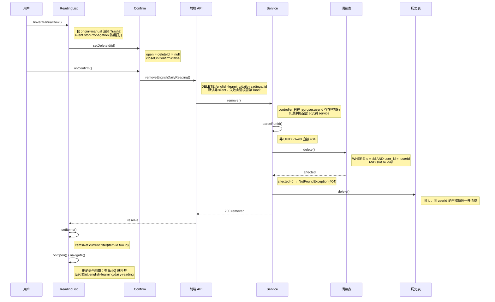
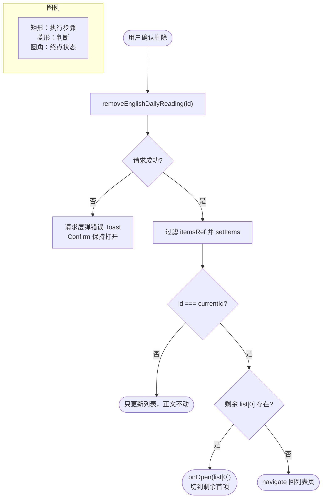

# 每日阅读篇目删除

> 文档角色：本篇是「每日阅读」删除能力专题，覆盖后端 `DELETE /english-learning/daily-readings/:id` 的归属与槽位校验、双表清理，以及详情页阅读列表的悬浮删除入口、二次确认与当前篇回退。
> 姊妹篇：双栏列表与组件拆分见 [每日阅读界面重构](./每日阅读界面重构.md)；SSE 协议见 [每日阅读流式生成](./每日阅读流式生成.md)；429 重试与词级补释义见 [每日阅读生成加固](./每日阅读生成加固.md)；定时调度见 [每日阅读生成调度](./每日阅读生成调度.md)；详情页语法卡片与词汇行复用见 [每日阅读语法说明结构化](./每日阅读语法说明结构化.md) 与 [每日阅读界面重构](./每日阅读界面重构.md)。

## 一、要解决什么问题

1. **手动篇只增不减**：手动生成的篇目按 `slot = runId` 逐行落库，列表越积越长；此前只有「删除生成历史」，删掉历史快照后正文仍留在每日阅读列表里，入口和正文两处文件对不上。
2. **定时篇不能误删**：`slot = 'day'` 的全站短文由调度生成、全员共用，一旦被某个用户删掉，所有人的当天阅读都会消失，因此删除必须从存储层就把定时篇排除。
3. **不能越权删别人的**：手动篇带 `userId`，接口只认登录态里的 `userId`，路径里的 `id` 再合法也不能绕过归属条件。
4. **删完不能停在空页**：如果删的正是当前正在读的篇，详情页不能继续显示已删除的正文，需要自动换到列表里的下一篇；列表删空就退回列表页。

## 二、核心思路

1. **一条 SQL 兜住三重条件**：`repo.delete({ id, userId, slot: Not(DAY_SLOT) })` 把「存在、本人、非定时篇」压进同一个 `WHERE`；`affected === 0` 统一按 `404 文章不存在` 处理，不区分「不存在」和「不是你的」，避免探测他人数据。
2. **先校验格式再碰库**：`parseRunId` 复用生成链路的 UUID 正则（v1–v8），非法串直接 404，不会带着任意字符串进查询条件。
3. **双表顺序删除**：手动篇的 `id`、`slot`、生成历史 `gens.id` 是同一个 runId。主表删除成功后才删 `english_daily_reading_gens` 里同 id、同 userId 的快照，保证「正文没了，历史也不残留」。
4. **行结构从按钮拆成容器**：原先把整行做成一个 `<button>`，无法在其内部再放一个删除按钮（按钮不能嵌套）。改为 `div.group.relative` 包住正文 `button` 与绝对定位的删除按钮，删除按钮只在 `origin === 'manual'` 时渲染，并在行悬浮时淡入。
5. **异步确认不抢跑**：确认弹窗 `closeOnConfirm={false}`，由成功回调显式 `setDeleteId(null)`；失败时请求层已弹 Toast，弹窗保持打开可直接重试。
6. **本地即时移除**：成功后直接过滤 `itemsRef.current` 并 `setItems`，不重新拉列表，避免分页游标与闪烁；随后只在「删的是当前篇」时取剩余列表首项打开，空列表则 `navigate` 回列表页。
7. **文案三键复用**：`deleteReading` 作按钮 `aria-label`，`deleteReadingTitle` / `deleteReadingDesc` 作确认弹窗标题与描述，中英各一套。

## 三、删除链路



**读图要点**：删除的「能不能删」全部由 service 的那一条 `delete` 决定，前端按钮显隐只是体验层；主表 `affected` 为 0 时立即 404，不会再走到历史表；历史表清理失败不会回滚主表（见第五节）。



**读图要点**：删除成功后先处理「列表」再处理「正文」，两步都以本地 `itemsRef` 为准；判定当前篇用的是路由里的 `currentId`，不是列表选中态，因此删除非当前篇不会触发跳转。

## 四、改动点明细

### 4.1 后端 `EnglishDailyReadingService.remove`

**对比范围**：`apps/backend/src/services/english-learning/english-daily-reading.service.ts` 中新增的 `remove` 方法全函数；基线只有 `removeGen`（只删历史），不存在正文删除方法。

来源：`apps/backend/src/services/english-learning/english-daily-reading.service.ts` **改动后（纯新增）** 约 L880–L890（`remove`）

```ts
	// 新增公开方法：只删「本人 + 非定时篇」的一行正文，供 DELETE 路由调用。
	async remove(userId: number, id: string): Promise<void> {
		// 先按 UUID 规则校验路径参数，非法串直接当不存在，避免任意字符串进入查询条件。
		if (!this.parseRunId(id)) throw new NotFoundException('文章不存在');
		// 单条 delete 同时带上 userId 与 slot != 'day'，把别人的篇和全站定时篇挡在 WHERE 外。
		const res = await this.repo.delete({
			// 按主键定位这篇手动阅读；手动行的 id 即生成 runId。
			id,
			// 归属过滤：定时篇 userId 为空、别人的手动篇 userId 不同，两者都命中不了。
			userId,
			// 排掉 slot='day' 的定时篇；手动篇 slot 等于自身 id，必然满足该条件。
			slot: Not(DAY_SLOT),
		});
		// affected 为 0 说明不存在 / 非本人 / 定时篇 / 已被并发删除，统一按 404 返回。
		if (!res.affected) throw new NotFoundException('文章不存在');
		// 主表删成功后再清同一 id 的生成快照，避免历史里残留已不存在的篇目。
		await this.gens.delete({ id, userId });
	}
```

**变更摘要**：新增正文删除能力。`id`、`userId`、`slot != 'day'` 三个条件缺一不可；`parseRunId` 把非法 id 的响应统一成 404；历史表删除放在主表成功之后，避免正文还在却先丢历史。

### 4.2 后端控制器 `removeDailyReading`

**对比范围**：`apps/backend/src/services/english-learning/english-learning.controller.ts` 中新增的 `DELETE daily-readings/:id` 处理方法；基线无该路由（同文件 `GET daily-readings/:id` 保持不变）。

来源：`apps/backend/src/services/english-learning/english-learning.controller.ts` **改动后（纯新增）** 约 L3038–L3045（`removeDailyReading`）

```ts
	// 新增 DELETE 路由：路径参数 id 即手动篇主键，也是这次生成的 runId。
	@Delete('daily-readings/:id')
	// 方法签名：从请求上下文取登录用户，从路径取待删篇目 id。
	async removeDailyReading(@Req() req: AuthedRequest, @Param('id') id: string) {
		// 先取登录态 userId；未登录直接 401，避免匿名请求走到删除逻辑。
		if (req.user?.userId == null) {
			// 缺少用户身份时立刻中断，后续删表操作不会执行。
			throw new UnauthorizedException('未授权');
		}
		// 归属判断全部下沉到 service，controller 不信任前端传来的任何用户标识。
		await this.dailyReadingService.remove(req.user.userId, id);
		// 返回统一响应结构，前端只需判断 Promise 是否 resolve，无需解析额外字段。
		return { success: true, data: { removed: true } };
	}
```

**变更摘要**：路由挂在既有 `daily-readings` 资源下，与 `GET :id` 同段但方法不同；鉴权只认 `req.user.userId`，路径 id 不参与身份判断。

### 4.3 前端接口封装 `removeEnglishDailyReading`

**对比范围**：`apps/frontend/src/service/index.ts` 中新增的接口函数；基线只有 `removeEnglishDailyReadingGen`（删生成历史）。

来源：`apps/frontend/src/service/index.ts` **改动后（纯新增）** 约 L2151–L2155（`removeEnglishDailyReading`）

```ts
// 新增正文删除接口封装，命名与既有 removeEnglishDailyReadingGen 保持同一族。
export const removeEnglishDailyReading = async (id: string) => {
	// 走统一 http.delete；默认非 silent，失败时由请求层弹错误 Toast。
	return await http.delete<{ removed: boolean }>(
		// 拼到 daily-readings 资源下；encodeURIComponent 防止 id 中特殊字符破坏路径。
		`${ENGLISH_LEARNING_DAILY_READINGS}/${encodeURIComponent(id)}`,
	);
};
```

**变更摘要**：前端只多一个薄封装，没有自定义错误处理；`http.delete` 的默认行为就是失败弹 Toast，因此调用方的 `.catch(() => {})` 仅用于吞掉 rejection、避免未处理异常。

### 4.4 `ReadingList` 顶部 import 区

**对比范围**：`apps/frontend/src/views/englishLearning/dailyReading/components/ReadingList.tsx` 文件顶部 import 区（改动前 L1–L12，改动后 L1–L16）。

来源：`apps/frontend/src/views/englishLearning/dailyReading/components/ReadingList.tsx` **改动前** 约 L1–L12（组件顶部 import 区）

```ts
// 旧版只引入 Loading 作为列表加载态占位。
import Loading from '@design/Loading';
// 只从 UI 库取 ScrollArea 与 Toast，没有按钮与确认弹窗依赖。
import { ScrollArea, Toast } from '@ui/index';
// 组件状态与副作用所需的四个 React Hook。
import { useCallback, useEffect, useRef, useState } from 'react';
// 列表分页大小常量，避免每页条数散落在组件里。
import { HISTORY_PAGE_SIZE } from '@/constants';
// 项目内 i18n Hook，按 key 取中英文案。
import { useI18n } from '@/hooks';
// className 合并工具，用于选中态与悬浮态的条件样式。
import { cn } from '@/lib/utils';
// 从 service 聚合入口按需引入阅读条目类型与列表接口。
import {
	// 条目类型：id / 标题 / 发布日期 / 来源等字段。
	type EnglishDailyReadingItem,
	// 分页拉取每日阅读列表。
	listEnglishDailyReadings,
// 结束 service 的具名导入。
} from '@/service';
// 来源类型：'day' 定时篇 / 'manual' 手动篇。
import type { ReadingOrigin } from '../utils/origin';
// 列表头部的日推 / 手动切换菜单。
import { OriginMenu } from './OriginMenu';
```

来源：`apps/frontend/src/views/englishLearning/dailyReading/components/ReadingList.tsx` **改动后** 约 L1–L16（组件顶部 import 区）

```ts
// 新增确认弹窗：删除前二次确认，复用通用 Confirm。
import Confirm from '@design/Confirm';
// 加载态占位保持不变。
import Loading from '@design/Loading';
// 新增 Button：用于行内悬浮删除按钮。
import { Button, ScrollArea, Toast } from '@ui/index';
// 新增 Trash2 图标，作为删除按钮的视觉标识。
import { Trash2 } from 'lucide-react';
// React Hook 集合不变，仍用于状态、副作用与引用。
import { useCallback, useEffect, useRef, useState } from 'react';
// 新增 useNavigate：列表删空后需要主动退回列表页。
import { useNavigate } from 'react-router';
// 列表分页大小常量保持不变。
import { HISTORY_PAGE_SIZE } from '@/constants';
// i18n Hook 不变，新增文案键同样经它读取。
import { useI18n } from '@/hooks';
// className 合并工具不变。
import { cn } from '@/lib/utils';
// service 导入新增删除接口，与列表接口同源。
import {
	// 条目类型保持不变。
	type EnglishDailyReadingItem,
	// 列表接口保持不变。
	listEnglishDailyReadings,
	// 新增删除接口：按 id 删除本人手动篇。
	removeEnglishDailyReading,
// 结束 service 的具名导入。
} from '@/service';
// 来源类型保持不变。
import type { ReadingOrigin } from '../utils/origin';
// 来源切换菜单保持不变。
import { OriginMenu } from './OriginMenu';
```

**变更摘要**：新增 `Confirm`、`Button`、`Trash2`、`useNavigate`、`removeEnglishDailyReading` 五项依赖，其余 import 顺序与内容不变。

### 4.5 `ReadingList` 组件声明与状态

**对比范围**：组件函数声明、props 类型与状态/引用初始化段（改动前 L16–L38，改动后 L20–L43）；加载逻辑与基线相同，用 `// ...` 对称省略。

来源：`apps/frontend/src/views/englishLearning/dailyReading/components/ReadingList.tsx` **改动前** 约 L16–L38（`ReadingList` 声明与状态段）

```ts
// 旧版组件入参：当前篇 id、来源、来源切换回调、打开某篇回调。
export function ReadingList({
	// 当前正文对应的篇目 id，用于高亮与避免重复打开。
	currentId,
	// 当前列表来源：day 为全站定时篇，manual 为本人手动篇。
	origin,
	// 切换来源时通知父组件重建列表。
	onOrigin,
	// 点击非当前篇时交给父组件做路由跳转。
	onOpen,
// 入参类型声明开始。
}: {
	// 当前篇 id；列表页可能为空串，表示未选中任何篇。
	currentId: string;
	// 来源联合类型，只允许 day / manual。
	origin: ReadingOrigin;
	// 来源切换回调，入参是目标来源。
	onOrigin: (next: ReadingOrigin) => void;
	// 打开篇目回调，入参是完整条目，便于父组件取标题拼 URL。
	onOpen: (item: EnglishDailyReadingItem) => void;
}) {
	// 取翻译函数，列表标题与空态文案都走 i18n。
	const { t } = useI18n();
	// 列表数据；重新拉取或本地删除都通过它触发渲染。
	const [items, setItems] = useState<EnglishDailyReadingItem[]>([]);
	// 首次加载标记，无数据时显示整块 Loading。
	const [loading, setLoading] = useState(true);
	// 追加加载标记，触底时在底部显示「加载更多」。
	const [loadingMore, setLoadingMore] = useState(false);
	// 是否还有下一页，由总数与已加载条数推导。
	const [hasMore, setHasMore] = useState(false);
	// 与 items 同步的引用，供异步回调读到最新数组，避免闭包过期。
	const itemsRef = useRef<EnglishDailyReadingItem[]>([]);
	// 与 hasMore 同步的引用，触底回调据此决定是否继续请求。
	const hasMoreRef = useRef(false);
	// 请求进行中标记，避免 IntersectionObserver 连续触发。
	const fetching = useRef(false);
	// 请求批次号；来源切换后旧请求返回时靠它丢弃结果。
	const gen = useRef(0);
	// 滚动容器引用，作为 IntersectionObserver 的 root。
	const scrollerRef = useRef<HTMLDivElement>(null);
	// 触底哨兵引用，进入可视区即加载下一页。
	const tailRef = useRef<HTMLDivElement>(null);
	// ...（列表加载与触底逻辑与基线相同，略）
```

来源：`apps/frontend/src/views/englishLearning/dailyReading/components/ReadingList.tsx` **改动后** 约 L20–L43（`ReadingList` 声明与状态段）

```ts
// 组件入参与基线一致，删除所需的路由能力由 Hook 内部获取。
export function ReadingList({
	// 当前正文对应的篇目 id，删除后据此判断是否需要换篇。
	currentId,
	// 当前列表来源，决定是否渲染删除按钮。
	origin,
	// 切换来源时通知父组件重建列表。
	onOrigin,
	// 点击非当前篇时交给父组件做路由跳转。
	onOpen,
// 入参类型声明开始。
}: {
	// 当前篇 id；列表页可能为空串，表示未选中任何篇。
	currentId: string;
	// 来源联合类型，只允许 day / manual。
	origin: ReadingOrigin;
	// 来源切换回调，入参是目标来源。
	onOrigin: (next: ReadingOrigin) => void;
	// 打开篇目回调，入参是完整条目，便于父组件取标题拼 URL。
	onOpen: (item: EnglishDailyReadingItem) => void;
}) {
	// 取翻译函数，弹窗与按钮文案都走 i18n。
	const { t } = useI18n();
	// 新增路由跳转函数：列表删空后需要退回列表页。
	const navigate = useNavigate();
	// 列表数据；删除成功后用过滤后的数组覆盖它。
	const [items, setItems] = useState<EnglishDailyReadingItem[]>([]);
	// 新增待删篇目 id：null 表示弹窗关闭，非 null 时打开 Confirm。
	const [deleteId, setDeleteId] = useState<string | null>(null);
	// 首次加载标记保持不变。
	const [loading, setLoading] = useState(true);
	// 追加加载标记保持不变。
	const [loadingMore, setLoadingMore] = useState(false);
	// 是否还有下一页保持不变。
	const [hasMore, setHasMore] = useState(false);
	// 与 items 同步的引用；删除时基于它过滤，保证拿到最新数组。
	const itemsRef = useRef<EnglishDailyReadingItem[]>([]);
	// 与 hasMore 同步的引用保持不变。
	const hasMoreRef = useRef(false);
	// 请求进行中标记保持不变。
	const fetching = useRef(false);
	// 请求批次号保持不变。
	const gen = useRef(0);
	// 滚动容器引用保持不变。
	const scrollerRef = useRef<HTMLDivElement>(null);
	// 触底哨兵引用保持不变。
	const tailRef = useRef<HTMLDivElement>(null);
	// ...（列表加载与触底逻辑与基线相同，略）
```

**变更摘要**：新增 `useNavigate()` 与 `deleteId` 状态；其余 props、加载态与分页引用完全沿用基线，避免删除功能改动既有分页逻辑。

### 4.6 `ReadingList` 返回的 JSX 根区块

**对比范围**：组件 `return (...)` 的完整根区块（改动前 L109–L170，`<aside>` 为根；改动后 L115–L228，`<>...</>` 为根，内含 `<Confirm>` 与 `<aside>`）。

来源：`apps/frontend/src/views/englishLearning/dailyReading/components/ReadingList.tsx` **改动前** 约 L109–L170（`ReadingList` 的 return 根区块）

```tsx
// 旧版根节点直接是侧栏，整块列表没有额外的确认弹层。
return (
	// 侧栏：宽度由父级分栏决定，内部纵向排布。
	<aside className="flex h-full min-h-0 min-w-0 flex-col overflow-hidden border-r border-theme/10 bg-theme-background">
		// 头部行：左边标题，右边来源切换菜单。
		<div className="flex shrink-0 items-center justify-between gap-2 px-4 pt-4 pb-2">
			// 标题按来源显示「手动生成」或「今日阅读」。
			<span className="min-w-0 truncate text-sm font-medium">
				// 三目选择对应来源的 i18n key。
				{t(
					// 手动来源时取手动列表标题。
					origin === 'manual'
						// 手动列表标题文案键。
						? 'englishLearning.dailyReading.listHeadingManual'
						// 非手动时取定时篇列表标题。
						: 'englishLearning.dailyReading.listHeadingDay',
				// 结束 t 调用。
				)}
			// 结束标题 span。
			</span>
			// 来源切换菜单：选中变化时通知父组件。
			<OriginMenu
				// 当前选中的来源。
				origin={origin}
				// 只有真的换了来源才回调，避免重复拉取。
				onSelect={(next) => {
					// 目标来源与当前一致时不动。
					if (next !== origin) onOrigin(next);
				// 结束切换回调。
				}}
			/>
		// 结束头部行。
		</div>
		// 滚动区域：列表内容超出高度时只滚这里。
		<ScrollArea ref={scrollerRef} className="min-h-0 flex-1 pb-4">
			// 首次加载且无数据时显示 Loading。
			{loading && items.length === 0 ? <Loading /> : null}
			// 加载完成但仍为空时展示空态文案。
			{!loading && items.length === 0 ? (
				// 空态提示居中排版。
				<p className="text-textcolor/60 py-8 text-center text-sm">
					// 空态文案走 i18n。
					{t('englishLearning.dailyReading.empty')}
				// 结束空态段落。
				</p>
			// 空态条件分支结束。
			) : null}
			// 有数据时渲染条目列表。
			{items.length > 0 ? (
				// 列表容器：条目之间留 0.5 间距。
				<div className="flex flex-col gap-0.5 px-4">
					// 逐条渲染；每条计算是否当前选中。
					{items.map((item) => {
						// 当前篇高亮底色，其它篇悬浮时才有底色。
						const selected = item.id === currentId;
						// 返回整行按钮；旧版整行就是一个 button。
						return (
							// 条目按钮：同时承担展示与点击打开。
							<button
								// 以条目 id 作为 key，删除后 React 能精确移除节点。
								key={item.id}
								// 显式按钮类型，避免表单场景误提交。
								type="button"
								// 行样式：负外边距铺满列表宽度，选中态与悬浮态切换底色。
								className={cn(
									// 基础样式：铺满、圆角、内边距、左对齐。
									'-mx-2 w-[calc(100%+1rem)] cursor-pointer rounded-md px-2 py-1.5 text-left',
									// 选中项常亮，其它项悬浮时高亮。
									selected ? 'bg-theme/10' : 'hover:bg-theme/10',
								// 结束 className 计算。
								)}
								// 点击时打开该篇，当前篇不重复跳转。
								onClick={() => {
									// 只在目标不是当前篇时通知父组件。
									if (item.id !== currentId) onOpen(item);
								// 结束点击回调。
								}}
							>
								// 英文标题：单行截断，保持行高稳定。
								<span className="block truncate text-sm font-medium">
									// 绑定条目英文标题。
									{item.titleEn}
								// 结束标题 span。
								</span>
								// 副信息行：发布日期与中文标题。
								<span className="text-textcolor/50 mt-0.5 block truncate text-xs">
									// 展示发布日期，作为同标题篇目的区分。
									{item.publishDate}
									// 有中文标题时用「·」拼接，没有就只显示日期。
									{item.titleZh ? ` · ${item.titleZh}` : ''}
								// 结束副信息 span。
								</span>
							// 结束条目按钮。
							</button>
						// 结束单条 return。
						);
					// 结束 map 回调。
					})}
				// 结束列表容器。
				</div>
			// 列表条件分支结束。
			) : null}
			// 还有下一页时放置触底哨兵，交给 IntersectionObserver 监听。
			{hasMore ? <div ref={tailRef} className="h-px" aria-hidden /> : null}
			// 追加加载时在底部显示提示。
			{loadingMore ? (
				// 加载更多文案：小号灰字居中。
				<p className="text-textcolor/50 py-2 text-center text-xs">
					// 取「加载更多」的 i18n 文案。
					{t('common.loadingMore')}
				// 结束加载更多段落。
				</p>
			// 加载更多分支结束。
			) : null}
		// 结束滚动区域。
		</ScrollArea>
	// 结束侧栏。
	</aside>
// 结束组件 return。
);
```

来源：`apps/frontend/src/views/englishLearning/dailyReading/components/ReadingList.tsx` **改动后** 约 L115–L228（`ReadingList` 的 return 根区块）

```tsx
// 新版根节点改为 Fragment，以便在侧栏旁并列确认弹窗。
return (
	// 片段包裹 Confirm 与侧栏，避免多一个真实 DOM 包裹层。
	<>
		// 二次确认弹窗：deleteId 存在时打开。
		<Confirm
			// 用 deleteId 反推开合，null 即关闭。
			open={deleteId != null}
			// 弹窗自身请求关闭时清空 deleteId；取消与遮罩点击都走这里。
			onOpenChange={(open) => {
				// 只在关闭时清空，避免打开事件误清目标 id。
				if (!open) setDeleteId(null);
			// 结束开合回调。
			}}
			// 标题：删除这篇阅读？
			title={t('englishLearning.dailyReading.deleteReadingTitle')}
			// 描述：删除后无法恢复。
			description={t('englishLearning.dailyReading.deleteReadingDesc')}
			// 确认按钮复用通用「删除」文案。
			confirmText={t('common.delete')}
			// 取消按钮复用通用「取消」文案。
			cancelText={t('common.cancel')}
			// 危险操作使用 destructive 配色，与生成历史删除一致。
			confirmVariant="destructive"
			// 异步删除期间保持弹窗打开，失败时用户可直接重试。
			closeOnConfirm={false}
			// 确认后的主流程：请求接口、更新本地列表、处理当前篇。
			onConfirm={() => {
				// 先固化本次目标 id，避免请求期间 deleteId 被其它交互改掉。
				const id = deleteId;
				// 没有目标 id 说明弹窗状态异常，直接返回。
				if (!id) return;
				// 调删除接口；void 表示不等待返回值，后续走 then / catch。
				void removeEnglishDailyReading(id)
					// 成功回调：先更新列表，再决定正文去哪。
					.then(() => {
						// 基于最新引用过滤掉被删条目，保留其余顺序。
						const list = itemsRef.current.filter((item) => item.id !== id);
						// 同步引用，保证触底加载与后续删除读到新数组。
						itemsRef.current = list;
						// 触发重渲染，行从界面上立即消失。
						setItems(list);
						// 关闭确认弹窗。
						setDeleteId(null);
						// 删的不是当前正在读的篇，列表更新即可，不动正文。
						if (id !== currentId) return;
						// 删的正是当前篇：取剩余列表首项作为下一篇。
						const next = list[0];
						// 还有其它篇时直接打开，父组件会更新路由与正文。
						if (next) onOpen(next);
						// 列表已空则退回列表页，避免停在已删除的详情上。
						else navigate('/english-learning/daily-reading');
					// 结束成功回调。
					})
					// 失败时请求层已弹 Toast；这里吞掉 rejection，弹窗保持打开供重试。
					.catch(() => {});
			// 结束确认回调。
			}}
		/>
		// 侧栏：结构与基线一致，仅头部字号与列表行结构调整。
		<aside className="flex h-full min-h-0 min-w-0 flex-col overflow-hidden border-r border-theme/10 bg-theme-background">
			// 头部行：左边标题，右边来源切换菜单。
			<div className="flex shrink-0 items-center justify-between gap-2 px-4 pt-4 pb-2">
				// 列表标题：字号由 text-sm 提到 text-base，与手动篇列表视觉统一。
				<span className="min-w-0 truncate text-base">
					// 按来源选择标题 key。
					{t(
						// 手动来源显示「手动生成」。
						origin === 'manual'
							// 手动列表标题 key。
							? 'englishLearning.dailyReading.listHeadingManual'
							// 非手动时显示定时篇标题。
							: 'englishLearning.dailyReading.listHeadingDay',
					// 结束 t 调用。
					)}
				// 结束标题 span。
				</span>
				// 来源切换菜单：选中变化时通知父组件。
				<OriginMenu
					// 当前来源。
					origin={origin}
					// 切换时才回调，避免重复拉取。
					onSelect={(next) => {
						// 与当前来源相同时不做任何事。
						if (next !== origin) onOrigin(next);
					// 结束切换回调。
					}}
				/>
			// 结束头部行。
			</div>
			// 首次加载且无数据时显示整块 Loading。
			{loading && items.length === 0 ? <Loading /> : null}
			// 滚动区域：列表与触底哨兵都在里面。
			<ScrollArea ref={scrollerRef} className="min-h-0 flex-1 pb-4">
				// 加载完成且无数据时显示空态。
				{!loading && items.length === 0 ? (
					// 空态文案：字号跟随头部统一，去掉 text-sm。
					<p className="text-textcolor/60 py-8 text-center">
						// 取「暂无篇目」文案。
						{t('englishLearning.dailyReading.empty')}
					// 结束空态段落。
					</p>
				// 空态分支结束。
				) : null}
				// 有数据时渲染行列表。
				{items.length > 0 ? (
					// 列表容器。
					<div className="flex flex-col gap-0.5 px-4">
						// 逐条渲染；每行外层是 div，内层才是可点击按钮。
						{items.map((item) => {
							// 计算当前篇，决定高亮底色。
							const selected = item.id === currentId;
							// 返回行容器。
							return (
								// 行容器：group 让悬浮删除按钮可被感知，relative 作为定位基准。
								<div
									// key 用条目 id，删除后 React 精确移除该行。
									key={item.id}
									// 行样式：分组 + 相对定位；选中态常亮，其它行悬浮高亮。
									className={cn(
										// 基础样式：group 悬浮组、relative 定位、铺满列表宽度。
										'group relative -mx-2 w-[calc(100%+1rem)] rounded-md',
										// 选中态与悬浮态共用同一底色。
										selected ? 'bg-theme/10' : 'hover:bg-theme/10',
									// 结束 className 计算。
									)}
								>
									// 正文按钮：只负责打开篇目，不再包住删除按钮。
									<button
										// 显式按钮类型，避免表单内误提交。
										type="button"
										// 铺满行宽；内边距从外层移到按钮，保持点击热区。
										className="w-full cursor-pointer px-2 py-1.5 text-left"
										// 点击非当前篇时打开。
										onClick={() => {
											// 当前篇不重复跳转。
											if (item.id !== currentId) onOpen(item);
										// 结束点击回调。
										}}
									>
										// 英文标题：悬浮时右侧留出删除按钮的位置。
										<span className="block truncate font-medium group-hover:pr-8">
											// 绑定条目英文标题。
											{item.titleEn}
										// 结束标题 span。
										</span>
										// 副信息行：日期 + 中文标题，同样为删除按钮让位。
										<div className="mt-0.5 flex items-center truncate text-sm text-textcolor/50 group-hover:pr-8">
											// 日期轻微上移，视觉上与中文标题基线对齐。
											<span className="-mb-0.5">{item.publishDate}</span>
											// 有中文标题时拼接，没有则只留日期。
											{item.titleZh ? ` · ${item.titleZh}` : ''}
										// 结束副信息行。
										</div>
									// 结束正文按钮。
									</button>
									// 只有手动来源才允许删除；定时篇全站共用，不显示入口。
									{origin === 'manual' ? (
										// 悬浮操作区：默认透明且不可点，hover 行时淡入。
										<div className="absolute top-2 right-2 flex items-center opacity-0 pointer-events-none transition-opacity duration-150 group-hover:pointer-events-auto group-hover:opacity-100">
											// 删除按钮：ghost 小图标，危险色只在悬浮时出现。
											<Button
												// 显式按钮类型，避免误提交。
												type="button"
												// 无底色幽灵样式，贴合列表行。
												variant="ghost"
												// 小尺寸，控制图标按钮高度。
												size="sm"
												// 固定 7×7 方形并去掉内边距，避免撑破行高。
												className="h-7 w-7 shrink-0 rounded-md p-0 text-textcolor/65 transition-colors hover:border hover:border-destructive/10 hover:bg-destructive/10 hover:text-destructive"
												// 无可见文字时用 aria-label 说明用途，保证无障碍可读。
												aria-label={t(
													// 取「删除这篇阅读」文案。
													'englishLearning.dailyReading.deleteReading',
												// 结束 aria-label 取值。
												)}
												// 点击只记录目标 id，不打开篇目。
												onClick={(event) => {
													// 阻止冒泡，避免触发外层按钮的行点击。
													event.stopPropagation();
													// 写入待删 id，Confirm 随之打开。
													setDeleteId(item.id);
												// 结束点击回调。
												}}
											>
												// 垃圾桶图标：纯装饰，aria-hidden 避免重复朗读。
												<Trash2 className="size-3.5" aria-hidden />
											// 结束删除按钮。
											</Button>
										// 结束悬浮操作区。
										</div>
									// 定时来源不渲染删除按钮。
									) : null}
								// 结束行容器。
								</div>
							// 结束单条 return。
							);
						// 结束 map 回调。
						})}
					// 结束列表容器。
					</div>
				// 列表条件分支结束。
				) : null}
				// 触底哨兵：进入可视区触发下一页。
				{hasMore ? <div ref={tailRef} className="h-px" aria-hidden /> : null}
				// 追加加载提示。
				{loadingMore ? (
					// 小号灰字居中。
					<p className="text-textcolor/50 py-2 text-center text-xs">
						// 取「加载更多」文案。
						{t('common.loadingMore')}
					// 结束加载更多段落。
					</p>
				// 加载更多分支结束。
				) : null}
			// 结束滚动区域。
			</ScrollArea>
		// 结束侧栏。
		</aside>
	// 结束 Fragment。
	</>
// 结束 return。
);
```

**变更摘要**：根节点由 `aside` 变为 Fragment；前方新增 `Confirm`（`closeOnConfirm=false`，成功后才关）；行结构由 `button` 改为 `div` + `button` + 悬浮 `Button`；`origin === 'manual'` 才渲染删除入口；成功后过滤 `itemsRef.current`，删当前篇时 `onOpen(list[0])`，空列表 `navigate` 回列表页。

### 4.7 i18n 文案三键

**对比范围**：`deleteReading` / `deleteReadingTitle` / `deleteReadingDesc` 三个键在中英词条文件中均为纯新增；基线无对应键（相邻的 `deleteHistory*` 保持不变）。

来源：`apps/frontend/src/i18n/locales/zh-CN/englishLearning.ts` **改动后（纯新增）** 约 L330–L332（`deleteReading` / `deleteReadingTitle` / `deleteReadingDesc`）

```ts
// 「删除这篇阅读」：作为行内删除按钮的 aria-label，也可用于纯文本入口。
'englishLearning.dailyReading.deleteReading': '删除这篇阅读',
// 确认弹窗标题，带问号提示这是需要确认的操作。
'englishLearning.dailyReading.deleteReadingTitle': '删除这篇阅读？',
// 确认弹窗描述，明确告知删除后无法恢复。
'englishLearning.dailyReading.deleteReadingDesc': '删除后无法恢复。',
```

来源：`apps/frontend/src/i18n/locales/en-US/englishLearning.ts` **改动后（纯新增）** 约 L361–L363（`deleteReading` / `deleteReadingTitle` / `deleteReadingDesc`）

```ts
// 英文按钮标签：用作删除图标按钮的 aria-label。
'englishLearning.dailyReading.deleteReading': 'Delete this reading',
// 英文确认标题：与中文一致，用问号强调二次确认。
'englishLearning.dailyReading.deleteReadingTitle': 'Delete this reading?',
// 英文确认描述：说明操作不可撤销。
'englishLearning.dailyReading.deleteReadingDesc': 'This cannot be undone.',
```

**变更摘要**：三个键与既有 `deleteHistory` 三键同层命名，便于按功能检索；中英 key 完全对齐，缺失时 i18n 会直接暴露 key 名。

## 五、边界与风险点

1. **定时篇删不到**：前端 `origin === 'manual'` 只是入口限制；真正的保险是 SQL 里的 `slot: Not(DAY_SLOT)`。即使手工构造请求，`slot = 'day'` 的行也不会被删，`affected = 0` 返回 404。
2. **越权删除按 404 处理**：`userId` 来自登录态，别人的手动篇同样命中不到，接口不会泄露「这篇存在但不属于你」。`parseRunId` 失败也返回 404，而 `GET /daily-readings/:id` 对非法 id 返回 400，两者语义略有差异，前端均按失败提示处理。
3. **并发删除**：两个端同时删同一篇，只有一个 `affected = 1`；后者收到 404 并在请求层弹 Toast，Confirm 因 `closeOnConfirm=false` 保持打开，用户可取消或重试。
4. **双表非事务**：主表删除成功后若 `gens.delete` 抛错，正文已消失但历史快照可能残留；当前实现没有包事务，属于可接受的残留风险（历史 Popover 里会留下一条打不开正文的记录）。
5. **切篇取的是剩余列表首项**：实现为 `const next = list[0]`，不是「原位置的下一条」。删除当前篇后会跳到剩余列表第一条；若希望跳到相邻篇，需要按删除前索引取 `list[index]`。
6. **只删当前来源的本地列表**：删除不会触发重新拉取，`hasMore` / `total` 仍是删除前的值；由于后续触底加载的 `offset` 取 `itemsRef.current.length`，分页游标仍与服务器剩余条数对齐，不会重复或跳过。
7. **历史入口同步消失**：`gens` 与正文同 id、同 userId，删正文即删历史，设置页「生成历史」Popover 中该条记录不再出现。

若与仓库最新源码不一致，以源码为准。
