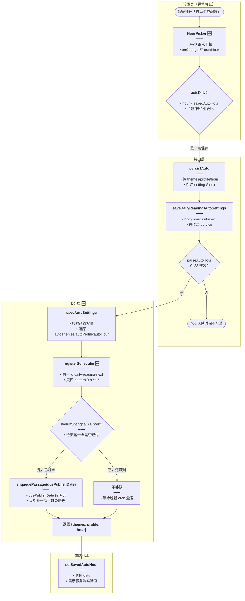
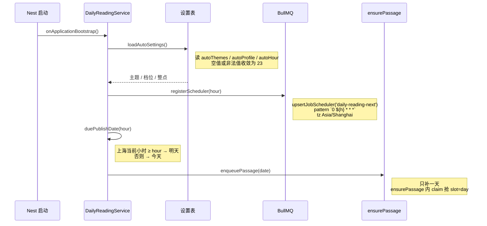

# 每日阅读自定义入队时间

> 文档角色：本篇是「每日阅读定时篇入队时刻可配置」的实现专题，覆盖 `autoHour` 列与迁移、上海整点计算、scheduler 重注册、启动补队与设置页整点下拉五段链路。
> 姊妹篇：定时调度与冷却见 [每日阅读生成调度](./每日阅读生成调度.md)；生成失败重试与档位落库见 [每日阅读生成加固](./每日阅读生成加固.md)；SSE 流式生成见 [每日阅读流式生成](./每日阅读流式生成.md)；前端组件化与详情页见 [每日阅读界面重构](./每日阅读界面重构.md)。

## 一、要解决什么问题

定时篇过去把入队时刻写死在 `0 23 * * *`（Asia/Shanghai）：所有部署都只能在 23:00 准备下一天，运营想改成凌晨低峰或午间预热都做不到。要做的是：

1. 超级管理员在设置页用 0–23 整点下拉选择「入队时间」，保存后立即生效。
2. 保存不能只改库：BullMQ 的 scheduler 必须同步换 cron，否则运行中的进程仍按旧整点触发。
3. 换 cron 不能把新旧两档都留着，否则两个整点各跑一次，重复占坑。
4. 如果当天所选整点已经过去，新时刻要等到明天才生效——需要立刻补一次队，避免当天断档。
5. 存量数据必须保持旧行为：迁移默认值 23，升级后不配置也还是 23:00。

## 二、核心思路

1. **整点作为设置列落库**：`english_daily_reading_settings` 新增 `autoHour int NOT NULL DEFAULT 23`，与 `autoThemes` / `autoProfile` 同表同权限，只由超管写。
2. **同一 scheduler id 做覆盖**：新增 `registerScheduler(hour)`，仍用 `daily-reading-next` 这个 id 调 `upsertJobScheduler`，只替换 `pattern` 为 `0 ${h} * * *`；id 相同即覆盖，不会出现新旧两档同时响。
3. **保存后立刻重注册**：`saveAutoSettings` 落库成功后马上 `registerScheduler(hour)`，不等进程重启，配置即时生效。
4. **过点才补队**：用 `hourInShanghai()` 取上海当前小时，只有 `当前小时 >= hour` 才 `enqueuePassage(duePublishDate(hour))`；未到点时不补，交给当晚的 cron 触发。
5. **补哪天由 `duePublishDate` 决定**：已过点补明天，未过点补今天。这样进程中午启动、或超管中午把 8 点改成 10 点，都能补上应生成的那一天。
6. **非法值两端兜底**：接口层 `parseAutoHour` 对非整数、越界值直接 400；读取侧 `loadAutoSettings` / `registerScheduler` 再把脏值收敛回 23，保证老数据与手工改库都不会让 cron 变成非法表达式。
7. **前后端类型同改**：`EnglishDailyReadingSettings.auto` 与 `saveEnglishDailyReadingAutoSettings` 的请求/响应都增加 `hour: number`，设置页据此回填 `savedAutoHour`。

## 三、实现链路

### 3.1 保存整点：校验 → 落库 → 重注册 → 补队



**读图要点**：保存链路唯一的副作用入口在 `saveAutoSettings`：先落库再重注册，最后按「是否已过点」决定补今天还是明天。`HourPicker` 只改组件状态，未点保存不会触发重注册。

### 3.2 进程启动：读 autoHour → 注册 scheduler → 计算 duePublishDate



**读图要点**：基线启动时会固定补「今天 + 明天」两天；改动后只由 `duePublishDate` 算出一个日期补一次，避免在自定义整点下把未到点的那一档提前生成。注册失败仍走原有 catch，只告警不阻断启动。

## 四、代码对比

### 4.1 数据库迁移（纯新增）

迁移只加一列，默认 23 与旧硬编码行为对齐，存量行无需回填。

来源：`apps/backend/src/migrations/1792800000000-english_daily_reading_auto_hour.ts` **改动后（纯新增）** 约 L1–L17（类 `EnglishDailyReadingAutoHour1792800000000`）。

```ts
// 引入迁移接口与查询执行器：迁移类必须实现 up/down 两个契约
import { MigrationInterface, QueryRunner } from 'typeorm';

// 导出迁移类；类名尾部时间戳与文件名一致，TypeORM 才能按序识别
export class EnglishDailyReadingAutoHour1792800000000 implements MigrationInterface {
	// 迁移名写进 migrations 表，用于判断这一版是否已执行
	name = 'EnglishDailyReadingAutoHour1792800000000';

	// 正向升级：给全站设置表补上「入队整点」列
	public async up(queryRunner: QueryRunner): Promise<void> {
		// 执行 ALTER TABLE；默认 23 让未配置的部署继续按旧的 23:00 触发
		await queryRunner.query(
			// NOT NULL + DEFAULT 23 保证既有那一行立即有合法整点，读取侧不必处理 null
			`ALTER TABLE \`english_daily_reading_settings\` ADD \`autoHour\` int NOT NULL DEFAULT 23`,
		);
	}

	// 回滚：删列，让表结构回到基线
	public async down(queryRunner: QueryRunner): Promise<void> {
		// 与 up 对称地删列；回滚后代码若仍读 autoHour 会报列不存在，须同时回退版本
		await queryRunner.query(
			// 表名与列名与 up 完全一致，保证回滚可定位
			`ALTER TABLE \`english_daily_reading_settings\` DROP COLUMN \`autoHour\``,
		);
	}
}
```

**变更摘要**：纯新增迁移，只加 `autoHour` 一列，不做数据回填；默认值即旧行为。

### 4.2 实体 `EnglishDailyReadingSetting` 增加 `autoHour`

`autoHour` 与定时档同表，读写都只经 `loadAutoSettings` / `saveAutoSettings`。

来源：`apps/backend/src/services/english-learning/entity/english-daily-reading-setting.entity.ts` **改动前** 约 L1–L22（类 `EnglishDailyReadingSetting`）。

```ts
// 从 TypeORM 引入列、实体、主键列三个装饰器
import { Column, Entity, PrimaryColumn } from 'typeorm';
// 基线档位类型只有具体枚举，还没有 random
import type { ReadingProfile } from '../daily-reading.rules';

// 实体装饰器：声明表名，全站定时档只有一行
@Entity('english_daily_reading_settings')
// 导出实体类：手动档在另一张用户设置表
export class EnglishDailyReadingSetting {
	// 主键列装饰器：整型主键
	@PrimaryColumn({ type: 'int' })
	// 主键字段：业务上恒为 id=1
	id!: number;

	// 旧的全站手动主题列装饰器：JSON 且非空
	@Column({ type: 'json' })
	// 手动主题字段，仅作为定时档为空时的回退
	themes!: string[];

	// 旧的全站手动档位列装饰器：JSON 可空
	@Column({ type: 'json', nullable: true })
	// 手动档位字段，用户保存不再写这里
	profile!: ReadingProfile | null;

	// 定时篇主题列装饰器：JSON 可空
	@Column({ type: 'json', nullable: true })
	// 定时篇主题，仅超管可写；空则生成时回退手动档
	autoThemes!: string[] | null;

	// 定时篇档位列装饰器：JSON 可空
	@Column({ type: 'json', nullable: true })
	// 定时篇档位，仅超管可写；空则生成时回退手动档
	autoProfile!: ReadingProfile | null;
}
```

来源：`apps/backend/src/services/english-learning/entity/english-daily-reading-setting.entity.ts` **改动后** 约 L1–L29（类 `EnglishDailyReadingSetting`）。

```ts
// 从 TypeORM 引入列、实体、主键列三个装饰器
import { Column, Entity, PrimaryColumn } from 'typeorm';
// 档位类型换成可存 random 的 StoredProfile，和保存链路保持一致
import type { StoredProfile } from '../daily-reading.rules';

// 实体装饰器：声明表名，全站定时档只有一行
@Entity('english_daily_reading_settings')
// 导出实体类：手动档在另一张用户设置表
export class EnglishDailyReadingSetting {
	// 主键列装饰器：整型主键
	@PrimaryColumn({ type: 'int' })
	// 主键字段：业务上恒为 id=1
	id!: number;

	// 旧的全站手动主题列装饰器：JSON 且非空
	@Column({ type: 'json' })
	// 手动主题字段，仅作为定时档为空时的回退
	themes!: string[];

	// 旧的全站手动档位列装饰器：JSON 可空
	@Column({ type: 'json', nullable: true })
	// 手动档位字段，用户保存不再写这里
	profile!: StoredProfile | null;

	// 定时篇主题列装饰器：JSON 可空
	@Column({ type: 'json', nullable: true })
	// 定时篇主题，仅超管可写；空则生成时回退手动档
	autoThemes!: string[] | null;

	// 定时篇档位列装饰器：JSON 可空
	@Column({ type: 'json', nullable: true })
	// 定时篇档位，仅超管可写；空则生成时回退手动档
	autoProfile!: StoredProfile | null;

	// 🆕 整点列装饰器：int，默认 23
	@Column({ type: 'int', default: 23 })
	// 🆕 每天在该小时（上海）入队下一天；仅超管可写
	autoHour!: number;
}
```

**变更摘要**：新增 `autoHour` 列并给默认 23；同文件另把档位类型从 `ReadingProfile` 换成 `StoredProfile`（随机档位改动，与本篇主链路无关）。

### 4.3 上海整点与应补日期（纯新增）

`hourInShanghai` 与 cron 使用同一套 `Asia/Shanghai` 钟；`duePublishDate` 只回答「该补哪一天」。

来源：`apps/backend/src/services/english-learning/daily-reading.rules.ts` **改动后（纯新增）** 约 L39–L57（函数 `hourInShanghai` / `duePublishDate`）。

```ts
/** 与 cron 的 Asia/Shanghai 同一套钟。 */
// 取上海当前小时（0–23），用于判断今天的入队整点是否已过
export function hourInShanghai(now = new Date()): number {
	// en-GB + h23 保证输出 0–23 的两位内数字，不会出现 12 小时制的 AM/PM
	const hour = new Intl.DateTimeFormat('en-GB', {
		// 与 BullMQ cron 的 tz 保持一致，避免服务器本地时区影响判断
		timeZone: SHANGHAI,
		// 只取小时字段，不需要分秒
		hour: 'numeric',
		// 强制 00–23 制，跨午夜时不会回绕成 12
		hourCycle: 'h23',
	})
		// 用 formatToParts 拿结构化片段，比解析本地化字符串稳
		.formatToParts(now)
		// 找到 type=hour 的那一段，拿它的字符串值
		.find((part) => part.type === 'hour')?.value;
	// 转成数字，供比较使用
	const n = Number(hour);
	// 拿不到小时（极端环境）时回 0，让调用方按「未到点」处理而不是抛错
	return Number.isInteger(n) ? n : 0;
}

/** 已过今天的整点则补明天，否则只可能补上一档产出的今天。 */
// 根据整点与当前上海时间，算这次补队应写哪一天的 publishDate
export function duePublishDate(hour: number, now = new Date()): string {
	// 脏整点先收敛为 23，防止调用方传入 -1 或 99 时算出离谱日期
	const h = hour >= 0 && hour <= 23 ? hour : 23;
	// 上海日历日作为基准，禁止用 UTC 或数据库 CURRENT_DATE
	const today = shanghaiToday(now);
	// 当前小时已过或正好等于整点：今天这一档已触发，补明天；否则补今天
	return hourInShanghai(now) >= h ? addCalendarDays(today, 1) : today;
}
```

**变更摘要**：纯新增两个纯函数，均带 `now` 注入便于测试；不读写数据库，不影响既有 `shanghaiToday` / `addCalendarDays`。

### 4.4 启动钩子 `onApplicationBootstrap` 与 `registerScheduler`

启动从「固定 23 点 + 补两天」改为「读设置整点 + 补一天」；注册逻辑抽成可复用的私有方法。

来源：`apps/backend/src/services/english-learning/english-daily-reading.service.ts` **改动前** 约 L257–L273（方法 `onApplicationBootstrap`）。

```ts
// 实现 Nest 启动钩子：进程起来后注册定时任务并补队
async onApplicationBootstrap(): Promise<void> {
	// 外层 try 包住队列操作：连不上时只告警，不阻断服务启动
	try {
		// 旧实现把 23:00 写死在 cron 里，所有部署只有这一档
		await this.queue.upsertJobScheduler(
			// scheduler id 固定；重复 upsert 会覆盖同一档而不是新增
			'daily-reading-next',
			// 每天 23:00（上海）触发，时区显式指定避免漂移
			{ pattern: '0 23 * * *', tz: 'Asia/Shanghai' },
			{
				// 触发任务的名称，与 worker 消费的 name 对齐
				name: 'prepare-next',
				// 定时任务不携带数据，日期由 worker 自己算
				data: {},
				// 统一的重试与清理策略
				opts: JOB_OPTS,
			},
		);
		// 取上海今天，作为补队基准
		const today = shanghaiToday();
		// 先补今天，避免进程在 23:00 之后才启动而漏掉当天
		await this.enqueuePassage(today);
		// 再补明天，等价于 23:00 那一档的产出
		await this.enqueuePassage(addCalendarDays(today, 1));
	// 捕获队列或补队异常
	} catch (e) {
		// 队列不可用时只告警：手动生成不依赖这次注册
		this.logger.warn('[EnglishDailyReading] 调度未注册', e);
	}
}
```

来源：`apps/backend/src/services/english-learning/english-daily-reading.service.ts` **改动后** 约 L257–L280（方法 `onApplicationBootstrap` / `registerScheduler`）。

```ts
// 实现 Nest 启动钩子：先读设置，再按整点注册，最后只补应生成的那一天
async onApplicationBootstrap(): Promise<void> {
	// 外层 try 包住队列操作：连不上时只告警，不阻断服务启动
	try {
		// 先读 autoHour（含回退与收敛），拿到本次部署要用的整点
		const saved = await this.loadAutoSettings();
		// 用配置整点注册 cron；同一 id 覆盖旧档，不会叠加
		await this.registerScheduler(saved.hour);
		// 只补一天：由 duePublishDate 判断是今天还是明天
		await this.enqueuePassage(duePublishDate(saved.hour));
	// 捕获读设置、注册或补队异常
	} catch (e) {
		// 队列不可用时只告警：手动生成不依赖这次注册
		this.logger.warn('[EnglishDailyReading] 调度未注册', e);
	}
}

/** 同一 scheduler id，改整点只换 cron，不会新旧两档一起响。 */
// 私有注册器：启动与保存设置共用，保证两处 cron 形态永远一致
private async registerScheduler(hour: number): Promise<void> {
	// 再次收敛整点，防止调用方传入脏值拼出非法 cron
	const h = hour >= 0 && hour <= 23 ? hour : 23;
	// upsert 同一个 id：BullMQ 会用新 pattern 覆盖旧调度
	await this.queue.upsertJobScheduler(
		// 固定 id 是「不并存」的关键；换 id 会留下旧档继续触发
		'daily-reading-next',
		// 只把小时换成配置值，分固定为 0，时区仍用上海
		{ pattern: `0 ${h} * * *`, tz: 'Asia/Shanghai' },
		{
			// 任务名保持 prepare-next，worker 无需改动
			name: 'prepare-next',
			// 不携带数据，日期仍由 worker 侧按上海日历计算
			data: {},
			// 沿用统一的任务选项
			opts: JOB_OPTS,
		},
	);
}
```

**变更摘要**：`onApplicationBootstrap` 从「固定 cron + 补今天/明天」改为「`loadAutoSettings` → `registerScheduler` → 补 `duePublishDate` 一天」；注册逻辑抽成 `registerScheduler` 供保存链路复用。

### 4.5 `saveAutoSettings`：校验、落库、重注册、补队

保存是整点生效的唯一入口：任何一处失败都不应留下「库改了但调度没改」的中间态。

来源：`apps/backend/src/services/english-learning/english-daily-reading.service.ts` **改动前** 约 L1005–L1044（方法 `saveAutoSettings`）。

```ts
// 保存全站定时档：仅超管可写
async saveAutoSettings(
	// 当前用户 id，用于鉴权
	userId: number,
	// 请求体只透传 unknown，具体校验交给 rules 层
	input: { themes?: unknown; profile?: unknown },
// 返回落库后的主题与档位
): Promise<{ themes: string[]; profile: ReadingProfile }> {
	// 非超管直接 403，避免普通用户改全站定时配置
	if (!(await this.userService.userHasSuperAdminRole(userId))) {
		// 统一错误文案，前端 http 层直接提示
		throw new ForbiddenException('需要超级管理员权限');
	}
	// 主题列表做归一化与长度校验
	const themes = normalizeThemeList(input?.themes);
	// 非法主题直接 400，不写半截配置
	if (!themes) throw new BadRequestException('主题不合法');
	// 档位脏值回默认，避免整单失败
	const profile = normalizeProfile(input?.profile);
	// 定时档固定只有 id=1 这一行
	const existing = await this.settings.findOne({ where: { id: 1 } });
	// 首次保存：先插一行，手动档列同时给出基线默认
	if (!existing) {
		// 插入全站设置行
		await this.settings.insert({
			// 主键恒为 1
			id: 1,
			// 手动主题列填代码默认，避免非空约束失败
			themes: [...DEFAULT_THEMES],
			// 手动档位列填默认档，作为回退兜底
			profile: { ...DEFAULT_PROFILE },
			// 自动主题取本次提交值
			autoThemes: themes,
			// 自动档位取本次提交值
			autoProfile: profile,
		});
	// 已有行分支：只覆盖自动档两列
	} else {
		// 已有行：只覆盖自动档两列，不动手动档
		await this.settings.update(
			// 按固定主键定位
			{ id: 1 },
			// 只更新自动档相关列
			{ autoThemes: themes, autoProfile: profile },
		);
	}
	// 返回落库后的值，前端据此回填
	return { themes, profile };
}
```

来源：`apps/backend/src/services/english-learning/english-daily-reading.service.ts` **改动后** 约 L1019–L1053（方法 `saveAutoSettings`）。

```ts
// 保存全站定时档：仅超管可写
async saveAutoSettings(
	// 当前用户 id，用于鉴权
	userId: number,
	// 🆕 请求体增加 hour，仍以 unknown 进入、在服务端校验
	input: { themes?: unknown; profile?: unknown; hour?: unknown },
	// 🆕 返回值带上 hour，前端用服务端值回填
): Promise<{ themes: string[]; profile: StoredProfile; hour: number }> {
	// 非超管直接 403，避免普通用户改全站定时配置
	if (!(await this.userService.userHasSuperAdminRole(userId))) {
		// 统一错误文案，前端 http 层直接提示
		throw new ForbiddenException('需要超级管理员权限');
	}
	// 主题列表做归一化与长度校验
	const themes = normalizeThemeList(input?.themes);
	// 非法主题直接 400，不写半截配置
	if (!themes) throw new BadRequestException('主题不合法');
	// 档位脏值回默认，避免整单失败
	const profile = normalizeProfile(input?.profile);
	// 🆕 整点校验：空值回 23，非整数或越界 400
	const hour = parseAutoHour(input?.hour);
	// 定时档固定只有 id=1 这一行
	const existing = await this.settings.findOne({ where: { id: 1 } });
	// 首次保存：先插一行，手动档列同时给出基线默认
	if (!existing) {
		// 插入全站设置行
		await this.settings.insert({
			// 主键恒为 1
			id: 1,
			// 手动主题列填代码默认，避免非空约束失败
			themes: [...DEFAULT_THEMES],
			// 手动档位列填默认档，作为回退兜底
			profile: { ...DEFAULT_PROFILE },
			// 自动主题取本次提交值
			autoThemes: themes,
			// 自动档位取本次提交值
			autoProfile: profile,
			// 🆕 整点随自动档一起写入，首次保存即生效
			autoHour: hour,
		});
	// 已有行分支：只覆盖自动档三列
	} else {
		// 已有行：只覆盖自动档三列，不动手动档
		await this.settings.update(
			// 按固定主键定位
			{ id: 1 },
			// 🆕 自动整点与主题、档位同一次 UPDATE，减少部分成功
			{ autoThemes: themes, autoProfile: profile, autoHour: hour },
		);
	}
	// 🆕 落库成功后立即重注册：同一 id 只换 cron，旧整点不再触发
	await this.registerScheduler(hour);
	// 🆕 今天这一档已过点才补队，避免新整点等到明天才有产出
	if (hourInShanghai() >= hour) {
		// 补 duePublishDate 算出的那一天（此时必为明天）
		await this.enqueuePassage(duePublishDate(hour)).catch((e) => {
			// 补队失败只告警：配置已保存，下一次 cron 仍会正常触发
			this.logger.warn('[EnglishDailyReading] 改点后补队失败', e);
		});
	}
	// 返回服务端实际值，前端用它更新 savedAutoHour
	return { themes, profile, hour };
}
```

**变更摘要**：入参与返回值增加 `hour`；落库列增加 `autoHour`；落库后新增 `registerScheduler` 与「已过点才补队」两步。

### 4.6 `loadAutoSettings` 返回整点

读取侧必须把历史空值或手工改库的脏值收敛为 23，否则 cron 表达式可能非法。

来源：`apps/backend/src/services/english-learning/english-daily-reading.service.ts` **改动前** 约 L1045–L1063（方法 `loadAutoSettings`）。

```ts
/** 定时篇只读自动档。列还空着时用手动档，再空才用代码默认。 */
// 读取全站定时配置：只供定时生成链路使用
private async loadAutoSettings(): Promise<{
	// 主题列表
	themes: string[];
	// 归一化后的档位
	profile: ReadingProfile;
// 返回主题与档位两部分
}> {
	// 全站设置固定一行 id=1
	const row = await this.settings.findOne({ where: { id: 1 } });
	// 手动档作为自动列缺失时的回退来源
	const manual = {
		// 手动主题为空时回代码默认
		themes: themesForSettings(row?.themes),
		// 手动档位归一化，脏值回默认
		profile: normalizeProfile(row?.profile),
	};
	// 自动主题做长度与内容校验；为空返回 null 表示未配置
	const autoThemes = normalizeThemeList(row?.autoThemes);
	// 自动主题优先，空则回退手动主题；档位同理
	return {
		// 主题：自动 > 手动
		themes: autoThemes ?? manual.themes,
		// 档位：自动列非空才用，否则回退手动
		profile:
			// 只有真正配置过自动档才覆盖手动
			row?.autoProfile != null
				// 已配置：归一化后使用
				? normalizeProfile(row.autoProfile)
				// 未配置：沿用手动档
				: manual.profile,
	};
}
```

来源：`apps/backend/src/services/english-learning/english-daily-reading.service.ts` **改动后** 约 L1067–L1088（方法 `loadAutoSettings`）。

```ts
/** 定时篇只读自动档。列还空着时用手动档，再空才用代码默认。 */
// 读取全站定时配置：启动注册与 worker 生成都走这里
private async loadAutoSettings(): Promise<{
	// 主题列表
	themes: string[];
	// 归一化后的档位
	profile: StoredProfile;
	// 🆕 入队整点（上海小时）
	hour: number;
// 返回主题、档位与整点三部分
}> {
	// 全站设置固定一行 id=1
	const row = await this.settings.findOne({ where: { id: 1 } });
	// 手动档作为自动列缺失时的回退来源
	const manual = {
		// 手动主题为空时回代码默认
		themes: themesForSettings(row?.themes),
		// 手动档位归一化，脏值回默认
		profile: normalizeProfile(row?.profile),
	};
	// 自动主题做长度与内容校验；为空返回 null 表示未配置
	const autoThemes = normalizeThemeList(row?.autoThemes);
	// 🆕 读 autoHour 并转数字；老行或 null 得到 NaN
	const hour = Number(row?.autoHour);
	// 主题、档位、整点三路回退后一起返回
	return {
		// 主题：自动 > 手动
		themes: autoThemes ?? manual.themes,
		// 档位：自动列非空才用，否则回退手动
		profile:
			// 只有真正配置过自动档才覆盖手动
			row?.autoProfile != null
				// 已配置：归一化后使用
				? normalizeProfile(row.autoProfile)
				// 未配置：沿用手动档
				: manual.profile,
		// 🆕 只接受 0–23 的整数，脏值收敛为 23，保证 cron 永远合法
		hour: Number.isInteger(hour) && hour >= 0 && hour <= 23 ? hour : 23,
	};
}
```

**变更摘要**：返回结构增加 `hour`，并在读取时做整数与范围收敛；其余主题/档位回退逻辑不变。

### 4.7 `parseAutoHour`（纯新增）

接口层的显式校验：能明确报 400 的就在这里报，不要留到 cron 注册时才炸。

来源：`apps/backend/src/services/english-learning/english-daily-reading.service.ts` **改动后（纯新增）** 约 L1873–L1880（函数 `parseAutoHour`）。

```ts
// 模块级校验函数：不依赖 this，便于单独测试
function parseAutoHour(input: unknown): number {
	// 未传或空串按旧行为回 23；设置页恢复默认时不带值也能保存
	if (input == null || input === '') return 23;
	// 数字直接用；字符串（表单常见）转数字后再校验
	const n = typeof input === 'number' ? input : Number(input);
	// 非整数、负数、超过 23 一律 400，避免脏值拼出非法 cron
	if (!Number.isInteger(n) || n < 0 || n > 23) {
		// 错误文案直接面向设置页用户
		throw new BadRequestException('入队时间不合法');
	}
	// 合法整点原样返回
	return n;
}
```

**变更摘要**：纯新增校验函数；只在保存链路调用，读取链路用 `loadAutoSettings` 的收敛逻辑兜底。

### 4.8 控制器 `saveDailyReadingAutoSettings`

控制器只做鉴权与透传，请求体类型补上可选的 `hour`。

来源：`apps/backend/src/services/english-learning/english-learning.controller.ts` **改动前** 约 L2870–L2883（方法 `saveDailyReadingAutoSettings`）。

```ts
// PUT daily-reading-settings/auto：保存全站定时配置
@Put('daily-reading-settings/auto')
// 方法声明：鉴权后透传给 service
async saveDailyReadingAutoSettings(
	// 取当前登录用户，用于超管鉴权后的 service 调用
	@Req() req: AuthedRequest,
	// 请求体：主题、档位均以 unknown 进入服务端校验
	@Body() body: { themes?: unknown; profile?: unknown },
// 方法体开始
) {
	// 未登录直接 401，不进入业务层
	if (req.user?.userId == null) {
		// 统一未授权错误
		throw new UnauthorizedException('未授权');
	}
	// 交给 service 做超管校验、落库与调度重注册
	const data = await this.dailyReadingService.saveAutoSettings(
		// 当前用户 id
		req.user.userId,
		// body 兜底空对象，避免 undefined 取属性报错
		body ?? {},
	);
	// 统一响应包裹，前端读 res.data
	return { success: true, data };
}
```

来源：`apps/backend/src/services/english-learning/english-learning.controller.ts` **改动后** 约 L2870–L2883（方法 `saveDailyReadingAutoSettings`）。

```ts
// PUT daily-reading-settings/auto：保存全站定时配置
@Put('daily-reading-settings/auto')
// 方法声明：鉴权后透传给 service
async saveDailyReadingAutoSettings(
	// 取当前登录用户，用于超管鉴权后的 service 调用
	@Req() req: AuthedRequest,
	// 🆕 请求体增加 hour?: unknown，具体校验在 service 的 parseAutoHour
	@Body() body: { themes?: unknown; profile?: unknown; hour?: unknown },
// 方法体开始
) {
	// 未登录直接 401，不进入业务层
	if (req.user?.userId == null) {
		// 统一未授权错误
		throw new UnauthorizedException('未授权');
	}
	// 交给 service 做超管校验、落库与调度重注册
	const data = await this.dailyReadingService.saveAutoSettings(
		// 当前用户 id
		req.user.userId,
		// body 兜底空对象，避免 undefined 取属性报错
		body ?? {},
	);
	// 统一响应包裹，前端读 res.data（含 hour）
	return { success: true, data };
}
```

**变更摘要**：仅请求体类型新增可选 `hour`；鉴权与透传逻辑不变。同文件另有删除阅读接口的改动，与本篇链路无关。

### 4.9 通用整点下拉 `HourPicker`（纯新增）

0–23 整点下拉，尺寸/边框/选中底色对齐设置页既有选项按钮。

来源：`apps/frontend/src/components/design/HourPicker/index.tsx` **改动后（纯新增）** 约 L1–L67（组件 `HourPicker`）。

```tsx
// 从 UI 组件库取 Select 五件套，保持与设置页其它下拉一致
import {
	// 受控选择器根节点
	Select,
	// 下拉内容容器，负责定位与溢出
	SelectContent,
	// 单个选项
	SelectItem,
	// 触发器（展示当前值）
	SelectTrigger,
	// 触发器内当前值文本
	SelectValue,
// 导入语句结束，来源为 UI 组件库
} from '@ui/select';

// 生成 0–23 的整点数组，用索引做值而非额外维护常量表
const HOURS = Array.from({ length: 24 }, (_, hour) => hour);

/** 下拉目前撑满可用高度，默认只留一半。 */
// 24 项全部展开会盖住整页，限制为可用高度的一半便于滚动
const DEFAULT_MAX_HEIGHT =
	// 用 Radix 暴露的可用高度变量折半，兼容不同视口
	'calc(var(--radix-select-content-available-height) / 2)';

/** 与设置页选项按钮 h-10 一致。Select 默认 h-9 会压过 class。 */
// 触发器高度用内联样式覆盖 Radix 默认值，保证与 OptionRow 的 h-10 对齐
const DEFAULT_HEIGHT = '2.5rem';

/** 0–23 整点下拉。边框与选中底色跟设置页选项一致。 */
// 默认导出通用组件：调用方只需给 value/onChange，标签与名称可选
export default function HourPicker({
	// 当前整点（0–23），由父组件状态控制
	value,
	// 选中回调，参数已转成 number
	onChange,
	// 保存中禁用，避免重复提交
	disabled,
	// 可选标题文案（设置页传 i18n 的「入队时间」）
	label,
	// 触发器 id，便于 label/测试定位
	name = 'hour',
	// 高度可覆盖，默认对齐设置页按钮
	height = DEFAULT_HEIGHT,
	// 下拉最大高度可覆盖，默认半屏
	maxHeight = DEFAULT_MAX_HEIGHT,
// 组件入参类型声明开始
}: {
	// 当前值类型为数字，避免父组件反复转字符串
	value: number;
	// 回调同样收数字，父组件直接 setAutoHour
	onChange: (hour: number) => void;
	// 可选禁用态
	disabled?: boolean;
	// 可选标题
	label?: string;
	// 可选 id 名称
	name?: string;
	// 可选高度（CSS 长度）
	height?: string;
	// 可选下拉最大高度（CSS 长度）
	maxHeight?: string;
// 入参类型声明结束，进入组件体
}) {
	// 根节点纵向排列标题与下拉，min-w-0 允许在栅格里收缩
	return (
		// 外层 section 与 ProfileFields 的字段容器保持同样的间距
		<section className="flex min-w-0 flex-col gap-3">
			// 有 label 才渲染标题，手动场景可不带标题复用
			{label ? (
				// 标题样式与其它字段一致：小号、半粗
				<h2 className="text-textcolor text-sm font-semibold">{label}</h2>
			// 无 label 时不渲染标题节点
			) : null}
			// Select 受控：值与禁用态都来自 props
			<Select
				// Radix 要求字符串值，这里把数字转成字符串
				value={String(value)}
				// 保存中禁用，避免与后端重注册竞态
				disabled={disabled}
				// 选中时转回 number 再回调，父组件无需关心字符串
				onValueChange={(next) => onChange(Number(next))}
			// Select 开标签结束，进入触发器
			>
				// 触发器：id + 高度 + 与设置页一致的边框/聚焦样式
				<SelectTrigger
					// 绑定 name，便于 label 与自动化定位
					id={name}
					// 内联高度覆盖 Select 默认 h-9
					style={{ height }}
					// 边框、底色、hover 与 focus 都对齐设置页选项
					className="border-theme/10 bg-theme/5 w-full cursor-pointer shadow-none hover:border-teal-500/35 hover:bg-teal-500/10 focus-visible:border-teal-500/40 focus-visible:ring-0"
				// 触发器开标签结束，进入当前值展示
				>
					// 展示当前选中值（Radix 自动读取 Select 的 value）
					<SelectValue />
				// 触发器结束，值文本由 Radix 填充
				</SelectTrigger>
				// 下拉内容限制最大高度，24 项可滚动
				<SelectContent style={{ maxHeight }}>
					// 逐项渲染 0–23
					{HOURS.map((hour) => (
						// 每项以数字为 key，避免重排错位
						<SelectItem
							// React 列表 key
							key={hour}
							// Radix 选项值统一用字符串
							value={String(hour)}
							// 选中底色与设置页按钮一致，my-1 增加可点间距
							className="my-1 cursor-pointer focus:bg-teal-500/10 data-[state=checked]:bg-teal-500/15 data-[state=checked]:text-textcolor"
						// 选项开标签结束，进入展示文案
						>
							// 展示为 08:00 形态，两位补零便于扫读
							{`${String(hour).padStart(2, '0')}:00`}
						// 单个选项结束
						</SelectItem>
					// 24 项遍历结束
					))}
				// 下拉内容结束
				</SelectContent>
			// 选择器结束
			</Select>
		// 外层 section 结束
		</section>
	);
}
```

**变更摘要**：纯新增通用组件；只有 `value` / `onChange` 是必需参数，设置页通过 `label` / `name` 定制。

### 4.10 设置页 `Settings.tsx`

#### 4.10.1 默认整点常量 `DEFAULT_AUTO_HOUR`（纯新增）

恢复默认与「是否默认」判断共用一个常量，避免 23 散落多处。

来源：`apps/frontend/src/views/englishLearning/dailyReading/Settings.tsx` **改动后（纯新增）** 约 L34（常量 `DEFAULT_AUTO_HOUR`）。

```tsx
// 默认整点与后端迁移默认值一致；恢复默认、初始状态、isDefault 都引用它
const DEFAULT_AUTO_HOUR = 23;
```

#### 4.10.2 新增 `autoHour` / `savedAutoHour` 状态（纯新增）

一个存当前编辑值，一个存服务端已保存值，后者用于 dirty 判断与回填。

来源：`apps/frontend/src/views/englishLearning/dailyReading/Settings.tsx` **改动后（纯新增）** 约 L64–L65（组件内状态声明）。

```tsx
// 当前编辑中的整点：HourPicker 直接改它
const [autoHour, setAutoHour] = useState(DEFAULT_AUTO_HOUR);
// 服务端已保存的整点：保存成功后同步，用于 autoDirty 比较
const [savedAutoHour, setSavedAutoHour] = useState(DEFAULT_AUTO_HOUR);
```

#### 4.10.3 加载回填 `useEffect`

页面加载拿到 `auto.hour` 后，同时写编辑值与已保存值，避免一进页面就显示 dirty。

来源：`apps/frontend/src/views/englishLearning/dailyReading/Settings.tsx` **改动前** 约 L90–L131（`useEffect`）。

```tsx
// 页面加载设置：主题、档位与定时档一次拉齐
useEffect(() => {
	// 取消标记，组件卸载后不再 setState
	let cancelled = false;
	// silent: true 不弹全局 loading，页面自己控制骨架
	void getEnglishDailyReadingSettings({ silent: true })
		// 成功回调：只有拿到 data 才回填
		.then((res) => {
			// 已卸载或空响应直接放弃，避免覆盖用户新输入
			if (cancelled || !res.data) return;
			// 手动主题为空时回空数组
			const nextThemes = res.data.themes ?? [];
			// 手动档位为空时回空档位
			const nextProfile = res.data.profile ?? EMPTY_PROFILE;
			// 同时写编辑值
			setThemes(nextThemes);
			// 同时写已保存值，保证初始不 dirty
			setSavedThemes(nextThemes);
			// 默认主题用于「恢复默认」比较
			setDefaults(res.data.defaults ?? []);
			// 写手动档位编辑值
			setProfile(nextProfile);
			// 写手动档位已保存值
			setSavedProfile(nextProfile);
			// 代码默认档位用于恢复默认
			setProfileDefaults(res.data.profileDefaults ?? EMPTY_PROFILE);
			// 只有超管才会拿到 auto 段
			if (res.data.auto) {
				// 定时主题为空时回空数组
				const nextAutoThemes = res.data.auto.themes ?? [];
				// 定时档位为空时回空档位
				const nextAutoProfile = res.data.auto.profile ?? EMPTY_PROFILE;
				// 写定时主题编辑值
				setAutoThemes(nextAutoThemes);
				// 写定时主题已保存值
				setSavedAutoThemes(nextAutoThemes);
				// 写定时档位编辑值
				setAutoProfile(nextAutoProfile);
				// 写定时档位已保存值
				setSavedAutoProfile(nextAutoProfile);
			}
			// 拉取成功清掉之前的错误
			setError(null);
		})
		// 失败回调：把错误文案展示在页面
		.catch((e) => {
			// 卸载后不再 setState
			if (!cancelled) {
				// 优先展示接口错误消息，否则用 i18n 兜底
				setError(
					// 标准 Error 取 message
					e instanceof Error
						// 非标准错误用「加载失败」文案
						? e.message
						// i18n 文案
						: t('englishLearning.dailyReading.loadFailed'),
				);
			}
		})
		// 无论成败都结束 loading
		.finally(() => {
			// 卸载后不再改状态
			if (!cancelled) setLoading(false);
		});
	// 卸载时置取消标记，防止异步回调写已卸载组件
	return () => {
		// 置 true 后 then/catch 都会跳过 setState
		cancelled = true;
	};
	// 依赖 t：语言切换后错误文案需要更新
}, [t]);
```

来源：`apps/frontend/src/views/englishLearning/dailyReading/Settings.tsx` **改动后** 约 L99–L140（`useEffect`）。

```tsx
// 页面加载设置：主题、档位、整点与定时档一次拉齐
useEffect(() => {
	// 取消标记，组件卸载后不再 setState
	let cancelled = false;
	// silent: true 不弹全局 loading，页面自己控制骨架
	void getEnglishDailyReadingSettings({ silent: true })
		// 成功回调：只有拿到 data 才回填
		.then((res) => {
			// 已卸载或空响应直接放弃，避免覆盖用户新输入
			if (cancelled || !res.data) return;
			// 手动主题为空时回空数组
			const nextThemes = res.data.themes ?? [];
			// 手动档位为空时回空档位
			const nextProfile = res.data.profile ?? EMPTY_PROFILE;
			// 同时写编辑值
			setThemes(nextThemes);
			// 同时写已保存值，保证初始不 dirty
			setSavedThemes(nextThemes);
			// 默认主题用于「恢复默认」比较
			setDefaults(res.data.defaults ?? []);
			// 写手动档位编辑值
			setProfile(nextProfile);
			// 写手动档位已保存值
			setSavedProfile(nextProfile);
			// 代码默认档位用于恢复默认
			setProfileDefaults(res.data.profileDefaults ?? EMPTY_PROFILE);
			// 只有超管才会拿到 auto 段
			if (res.data.auto) {
				// 定时主题为空时回空数组
				const nextAutoThemes = res.data.auto.themes ?? [];
				// 定时档位为空时回空档位
				const nextAutoProfile = res.data.auto.profile ?? EMPTY_PROFILE;
				// 🆕 服务端没给 hour 时回默认 23，兼容旧接口
				const nextHour = res.data.auto.hour ?? DEFAULT_AUTO_HOUR;
				// 写定时主题编辑值
				setAutoThemes(nextAutoThemes);
				// 写定时主题已保存值
				setSavedAutoThemes(nextAutoThemes);
				// 写定时档位编辑值
				setAutoProfile(nextAutoProfile);
				// 写定时档位已保存值
				setSavedAutoProfile(nextAutoProfile);
				// 🆕 写整点编辑值，供 HourPicker 展示
				setAutoHour(nextHour);
				// 🆕 同步已保存值，避免初始即 dirty
				setSavedAutoHour(nextHour);
			}
			// 拉取成功清掉之前的错误
			setError(null);
		})
		// 失败回调：把错误文案展示在页面
		.catch((e) => {
			// 卸载后不再 setState
			if (!cancelled) {
				// 优先展示接口错误消息，否则用 i18n 兜底
				setError(
					// 标准 Error 取 message
					e instanceof Error
						// 非标准错误用「加载失败」文案
						? e.message
						// i18n 文案
						: t('englishLearning.dailyReading.loadFailed'),
				);
			}
		})
		// 无论成败都结束 loading
		.finally(() => {
			// 卸载后不再改状态
			if (!cancelled) setLoading(false);
		});
	// 卸载时置取消标记，防止异步回调写已卸载组件
	return () => {
		// 置 true 后 then/catch 都会跳过 setState
		cancelled = true;
	};
	// 依赖 t：语言切换后错误文案需要更新
}, [t]);
```

**变更摘要**：`auto` 分支新增 `nextHour`，并同时写 `autoHour` / `savedAutoHour`；`auto.hour` 缺失时按 23 兼容。

#### 4.10.4 `persistAuto` 增加整点参数

保存函数把整点一并提交，并用响应里的服务端值回填两个状态。

来源：`apps/frontend/src/views/englishLearning/dailyReading/Settings.tsx` **改动前** 约 L164–L191（`useCallback` `persistAuto`）。

```tsx
// 保存定时档：主题 + 档位
const persistAuto = useCallback(
	// 传入本次要保存的值，避免依赖外部状态导致闭包过期
	async (nextThemes: string[], nextProfile: EnglishDailyReadingProfile) => {
		// 置保存中，禁用整块自动配置
		setAutoSaving(true);
		// try/finally 保证无论成败都恢复保存态
		try {
			// 调接口保存定时档
			const res = await saveEnglishDailyReadingAutoSettings({
				// 提交主题
				themes: nextThemes,
				// 提交档位
				profile: nextProfile,
			});
			// 以服务端归一化结果为准，失败回退提交值
			const storedThemes = res.data?.themes ?? nextThemes;
			// 以服务端归一化结果为准，失败回退提交值
			const storedProfile = res.data?.profile ?? nextProfile;
			// 回填编辑中的主题
			setAutoThemes(storedThemes);
			// 回填已保存主题，清掉这一项 dirty
			setSavedAutoThemes(storedThemes);
			// 回填编辑中的档位
			setAutoProfile(storedProfile);
			// 回填已保存档位，清掉这一项 dirty
			setSavedAutoProfile(storedProfile);
			// 成功提示；文案强调已发布篇目不变
			Toast({
				// 成功类型
				type: 'success',
				// i18n 文案
				title: t('englishLearning.dailyReading.settingsSaved'),
			});
		// 捕获接口异常，保证保存态能恢复
		} catch {
			// http 层已统一弹出服务端错误，这里不再重复提示
		} finally {
			// 结束保存态，恢复交互
			setAutoSaving(false);
		}
	},
	// 依赖 t：语言切换后 Toast 文案要更新
	[t],
);
```

来源：`apps/frontend/src/views/englishLearning/dailyReading/Settings.tsx` **改动后** 约 L172–L205（`useCallback` `persistAuto`）。

```tsx
// 保存定时档：主题 + 档位 + 整点
const persistAuto = useCallback(
	// 🆕 增加 nextHour 参数，保存与恢复默认都显式传入
	async (
		// 本次要保存的主题
		nextThemes: string[],
		// 本次要保存的档位
		nextProfile: EnglishDailyReadingProfile,
		// 🆕 本次要保存的整点
		nextHour: number,
	// 回调函数体开始
	) => {
		// 置保存中，禁用整块自动配置
		setAutoSaving(true);
		// try/finally 保证无论成败都恢复保存态
		try {
			// 调接口保存定时档
			const res = await saveEnglishDailyReadingAutoSettings({
				// 提交主题
				themes: nextThemes,
				// 提交档位
				profile: nextProfile,
				// 🆕 提交整点，服务端据此重注册 cron
				hour: nextHour,
			});
			// 以服务端归一化结果为准，失败回退提交值
			const storedThemes = res.data?.themes ?? nextThemes;
			// 以服务端归一化结果为准，失败回退提交值
			const storedProfile = res.data?.profile ?? nextProfile;
			// 🆕 服务端实际整点；旧响应无 hour 时回退提交值
			const storedHour = res.data?.hour ?? nextHour;
			// 回填编辑中的主题
			setAutoThemes(storedThemes);
			// 回填已保存主题，清掉这一项 dirty
			setSavedAutoThemes(storedThemes);
			// 回填编辑中的档位
			setAutoProfile(storedProfile);
			// 回填已保存档位，清掉这一项 dirty
			setSavedAutoProfile(storedProfile);
			// 🆕 回填编辑中的整点，下拉展示服务端值
			setAutoHour(storedHour);
			// 🆕 回填已保存整点，清掉 hour 这一项 dirty
			setSavedAutoHour(storedHour);
			// 成功提示；文案强调已发布篇目不变
			Toast({
				// 成功类型
				type: 'success',
				// i18n 文案
				title: t('englishLearning.dailyReading.settingsSaved'),
			});
		// 捕获接口异常，保证保存态能恢复
		} catch {
			// http 层已统一弹出服务端错误，这里不再重复提示
		} finally {
			// 结束保存态，恢复交互
			setAutoSaving(false);
		}
	},
	// 依赖 t：语言切换后 Toast 文案要更新
	[t],
);
```

**变更摘要**：`persistAuto` 增加第三个参数 `hour`；请求体与回填状态都带上整点。

#### 4.10.5 `autoDirty` 与 `autoIsDefault` 纳入整点

整点没改但主题没改时，保存按钮不应亮；整点不是 23 时也不应判为「默认」。

来源：`apps/frontend/src/views/englishLearning/dailyReading/Settings.tsx` **改动前** 约 L195–L202（常量 `autoDirty` / `autoIsDefault`）。

```tsx
// 定时档是否有未保存改动：主题或档位任一不同即为 dirty
const autoDirty =
	// 主题比较
	!sameThemes(autoThemes, savedAutoThemes) ||
	// 档位比较
	!sameProfile(autoProfile, savedAutoProfile);
// 定时档是否处于默认：主题与档位都等于代码默认
const autoIsDefault =
	// 主题等于默认
	sameThemes(autoThemes, defaults) &&
	// 档位等于默认
	sameProfile(autoProfile, profileDefaults);
```

来源：`apps/frontend/src/views/englishLearning/dailyReading/Settings.tsx` **改动后** 约 L211–L218（常量 `autoDirty` / `autoIsDefault`）。

```tsx
// 定时档是否有未保存改动：主题、档位、整点任一不同即为 dirty
const autoDirty =
	// 主题比较
	!sameThemes(autoThemes, savedAutoThemes) ||
	// 档位比较
	!sameProfile(autoProfile, savedAutoProfile) ||
	// 🆕 整点比较，单独改整点也能点亮保存按钮
	autoHour !== savedAutoHour;
// 定时档是否处于默认：主题、档位、整点都等于默认
const autoIsDefault =
	// 主题等于默认
	sameThemes(autoThemes, defaults) &&
	// 档位等于默认
	sameProfile(autoProfile, profileDefaults) &&
	// 🆕 整点等于 23 才算默认，避免「恢复默认」按钮误隐藏
	autoHour === DEFAULT_AUTO_HOUR;
```

**变更摘要**：两个判断各增加一条整点比较；`autoIsDefault` 的整点基准是常量 `DEFAULT_AUTO_HOUR`。

#### 4.10.6 `ProfileFields` 传入 `hour` 插槽

设置页把 `HourPicker` 作为一个 ReactNode 交给 `ProfileFields`，由它决定栅格位置。

来源：`apps/frontend/src/views/englishLearning/dailyReading/Settings.tsx` **改动前** 约 L314–L339（JSX `<ProfileFields>`）。

```tsx
// 定时档字段组：主题、档位、联网与保存/恢复操作
<ProfileFields
	// id 前缀，保证各选项 name 唯一
	idPrefix="auto"
	// 定时主题与 setter
	themes={autoThemes}
	// 主题 setter
	setThemes={setAutoThemes}
	// 主题输入草稿
	draft={autoDraft}
	// 草稿 setter
	setDraft={setAutoDraft}
	// 定时档位
	profile={autoProfile}
	// 档位 setter
	setProfile={setAutoProfile}
	// 保存中禁用整块
	disabled={autoSaving}
	// 保存/恢复默认操作区
	actions={
		// 有改动或不在默认态才显示操作
		autoDirty || !autoIsDefault ? (
			// 复用设置页统一操作组件
			<SettingActions
				// 控制保存按钮可用
				dirty={autoDirty}
				// 控制恢复默认按钮显隐
				isDefault={autoIsDefault}
				// 保存中禁用
				disabled={autoSaving}
				// 保存当前主题与档位
				onSave={() => void persistAuto(autoThemes, autoProfile)}
				// 恢复默认主题与档位
				onReset={() =>
					// 显式传默认值，避免依赖状态时序
					void persistAuto(defaults, profileDefaults)
				}
			// 操作组件闭合
			/>
		// 无改动且处于默认态时不渲染操作区
		) : undefined
	}
// 定时档字段组闭合
/>
```

来源：`apps/frontend/src/views/englishLearning/dailyReading/Settings.tsx` **改动后** 约 L332–L370（JSX `<ProfileFields>`）。

```tsx
// 定时档字段组：主题、档位、联网、整点与保存/恢复操作
<ProfileFields
	// id 前缀，保证各选项 name 唯一
	idPrefix="auto"
	// 定时档允许随机档位（本次同轮改动）
	random
	// 🆕 整点插槽：由 ProfileFields 放到联网行右侧
	hour={
		// 通用整点下拉
		<HourPicker
			// 触发器 id，便于测试与 label 关联
			name="auto-hour"
			// 标题走 i18n「入队时间」
			label={t('englishLearning.dailyReading.autoHour')}
			// 当前值来自页面状态
			value={autoHour}
			// 保存中禁用，避免与重注册竞态
			disabled={autoSaving}
			// 选中即写状态，未保存只影响前端
			onChange={setAutoHour}
		// 整点下拉闭合
		/>
	}
	// 定时主题与 setter
	themes={autoThemes}
	// 主题 setter
	setThemes={setAutoThemes}
	// 主题输入草稿
	draft={autoDraft}
	// 草稿 setter
	setDraft={setAutoDraft}
	// 定时档位
	profile={autoProfile}
	// 档位 setter
	setProfile={setAutoProfile}
	// 保存中禁用整块
	disabled={autoSaving}
	// 保存/恢复默认操作区
	actions={
		// 有改动或不在默认态才显示操作
		autoDirty || !autoIsDefault ? (
			// 复用设置页统一操作组件
			<SettingActions
				// 控制保存按钮可用（现在含整点比较）
				dirty={autoDirty}
				// 控制恢复默认按钮显隐（现在含整点比较）
				isDefault={autoIsDefault}
				// 保存中禁用
				disabled={autoSaving}
				// 🆕 保存时把整点一并提交
				onSave={() =>
					// 三个值都取当前状态
					void persistAuto(autoThemes, autoProfile, autoHour)
				}
				// 🆕 恢复默认时整点也回 23
				onReset={() =>
					// 显式传默认主题、默认档位、默认整点
					void persistAuto(
						// 默认主题列表
						defaults,
						// 默认档位
						profileDefaults,
						// 默认整点常量
						DEFAULT_AUTO_HOUR,
					)
				}
			// 操作组件闭合
			/>
		// 无改动且处于默认态时不渲染操作区
		) : undefined
	}
// 定时档字段组闭合
/>
```

**变更摘要**：新增 `hour={<HourPicker …/>}` 插槽；保存与恢复默认都显式传整点。

### 4.11 `ProfileFields` 增加 `hour` 插槽

`ProfileFields` 本身不关心整点值，只负责把插槽放到「联网」行右侧，保持栅格对齐。

来源：`apps/frontend/src/views/englishLearning/dailyReading/components/ProfileFields.tsx` **改动前** 约 L14–L39（组件 `ProfileFields` 的入参与类型）。

```tsx
// 通用字段组：主题、篇幅、难度、侧重、题目、联网与操作区
export function ProfileFields({
	// 各选项 name 前缀
	idPrefix,
	// 已选主题列表
	themes,
	// 主题 setter
	setThemes,
	// 主题输入草稿
	draft,
	// 草稿 setter
	setDraft,
	// 当前档位
	profile,
	// 档位 setter
	setProfile,
	// 整块禁用态
	disabled,
	// 底部保存/恢复操作
	actions,
// 组件入参类型声明开始（基线无 hour）
}: {
	// 前缀
	idPrefix: string;
	// 主题列表
	themes: string[];
	// 主题 setter
	setThemes: (next: string[]) => void;
	// 草稿
	draft: string;
	// 草稿 setter
	setDraft: (next: string) => void;
	// 档位
	profile: EnglishDailyReadingProfile;
	// 档位 setter
	setProfile: (next: EnglishDailyReadingProfile) => void;
	// 禁用态
	disabled: boolean;
	// 可选操作区
	actions?: ReactNode;
// 入参类型结束，进入组件体
}) {
```

来源：`apps/frontend/src/views/englishLearning/dailyReading/components/ProfileFields.tsx` **改动后** 约 L14–L39（组件 `ProfileFields` 的入参与类型）。

```tsx
// 通用字段组：主题、篇幅、难度、侧重、题目、联网、整点与操作区
export function ProfileFields({
	// 各选项 name 前缀
	idPrefix,
	// 已选主题列表
	themes,
	// 主题 setter
	setThemes,
	// 主题输入草稿
	draft,
	// 草稿 setter
	setDraft,
	// 当前档位
	profile,
	// 档位 setter
	setProfile,
	// 整块禁用态
	disabled,
	// 底部保存/恢复操作
	actions,
	// 🆕 整点插槽：由调用方决定具体组件与文案
	hour,
	// 是否允许随机档位（同轮另一改动，默认关闭）
	random = false,
// 组件入参类型声明开始（新增 hour 与 random）
}: {
	// 前缀
	idPrefix: string;
	// 主题列表
	themes: string[];
	// 主题 setter
	setThemes: (next: string[]) => void;
	// 草稿
	draft: string;
	// 草稿 setter
	setDraft: (next: string) => void;
	// 档位
	profile: EnglishDailyReadingProfile;
	// 档位 setter
	setProfile: (next: EnglishDailyReadingProfile) => void;
	// 禁用态
	disabled: boolean;
	// 可选操作区
	actions?: ReactNode;
	// 🆕 可选整点插槽
	hour?: ReactNode;
	// 只有自动档提供随机；手动档保持具体选项
	random?: boolean;
// 入参类型结束，进入组件体
}) {
```

来源：`apps/frontend/src/views/englishLearning/dailyReading/components/ProfileFields.tsx` **改动前** 约 L214–L228（组件尾部 JSX）。

```tsx
// 底部：联网选项独占一行，右侧挂保存/恢复操作
<OptionRow
	// 选项 name 带前缀
	name={`${idPrefix}-useWeb`}
	// i18n 标题
	label={t('englishLearning.dailyReading.useWeb')}
	// 布尔转 on/off
	value={profile.useWeb ? 'on' : 'off'}
	// 两个选项：开启 / 关闭
	options={[
		// 开启
		{
			// 选项值
			value: 'on',
			// i18n 文案
			label: t('englishLearning.dailyReading.useWebOn'),
		},
		// 关闭
		{
			// 选项值
			value: 'off',
			// i18n 文案
			label: t('englishLearning.dailyReading.useWebOff'),
		},
	]}
	// 选中后写回档位
	onChange={(value) => setProfile({ ...profile, useWeb: value === 'on' })}
	// 旧版把操作区塞进 OptionRow 行尾
	trailing={actions}
// 联网选项闭合
/>
```

来源：`apps/frontend/src/views/englishLearning/dailyReading/components/ProfileFields.tsx` **改动后** 约 L254–L286（组件尾部 JSX）。

```tsx
// 底部：左侧联网，右侧整点；操作区独立成列
<div
	// 有操作区时两列，否则单列占满
	className={cn('grid gap-4', actions ? 'grid-cols-2' : 'grid-cols-1')}
// 外层栅格开标签结束
>
	// 左侧组：联网 + 可选整点
	<div
		// 有整点时三列，否则单列
		className={cn(
			// 基础栅格
			'grid min-w-0 gap-4',
			// 整点存在时给它留一列
			hour ? 'grid-cols-3' : 'grid-cols-1',
		)}
	// 左侧栅格开标签结束
	>
		// 联网占两列（有整点时）
		<div className={hour ? 'col-span-2 min-w-0' : undefined}>
			// 联网选项保持原样
			<OptionRow
				// 选项 name 带前缀
				name={`${idPrefix}-useWeb`}
				// i18n 标题
				label={t('englishLearning.dailyReading.useWeb')}
				// 布尔转 on/off
				value={profile.useWeb ? 'on' : 'off'}
				// 两个选项：开启 / 关闭
				options={[
					// 开启
					{
						// 选项值
						value: 'on',
						// i18n 文案
						label: t('englishLearning.dailyReading.useWebOn'),
					},
					// 关闭
					{
						// 选项值
						value: 'off',
						// i18n 文案
						label: t('englishLearning.dailyReading.useWebOff'),
					},
				]}
				// 选中后写回档位
				onChange={(value) =>
					// 布尔值由 on/off 转换
					setProfile({ ...profile, useWeb: value === 'on' })
				}
			// 联网选项闭合
			/>
		// 联网左侧列结束
		</div>
		// 🆕 整点插槽：调用方没传时渲染空，不占位
		{hour}
	// 左侧栅格结束
	</div>
	// 操作区独立成列，不再塞进 OptionRow 的 trailing
	{actions}
// 外层栅格结束
</div>
```

**变更摘要**：组件入参与类型新增 `hour?: ReactNode`；尾部把 `hour` 与联网并排，`actions` 从 `OptionRow` 的 `trailing` 移到独立列。

### 4.12 前端 `service` 类型与保存函数

类型与请求/响应同步加 `hour`，让调用方在编译期就能发现漏传。

来源：`apps/frontend/src/service/index.ts` **改动前** 约 L2063–L2073（类型 `EnglishDailyReadingSettings`）。

```ts
// 设置接口返回结构：手动档 + 可选定时档
export type EnglishDailyReadingSettings = {
	// 当前手动主题
	themes: string[];
	// 主题默认值
	defaults: string[];
	// 手动档位
	profile: EnglishDailyReadingProfile;
	// 档位默认值
	profileDefaults: EnglishDailyReadingProfile;
	// 定时档只有超管可见，故整体可选
	auto?: {
		// 定时主题
		themes: string[];
		// 定时档位
		profile: EnglishDailyReadingProfile;
	};
};
```

来源：`apps/frontend/src/service/index.ts` **改动后** 约 L2063–L2074（类型 `EnglishDailyReadingSettings`）。

```ts
// 设置接口返回结构：手动档 + 可选定时档
export type EnglishDailyReadingSettings = {
	// 当前手动主题
	themes: string[];
	// 主题默认值
	defaults: string[];
	// 手动档位
	profile: EnglishDailyReadingProfile;
	// 档位默认值
	profileDefaults: EnglishDailyReadingProfile;
	// 定时档只有超管可见，故整体可选
	auto?: {
		// 定时主题
		themes: string[];
		// 定时档位
		profile: EnglishDailyReadingProfile;
		// 🆕 入队整点（0–23，上海）
		hour: number;
	};
};
```

来源：`apps/frontend/src/service/index.ts` **改动前** 约 L2093–L2104（函数 `saveEnglishDailyReadingAutoSettings`）。

```ts
// 保存定时档：请求体只有主题与档位
export const saveEnglishDailyReadingAutoSettings = async (body: {
	// 主题
	themes: string[];
	// 档位
	profile: EnglishDailyReadingProfile;
// 请求体类型结束，进入函数体
}) => {
	// PUT 到 /auto 子路径，返回服务端归一化后的配置
	return await http.put<{
		// 归一化主题
		themes: string[];
		// 归一化档位
		profile: EnglishDailyReadingProfile;
	// 响应泛型结束，调用 PUT 并原样回传请求体
	}>(`${ENGLISH_LEARNING_DAILY_READING_SETTINGS}/auto`, body);
};
```

来源：`apps/frontend/src/service/index.ts` **改动后** 约 L2094–L2106（函数 `saveEnglishDailyReadingAutoSettings`）。

```ts
// 保存定时档：请求体增加整点
export const saveEnglishDailyReadingAutoSettings = async (body: {
	// 主题
	themes: string[];
	// 档位
	profile: EnglishDailyReadingProfile;
	// 🆕 入队整点，服务端据此重注册 cron
	hour: number;
// 请求体类型结束，进入函数体
}) => {
	// PUT 到 /auto 子路径，返回服务端归一化后的配置
	return await http.put<{
		// 归一化主题
		themes: string[];
		// 归一化档位
		profile: EnglishDailyReadingProfile;
		// 🆕 服务端实际整点，前端用于回填
		hour: number;
	// 响应泛型结束，调用 PUT 并原样回传请求体
	}>(`${ENGLISH_LEARNING_DAILY_READING_SETTINGS}/auto`, body);
};
```

**变更摘要**：返回类型与请求体、响应体都增加 `hour`；为必填字段，漏传会在编译期报错。

### 4.13 国际化文案

`autoHint` 去掉写死的 23:00，新增「入队时间」标签。

来源：`apps/frontend/src/i18n/locales/zh-CN/englishLearning.ts` **改动前** 约 L298–L300（`autoTitle` / `autoHint`）。

```ts
// ...（未改动：同对象内其它文案）
// 自动生成配置标题
'englishLearning.dailyReading.autoTitle': '自动生成配置',
// 旧提示写死 23:00，与实际可配置整点不符
'englishLearning.dailyReading.autoHint':
	// 文案：每天 23:00 生成全站短文
	'每天 23:00 的全站短文按这里生成，已写好的篇目不变',
// ...（未改动：后续文案）
```

来源：`apps/frontend/src/i18n/locales/zh-CN/englishLearning.ts` **改动后** 约 L298–L301（`autoTitle` / `autoHint` / `autoHour`）。

```ts
// ...（未改动：同对象内其它文案）
// 自动生成配置标题
'englishLearning.dailyReading.autoTitle': '自动生成配置',
// 提示改为「到设定的整点」，不再引用固定时刻
'englishLearning.dailyReading.autoHint':
	// 文案：整点由 HourPicker 决定
	'到设定的整点生成全站短文，已写好的篇目不变',
// 🆕 整点下拉标题
'englishLearning.dailyReading.autoHour': '入队时间',
// ...（未改动：后续文案）
```

来源：`apps/frontend/src/i18n/locales/en-US/englishLearning.ts` **改动前** 约 L328–L330（`autoTitle` / `autoHint`）。

```ts
// ...（未改动：同对象内其它文案）
// 自动生成配置标题
'englishLearning.dailyReading.autoTitle': 'Automatic generation settings',
// 旧提示写死 23:00
'englishLearning.dailyReading.autoHint':
	// 文案：每天 23:00 生成
	'The daily passage at 23:00 follows this. Published passages stay as they are',
// ...（未改动：后续文案）
```

来源：`apps/frontend/src/i18n/locales/en-US/englishLearning.ts` **改动后** 约 L328–L331（`autoTitle` / `autoHint` / `autoHour`）。

```ts
// ...（未改动：同对象内其它文案）
// 自动生成配置标题
'englishLearning.dailyReading.autoTitle': 'Automatic generation settings',
// 提示改为「chosen hour」
'englishLearning.dailyReading.autoHint':
	// 文案：在所选整点生成全站短文
	'The site passage is generated at the chosen hour. Published passages stay as they are',
// 🆕 整点下拉标题
'englishLearning.dailyReading.autoHour': 'Enqueue hour',
// ...（未改动：后续文案）
```

**变更摘要**：中英文都新增 `autoHour` 键，并把 `autoHint` 从「固定 23:00」改为「所选整点」。

## 五、行为变化与兼容

- **默认行为不变**：迁移默认 23，未配置的部署仍每天 23:00（上海）入队；`parseAutoHour` 对空值也回 23。
- **接口兼容**：`hour` 为可选入参；不传按 23 处理，旧前端不改也能保存。读取接口新增 `auto.hour`，旧前端会忽略。
- **调度唯一性**：`daily-reading-next` 这个 id 不变，保存只覆盖 pattern，不存在新旧两档并存；若未来改 id，旧档会残留，必须显式移除。
- **补队语义**：改动后启动只补 `duePublishDate` 一天，不再固定补今天 + 明天；未到点的当天交给 cron。
- **幂等**：`enqueuePassage` → `ensurePassage` 内仍靠 `claim` 抢 `slot=day` 的唯一索引，重复补队不会重复生成。
- **失败降级**：队列注册失败仍只告警；保存后补队失败也只告警，配置本身已落库，下一次 cron 会按新整点触发。

## 六、风险与回归

- 超管把 23 改成 8（当前上海 10 点）：保存后应立即补明天的队，scheduler 的 cron 变成 `0 8 * * *`；不应再出现 23 点触发。
- 超管把 8 改成 23（当前上海 10 点）：不补队，当天不提前生成，等 23 点触发。
- 把 8 改成 10（当前上海 10 点整）：`hourInShanghai() >= hour` 成立，补明天；边界按「已到点」处理，不补今天。
- 连续保存两次不同整点：BullMQ 应只有一个 scheduler，`getJobSchedulers` 不应出现两条 `daily-reading-next`。
- 手工把库里 `autoHour` 改成 `-1` / `99`：启动与保存都应收敛为 23 或 400，不能拼出非法 cron。
- 进程重启：启动日志不应报「调度未注册」；当天应生成的日期与设置整点一致。
- 老库升级：迁移执行后既有行 `autoHour=23`，设置页下拉显示 `23:00`，且「恢复默认」按钮状态正确。

## 七、相关源码路径

| 说明 | 路径 |
| ---- | ---- |
| 迁移：新增 autoHour 列 | `apps/backend/src/migrations/1792800000000-english_daily_reading_auto_hour.ts` |
| 实体：autoHour 列定义 | `apps/backend/src/services/english-learning/entity/english-daily-reading-setting.entity.ts` |
| 规则：上海整点与应补日期 | `apps/backend/src/services/english-learning/daily-reading.rules.ts` |
| 服务：启动注册、保存重注册、读取整点 | `apps/backend/src/services/english-learning/english-daily-reading.service.ts` |
| 控制器：保存接口 body | `apps/backend/src/services/english-learning/english-learning.controller.ts` |
| 前端通用整点下拉 | `apps/frontend/src/components/design/HourPicker/index.tsx` |
| 设置页：状态、保存、回填、插槽 | `apps/frontend/src/views/englishLearning/dailyReading/Settings.tsx` |
| 字段组：hour 插槽 | `apps/frontend/src/views/englishLearning/dailyReading/components/ProfileFields.tsx` |
| 前端接口类型与保存函数 | `apps/frontend/src/service/index.ts` |
| 中英文文案 | `apps/frontend/src/i18n/locales/zh-CN/englishLearning.ts`、`apps/frontend/src/i18n/locales/en-US/englishLearning.ts` |

---

若与仓库最新源码不一致，以源码为准。
