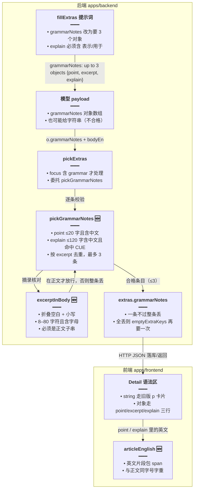
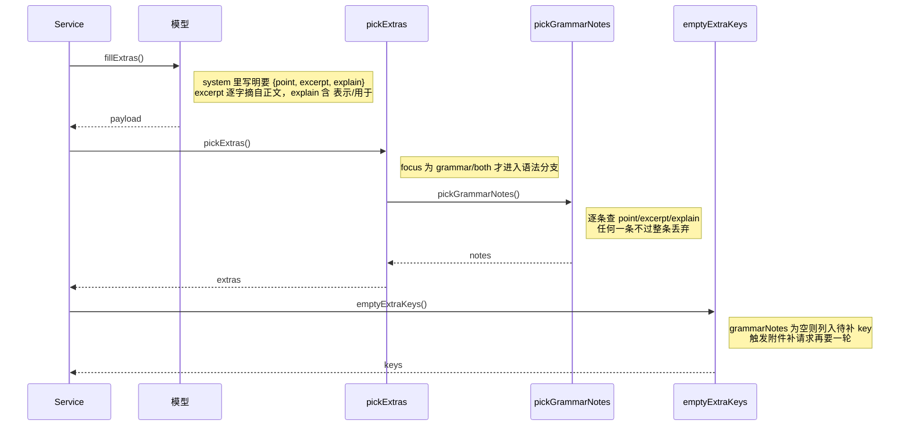

# 每日阅读语法说明结构化

> 文档角色：本篇是「每日阅读」语法说明结构化专题，覆盖后端 `grammarNotes` 从纯中文句子数组升级为 `{point, excerpt, explain}` 对象数组的提示词改写、`pickGrammarNotes` 逐条硬校验（摘录必须出自正文），以及前端详情页按 `string | 对象` 联合类型分流渲染、`articleEnglish` 让说明里的英文与正文同字号字重。
> 姊妹篇：补请求与 429 重试见 [每日阅读生成加固](./每日阅读生成加固.md)；详情页分栏与 `SECTION`/`PANEL` 常量的删除见 [每日阅读界面重构](./每日阅读界面重构.md)；SSE 协议见 [每日阅读流式生成](./每日阅读流式生成.md)；`questionCount` 与题数设定见 [每日阅读随机档位](./每日阅读随机档位.md)；定时入队整点见 [每日阅读自定义入队时间](./每日阅读自定义入队时间.md)；篇目删除见 [每日阅读篇目删除](./每日阅读篇目删除.md)；调度注册见 [每日阅读生成调度](./每日阅读生成调度.md)；前端整体结构见 [每日阅读前端](./每日阅读前端.md)。

## 一、要解决什么问题

1. **讲解写成翻译**：旧版提示词只要「最多 3 句中文，每句讲一个语法点」，模型常把正文整句翻译成中文充数，或写「本文使用了定语从句」这类放之四海皆准的空话，读者看完仍不知道语法点在正文哪里。
2. **没有正文锚点**：纯字符串里即使提到语法点，也不带原文片段，读者要自己在正文里找，学习路径是断的。
3. **后端校验太松**：旧版只查「是字符串、≤120 字、含中文、不重复」，完全管不住内容与本文的相关性，模型讲别的文章也能通过。
4. **中英文样式割裂**：讲解句里夹带的英文术语（如 `used to do`）沿用说明文字的字号字重，与正文 `text-lg` 的英文视觉不统一，像两篇文章拼在一起。

## 二、核心思路

1. **提示词先要结构**：把 `grammarNotes` 的需求从「3 句中文」改成「3 个 `{point, excerpt, explain}` 对象」：`point` 是语法点中文名（≤20 字），`excerpt` 必须逐字摘自正文（8–80 字符），`explain` 是一句 ≤120 字的中文用法说明且必须含「表示」或「用于」——后两个词把「讲用法」和「做翻译」在词面上分开，模型想偷懒直译就过不了。
2. **后端逐条硬校验，不降级**：新增 `pickGrammarNotes`，每条查四件事——`point` 含中文且不超 20 字、`excerpt` 折叠空白小写后必须是正文子串（且含字母）、`explain` 含中文且命中 `GRAMMAR_CUE`、按 `excerpt` 去重。任何一项不过就整条丢弃，不把「半个合格」的条目塞进 extras。
3. **宁缺毋滥，靠外层补一次**：全部丢光时 `grammarNotes` 键为空，`emptyExtraKeys` 会把它列回「需要再要」的 key，复用既有附件补请求机制再要一轮；补回来的条目仍走同一套校验（补请求链路见 [每日阅读生成加固](./每日阅读生成加固.md)，本篇不展开）。
4. **类型单侧收紧、前端双侧兼容**：后端 `ReadingExtras.grammarNotes` 直接改为 `GrammarNote[]`，新产出不再有字符串；但历史篇目的 extras 里躺着 `string[]`，前端类型改为 `Array<string | {point; excerpt; explain}>`，渲染时 `typeof note === 'string'` 分流，老数据走旧卡片原样回显。
5. **摘录即 key**：对象卡片用 `note.excerpt` 作 React key，与后端「按 excerpt 去重」天然对齐，不会出现同 key 告警。
6. **英文回归正文样式**：新增模块级 `articleEnglish`，按英文单词正则把说明文字切开，英文片段包成 `text-lg font-normal leading-7 text-textcolor` 的 span，与正文同一字号字重，中文部分维持说明区样式不变。
7. **取舍说明**：`excerpt` 校验对大小写与多余空白宽容、对措辞零容忍——模型改写任何一个词都会被丢。这是有意为之：放过一个改写过的「伪原文」，比丢掉一条好讲解更伤信任；丢掉的代价由补请求机制兜底。

## 三、实现链路



**读图要点**：结构化的关口只有两个——提示词（让模型给对象）与 `pickGrammarNotes`（不合格整条丢）；前端不做任何校验，只按元素类型分流渲染，因此历史字符串数据与新对象数据能共存于同一语法区。



**读图要点**：`pickGrammarNotes` 返回空数组不等于生成失败——`emptyExtraKeys` 只认「这个键有没有内容」，空了就再要一次，与词汇、题目共用同一条补请求链路。

## 四、代码对比

### 4.1 后端 `GrammarNote` 类型与 `ReadingExtras.grammarNotes`

**对比范围**：`apps/backend/src/services/english-learning/daily-reading.rules.ts` 中 `ReadingExtras` 类型声明（改动前约 L76–L87，改动后约 L105–L125）；`GrammarNote` 为纯新增。

来源：`apps/backend/src/services/english-learning/daily-reading.rules.ts` **改动前** 约 L76–L87（`ReadingExtras`）

```ts
// 附件集合类型：正文合格后由模型补出的学习块，逐键可选。
export type ReadingExtras = {
	// 本篇难度档，来自生成时钉死的 profile。
	level: ReadingLevel;
	// 篇幅档，与 level 一样随正文落库。
	length: ReadingLength;
	// 学习侧重点：只阅读 / 词汇 / 语法 / 两者都要。
	focus: ReadingFocus;
	// 词汇表：词 + 中文释义，逐条校验词在正文里。
	glossary?: { word: string; zh: string }[];
	/** 按句列出正文里的词，zh 是该词在这一句里的意思。 */
	// wordGloss 结构本篇不涉及，保持原样。
	wordGloss?: { en: string; words: { w: string; zh: string }[] }[];
	// 旧版语法说明：纯字符串数组，模型给什么句子就展示什么句子。
	grammarNotes?: string[];
	// 理解题：题干 + 3 个选项 + 正确下标。
	questions?: { q: string; options: string[]; answer: number }[];
	/** 这次联网取材用到的条目，详情全部展示。 */
	// 联网来源列表本篇不涉及，保持原样。
	sources?: { title: string; url: string }[];
};
```

来源：`apps/backend/src/services/english-learning/daily-reading.rules.ts` **改动后** 约 L105–L125（`GrammarNote` + `ReadingExtras`，`GrammarNote` 为纯新增）

```ts
/** 一条语法：名称、正文里的英文片段、用法。纯中文句子不是讲解。 */
// 新增结构化语法条目：point 是语法点中文名，excerpt 是正文原文片段，explain 是用法说明。
export type GrammarNote = {
	// 语法点名称：短中文短语，如「过去分词作定语」。
	point: string;
	// 正文原文片段：后端强制必须能在本篇正文里找到。
	excerpt: string;
	// 用法说明：一句中文，必须说清「表示/用于」什么。
	explain: string;
};

// 附件集合类型：grammarNotes 由字符串数组升级为 GrammarNote 数组。
export type ReadingExtras = {
	// 难度档保持不变。
	level: ReadingLevel;
	// 篇幅档保持不变。
	length: ReadingLength;
	// 侧重点保持不变。
	focus: ReadingFocus;
	/** 这次设置要几道理解题。和 questions 数组分开，条数没凑满时仍显示设定。 */
	// questionCount 属题数设定那项改动的类型落点，本篇只标位置不展开。
	questionCount?: 0 | 2 | 3;
	// 词汇表保持不变。
	glossary?: { word: string; zh: string }[];
	/** 按句列出正文里的词，zh 是该词在这一句里的意思。 */
	// wordGloss 保持不变。
	wordGloss?: { en: string; words: { w: string; zh: string }[] }[];
	// 语法说明改为结构化对象数组；历史 string 形态只由前端类型兼容，后端不再产出。
	grammarNotes?: GrammarNote[];
	// 理解题保持不变。
	questions?: { q: string; options: string[]; answer: number }[];
	/** 这次联网取材用到的条目，详情全部展示。 */
	// 来源列表保持不变。
	sources?: { title: string; url: string }[];
};
```

**变更摘要**：新增 `GrammarNote` 三字段对象类型；`grammarNotes` 由 `string[]` 改为 `GrammarNote[]`，从类型上断绝后端再产出纯字符串讲解的可能。同一块里的 `questionCount` 属另一项改动，本篇不展开。

### 4.2 `pickExtras` 语法分支

**对比范围**：`pickExtras` 中 `focus === 'grammar' || 'both'` 的分支（改动前约 L730–L746，改动后约 L797–L800）；函数其余部分未改，对称省略。

来源：`apps/backend/src/services/english-learning/daily-reading.rules.ts` **改动前** 约 L730–L746（`pickExtras` 语法分支）

```ts
	// 只有设置里要了语法（grammar 或 both）才处理语法说明。
	if (profile.focus === 'grammar' || profile.focus === 'both') {
		// 兼容两种模型输出：grammarNotes 数组，或老字段 grammarNote 单句，兜底空数组。
		const rawNotes = Array.isArray(o.grammarNotes)
			// grammarNotes 已是数组时直接用它。
			? o.grammarNotes
			// 否则看老字段 grammarNote 是不是字符串。
			: typeof o.grammarNote === 'string'
				// 是字符串就包成单元素数组，统一走下面的循环。
				? [o.grammarNote]
				// 两种形态都没有时从空数组开始。
				: [];
		// 收集合格句子的容器，元素是任意中文字符串。
		const grammarNotes: string[] = [];
		// 逐条过滤模型给的原话。
		for (const item of rawNotes) {
			// 最多留 3 条，够了就停。
			if (grammarNotes.length >= 3) break;
			// 非字符串元素直接跳过。
			if (typeof item !== 'string') continue;
			// 去掉零宽字符，防止隐形字符破坏长度与去重判断。
			const note = stripZw(item);
			// 空串、超 120 字、不含中文的都丢掉——仅这三条，管不住内容相关性。
			if (!note || note.length > 120 || !/[\u4e00-\u9fff]/.test(note)) continue;
			// 完全相同的句子去重。
			if (grammarNotes.includes(note)) continue;
			// 留下合格句子。
			grammarNotes.push(note);
		}
		// 一条都不剩就不挂这个键，让外层决定要不要再要一次。
		if (grammarNotes.length > 0) extras.grammarNotes = grammarNotes;
	}
```

来源：`apps/backend/src/services/english-learning/daily-reading.rules.ts` **改动后** 约 L797–L800（`pickExtras` 语法分支）

```ts
	// 只有设置里要了语法（grammar 或 both）才处理语法说明。
	if (profile.focus === 'grammar' || profile.focus === 'both') {
		// 全部校验下沉到 pickGrammarNotes：对象形态、摘录出自正文、用法说明命中 CUE。
		const grammarNotes = pickGrammarNotes(o.grammarNotes, bodyEn);
		// 一条都不剩就不挂这个键，emptyExtraKeys 会把它列回补请求。
		if (grammarNotes.length > 0) extras.grammarNotes = grammarNotes;
	}
```

**变更摘要**：内联手写的字符串校验（长度、含中文、去重、≤3 条）整体删除，换成一行 `pickGrammarNotes(o.grammarNotes, bodyEn)`；注意旧版兼容的 `grammarNote` 单字符串字段不再进入 `pickExtras`——后端只认新的对象数组，老字段仅由前端渲染层兜底。

### 4.3 `GRAMMAR_CUE` / `excerptInBody` / `pickGrammarNotes`

**对比范围**：三个符号均为纯新增，基线无对应实现。

来源：`apps/backend/src/services/english-learning/daily-reading.rules.ts` **改动后（纯新增）** 约 L830–L874（`GRAMMAR_CUE`、`excerptInBody`、`pickGrammarNotes`）

```ts
// 用法说明的特征词：「表示」「用于」。讲解必含其一，把「讲用法」和「做翻译」分开。
const GRAMMAR_CUE = /表示|用于/;

/** 摘录折叠空白后必须出现在这篇正文里，避免讲到别的文章。 */
// 判断一条摘录是否真是本文原文：对大小写与多余空白宽容，对措辞零容忍。
function excerptInBody(bodyEn: string, excerpt: string): boolean {
	// 正文去零宽、折叠连续空白为单个空格、转小写，作为被查找的母串。
	const left = stripZw(bodyEn).replace(/\s+/g, ' ').toLowerCase();
	// 摘录同样折叠空白、去首尾、转小写，与正文保持同一套规范化。
	const right = excerpt.replace(/\s+/g, ' ').trim().toLowerCase();
	// 太短（<8）没有定位意义，太长（>80）更像抄整句，都视为不合格。
	if (right.length < 8 || right.length > 80) return false;
	// 摘录必须含英文字母，防止模型拿中文翻译冒充原文。
	if (!/[a-z]/i.test(right)) return false;
	// 子串包含即通过；模型改写任何一个词都会在这里被丢掉。
	return left.includes(right);
}

/** 只留讲到本文的语法。字符串和整句中文翻译都丢掉，好让外层再要一次。 */
// 语法说明的唯一入口校验：输入未知，输出最多 3 条合格 GrammarNote。
export function pickGrammarNotes(raw: unknown, bodyEn: string): GrammarNote[] {
	// 模型给的不是数组（包括旧版字符串形态）时直接判空，交给外层补请求。
	if (!Array.isArray(raw)) return [];
	// 合格条目的收集容器。
	const notes: GrammarNote[] = [];
	// 逐条检查模型输出。
	for (const item of raw) {
		// 最多 3 条，够了就停。
		if (notes.length >= 3) break;
		// 非对象元素（含旧版字符串）整条丢弃，不做降级保留。
		if (!item || typeof item !== 'object') continue;
		// 放宽成键值对，逐字段取字符串。
		const row = item as Record<string, unknown>;
		// point 必须是字符串，去零宽；取不到按空串处理。
		const point = typeof row.point === 'string' ? stripZw(row.point) : '';
		// excerpt 必须是字符串，去零宽；取不到按空串处理。
		const excerpt = typeof row.excerpt === 'string' ? stripZw(row.excerpt) : '';
		// explain 必须是字符串，去零宽；取不到按空串处理。
		const explain = typeof row.explain === 'string' ? stripZw(row.explain) : '';
		// 语法点名称：非空、≤20 字、含中文；英文名或长句都不合格。
		if (!point || point.length > 20 || !/[\u4e00-\u9fff]/.test(point)) continue;
		// 摘录必须能通过正文子串校验，讲不到本文的整条丢。
		if (!excerptInBody(bodyEn, excerpt)) continue;
		// 用法说明：非空、≤120 字、含中文，且必须命中「表示/用于」。
		if (
			// 空串不合格。
			!explain ||
			// 超 120 字不合格。
			explain.length > 120 ||
			// 不含中文不合格。
			!/[\u4e00-\u9fff]/.test(explain) ||
			// 不含「表示/用于」视为翻译而非讲解，不合格。
			!GRAMMAR_CUE.test(explain)
		// 任一条件命中即进入丢弃分支。
		) {
			// 丢弃当前条，继续看下一条。
			continue;
		}
		// 用规范化后的摘录作去重键，同一处原文只讲一次。
		const key = excerpt.replace(/\s+/g, ' ').trim().toLowerCase();
		// 已留条目里有同一摘录时跳过当前条。
		if (
			// 在已收条目里查找重复摘录。
			notes.some(
				// 对每个已收条目取它的摘录。
				(note) =>
					// 同样规范化后与当前键比较。
					note.excerpt.replace(/\s+/g, ' ').trim().toLowerCase() === key,
			)
		// 找到重复即进入丢弃分支。
		) {
			// 丢弃重复的当前条。
			continue;
		}
		// 三项校验全过且未重复，才收进结果。
		notes.push({ point, excerpt, explain });
	}
	// 可能为空数组；空数组由 pickExtras 转成「不挂键」，再由补请求兜底。
	return notes;
}
```

**变更摘要**：`GRAMMAR_CUE` 把「讲解」锁死在「表示/用于」句式上；`excerptInBody` 用规范化子串匹配保证摘录出自本文；`pickGrammarNotes` 把对象形态、三字段、去重、上限串成一条流水线，任何一环不过都整条丢弃。

### 4.4 `fillExtras` 提示词行

**对比范围**：`apps/backend/src/services/english-learning/english-daily-reading.service.ts` 中 `fillExtras` 方法内的 `lines` 映射块（改动前约 L1570–L1578，改动后约 L1599–L1607）；仅 `grammarNotes` 一行文案变化，其余行对称保留以便对照。

来源：`apps/backend/src/services/english-learning/english-daily-reading.service.ts` **改动前** 约 L1570–L1578（`fillExtras` 内 `lines` 映射）

```ts
		// 按这次要补的附件 key，逐类生成一行英文需求说明。
		const lines = keys.map((key) => {
			// 词汇表需求：词必须出自正文，数量随篇幅档变化。
			if (key === 'glossary') {
				// 返回词汇表那一行提示词，glossaryLimit 按篇幅给上限。
				return `glossary: up to ${glossaryLimit(profile.length)} objects {word, zh}; each word must appear in the passage; pick advanced, precise, high-value words a learner would look up, not basic everyday words`;
			}
			// 语法说明需求：旧版只要中文字符串，不约束结构与正文锚点。
			if (key === 'grammarNotes') {
				// 旧提示词：最多 3 句不同的中文，每句 ≤120 字，讲正文里一个语法点。
				return 'grammarNotes: up to 3 different Chinese sentences, each within 120 characters, each about one grammar pattern in the passage';
			}
			// 其余 key 只剩理解题，题数随设置。
			return `questions: exactly ${profile.questions} objects {q, options, answer}; options has 3 strings; answer is 0, 1, or 2`;
		});
```

来源：`apps/backend/src/services/english-learning/english-daily-reading.service.ts` **改动后** 约 L1599–L1607（`fillExtras` 内 `lines` 映射）

```ts
		// 按这次要补的附件 key，逐类生成一行英文需求说明。
		const lines = keys.map((key) => {
			// 词汇表需求保持不变。
			if (key === 'glossary') {
				// 词汇表提示词与基线一致。
				return `glossary: up to ${glossaryLimit(profile.length)} objects {word, zh}; each word must appear in the passage; pick advanced, precise, high-value words a learner would look up, not basic everyday words`;
			}
			// 语法说明需求：改为要结构化对象，并把后端的每条校验都写进提示词。
			if (key === 'grammarNotes') {
				// 新提示词：3 个 {point, excerpt, explain} 对象；excerpt 逐字摘自正文 8–80 字符；
				// explain 一句 ≤120 字中文且必须含 表示/用于；明确禁止翻译摘录或正文。
				return 'grammarNotes: up to 3 objects {point, excerpt, explain}, not Chinese sentences. point: Chinese name of one pattern in the passage, within 20 characters. excerpt: an English fragment copied verbatim from the passage, 8-80 characters. explain: one Chinese sentence within 120 characters that says how the pattern works in that excerpt, and must contain 表示 or 用于. Do not translate the excerpt or the passage.';
			}
			// 理解题提示词与基线一致。
			return `questions: exactly ${profile.questions} objects {q, options, answer}; options has 3 strings; answer is 0, 1, or 2`;
		});
```

**变更摘要**：提示词与 `pickGrammarNotes` 的校验一一对应（20/8–80/120/表示|用于），并额外加了两句词面约束——`not Chinese sentences` 堵死旧输出习惯，`Do not translate the excerpt or the passage` 堵死直译充数。提示词先行、校验兜底，两层用同一组数字，模型给的即使跑偏也会被后端同构地丢掉。

### 4.5 前端 `EnglishDailyReadingExtras.grammarNotes` 类型

**对比范围**：`apps/frontend/src/service/index.ts` 中 `EnglishDailyReadingExtras` 类型（改动前约 L2014–L2024，改动后约 L2014–L2026）；其中 `level/length/focus` 的 `Exclude<..., 'random'>` 属「随机档位」改动，本篇只标位置。

来源：`apps/frontend/src/service/index.ts` **改动前** 约 L2014–L2024（`EnglishDailyReadingExtras`）

```ts
// 每日阅读附件集合的前端类型，与后端 ReadingExtras 对应。
export type EnglishDailyReadingExtras = {
	// 难度档，直接引用 Profile 的 level 联合。
	level: EnglishDailyReadingProfile['level'];
	// 篇幅档，直接引用 Profile 的 length 联合。
	length: EnglishDailyReadingProfile['length'];
	// 侧重点，直接引用 Profile 的 focus 联合。
	focus: EnglishDailyReadingProfile['focus'];
	// 词汇表：词 + 中文释义。
	glossary?: { word: string; zh: string }[];
	// 按句词级释义。
	wordGloss?: { en: string; words: { w: string; zh: string }[] }[];
	// 旧版单句语法字段，历史数据兜底用。
	grammarNote?: string;
	// 旧版语法说明：纯字符串数组。
	grammarNotes?: string[];
	// 理解题。
	questions?: { q: string; options: string[]; answer: number }[];
	// 联网来源列表。
	sources?: { title: string; url: string }[];
};
```

来源：`apps/frontend/src/service/index.ts` **改动后** 约 L2014–L2026（`EnglishDailyReadingExtras`）

```ts
// 每日阅读附件集合的前端类型，与后端 ReadingExtras 对应。
export type EnglishDailyReadingExtras = {
	// 难度档排除 random：落库的永远是抽完的具体档（随机档位改动，本篇只标位置）。
	level: Exclude<EnglishDailyReadingProfile['level'], 'random'>;
	// 篇幅档同理排除 random。
	length: Exclude<EnglishDailyReadingProfile['length'], 'random'>;
	// 侧重点同理排除 random。
	focus: Exclude<EnglishDailyReadingProfile['focus'], 'random'>;
	// 词汇表保持不变。
	glossary?: { word: string; zh: string }[];
	// 按句词级释义保持不变。
	wordGloss?: { en: string; words: { w: string; zh: string }[] }[];
	// 旧版单句语法字段仍保留，历史数据兜底用。
	grammarNote?: string;
	// 语法说明改为联合数组：新数据是对象，历史数据是字符串，渲染层按 typeof 分流。
	grammarNotes?: Array<
		// 联合成员：历史 string 与新对象三字段。
		string | { point: string; excerpt: string; explain: string }
	>;
	// 理解题保持不变。
	questions?: { q: string; options: string[]; answer: number }[];
	// 联网来源列表保持不变。
	sources?: { title: string; url: string }[];
};
```

**变更摘要**：`grammarNotes` 改为 `Array<string | {point; excerpt; explain}>` 联合类型——后端只产出对象，但已落库的历史篇目仍是字符串数组，前端类型必须同时承认两种形态，否则老数据在类型层就过不去。

### 4.6 前端 `articleEnglish`

**对比范围**：`apps/frontend/src/views/englishLearning/dailyReading/Detail.tsx` 模块级新增的 `articleEnglish` 函数；基线无此函数（语法区原是整段中文样式，不存在英文混排需求）。

来源：`apps/frontend/src/views/englishLearning/dailyReading/Detail.tsx` **改动后（纯新增）** 约 L34–L48（`articleEnglish`）

```ts
/** 语法说明里的英文跟正文同一字号、字重和颜色。 */
// 把一段说明文字里的英文片段挑出来包 span，让卡片里的英文与正文视觉一致。
function articleEnglish(text: string) {
	// 按「英文单词（可带撇号/连字符/右单引号续段）」正则切分；捕获组让英文段落在结果数组的奇数位。
	return text.split(/([A-Za-z]+(?:['’-][A-Za-z]+)*)/).map((part, index) =>
		// 奇数位是英文片段：包成与正文相同样式的 span。
		index % 2 === 1 ? (
			// 片段容器：key 用下标即可，列表由 split 稳定产生。
			<span
				// 以切分下标作 key，同一段文字内不会重复。
				key={index}
				// 与正文相同的字号、字重、行高和颜色，消除「两篇文章」感。
				className="text-lg font-normal leading-7 text-textcolor"
			>
				// 渲染英文片段本身。
				{part}
			// 结束英文片段 span。
			</span>
		// 偶数位分支：中文与标点不包层。
		) : (
			// 偶数位是中文/标点等非英文部分，原样输出不包层。
			part
		),
	);
}
```

**变更摘要**：`split` 带捕获组时，偶数位是非匹配段、奇数位是匹配段，函数只对奇数位包样式；中文说明维持调用处（`text-sm`）的默认样式，英文片段提升到正文的 `text-lg`，同一张卡片里两种语言各自合适。

### 4.7 前端语法区渲染

**对比范围**：`Detail.tsx` 中「语法」`section` 的完整区块（改动前约 L495–L516，改动后约 L418–L453）。改动前的 `SECTION`/`PANEL` 常量删除与 `h2` 样式统一属界面重构，本篇只在摘要里提一句；为可读性，摘录去掉了过深的公共前导缩进。

来源：`apps/frontend/src/views/englishLearning/dailyReading/Detail.tsx` **改动前** 约 L495–L516（语法区）

```tsx
// 有语法数组或老单句字段时才渲染语法区。
{row.extras?.grammarNotes?.length ||
// 老单句字段也足以打开语法区。
row.extras?.grammarNote ? (
	// 语法区容器：标题与卡片纵向排列。
	<section className="flex flex-col gap-3">
		// 区标题：沿用 SECTION 常量（该常量已随界面重构删除，见姊妹篇）。
		<h2 className={SECTION}>
			// 「语法」标题走 i18n。
			{t('englishLearning.dailyReading.grammar')}
		// 结束区标题。
		</h2>
		// 优先用数组；数组为空时回退老字段单句，包成单元素数组统一 map。
		{(row.extras.grammarNotes?.length
			// 数组非空时优先用数组。
			? row.extras.grammarNotes
			// 数组为空时把老字段单句包成单元素数组。
			: [row.extras.grammarNote!]
		// 逐条渲染成卡片。
		).map((note) => (
			// 每条一张卡片：旧版只有字符串一种形态，整句平铺。
			<p
				// 字符串本身作 key，与后端按整句去重对齐。
				key={note}
				// PANEL 常量给边框底色，再叠说明文字的字号行高。
				className={cn(
					// PANEL 提供边框、圆角与浅底色。
					PANEL,
					// 叠加说明文字颜色、内边距与字号行高。
					'text-textcolor/80 px-3 py-2.5 text-sm leading-7',
				)}
			>
				// 整句原样渲染，中英文同一套样式。
				{note}
			// 结束整句卡片。
			</p>
		))}
	// 结束语法区容器。
	</section>
// 没有任何语法数据时不渲染该区。
) : null}
```

来源：`apps/frontend/src/views/englishLearning/dailyReading/Detail.tsx` **改动后** 约 L418–L453（语法区）

```tsx
// 有语法数组或老单句字段时才渲染语法区，条件与基线一致。
{row.extras?.grammarNotes?.length ||
// 老单句字段也足以打开语法区，与基线一致。
row.extras?.grammarNote ? (
	// 语法区容器：标题与卡片纵向排列。
	<section className="flex flex-col gap-3">
		// 区标题改为内联类名；SECTION 常量的删除属界面重构，与本篇正交。
		<h2 className="text-sm text-textcolor/80">
			// 「语法」标题走 i18n。
			{t('englishLearning.dailyReading.grammar')}
		// 结束区标题。
		</h2>
		// 优先用数组；数组为空时回退老字段单句，包成单元素数组统一 map，与基线一致。
		{(row.extras.grammarNotes?.length
			// 数组非空时优先用数组。
			? row.extras.grammarNotes
			// 数组为空时把老字段单句包成单元素数组。
			: [row.extras.grammarNote!]
		// 逐条按元素类型分流渲染。
		).map((note) =>
			// 元素是字符串：历史数据，走旧版整句卡片。
			typeof note === 'string' ? (
				// 旧版卡片：类名内联展开（原 PANEL + 文字样式），视觉与基线一致。
				<p
					// 字符串本身作 key。
					key={note}
					// 与旧版 PANEL 组合样式逐类等价。
					className="border-theme/10 bg-theme/5 text-textcolor/80 rounded-md border px-3 py-2.5 text-sm leading-7"
				>
					// 整句原样渲染。
					{note}
				// 结束历史卡片。
				</p>
			// 元素是对象：新数据，渲染 point/excerpt/explain 三行结构。
			) : (
				// 对象卡片容器。
				<div
					// 摘录作 key，与后端按 excerpt 去重对齐。
					key={note.excerpt}
					// 卡片容器：三行纵向排布，行间距 1。
					className="border-theme/10 bg-theme/5 flex flex-col gap-1 rounded-md border px-3 py-2.5"
				>
					// 第一行：语法点中文名，小号中重；其中英文术语经 articleEnglish 提到正文字号。
					<p className="text-sm font-medium text-textcolor">
						// 渲染 point，英文片段包成正文样式。
						{articleEnglish(note.point)}
					// 结束语法点标题行。
					</p>
					// 第二行：正文原文摘录，直接用正文同款 text-lg，一眼能对回原文。
					<p className="text-lg leading-7 text-textcolor">
						// 摘录是纯正文片段，无需再过 articleEnglish。
						{note.excerpt}
					// 结束原文摘录行。
					</p>
					// 第三行：用法说明，小号弱色；其中英文术语同样经 articleEnglish 提级。
					<p className="text-sm leading-7 text-textcolor/80">
						// 渲染 explain，英文片段包成正文样式。
						{articleEnglish(note.explain)}
					// 结束用法说明行。
					</p>
				// 结束对象卡片。
				</div>
			),
		)}
	// 结束语法区容器。
	</section>
// 没有任何语法数据时不渲染该区。
) : null}
```

**变更摘要**：渲染入口按 `typeof note === 'string'` 分流——字符串走与旧版逐类等价的 `<p>` 卡片（历史数据原样回显），对象走三行卡片（point 标题行 / excerpt 原文行 / explain 说明行）；对象卡片 key 改用 `note.excerpt`；`h2` 与卡片类名由常量改为内联是界面重构的连带结果，与本篇功能正交。

## 五、行为变化与兼容性

1. **历史 string 数据原样回显**：已落库篇目的 `extras.grammarNotes` 是 `string[]`，前端 `typeof note === 'string'` 分支渲染的卡片类名与旧版 `PANEL + text-sm leading-7` 逐类等价，老篇目视觉不变；`grammarNote` 单字符串老字段仍在数组为空的回退路径里，双保险。
2. **新旧提示词差异**：旧提示词是「up to 3 different Chinese sentences… about one grammar pattern」，产出物无结构、无锚点；新提示词要求「up to 3 objects {point, excerpt, explain}」，逐字段给约束（point ≤20 字中文名、excerpt 逐字摘自正文 8–80 字符、explain ≤120 字且含 表示/用于），并显式禁止翻译摘录或正文。提示词里的每个数字都与 `pickGrammarNotes` 的校验一致，模型照做即过检。
3. **校验不过的策略是「整条丢弃，让外层再要一次」**：任何一条不合格只丢自己，不连坐其它条目；全部丢光时 `grammarNotes` 键不挂在 extras 上，`emptyExtraKeys` 判定该 key 为空并列入补请求，`mergeExtras` 同类合并时仍优先留先拿到的合格条目。整条链路不产生脏数据，代价是多一次附件请求。
4. **后端不再读 `grammarNote` 老字段**：`pickExtras` 旧版会把 `grammarNote` 单句包成数组兜底，新版只把 `o.grammarNotes` 交给 `pickGrammarNotes`，模型走老字段输出会被整体判空并触发补请求——这是有意收紧，避免新旧两路并存。
5. **生成失败不渲染**：语法区渲染条件是 `grammarNotes?.length || grammarNote`，补请求仍失败时键不存在，详情页直接没有语法区，不显示空卡片或错误态。

## 六、风险与回归清单

1. **摘录措辞零容忍**：`excerptInBody` 是规范化子串匹配，模型把 `don't` 写成 `do not`、改一个时态词形都会整条丢；语法区可能因此经常需要第二次补请求才出现，极端情况下最终缺省（区不渲染）。回归点：同一篇生成两次，观察语法区出现率是否可接受。
2. **`GRAMMAR_CUE` 误杀**：合法讲解若用「表达」「用来」「修饰」等措辞而不含「表示/用于」，会被整条丢弃。回归点：检查若干篇的 explain 是否句式趋同、多样性下降。
3. **point ≤20 字上限**：长语法点中文名（如「过去完成进行时的被动语态」）超限被丢，可能偏向只保留短名语法点。回归点：focus=grammar 生成的篇目里语法点是否集中于常见短名。
4. **联合类型扩散面**：任何消费 `grammarNotes` 的前端代码都必须先 `typeof` 分流；目前仅 `Detail.tsx` 消费，`Quiz`、`ReadingList` 等不碰该字段，无连带改动。回归点：全局搜索 `grammarNotes` 确认消费方清单没有遗漏。
5. **两套「在正文」校验别混用**：词汇用 `inBody`（单词级），语法摘录用 `excerptInBody`（子串级，8–80 字符）；给词汇换用子串校验或给摘录换用词级校验都会引入误判。回归点：`pickGrammarNotes` 单测覆盖「摘录在正文 / 不在正文 / 超界 / 无字母」四象限。
6. **去重以规范化 excerpt 为键**：两条不同语法点引用同一处原文时只留第一条，后一条被丢；这是预期行为（同一处只讲一次），但若模型习惯集中引用同一句，可能 3 条名额用不满。

若与仓库最新源码不一致，以源码为准。
