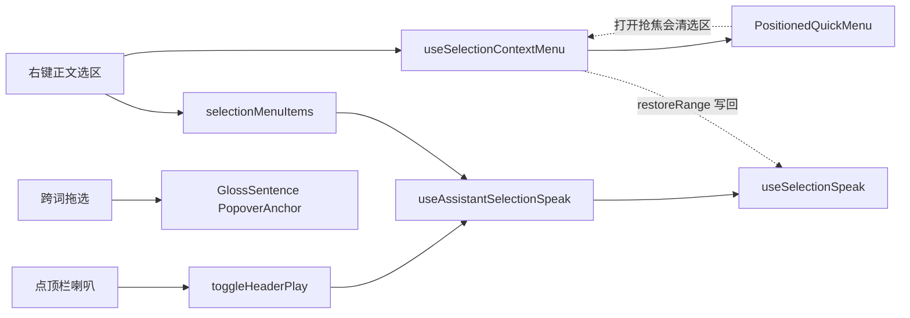

# 每日阅读选区朗读与全文播放统一

## 1. 背景与目标

每日阅读详情页此前有三套互不打通的播放与选区交互：

- **全文朗读**走独立的 `playPreferred` 流程，自带 `playStatus`（idle/playing/paused）与「暂停/继续」，和助手选区朗读条是两套状态机；
- **正文选区**没有右键菜单，想朗读选中的句子得复制出去；
- **点词释义**用 `PopoverTrigger`，Trigger 把每个词当成可聚焦按钮，右键聚焦会清掉跨词选区，导致拖选时「只剩点击处被选中」。

本轮把三者统一：全文朗读复用**选区朗读条**（开始/停止，不再暂停），正文选区**右键出菜单**（朗读 / 复制），点词改用 `PopoverAnchor` 让**跨词拖选**不再被抢焦。

## 2. 改动范围

- `apps/frontend/src/components/design/ContextMenu/PositionedQuickMenu.tsx`
- `apps/frontend/src/components/design/ContextMenu/useSelectionContextMenu.tsx`
- `apps/frontend/src/components/design/SelectionSpeak/index.ts`
- `apps/frontend/src/components/design/SelectionSpeak/useSelectionSpeak.ts`
- `apps/frontend/src/components/design/SelectionSpeak/useAssistantSelectionSpeak.tsx`
- `apps/frontend/src/views/englishLearning/daily/components/DailyPlayIconButton.tsx`
- `apps/frontend/src/views/englishLearning/dailyReading/Detail.tsx`
- `apps/frontend/src/views/englishLearning/dailyReading/components/ArticleHeader.tsx`
- `apps/frontend/src/views/englishLearning/dailyReading/components/GlossSentence.tsx`

## 3. 实现思路

核心是「让选区高亮在菜单打开期间不丢」+「让全文朗读走选区朗读同一条链路」。



要点：

1. **菜单不抢焦**：`PositionedQuickMenu` 的 `DropdownMenu` 改 `modal={false}`，并 `onCloseAutoFocus` 阻止回焦——避免 Dropdown 挂载时把焦点抢回 Trigger，导致浏览器清除页面选区高亮。
2. **Range 写回**：`useSelectionContextMenu` 在右键按下时快照 `Range`，菜单打开后（`requestAnimationFrame` / `queueMicrotask` / `focusin`）反复把快照写回 `window.getSelection`，保住蓝底高亮。
3. **左键点选区外清选区**：浏览器对 `user-select:none` 区域的左键常不清选区，这里用几何命中（`range.getClientRects()`）判断是否点在选区外，是则 `removeAllRanges` 并打 `skipRestoreRef` 标记，防止写回效果把选区又恢复。
4. **句下标回调**：`useSelectionSpeak.start` 新增可选 `opts.onSentenceIndex`，每次 `applySentence(si)` 时回调，让详情页能据此高亮当前句（替代旧版 `playPreferred` 的 `onCadenceChunk`）。
5. **全文朗读走选区条**：`Detail` 不再维护 `playStatus` / `playGenRef` / `pausePlaybackSoft`，改用 `useAssistantSelectionSpeak`；顶栏喇叭只做「开始 / 停止」，`speakSource` 区分 `article`（全文）与 `selection`（选区），两者共用底部播放条但顶栏图标只跟 `article` 联动。
6. **点词不抢选区**：`GlossSentence` 把 `PopoverTrigger` 换成 `PopoverAnchor`，去掉 `role="button"` / `tabIndex`，改为 `onClick` 手动打开；若当前有文本选区则不打开释义，保证拖选 / 右键复制畅通。

## 4. 关键代码对比与注释

### 4.1 选区右键菜单保选区高亮

#### 4.1.1 `PositionedQuickMenu`：菜单不抢焦

**改动前** · `apps/frontend/src/components/design/ContextMenu/PositionedQuickMenu.tsx`

```tsx
		// 渲染 DropdownMenu 元素
		<DropdownMenu open={state.open} onOpenChange={onOpenChange} modal>
			// 渲染 DropdownMenuTrigger 元素
			<DropdownMenuTrigger asChild>
				// 渲染 span 元素
				<span aria-hidden style={anchorStyle} />
			// 闭合 DropdownMenuTrigger 标签
			</DropdownMenuTrigger>
			// 渲染 DropdownMenuContent 元素
			<DropdownMenuContent
				// 赋值
				className={contentClassName}
				// 赋值
				align="start"
```

**改动后** · `apps/frontend/src/components/design/ContextMenu/PositionedQuickMenu.tsx`

```tsx
		// 执行本行
		// modal=false + 禁止自动聚焦：避免抢焦把页面选区高亮清掉（选区右键复制/朗读）
		// 渲染 DropdownMenu 元素
		<DropdownMenu open={state.open} onOpenChange={onOpenChange} modal={false}>
			// 渲染 DropdownMenuTrigger 元素
			<DropdownMenuTrigger asChild>
				// 渲染 span 元素
				<span aria-hidden style={anchorStyle} />
			// 闭合 DropdownMenuTrigger 标签
			</DropdownMenuTrigger>
			// 渲染 DropdownMenuContent 元素
			<DropdownMenuContent
				// 赋值
				className={contentClassName}
				// 赋值
				align="start"
				// 赋值
				side="right"
				// 执行本行
				// DropdownMenu Content 类型不含 onOpenAutoFocus（Menu 私有）；关焦即可，开菜单选区靠 hook 写回
				// 函数/回调定义
				onCloseAutoFocus={(event) => event.preventDefault()}
			// 执行本行
			>
```

**变更摘要**：`modal` 由默认 `true` 改为 `false`，并阻止关闭时自动回焦；让选区高亮不被 Dropdown 的焦点管理清除，真正的写回由 `useSelectionContextMenu` 完成。

#### 4.1.2 `useSelectionContextMenu`：快照 + 写回 Range

**改动前** · `apps/frontend/src/components/design/ContextMenu/useSelectionContextMenu.tsx`

```tsx
// 定义类型
type MenuState = PositionedQuickMenuState & {
	// 设置 items 字段
	items: readonly QuickContextMenuEntry[];
};

// 执行本行
/**
 // 执行本行
 * 选中文本后右键才弹出菜单；`getItems` 未传则无行为（默认关闭）。
 // 执行本行
 *
 // 执行本行
 * 可靠性（尤其 macOS）：
 // 赋值
 * - pointerdown(button=2) 先快照选区（系统右键常会改写/点词选中）
 // 执行本行
 * - contextmenu 用捕获阶段，并尽早 preventDefault
 // 执行本行
 */
// 导出
export function useSelectionContextMenu(
	// 执行本行
	getItems?: SelectionContextMenuItemsFn,
// 执行本行
): {
	// 设置 onContextMenuCapture 字段
	onContextMenuCapture: ((e: ReactMouseEvent<HTMLElement>) => void) | undefined;
	// 设置 onPointerDownCapture 字段
	onPointerDownCapture:
		// 函数/回调定义
		| ((e: ReactPointerEvent<HTMLElement>) => void)
		// 执行本行
		| undefined;
	// 设置 menu 字段
	menu: ReactNode;
} {
	// 赋值
	const [menu, setMenu] = useState<MenuState | null>(null);
	// 执行本行
	/** 右键按下瞬间的选区；contextmenu 时优先用它 */
	// 声明 snapRef
	const snapRef = useRef<SelSnap | null>(null);

	// 声明 onPointerDownCapture
	const onPointerDownCapture = useCallback(
		// 函数/回调定义
		(e: ReactPointerEvent<HTMLElement>) => {
			// 条件分支
			if (!getItems) return;
			// 条件分支
			if (e.button !== 2) return;
			// 赋值
			snapRef.current = readSelectionIn(e.currentTarget);
		},
		// 执行本行
		[getItems],
	);

	// 声明 onContextMenuCapture
	const onContextMenuCapture = useCallback(
		// 函数/回调定义
		(e: ReactMouseEvent<HTMLElement>) => {
			// 条件分支
			if (!getItems) return;

			// 声明 live
			const live = readSelectionIn(e.currentTarget);
			// 声明 snap
			const snap = snapRef.current;
			// 赋值
			snapRef.current = null;

			// 执行本行
			// 优先用右键按下前的快照（用户拖选）；避免系统点词覆盖后误判无选区
			// 声明 text
			const text = (snap?.text || live.text).trim();
			// 条件分支
			if (!text) return;

			// 声明 range
			const range = snap?.text ? snap.range : live.range;
			// 声明 items
			const items = getItems(text, { range });
			// 条件分支
			if (!items?.length) return;

			// 执行本行
			// 已确认要弹自定义菜单：必须拦住系统菜单（须在捕获阶段尽早调用）
			// 调用方法
			e.preventDefault();
			// 调用方法
			e.stopPropagation();
			// 更新 Menu 状态
			setMenu({ open: true, x: e.clientX, y: e.clientY, items });
		},
		// 执行本行
		[getItems],
	);

	// 条件分支
	if (!getItems) {
		// 返回结果
		return {
			// 设置 onContextMenuCapture 字段
			onContextMenuCapture: undefined,
			// 设置 onPointerDownCapture 字段
			onPointerDownCapture: undefined,
			// 设置 menu 字段
			menu: null,
		};
	}

	// 返回结果
	return {
		// 执行本行
		onContextMenuCapture,
		// 执行本行
		onPointerDownCapture,
		// 设置 menu 字段
		menu: (
			// 渲染 PositionedQuickMenu 元素
			<PositionedQuickMenu
				// 赋值
				state={menu}
				// 赋值
				items={menu?.items ?? []}
				// 函数/回调定义
				onOpenChange={(open) => {
					// 条件分支
					if (!open) setMenu(null);
					// 条件分支
					else setMenu((m) => (m ? { ...m, open } : m));
				}}
			// 执行本行
			/>
		),
	};
}
```

**改动后** · `apps/frontend/src/components/design/ContextMenu/useSelectionContextMenu.tsx`

```tsx
// 函数/回调定义
function restoreRange(range: Range | null, skip?: boolean) {
	// 条件分支
	if (skip || !range) return;
	// 声明 sel
	const sel = window.getSelection();
	// 条件分支
	if (!sel) return;
	// 异常处理块
	try {
		// 条件分支
		if (sel.rangeCount === 1) {
			// 声明 cur
			const cur = sel.getRangeAt(0);
			// 条件分支
			if (
				// 赋值
				cur.startContainer === range.startContainer &&
				// 赋值
				cur.startOffset === range.startOffset &&
				// 赋值
				cur.endContainer === range.endContainer &&
				// 赋值
				cur.endOffset === range.endOffset
			) {
				// 返回结果
				return;
			}
		}
		// 调用方法
		sel.removeAllRanges();
		// 调用方法
		sel.addRange(range);
	// 执行本行
	} catch {
		// 执行本行
		/* DOM 变动后 range 可能失效 */
	}
}

// 定义类型
type MenuState = PositionedQuickMenuState & {
	// 设置 items 字段
	items: readonly QuickContextMenuEntry[];
	// 设置 range 字段
	range: Range | null;
};

// 执行本行
/**
 // 执行本行
 * 选中文本后右键才弹出菜单；`getItems` 未传则无行为（默认关闭）。
 // 执行本行
 *
 // 执行本行
 * 可靠性（尤其 macOS）：
 // 赋值
 * - pointerdown(button=2) 先快照选区（系统右键常会改写/点词选中）
 // 执行本行
 * - contextmenu 用捕获阶段，并尽早 preventDefault
 // 执行本行
 * - 菜单打开后写回 Range，避免 Dropdown 抢焦导致选中样式消失
 // 执行本行
 * - 左键点选区外/空白（含 user-select:none 区域）主动清选区；浏览器默认常不清
 // 执行本行
 */
// 导出
export function useSelectionContextMenu(
	// 执行本行
	getItems?: SelectionContextMenuItemsFn,
// 执行本行
): {
	// 设置 onContextMenuCapture 字段
	onContextMenuCapture: ((e: ReactMouseEvent<HTMLElement>) => void) | undefined;
	// 设置 onPointerDownCapture 字段
	onPointerDownCapture:
		// 函数/回调定义
		| ((e: ReactPointerEvent<HTMLElement>) => void)
		// 执行本行
		| undefined;
	// 设置 menu 字段
	menu: ReactNode;
} {
	// 赋值
	const [menu, setMenu] = useState<MenuState | null>(null);
	// 执行本行
	/** 右键按下瞬间的选区；contextmenu 时优先用它 */
	// 声明 snapRef
	const snapRef = useRef<SelSnap | null>(null);
	// 声明 keepRangeRef
	const keepRangeRef = useRef<Range | null>(null);
	// 执行本行
	/** 左键点空白取消选中时，禁止菜单期 restore 把选区写回 */
	// 声明 skipRestoreRef
	const skipRestoreRef = useRef(false);

	// 声明 onPointerDownCapture
	const onPointerDownCapture = useCallback(
		// 函数/回调定义
		(e: ReactPointerEvent<HTMLElement>) => {
			// 条件分支
			if (!getItems) return;
			// 条件分支
			if (e.button !== 2) return;
			// 赋值
			snapRef.current = readSelectionIn(e.currentTarget);
		},
		// 执行本行
		[getItems],
	);

	// 声明 onContextMenuCapture
	const onContextMenuCapture = useCallback(
		// 函数/回调定义
		(e: ReactMouseEvent<HTMLElement>) => {
			// 条件分支
			if (!getItems) return;

			// 声明 live
			const live = readSelectionIn(e.currentTarget);
			// 声明 snap
			const snap = snapRef.current;
			// 赋值
			snapRef.current = null;

			// 执行本行
			// 优先用右键按下前的快照（用户拖选）；避免系统点词覆盖后误判无选区
			// 声明 text
			const text = (snap?.text || live.text).trim();
			// 条件分支
			if (!text) return;

			// 声明 range
			const range = snap?.text ? snap.range : live.range;
			// 声明 items
			const items = getItems(text, { range });
			// 条件分支
			if (!items?.length) return;

			// 执行本行
			// 已确认要弹自定义菜单：必须拦住系统菜单（须在捕获阶段尽早调用）
			// 调用方法
			e.preventDefault();
			// 调用方法
			e.stopPropagation();
			// 赋值
			skipRestoreRef.current = false;
			// 赋值
			keepRangeRef.current = range;
			// 更新 Menu 状态
			setMenu({ open: true, x: e.clientX, y: e.clientY, items, range });
			// 执行本行
			// 同步写回：赶在菜单挂载抢焦前尽量保住高亮
			// 函数/回调定义
			requestAnimationFrame(() => restoreRange(range, skipRestoreRef.current));
		},
		// 执行本行
		[getItems],
	);

	// 执行本行
	// 菜单打开期间若焦点/系统又清掉选区，再写回快照 Range
	// 函数/回调定义
	useEffect(() => {
		// 条件分支
		if (!menu?.open || !menu.range) return;
		// 声明 range
		const range = menu.range;
		// 赋值
		keepRangeRef.current = range;
		// 调用方法
		restoreRange(range, skipRestoreRef.current);
		// 声明 onFocusIn
		const onFocusIn = () =>
			// 函数/回调定义
			queueMicrotask(() => restoreRange(range, skipRestoreRef.current));
		// 调用方法
		document.addEventListener('focusin', onFocusIn);
		// 声明 raf
		const raf = requestAnimationFrame(() => {
			// 调用方法
			restoreRange(range, skipRestoreRef.current);
			// 函数/回调定义
			requestAnimationFrame(() => restoreRange(range, skipRestoreRef.current));
		});
		// 返回结果
		return () => {
			// 调用方法
			cancelAnimationFrame(raf);
			// 调用方法
			document.removeEventListener('focusin', onFocusIn);
		};
	// 执行本行
	}, [menu]);

	// 执行本行
	// 左键点选区高亮外（空白、按钮、父级 padding）：浏览器对不可选区域常不清选区
	// 函数/回调定义
	useEffect(() => {
		// 条件分支
		if (!getItems) return;
		// 声明 onPointerDown
		const onPointerDown = (e: PointerEvent) => {
			// 条件分支
			if (e.button !== 0) return;
			// 声明 target
			const target = e.target;
			// 条件分支
			if (
				// 执行本行
				target instanceof Element &&
				// 调用方法
				target.closest('[data-slot="dropdown-menu-content"]')
			) {
				// 返回结果
				return;
			}
			// 声明 sel
			const sel = window.getSelection();
			// 条件分支
			if (!sel || sel.isCollapsed || sel.rangeCount < 1) return;
			// 声明 range
			const range = sel.getRangeAt(0);
			// 执行本行
			// 用几何命中：点在父容器空白上时 intersectsNode(父节点) 仍为 true，不能靠它判断
			// 赋值
			const { clientX: x, clientY: y } = e;
			// 声明 rects
			const rects = range.getClientRects();
			// 循环
			for (let i = 0; i < rects.length; i += 1) {
				// 声明 r
				const r = rects[i]!;
				// 条件分支
				if (x >= r.left && x <= r.right && y >= r.top && y <= r.bottom) {
					// 返回结果
					return;
				}
			}
			// 赋值
			skipRestoreRef.current = true;
			// 赋值
			keepRangeRef.current = null;
			// 调用方法
			sel.removeAllRanges();
		};
		// 调用方法
		document.addEventListener('pointerdown', onPointerDown, true);
		// 返回结果
		return () =>
			// 调用方法
			document.removeEventListener('pointerdown', onPointerDown, true);
	// 执行本行
	}, [getItems]);

	// 条件分支
	if (!getItems) {
		// 返回结果
		return {
			// 设置 onContextMenuCapture 字段
			onContextMenuCapture: undefined,
			// 设置 onPointerDownCapture 字段
			onPointerDownCapture: undefined,
			// 设置 menu 字段
			menu: null,
		};
	}

	// 返回结果
	return {
		// 执行本行
		onContextMenuCapture,
		// 执行本行
		onPointerDownCapture,
		// 设置 menu 字段
		menu: (
			// 渲染 PositionedQuickMenu 元素
			<PositionedQuickMenu
				// 赋值
				state={menu}
				// 赋值
				items={menu?.items ?? []}
				// 函数/回调定义
				onOpenChange={(open) => {
					// 条件分支
					if (!open) {
						// 赋值
						keepRangeRef.current = null;
						// 更新 Menu 状态
						setMenu(null);
						// 返回结果
						return;
					}
					// 更新 Menu 状态
					setMenu((m) => (m ? { ...m, open } : m));
					// 函数/回调定义
					queueMicrotask(() =>
						// 调用方法
						restoreRange(keepRangeRef.current, skipRestoreRef.current),
					);
				}}
			// 执行本行
			/>
		),
	};
}
```

**变更摘要**：新增 `restoreRange` 把快照 Range 写回 `Selection`；`MenuState` 带上 `range`；右键菜单打开时通过 `requestAnimationFrame` / `queueMicrotask` / `focusin` 三重时机写回；新增左键几何命中判断，点选区外则清选区并打 `skipRestoreRef` 防止写回恢复。

### 4.2 选区朗读支持句下标回调

#### 4.2.1 `useSelectionSpeak`：start 新增 `onSentenceIndex`

**改动前** · `apps/frontend/src/components/design/SelectionSpeak/useSelectionSpeak.ts`

```ts
// 导出
export type SelectionSpeakStatus = 'idle' | 'loading' | 'playing' | 'paused';
	// 执行本行
	// ...
	// 声明 applySentence
	const applySentence = useCallback((si: number) => {
		// 声明 span
		const span = sentencesRef.current[si];
		// 条件分支
		if (!span) return;
		// 条件分支
		if (si === shownSiRef.current) return;
		// 赋值
		shownSiRef.current = si;
		// 更新 Preview 状态
		setPreview(previewOf(plainRef.current.slice(span.start, span.end)));
	// 执行本行
	}, []);
	// 执行本行
	// ...
	// 声明 stop
	const stop = useCallback(() => {
		// 赋值
		seqRef.current += 1;
		// 赋值
		pausedRef.current = false;
		// 赋值
		audioClockRef.current = false;
		// 赋值
		waitingRef.current = false;
		// 赋值
		shownSiRef.current = 0;
		// 调用方法
		clearDelay();
		// 赋值
		textRef.current = '';
		// 赋值
		plainRef.current = '';
		// 赋值
		sentencesRef.current = [];
		// 调用方法
		stopAllPlayback();
		// 执行本行
		// 与听书一致：同步卸 Media Session，避免 macOS Touch Bar / 控制中心残留
		// 调用方法
		registerPlaybackMediaHandlers(null);
		// 更新 Status 状态
		setStatus('idle');
		// 更新 Preview 状态
		setPreview('');
	// 执行本行
	}, [clearDelay]);
	// 执行本行
	// ...
	// 声明 start
	const start = useCallback(
		// 函数/回调定义
		(rawText: string) => {
			// 声明 text
			const text = rawText.trim();
			// 条件分支
			if (!text) return false;
			// 条件分支
			if (!isPlaybackAvailable()) return false;

			// 执行本行
			// TTS 前去掉 markdown 标记，避免读出符号
			// 声明 plain
			const plain = stripMarkdownForTts(text);
			// 条件分支
			if (!plain) return false;
			// 声明 sentences
			const sentences = buildSentenceOffsetSpans(plain);

			// 执行本行
			// 新会话：递增 seq，重置暂停/时钟/等待与展示句
			// 声明 seq
			const seq = ++seqRef.current;
			// 赋值
			pausedRef.current = false;
			// 赋值
			audioClockRef.current = false;
			// 赋值
			waitingRef.current = false;
			// 执行本行
			// -1 使 applySentence(0) 一定会写入首句预览
			// 赋值
			shownSiRef.current = -1;
			// 调用方法
			clearDelay();
			// 赋值
			textRef.current = text;
			// 赋值
			plainRef.current = plain;
			// 赋值
			sentencesRef.current = sentences;
			// 执行本行
			// 先停掉可能残留的全局播放，再展示首句并进入 loading
			// 调用方法
			stopAllPlayback();
			// 调用方法
			suppressPlaybackMediaChromeForLoading();
			// 调用方法
			applySentence(0);
			// 更新 Status 状态
			setStatus('loading');

			// 函数/回调定义
			void (async () => {
				// 异常处理块
				try {
					// 声明 ok
					const ok = await playListenPlainText(plain, {
						// 执行本行
						// 仅当前会话且未暂停时继续拉流/播下一段
						// 设置 isActive 字段
						isActive: () => seq === seqRef.current && !pausedRef.current,
						// 设置 getRate 字段
						getRate: () => rateRef.current,
						// 执行本行
						// TTS 排队/出声：waiting 时回 loading，并清掉不可靠的估句时钟
						// 设置 onAwaitingCurrentTts 字段
						onAwaitingCurrentTts: (waiting) => {
							// 条件分支
							if (seq !== seqRef.current || pausedRef.current) return;
							// 赋值
							waitingRef.current = waiting;
							// 条件分支
							if (waiting) {
								// 赋值
								audioClockRef.current = false;
								// 调用方法
								clearDelay();
								// 执行本行
								// 同步卸键+丢 <audio>：中途仅 detach 时 macOS 常残留 Touch Bar
								// 调用方法
								suppressPlaybackMediaChromeForLoading();
								// 更新 Status 状态
								setStatus('loading');
								// 返回结果
								return;
							}
							// 执行本行
							// 仅离开 loading；勿在 paused 时被迟到的 false 打成 playing
							// 条件分支
							if (statusRef.current === 'loading') setStatus('playing');
						},
						// 执行本行
						// 真实音频时钟：优先用 speech 与听书同一套 cadence 句下标（中英权重）
						// 设置 onAudioTime 字段
						onAudioTime: ({ baseSi, duration, sentenceIndex }) => {
							// 条件分支
							if (seq !== seqRef.current) return;
							// 条件分支
							if (!(duration > 0) || !Number.isFinite(duration)) {
								// 执行本行
								// 出声瞬间尚无 duration：只钉到本段首句，不锁死 audioClock
								// 调用方法
								applySentence(baseSi);
								// 返回结果
								return;
							}
							// 赋值
							audioClockRef.current = true;
							// 调用方法
							clearDelay();
							// 声明 clipSi
							const clipSi =
								// 赋值
								typeof sentenceIndex === 'number' &&
								// 调用方法
								Number.isFinite(sentenceIndex)
									// 执行本行
									? Math.max(0, sentenceIndex)
									// 执行本行
									: 0;
							// 调用方法
							applySentence(baseSi + clipSi);
						},
						// 执行本行
						// 估句回调：仅在无真实进度时作降级；并延迟 CADENCE_LEAD 抵消提前量
						// 设置 onSentence 字段
						onSentence: (si, info) => {
							// 条件分支
							if (seq !== seqRef.current) return;
							// 执行本行
							// 首包 80% 提前切句：下一句音频还没出
							// 条件分支
							if (info.early) return;
							// 执行本行
							// 已有真实进度则完全交给 onAudioTime
							// 条件分支
							if (audioClockRef.current || waitingRef.current) return;
							// 执行本行
							// 本机等无 progress：抵消 cadence 的 0.35s lead（随语速缩短延迟）
							// 调用方法
							clearDelay();
							// 声明 delayMs
							const delayMs =
								// 执行本行
								(CADENCE_LEAD_SEC / Math.max(RATE_MIN, rateRef.current)) * 1000;
							// 函数/回调定义
							delayTimerRef.current = setTimeout(() => {
								// 赋值
								delayTimerRef.current = null;
								// 条件分支
								if (seq !== seqRef.current) return;
								// 执行本行
								// 延迟期间若已拿到真实时钟，则丢弃这次估句
								// 条件分支
								if (audioClockRef.current) return;
								// 调用方法
								applySentence(si);
							// 执行本行
							}, delayMs);
						},
					});
					// 执行本行
					// 会话已切换（stop/重新 start）则不再改 UI
					// 条件分支
					if (seq !== seqRef.current) return;
					// 条件分支
					if (ok && !pausedRef.current) {
						// 执行本行
						// 正常播完：回到 idle 并清空文本缓存
						// 更新 Status 状态
						setStatus('idle');
						// 更新 Preview 状态
						setPreview('');
						// 赋值
						textRef.current = '';
						// 赋值
						plainRef.current = '';
						// 赋值
						sentencesRef.current = [];
					// 赋值
					} else if (!ok && statusRef.current !== 'paused') {
						// 执行本行
						// 失败且不是用户暂停导致的中断：同样复位
						// 更新 Status 状态
						setStatus('idle');
						// 更新 Preview 状态
						setPreview('');
						// 赋值
						textRef.current = '';
						// 赋值
						plainRef.current = '';
						// 赋值
						sentencesRef.current = [];
					}
				// 执行本行
				} catch {
					// 条件分支
					if (seq !== seqRef.current) return;
					// 更新 Status 状态
					setStatus('idle');
					// 更新 Preview 状态
					setPreview('');
					// 赋值
					textRef.current = '';
					// 赋值
					plainRef.current = '';
					// 赋值
					sentencesRef.current = [];
				}
			})();

			// 返回结果
			return true;
		},
		// 执行本行
		[applySentence, clearDelay],
```

**改动后** · `apps/frontend/src/components/design/SelectionSpeak/useSelectionSpeak.ts`

```ts
// 导出
export type SelectionSpeakStartOptions = {
	// 函数/回调定义
	onSentenceIndex?: (sentenceIndex: number) => void;
};
	// 执行本行
	// ...
	// 声明 onSentenceIndexRef
	const onSentenceIndexRef =
		// 执行本行
		useRef<SelectionSpeakStartOptions['onSentenceIndex']>(undefined);
	// 执行本行
	// ...
	// 声明 applySentence
	const applySentence = useCallback((si: number) => {
		// 声明 span
		const span = sentencesRef.current[si];
		// 条件分支
		if (!span) return;
		// 条件分支
		if (si === shownSiRef.current) return;
		// 赋值
		shownSiRef.current = si;
		// 更新 Preview 状态
		setPreview(previewOf(plainRef.current.slice(span.start, span.end)));
		// 执行本行
		onSentenceIndexRef.current?.(si);
	// 执行本行
	}, []);
	// 执行本行
	// ...
	// 声明 stop
	const stop = useCallback(() => {
		// 赋值
		seqRef.current += 1;
		// 赋值
		pausedRef.current = false;
		// 赋值
		audioClockRef.current = false;
		// 赋值
		waitingRef.current = false;
		// 赋值
		shownSiRef.current = 0;
		// 赋值
		onSentenceIndexRef.current = undefined;
		// 调用方法
		clearDelay();
		// 赋值
		textRef.current = '';
		// 赋值
		plainRef.current = '';
		// 赋值
		sentencesRef.current = [];
		// 调用方法
		stopAllPlayback();
		// 执行本行
		// 与听书一致：同步卸 Media Session，避免 macOS Touch Bar / 控制中心残留
		// 调用方法
		registerPlaybackMediaHandlers(null);
		// 更新 Status 状态
		setStatus('idle');
		// 更新 Preview 状态
		setPreview('');
	// 执行本行
	}, [clearDelay]);
	// 执行本行
	// ...
	// 声明 start
	const start = useCallback(
		// 函数/回调定义
		(rawText: string, opts?: SelectionSpeakStartOptions) => {
			// 声明 text
			const text = rawText.trim();
			// 条件分支
			if (!text) return false;
			// 条件分支
			if (!isPlaybackAvailable()) return false;

			// 执行本行
			// TTS 前去掉 markdown 标记，避免读出符号
			// 声明 plain
			const plain = stripMarkdownForTts(text);
			// 条件分支
			if (!plain) return false;
			// 声明 sentences
			const sentences = buildSentenceOffsetSpans(plain);

			// 执行本行
			// 新会话：递增 seq，重置暂停/时钟/等待与展示句
			// 声明 seq
			const seq = ++seqRef.current;
			// 赋值
			pausedRef.current = false;
			// 赋值
			audioClockRef.current = false;
			// 赋值
			waitingRef.current = false;
			// 赋值
			onSentenceIndexRef.current = opts?.onSentenceIndex;
			// 执行本行
			// -1 使 applySentence(0) 一定会写入首句预览
			// 赋值
			shownSiRef.current = -1;
			// 调用方法
			clearDelay();
			// 赋值
			textRef.current = text;
			// 赋值
			plainRef.current = plain;
			// 赋值
			sentencesRef.current = sentences;
			// 执行本行
			// 先停掉可能残留的全局播放，再展示首句并进入 loading
			// 调用方法
			stopAllPlayback();
			// 调用方法
			suppressPlaybackMediaChromeForLoading();
			// 调用方法
			applySentence(0);
			// 更新 Status 状态
			setStatus('loading');

			// 函数/回调定义
			void (async () => {
				// 异常处理块
				try {
					// 声明 ok
					const ok = await playListenPlainText(plain, {
						// 执行本行
						// 仅当前会话且未暂停时继续拉流/播下一段
						// 设置 isActive 字段
						isActive: () => seq === seqRef.current && !pausedRef.current,
						// 设置 getRate 字段
						getRate: () => rateRef.current,
						// 执行本行
						// TTS 排队/出声：waiting 时回 loading，并清掉不可靠的估句时钟
						// 设置 onAwaitingCurrentTts 字段
						onAwaitingCurrentTts: (waiting) => {
							// 条件分支
							if (seq !== seqRef.current || pausedRef.current) return;
							// 赋值
							waitingRef.current = waiting;
							// 条件分支
							if (waiting) {
								// 赋值
								audioClockRef.current = false;
								// 调用方法
								clearDelay();
								// 执行本行
								// 同步卸键+丢 <audio>：中途仅 detach 时 macOS 常残留 Touch Bar
								// 调用方法
								suppressPlaybackMediaChromeForLoading();
								// 更新 Status 状态
								setStatus('loading');
								// 返回结果
								return;
							}
							// 执行本行
							// 仅离开 loading；勿在 paused 时被迟到的 false 打成 playing
							// 条件分支
							if (statusRef.current === 'loading') setStatus('playing');
						},
						// 执行本行
						// 真实音频时钟：优先用 speech 与听书同一套 cadence 句下标（中英权重）
						// 设置 onAudioTime 字段
						onAudioTime: ({ baseSi, duration, sentenceIndex }) => {
							// 条件分支
							if (seq !== seqRef.current) return;
							// 条件分支
							if (!(duration > 0) || !Number.isFinite(duration)) {
								// 执行本行
								// 出声瞬间尚无 duration：只钉到本段首句，不锁死 audioClock
								// 调用方法
								applySentence(baseSi);
								// 返回结果
								return;
							}
							// 赋值
							audioClockRef.current = true;
							// 调用方法
							clearDelay();
							// 声明 clipSi
							const clipSi =
								// 赋值
								typeof sentenceIndex === 'number' &&
								// 调用方法
								Number.isFinite(sentenceIndex)
									// 执行本行
									? Math.max(0, sentenceIndex)
									// 执行本行
									: 0;
							// 调用方法
							applySentence(baseSi + clipSi);
						},
						// 执行本行
						// 估句回调：仅在无真实进度时作降级；并延迟 CADENCE_LEAD 抵消提前量
						// 设置 onSentence 字段
						onSentence: (si, info) => {
							// 条件分支
							if (seq !== seqRef.current) return;
							// 执行本行
							// 首包 80% 提前切句：下一句音频还没出
							// 条件分支
							if (info.early) return;
							// 执行本行
							// 已有真实进度则完全交给 onAudioTime
							// 条件分支
							if (audioClockRef.current || waitingRef.current) return;
							// 执行本行
							// 本机等无 progress：抵消 cadence 的 0.35s lead（随语速缩短延迟）
							// 调用方法
							clearDelay();
							// 声明 delayMs
							const delayMs =
								// 执行本行
								(CADENCE_LEAD_SEC / Math.max(RATE_MIN, rateRef.current)) * 1000;
							// 函数/回调定义
							delayTimerRef.current = setTimeout(() => {
								// 赋值
								delayTimerRef.current = null;
								// 条件分支
								if (seq !== seqRef.current) return;
								// 执行本行
								// 延迟期间若已拿到真实时钟，则丢弃这次估句
								// 条件分支
								if (audioClockRef.current) return;
								// 调用方法
								applySentence(si);
							// 执行本行
							}, delayMs);
						},
					});
					// 执行本行
					// 会话已切换（stop/重新 start）则不再改 UI
					// 条件分支
					if (seq !== seqRef.current) return;
					// 条件分支
					if (ok && !pausedRef.current) {
						// 执行本行
						// 正常播完：回到 idle 并清空文本缓存
						// 更新 Status 状态
						setStatus('idle');
						// 更新 Preview 状态
						setPreview('');
						// 赋值
						textRef.current = '';
						// 赋值
						plainRef.current = '';
						// 赋值
						sentencesRef.current = [];
					// 赋值
					} else if (!ok && statusRef.current !== 'paused') {
						// 执行本行
						// 失败且不是用户暂停导致的中断：同样复位
						// 更新 Status 状态
						setStatus('idle');
						// 更新 Preview 状态
						setPreview('');
						// 赋值
						textRef.current = '';
						// 赋值
						plainRef.current = '';
						// 赋值
						sentencesRef.current = [];
					}
				// 执行本行
				} catch {
					// 条件分支
					if (seq !== seqRef.current) return;
					// 更新 Status 状态
					setStatus('idle');
					// 更新 Preview 状态
					setPreview('');
					// 赋值
					textRef.current = '';
					// 赋值
					plainRef.current = '';
					// 赋值
					sentencesRef.current = [];
				}
			})();

			// 返回结果
			return true;
		},
		// 执行本行
		[applySentence, clearDelay],
```

#### 4.2.2 `useAssistantSelectionSpeak`：透传 options 并暴露 status / togglePlay

**改动前** · `apps/frontend/src/components/design/SelectionSpeak/useAssistantSelectionSpeak.tsx`

```tsx
// 导入依赖
import { useSelectionSpeak } from './useSelectionSpeak';
	// 执行本行
	// ...
	// 声明 start
	const start = useCallback(
		// 函数/回调定义
		(text: string) => {
			// 执行本行
			onBeforeStartRef.current?.();
			// 返回结果
			return speak.start(text);
		},
		// 执行本行
		[speak.start],
	// 执行本行
	// ...
	// 返回结果
	return {
		// 执行本行
		/** 朗读任意文本（选区菜单 / 消息操作条整条朗读共用） */
		// 执行本行
		start,
		// 执行本行
		getSelectionContextMenuItems,
		// 执行本行
		floatAbove,
		// 设置 stop 字段
		stop: speak.stop,
		// 设置 visible 字段
		visible: speak.visible,
```

**改动后** · `apps/frontend/src/components/design/SelectionSpeak/useAssistantSelectionSpeak.tsx`

```tsx
// 导入依赖
import { useCallback, useMemo, useRef } from 'react';
// 导入依赖
import { useI18n } from '@/hooks';
// 导入依赖
import { createSelectionSpeakMenu } from './createSelectionSpeakMenu';
// 导入依赖
import {
	// 执行本行
	SelectionSpeakBar,
	// 定义类型
	type SelectionSpeakBarSizeProps,
// 执行本行
} from './SelectionSpeakBar';
// 导入依赖
import {
	// 定义类型
	type SelectionSpeakStartOptions,
	// 执行本行
	useSelectionSpeak,
// 执行本行
} from './useSelectionSpeak';
	// 执行本行
	// ...
	// 声明 start
	const start = useCallback(
		// 函数/回调定义
		(text: string, startOpts?: SelectionSpeakStartOptions) => {
			// 执行本行
			onBeforeStartRef.current?.();
			// 返回结果
			return speak.start(text, startOpts);
		},
		// 执行本行
		[speak.start],
	// 执行本行
	// ...
	// 返回结果
	return {
		// 执行本行
		/** 朗读任意文本（选区菜单 / 消息操作条整条朗读 / 每日阅读全文共用） */
		// 执行本行
		start,
		// 执行本行
		getSelectionContextMenuItems,
		// 执行本行
		floatAbove,
		// 设置 stop 字段
		stop: speak.stop,
		// 设置 visible 字段
		visible: speak.visible,
		// 设置 status 字段
		status: speak.status,
		// 设置 togglePlay 字段
		togglePlay: speak.togglePlay,
```

**变更摘要**：`useSelectionSpeak.start` 新增 `opts.onSentenceIndex`，在 `applySentence` 时回调；`useAssistantSelectionSpeak` 透传 options 并对外暴露 `status` / `togglePlay`，使每日阅读能据此联动句高亮与播放条状态。

### 4.3 详情页迁移到选区朗读条

#### 4.3.1 引入与状态：去掉 `playStatus`，改为 `speakSource` + `selectionSpeak`

**改动前** · `apps/frontend/src/views/englishLearning/dailyReading/Detail.tsx`

```tsx
	// 执行本行
	pausePlaybackSoft,
	// 执行本行
	playPreferred,
	// 执行本行
	resumePlaybackSoft,
	// 执行本行
	stopAllPlayback,
// 执行本行
} from '@/utils/speech';
	// 执行本行
	// ...
	// 赋值
	const [playStatus, setPlayStatus] = useState<PlayStatus>('idle');
	// 声明 playGenRef
	const playGenRef = useRef(0);
	// 执行本行
	/** 全文 playPreferred 仍在 await（含软暂停挂起） */
	// 声明 articlePlayActiveRef
	const articlePlayActiveRef = useRef(false);
```

**改动后** · `apps/frontend/src/views/englishLearning/dailyReading/Detail.tsx`

```tsx
// 导入依赖
import { useSelectionContextMenu } from '@design/ContextMenu';
	// 执行本行
	// ...
	// 执行本行
	createSelectionSpeakMenu,
	// 执行本行
	useAssistantSelectionSpeak,
// 执行本行
} from '@design/SelectionSpeak';
	// 执行本行
	// ...
// 导入依赖
import { playPreferred, stopAllPlayback } from '@/utils/speech';
	// 执行本行
	// ...
	// 赋值
	const [speakSource, setSpeakSource] = useState<
		// 执行本行
		'idle' | 'article' | 'selection'
	// 执行本行
	>('idle');

	// 执行本行
	/** 开播前清点词高亮；句高亮由 article 的 onSentenceIndex / idle effect 管 */
	// 声明 resetBeforeSpeak
	const resetBeforeSpeak = useCallback(() => {
		// 更新 WordKey 状态
		setWordKey(null);
	// 执行本行
	}, []);

	// 声明 selectionSpeak
	const selectionSpeak = useAssistantSelectionSpeak(resetBeforeSpeak);

	// 声明 startSelectionSpeak
	const startSelectionSpeak = useCallback(
		// 函数/回调定义
		(text: string) => {
			// 更新 SpeakSource 状态
			setSpeakSource('selection');
			// 更新 ActiveSentenceIndex 状态
			setActiveSentenceIndex(null);
			// 返回结果
			return selectionSpeak.start(text);
		},
		// 执行本行
		[selectionSpeak.start],
	);

	// 声明 selectionMenuItems
	const selectionMenuItems = useMemo(
		// 函数/回调定义
		() => createSelectionSpeakMenu(t, startSelectionSpeak),
		// 执行本行
		[t, startSelectionSpeak],
	);

	// 执行本行
	const {
		// 设置 onContextMenuCapture 字段
		onContextMenuCapture: onSelectionContextMenuCapture,
		// 设置 onPointerDownCapture 字段
		onPointerDownCapture: onSelectionPointerDownCapture,
		// 设置 menu 字段
		menu: selectionContextMenu,
	// 赋值
	} = useSelectionContextMenu(selectionMenuItems);
```

#### 4.3.2 顶栏播放：只开/停，无暂停

**改动前** · `apps/frontend/src/views/englishLearning/dailyReading/Detail.tsx`

```tsx
	// 声明 startArticlePlay
	const startArticlePlay = useCallback(async () => {
		// 条件分支
		if (!row?.bodyEn) return;
		// 声明 gen
		const gen = ++playGenRef.current;
		// 调用方法
		stopAllPlayback();
		// 更新 WordKey 状态
		setWordKey(null);
		// 赋值
		articlePlayActiveRef.current = true;
		// 更新 PlayStatus 状态
		setPlayStatus('playing');
		// 执行本行
		// 首包等待期也亮首句，避免正文无反馈
		// 更新 ActiveSentenceIndex 状态
		setActiveSentenceIndex(0);
		// 异常处理块
		try {
			// 执行本行
			// ponytail: 句级高亮需要 progress cadence；leadThenParagraphs 只在块边界回调。
			// 执行本行
			// cloudSingleUtterance 下软暂停/persistDisk 仍可用，首声可能略晚于旧分段策略。
			// 等待异步
			await playPreferred(row.bodyEn, {
				// 设置 cloudSingleUtterance 字段
				cloudSingleUtterance: true,
				// 设置 persistDisk 字段
				persistDisk: true,
				// 设置 cacheFolder 字段
				cacheFolder: ttsCacheScopeDailyReading(row.id),
				// 设置 cacheTitle 字段
				cacheTitle: row.titleEn,
				// 设置 onCadenceChunk 字段
				onCadenceChunk: (event) => {
					// 条件分支
					if (event.phase !== 'start') return;
					// 条件分支
					if (gen !== playGenRef.current) return;
					// 更新 ActiveSentenceIndex 状态
					setActiveSentenceIndex(event.sentenceIndex);
				},
			});
		// 执行本行
		} catch {
			// 条件分支
			if (gen === playGenRef.current) {
				// 调用方法
				Toast({ type: 'warning', title: t('assistant.tts.unsupported') });
			}
		// 执行本行
		} finally {
			// 执行本行
			// 勿在 finally 里 return（no-unsafe-finally）；过期世代只跳过清理
			// 条件分支
			if (gen === playGenRef.current) {
				// 赋值
				articlePlayActiveRef.current = false;
				// 执行本行
				// 软暂停时 await 仍挂起；promise 结束说明已播完或被 stop
				// 更新 PlayStatus 状态
				setPlayStatus('idle');
				// 更新 ActiveSentenceIndex 状态
				setActiveSentenceIndex(null);
			}
		}
	// 执行本行
	}, [row, t]);
	// 执行本行
	// ...
	// 声明 togglePlay
	const togglePlay = useCallback(async () => {
		// 条件分支
		if (!row?.bodyEn) return;
		// 条件分支
		if (playStatus === 'playing') {
			// 调用方法
			pausePlaybackSoft();
			// 更新 PlayStatus 状态
			setPlayStatus('paused');
			// 返回结果
			return;
		}
		// 条件分支
		if (playStatus === 'paused') {
			// 条件分支
			if (articlePlayActiveRef.current) {
				// 执行本行
				// 软续播：唤醒 wait / 从 currentTime 继续；勿 stopAll 重头播
				// 调用方法
				resumePlaybackSoft();
				// 更新 PlayStatus 状态
				setPlayStatus('playing');
				// 返回结果
				return;
			}
			// 执行本行
			// 会话已结束（例如暂停空操作期间播完）：重新开播
		}
		// 等待异步
		await startArticlePlay();
	// 执行本行
	}, [playStatus, row, startArticlePlay]);
```

**改动后** · `apps/frontend/src/views/englishLearning/dailyReading/Detail.tsx`

```tsx
		// 条件分支
		if (selectionSpeak.status !== 'idle') return;
		// 更新 SpeakSource 状态
		setSpeakSource('idle');
		// 更新 ActiveSentenceIndex 状态
		setActiveSentenceIndex(null);
	// 执行本行
	}, [selectionSpeak.status]);
	// 执行本行
	// ...
	// 声明 toggleHeaderPlay
	const toggleHeaderPlay = useCallback(() => {
		// 条件分支
		if (!row?.bodyEn) return;
		// 条件分支
		if (speakSource === 'article') {
			// 调用方法
			selectionSpeak.stop();
			// 返回结果
			return;
		}
		// 更新 SpeakSource 状态
		setSpeakSource('article');
		// 声明 ok
		const ok = selectionSpeak.start(row.bodyEn, {
			// 设置 onSentenceIndex 字段
			onSentenceIndex: (si) => setActiveSentenceIndex(si),
		});
		// 条件分支
		if (!ok) {
			// 更新 SpeakSource 状态
			setSpeakSource('idle');
			// 调用方法
			Toast({ type: 'warning', title: t('assistant.tts.unsupported') });
			// 返回结果
			return;
		}
		// 更新 ActiveSentenceIndex 状态
		setActiveSentenceIndex(0);
	// 执行本行
	}, [row, selectionSpeak, speakSource, t]);
```

#### 4.3.3 换篇、点词、JSX 接入

**改动前** · `apps/frontend/src/views/englishLearning/dailyReading/Detail.tsx`

```tsx
	// 声明 playWord
	const playWord = useCallback(
		// 函数/回调定义
		async (word: string) => {
			// 条件分支
			if (!row) return;
			// 条件分支
			if (wordKey === word) {
				// 调用方法
				stopAllPlayback();
				// 更新 WordKey 状态
				setWordKey(null);
				// 更新 ActiveSentenceIndex 状态
				setActiveSentenceIndex(null);
				// 返回结果
				return;
			}
			// 赋值
			playGenRef.current += 1;
			// 赋值
			articlePlayActiveRef.current = false;
			// 调用方法
			stopAllPlayback();
			// 更新 PlayStatus 状态
			setPlayStatus('idle');
			// 更新 ActiveSentenceIndex 状态
			setActiveSentenceIndex(null);
			// 更新 WordKey 状态
			setWordKey(word);
			// 异常处理块
			try {
				// 等待异步
				await playPreferred(word, {
					// 设置 persistDisk 字段
					persistDisk: true,
					// 设置 cacheFolder 字段
					cacheFolder: ttsCacheScopeDailyReading(row.id),
					// 设置 cacheTitle 字段
					cacheTitle: word,
				});
			// 执行本行
			} catch {
				// 调用方法
				Toast({ type: 'warning', title: t('assistant.tts.unsupported') });
			// 执行本行
			} finally {
				// 更新 WordKey 状态
				setWordKey((current) => (current === word ? null : current));
			}
		},
		// 执行本行
		[row, t, wordKey],
	// 执行本行
	// ...
												// 赋值
												playing={playStatus !== 'idle'}
												// 赋值
												paused={playStatus === 'paused'}
												// 赋值
												listOpen={listOpen}
												// 赋值
												hasSentenceZh={hasSentenceZh}
												// 赋值
												sentenceZhOpen={showSentenceZh}
												// 赋值
												playSentenceZhOpen={showPlaySentenceZh}
												// 函数/回调定义
												onPlay={() => void togglePlay()}
```

**改动后** · `apps/frontend/src/views/englishLearning/dailyReading/Detail.tsx`

```tsx
		// 执行本行
		scrollerRef.current?.scrollTo(0, 0);
		// 调用方法
		selectionSpeak.stop();
		// 更新 SpeakSource 状态
		setSpeakSource('idle');
		// 更新 ActiveSentenceIndex 状态
		setActiveSentenceIndex(null);
		// 更新 WordKey 状态
		setWordKey(null);
		// 更新 ShowSentenceZh 状态
		setShowSentenceZh(false);
		// 更新 ShowPlaySentenceZh 状态
		setShowPlaySentenceZh(true);
	// 执行本行
	}, [id, selectionSpeak.stop]);
	// 执行本行
	// ...
	// 声明 playWord
	const playWord = useCallback(
		// 函数/回调定义
		async (word: string) => {
			// 条件分支
			if (!row) return;
			// 条件分支
			if (wordKey === word) {
				// 调用方法
				stopAllPlayback();
				// 更新 WordKey 状态
				setWordKey(null);
				// 返回结果
				return;
			}
			// 调用方法
			selectionSpeak.stop();
			// 调用方法
			stopAllPlayback();
			// 更新 ActiveSentenceIndex 状态
			setActiveSentenceIndex(null);
			// 更新 WordKey 状态
			setWordKey(word);
			// 异常处理块
			try {
				// 等待异步
				await playPreferred(word, {
					// 设置 persistDisk 字段
					persistDisk: true,
					// 设置 cacheFolder 字段
					cacheFolder: ttsCacheScopeDailyReading(row.id),
					// 设置 cacheTitle 字段
					cacheTitle: word,
				});
			// 执行本行
			} catch {
				// 调用方法
				Toast({ type: 'warning', title: t('assistant.tts.unsupported') });
			// 执行本行
			} finally {
				// 更新 WordKey 状态
				setWordKey((current) => (current === word ? null : current));
			}
		},
		// 执行本行
		[row, selectionSpeak.stop, t, wordKey],
	// 执行本行
	// ...
												// 赋值
												playing={speakSource === 'article'}
												// 赋值
												listOpen={listOpen}
												// 赋值
												hasSentenceZh={hasSentenceZh}
												// 赋值
												sentenceZhOpen={showSentenceZh}
												// 赋值
												playSentenceZhOpen={showPlaySentenceZh}
												// 赋值
												onPlay={toggleHeaderPlay}
	// 执行本行
	// ...
															// 赋值
															onContextMenuCapture={
																// 执行本行
																onSelectionContextMenuCapture
															}
															// 赋值
															onPointerDownCapture={
																// 执行本行
																onSelectionPointerDownCapture
															}
														// 执行本行
														>
															// 函数/回调定义
															{playBlocks.map((block, blockIndex) => (
																// 渲染 PlaySentenceRun 元素
																<PlaySentenceRun
																	// 赋值
																	key={blockIndex}
																	// 赋值
																	sentences={block}
																	// 赋值
																	activeSentenceIndex={activeSentenceIndex}
																	// 赋值
																	glossKey={glossKey}
																	// 赋值
																	openGloss={openGloss}
																	// 赋值
																	wordKey={wordKey}
																	// 函数/回调定义
																	onPlayWord={(word) => void playWord(word)}
																	// 赋值
																	playLabel={t(
																		// 执行本行
																		'englishLearning.vocab.playWord',
																	)}
																	// 赋值
																	stopLabel={t('englishLearning.tts.stop')}
																	// 赋值
																	showSentenceZh={showSentenceZh}
																	// 赋值
																	showPlaySentenceZh={showPlaySentenceZh}
																// 执行本行
																/>
															))}
															// 执行本行
															{selectionContextMenu}
	// 执行本行
	// ...
								// 执行本行
								{selectionSpeak.floatAbove ? (
									// 渲染 div 元素
									<div className="relative mx-auto mb-3 w-full max-w-2xl shrink-0 px-4">
										// 执行本行
										{selectionSpeak.floatAbove}
```

**变更摘要**：详情页删除 `playStatus` / `playGenRef` / `articlePlayActiveRef` / `pausePlaybackSoft` / `resumePlaybackSoft` / `startArticlePlay` / `togglePlay`，改用 `useAssistantSelectionSpeak` + `speakSource`；顶栏只做开始/停止；句高亮靠 `onSentenceIndex`；正文挂选区右键菜单，底部渲染共用播放条。

### 4.4 顶栏按钮停止图标统一

#### 4.4.1 `DailyPlayIconButton`：`Square` → `SquareStop`

**改动前** · `apps/frontend/src/views/englishLearning/daily/components/DailyPlayIconButton.tsx`

```tsx
// 导入依赖
import { Square, SquarePause, SquarePlay, Volume2 } from 'lucide-react';
	// 执行本行
	// ...
	// 声明 active
	const active = mode === 'pause' ? playing && !paused : playing;
	// 执行本行
	// pause 模式图标对齐听书/划词播放条（SquarePlay / SquarePause）
	// 声明 icon
	const icon =
		// 赋值
		mode === 'pause' ? (
			// 执行本行
			active ? (
				// 渲染 SquarePause 自闭合元素
				<SquarePause className="size-4" aria-hidden />
			// 执行本行
			) : (
				// 渲染 SquarePlay 自闭合元素
				<SquarePlay className="size-4" aria-hidden />
			)
		// 执行本行
		) : playing ? (
			// 渲染 Square 自闭合元素
			<Square className="size-4.5 fill-current" aria-hidden />
		// 执行本行
		) : (
			// 渲染 Volume2 自闭合元素
			<Volume2 className="size-4.5" aria-hidden />
```

**改动后** · `apps/frontend/src/views/englishLearning/daily/components/DailyPlayIconButton.tsx`

```tsx
// 导入依赖
import { SquarePause, SquarePlay, SquareStop, Volume2 } from 'lucide-react';
	// 执行本行
	// ...
	// 声明 active
	const active = mode === 'pause' ? playing && !paused : playing;
	// 执行本行
	// 图标对齐选区朗读条：SquarePlay / SquarePause / SquareStop
	// 声明 icon
	const icon =
		// 赋值
		mode === 'pause' ? (
			// 执行本行
			active ? (
				// 渲染 SquarePause 自闭合元素
				<SquarePause className="size-4" aria-hidden />
			// 执行本行
			) : (
				// 渲染 SquarePlay 自闭合元素
				<SquarePlay className="size-4" aria-hidden />
			)
		// 执行本行
		) : playing ? (
			// 渲染 SquareStop 自闭合元素
			<SquareStop className="size-4" aria-hidden />
		// 执行本行
		) : (
			// 渲染 Volume2 自闭合元素
			<Volume2 className="size-4.5" aria-hidden />
```

#### 4.4.2 `ArticleHeader`：去掉 `paused`，停止文案

**改动前** · `apps/frontend/src/views/englishLearning/dailyReading/components/ArticleHeader.tsx`

```tsx
// 导出
export function ArticleHeader({
	// 执行本行
	row,
	// 执行本行
	playing,
	// 赋值
	paused = false,
	// 执行本行
	listOpen,
	// 赋值
	hasSentenceZh = false,
	// 赋值
	sentenceZhOpen = false,
	// 赋值
	playSentenceZhOpen = true,
	// 执行本行
	onPlay,
	// 执行本行
	onToggleList,
	// 执行本行
	onToggleSentenceZh,
	// 执行本行
	onTogglePlaySentenceZh,
// 执行本行
}: {
	// 设置 row 字段
	row: EnglishDailyReadingItem;
	// 设置 playing 字段
	playing: boolean;
	// 执行本行
	paused?: boolean;
	// 执行本行
	// ...
	// 声明 playLabel
	const playLabel = playing
		// 执行本行
		? paused
			// 执行本行
			? t('englishLearning.tts.resume')
			// 执行本行
			: t('englishLearning.tts.pause')
		// 执行本行
		: t('englishLearning.dailyReading.play');
	// 声明 sentenceZhLabel
	const sentenceZhLabel = sentenceZhOpen
		// 执行本行
		? t('englishLearning.dailyReading.hideSentenceZh')
		// 执行本行
		: t('englishLearning.dailyReading.showSentenceZh');
	// 声明 playSentenceZhLabel
	const playSentenceZhLabel = playSentenceZhOpen
		// 执行本行
		? t('englishLearning.dailyReading.hidePlaySentenceZh')
		// 执行本行
		: t('englishLearning.dailyReading.showPlaySentenceZh');
	// 返回结果
	return (
		// 渲染 div 元素
		<div className="flex flex-col gap-2">
			// 渲染 div 元素
			<div className="flex items-center justify-between gap-3">
				// 渲染 h1 元素
				<h1 className="min-w-0 flex-1 text-xl font-semibold leading-snug">
					// 执行本行
					{row.titleEn}
				// 闭合 h1 标签
				</h1>
				// 渲染 div 元素
				<div className="flex shrink-0 items-center -mr-[9px]">
					// 执行本行
					{row.bodyEn ? (
						// 渲染 DailyPlayIconButton 元素
						<DailyPlayIconButton
							// 赋值
							mode="pause"
							// 赋值
							playing={playing}
							// 赋值
							paused={paused}
							// 赋值
							playLabel={playLabel}
```

**改动后** · `apps/frontend/src/views/englishLearning/dailyReading/components/ArticleHeader.tsx`

```tsx
// 导出
export function ArticleHeader({
	// 执行本行
	row,
	// 执行本行
	playing,
	// 执行本行
	listOpen,
	// 赋值
	hasSentenceZh = false,
	// 赋值
	sentenceZhOpen = false,
	// 赋值
	playSentenceZhOpen = true,
	// 执行本行
	onPlay,
	// 执行本行
	onToggleList,
	// 执行本行
	onToggleSentenceZh,
	// 执行本行
	onTogglePlaySentenceZh,
// 执行本行
}: {
	// 设置 row 字段
	row: EnglishDailyReadingItem;
	// 执行本行
	/** 朗读中（含 loading/paused）：图标为停止，再点即停 */
	// 设置 playing 字段
	playing: boolean;
	// 执行本行
	// ...
	// 声明 playLabel
	const playLabel = playing
		// 执行本行
		? t('englishLearning.tts.stop')
		// 执行本行
		: t('englishLearning.dailyReading.play');
	// 声明 sentenceZhLabel
	const sentenceZhLabel = sentenceZhOpen
		// 执行本行
		? t('englishLearning.dailyReading.hideSentenceZh')
		// 执行本行
		: t('englishLearning.dailyReading.showSentenceZh');
	// 声明 playSentenceZhLabel
	const playSentenceZhLabel = playSentenceZhOpen
		// 执行本行
		? t('englishLearning.dailyReading.hidePlaySentenceZh')
		// 执行本行
		: t('englishLearning.dailyReading.showPlaySentenceZh');
	// 返回结果
	return (
		// 渲染 div 元素
		<div className="flex flex-col gap-2">
			// 渲染 div 元素
			<div className="flex items-center justify-between gap-3">
				// 渲染 h1 元素
				<h1 className="min-w-0 flex-1 text-xl font-semibold leading-snug">
					// 执行本行
					{row.titleEn}
				// 闭合 h1 标签
				</h1>
				// 渲染 div 元素
				<div className="flex shrink-0 items-center -mr-[9px]">
					// 执行本行
					{row.bodyEn ? (
						// 渲染 DailyPlayIconButton 元素
						<DailyPlayIconButton
							// 赋值
							playing={playing}
							// 赋值
							playLabel={playLabel}
```

**变更摘要**：`DailyPlayIconButton` 的停止图标由 `Square` 改为 `SquareStop`，与选区朗读条统一；`ArticleHeader` 去掉 `paused` prop 与 `mode="pause"`，顶栏播放按钮只在「播放 / 停止」间切换。

### 4.5 点词改 PopoverAnchor 支持跨词拖选

**改动前** · `apps/frontend/src/views/englishLearning/dailyReading/components/GlossSentence.tsx`

```tsx
					// 渲染 Popover 元素
					<Popover
						// 赋值
						key={index}
						// 赋值
						open={open}
						// 函数/回调定义
						onOpenChange={(next) => {
							// 执行本行
							// 拖选复制时勿打开释义；button 不可跨词选中，故用 span
							// 条件分支
							if (next) {
								// 声明 sel
								const sel = window.getSelection();
								// 条件分支
								if (sel && !sel.isCollapsed) return;
							}
							// 调用方法
							onOpen(next ? key : null, key);
						}}
					// 执行本行
					>
						// 渲染 PopoverTrigger 元素
						<PopoverTrigger asChild>
							// 渲染 span 元素
							<span
								// 赋值
								role="button"
								// 赋值
								tabIndex={0}
								// 函数/回调定义
								onPointerEnter={() => setHoverKey(key)}
								// 函数/回调定义
								onPointerLeave={() =>
									// 更新 HoverKey 状态
									setHoverKey((current) => (current === key ? null : current))
								}
								// 赋值
								className={cn(
									// 执行本行
									'cursor-pointer select-text bg-transparent p-0 text-inherit',
									// 赋值
									open ? 'text-teal-500' : hoverKey === key && 'text-teal-400',
								)}
							// 执行本行
							>
								// 执行本行
								{token}
							// 闭合 span 标签
							</span>
						// 闭合 PopoverTrigger 标签
						</PopoverTrigger>
```

**改动后** · `apps/frontend/src/views/englishLearning/dailyReading/components/GlossSentence.tsx`

```tsx
// 函数/回调定义
function hasTextSelection() {
	// 声明 sel
	const sel = window.getSelection();
	// 返回结果
	return Boolean(sel && !sel.isCollapsed);
}
	// 执行本行
	// ...
					// 渲染 Popover 元素
					<Popover
						// 赋值
						key={index}
						// 赋值
						open={open}
						// 函数/回调定义
						onOpenChange={(next) => {
							// 条件分支
							if (next && hasTextSelection()) return;
							// 调用方法
							onOpen(next ? key : null, key);
						}}
					// 执行本行
					>
						// 执行本行
						{/*
						 // 执行本行
						 * 不用 PopoverTrigger：Trigger 会当成可聚焦按钮，右键 mousedown
						 // 执行本行
						 * 聚焦该词 → 浏览器清掉跨词选区，看起来像「只剩点击处被选中」。
						 // 执行本行
						 * Anchor + 左键打开：可拖选 / 右键复制，释义仍可点开。
						 // 执行本行
						 */}
						// 渲染 PopoverAnchor 元素
						<PopoverAnchor asChild>
							// 渲染 span 元素
							<span
								// 函数/回调定义
								onClick={() => {
									// 条件分支
									if (hasTextSelection()) return;
									// 调用方法
									onOpen(open ? null : key, key);
								}}
								// 函数/回调定义
								onPointerEnter={() => setHoverKey(key)}
								// 函数/回调定义
								onPointerLeave={() =>
									// 更新 HoverKey 状态
									setHoverKey((current) => (current === key ? null : current))
								}
								// 赋值
								className={cn(
									// 执行本行
									'cursor-pointer select-text bg-transparent p-0 text-inherit',
									// 赋值
									open ? 'text-teal-500' : hoverKey === key && 'text-teal-400',
								)}
							// 执行本行
							>
								// 执行本行
								{token}
							// 闭合 span 标签
							</span>
						// 闭合 PopoverAnchor 标签
						</PopoverAnchor>
```

**变更摘要**：把选区判断抽成 `hasTextSelection()`；`PopoverTrigger` 换为 `PopoverAnchor`，去掉 `role="button"` / `tabIndex={0}`，改为 `onClick` 手动打开——这样右键不会聚焦按钮、跨词拖选不会被清除，左键点词仍可打开释义。

## 5. 兼容性与影响

- **无暂停**：每日阅读全文朗读不再支持暂停/继续，点顶栏喇叭直接停止。若需要继续，再点一次从头播放。这是有意为之——与选区朗读条统一后，状态机更简单，且「暂停」在长文场景价值有限。
- **选区朗读条常驻底部**：无论全文还是选区触发，播放条都渲染在正文下方（max-w-2xl 居中），不再是独立的 `playPreferred` 链路。
- **句高亮**：由 `onSentenceIndex` 驱动，精度与选区朗读的 cadence 一致；旧版 `onCadenceChunk` 的 `cloudSingleUtterance` 路径已废弃。
- **点词**：释义改为左键点击触发；有拖选时点击不弹释义。
- **共享基础设施**：`useSelectionContextMenu` 的保选区逻辑对所有使用方（助手消息、每日阅读等）生效，是通用增强。

## 6. 相关源码路径

| 说明 | 路径 |
| ---- | ---- |
| 选区菜单（保选区） | `apps/frontend/src/components/design/ContextMenu/useSelectionContextMenu.tsx` |
| 菜单容器（不抢焦） | `apps/frontend/src/components/design/ContextMenu/PositionedQuickMenu.tsx` |
| 选区朗读（句下标回调） | `apps/frontend/src/components/design/SelectionSpeak/useSelectionSpeak.ts` |
| 助手选区朗读包装 | `apps/frontend/src/components/design/SelectionSpeak/useAssistantSelectionSpeak.tsx` |
| 每日阅读详情页 | `apps/frontend/src/views/englishLearning/dailyReading/Detail.tsx` |
| 顶栏 | `apps/frontend/src/views/englishLearning/dailyReading/components/ArticleHeader.tsx` |
| 播放图标按钮 | `apps/frontend/src/views/englishLearning/daily/components/DailyPlayIconButton.tsx` |
| 点词句组件 | `apps/frontend/src/views/englishLearning/dailyReading/components/GlossSentence.tsx` |

---

（若与仓库最新源码不一致，以源码为准）