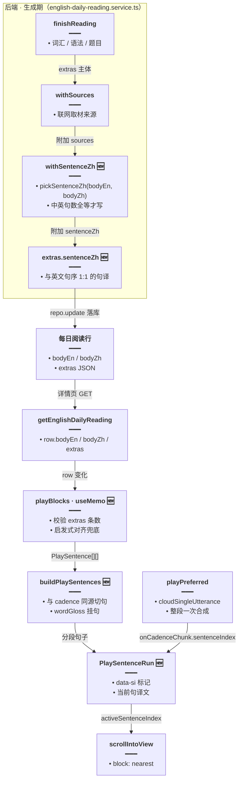
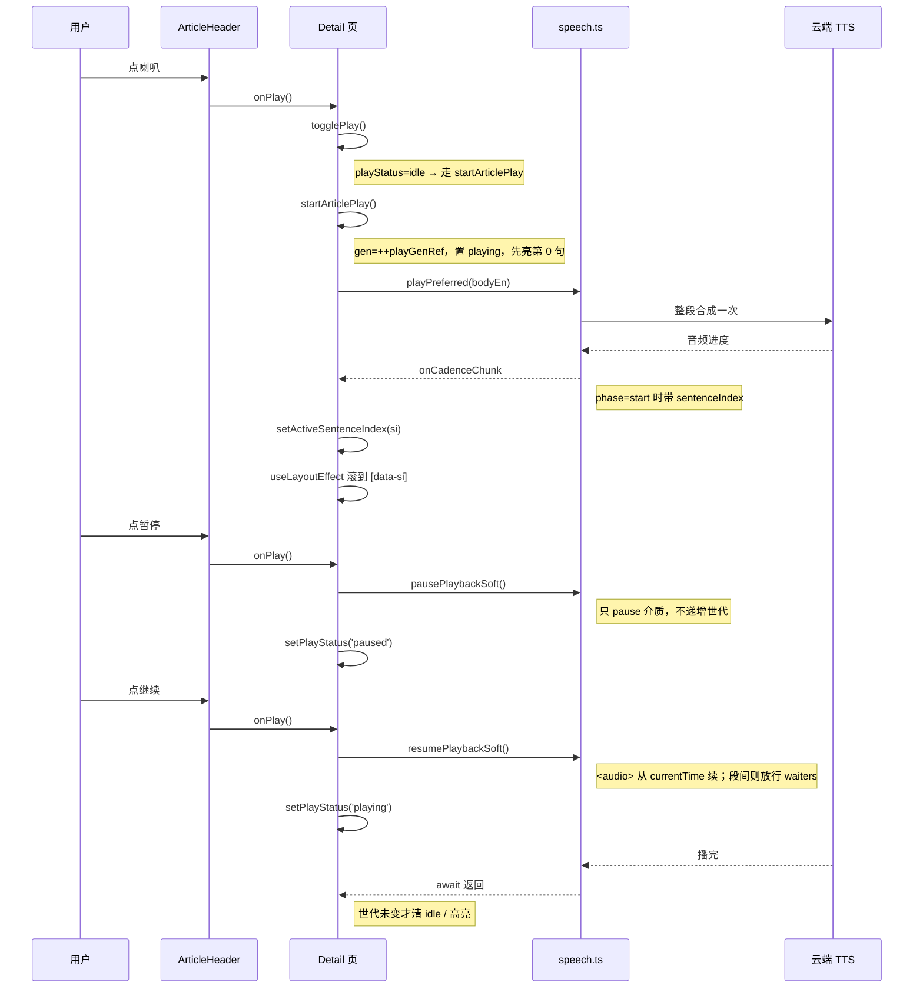

# 每日阅读逐句播放

> 延伸阅读：
> - [每日阅读前端.md](./每日阅读前端.md)：详情页整体结构（标题、正文、词汇、语法、题目）。
> - [每日阅读生成元信息.md](./每日阅读生成元信息.md)：`extras` 里各字段的生成与落库时机。
> - [TTS播放源.md](./TTS播放源.md)：`playPreferred` 的云端 / 本机选择与播放世代。
> - [英语TTS停止清理.md](./英语TTS停止清理.md)：`stopAllPlayback` 与 MediaSession 清理。

## 1. 背景与目标

每日阅读详情页此前只有「整篇朗读」：点喇叭开始、再点停止，播放过程既不知道读到哪一句，也看不到当前句的中文意思；中途想歇一下只能整篇重来。

本轮把「听」补齐成三件事：

1. **逐句高亮**：朗读进行到哪一句，正文里那一句就浅绿色底标出，并自动滚到视口内。
2. **逐句中文**：后端在生成时把中英按句对齐写入 `extras.sentenceZh`；详情页可切换「逐句中文」排版，播放时还会把**当前句**的译文临时挂在该句下方。
3. **暂停 / 继续**：喇叭按钮改为播放中显示暂停、暂停中显示继续，底层走 TTS 的**软暂停 / 软续播**，不打断播放世代、不从头重播。

目标：整篇朗读从「只有声音」变成「声音 + 句级定位 + 句级译文」，且暂停后能从原位置继续。

## 2. 改动范围

| 路径 | 改动 |
|------|------|
| `apps/backend/src/services/english-learning/daily-reading.rules.ts` | `ReadingExtras` 新增 `sentenceZh`；新增 `pickSentenceZh`（中英句数全等才产出）；`mergeExtras` 合并两稿时一并取句译 |
| `apps/backend/src/services/english-learning/english-daily-reading.service.ts` | 两处落库（日推、手动生成）先清洗 `bodyZh` 再挂 `withSentenceZh`（新增私有方法） |
| `apps/frontend/src/service/index.ts` | `EnglishDailyReadingExtras` 补 `sentenceZh?: string[]` |
| `apps/frontend/src/views/englishLearning/dailyReading/utils/playSentences.ts`（新增） | 句模型：`playSentenceCount` / `alignBodyZhHeuristic` / `resolveSentenceZh` / `buildPlaySentences` |
| `apps/frontend/src/views/englishLearning/dailyReading/Detail.tsx` | `PlayStatus` 三态 + 播放世代；`startArticlePlay` / `togglePlay`；`playBlocks` 句模型；`PlaySentenceRun` 渲染；`useLayoutEffect` 跟随滚动；换篇复位 |
| `apps/frontend/src/views/englishLearning/dailyReading/components/ArticleHeader.tsx` | 顶栏新增「逐句中文」开关；喇叭文案随播放 / 暂停切换 |
| `apps/frontend/src/views/englishLearning/daily/components/DailyPlayIconButton.tsx` | 新增 `mode: 'stop' \| 'pause'` 与 `paused`，图标在喇叭 / 暂停 / 继续 / 停止间切换 |
| `apps/frontend/src/utils/speech.ts` | `notifyAwaitingPlayback` 锁随出声解除；`pausePlaybackSoft` 去掉 loading 锁早退；`resumePlaybackSoft` 识别「段间软暂停」 |
| `apps/frontend/src/i18n/locales/{zh-CN,en-US}/englishLearning.ts` | 新增 `showSentenceZh` / `hideSentenceZh` / `tts.pause` / `tts.resume` |

## 3. 实现思路

1. **一套句界，两处复用**：后端 `pickSentenceZh` 与前端 `playSentenceCount` 各自切句，但前端句模型与 TTS 的 `buildSentenceOffsetSpans` 用**同一个切句函数**——`onCadenceChunk.sentenceIndex` 才能直接对上 `PlaySentence.si`。后端切句只用于「中英条数校验」，不参与前端句界。
2. **不对齐就不显示**：句译有三个来源，按优先级取——`extras.sentenceZh`（后端已校验句数全等）→ `alignBodyZhHeuristic`（前端把 `bodyZh` 按句末标点切分，条数恰好等于英文句数才配对）→ 无。任何一处条数对不上都**整段丢弃**，宁可没有译文，也不显示错位译文。
3. **播放模式改为整段单发**：句级高亮依赖 `onCadenceChunk` 的进度节奏，原来的 `leadThenParagraphs` 只在块边界回调，无法逐句。改用 `cloudSingleUtterance: true`（整段一次 HTTP，用真实音频进度估算当前句），代价是首声略晚于分段策略。
4. **三种播放态 + 播放世代**：`idle / playing / paused` 取代布尔值；`playGenRef` 每次起播递增，异步 `onCadenceChunk` 与 `finally` 清理都先比对世代，避免过期回调把新高亮或新状态覆盖。暂停时刻意**不递增世代**，因此 `await playPreferred` 仍挂起，续播才能从原位置接着走。
5. **暂停不打断介质**：`pausePlaybackSoft` 只 `pause` `<audio>` / `speechSynthesis` 并置软暂停标志；`resumePlaybackSoft` 优先从 `currentTime` 续上，段间无 `<audio>` 时则放行 `waitWhileSoftPaused` 里的等待者。这样「暂停—继续」不产生新的播放世代，也不会重头播。
6. **软暂停对无 MediaSession 的调用方也要生效**：`notifyAwaitingPlayback` 不再永久锁住系统媒体键，而出声即解锁；`pausePlaybackSoft` 去掉 `systemMediaControlsLocked` 早退。否则每日阅读这类**没有接 MediaSession**的页面，应用内暂停只改 UI、介质仍在跑。
7. **高亮与滚动解耦**：高亮是 `data-si` 属性 + 类名，滚动是独立的 `useLayoutEffect` 按 `data-si` 选择器 `scrollIntoView({ block: 'nearest' })`；两者都只看 `activeSentenceIndex`，不依赖渲染结构。
8. **换篇即复位**：`id` 变化的 effect 里同时递增世代、清空句高亮、播放态、单词播放与逐句中文开关，避免切篇后残留上一篇的播放 UI。

### 架构与数据流（改动后）



### 播放 / 暂停 / 继续时序（改动后）



## 4. 关键实现（改动前 / 改动后对比 + 注释）

### 4.1 后端：句译字段与生成

#### 4.1.1 `ReadingExtras.sentenceZh`

来源：`apps/backend/src/services/english-learning/daily-reading.rules.ts`（**改动前**，约 L112–L127，diff `-` 侧）

```ts
// 阅读附加信息的类型：落库到 extras JSON，前端按字段选用
export type ReadingExtras = {
	// 难度档位：生成时定稿，详情页信息行展示
	level: ReadingLevel;
	// 篇幅档位：生成时定稿，详情页信息行展示
	length: ReadingLength;
	// 学习侧重：阅读 / 词汇 / 语法，可组合
	focus: ReadingFocus;
	/** 这次设置要几道理解题。和 questions 数组分开，条数没凑满时仍显示设定。 */
	// 题目设定数：与实际出的题量分开存储
	questionCount?: 0 | 2 | 3;
	// 讲解词表：词 + 中文释义
	glossary?: { word: string; zh: string }[];
	/** 按句列出正文里的词，zh 是该词在这一句里的意思。 */
	// 逐句词表：en 是原句，words 是这句里各词在本句的释义
	wordGloss?: { en: string; words: { w: string; zh: string }[] }[];
	// 语法点拨列表：语法点 + 原文摘录 + 说明
	grammarNotes?: GrammarNote[];
	// 理解题：题干 + 选项 + 正确项下标
	questions?: { q: string; options: string[]; answer: number }[];
	/** 这次联网取材用到的条目，详情全部展示。 */
	// 参考来源：标题 + 链接
	sources?: { title: string; url: string }[];
};
```

来源：`apps/backend/src/services/english-learning/daily-reading.rules.ts`（**改动后**，约 L112–L127；新增一行句译字段）

```ts
// 阅读附加信息的类型：落库到 extras JSON，前端按字段选用
export type ReadingExtras = {
	// 难度档位：生成时定稿，详情页信息行展示
	level: ReadingLevel;
	// 篇幅档位：生成时定稿，详情页信息行展示
	length: ReadingLength;
	// 学习侧重：阅读 / 词汇 / 语法，可组合
	focus: ReadingFocus;
	/** 这次设置要几道理解题。和 questions 数组分开，条数没凑满时仍显示设定。 */
	// 题目设定数：与实际出的题量分开存储
	questionCount?: 0 | 2 | 3;
	// 讲解词表：词 + 中文释义
	glossary?: { word: string; zh: string }[];
	/** 按句列出正文里的词，zh 是该词在这一句里的意思。 */
	// 逐句词表：en 是原句，words 是这句里各词在本句的释义
	wordGloss?: { en: string; words: { w: string; zh: string }[] }[];
	/** 与英文句序对齐的句译；前端按 spans 下标读取，条数不对会被忽略 */
	// 句译数组：第 i 项对应正文第 i 句英文，缺省表示没有可靠句译
	sentenceZh?: string[];
	// 语法点拨列表：语法点 + 原文摘录 + 说明
	grammarNotes?: GrammarNote[];
	// 理解题：题干 + 选项 + 正确项下标
	questions?: { q: string; options: string[]; answer: number }[];
	/** 这次联网取材用到的条目，详情全部展示。 */
	// 参考来源：标题 + 链接
	sources?: { title: string; url: string }[];
};
```

**变更摘要**：`extras` 多了一个「按英文句序排好的句译数组」，它不参与模型生成，由后端在落库前从 `bodyEn` / `bodyZh` 计算得出。

#### 4.1.2 `pickSentenceZh`

来源：`apps/backend/src/services/english-learning/daily-reading.rules.ts`（**改动后**，约 L676–L692，纯新增）

```ts
/**
 * 中英句数全等时写入句译。前端还会按 TTS spans 条数校验，对不上会忽略。
 * ponytail: 英文切句近似前端 buildSentenceOffsetSpans；升级可抽共享切句。
 */
// 从同篇中英正文产出句译：只有中英句数全等才值得存
export function pickSentenceZh(
	// 英文正文：生成稿原文，可能含 Markdown 与零宽字符
	bodyEn: string,
	// 中文正文：同篇译文，按句末标点切分
	bodyZh: string,
	// 返回句译；undefined 表示条数对不上，调用方不写该字段
): string[] | undefined {
	// 按后端口径切英文：先按空行分段，再按句末标点 + 大写切句
	const en = passageSentences(bodyEn);
	// 中文先清零宽字符，避免不可见字符混进译文导致条数虚增
	const zh = stripZw(bodyZh)
		// 在 。！？； 之后切分，标点留在上一句，避免句首丢标点
		.split(/(?<=[。！？；])\s*/)
		// 逐句去首尾空白：正文换行与缩进不进译文
		.map((s) => s.trim())
		// 丢掉空片段：连续标点会切出空串
		.filter(Boolean);
	// 英文为空或中英句数不等：错位译文比没有更糟，直接放弃
	if (!en.length || en.length !== zh.length) return undefined;
	// 条数全等才返回，前端按下标一一取用
	return zh;
}
```

#### 4.1.3 `mergeExtras`：两稿合并时带上句译

来源：`apps/backend/src/services/english-learning/daily-reading.rules.ts`（**改动前**，约 L1187–L1207，diff `-` 侧）

```ts
/** 同一类两次都有时留下先拿到的。题目不足时用后一次补满。 */
// 合并首稿与补稿的附加信息：同类字段取先拿到的，题目用补稿凑满
export function mergeExtras(
	// 首稿 extras：主要字段来源
	first: ReadingExtras,
	// 补稿 extras：题目不足时的补充来源
	second: ReadingExtras,
	// 当前设置：决定题目需要凑到几道
	profile: ReadingProfile,
	// 返回合并后的 extras
): ReadingExtras {
	// 档位字段只认首稿：补稿不改变本次生成设置
	const extras: ReadingExtras = {
		// 难度：取首稿
		level: first.level,
		// 篇幅：取首稿
		length: first.length,
		// 学习侧重：取首稿
		focus: first.focus,
	};
	// 词表优先首稿，首稿没有才用补稿
	const glossary = first.glossary?.length ? first.glossary : second.glossary;
	// 语法点拨同上，两级三元取先拿到的非空数组
	const grammarNotes = first.grammarNotes?.length
		// 首稿有就用首稿
		? first.grammarNotes
		// 否则退回补稿
		: second.grammarNotes;
	// 题目单独走凑满逻辑：首稿不够时由补稿补齐并去重
	const questions = fillQuestions(
		// 首稿题目
		first.questions,
		// 补稿题目
		second.questions,
		// 目标题量
		profile.questions,
	);
	// 逐句词表优先首稿，其次补稿
	const wordGloss = first.wordGloss?.length
		// 首稿有就用首稿
		? first.wordGloss
		// 否则退回补稿
		: second.wordGloss;
	// 只有非空才写入，避免落库出现空数组
	if (glossary?.length) extras.glossary = glossary;
	// 语法点拨同理：空数组不落库
	if (grammarNotes?.length) extras.grammarNotes = grammarNotes;
	// 题目凑满后再判断是否有内容
	if (questions?.length) extras.questions = questions;
	// 逐句词表同理
	if (wordGloss?.length) extras.wordGloss = wordGloss;
	// 返回合并结果，未命中的字段保持缺省
	return extras;
}
```

来源：`apps/backend/src/services/english-learning/daily-reading.rules.ts`（**改动后**，约 L1206–L1239；新增句译的三元取值与写回）

```ts
/** 同一类两次都有时留下先拿到的。题目不足时用后一次补满。 */
// 合并首稿与补稿的附加信息：同类字段取先拿到的，题目用补稿凑满
export function mergeExtras(
	// 首稿 extras：主要字段来源
	first: ReadingExtras,
	// 补稿 extras：题目不足时的补充来源
	second: ReadingExtras,
	// 当前设置：决定题目需要凑到几道
	profile: ReadingProfile,
	// 返回合并后的 extras
): ReadingExtras {
	// 档位字段只认首稿：补稿不改变本次生成设置
	const extras: ReadingExtras = {
		// 难度：取首稿
		level: first.level,
		// 篇幅：取首稿
		length: first.length,
		// 学习侧重：取首稿
		focus: first.focus,
	};
	// 词表优先首稿，首稿没有才用补稿
	const glossary = first.glossary?.length ? first.glossary : second.glossary;
	// 语法点拨同上，两级三元取先拿到的非空数组
	const grammarNotes = first.grammarNotes?.length
		// 首稿有就用首稿
		? first.grammarNotes
		// 否则退回补稿
		: second.grammarNotes;
	// 题目单独走凑满逻辑：首稿不够时由补稿补齐并去重
	const questions = fillQuestions(
		// 首稿题目
		first.questions,
		// 补稿题目
		second.questions,
		// 目标题量
		profile.questions,
	);
	// 逐句词表优先首稿，其次补稿
	const wordGloss = first.wordGloss?.length
		// 首稿有就用首稿
		? first.wordGloss
		// 否则退回补稿
		: second.wordGloss;
	// 句译同样先到先得：两稿的切句口径一致，混用会导致句序错位
	const sentenceZh = first.sentenceZh?.length
		// 首稿有就用首稿
		? first.sentenceZh
		// 否则退回补稿
		: second.sentenceZh;
	// 只有非空才写入，避免落库出现空数组
	if (glossary?.length) extras.glossary = glossary;
	// 语法点拨同理：空数组不落库
	if (grammarNotes?.length) extras.grammarNotes = grammarNotes;
	// 题目凑满后再判断是否有内容
	if (questions?.length) extras.questions = questions;
	// 逐句词表同理
	if (wordGloss?.length) extras.wordGloss = wordGloss;
	// 句译有内容才写，缺省时前端会退回启发式对齐
	if (sentenceZh?.length) extras.sentenceZh = sentenceZh;
	// 返回合并结果，未命中的字段保持缺省
	return extras;
}
```

**变更摘要**：合并两稿时新增 `sentenceZh` 的「先到先得」取值与空数组过滤，保证补稿流程不会把句译丢掉，也不会写入空数组。

#### 4.1.4 `withSentenceZh`

来源：`apps/backend/src/services/english-learning/english-daily-reading.service.ts`（**改动后**，约 L1615–L1627，纯新增私有方法）

```ts
/** 中英句数对齐时挂 sentenceZh，供详情播放句下译文 */
// 落库前补句译：对齐失败就不写，前端另有启发式兜底
private withSentenceZh(
	// 已带 sources 的 extras
	extras: ReadingExtras,
	// 清洗后的英文正文
	bodyEn: string,
	// 清洗后的中文正文
	bodyZh: string,
	// 返回可能补上 sentenceZh 的新 extras
): ReadingExtras {
	// 计算句译：内部已做中英句数全等校验
	const sentenceZh = pickSentenceZh(bodyEn, bodyZh);
	// 对齐失败：原样返回，不制造空字段
	if (!sentenceZh) return extras;
	// 对齐成功：浅拷贝后补字段，避免改到调用方持有的对象
	return { ...extras, sentenceZh };
}
```

#### 4.1.5 两处落库调用

来源：`apps/backend/src/services/english-learning/english-daily-reading.service.ts`（**改动前**，约 L411–L429，日推落库，摘录）

```ts
			// ...（前面的废稿校验与失败处理未改动，对称省略）
			// 英文正文先清零宽字符，后续切句 / 词表都基于这份文本
			const bodyEn = stripZw(draft.bodyEn);
			// 生成期补齐 extras：词汇、语法、题目
			const extras = await this.finishReading(bodyEn, profile, { onUsage });
			// 把 ready 行写回库：同一 publishDate + 日推槽位
			await this.repo.update(
				// 定位条件：发布日期 + 日推槽位
				{ publishDate, slot: DAY_SLOT },
				// 要写入的字段
				{
					// 状态改为 ready：详情页可读
					status: 'ready',
					// 英文标题截断 80 字，避免超长标题撑破列表
					titleEn: stripZw(draft.titleEn).slice(0, 80),
					// 中文标题同样截断 80 字
					titleZh: stripZw(draft.titleZh).slice(0, 80),
					// 清洗后的英文正文
					bodyEn,
					// 中文正文：旧版在写入时才清洗，没有复用
					bodyZh: stripZw(draft.bodyZh),
					// 来源类型：有联网片段记 web，否则记 llm
					sourceKind: material.snippet ? 'web' : 'llm',
					// 来源链接
					sourceUrl: material.sourceUrl,
					// 来源标题
					sourceTitle: material.sourceTitle,
					// 本篇主题
					theme,
					// 附加信息：只补参考来源
					extras: this.withSources(extras, material.sources),
				},
			);
			// ...（后面的成功计数未改动，对称省略）
```

来源：`apps/backend/src/services/english-learning/english-daily-reading.service.ts`（**改动后**，约 L415–L438；先清洗中文，再补句译）

```ts
			// ...（前面的废稿校验与失败处理未改动，对称省略）
			// 英文正文先清零宽字符，后续切句 / 词表都基于这份文本
			const bodyEn = stripZw(draft.bodyEn);
			// 中文正文先清洗并复用：句译与落库都读同一份文本
			const bodyZh = stripZw(draft.bodyZh);
			// 生成期补齐 extras：词汇、语法、题目
			const extras = await this.finishReading(bodyEn, profile, { onUsage });
			// 把 ready 行写回库：同一 publishDate + 日推槽位
			await this.repo.update(
				// 定位条件：发布日期 + 日推槽位
				{ publishDate, slot: DAY_SLOT },
				// 要写入的字段
				{
					// 状态改为 ready：详情页可读
					status: 'ready',
					// 英文标题截断 80 字，避免超长标题撑破列表
					titleEn: stripZw(draft.titleEn).slice(0, 80),
					// 中文标题同样截断 80 字
					titleZh: stripZw(draft.titleZh).slice(0, 80),
					// 清洗后的英文正文
					bodyEn,
					// 清洗后的中文正文：与句译计算用同一份
					bodyZh,
					// 来源类型：有联网片段记 web，否则记 llm
					sourceKind: material.snippet ? 'web' : 'llm',
					// 来源链接
					sourceUrl: material.sourceUrl,
					// 来源标题
					sourceTitle: material.sourceTitle,
					// 本篇主题
					theme,
					// 附加信息：先补参考来源，再按中英正文补句译
					extras: this.withSentenceZh(
						// 第一步：挂联网来源
						this.withSources(extras, material.sources),
						// 第二步入参：英文正文
						bodyEn,
						// 第二步入参：中文正文
						bodyZh,
					),
				},
			);
			// ...（后面的成功计数未改动，对称省略）
```

**变更摘要**：`bodyZh` 从「写入时才清洗」改为「先清洗一次、复用于句译与落库」；`extras` 落库前多包一层 `withSentenceZh`。

来源：`apps/backend/src/services/english-learning/english-daily-reading.service.ts`（**改动前**，约 L836–L855，手动生成落库，摘录）

```ts
						// ...（前面的停止检查未改动，对称省略）
						// 英文正文清零宽字符
						const bodyEn = stripZw(draft.bodyEn);
						// 生成期补齐 extras：词汇、语法、题目
						const extras = await this.finishReading(bodyEn, profile, {
							// 透传取消信号：用户点停止时中断
							signal: ac.signal,
							// 透传用户 id：写用量与缓存归属
							userId,
							// 透传流式增量回调：页面边写边显示
							onDelta,
							// 透传用量回调：生成信息栏显示 Token
							onUsage,
							// 首稿不合格时继续写下半段
							onSecond: () => this.continueBelow(run),
						});
						// 只更新仍为 pending 的行：被停止或已发布的不能改写
						const saved = await this.repo.update(this.pendingOnly(id, userId), {
							// 状态改为 ready
							status: 'ready',
							// 英文标题截断 80 字
							titleEn: stripZw(draft.titleEn).slice(0, 80),
							// 中文标题截断 80 字
							titleZh: stripZw(draft.titleZh).slice(0, 80),
							// 清洗后的英文正文
							bodyEn,
							// 中文正文：旧版在写入时才清洗
							bodyZh: stripZw(draft.bodyZh),
							// 来源类型
							sourceKind: material.snippet ? 'web' : 'llm',
							// 来源链接
							sourceUrl: material.sourceUrl,
							// 来源标题
							sourceTitle: material.sourceTitle,
							// 本篇主题
							theme,
							// 附加信息：只补参考来源
							extras: this.withSources(extras, material.sources),
						});
						// ...（后面的 affected 判定未改动，对称省略）
```

来源：`apps/backend/src/services/english-learning/english-daily-reading.service.ts`（**改动后**，约 L839–L866；同样先清洗中文再补句译）

```ts
						// ...（前面的停止检查未改动，对称省略）
						// 英文正文清零宽字符
						const bodyEn = stripZw(draft.bodyEn);
						// 中文正文先清洗并复用：句译与落库读同一份
						const bodyZh = stripZw(draft.bodyZh);
						// 生成期补齐 extras：词汇、语法、题目
						const extras = await this.finishReading(bodyEn, profile, {
							// 透传取消信号：用户点停止时中断
							signal: ac.signal,
							// 透传用户 id：写用量与缓存归属
							userId,
							// 透传流式增量回调：页面边写边显示
							onDelta,
							// 透传用量回调：生成信息栏显示 Token
							onUsage,
							// 首稿不合格时继续写下半段
							onSecond: () => this.continueBelow(run),
						});
						// 只更新仍为 pending 的行：被停止或已发布的不能改写
						const saved = await this.repo.update(this.pendingOnly(id, userId), {
							// 状态改为 ready
							status: 'ready',
							// 英文标题截断 80 字
							titleEn: stripZw(draft.titleEn).slice(0, 80),
							// 中文标题截断 80 字
							titleZh: stripZw(draft.titleZh).slice(0, 80),
							// 清洗后的英文正文
							bodyEn,
							// 清洗后的中文正文：与句译计算同源
							bodyZh,
							// 来源类型
							sourceKind: material.snippet ? 'web' : 'llm',
							// 来源链接
							sourceUrl: material.sourceUrl,
							// 来源标题
							sourceTitle: material.sourceTitle,
							// 本篇主题
							theme,
							// 附加信息：先补来源，再补句译
							extras: this.withSentenceZh(
								// 第一步：挂联网来源
								this.withSources(extras, material.sources),
								// 第二步入参：英文正文
								bodyEn,
								// 第二步入参：中文正文
								bodyZh,
							),
						});
						// ...（后面的 affected 判定未改动，对称省略）
```

**变更摘要**：手动生成与日推两条落库路径保持同一顺序——`finishReading → withSources → withSentenceZh`，任何一条路径漏挂都会让详情页少句译。

### 4.2 前端句模型 `playSentences.ts`

来源：`apps/frontend/src/views/englishLearning/dailyReading/utils/playSentences.ts`（**改动后**，约 L1–L120，纯新增文件，全文）

```ts
/**
 * 每日阅读播放句模型：句界与 speech cadence 共用 buildSentenceOffsetSpans。
 */
// 句界必须与 TTS 回调同一坐标系：直接复用 speech 的切句与去 Markdown
import {
	// 句界函数：plain 文本内的 [start, end) 偏移，cadence 用它算 sentenceIndex
	buildSentenceOffsetSpans,
	// 去 Markdown：与 cloudSingleUtterance 路径朗读的文本保持一致
	stripMarkdownForTts,
// 从 speech 工具模块引入
} from '@/utils/speech';
// 按空行分段：段界来自原文，不参与句界计算
import { paragraphs } from './body';

// 播放句：一句英文及其可选的逐词释义与句译
export type PlaySentence = {
	/** 全局句下标，等于 onCadenceChunk.sentenceIndex */
	// 句下标：高亮、滚动、句译取值都用它
	si: number;
	// 英文原文：从 plain 里按 span 切出，保留原标点
	en: string;
	// 逐词释义：null 表示这句没有可用的词表
	words: { w: string; zh: string }[] | null;
	// 句译：缺省表示没有可靠译文
	zh?: string;
};

// 词表项：en 是原句，words 是这句内各词的本句释义
type GlossItem = { en: string; words: { w: string; zh: string }[] };

// 取某一句的译文：后端句译优先，其次启发式对齐结果
export function resolveSentenceZh(input: {
	// 句下标：与 extras.sentenceZh 的顺序一致
	si: number;
	// 后端句译：可选，条数已在前端校验过
	sentenceZh?: string[] | null;
	// 启发式对齐：可选，由 bodyZh 切句得到
	alignedHeuristic?: string[];
// 返回译文；两者都没有时返回 undefined
}): string | undefined {
	// 后端句译优先：生成期已校验中英句数全等，可信度最高
	const fromExtras = input.sentenceZh?.[input.si]?.trim();
	// 后端有非空译文就直接用，不再看启发式结果
	if (fromExtras) return fromExtras;
	// 后端缺失时退回启发式对齐，仍去空白防纯空格
	const fromHeuristic = input.alignedHeuristic?.[input.si]?.trim();
	// 空串归一成 undefined，调用方只需判空
	return fromHeuristic || undefined;
}

/** 与 cadence 同坐标系的英文句数 */
// 统计英文句数：与 TTS 的 sentenceIndex 上界保持一致
export function playSentenceCount(bodyEn: string): number {
	// 先按朗读口径去 Markdown 与卡片锚点，得到与 TTS 相同的 plain
	const plain = stripMarkdownForTts(bodyEn);
	// 空正文没有句子，直接返回 0 避免下游除零或空数组判断
	if (!plain) return 0;
	// 句界数组长度就是句数，也是 sentenceIndex 的最大值 + 1
	return buildSentenceOffsetSpans(plain).length;
}

/** 仅当中文切句数与英文句数全等时配对，避免错位译文。 */
// 中文启发式对齐：条数恰好等于英文句数才认，否则整体放弃
export function alignBodyZhHeuristic(
	// 中文正文：按句末标点切分
	bodyZh: string,
	// 英文句数：切分结果必须与之全等
	enCount: number,
// 返回按句排列的中文；条数不等时 undefined
): string[] | undefined {
	// 中文按标点切句，作为启发式候选
	const parts = bodyZh
		// 在 。！？； 后切分，标点保留在上一句
		.split(/(?<=[。！？；])\s*/)
		// 逐句去首尾空白，避免换行缩进进入译文
		.map((s) => s.trim())
		// 丢掉空片段：连续标点会切出空串
		.filter(Boolean);
	// 条数不等说明切句口径不一致：错位译文比没有更糟，直接放弃
	if (parts.length !== enCount) return undefined;
	// 条数全等才返回，按下标与英文句一一对应
	return parts;
}

// 归一化文本：去多余空白、转小写，用于「这句是否包含该词表句」
function norm(text: string): string {
	// 空白折叠成一个空格并转小写，避免大小写与换行造成匹配失败
	return text.replace(/\s+/g, ' ').trim().toLowerCase();
}

/**
 * 与 cloudSingleUtterance 路径一致：先 stripMarkdownForTts 再切句。
 * 段界仍按原文空行；gloss 只挂词不定义句界。
 */
// 构建播放句模型：句子带 si / 词表 / 句译，并按原文空行分块
export function buildPlaySentences(
	// 英文正文：原始 Markdown，函数内部再去 Markdown
	bodyEn: string,
	// 逐句词表：可选，按 en 文本匹配到句子上
	gloss: GlossItem[] | undefined,
	// 句译取值函数：入参 si，返回该句译文或 undefined
	zhBySi: (si: number) => string | undefined,
// 返回按段落分组的句子数组，供渲染层逐块输出
): PlaySentence[][] {
	// 与 TTS 同一份 plain 切句，保证 si 与 onCadenceChunk 对齐
	const plain = stripMarkdownForTts(bodyEn);
	// 空正文直接返回空块，页面显示空状态
	if (!plain) return [];

	// 句界偏移数组：第 i 项是该句在 plain 内的 [start, end)
	const spans = buildSentenceOffsetSpans(plain);
	// 已用过的词表下标：避免同一词表句被重复挂到多句
	const glossUsed = new Set<number>();
	// 逐句生成播放句：句文本、词表、句译一次算好
	const sentences: PlaySentence[] = spans.map((span, si) => {
		// 按偏移切出英文原句，标点与大小写保持原样
		const en = plain.slice(span.start, span.end);
		// 归一化后用于「包含关系」匹配词表
		const enNorm = norm(en);
		// 默认没有词表，匹配成功后再替换
		let words: PlaySentence['words'] = null;
		// 有词表且本句非空时才尝试匹配
		if (gloss?.length && enNorm) {
			// 找第一条尚未使用、且文本被本句包含的词表项
			const hitAt = gloss.findIndex((g, index) => {
				// 已用过的词表项跳过，防止一句挂两份释义
				if (glossUsed.has(index)) return false;
				// 归一化词表句，便于忽略大小写与空白差异
				const gEn = norm(g.en);
				// 双向包含只取「词表句被本句包含」这一侧，短句避免误命中
				return gEn.length > 0 && enNorm.includes(gEn);
			});
			// 命中下标非负才挂词表
			if (hitAt >= 0) {
				// 标记已用：后续句子不再重复挂同一份词表
				glossUsed.add(hitAt);
				// 取该词表项的词数组，挂到本句
				words = gloss[hitAt]!.words;
			}
		}
		// 组装播放句：si 与 cadence 一致，zh 由调用方按来源优先级取
		return { si, en, words, zh: zhBySi(si) };
	});

	// 已被分块接纳的句下标：用于把漏掉的句子兜回最后一块
	const placed = new Set<number>();
	// 按原文空行分段，把句子归到各自段落
	const blocks = paragraphs(bodyEn)
		// 每个段落转成一组句子
		.map((part) => {
			// 段落归一化：抹平段内换行后再做包含判断
			const flat = norm(part);
			// 从全部句子里挑出属于本段的句子
			return sentences.filter((s) => {
				// 已归过段的句子跳过，避免重复渲染
				if (placed.has(s.si)) return false;
				// 段落文本不包含本句：说明不属于这段（或归一化后差异过大）
				if (!flat.includes(norm(s.en))) return false;
				// 归入本段并登记，后续段落不再重复
				placed.add(s.si);
				// 保留该句
				return true;
			});
		})
		// 丢掉空段落：只有空行的段不渲染
		.filter((block) => block.length > 0);

	// 没被任何段落认领的句子：可能段界与切句口径有细微差异
	const rest = sentences.filter((s) => !placed.has(s.si));
	// 有漏句才需要兜底，正常情况不进此分支
	if (rest.length) {
		// 已有段落：把漏句追加到最后一段，保证正文不缺句
		if (blocks.length) blocks[blocks.length - 1]!.push(...rest);
		// 一个段落都没有：整体作为唯一一段
		else blocks.push(rest);
	}
	// 返回分块结果，渲染层逐块输出 PlaySentenceRun
	return blocks;
}

// ponytail: 开发态自检；升级可拆正式 test 文件
// 开发环境自检：锁定切句 / 对齐 / 句译三条基础行为
if (import.meta.env.DEV) {
	// 两段三句的英文样例：第二段单独一行，验证空行分段
	const bodyEn = 'Hello world. Second sentence.\n\nThird one.';
	// 与英文一一对应的中文样例：三条，句序一致
	const bodyZh = '你好世界。第二句。第三句。';
	// 英文句数：应等于 3
	const n = playSentenceCount(bodyEn);
	// 启发式对齐结果：条数全等时应有 3 条
	const aligned = alignBodyZhHeuristic(bodyZh, n);
	// 展平播放句模型，取所有句子
	const flat = buildPlaySentences(bodyEn, undefined, (si) =>
		// 只用启发式句译，验证 si → 译文映射
		resolveSentenceZh({ si, alignedHeuristic: aligned }),
	).flat();
	// 任一断言不成立就报错：对齐失败、句数不对、首句译文不对
	if (!aligned || aligned.length !== 3 || flat.length !== 3 || flat[0]?.zh !== '你好世界。') {
		// 打印现场数据，便于定位是切句还是对齐出了偏差
		console.error('[playSentences] self-check failed', { n, aligned, flat });
	}
}
```

**变更摘要**：新文件只做一件事——把「英文正文 + 词表 + 句译」变成带 `si` 的句子模型，`si` 与 TTS cadence 的 `sentenceIndex` 共用同一套切句函数，这是逐句高亮能对齐的前提。

### 4.3 详情页播放状态与句模型

#### 4.3.1 播放三态与世代引用

来源：`apps/frontend/src/views/englishLearning/dailyReading/Detail.tsx`（**改动后**，约 L49，纯新增类型）

```ts
// 播放三态：idle 未播 / playing 播放中 / paused 软暂停
type PlayStatus = 'idle' | 'playing' | 'paused';
```

来源：`apps/frontend/src/views/englishLearning/dailyReading/Detail.tsx`（**改动前**，约 L56–L60，diff `-` 侧）

```ts
	// 当前篇目：详情数据，含正文与 extras
	const [row, setRow] = useState<EnglishDailyReadingItem | null>(null);
	// 加载态：仅首屏且无 row 时显示 Loading
	const [loading, setLoading] = useState(true);
	// 旧版播放态：单个布尔，无法表达「暂停」
	const [playing, setPlaying] = useState(false);
	// 正在朗读的单词 key：驱动行内喇叭动效
	const [wordKey, setWordKey] = useState<string | null>(null);
	// 全文中文释义开关：展开标题与整篇译文
	const [showZh, setShowZh] = useState(false);
```

来源：`apps/frontend/src/views/englishLearning/dailyReading/Detail.tsx`（**改动后**，约 L166–L179；布尔换成三态，并新增世代与当前句）

```ts
	// 当前篇目：详情数据，含正文与 extras
	const [row, setRow] = useState<EnglishDailyReadingItem | null>(null);
	// 加载态：仅首屏且无 row 时显示 Loading
	const [loading, setLoading] = useState(true);
	// 播放三态：替代旧布尔，能区分「暂停」与「未播」
	const [playStatus, setPlayStatus] = useState<PlayStatus>('idle');
	// 播放世代：每次起播 / 打断递增，用于丢弃过期 cadence 回调
	const playGenRef = useRef(0);
	/** 全文 playPreferred 仍在 await（含软暂停挂起） */
	// 全文会话是否仍活着：暂停时 promise 挂起，仍为 true
	const articlePlayActiveRef = useRef(false);
	/** 当前播放句；暂停保留，idle/打断/换篇清空 */
	// 当前高亮句：cadence 回调写入，滚动与译文都读它
	const [activeSentenceIndex, setActiveSentenceIndex] = useState<number | null>(
		// 初始无高亮
		null,
	// 状态声明收尾
	);
	// 正在朗读的单词 key：驱动行内喇叭动效
	const [wordKey, setWordKey] = useState<string | null>(null);
	// 全文中文释义开关：展开标题与整篇译文
	const [showZh, setShowZh] = useState(false);
	/** 逐句中文：一句英文下一句中文 */
	// 逐句中文开关：影响正文排版，不改正文数据
	const [showSentenceZh, setShowSentenceZh] = useState(false);
```

**变更摘要**：用一个字符串状态替掉布尔值，并补两个 ref（播放世代、全文会话存活）与一个句子下标状态；暂停因此可以「保留」当前句而不清空。

#### 4.3.2 换篇复位

来源：`apps/frontend/src/views/englishLearning/dailyReading/Detail.tsx`（**改动前**，约 L128–L130，diff `-` 侧）

```ts
		// 换篇后回到顶部：新篇目从第一屏开始读
		useEffect(() => {
			// 滚动容器归零
			scrollerRef.current?.scrollTo(0, 0);
			// 依赖篇目 id：切篇时重跑
		}, [id]);
```

来源：`apps/frontend/src/views/englishLearning/dailyReading/Detail.tsx`（**改动后**，约 L248–L256；换篇同时作废旧世代并清空播放 UI）

```ts
		// 换篇后回到顶部：新篇目从第一屏开始读
		useEffect(() => {
			// 滚动容器归零
			scrollerRef.current?.scrollTo(0, 0);
			// 递增世代：上一篇挂起的 cadence / finally 全部作废
			playGenRef.current += 1;
			// 标记全文会话结束：旧篇的 await 不再被当作「可续播」
			articlePlayActiveRef.current = false;
			// 播放态回到未播：按钮显示喇叭
			setPlayStatus('idle');
			// 清空高亮句：新篇不应该亮着上一篇的句子
			setActiveSentenceIndex(null);
			// 清空单词播放：旧篇的喇叭动效不能残留
			setWordKey(null);
			// 关闭逐句中文：换篇后回到默认紧凑排版
			setShowSentenceZh(false);
			// 依赖篇目 id：切篇时重跑
		}, [id]);
```

**变更摘要**：换篇不只滚回顶部，还要作废旧播放世代并清空所有播放相关状态，否则旧篇迟到的 cadence 会把新高亮写成旧句。

#### 4.3.3 跟随高亮滚动

来源：`apps/frontend/src/views/englishLearning/dailyReading/Detail.tsx`（**改动后**，约 L268–L273，纯新增）

```ts
	// 高亮变化后把该句滚进视口：只动滚动，不改播放
	useLayoutEffect(() => {
		// 没有高亮句时不滚：未播 / 已停状态保持用户当前位置
		if (activeSentenceIndex == null) return;
		// 滚动容器：正文所在的 ScrollArea
		const root = scrollerRef.current;
		// 按 data-si 找当前句：句子渲染时写入同一属性
		const el = root?.querySelector(`[data-si="${activeSentenceIndex}"]`);
		// nearest 只滚到刚好可见：不把句子顶到最上方，减少视觉跳动
		el?.scrollIntoView({ block: 'nearest', behavior: 'smooth' });
		// 依赖当前句下标：每次换句触发一次
	}, [activeSentenceIndex]);
```

#### 4.3.4 `startArticlePlay` 与 `togglePlay`

来源：`apps/frontend/src/views/englishLearning/dailyReading/Detail.tsx`（**改动前**，约 L142–L165，diff `-` 侧，完整符号）

```ts
	// 旧版播放开关：一个回调同时负责开始与停止
	const togglePlay = useCallback(async () => {
		// 没有英文正文：按钮本就不渲染，这里兜底
		if (!row?.bodyEn) return;
		// 正在播：这一下就是「停止」
		if (playing) {
			// 硬停止：清介质、递增世代、清会话
			stopAllPlayback();
			// UI 回到未播
			setPlaying(false);
			// 停止分支到此结束
			return;
		}
		// 开始播放前先硬停上一次：避免两路音频叠加
		stopAllPlayback();
		// 清掉单词播放态：整篇播放优先
		setWordKey(null);
		// 立即置播放中：按钮先切成方块
		setPlaying(true);
		// 播放可能因环境不支持而失败，需要捕获
		try {
			// 整篇朗读：首句单发 + 其余按段落分段
			await playPreferred(row.bodyEn, {
				// 分段合成：首声快，但句级回调只在块边界
				cloudSingleUtterance: false,
				// 首句单独合成，其余按空行段落合成
				leadThenParagraphs: true,
				// 落盘缓存：同篇再播可直接复用
				persistDisk: true,
				// 缓存目录按篇目 id 隔离
				cacheFolder: ttsCacheScopeDailyReading(row.id),
				// 缓存标题：写进 _meta.json 便于排查
				cacheTitle: row.titleEn,
			});
		// 播放失败：提示当前环境不支持朗读
		} catch {
			// 顶部轻提示，不阻断页面
			Toast({ type: 'warning', title: t('assistant.tts.unsupported') });
		// 无论成功失败都要复位按钮
		} finally {
			// 播放结束 / 被停止：UI 回到未播
			setPlaying(false);
		}
		// 依赖播放态与当前篇目
	}, [playing, row, t]);
```

来源：`apps/frontend/src/views/englishLearning/dailyReading/Detail.tsx`（**改动后**，约 L275–L330；拆出 `startArticlePlay`，`togglePlay` 只做状态分发）

```ts
	// 起播：负责世代、状态、cadence 回调与结束清理
	const startArticlePlay = useCallback(async () => {
		// 没有英文正文：不启动
		if (!row?.bodyEn) return;
		// 先递增世代再起播：本次回调只认这一代
		const gen = ++playGenRef.current;
		// 硬停上一次：避免与正在播的单词 / 旧篇叠加
		stopAllPlayback();
		// 清掉单词播放态：整篇播放优先
		setWordKey(null);
		// 标记全文会话存活：暂停后据此判断能否软续播
		articlePlayActiveRef.current = true;
		// 置播放中：按钮切暂停图标
		setPlayStatus('playing');
		// 首包等待期也亮首句，避免正文无反馈
		// 先高亮第 0 句：合成尚未出声时也有定位感
		setActiveSentenceIndex(0);
		// 播放可能因环境不支持而失败，需要捕获
		try {
			// ponytail: 句级高亮需要 progress cadence；leadThenParagraphs 只在块边界回调。
			// cloudSingleUtterance 下软暂停/persistDisk 仍可用，首声可能略晚于旧分段策略。
			// 整段一次合成：用真实音频进度估算当前句，才能逐句回调
			await playPreferred(row.bodyEn, {
				// 整段单发：换取 cadence 的句级节奏
				cloudSingleUtterance: true,
				// 落盘缓存：同篇再播可直接复用
				persistDisk: true,
				// 缓存目录按篇目 id 隔离
				cacheFolder: ttsCacheScopeDailyReading(row.id),
				// 缓存标题：写进 _meta.json 便于排查
				cacheTitle: row.titleEn,
				// 句级节奏回调：只在开始阶段推进高亮
				onCadenceChunk: (event) => {
					// 只认 start：end 时该句已念完，高亮交给下一句
					if (event.phase !== 'start') return;
					// 过期世代直接丢弃：防止旧播放覆盖新播放的高亮
					if (gen !== playGenRef.current) return;
					// 写入当前句下标：触发高亮与跟随滚动
					setActiveSentenceIndex(event.sentenceIndex);
				// 回调定义收尾
				},
			});
		// 播放失败：提示当前环境不支持朗读
		} catch {
			// 只有仍是当前世代才提示：过期播放的失败不该打扰用户
			if (gen === playGenRef.current) {
				// 顶部轻提示，不阻断页面
				Toast({ type: 'warning', title: t('assistant.tts.unsupported') });
			}
		// 无论成功失败都要处理结束状态
		} finally {
			// 勿在 finally 里 return（no-unsafe-finally）；过期世代只跳过清理
			// 世代仍当前：说明是自己播完或被自己停止
			if (gen === playGenRef.current) {
				// 会话结束：之后不能再软续播
				articlePlayActiveRef.current = false;
				// 软暂停时 await 仍挂起；promise 结束说明已播完或被 stop
				// 回到未播：按钮显示喇叭
				setPlayStatus('idle');
				// 清空高亮：播完后不再停在某一句
				setActiveSentenceIndex(null);
			}
		}
		// 依赖当前篇目与文案函数
	}, [row, t]);

	// 播放按钮总入口：按当前三态分发到暂停 / 继续 / 起播
	const togglePlay = useCallback(async () => {
		// 没有英文正文：不启动
		if (!row?.bodyEn) return;
		// 播放中点击：软暂停，不打断播放会话
		if (playStatus === 'playing') {
			// 只暂停介质：不递增世代、不 abort wait
			pausePlaybackSoft();
			// UI 切到暂停态：按钮显示继续
			setPlayStatus('paused');
			// 暂停分支结束，不触发起播
			return;
		}
		// 暂停中点击：优先原位置续播
		if (playStatus === 'paused') {
			// 全文会话仍存活：可以软续播
			if (articlePlayActiveRef.current) {
				// 软续播：唤醒 wait / 从 currentTime 继续；勿 stopAll 重头播
				// 从介质暂停点继续，播放循环不会重来
				resumePlaybackSoft();
				// UI 回到播放中
				setPlayStatus('playing');
				// 续播分支结束
				return;
			}
			// 会话已结束（例如暂停空操作期间播完）：重新开播
		}
		// 未播或会话已结束：正常起播
		await startArticlePlay();
		// 依赖三态、篇目与起播函数
	}, [playStatus, row, startArticlePlay]);
```

**变更摘要**：起播逻辑从开关里抽出来，多了世代校验、cadence 高亮与「首包先亮首句」；`togglePlay` 变成纯分发，暂停不再走 `stopAllPlayback`。

#### 4.3.5 单词播放打断整篇

来源：`apps/frontend/src/views/englishLearning/dailyReading/Detail.tsx`（**改动前**，约 L181–L205，diff `-` 侧，摘录）

```ts
	// 点词朗读：同一词再点即停，点别的词则切换
	const playWord = useCallback(
		// 入参为要朗读的单词
		async (word: string) => {
			// 没有篇目数据时不播
			if (!row) return;
			// 再点同一个词：视为停止
			if (wordKey === word) {
				// 硬停止当前朗读
				stopAllPlayback();
				// 清掉单词播放态
				setWordKey(null);
				// 停止分支结束
				return;
			}
			// 切到新词前先硬停：整篇与单词不能同时出声
			stopAllPlayback();
			// 整篇播放 UI 复位：旧版只有布尔
			setPlaying(false);
			// 标记正在朗读的单词
			setWordKey(word);
			// ...（朗读与 finally 未改动，对称省略）
		},
		// 依赖篇目、文案与当前单词
		[row, t, wordKey],
	);
```

来源：`apps/frontend/src/views/englishLearning/dailyReading/Detail.tsx`（**改动后**，约 L346–L374；打断整篇时同步作废世代、清高亮）

```ts
	// 点词朗读：同一词再点即停，点别的词则切换
	const playWord = useCallback(
		// 入参为要朗读的单词
		async (word: string) => {
			// 没有篇目数据时不播
			if (!row) return;
			// 再点同一个词：视为停止
			if (wordKey === word) {
				// 硬停止当前朗读
				stopAllPlayback();
				// 清掉单词播放态
				setWordKey(null);
				// 单词停播也清高亮：正文不再停在某句
				setActiveSentenceIndex(null);
				// 停止分支结束
				return;
			}
			// 切到新词：作废全文播放世代，旧 cadence 不再改 UI
			playGenRef.current += 1;
			// 全文会话标记结束：之后不能软续播
			articlePlayActiveRef.current = false;
			// 硬停整篇：单词与整篇不能同时出声
			stopAllPlayback();
			// 播放态回到未播：按钮回到喇叭
			setPlayStatus('idle');
			// 清空句高亮：单词播放没有句概念
			setActiveSentenceIndex(null);
			// 标记正在朗读的单词
			setWordKey(word);
			// ...（朗读与 finally 未改动，对称省略）
		},
		// 依赖篇目、文案与当前单词
		[row, t, wordKey],
	);
```

**变更摘要**：单词朗读从「只置布尔」升级为「作废世代 + 结束会话 + 清高亮」，避免整篇的迟到回调把单词播放 UI 改回播放中。

#### 4.3.6 `playBlocks` 与 `hasSentenceZh`

来源：`apps/frontend/src/views/englishLearning/dailyReading/Detail.tsx`（**改动后**，约 L376–L397，纯新增）

```ts
	// 句模型：正文、词表、句译合成渲染用的段落句子
	const playBlocks = useMemo(() => {
		// 没有英文正文时不建模型，页面显示空状态
		if (!row?.bodyEn) return [];
		// 与 TTS 同坐标系的英文句数：用于校验句译条数
		const enCount = playSentenceCount(row.bodyEn);
		// 启发式对齐：把整篇中文按句切开，条数全等才可用
		const aligned = alignBodyZhHeuristic(row.bodyZh, enCount);
		// 条数对不上时不信 extras，避免错句译文
		// 后端句译仅在与 TTS 句数全等时才采信
		const sentenceZh =
			// 条数严格相等才采用
			row.extras?.sentenceZh?.length === enCount
				// 采用后端句译
				? row.extras.sentenceZh
				// 否则交给启发式对齐兜底
				: undefined;
		// 组装播放句：词表按句挂，句译按优先级取
		return buildPlaySentences(row.bodyEn, row.extras?.wordGloss, (si) =>
			// 每句取译文：后端优先，启发式兜底
			resolveSentenceZh({
				// 当前句下标
				si,
				// 已校验的后端句译
				sentenceZh,
				// 启发式对齐结果
				alignedHeuristic: aligned,
			// 取值调用收尾
			}),
		);
		// 依赖整行数据：换篇 / 刷新都会重建
	}, [row]);

	// 是否存在任一句译文：决定顶栏是否显示「逐句中文」开关
	const hasSentenceZh = useMemo(
		// 有任意一句非空译文即可开关
		() => playBlocks.some((block) => block.some((s) => !!s.zh?.trim())),
		// 依赖句模型：句译来源变化时重算
		[playBlocks],
	);
```

#### 4.3.7 `PlaySentenceRun` 与正文渲染

来源：`apps/frontend/src/views/englishLearning/dailyReading/Detail.tsx`（**改动后**，约 L51–L143，纯新增组件）

```ts
/**
 * - 默认/播放：一段连续 text-justify；当前句译 float 全宽挂在该句后。
 * - 逐句释义：仍按句展示（一句英文 + 一句中文），中文普通换行（一行摆不下再折），
 *   不再把整段中文捏成一块。
 */
// 一组段内句子：负责英文逐句渲染、高亮与两种中文排版
function PlaySentenceRun({
	// 本段句子：按原文顺序，si 全局唯一
	sentences,
	// 当前高亮句下标：null 表示没有高亮
	activeSentenceIndex,
	// 当前打开的词表 key：同一时刻只开一个弹层
	glossKey,
	// 开合词表弹层的回调：from 用于区分触发来源
	openGloss,
	// 正在朗读的单词 key：驱动词内喇叭动效
	wordKey,
	// 点词朗读回调
	onPlayWord,
	// 单词朗读按钮文案
	playLabel,
	// 停止按钮文案
	stopLabel,
	// 是否开启逐句中文：true 时一句英文配一句中文
	showSentenceZh = false,
// 组件 props 类型：与解构一一对应
}: {
	// 本段句子数组
	sentences: PlaySentence[];
	// 当前高亮句
	activeSentenceIndex: number | null;
	// 词表弹层 key
	glossKey: string | null;
	// 开合词表弹层
	openGloss: (key: string | null, from?: string) => void;
	// 正在朗读的单词
	wordKey: string | null;
	// 点词朗读
	onPlayWord: (word: string) => void;
	// 单词朗读文案
	playLabel: string;
	// 停止文案
	stopLabel: string;
	// 逐句中文开关
	showSentenceZh?: boolean;
// 组件函数体开始
}) {
	// 渲染单句：写 data-si 供滚动定位，按是否当前句决定底色
	const renderEn = (sentence: PlaySentence, indexInRun: number) => (
		// 句容器：data-si 是滚动与高亮的锚点
		<span
			// 全局句下标：与 cadence 的 sentenceIndex 一致
			data-si={sentence.si}
			// 当前句加浅绿底：非当前句不加类名
			className={
				// 下标相等即为当前句
				activeSentenceIndex === sentence.si
					// 浅绿背景 + 小圆角：不改变行高
					? 'rounded-sm bg-[rgba(135,207,92,0.15)]'
					// 非当前句不加类名
					: undefined
			}
		>
			// 段内第二句起补空格：避免两句粘成一个词
			{indexInRun > 0 ? ' ' : null}
			// 有词表句走 GlossSentence，否则按纯文本渲染
			{sentence.words ? (
				// 逐词可点的句子：词表弹层与朗读都复用既有组件
				<GlossSentence
					// 英文原句
					en={sentence.en}
					// 本句词表：每词带本句释义
					words={sentence.words}
					// 句下标：弹层 key 与朗读上下文都依赖它
					sentenceIndex={sentence.si}
					// 当前打开的弹层 key
					openKey={glossKey}
					// 开合弹层
					onOpen={openGloss}
					// 正在朗读的词
					playingWord={wordKey}
					// 点词朗读
					onPlay={onPlayWord}
					// 单词朗读文案
					playLabel={playLabel}
					// 停止文案
					stopLabel={stopLabel}
				/>
			) : (
				// 无词表：按纯文本渲染，链接等仍可点击
				renderText(sentence.en)
			)}
		// 句容器闭合
		</span>
	);

	// 逐句中文模式：一句英文一段、一句中文一段
	if (showSentenceZh) {
		// 纵向排列各句，句间留 3 档间距
		return (
			// 逐句容器：每句一组
			<div className="flex flex-col gap-3">
				// 逐句输出：key 用全局句下标
				{sentences.map((sentence) => (
					// 单句组：英文在上、中文在下
					<div key={sentence.si} className="flex flex-col gap-1">
						// 英文行：与默认排版同字号
						<p className="text-justify text-lg leading-7">
							// 段内只有一句，indexInRun 固定 0，不加前导空格
							{renderEn(sentence, 0)}
						// 英文行闭合
						</p>
						// 有非空译文才显示中文行
						{sentence.zh?.trim() ? (
							// 中文行：小一号、次要色，一行摆不下自然折行
							<p className="text-sm font-normal leading-6 text-textcolor/80">
								// 译文原文
								{sentence.zh}
							// 中文行闭合
							</p>
						// 无译文：不占位
						) : null}
					// 单句组闭合
					</div>
				// 逐句列表闭合
				))}
			// 逐句容器闭合
			</div>
		);
	}

	// 默认 / 播放模式：整段连续排版，当前句译临时挂在句下
	return (
		// 段落：保持两端对齐与原行高
		<p className="text-justify text-lg leading-7">
			// 逐句输出，句间用 Fragment 承载「句 + 可选译文」
			{sentences.map((sentence, index) => {
				// 当前句且有译文时，才把译文插到该句后面
				const playZhBelow =
					// 译文必须非空
					!!sentence.zh?.trim() &&
					// 且是当前播放句
					activeSentenceIndex === sentence.si;
				// 返回句与译文的组合
				return (
					// Fragment：不额外包一层块级元素，保持段落连续
					<Fragment key={sentence.si}>
						// 英文句本体
						{renderEn(sentence, index)}
						// 当前句译文：整行插在该句之后
						{playZhBelow ? (
							// float 全宽换行：不打断段落文字流，但独占一行
							<span className="float-left clear-both w-full text-sm font-normal leading-6 text-textcolor/80">
								// 当前句译文
								{sentence.zh}
							// 译文块闭合
							</span>
						// 非当前句：不显示译文
						) : null}
					// Fragment 闭合
					</Fragment>
				);
			// 逐句映射闭合
			})}
		// 段落闭合
		</p>
	);
}
```

来源：`apps/frontend/src/views/englishLearning/dailyReading/Detail.tsx`（**改动前**，约 L285–L330，diff `-` 侧，正文渲染摘录）

```ts
	// ...（前面的 loading / 错误提示未改动，对称省略）
	// 有正文才渲染文章主体
	{row ? (
		// 文章容器：限宽、纵向排列、块间留白
		<article className="mx-auto flex w-full max-w-2xl flex-col gap-6">
			// 有逐句词表就走词表排版，否则按段落纯文本
			{row.extras?.wordGloss?.length
				// 词表段落：由 glossParagraphs 把词表句与普通句拼回段落
				? glossParagraphs(
					// 英文正文
					row.bodyEn,
					// 逐句词表
					row.extras.wordGloss,
				// 每个段落一组句子
				).map((block, blockIndex) => (
					// 段落：两端对齐、正文行高
					<p
						// key 用段落下标
						key={blockIndex}
						// 正文排版类
						className="text-justify text-lg leading-7"
					>
						// 段内逐句输出
						{block.map((sentence, index) => (
							// 句容器：旧版 key 由段下标 + 句下标拼成
							<span key={`${blockIndex}-${index}`}>
								// 段内第二句起补空格
								{index > 0 ? ' ' : null}
								// 有词表走逐词句子组件
								{sentence.words ? (
									// 逐词可点句子
									<GlossSentence
										// 英文原句
										en={sentence.en}
										// 本句词表
										words={sentence.words}
										// 旧版句下标：用段号乘 100 拼位，与 TTS 无关
										sentenceIndex={blockIndex * 100 + index}
										// 当前打开的弹层 key
										openKey={glossKey}
										// 开合弹层
										onOpen={openGloss}
										// 正在朗读的词
										playingWord={wordKey}
										// 点词朗读
										onPlay={(word) => void playWord(word)}
										// 单词朗读文案
										playLabel={t('englishLearning.vocab.playWord')}
										// 停止文案
										stopLabel={t('englishLearning.tts.stop')}
									/>
								) : (
									// 无词表：纯文本渲染
									renderText(sentence.en)
								)}
							// 句容器闭合
							</span>
						// 段内映射闭合
						))}
					// 段落闭合
					</p>
				// 词表段落映射闭合
				))
				// 无词表：按空行分段、每段一段落
				: paragraphs(row.bodyEn).map((part, index) => (
					// 段落：两端对齐、正文行高
					<p
						// key 用段落下标
						key={index}
						// 正文排版类
						className="text-justify text-lg leading-7"
					>
						// 段落纯文本：长链接仍可断行
						{renderText(part)}
					// 段落闭合
					</p>
				// 无词表映射闭合
				))}
			// ...（后面的中文释义按钮未改动，对称省略）
```

来源：`apps/frontend/src/views/englishLearning/dailyReading/Detail.tsx`（**改动后**，约 L485–L507；整段渲染交给 `PlaySentenceRun`）

```ts
	// ...（前面的 loading / 错误提示未改动，对称省略）
	// 有正文才渲染文章主体
	{row ? (
		// 文章容器：限宽、纵向排列、块间留白
		<article className="mx-auto flex w-full max-w-2xl flex-col gap-6">
			// 逐块渲染：每块是一段句子，含高亮与句译
			{playBlocks.map((block, blockIndex) => (
				// 段渲染组件：把句子、高亮、词表、句译一起交给它
				<PlaySentenceRun
					// key 用段落下标：换篇时整组重建
					key={blockIndex}
					// 本段句子
					sentences={block}
					// 当前高亮句
					activeSentenceIndex={activeSentenceIndex}
					// 当前词表弹层
					glossKey={glossKey}
					// 开合弹层
					openGloss={openGloss}
					// 正在朗读的词
					wordKey={wordKey}
					// 点词朗读：接回页面级 playWord
					onPlayWord={(word) => void playWord(word)}
					// 单词朗读文案
					playLabel={t('englishLearning.vocab.playWord')}
					// 停止文案
					stopLabel={t('englishLearning.tts.stop')}
					// 逐句中文开关：透传到排版分支
					showSentenceZh={showSentenceZh}
				/>
			// 逐块映射闭合
			))}
			// ...（后面的中文释义按钮未改动，对称省略）
```

**变更摘要**：正文从「有词表 / 无词表两套渲染」收拢为「句模型 + 一个段落组件」，`GlossSentence` 的 `sentenceIndex` 也从「段号 × 100」改为真实全局句下标，才能和 TTS 高亮对上。

### 4.4 顶栏与播放图标

#### 4.4.1 `ArticleHeader`

来源：`apps/frontend/src/views/englishLearning/dailyReading/components/ArticleHeader.tsx`（**改动前**，约 L9–L43，diff `-` 侧，摘录：props 与播放按钮）

```tsx
// 顶栏：标题 + 朗读 / 继续生成 / 列表面板按钮
export function ArticleHeader({
	// 当前篇目：取正文与标题
	row,
	// 是否正在播放：决定喇叭还是方块
	playing,
	// 右侧阅读列表是否展开
	listOpen,
	// 点播放 / 停止
	onPlay,
	// 开合阅读列表
	onToggleList,
// props 类型定义
}: {
	// 篇目数据
	row: EnglishDailyReadingItem;
	// 播放中标记
	playing: boolean;
	// 列表展开标记
	listOpen: boolean;
	// 播放回调
	onPlay: () => void;
	// 列表开关回调
	onToggleList: () => void;
// 组件函数体开始
}) {
	// 取文案函数
	const { t } = useI18n();
	// 取导航函数：继续生成按钮跳设置页
	const navigate = useNavigate();
	// 顶栏纵向布局：标题行 + 其它
	return (
		// 纵向容器：行间距 2 档
		<div className="flex flex-col gap-2">
			// 标题行：标题靠左、按钮组靠右
			<div className="flex items-center justify-between gap-3">
				// ...（标题与其它按钮未改动，对称省略）
				// 右侧按钮组：负右边距抵消按钮内边距
				<div className="flex shrink-0 items-center -mr-[9px]">
					// 有正文才显示朗读按钮
					{row.bodyEn ? (
						// 旧版播放按钮：只有播放 / 停止两态
						<DailyPlayIconButton
							// 播放中标记
							playing={playing}
							// 文案：播放中是「停止」，否则「朗读」
							playLabel={
								// 播放中
								playing
									// 停止文案
									? t('englishLearning.tts.stop')
									// 未播：朗读文案
									: t('englishLearning.dailyReading.play')
							}
							// 点击回调
							onPlay={onPlay}
						/>
					// 无正文：不渲染
					) : null}
					// ...（继续生成 / 列表按钮未改动，对称省略）
```

来源：`apps/frontend/src/views/englishLearning/dailyReading/components/ArticleHeader.tsx`（**改动后**，约 L14–L82；新增暂停态、逐句中文开关）

```tsx
// 顶栏：标题 + 朗读 / 逐句中文 / 继续生成 / 列表面板按钮
export function ArticleHeader({
	// 当前篇目：取正文与标题
	row,
	// 是否正在播放：决定喇叭 / 暂停 / 继续
	playing,
	// 是否处于软暂停：按钮显示继续
	paused = false,
	// 右侧阅读列表是否展开
	listOpen,
	// 是否有可用的逐句译文：没有就不显示开关
	hasSentenceZh = false,
	// 逐句中文是否展开
	sentenceZhOpen = false,
	// 点播放 / 暂停 / 继续
	onPlay,
	// 开合阅读列表
	onToggleList,
	// 开合逐句中文
	onToggleSentenceZh,
// props 类型定义
}: {
	// 篇目数据
	row: EnglishDailyReadingItem;
	// 播放中标记
	playing: boolean;
	// 暂停标记
	paused?: boolean;
	// 列表展开标记
	listOpen: boolean;
	/** 有逐句中文数据时才渲染开关 */
	// 逐句译文可用标记
	hasSentenceZh?: boolean;
	// 逐句中文展开标记
	sentenceZhOpen?: boolean;
	// 播放回调
	onPlay: () => void;
	// 列表开关回调
	onToggleList: () => void;
	// 逐句中文开关回调
	onToggleSentenceZh?: () => void;
// 组件函数体开始
}) {
	// 取文案函数
	const { t } = useI18n();
	// 取导航函数：继续生成按钮跳设置页
	const navigate = useNavigate();
	// 播放按钮文案：播放中区分暂停 / 继续，未播为朗读
	const playLabel = playing
		// 播放中再按是否暂停分档
		? paused
			// 暂停中：按钮语义是「继续」
			? t('englishLearning.tts.resume')
			// 播放中：按钮语义是「暂停」
			: t('englishLearning.tts.pause')
		// 未播：按钮语义是「朗读」
		: t('englishLearning.dailyReading.play');
	// 逐句中文按钮文案：随展开状态切换
	const sentenceZhLabel = sentenceZhOpen
		// 已展开：提示点击会隐藏
		? t('englishLearning.dailyReading.hideSentenceZh')
		// 未展开：提示点击会显示
		: t('englishLearning.dailyReading.showSentenceZh');
	// 顶栏纵向布局：标题行 + 其它
	return (
		// 纵向容器：行间距 2 档
		<div className="flex flex-col gap-2">
			// 标题行：标题靠左、按钮组靠右
			<div className="flex items-center justify-between gap-3">
				// ...（标题与其它按钮未改动，对称省略）
				// 右侧按钮组：负右边距抵消按钮内边距
				<div className="flex shrink-0 items-center -mr-[9px]">
					// 有正文才显示朗读按钮
					{row.bodyEn ? (
						// 新版播放按钮：模式为暂停 / 继续
						<DailyPlayIconButton
							// 用暂停模式：图标在喇叭 / 暂停 / 继续间切换
							mode="pause"
							// 播放中标记
							playing={playing}
							// 暂停标记
							paused={paused}
							// 已算好的文案
							playLabel={playLabel}
							// 点击回调：交给页面分发三态
							onPlay={onPlay}
						/>
					// 无正文：不渲染
					) : null}
					// 有逐句译文且传了开关回调才显示语言按钮
					{hasSentenceZh && onToggleSentenceZh ? (
						// 提示文案随展开状态变化
						<Tooltip side="top" content={sentenceZhLabel}>
							// 图标按钮：与其它顶栏按钮同尺寸
							<Button
								// 普通按钮：不提交表单
								type="button"
								// 链接样式：无底色
								variant="link"
								// 小尺寸：与顶栏图标一致
								size="sm"
								// 不参与 Tab 焦点：避免键盘操作多停一站
								tabIndex={-1}
								// 无障碍状态：展开时为 true
								aria-pressed={sentenceZhOpen}
								// 无障碍名称：与提示一致
								aria-label={sentenceZhLabel}
								// 样式：方形、青色、无边框与阴影
								className="h-8 w-8 shrink-0 cursor-pointer rounded-md border-0 p-0 text-teal-500 shadow-none transition-colors hover:text-teal-400 focus-visible:border-transparent focus-visible:ring-0 focus-visible:shadow-none"
								// 点击：切换逐句中文并失焦
								onClick={(event) => {
									// 切换开关：让正文换排版
									onToggleSentenceZh();
									// 失焦：避免按钮停留高亮
									event.currentTarget.blur();
								// 点击回调收尾
								}}
							>
								// 语言图标：表示「显示 / 隐藏中文」
								<Languages className="size-4" aria-hidden />
							// 按钮闭合
							</Button>
						// 提示闭合
						</Tooltip>
					// 无译文：不渲染
					) : null}
					// ...（继续生成 / 列表按钮未改动，对称省略）
```

**变更摘要**：顶栏多了一个「逐句中文」语言按钮（仅在有译文时出现），播放按钮文案从「朗读 / 停止」改为「朗读 / 暂停 / 继续」。

#### 4.4.2 `DailyPlayIconButton`

来源：`apps/frontend/src/views/englishLearning/daily/components/DailyPlayIconButton.tsx`（**改动前**，约 L16–L44，diff `-` 侧，完整组件）

```tsx
// 每日阅读的播放图标按钮：只区分播放中 / 未播
export function DailyPlayIconButton({
	// 是否播放中
	playing,
	// 按钮文案：进 Tooltip 与 aria-label
	playLabel,
	// 点击回调
	onPlay,
// props 类型：只有三件
}: DailyPlayIconButtonProps) {
	// 外层提示：跟随按钮显示语义
	return (
		// 提示优先放在上方：不挡正文
		<Tooltip side="top" content={playLabel}>
			// 图标按钮：无底色、无边框
			<Button
				// 普通按钮：不提交表单
				type="button"
				// 链接样式：无底色
				variant="link"
				// 小尺寸：与顶栏一致
				size="sm"
				// 不参与 Tab 焦点
				tabIndex={-1}
				// 点击：先回调再失焦
				onClick={(e) => {
					// 触发播放 / 停止
					onPlay();
					// 失焦：避免停留高亮
					e.currentTarget.blur();
				// 点击回调收尾
				}}
				// 无障碍名称：与提示一致
				aria-label={playLabel}
				// 无障碍状态：播放中为 true
				aria-pressed={playing}
				// 样式：基础按钮类 + 青色
				className={cn(PLAY_ICON_BTN, 'text-teal-500 hover:text-teal-400')}
			>
				// 播放中显示方块，否则喇叭
				{playing ? (
					// 方块：语义为停止
					<Square className="size-4.5 fill-current" aria-hidden />
				) : (
					// 喇叭：语义为开始朗读
					<Volume2 className="size-4.5" aria-hidden />
				)}
			// 按钮闭合
			</Button>
		// 提示闭合
		</Tooltip>
	);
}
```

来源：`apps/frontend/src/views/englishLearning/daily/components/DailyPlayIconButton.tsx`（**改动后**，约 L19–L62；新增 `mode` 与 `paused`，图标四选一）

```tsx
// 每日阅读的播放图标按钮：可选「停止模式」或「暂停模式」
export function DailyPlayIconButton({
	// 是否播放中
	playing,
	// 图标模式：stop 显示方块，pause 显示暂停 / 继续
	mode = 'stop',
	// 是否处于暂停：暂停模式下决定显示继续
	paused = false,
	// 按钮文案：进 Tooltip 与 aria-label
	playLabel,
	// 点击回调
	onPlay,
// props 类型：比旧版多两个可选标记
}: DailyPlayIconButtonProps) {
	// 当前是否处于「可暂停 / 可停止」的激活态：暂停时不算激活
	const active = mode === 'pause' ? playing && !paused : playing;
	// 按模式选图标：暂停模式四选一，停止模式二选一
	const icon =
		// 暂停模式：喇叭 / 暂停 / 继续
		mode === 'pause' ? (
			// 播放中且未暂停：显示暂停
			active ? (
				// 暂停图标：点击会暂停
				<Pause className="size-4.5 fill-current" aria-hidden />
			) : paused ? (
				// 已暂停：显示继续
				<Play className="size-4.5 fill-current" aria-hidden />
			) : (
				// 未播：显示喇叭
				<Volume2 className="size-4.5" aria-hidden />
			)
		) : playing ? (
			// 停止模式播放中：显示方块
			<Square className="size-4.5 fill-current" aria-hidden />
		) : (
			// 停止模式未播：显示喇叭
			<Volume2 className="size-4.5" aria-hidden />
		);
	// 外层提示：跟随按钮显示语义
	return (
		// 提示优先放在上方：不挡正文
		<Tooltip side="top" content={playLabel}>
			// 图标按钮：无底色、无边框
			<Button
				// 普通按钮：不提交表单
				type="button"
				// 链接样式：无底色
				variant="link"
				// 小尺寸：与顶栏一致
				size="sm"
				// 不参与 Tab 焦点
				tabIndex={-1}
				// 点击：先回调再失焦
				onClick={(e) => {
					// 触发播放 / 暂停 / 继续
					onPlay();
					// 失焦：避免停留高亮
					e.currentTarget.blur();
				// 点击回调收尾
				}}
				// 无障碍名称：与提示一致
				aria-label={playLabel}
				// 无障碍状态：只有真正在播才为 true
				aria-pressed={active}
				// 样式：基础按钮类 + 青色
				className={cn(PLAY_ICON_BTN, 'text-teal-500 hover:text-teal-400')}
			>
				// 渲染选好的图标
				{icon}
			// 按钮闭合
			</Button>
		// 提示闭合
		</Tooltip>
	);
}
```

**变更摘要**：组件从「布尔驱动两图标」升级为「模式 + 暂停标记驱动四图标」，`aria-pressed` 也跟随 `active`，暂停时不会误报「正在播放」。

### 4.5 软暂停与软续播

#### 4.5.1 `notifyAwaitingPlayback`

来源：`apps/frontend/src/utils/speech.ts`（**改动前**，约 L1030–L1036，diff `-` 侧，完整函数）

```ts
// 通知「仍在等出声」：loading 期锁系统媒体键，避免误触
function notifyAwaitingPlayback(
	// 调用方的等待态回调
	cb: ((waiting: boolean) => void) | undefined,
	// 是否仍在等待出声
	waiting: boolean,
// 函数体开始
): void {
	// 先于 hook：loading 期立刻锁系统键，避免连点抢在 suppress 之前
	// 只在等待时上锁，出声后状态留给 registerPlaybackMediaHandlers
	if (waiting) systemMediaControlsLocked = true;
	// 再通知调用方更新自己的 loading UI
	cb?.(waiting);
}
```

来源：`apps/frontend/src/utils/speech.ts`（**改动后**，约 L1030–L1037；锁随 waiting 变化，出声即解锁）

```ts
// 通知「仍在等出声」：loading 期锁系统媒体键，出声即解锁
function notifyAwaitingPlayback(
	// 调用方的等待态回调
	cb: ((waiting: boolean) => void) | undefined,
	// 是否仍在等待出声
	waiting: boolean,
// 函数体开始
): void {
	// loading 锁系统键；出声后立刻解锁，否则无 MediaSession 接线的调用方（如每日阅读）会一直 pause 空操作
	// 开关随等待态同步：false 时解锁，系统暂停键才能落到真实介质
	systemMediaControlsLocked = waiting;
	// 再通知调用方更新自己的 loading UI
	cb?.(waiting);
}
```

**变更摘要**：旧版只上锁不解锁，导致没有接 MediaSession 的页面（每日阅读）一直被当作「加载中」，应用内暂停被忽略；新版把锁与 waiting 同步。

#### 4.5.2 `pausePlaybackSoft`

来源：`apps/frontend/src/utils/speech.ts`（**改动前**，约 L1459–L1477，diff `-` 侧，完整函数）

```ts
/**
 * 听书底栏软暂停：只 pause 介质，不递增世代、不 abort wait。
 * 续播走 resumePlaybackSoft，从 currentTime 继续。
 */
// 软暂停：不打断播放会话，只把介质停下来
export function pausePlaybackSoft(): void {
	// loading 锁期间直接返回：旧版认为此时没有可暂停的介质
	if (systemMediaControlsLocked) return;
	// 置软暂停标志：播放循环据此在句间停住
	playbackSoftPaused = true;
	// 本机 Web Speech：pause 合成队列
	if (isSpeechSupported()) {
		// 部分 WebView 的 pause 会抛错，需要兜住
		try {
			// 暂停合成：已排队的句子不会丢
			window.speechSynthesis.pause();
		// 环境不支持时忽略
		} catch {
			// ignore
		}
	}
	// 云端整段：暂停 <audio> 元素
	if (cloudAudio && !cloudAudio.paused) {
		// 包一层抑制 pause 事件：避免回环进 MediaSession
		withSuppressedAudioPauseEvent(() => {
			// 真正暂停介质
			cloudAudio?.pause();
		// 回调收尾
		});
	}
	// 同步系统播控状态：进度条显示暂停
	setPlaybackMediaState('paused');
}
```

来源：`apps/frontend/src/utils/speech.ts`（**改动后**，约 L1459–L1480；去掉 loading 锁早退）

```ts
/**
 * 听书底栏软暂停：只 pause 介质，不递增世代、不 abort wait。
 * 续播走 resumePlaybackSoft，从 currentTime 继续。
 * Touch Bar 误触由 registerPlaybackMediaHandlers 包装层拦截；此处不因 loading 锁直接 return，
 * 否则应用内暂停只改了 UI、介质仍在跑，或段间暂停无法卡住后续 waitWhileSoftPaused。
 */
// 软暂停：不打断播放会话，只把介质停下来
export function pausePlaybackSoft(): void {
	// 置软暂停标志：播放循环据此在句间停住
	playbackSoftPaused = true;
	// 本机 Web Speech：pause 合成队列
	if (isSpeechSupported()) {
		// 部分 WebView 的 pause 会抛错，需要兜住
		try {
			// 暂停合成：已排队的句子不会丢
			window.speechSynthesis.pause();
		// 环境不支持时忽略
		} catch {
			// ignore
		}
	}
	// 云端整段：暂停 <audio> 元素
	if (cloudAudio && !cloudAudio.paused) {
		// 包一层抑制 pause 事件：避免回环进 MediaSession
		withSuppressedAudioPauseEvent(() => {
			// 真正暂停介质
			cloudAudio?.pause();
		// 回调收尾
		});
	}
	// 同步系统播控状态：进度条显示暂停
	setPlaybackMediaState('paused');
}
```

**变更摘要**：只删了一行早退。系统媒体键的误触改由 `registerPlaybackMediaHandlers` 的包装层拦截，应用内主动暂停不再被 loading 锁挡住。

#### 4.5.3 `resumePlaybackSoft`

来源：`apps/frontend/src/utils/speech.ts`（**改动前**，约 L1480–L1509，diff `-` 侧，完整函数）

```ts
/** @returns 是否已从暂停的 Audio / speechSynthesis 续上（含合成已就绪待播） */
// 软续播：从暂停点继续，返回是否真的续上
export function resumePlaybackSoft(): boolean {
	// loading 锁期间不允许续播：旧版直接失败
	if (systemMediaControlsLocked) return false;
	// 当前云端 <audio>
	const audio = cloudAudio;
	// 是否已挂源：有 currentSrc 或 src 属性才算可续
	const hasSrc = Boolean(audio?.currentSrc || audio?.getAttribute('src'));
	// 可续条件：元素存在、已挂源、未播完
	const canResumeAudio = !!(audio && hasSrc && !audio.ended);
	// 清掉软暂停标志：播放循环恢复
	playbackSoftPaused = false;
	// 取出等待中的续播回调
	const waiters = softResumeWaiters;
	// 清空等待队列：避免重复唤醒
	softResumeWaiters = [];
	// 逐个唤醒：让段间等待的循环继续
	for (const w of waiters) w();

	// 是否成功续上
	let resumed = false;
	// 有可续的 <audio>：从 currentTime 继续
	if (canResumeAudio && audio) {
		// 元素处于暂停态才需要 play
		if (audio.paused) {
			// play 返回 promise：失败时静默，避免未捕获
			void audio
				// 继续播放
				.play()
				// 成功后再补一次状态同步（期间可能又被暂停）
				.then(() => {
					// 又被软暂停就不覆盖状态
					if (playbackSoftPaused) return;
					// 同步系统播控为播放中
					setPlaybackMediaState('playing');
				// 失败吞掉：调用方按返回值判断
				}).catch(() => {});
		}
		// 元素存在即算续上
		resumed = true;
	}
	// 本机 Web Speech：恢复合成
	if (isSpeechSupported()) {
		// 部分 WebView 的 resume 会抛错
		try {
			// 只有确实处于暂停才 resume
			if (window.speechSynthesis.paused) {
				// 恢复合成队列
				window.speechSynthesis.resume();
				// 标记续上
				resumed = true;
			}
		// 环境不支持时忽略
		} catch {
			// ignore
		}
	}
	// 续上才同步播放态：系统进度条恢复
	if (resumed) setPlaybackMediaState('playing');
	// 返回是否续上
	return resumed;
}
```

来源：`apps/frontend/src/utils/speech.ts`（**改动后**，约 L1482–L1521；记住「曾有软暂停」，段间也返回成功）

```ts
/** @returns 是否已续上介质，或已唤醒软暂停等待（段间/合成未挂源时循环会继续） */
// 软续播：从暂停点继续，段间暂停也能放行等待者
export function resumePlaybackSoft(): boolean {
	// 当前云端 <audio>
	const audio = cloudAudio;
	// 是否已挂源：有 currentSrc 或 src 属性才算可续
	const hasSrc = Boolean(audio?.currentSrc || audio?.getAttribute('src'));
	// 可续条件：元素存在、已挂源、未播完
	const canResumeAudio = !!(audio && hasSrc && !audio.ended);
	// 记录本次调用前是否处于软暂停：段间没有 <audio> 也要算续上
	const hadSoftPause = playbackSoftPaused || softResumeWaiters.length > 0;

	// 清掉软暂停标志：播放循环恢复
	playbackSoftPaused = false;
	// 取出等待中的续播回调
	const waiters = softResumeWaiters;
	// 清空等待队列：避免重复唤醒
	softResumeWaiters = [];
	// 逐个唤醒：让段间等待的循环继续
	for (const w of waiters) w();

	// 是否成功续上
	let resumed = false;
	// 有可续的 <audio>：从 currentTime 继续
	if (canResumeAudio && audio) {
		// 元素处于暂停态才需要 play
		if (audio.paused) {
			// play 返回 promise：失败时静默，避免未捕获
			void audio
				// 继续播放
				.play()
				// 成功后再补一次状态同步（期间可能又被暂停）
				.then(() => {
					// 又被软暂停就不覆盖状态
					if (playbackSoftPaused) return;
					// 同步系统播控为播放中
					setPlaybackMediaState('playing');
				// 失败吞掉：调用方按返回值判断
				}).catch(() => {});
		}
		// 元素存在即算续上
		resumed = true;
	}
	// 本机 Web Speech：恢复合成
	if (isSpeechSupported()) {
		// 部分 WebView 的 resume 会抛错
		try {
			// 只有确实处于暂停才 resume
			if (window.speechSynthesis.paused) {
				// 恢复合成队列
				window.speechSynthesis.resume();
				// 标记续上
				resumed = true;
			}
		// 环境不支持时忽略
		} catch {
			// ignore
		}
	}
	// 段间软暂停：无未结束的 <audio>，但 waiters / 标志已清，播放循环会接着走
	// 有软暂停即算续上：调用方据此把 UI 切回播放中
	if (hadSoftPause) resumed = true;
	// 续上才同步播放态：系统进度条恢复
	if (resumed) setPlaybackMediaState('playing');
	// 返回是否续上
	return resumed;
}
```

**变更摘要**：移除了 loading 锁早退；新增 `hadSoftPause` 判定，使「段间暂停」（音频元素已释放、只有等待者）也能返回 `true`，页面不会误以为续播失败。

### 4.6 文案

来源：`apps/frontend/src/i18n/locales/zh-CN/englishLearning.ts` 与 `apps/frontend/src/i18n/locales/en-US/englishLearning.ts`（**改动后**，约 zh-CN L381–L382 / L743–L745，en-US L415–L416 / L817–L819，纯新增，摘录）

```ts
	// 逐句中文开关的两条提示：按当前展开状态二选一
	// 显示逐句中文：按钮未展开时的提示
	'englishLearning.dailyReading.showSentenceZh': '显示逐句中文',
	// 隐藏逐句中文：按钮已展开时的提示
	'englishLearning.dailyReading.hideSentenceZh': '隐藏逐句中文',
	// ...（其余每日阅读文案未改动，对称省略）
	// 播放按钮的暂停 / 继续文案：替换旧的「停止」
	// 暂停：播放中点击
	'englishLearning.tts.pause': '暂停',
	// 朗读：未播时点击（原有文案，此处仅作上下文）
	'englishLearning.tts.play': '朗读',
	// 继续：暂停中点击
	'englishLearning.tts.resume': '继续',
	// 停止：单词朗读等仍在用
	'englishLearning.tts.stop': '停止',
```

```ts
	// 逐句中文开关的两条提示（英文）
	// 显示逐句中文
	'englishLearning.dailyReading.showSentenceZh': 'Show sentence Chinese',
	// 隐藏逐句中文
	'englishLearning.dailyReading.hideSentenceZh': 'Hide sentence Chinese',
	// ...（其余每日阅读文案未改动，对称省略）
	// 播放按钮的暂停 / 继续文案（英文）
	// 暂停
	'englishLearning.tts.pause': 'Pause',
	// 朗读（原有文案，此处仅作上下文）
	'englishLearning.tts.play': 'Read aloud',
	// 继续
	'englishLearning.tts.resume': 'Resume',
	// 停止（原有文案，此处仅作上下文）
	'englishLearning.tts.stop': 'Stop',
```

**变更摘要**：只加四组中英文案；`tts.stop` 保留，单词朗读等其它入口仍用它。

## 5. 兼容性与影响

- **旧数据**：历史篇目的 `extras` 没有 `sentenceZh`，前端会退回启发式对齐（`bodyZh` 句数恰好等于英文句数时仍能显示逐句中文）；条数不等则不显示，不会报错。
- **播放策略变化**：`cloudSingleUtterance` 由 `false` 改为 `true`，不再走 `leadThenParagraphs`。首声可能略晚，但换来句级节奏；`persistDisk` 与缓存目录不变，缓存仍可复用。
- **暂停语义**：暂停不递增播放世代，`playPreferred` 的 promise 仍挂起；只有播放自然结束、被 `stopAllPlayback` 或换篇才结束会话。若在暂停期间会话已结束，`togglePlay` 会自动重新起播。
- **`glossParagraphs` 不再被详情页使用**：正文改用 `buildPlaySentences`；该函数仍保留在 `body.tsx` 中供其它潜在调用，本轮未删除。
- **无开关**：逐句高亮与逐句中文都随数据可用性自动生效，没有 feature flag。

## 6. 风险与回归

建议覆盖以下路径：

1. 云端可用 + 有词表 + 有 `extras.sentenceZh`：播放逐句高亮、当前句译文挂载、自动滚动。
2. 云端可用但无 `sentenceZh`：中文按启发式对齐，条数不等时语言按钮不出现。
3. 非会员 / 本机 Web Speech：`onCadenceChunk` 是否逐句触发，暂停 / 继续是否可用。
4. 播放中点击正文单词：整篇应立即停止、高亮清空、单词开始朗读；再点同词停止。
5. 暂停后等待超过合成时长：点继续应重新起播（`articlePlayActiveRef` 为 false 的分支）。
6. 播放中切换篇目：旧篇迟到回调不得把新高亮改成旧句。
7. 段间暂停（`<audio>` 已释放）：继续后播放循环应接着走，按钮回到「暂停」。

## 7. 相关源码路径

| 说明 | 路径 |
| ---- | ---- |
| 后端句译生成与合并 | `apps/backend/src/services/english-learning/daily-reading.rules.ts` |
| 后端落库挂句译 | `apps/backend/src/services/english-learning/english-daily-reading.service.ts` |
| 前端 extras 类型 | `apps/frontend/src/service/index.ts` |
| 句模型 | `apps/frontend/src/views/englishLearning/dailyReading/utils/playSentences.ts` |
| 详情页播放控制与渲染 | `apps/frontend/src/views/englishLearning/dailyReading/Detail.tsx` |
| 顶栏按钮 | `apps/frontend/src/views/englishLearning/dailyReading/components/ArticleHeader.tsx` |
| 播放图标 | `apps/frontend/src/views/englishLearning/daily/components/DailyPlayIconButton.tsx` |
| 软暂停 / 续播 | `apps/frontend/src/utils/speech.ts` |
| 中英文案 | `apps/frontend/src/i18n/locales/{zh-CN,en-US}/englishLearning.ts` |

---

若与仓库最新源码不一致，以源码为准。


