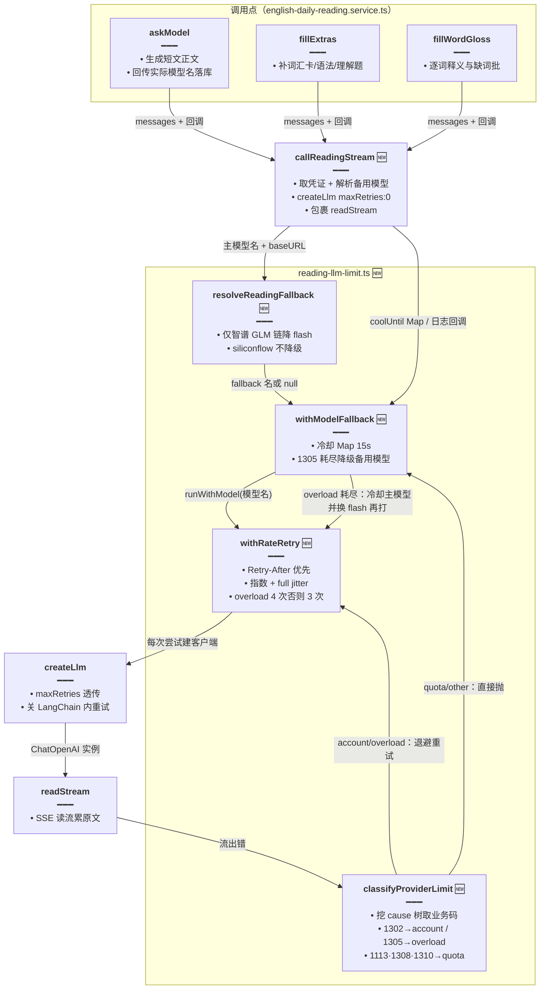

# 每日阅读限流分级退避与模型降级

> 文档角色：本篇是**每日阅读出站请求限流治理**的当前主文档——429 按智谱业务码分级、同模型带抖动退避、模型过载（1305）冷却后自动降级到同 Key 备用模型。
>
> 延伸阅读：
> - 上一代限流写法（`isRateLimit` 结构识别 + 固定 2s/4s 退避，已被本篇取代）：[每日阅读生成加固.md](./每日阅读生成加固.md)
> - 手动生成 SSE 主链路（`callReadingStream` 的调用方所在链路）：[每日阅读流式生成.md](./每日阅读流式生成.md)
> - 队列调度与日推失败上限（退避耗尽后的外层账本）：[每日阅读生成调度.md](./每日阅读生成调度.md)、[每日阅读日推失败上限.md](./每日阅读日推失败上限.md)
> - 句译与逐句播放（生成完成后的阅读侧）：[每日阅读逐句播放.md](./每日阅读逐句播放.md)

## 1. 背景与目标

改动前，每日阅读三次模型出站（正文 `askModel`、附件 `fillExtras`、逐词释义 `fillWordGloss`）各自重复三段样板：建 `createLlm` 客户端 → 私有 `withRateRetry` 包一层 `readStream`。限流处理只有两个粒度：

- **只认「是不是 429」**：旧 `isRateLimit` 只看 `status === 429` 或 `lc_error_code === 'MODEL_RATE_LIMIT'`，不分辨智谱业务码。账户速率限制（1302）、模型过载（1305）、额度耗尽（1113/1308/1310）一律按同一策略短睡重试。
- **固定退避**：2s、4s 两档，连同首次最多 3 次；不读供应商返回的 `Retry-After`，也没有抖动，多实例同时撞限流时会同步苏醒、再撞一次。
- **没有降级**：主模型过载（1305，「该模型当前访问量过大」）时只能硬等，高峰时段一篇短文可能连续失败；即便换了模型重试，LangChain `ChatOpenAI` 默认还会内置重试，与外层退避叠加成嵌套重试。
- **三处样板重复**：新建客户端与重试包裹在三个方法里各写一份，改一处忘两处。

本轮目标：**按业务码分级限流、退避带 `Retry-After` 优先与 full jitter、1305 过载冷却后降级到同 Key 备用模型、三处出站收口到一个 `callReadingStream`**。

## 2. 改动范围

| 文件 | 改动 | 角色 |
| --- | --- | --- |
| `apps/backend/src/services/english-learning/reading-llm-limit.ts` | **新增** | 限流分级、退避、降级、自检的独立工具模块 |
| `apps/backend/src/services/english-learning/english-daily-reading.service.ts` | 修改 | 删内置 `isRateLimit`/`wait`/私有 `withRateRetry`；新增 `modelCoolUntil` 与 `callReadingStream`；`askModel`/`fillExtras`/`fillWordGloss` 改走 `callReadingStream` |
| `apps/backend/src/enum/config.enum.ts` | 修改 | `ModelEnum` 新增 `GLM_FALLBACK_MODEL_NAME` 环境变量枚举 |
| `apps/backend/src/utils/create-llm.ts` | 修改 | `CreateLlmOptions` 新增 `maxRetries` 并在两处构造透传，供出站方关闭 LangChain 内置重试 |

## 3. 实现思路

1. **先分级，再谈退避**：`classifyProviderLimit` 从异常树（`cause` 递归 ≤4 层）挖出智谱业务码 / HTTP 状态 / LangChain 错误码，把限流分成四类——`quota`（1113/1308/1310，额度问题，重试无意义，直接抛）、`account`（1302，账户速率限制，只退避不换模型）、`model_overload`（1305，模型级过载，退避耗尽后允许降级备用模型）、`other`（非限流，直接抛）。429 但挖不到业务码时按文案兜底，分不清一律当 `model_overload`，为降级留口子。
2. **退避尊重供应商节奏**：`withRateRetry` 优先读 `Retry-After` 响应头（秒 → 毫秒），没有时按 `2000 * 2^attempt` 指数打底，再乘 `Math.random()` 做 **full jitter**（0～base 均匀随机，下限 500ms），避免多实例同步重试；过载给 4 次机会，账户限流 3 次。
3. **降级只对智谱 GLM 链开放**：`resolveReadingFallback` 只在 baseURL 非硅基流动、主模型名含 `glm` 且备用名与主模型不同名时，返回备用模型名（默认 `glm-4-flash`，可用 `GLM_FALLBACK_MODEL_NAME` 覆盖）；硅基流动主路径明确不降回 flash，避免会员高配模型被悄悄换成免费小模型。
4. **冷却用进程内 Map**：`withModelFallback` 把 1305 耗尽的主模型写入 `modelCoolUntil`（key=modelName，15 秒冷却），冷却期内后续请求直接打备用模型，不再头撞主模型；ponytail 注释已注明多实例部署要搬 Redis，单实例先用进程内 Map 换取零新依赖。
5. **关闭 LangChain 内置重试**：`createLlm` 新增 `maxRetries` 透传，阅读出站固定传 `0`——重试策略全由本模块自管，避免 LangChain 默认重试与外层退避叠成嵌套重试、放大等待时间。
6. **三处出站收口**：新增私有 `callReadingStream` 统一做「取凭证 → 解析备用模型 → `withModelFallback` 包裹 `createLlm` + `readStream`」，`askModel`/`fillExtras`/`fillWordGloss` 只传消息与回调；`askModel` 的实际模型名改从 `withModelFallback` 返回值拿（降级后落库的是真实出文模型，而非请求时的预期模型）。



## 4. 关键代码对比与注释

### 4.1 新模块 `reading-llm-limit.ts`（纯新增）

整个文件为**本轮新增**，无「改动前」对照（纯新增例外，不再贴空块）。按符号分节摘录全文并逐行注释。

#### 4.1.1 模块头、`LimitKind` 与常量

**改动后（纯新增）** · `apps/backend/src/services/english-learning/reading-llm-limit.ts`（当前，约 L1–L12）

```typescript
// 模块头注释：一句话说清本文件管每日阅读出站的三件事——429 分码、同模型退避、过载降级
/** 每日阅读出站：429 分码、同模型退避、模型过载降级。 */

// 限流分类联合类型：账户限流 / 模型过载 / 额度耗尽 / 其它，分级决定「退避还是降级还是直接抛」
export type LimitKind = 'account' | 'model_overload' | 'quota' | 'other';

// 默认备用模型：智谱同 Key 下的免费 flash，1305 过载时顶班
const DEFAULT_FALLBACK = 'glm-4-flash';
// 主模型冷却时长：15 秒内不再头撞刚过载的主模型，直接打备用
const COOLDOWN_MS = 15_000;

// 剥掉模型名的路径前缀（如 "Pro/zai-org/GLM-5.1" → "gl-5.1" 式小写裸名），供包含判断用
function bareModel(name: string): string {
	// 先去首尾空格，避免环境变量里带空格导致比较失败
	const s = name.trim();
	// 找最后一个斜杠，硅基流动模型名常用 "组织/模型" 形式
	const slash = s.lastIndexOf('/');
	// 有斜杠取最后一段，再统一小写，保证 includes('glm') 判断大小写不敏感
	return (slash >= 0 ? s.slice(slash + 1) : s).toLowerCase();
}
```

#### 4.1.2 `digLimitFields`：从异常树挖业务码

**改动后（纯新增）** · `apps/backend/src/services/english-learning/reading-llm-limit.ts`（当前，约 L14–L58）

```typescript
// 函数职责注释：从层层包裹的异常对象里取出分类所需的全部字段
/** 从异常树取出智谱业务码 / HTTP 状态 / LangChain 码。 */
// depth 限制递归深度，防止异常 cause 成环时栈溢出
function digLimitFields(
	// 待挖的异常对象：任意形态，函数内部再窄化
	err: unknown,
	// 当前递归深度：配合 4 层上限，防 cause 成环时栈溢出
	depth = 0,
	// 返回扁平结构：字段全可选，挖不到就是 undefined
): {
	// 返回结构：HTTP 状态码（如 429）
	status?: number;
	// LangChain 侧错误码（如 MODEL_RATE_LIMIT）
	lc?: string;
	// 供应商业务码（智谱 1302/1305 等，统一成字符串）
	code?: string;
	// 错误文案，429 无业务码时靠它兜底分类
	message?: string;
	// 供应商建议的重试等待毫秒数（来自 Retry-After 头）
	retryAfterMs?: number;
} {
	// 非对象或超过 4 层就不再深挖，返回空对象让上层走兜底分类
	if (!err || typeof err !== 'object' || depth > 4) return {};
	// 把 unknown 窄化成可能带这些字段的形状，字段全可选，拿不到就是 undefined
	const o = err as {
		// 异常自带的 HTTP 状态码（fetch/axios 都会带）
		status?: number;
		// LangChain 侧错误码（如 MODEL_RATE_LIMIT）
		lc_error_code?: string;
		// 供应商业务码：数字或字符串都可能，后面统一转字符串
		code?: string | number;
		// 错误文案：429 无业务码时的兜底分类依据
		message?: string;
		// fetch 风格响应头：Retry-After 可能在这里
		headers?: Record<string, unknown>;
		// axios 风格包装：响应头与响应体挂在 response 下
		response?: { headers?: Record<string, unknown>; data?: unknown };
		// 智谱典型形态：业务码与文案嵌在 error 对象里
		error?: { code?: string | number; message?: string };
		// 下层异常：递归深挖的入口
		cause?: unknown;
	};
	// 先递归 cause 拿到内层字段，外层字段优先于内层（外层 ?? 内层）
	const nested = digLimitFields(o.cause, depth + 1);
	// 业务码三处来源：自身 code、error.code、内层结果
	const code = o.code ?? o.error?.code ?? nested.code;
	// 文案两处来源：自身 message、error.message，再落内层
	const message = o.message ?? o.error?.message ?? nested.message;
	// HTTP 状态：自身没有就用内层挖到的
	const status = o.status ?? nested.status;
	// LangChain 错误码同理，外层优先
	const lc = o.lc_error_code ?? nested.lc;
	// 响应头可能在 headers 或 response.headers（axios/fetch 两种包法都兼容）
	const headers = o.headers ?? o.response?.headers;
	// 内层若已挖到 Retry-After 先留着，外层有头覆盖
	let retryAfterMs = nested.retryAfterMs;
	// 确实有头对象才尝试解析
	if (headers && typeof headers === 'object') {
		// 兼容三种取法：小写键、大写键、Headers 实例的 .get 方法
		const raw =
			// 先按小写键取：Node fetch/undici 的头键全小写
			headers['retry-after'] ??
			// 再按规范首字母大写键取，兼容部分客户端实现
			headers['Retry-After'] ??
			// 最后兼容 Headers 实例：用 .get 方法取，取不到就是 undefined
			(headers as { get?: (k: string) => unknown }).get?.('retry-after');
		// Retry-After 规范是秒数，转 number 备用
		const n = Number(raw);
		// 只接受有限非负数，乘 1000 换成毫秒并取整
		if (Number.isFinite(n) && n >= 0) retryAfterMs = Math.floor(n * 1000);
	}
	// 汇总成扁平结构返回，业务码与文案统一成字符串便于上层比较
	return {
		// 带出 HTTP 状态码，供上层判 429
		status,
		// 带出 LangChain 错误码，供上层判 MODEL_RATE_LIMIT
		lc,
		// 业务码统一转字符串：数字 1305 与 '1305' 同口径比较
		code: code != null ? String(code) : undefined,
		// 文案统一转字符串：兜底分类的正则要用
		message: message != null ? String(message) : undefined,
		// 带出解析好的 Retry-After 毫秒数，退避时优先采用
		retryAfterMs,
	};
}
```

#### 4.1.3 `classifyProviderLimit` / `isRateLimit` / `readRetryAfterMs`

**改动后（纯新增）** · `apps/backend/src/services/english-learning/reading-llm-limit.ts`（当前，约 L60–L84）

```typescript
// 函数职责注释：分级的核心动机——旧版一律短睡，额度错误白重试、过载不敢降级
/** 分出 1302 账户限流 / 1305 模型过载 / 额度类，避免一律短睡。 */
export function classifyProviderLimit(err: unknown): LimitKind {
	// 先挖全字段再逐级判断，判断顺序即优先级
	const { status, lc, code, message } = digLimitFields(err);
	// 1113 欠费 / 1308 额度耗尽 / 1310 套餐限制：重试没意义，直接归 quota 让上层抛出
	if (code === '1113' || code === '1308' || code === '1310') return 'quota';
	// 1302 是账户级速率限制：只能等，换模型无用（同 Key 共享账户配额）
	if (code === '1302') return 'account';
	// 1305 是模型级过载：等一等或换同 Key 备用模型都可能成
	if (code === '1305') return 'model_overload';
	// 没有业务码但有 429 状态或 LangChain 限流码时，进入文案兜底分支
	if (status === 429 || lc === 'MODEL_RATE_LIMIT') {
		// 文案可能为空，统一成空串避免正则 undefined
		const msg = message ?? '';
		// 「访问量过大 / overloaded / capacity」→ 模型过载，允许后续降级
		if (/访问量过大|overloaded|capacity/i.test(msg)) return 'model_overload';
		// 「账户…速率 / rate limit / slow_down」→ 账户限流，只退避
		if (/账户.*速率|rate limit|slow_down/i.test(msg)) return 'account';
		// 源码自带注释：分不清时按过载处理，给降级留机会
		// 分不清时按过载处理，允许后续走 fallback
		return 'model_overload';
	}
	// 其余错误（超时、500、解析失败等）不算限流
	return 'other';
}

// 函数职责注释：只有「等一等可能好」的两类才可退避
/** 是否可退避的限流（额度不算）。 */
export function isRateLimit(err: unknown): boolean {
	// 复用分级结果，保持单一口径
	const kind = classifyProviderLimit(err);
	// 额度与其它错误不重试，直接抛给上层计数或收尾
	return kind === 'account' || kind === 'model_overload';
}

// 把 Retry-After 毫秒数单独暴露，withRateRetry 退避时优先采用
export function readRetryAfterMs(err: unknown): number | undefined {
	// 再挖一次异常树取 retryAfterMs；调用频率低，重复挖比缓存结果更简单可靠
	return digLimitFields(err).retryAfterMs;
}
```

#### 4.1.4 `resolveReadingFallback`：只给智谱 GLM 链配降级

**改动后（纯新增）** · `apps/backend/src/services/english-learning/reading-llm-limit.ts`（当前，约 L86–L98）

```typescript
// 函数职责注释：降级白名单——硅基主路径不降，非 GLM 模型不降
/** 仅智谱 GLM 链启用同 Key flash 备用；硅基主路径不降回 flash。 */
export function resolveReadingFallback(
	// 主模型完整名：判断是否为 GLM 系的依据
	primaryName: string,
	// 出站根地址：识别硅基流动渠道的依据
	baseURL: string,
	// 备用模型名：允许环境变量覆盖，默认 glm-4-flash
	fallbackName = DEFAULT_FALLBACK,
	// 返回备用模型名；返回 null 表示本链路不启用降级
): string | null {
	// 硅基流动渠道直接不降级：会员可能特地选了高配模型，悄悄换成免费 flash 是体验倒退
	if (/siliconflow/i.test(baseURL)) return null;
	// 取主模型裸名做包含判断
	const primary = bareModel(primaryName);
	// 主模型不是 GLM 系（例如用户在智谱 Key 下配了别家模型）就不乱降级
	if (!primary.includes('glm')) return null;
	// 备用名允许环境变量覆盖；配成空白字符串时回落默认 glm-4-flash
	const fb = (fallbackName.trim() || DEFAULT_FALLBACK).trim();
	// 备用与主模型同名时降级无意义（同模型再打一遍只会再撞 1305）
	if (bareModel(fb) === primary) return null;
	// 校验通过，返回备用模型名
	return fb;
}
```

#### 4.1.5 `wait` 与 `isAbort`

**改动后（纯新增）** · `apps/backend/src/services/english-learning/reading-llm-limit.ts`（当前，约 L100–L127）

```typescript
// 函数职责注释：可中止的退避等待——停止信号一到立刻 reject，不再发下一跳请求
/** 退避等待；停止信号打断，不再发下一跳。 */
export function wait(ms: number, signal?: AbortSignal): Promise<void> {
	// 进入等待前已中止：直接 reject，连定时器都不起
	if (signal?.aborted) {
		// 统一用 AbortError 名字，上层 isAbort 按名字识别
		const err = new Error('aborted');
		// 改名为标准 AbortError，与浏览器中止错误口径一致
		err.name = 'AbortError';
		// 以 rejected Promise 返回，await 处直接进 catch
		return Promise.reject(err);
	}
	// 起定时器睡眠，同时挂 abort 监听
	return new Promise((resolve, reject) => {
		// 到点正常唤醒：先摘监听再 resolve，防止监听泄漏
		const timer = setTimeout(() => {
			// 到点唤醒前先摘掉 abort 监听，防监听器泄漏
			signal?.removeEventListener('abort', onAbort);
			// 正常睡满：放行 Promise，进入下一次重试
			resolve();
			// 定时时长为传入的退避毫秒数
		}, ms);
		// 中止回调：清掉定时器并以 AbortError 拒绝，让 withRateRetry 跳出重试循环
		const onAbort = () => {
			// 取消尚未触发的定时器，省一次无效唤醒
			clearTimeout(timer);
			// 构造中止错误
			const err = new Error('aborted');
			// 命名为 AbortError，与预检分支口径一致
			err.name = 'AbortError';
			// 以拒绝结束等待，withRateRetry 在 catch 里识别并退出
			reject(err);
		};
		// once:true 保证监听只触发一次，配合上面的 removeEventListener 双保险
		signal?.addEventListener('abort', onAbort, { once: true });
	});
}

// 本模块内部的中止判定：信号已 abort、错误名 AbortError、或文案含 abort 都算
function isAbort(err: unknown, signal?: AbortSignal): boolean {
	// 信号位优先，最权威
	if (signal?.aborted) return true;
	// 非对象错误（字符串等）无法判定，按非中止处理让上层原样抛出
	if (!err || typeof err !== 'object') return false;
	// 标准 AbortError 名字命中
	if ((err as { name?: string }).name === 'AbortError') return true;
	// 兼容只带文案的第三方错误（如 "Request aborted"）
	return /abort/i.test(String((err as { message?: unknown }).message ?? ''));
}
```

#### 4.1.6 `withRateRetry`：同模型有限次退避

**改动后（纯新增）** · `apps/backend/src/services/english-learning/reading-llm-limit.ts`（当前，约 L129–L158）

```typescript
// 函数职责注释：Retry-After 优先，否则指数退避加 full jitter
/** 同模型有限次重试：Prefer Retry-After，否则指数 + full jitter。 */
export async function withRateRetry<T>(
	// 被重试包裹的一次出站动作：成功即返回，失败由本函数决定退避还是放弃
	run: () => Promise<T>,
	// 可选配置：中止信号、类别提示、次数覆盖与退避回调
	opts?: {
		// 中止信号：退避期间被停止要能立刻退出
		signal?: AbortSignal;
		// 调用方已知错误类别时的提示（如冷却期直打备用模型，按过载给 4 次）
		kindHint?: LimitKind;
		// 显式覆盖最大尝试次数
		maxAttempts?: number;
		// 每次退避前的回调，供 service 打日志
		onRetry?: (delayMs: number, kind: LimitKind) => void;
	},
	// 泛型 T 透传 run 的返回类型；全部失败时抛最后一次错误
): Promise<T> {
	// 最大尝试次数：显式配置 > kindHint 推断（过载 4 次）> 默认 3 次；含首次
	const max =
		// 显式 maxAttempts 优先；否则过载给 4 次（多留一次机会），其余 3 次
		opts?.maxAttempts ?? (opts?.kindHint === 'model_overload' ? 4 : 3);
	// 记录最后一次错误的分类，循环走到尽头时报错信息用得上
	let lastKind: LimitKind = 'other';
	// 逐次尝试，attempt 从 0 起算，退避指数随 attempt 增长
	for (let attempt = 0; attempt < max; attempt += 1) {
		// 单次尝试：成功就把结果带出循环
		try {
			// 成功立即返回，不等待
			return await run();
			// 失败进入捕获：先判中止，再按类别决定退避还是上抛
		} catch (err) {
			// 中止错误原样上抛，不消耗重试次数
			if (isAbort(err, opts?.signal)) throw err;
			// 对本次错误分级，决定退避还是放弃
			lastKind = classifyProviderLimit(err);
			// 额度与其它错误重试无意义，直接抛
			if (lastKind === 'quota' || lastKind === 'other') throw err;
			// 最后一次也失败就不再睡，把错误抛给上层（withModelFallback 或生成主流程）
			if (attempt === max - 1) throw err;
			// 供应商若给了 Retry-After 就尊重它，否则 2s/4s/8s… 指数打底
			const retryAfter = readRetryAfterMs(err);
			// Retry-After 优先；没有时按 2000 * 2^attempt 指数增长
			const base = retryAfter ?? 2000 * 2 ** attempt;
			// full jitter：在 0～base 间均匀随机，至少 500ms，打散多实例的同步重试
			const delay = Math.max(500, Math.floor(Math.random() * base));
			// 睡之前通知调用方（日志能看到「多久后重试、属于哪类限流」）
			opts?.onRetry?.(delay, lastKind);
			// 可中止地睡；睡醒进入下一次尝试
			await wait(delay, opts?.signal);
		}
	}
	// 理论到不了（最后一次已在循环内抛出），兜底报错带上最后分类便于排查
	throw new Error(`rate limit:${lastKind}`);
}
```

#### 4.1.7 `withModelFallback`：冷却后降级备用模型

**改动后（纯新增）** · `apps/backend/src/services/english-learning/reading-llm-limit.ts`（当前，约 L160–L203）

```typescript
// 函数职责注释：1305 退避耗尽才冷却主模型并换备用；账户限流不换模型（换了也白换）
/** 1305 耗尽后冷却主模型并换备用再打；账户限流不换模型。 */
export async function withModelFallback<T>(input: {
	// 主模型完整名（凭证解析结果）
	primaryModel: string;
	// 备用模型名；resolveReadingFallback 返回 null 时降级路径整体关闭
	fallbackModel: string | null;
	// 中止信号，一路透传到退避等待
	signal?: AbortSignal;
	// 进程内冷却表：key=modelName → 冷却到期时间戳（ms）
	coolUntil: Map<string, number>;
	// 用指定模型名真正发请求的回调（service 里建客户端 + readStream）
	runWithModel: (modelName: string) => Promise<T>;
	// 退避日志回调，透传给 withRateRetry
	onRetry?: (delayMs: number, kind: LimitKind) => void;
	// 发生降级时的回调，供 service 打「主模型过载，降级 X → Y」
	onDegraded?: (from: string, to: string) => void;
	// 返回结果与真实出文模型名：降级时 modelName 是备用模型，落库要用真名
}): Promise<{ value: T; modelName: string }> {
	// 取当前时间戳，与冷却到期时间比较
	const now = Date.now();
	// 主模型是否仍在冷却期内
	const cooled = (input.coolUntil.get(input.primaryModel) ?? 0) > now;
	// 冷却中且有备用：跳过主模型直接打备用，省一次注定失败的尝试
	const first =
		// 冷却期内且有备用 → 备用；否则正常从主模型开始
		cooled && input.fallbackModel ? input.fallbackModel : input.primaryModel;
	// 首轮尝试：用选定的 first 模型走带退避的出站
	try {
		// 先按选定模型走一轮带退避的出站
		const value = await withRateRetry(() => input.runWithModel(first), {
			// 中止信号透传，退避期间可被打断
			signal: input.signal,
			// 冷却期直打备用时提示按过载给 4 次机会；正常首发不预设类别
			kindHint: cooled ? 'model_overload' : undefined,
			// 退避日志回调透传，service 侧统一打日志
			onRetry: input.onRetry,
		});
		// 成功：把实际出文的模型名一并带回去（askModel 落库要用真实模型名）
		return { value, modelName: first };
		// 首轮失败：进入降级判定
	} catch (err) {
		// 中止错误原样上抛，不触发降级
		if (isAbort(err, input.signal)) throw err;
		// 对失败原因分级，只有模型过载才值得换模型
		const kind = classifyProviderLimit(err);
		// 三种情况放弃降级：非过载（账户限流换模型无用）、没配备用、首发已是备用（备用也过载就不再绕圈）
		if (
			// 非模型过载（账户限流换模型无用，同 Key 共享账户配额）
			kind !== 'model_overload' ||
			// 没解析出备用模型：降级路径整体关闭
			!input.fallbackModel ||
			// 首发已是备用：备用也过载就不再绕圈
			first === input.fallbackModel
		) {
			// 命中任一放弃条件：把原始错误抛给生成主流程
			throw err;
		}
		// 把主模型写入冷却表，15 秒内后续请求直接打备用
		input.coolUntil.set(input.primaryModel, Date.now() + COOLDOWN_MS);
		// 通知调用方发生了降级（日志可见）
		input.onDegraded?.(input.primaryModel, input.fallbackModel);
		// 换备用模型再打一轮，按过载给满 4 次退避
		const value = await withRateRetry(
			// 降级轮固定打备用模型；非空断言安全：上面已排除 fallbackModel 为 null
			() => input.runWithModel(input.fallbackModel!),
			{
				// 中止信号继续透传
				signal: input.signal,
				// 明确按过载类别给满 4 次退避机会
				kindHint: 'model_overload',
				// 退避日志回调透传
				onRetry: input.onRetry,
			},
		);
		// 备用成功：返回备用模型出的文与备用模型名
		return { value, modelName: input.fallbackModel };
	}
}
```

#### 4.1.8 `assertReadingLlmLimitSelfCheck`：最小自检

**改动后（纯新增）** · `apps/backend/src/services/english-learning/reading-llm-limit.ts`（当前，约 L205–L254）

```typescript
// 函数职责注释：改本文件逻辑后先跑这段自检，防止分类/降级规则被改坏
/** 最小自检：分类与备用解析。改逻辑时先跑这一段。 */
export function assertReadingLlmLimitSelfCheck(): void {
	// 构造 1305 过载样本：LangChain 码 + error.code + 中文文案三层都有
	const overload = {
		// 样本带 429 状态码
		status: 429,
		// 样本带 LangChain 限流码，覆盖 lc 判定路径
		lc_error_code: 'MODEL_RATE_LIMIT',
		// 智谱真实 1305 响应形态：业务码与文案嵌在 error 里
		error: { code: 1305, message: '该模型当前访问量过大，请您稍后再试' },
	};
	// 构造 1302 账户限流样本
	const account = {
		// 样本带 429 状态码
		status: 429,
		// 1302 业务码与账户限速文案
		error: { code: 1302, message: '您的账户已达到速率限制' },
	};
	// 构造 1113 欠费样本（顶层 code，数字型，验证 String 归一化路径）
	const quota = { status: 429, code: 1113, message: '欠费' };
	// 1305 必须分到模型过载
	if (classifyProviderLimit(overload) !== 'model_overload') {
		// 分类不是模型过载即自检失败，抛错暴露改动
		throw new Error('1305 should be model_overload');
	}
	// 1302 必须分到账户限流
	if (classifyProviderLimit(account) !== 'account') {
		// 分类不是账户限流即自检失败
		throw new Error('1302 should be account');
	}
	// 1113 必须分到额度类（不退避）
	if (classifyProviderLimit(quota) !== 'quota') {
		// 分类不是额度类即自检失败
		throw new Error('1113 should be quota');
	}
	// 包在 cause 里的 1305 也要能挖出来（验证递归）
	if (classifyProviderLimit({ cause: overload }) !== 'model_overload') {
		// 嵌套业务码挖不到即自检失败
		throw new Error('nested cause 1305');
	}
	// 智谱 GLM 主模型应解析出默认备用 glm-4-flash
	if (
		// 用智谱官方地址 + GLM 主模型调备用解析
		resolveReadingFallback(
			// 主模型名：GLM 系，应触发降级
			'glm-4.7-flash',
			// 智谱官方 baseURL：非硅基渠道，允许降级
			'https://open.bigmodel.cn/api/paas/v4',
			// 期望解析出默认备用 glm-4-flash
		) !== 'glm-4-flash'
	) {
		// 解析结果不符预期即自检失败
		throw new Error('zhipu flash should fallback');
	}
	// 硅基流动渠道即使模型名带 GLM 也绝不降级
	if (
		// 用硅基地址 + 带路径前缀的 GLM 模型名调备用解析
		resolveReadingFallback(
			// 硅基风格「组织/模型」名，验证 bareModel 去前缀逻辑
			'Pro/zai-org/GLM-5.1',
			// 硅基流动 baseURL：必须命中不降级白名单
			'https://api.siliconflow.cn/v1',
			// 期望返回 null（不降级）
		) != null
	) {
		// 硅基渠道返回了备用名即自检失败
		throw new Error('siliconflow must not glm-flash fallback');
	}
	// 备用名与主模型同名时必须返回 null（防止同模型空转）
	if (
		// 备用名与主模型同名的边界用例
		resolveReadingFallback(
			// 主模型 glm-4-flash
			'glm-4-flash',
			// 智谱官方地址：渠道本身允许降级
			'https://open.bigmodel.cn/api/paas/v4',
			// 备用名也配成 glm-4-flash：同名应被否决
			'glm-4-flash',
			// 期望返回 null（同名不降级）
		) != null
	) {
		// 同名仍返回备用名即自检失败
		throw new Error('same-name fallback must be null');
	}
}
```

### 4.2 service：删内置 `isRateLimit` / `wait`，改从新模块导入

**改动前** · `apps/backend/src/services/english-learning/english-daily-reading.service.ts`（基线，约 L208–L240）

```typescript
// 旧版限流识别：只看状态码与 LangChain 码，无法区分账户限流/过载/额度
/** 认出账户限流。只看状态码和 LangChain 错误码，不按文案猜。 */
function isRateLimit(err: unknown, depth = 0): boolean {
	// 非对象或递归超 3 层就判定非限流
	if (!err || typeof err !== 'object' || depth > 3) return false;
	// 窄化出判定所需的三个字段
	const o = err as {
		// HTTP 状态码字段
		status?: number;
		// LangChain 错误码字段
		lc_error_code?: string;
		// 下层异常：递归判定的入口
		cause?: unknown;
	};
	// 命中 429 或 LangChain 限流码即算限流（额度错误也被误算进来）
	if (o.status === 429 || o.lc_error_code === 'MODEL_RATE_LIMIT') return true;
	// 递归 cause 继续找
	return isRateLimit(o.cause, depth + 1);
}

// 旧版退避等待：实现与新模块 wait 相同，本轮随识别逻辑一起搬走
/** 退避等待。停止信号一到就结束，不再发下一次请求。 */
function wait(ms: number, signal?: AbortSignal): Promise<void> {
	// 已中止则直接拒绝
	if (signal?.aborted) {
		// 构造中止错误
		const err = new Error('aborted');
		// 命名 AbortError，供上层按名字识别
		err.name = 'AbortError';
		// 以 rejected Promise 返回，不起定时器
		return Promise.reject(err);
	}
	// 定时器 + abort 监听组合的可中止睡眠
	return new Promise((resolve, reject) => {
		// 起退避定时器，到点 resolve
		const timer = setTimeout(() => {
			// 到点后摘掉 abort 监听，防泄漏
			signal?.removeEventListener('abort', onAbort);
			// 睡满放行
			resolve();
			// 定时时长为传入的退避毫秒数
		}, ms);
		// 中止回调：清定时器并以 AbortError 拒绝
		const onAbort = () => {
			// 取消未触发的定时器
			clearTimeout(timer);
			// 构造中止错误
			const err = new Error('aborted');
			// 命名 AbortError
			err.name = 'AbortError';
			// 以拒绝打断等待
			reject(err);
		};
		// 挂一次性 abort 监听，触发即打断睡眠
		signal?.addEventListener('abort', onAbort, { once: true });
	});
}
```

**改动后** · `apps/backend/src/services/english-learning/english-daily-reading.service.ts`（当前，约 L18 与 L83–L87）

```typescript
// 引入 ModelEnum 以读取新增的 GLM_FALLBACK_MODEL_NAME 环境变量
import { ModelEnum } from '../../enum/config.enum';
// ...（未改动：其余 import 与文件中间部分）

// 从限流模块导入三件套：识别（isRateLimit 仍被缺词批容错用）、备用解析、降级编排
import {
	// 限流判定：缺词批容错分支仍在用
	isRateLimit,
	// 备用模型解析：callReadingStream 算降级目标用
	resolveReadingFallback,
	// 退避 + 冷却降级编排：统一出站的核心
	withModelFallback,
// 同目录新模块的相对引用
} from './reading-llm-limit';
```

**变更摘要**：删掉 service 内「只认 429」的旧 `isRateLimit` 与本地 `wait`，改由 `reading-llm-limit.ts` 统一出口；`isRateLimit` 名字保留但语义升级为「账户/过载两类才算」。

### 4.3 新增 `modelCoolUntil` 字段，删私有 `withRateRetry`

**改动前** · `apps/backend/src/services/english-learning/english-daily-reading.service.ts`（基线，约 L1035–L1061）

```typescript
	// 旧版私有重试：固定 2s/4s 两档，最多 3 次，无 Retry-After 与抖动
	/** 只重试这一次流。成功不等待。429 才等 2 秒、4 秒，连同首次最多 3 次。 */
	private async withRateRetry<T>(
		// 被包裹的一次流式出站动作
		run: () => Promise<T>,
		// 中止信号：退避期间可被打断
		signal?: AbortSignal,
		// 返回 run 的成功结果；重试耗尽抛最后一次错误
	): Promise<T> {
		// 固定 3 次尝试
		for (let attempt = 0; attempt < 3; attempt += 1) {
			// 单次尝试：成功直接带出结果
			try {
				// 成功直接返回
				return await run();
				// 失败进入放弃/退避判定
			} catch (err) {
				// 中止、最后一次、或非限流错误都直接抛
				if (
					// 调用方已点停止：不再重试
					signal?.aborted ||
					// 错误本身是中止：不再重试
					this.isAbort(err, signal) ||
					// 已是最后一次尝试：再睡无意义
					attempt === 2 ||
					// 非限流错误（含被误算的额度错误）：重试无用
					!isRateLimit(err)
				) {
					// 命中任一放弃条件，原样上抛
					throw err;
				}
				// 固定指数退避：2s、4s，无抖动，多实例会同步苏醒再撞一次
				const delay = 2000 * 2 ** attempt;
				// 打一条限流重试告警日志
				this.logger.warn(`[EnglishDailyReading] 限流，${delay / 1000}秒后重试`);
				// 可中止地睡；睡醒进入下一次尝试
				await wait(delay, signal);
			}
		}
		// 循环穷尽兜底（实际最后一次已在循环内抛出）
		throw new Error('rate limit');
	}
```

**改动后** · `apps/backend/src/services/english-learning/english-daily-reading.service.ts`（当前，约 L230–L232）

```typescript
// 服务类声明：本段只展示承载冷却表的新增字段
export class EnglishDailyReadingService implements OnApplicationBootstrap {
	// 源码 ponytail 注释：说明该表是进程内状态，多实例部署需外搬
	/** ponytail: 进程内模型冷却；多实例要搬 Redis。key=modelName → 冷却到期 ms */
	// 冷却表作为服务实例字段，随 Nest 单例生命周期存在，传给 withModelFallback 读写
	private readonly modelCoolUntil = new Map<string, number>();
```

**变更摘要**：固定 3 次、无抖动的私有 `withRateRetry` 整体删除，能力由新模块同名函数的「Retry-After + full jitter + 按类给次数」取代；类上新增 `modelCoolUntil` 承载降级冷却。

### 4.4 新增 `callReadingStream`：三处出站的统一入口（纯新增方法）

**改动后（纯新增方法）** · `apps/backend/src/services/english-learning/english-daily-reading.service.ts`（当前，约 L1576–L1645）

```typescript
	// 方法职责注释：单次出站 = 同模型退避 + 1305 冷却降级，一句话点明策略
	/** 单次阅读出站：同模型 jitter 退避；1305 冷却后降级到同 Key flash。 */
	private async callReadingStream(opts: {
		// 中止信号，贯穿取流全程
		signal?: AbortSignal;
		// 用户 id：凭证解析要按用户取自定义 Key
		userId?: number;
		// 本次出站的系统/用户消息
		messages: Array<SystemMessage | HumanMessage>;
		// 流式增量回调（SSE 推给前端）
		onDelta?: (piece: string) => void;
		// Token 用量回调（done/paint 标记收尾与上色）
		onUsage?: (total: number, done?: boolean, paint?: boolean) => void;
	// 返回正文与真实出文模型名：降级时 modelName 是备用模型
	}): Promise<{ text: string; modelName: string }> {
		// 信号取出备用，后面多处要判
		const signal = opts.signal;
		// 进方法先查中止：已停止就不再取凭证、不发请求
		if (signal?.aborted) {
			// 构造中止错误
			const err = new Error('aborted');
			// 命名 AbortError，与模块识别口径一致
			err.name = 'AbortError';
			// 直接抛，不消耗任何外部调用
			throw err;
		}
		// 解析阅读专用凭证：用户自定义 Key 优先，否则环境变量预设
		const creds = await this.llmConfigService.resolveSiliconFlowCredentials(
			// 配置服务：读环境变量用
			this.configService,
			// 预设名：走阅读渠道凭证
			'englishLearning',
			// 用户 id：用户自定义 Key 优先
			opts.userId,
		);
		// 读可选的备用模型环境变量
		const fbRaw = this.configService.get<string>(
			// 新增的备用模型环境变量枚举键
			ModelEnum.GLM_FALLBACK_MODEL_NAME,
		);
		// 按白名单规则算出备用模型名；硅基渠道/非 GLM/同名都返回 null
		const fallback = resolveReadingFallback(
			// 主模型名：判断是否 GLM 系
			creds.modelName,
			// 出站地址：识别硅基渠道用
			creds.baseURL,
			// 环境变量是字符串才传入，否则走默认 glm-4-flash
			typeof fbRaw === 'string' ? fbRaw : undefined,
		);
		// 进入退避 + 降级编排；解构出正文与实际出文模型名
		const { value: text, modelName } = await withModelFallback({
			// 主模型名：凭证解析出的当前模型
			primaryModel: creds.modelName,
			// 备用模型名：白名单解析结果，null 时降级关闭
			fallbackModel: fallback,
			// 中止信号透传
			signal,
			// 把服务级冷却表交给编排层读写
			coolUntil: this.modelCoolUntil,
			// 每次退避前打一条带类别与等待时长的告警日志
			onRetry: (delayMs, kind) => {
				// 打告警：带限流类别与等待秒数，便于观察限流形态
				this.logger.warn(
					// 秒数四舍五入展示，日志更直观
					`[EnglishDailyReading] ${kind}，${Math.round(delayMs / 1000)}秒后重试`,
				);
			},
			// 降级发生时打「从哪个模型降到哪个模型」
			onDegraded: (from, to) => {
				// 降级告警：记录降级路径
				this.logger.warn(
					// 文案与回归观察点一致，方便 grep
					`[EnglishDailyReading] 主模型过载，降级 ${from} → ${to}`,
				);
			},
			// 真正发一次请求的回调：按给定模型名建客户端并读流
			runWithModel: async (modelName) => {
				// 按编排层指定的模型名建 LangChain 客户端
				const llm = await createLlm(
					// 配置服务：读环境变量
					this.configService,
					{
						// 阅读预设：走 englishLearning 渠道的 Key 与默认参数
						preset: 'englishLearning',
						// 用户 id：解析用户自定义 Key 用
						userId: opts.userId,
						// 模型名由编排层指定（主或备用），不再写死凭证里的名字
						modelName,
						// 开流式：SSE 增量推给前端
						streaming: true,
						// 采样温度 0.7：兼顾稳定与多样
						temperature: 0.7,
						// 默认温度兜底：模型不支持显式温度时用
						defaultTemperature: 0.7,
						// 输出上限 8192：长文 + 附件一次出全
						maxTokens: 8192,
						// 超上限策略按默认：不强行截断
						maxTokensPolicy: 'default',
						// 关掉 LangChain 内置重试，重试全由 withRateRetry 自管，避免嵌套重试
						maxRetries: 0,
						// 仍要求模型输出 JSON 对象，下游 parseModelObject 依赖该格式
						modelKwargs: { response_format: { type: 'json_object' } },
					},
					// 凭证服务：解析用户级 Key 与 baseURL
					this.llmConfigService,
				);
				// 建好后读流，把中止信号与两个回调透传下去
				return this.readStream(
					// 刚建好的客户端
					llm,
					// 系统/用户消息透传
					opts.messages,
					// 中止信号透传：读流中可被打断
					signal,
					// 增量回调透传（SSE 推前端）
					opts.onDelta,
					// 用量回调透传（done/paint 收尾）
					opts.onUsage,
				);
			},
		});
		// 统一返回正文与真实模型名（降级时为备用模型名）
		return { text, modelName };
	}
```

### 4.5 `askModel`：删自建客户端与重试包裹，改走 `callReadingStream`

**对比范围**：`private async askModel(...)` 全函数；中间的篇幅/提示词拼装未改动，两块用同一 `// ...（未改动）` 对称省略。

**改动前** · `apps/backend/src/services/english-learning/english-daily-reading.service.ts`（基线，约 L1623–L1712）

```typescript
	// 方法签名：正文生成出站（旧版自建客户端 + 私有重试包裹）
	private async askModel(
		// 发布日期：篇目归属日
		publishDate: string,
		// 主题：提示词拼装输入
		theme: string,
		// 阅读档位：决定词数与难度
		profile: ReadingProfile,
		// 续写片段：二次生成时接在上次后
		snippet: string | null,
		// 上次被拒稿反馈：重生成时规避
		previousReject: string | null,
		// 可选参数：信号、凭证与回调
		opts?: {
			// 中止信号
			signal?: AbortSignal;
			// 用户 id：凭证解析用
			userId?: number;
			// 流式增量回调
			onDelta?: (piece: string) => void;
			// Token 用量回调
			onUsage?: (total: number, done?: boolean, paint?: boolean) => void;
		},
	// 返回结构声明开始
	): Promise<{
		// 解析成功的草稿；废稿为 null
		draft: PassageDraft | null;
		// 解析成功的原始 JSON；废稿为 null
		payload: Record<string, unknown> | null;
		// 实际出文模型名：落库用
		modelName: string;
	// 返回结构结束，进入方法体
	}> {
		// 旧版先就地查中止
		const signal = opts?.signal;
		// 建客户端前先判中止
		if (signal?.aborted) {
			// 停止发生在创建客户端之前。不再发这次 HTTP。
			const err = new Error('aborted');
			// 命名 AbortError
			err.name = 'AbortError';
			// 直接抛，不发请求
			throw err;
		}
		// 旧版就地建客户端：三处出站各写一份同样的参数
		const llm = await createLlm(
			// 配置服务：读环境变量
			this.configService,
			{
				// 阅读预设渠道
				preset: 'englishLearning',
				// 用户 id：自定义 Key 解析
				userId: opts?.userId,
				// 开流式
				streaming: true,
				// 采样温度
				temperature: 0.7,
				// 默认温度兜底
				defaultTemperature: 0.7,
				// 输出上限
				maxTokens: 8192,
				// 超上限策略
				maxTokensPolicy: 'default',
				// 要求 JSON 输出：下游 parseModelObject 依赖
				modelKwargs: { response_format: { type: 'json_object' } },
			},
			// 凭证服务：解析用户级 Key
			this.llmConfigService,
		);
		// ...（未改动：lengthLine/system/user 提示词拼装，前后一致）
		// 旧版出站：readStream 外包一层私有 withRateRetry
		const text = await this.withRateRetry(
			// 每次重试重新发起同一条流
			() =>
				// 真正发起一次流式请求
				this.readStream(
					// 复用上面建好的客户端
					llm,
					// 系统提示词 + 用户提示词
					[new SystemMessage(system), new HumanMessage(user)],
					// 中止信号透传
					signal,
					// 增量回调透传
					opts?.onDelta,
					// 用量回调透传
					opts?.onUsage,
				),
			// 退避等待用的中止信号
			signal,
		);
		// 解析正文 JSON 为对象，失败为 null
		const payload = parseModelObject(text);
		// 解析成结构化草稿，失败为 null
		const draft = parsePassageJson(text);
		// 旧版从客户端实例上抠模型名：字段名不稳定（model/modelName 两种实现都有）
		const named = llm as { model?: string; modelName?: string };
		// modelName 优先，没有再退 model，兜底空串
		const modelName = named.modelName ?? named.model ?? '';
		// 流式过程只累积原文。整篇 JSON 不完整时当废稿，由调用方决定是否重试。模型名仍要带回去，第二次才能接在下面。
		if (!payload || !draft) return { draft: null, payload: null, modelName };
		// 完整稿：草稿 + 原始 JSON + 模型名一起带回
		return { draft, payload, modelName };
	}
```

**改动后** · `apps/backend/src/services/english-learning/english-daily-reading.service.ts`（当前，约 L1647–L1707）

```typescript
	// 方法签名：正文生成出站（新版收口到 callReadingStream）
	private async askModel(
		// 发布日期：篇目归属日
		publishDate: string,
		// 主题：提示词拼装输入
		theme: string,
		// 阅读档位：决定词数与难度
		profile: ReadingProfile,
		// 续写片段：二次生成时接在上次后
		snippet: string | null,
		// 上次被拒稿反馈：重生成时规避
		previousReject: string | null,
		// 可选参数：信号、凭证与回调
		opts?: {
			// 中止信号
			signal?: AbortSignal;
			// 用户 id：凭证解析用
			userId?: number;
			// 流式增量回调
			onDelta?: (piece: string) => void;
			// Token 用量回调
			onUsage?: (total: number, done?: boolean, paint?: boolean) => void;
		},
	// 返回结构声明开始
	): Promise<{
		// 解析成功的草稿；废稿为 null
		draft: PassageDraft | null;
		// 解析成功的原始 JSON；废稿为 null
		payload: Record<string, unknown> | null;
		// 实际出文模型名：降级时为备用模型，落库用真名
		modelName: string;
	// 返回结构结束，进入方法体
	}> {
		// ...（未改动：lengthLine/system/user 提示词拼装，前后一致）
		// 新版出站一行搞定：中止检查、取凭证、退避、降级全收口在 callReadingStream
		const { text, modelName } = await this.callReadingStream({
			// 中止信号透传
			signal: opts?.signal,
			// 用户 id 透传：凭证解析用
			userId: opts?.userId,
			// 正文生成的系统/用户提示词
			messages: [new SystemMessage(system), new HumanMessage(user)],
			// 增量回调透传
			onDelta: opts?.onDelta,
			// 用量回调透传
			onUsage: opts?.onUsage,
		});
		// 解析正文 JSON 为对象
		const payload = parseModelObject(text);
		// 解析成结构化草稿
		const draft = parsePassageJson(text);
		// 流式过程只累积原文。整篇 JSON 不完整时当废稿，由调用方决定是否重试。模型名仍要带回去，第二次才能接在下面。
		// 废稿分支同样带回真实模型名，二次生成能接在同一模型下
		if (!payload || !draft) return { draft: null, payload: null, modelName };
		// 完整稿带回草稿、原始 JSON 与真实模型名
		return { draft, payload, modelName };
	}
```

**变更摘要**：删掉方法头部的中止检查与 `createLlm` 样板、`withRateRetry` 包裹；模型名从「抠客户端实例字段」改为编排层返回值，降级后落库的是真实出文模型。

### 4.6 `fillExtras`：同样收口到 `callReadingStream`

**对比范围**：`private async fillExtras(...)` 全函数；中间的附件提示词 `lines`/`system` 拼装未改动，对称省略。

**改动前** · `apps/backend/src/services/english-learning/english-daily-reading.service.ts`（基线，约 L1835–L1881）

```typescript
	// 返回附件结果声明开始
	): Promise<{
		// 附件是否解析成功：上层据此决定补轮
		ok: boolean;
		// 解析出的附件 JSON；失败为 null
		payload: Record<string, unknown> | null;
		// 原始文本：打捞逻辑兜底用
		raw: string;
	// 返回结构结束，进入方法体
	}> {
		// 旧版就地查中止
		const signal = opts?.signal;
		// 建客户端前判中止
		if (signal?.aborted) {
			// 构造中止错误
			const err = new Error('aborted');
			// 命名 AbortError
			err.name = 'AbortError';
			// 直接抛
			throw err;
		}
		// 调用方指定附件键优先，否则按档位推导
		const keys = opts?.keys?.length ? opts.keys : requestedExtraKeys(profile);
		// 旧版就地建客户端，与 askModel 完全同参
		const llm = await createLlm(
			// 配置服务：读环境变量
			this.configService,
			{
				// 阅读预设渠道
				preset: 'englishLearning',
				// 用户 id：自定义 Key 解析
				userId: opts?.userId,
				// 开流式
				streaming: true,
				// 采样温度
				temperature: 0.7,
				// 默认温度兜底
				defaultTemperature: 0.7,
				// 输出上限
				maxTokens: 8192,
				// 超上限策略
				maxTokensPolicy: 'default',
				// 要求 JSON 输出
				modelKwargs: { response_format: { type: 'json_object' } },
			},
			// 凭证服务：解析用户级 Key
			this.llmConfigService,
		);
		// ...（未改动：lines 与 system 提示词拼装，前后一致）
		// 旧版出站：withRateRetry 包 readStream
		const text = await this.withRateRetry(
			// 每次重试重新发起同一条流
			() =>
				// 真正发起一次流式请求
				this.readStream(
					// 复用上面建好的客户端
					llm,
					// 系统提示词 + 正文
					[new SystemMessage(system), new HumanMessage(bodyEn)],
					// 中止信号透传
					signal,
					// 增量回调透传
					opts?.onDelta,
					// 用量回调透传
					opts?.onUsage,
				),
			// 退避等待用的中止信号
			signal,
		);
		// 解析附件 JSON，失败为 null
		const payload = parseModelObject(text);
		// ok 标记 + 解析结果 + 原文一起返回
		return { ok: Boolean(payload), payload, raw: text };
	}
```

**改动后** · `apps/backend/src/services/english-learning/english-daily-reading.service.ts`（当前，约 L1813–L1854）

```typescript
	// 方法职责注释：正文已定稿，附件请求不许模型再输出正文
	/** 只写这次列出的附件。正文已定稿，不让模型再输出正文。 */
	private async fillExtras(
		// 已定稿正文：附件提示词围绕它出
		bodyEn: string,
		// 阅读档位：推导默认附件键用
		profile: ReadingProfile,
		// 可选参数：信号、凭证、回调与指定附件键
		opts?: {
			// 中止信号
			signal?: AbortSignal;
			// 用户 id：凭证解析用
			userId?: number;
			// 流式增量回调
			onDelta?: (piece: string) => void;
			// Token 用量回调
			onUsage?: (total: number, done?: boolean, paint?: boolean) => void;
			// 指定只补哪些附件；缺省按档位全量
			keys?: ReadingExtraKey[];
		},
	// 返回结构声明开始
	): Promise<{
		// 附件是否解析成功
		ok: boolean;
		// 附件 JSON；失败为 null
		payload: Record<string, unknown> | null;
		// 原始文本：打捞兜底
		raw: string;
	// 返回结构结束，进入方法体
	}> {
		// 附件键列表：调用方指定优先，否则按档位推导
		const keys = opts?.keys?.length ? opts.keys : requestedExtraKeys(profile);
		// ...（未改动：lines 与 system 提示词拼装，前后一致）
		// 新版出站改走统一入口；附件不需要模型名，只取正文
		const { text } = await this.callReadingStream({
			// 中止信号透传
			signal: opts?.signal,
			// 用户 id 透传
			userId: opts?.userId,
			// 附件提示词：system 规则 + 正文
			messages: [new SystemMessage(system), new HumanMessage(bodyEn)],
			// 增量回调透传
			onDelta: opts?.onDelta,
			// 用量回调透传
			onUsage: opts?.onUsage,
		});
		// 解析附件 JSON
		const payload = parseModelObject(text);
		// ok 标记供上层决定要不要补一轮；raw 留给打捞逻辑
		return { ok: Boolean(payload), payload, raw: text };
	}
```

**变更摘要**：同 4.5——删中止检查与建客户端样板、退避降级收口；返回值结构不变，调用方零感知。

### 4.7 `fillWordGloss`：同样收口到 `callReadingStream`

**对比范围**：`private async fillWordGloss(...)` 全函数；中间的 `numbered`/`system` 拼装与尾部 `gloss` 打捞未改动，对称省略。

**改动前** · `apps/backend/src/services/english-learning/english-daily-reading.service.ts`（基线，约 L1963–L2005）

```typescript
	// 返回逐词释义与原始文本
	): Promise<{ gloss: ReadingExtras['wordGloss']; raw: string }> {
		// 旧版就地查中止
		const signal = opts?.signal;
		// 建客户端前判中止
		if (signal?.aborted) {
			// 构造中止错误
			const err = new Error('aborted');
			// 命名 AbortError
			err.name = 'AbortError';
			// 直接抛
			throw err;
		}
		// 旧版就地建客户端，第三份同参样板
		const llm = await createLlm(
			// 配置服务：读环境变量
			this.configService,
			{
				// 阅读预设渠道
				preset: 'englishLearning',
				// 用户 id：自定义 Key 解析
				userId: opts?.userId,
				// 开流式
				streaming: true,
				// 采样温度
				temperature: 0.7,
				// 默认温度兜底
				defaultTemperature: 0.7,
				// 输出上限
				maxTokens: 8192,
				// 超上限策略
				maxTokensPolicy: 'default',
				// 要求 JSON 输出
				modelKwargs: { response_format: { type: 'json_object' } },
			},
			// 凭证服务：解析用户级 Key
			this.llmConfigService,
		);
		// ...（未改动：gaps/numbered/system 拼装，前后一致）
		// 旧版出站：withRateRetry 包 readStream
		const text = await this.withRateRetry(
			// 每次重试重新发起同一条流
			() =>
				// 真正发起一次流式请求
				this.readStream(
					// 复用上面建好的客户端
					llm,
					// 系统提示词 + 编号句或正文
					[new SystemMessage(system), new HumanMessage(numbered || bodyEn)],
					// 中止信号透传
					signal,
					// 增量回调透传
					opts?.onDelta,
					// 用量回调透传
					opts?.onUsage,
				),
			// 退避等待用的中止信号
			signal,
		);
		// ...（未改动：payload 解析与 gloss 打捞，前后一致）
	}
```

**改动后** · `apps/backend/src/services/english-learning/english-daily-reading.service.ts`（当前，约 L1922–L1962）

```typescript
	// 方法职责注释：只补 wordGloss；sentences 有值时只给这一批句子
	/** 只补 wordGloss。正文已定稿。sentences 有值时只给这一批句子。 */
	private async fillWordGloss(
		// 已定稿正文：全量批的提示词输入
		bodyEn: string,
		// 可选参数：信号、凭证、回调与缺词批
		opts?: {
			// 中止信号
			signal?: AbortSignal;
			// 用户 id：凭证解析用
			userId?: number;
			// 流式增量回调
			onDelta?: (piece: string) => void;
			// Token 用量回调
			onUsage?: (total: number, done?: boolean, paint?: boolean) => void;
			// 缺词批：只补这些句子的这些词
			gaps?: { sentence: string; words: string[] }[];
		},
	// 返回逐词释义与原始文本
	): Promise<{ gloss: ReadingExtras['wordGloss']; raw: string }> {
		// ...（未改动：gaps/numbered/system 拼装，前后一致）
		// 新版出站改走统一入口；缺词批消息正文用 numbered，全量批用 bodyEn
		const { text } = await this.callReadingStream({
			// 中止信号透传
			signal: opts?.signal,
			// 用户 id 透传
			userId: opts?.userId,
			// 消息数组：system 规则 + 用户输入
			messages: [
				// 系统提示词：限定只输出 wordGloss
				new SystemMessage(system),
				// 用户输入：缺词批用编号句，全量批用正文
				new HumanMessage(numbered || bodyEn),
			],
			// 增量回调透传
			onDelta: opts?.onDelta,
			// 用量回调透传
			onUsage: opts?.onUsage,
		});
		// ...（未改动：payload 解析与 placeGapGloss/pickWordGloss/salvageWordGloss 打捞，前后一致）
	}
```

**变更摘要**：第三处样板同样删除；缺词批（`gaps`）与全量批两种消息形态原样保留，仅出站通道换成 `callReadingStream`。

### 4.8 `ModelEnum` 新增 `GLM_FALLBACK_MODEL_NAME`

**改动前** · `apps/backend/src/enum/config.enum.ts`（基线，约 L105–L110）

```typescript
	// 智谱 GLM 三要素环境变量枚举：Key、根路径、模型名
	GLM_API_KEY = 'GLM_API_KEY',
	// API 根路径环境变量
	GLM_BASE_URL = 'GLM_BASE_URL',
	// 主模型名环境变量
	GLM_MODEL_NAME = 'GLM_MODEL_NAME',
	// 旧版没有备用模型枚举，降级名只能硬编码
	/** 图片 OCR 视觉模型名，未配置时默认 GLM-4.6V-Flash */
	GLM_OCR_MODEL_NAME = 'GLM_OCR_MODEL_NAME',
```

**改动后** · `apps/backend/src/enum/config.enum.ts`（当前，约 L105–L112）

```typescript
	// 智谱 GLM 三要素环境变量枚举：Key、根路径、模型名
	GLM_API_KEY = 'GLM_API_KEY',
	// API 根路径环境变量
	GLM_BASE_URL = 'GLM_BASE_URL',
	// 主模型名环境变量
	GLM_MODEL_NAME = 'GLM_MODEL_NAME',
	// 新增枚举：备用模型名可通过环境变量覆盖默认 glm-4-flash
	/** 每日阅读主模型 1305 过载时的同 Key 备用，默认 glm-4-flash */
	GLM_FALLBACK_MODEL_NAME = 'GLM_FALLBACK_MODEL_NAME',
	// OCR 视觉模型枚举保持原位
	/** 图片 OCR 视觉模型名，未配置时默认 GLM-4.6V-Flash */
	GLM_OCR_MODEL_NAME = 'GLM_OCR_MODEL_NAME',
```

**变更摘要**：`ModelEnum` 增加一项，备用模型名从硬编码升级为可配置。

### 4.9 `createLlm` 支持 `maxRetries` 透传

**改动前** · `apps/backend/src/utils/create-llm.ts`（基线，约 L566–L648）

```typescript
// createLlm 入参类型：汇总构造客户端的全部可选项
export type CreateLlmOptions = {
	// ...（未改动：preset/userId/modelName 等既有字段，前后一致）
	// 输出 token 上限缺省值
	defaultMaxTokens?: number;
	// 中止信号：作为 callOptions.signal 透传给 LangChain
	abortSignal?: AbortSignal;
	// 额外模型参数：如 response_format
	modelKwargs?: Record<string, unknown>;
	// 旧版没有 maxRetries 入口，LangChain 默认重试次数不可控
};

// ...（未改动：createLlm 函数头与凭证解析，前后一致）
// 旧版解构：没有 maxRetries
		defaultMaxTokens = 4096,
		// 中止信号
		abortSignal,
		// 额外模型参数
		modelKwargs,
	// 从 options 解构完成
	} = options;
// ...（未改动：中间凭证解析，前后一致）
// 旧版自定义凭证分支构造参数：无 maxRetries 透传
			...maxTokensField,
			// 出站根地址透传给底层客户端
			configuration: { baseURL: credentials.baseURL },
			// 有额外模型参数才挂载，避免传 undefined
			...(modelKwargs && { modelKwargs }),
			// 有中止信号才包装成 callOptions
			...(abortSignal && {
				// LangChain 读 callOptions.signal 中止请求
				callOptions: { signal: abortSignal },
			}),
// ...（未改动：另一处预设分支同样无 maxRetries 透传，前后一致）
```

**改动后** · `apps/backend/src/utils/create-llm.ts`（当前，约 L566–L652）

```typescript
// createLlm 入参类型：汇总构造客户端的全部可选项
export type CreateLlmOptions = {
	// ...（未改动：preset/userId/modelName 等既有字段，前后一致）
	// 输出 token 上限缺省值
	defaultMaxTokens?: number;
	// 中止信号：作为 callOptions.signal 透传
	abortSignal?: AbortSignal;
	// 额外模型参数：如 response_format
	modelKwargs?: Record<string, unknown>;
	// 新增可选字段：调用方可显式控制 LangChain 内置重试；阅读出站传 0 关掉
	/** LangChain 内置重试次数；阅读出站自管 429 时传 0，避免 nested retry */
	maxRetries?: number;
};

// ...（未改动：createLlm 函数头与凭证解析，前后一致）
// 新版解构出 maxRetries，供下面两处透传
		defaultMaxTokens = 4096,
		// 中止信号
		abortSignal,
		// 额外模型参数
		modelKwargs,
		// LangChain 内置重试次数：阅读出站传 0
		maxRetries,
	// 从 options 解构完成
	} = options;
// ...（未改动：中间凭证解析，前后一致）
// 新版自定义凭证分支：仅在显式传值时挂上 maxRetries，不传时保持 LangChain 默认行为
			...maxTokensField,
			// 出站根地址透传
			configuration: { baseURL: credentials.baseURL },
			// 有额外模型参数才挂载
			...(modelKwargs && { modelKwargs }),
			// 显式传了 maxRetries 才覆盖：不传维持 LangChain 默认，其它模块零影响
			...(maxRetries !== undefined && { maxRetries }),
			// 有中止信号才包装成 callOptions
			...(abortSignal && {
				// LangChain 读 callOptions.signal 中止请求
				callOptions: { signal: abortSignal },
			}),
// ...（未改动：预设分支同样新增一行 ...(maxRetries !== undefined && { maxRetries })，前后一致）
```

**变更摘要**：类型 + 解构 + 两处构造各加一处透传；用 `!== undefined` 判断保证「不传 = 维持 LangChain 默认」，其它模块行为零变化。

## 5. 兼容性与影响

- **行为变化（用户可感知）**：手动生成 / 系统日推撞 429 时，等待节奏从固定 2s/4s 变为「尊重 `Retry-After` + 随机化退避」；智谱 GLM 主模型持续过载时会自动改用同 Key 的 `glm-4-flash` 出文，篇目元信息记录的是真实出文模型。额度类错误（欠费/套餐限制）不再空重试，失败更快显现。
- **配置变化**：新增可选环境变量 `GLM_FALLBACK_MODEL_NAME`；不配置时默认 `glm-4-flash`，与旧行为相比只多不少。
- **接口/返回结构**：`askModel`/`fillExtras`/`fillWordGloss` 返回值结构不变，生成主流程（`finishReading`/`completeWordGloss`）零改动。
- **其它模块**：`createLlm` 的 `maxRetries` 为可选且仅显式传值才生效，聊天、知识库等其它出站路径不受影响。
- **部署注意**：`modelCoolUntil` 是进程内 Map，多实例部署时各实例冷却表互不通气（ponytail 已注明可搬 Redis）；单实例部署无影响。

## 6. 风险与回归

建议回归路径：

- 智谱渠道主模型打满（1305）：观察日志先出现 `model_overload，N秒后重试`，耗尽后出现 `主模型过载，降级 … → glm-4-flash`；15 秒内再次生成应直接走 flash，不再撞主模型；冷却过后自动回主模型。
- 账户限流（1302）：只退避不降级，日志不出现「降级」；耗尽后按一次失败计入尝试账本（与日推 5 次上限衔接）。
- 欠费/额度（1113/1308/1310）：不重试，立即失败并留账本。
- 退避期间点「停止生成」：等待立即被打断，不再发出下一跳请求。
- 硅基流动渠道：即使撞 429 也只退避，日志绝不出现降级；配置 `SILICONFLOW_MODEL_NAME` 为高配模型时不会被换成 flash。
- 配置 `GLM_FALLBACK_MODEL_NAME` 与主模型同名：等同于关闭降级，只退避。
- 改动本模块后先跑 `assertReadingLlmLimitSelfCheck`（分类与备用解析的最小断言）。

## 7. 相关源码路径

| 说明 | 路径 |
| ---- | ---- |
| 限流分级 / 退避 / 降级 / 自检 | `apps/backend/src/services/english-learning/reading-llm-limit.ts` |
| 出站收口与三处调用点 | `apps/backend/src/services/english-learning/english-daily-reading.service.ts` |
| 备用模型环境变量枚举 | `apps/backend/src/enum/config.enum.ts` |
| `maxRetries` 透传 | `apps/backend/src/utils/create-llm.ts` |

---

本文基于当前仓库源码整理；若与仓库最新源码不一致，以源码为准。
