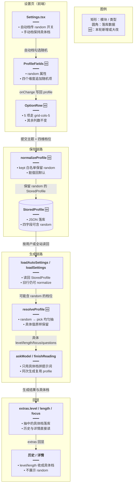

# 每日阅读随机档位

> 文档角色：本篇是「每日阅读」随机档位的实现专题，覆盖 `StoredProfile` 存储层、`resolveProfile` 生成期抽档、`extras` 回显与前端类型分叉四段实现。
> 姊妹篇：生成重试与补释义见 [每日阅读生成加固](./每日阅读生成加固.md)；组件化与详情双栏见 [每日阅读界面重构](./每日阅读界面重构.md)；SSE 流式协议见 [每日阅读流式生成](./每日阅读流式生成.md)；定时入队与冷却见 [每日阅读生成调度](./每日阅读生成调度.md)；自定义整点见 [每日阅读自定义入队时间](./每日阅读自定义入队时间.md)。

## 一、要解决什么问题

旧版每日阅读的「难度 / 篇幅 / 学习侧重 / 理解题数量」四个档位只能存具体值。用户想每次都换一种组合，只能反复进设置页手改；定时篇更是长期固定在同一档位。

直接在每个请求里 `Math.random()` 会带来三个新问题：

1. **保存就丢随机**：`normalizeProfile` 只认具体白名单，`'random'` 会被当成脏值收成默认的 B1 / 中篇 / reading / 0 题，用户保存后回读看到的已经不是「随机」。
2. **提示词与 extras 各抽一次**：若在拼提示词和写 `extras` 时各抽一次，短文实际难度与历史回显的档位会对不上。
3. **回显出现非法的 random**：历史列表与详情只应该展示抽中的具体档，不能把 `random` 当成一次生成的真实档位展示。

因此本轮把「存储」与「生成」拆成两层：设置层允许记住 `random`，真正生成时才抽一次具体档，并把抽中的具体档写进 `extras`。

## 二、核心思路

1. **双层类型**：新增 `StoredProfile`（四个字段都可以是 `'random'`）作为设置落库类型；提示词与 `extras` 继续使用只含具体值的 `ReadingProfile`。
2. **保存只做白名单保留**：`normalizeProfile` 返回 `StoredProfile`，把 `'random'` 与具体枚举一起放进 `kept` 的白名单，脏值才回默认。
3. **生成前只抽一次**：`resolveProfile` 对每个 `'random'` 字段均匀抽一次，具体字段原样透传；同一次生成复用这个返回值，保证提示词、附件、`extras` 完全一致。
4. **抽取点前移**：定时篇在 `ensurePassage`、手动篇在 `executeManual` 开头解析档位，后续 `askModel` / `finishReading` / `claimRow` 拿到的都是具体档。
5. **落库回显**：`claimRow` 把解析后的 `level/length/focus` 写进 `extras`，历史列表与详情直接读 `extras`，不会看到 `random`。
6. **前端类型分叉**：`EnglishDailyReadingProfile` 允许 `random`；`EnglishDailyReadingExtras`、`EnglishDailyReadingItem`、`DailyReadingGen` 用 `Exclude<..., 'random'>` 收敛成具体档。
7. **入口收敛**：只有自动档在 `ProfileFields` 上打开 `random` 开关，手动档保持具体选项；后端仍兼容手动请求里直接传 `random`。
8. **文案统一**：中英文各补一个 `englishLearning.dailyReading.random` 键，四个维度共用。

## 三、实现链路

来源：依据本轮改动整理（后端 `daily-reading.rules.ts`、`english-daily-reading.service.ts`，前端 `service/index.ts`、`store/englishDailyReading.ts`、`ProfileFields.tsx`、`OptionRow.tsx`）


**读图要点**：`random` 只活在「保存 → 落库 → 读回」这一段；一进入生成链路就被 `resolveProfile` 抽成具体档。真正写进 `extras` 的是抽中的值，所以历史与详情永远看不到 `random`。

## 四、代码对比

### 4.1 新增存储层档位类型 `StoredProfile`

基线中不存在该类型，设置层直接复用 `ReadingProfile`，无法表达随机。

来源：`apps/backend/src/services/english-learning/daily-reading.rules.ts` **改动后** 约 L72–L79（新增类型 `StoredProfile`）
```ts
// 设置层档位：四个可随机字段都把 'random' 并进原枚举，供设置页原样落库。
export type StoredProfile = {
	// 难度可存 random；生成时才抽成 A2/B1/B2/C1，避免保存后就丢失随机意图。
	level: ReadingLevel | 'random';
	// 篇幅可存 random；提示词只认具体 short/medium/long，所以必须留到生成时再抽。
	length: ReadingLength | 'random';
	// 学习侧重可存 random；抽取后才能决定是否写词汇/语法附件。
	focus: ReadingFocus | 'random';
	// 理解题数量可存 random；0/2/3 是提示词里能直接写的具体值，random 先留在存储层。
	questions: 0 | 2 | 3 | 'random';
	// 联网开关不参与随机，保持布尔，保证后端取材逻辑无需分支。
	useWeb: boolean;
};
```

### 4.2 新增抽取与白名单工具 `QUESTION_COUNTS` / `pick` / `kept`

三个符号均为新增：`QUESTION_COUNTS` 给题量抽取提供字面量集合，`pick` 负责均匀抽取，`kept` 负责「保留 random 的白名单校验」。

来源：`apps/backend/src/services/english-learning/daily-reading.rules.ts` **改动后** 约 L126–L138（新增常量 `QUESTION_COUNTS` 与函数 `pick` / `kept`）
```ts
// 可抽取的题量集合；用 as const 锁住字面量类型，pick 返回仍是 0|2|3 而不是宽泛的 number。
const QUESTION_COUNTS = [0, 2, 3] as const;

// 从候选集中均匀抽一项；Math.random 覆盖 [0,1)，floor 保证下标落在 0..length-1。
function pick<T>(items: readonly T[]): T {
	// 断言 T 是因为下标一定合法；调用方只会传 LEVELS / LENGTHS 这类非空常量。
	return items[Math.floor(Math.random() * items.length)] as T;
}

// 校验并保留白名单值；把 'random' 放进 allowed，才能让保存层记住随机。
function kept<T extends string>(
	// 原始输入来自 HTTP body，类型未知，必须先按白名单收窄。
	value: unknown,
	// 允许值列表由调用方传入，是否接受随机由调用方决定。
	allowed: readonly T[],
	// 非法或缺省时回落到默认值，保证旧数据与脏请求不会让整单失败。
	fallback: T,
// 函数返回收窄后的白名单值，调用方不再需要二次断言。
): T {
	// find 命中则原样返回（包括 'random'），否则用 fallback；比手写多个 || 更好扩展。
	return allowed.find((item) => item === value) ?? fallback;
}
```

### 4.3 保存校验 `normalizeProfile` 保留 random

旧实现把 `'random'` 当脏值收成默认；新实现把 `'random'` 加入白名单，并把返回类型改成 `StoredProfile`。

来源：`apps/backend/src/services/english-learning/daily-reading.rules.ts` **改动前** 约 L99–L117（函数 `normalizeProfile`）
```ts
/** 脏枚举回默认，不让整单失败。 */
// 旧实现只接受具体值，任何 'random' 都会被替换成 DEFAULT。
export function normalizeProfile(input: unknown): ReadingProfile {
	// input 可能不是对象（body 缺失或传字符串），先归一成可读的 Record；否则下面取值会抛错。
	const src =
		// 仅当 input 是非 null 的对象时才按字段读取；数组也算对象，但取不到这些键，结果仍是默认。
		input && typeof input === 'object'
			// 断言成 Record 后可按 key 读取，值仍是 unknown，交给下面的查找收窄。
			? (input as Record<string, unknown>)
			// 非对象统一退回空对象，后续每个字段都会走默认值。
			: {};
	// 旧实现只在 LEVELS 里找具体等级；找不到（包括 random）就回落 B1。
	const level =
		// find 只比较具体四档，random 不会命中。
		LEVELS.find((item) => item === src.level) ?? DEFAULT_PROFILE.level;
	// 篇幅同理只在 LENGTHS 里找；random 会被当成脏值收成 medium。
	const length =
		// find 只比较 short/medium/long，random 不会命中。
		LENGTHS.find((item) => item === src.length) ?? DEFAULT_PROFILE.length;
	// 侧重只在 FOCUSES 里找；random 无法表达，保存后回读就变成 reading。
	const focus =
		// find 只比较四个具体侧重，random 不会命中。
		FOCUSES.find((item) => item === src.focus) ?? DEFAULT_PROFILE.focus;
	// 题量只认 0/2/3 三个数字；random 会被收成默认 0，用户选择被静默丢弃。
	const questions =
		// 三个数字任一命中才采用原值。
		src.questions === 0 || src.questions === 2 || src.questions === 3
			// 命中后返回原值，类型仍是 0|2|3。
			? src.questions
			// 其它值（包括 random）回默认。
			: DEFAULT_PROFILE.questions;
	// useWeb 必须是布尔才采用；字符串 'false' 也回默认，避免 JSON 误传。
	const useWeb =
		// 只有真正的布尔才透传。
		typeof src.useWeb === 'boolean' ? src.useWeb : DEFAULT_PROFILE.useWeb;
	// 返回具体档位；类型 ReadingProfile 决定下游提示词只能拿到具体值。
	return { level, length, focus, questions, useWeb };
}
```

来源：`apps/backend/src/services/english-learning/daily-reading.rules.ts` **改动后** 约 L140–L163（函数 `normalizeProfile`）
```ts
/** 脏枚举回默认。random 要留下来，否则保存后的随机会被收成 B1。 */
// 新版返回 StoredProfile，四个维度都可能带着 'random' 继续落库。
export function normalizeProfile(input: unknown): StoredProfile {
	// 请求体可能缺字段或不是对象，先归一成 Record，保证后续按 key 读取安全。
	const src =
		// 仅对象才按字段解析；null/字符串都退回空对象，最终由各 kept 回默认。
		input && typeof input === 'object'
			// 断言成 Record 后逐字段读取，值保持 unknown 交给 kept 校验。
			? (input as Record<string, unknown>)
			// 非对象统一给空对象，保证后面不会读到 undefined 的属性。
			: {};
	// 难度白名单追加 'random'；命中随机就原样保存，具体值仍照旧通过。
	const level = kept(src.level, [...LEVELS, 'random'], DEFAULT_PROFILE.level);
	// 篇幅同样追加 'random'；fallback 仍是 medium，兼容旧数据与脏输入。
	const length = kept(
		// 原始值可能是任意 JSON 值，交给 kept 做白名单校验。
		src.length,
		// 允许具体三档加 random，保证存储层能表达随机意图。
		[...LENGTHS, 'random'],
		// 非法值回落到默认中篇，不因单个字段让保存失败。
		DEFAULT_PROFILE.length,
	);
	// 侧重白名单追加 'random'；这里抽成一行，与难度/篇幅保持对称。
	const focus = kept(src.focus, [...FOCUSES, 'random'], DEFAULT_PROFILE.focus);
	// 题量单独判断：数字 0/2/3 与字符串 'random' 都合法；先判 random 避免被误当数字。
	const questions =
		// 随机题量直接保留，等生成时再抽 0/2/3。
		src.questions === 'random' ||
		// 0 道题是合法选择，不能用 falsy 判断漏掉。
		src.questions === 0 ||
		// 2 道题是合法选择，命中后原样返回。
		src.questions === 2 ||
		// 3 道题是合法选择，命中后原样返回。
		src.questions === 3
			// 命中任一合法值就返回原值，类型收窄为 0|2|3|'random'。
			? src.questions
			// 其它数字/字符串都回默认 0，避免模型收到不存在的题量。
			: DEFAULT_PROFILE.questions;
	// 联网仍只认布尔；它与随机无关，脏值回默认 true。
	const useWeb =
		// 只有真正的布尔才透传，字符串 'false' 不会误开联网。
		typeof src.useWeb === 'boolean' ? src.useWeb : DEFAULT_PROFILE.useWeb;
	// 返回 StoredProfile，让调用方明确知道这里可能还带着 random。
	return { level, length, focus, questions, useWeb };
}
```

**变更摘要**：`normalizeProfile` 的返回类型由 `ReadingProfile` 改为 `StoredProfile`，四个字段的白名单都追加 `'random'`；非法值仍回默认，旧数据与旧前端请求不受影响。

### 4.4 新增生成期抽档 `resolveProfile`

基线中不存在该函数，旧实现直接把设置里的具体档传给提示词。

来源：`apps/backend/src/services/english-learning/daily-reading.rules.ts` **改动后** 约 L165–L175（新增函数 `resolveProfile`）
```ts
/** 每个 random 字段均匀抽一次。具体字段保持原值，同一次生成复用返回值。 */
// 生成前把存储档解析成具体档；同一次生成只调用一次，提示词与 extras 共用结果。
export function resolveProfile(stored: StoredProfile): ReadingProfile {
	// 返回新的具体档对象；不修改 stored，避免把随机标记写回设置。
	return {
		// 难度是 random 就均匀抽一档，否则沿用用户明确选择。
		level: stored.level === 'random' ? pick(LEVELS) : stored.level,
		// 篇幅同理；抽取发生在这里，保证 glossaryLimit 等函数拿到具体值。
		length: stored.length === 'random' ? pick(LENGTHS) : stored.length,
		// 侧重是 random 就抽一档；抽取结果决定是否生成词汇/语法附件。
		focus: stored.focus === 'random' ? pick(FOCUSES) : stored.focus,
		// 题量是 random 就抽 0/2/3；否则保持用户选择的具体数量。
		questions:
			// 三目单独换行是为了不超长；命中 random 才走 pick。
			stored.questions === 'random' ? pick(QUESTION_COUNTS) : stored.questions,
		// 联网开关与随机无关，原样透传。
		useWeb: stored.useWeb,
	};
}
```

### 4.5 实体字段类型 `ReadingProfile` → `StoredProfile`

两张设置表的 JSON 列都可能保存 `random`，类型必须同步放宽，否则读取时会在类型层被当成具体档。

来源：`apps/backend/src/services/english-learning/entity/english-daily-reading-setting.entity.ts` **改动前** 约 L1–L24（类 `EnglishDailyReadingSetting`）
```ts
// 用 TypeORM 装饰器把普通类映射成表实体。
import { Column, Entity, PrimaryColumn } from 'typeorm';
// 旧版只导入具体档类型，实体列无法表达 random。
import type { ReadingProfile } from '../daily-reading.rules';

/** 全站定时档，一行。手动档在 english_daily_reading_user_settings。 */
// 标记表名；全站只有一行，id 固定为 1。
@Entity('english_daily_reading_settings')
// 导出实体类，服务层通过 Repository 读写这张表。
export class EnglishDailyReadingSetting {
	// 主键固定 1，保证全站配置只有一份。
	@PrimaryColumn({ type: 'int' })
// 主键列存数字 id，全站配置只会写入 1。
	id!: number;

	/** 旧的全站手动主题。用户保存不再写这里。定时档空着时回退到这列。 */
	// JSON 列存主题数组；保留旧列是为了兼容历史数据。
	@Column({ type: 'json' })
// 主题数组字段，读写时由 TypeORM 自动做 JSON 序列化。
	themes!: string[];

	/** 旧的全站手动档。用户保存不再写这里。定时档空着时回退到这列。 */
	// 旧类型 ReadingProfile 只允许具体档，数据库里即使有 random 也会被类型层误判。
	@Column({ type: 'json', nullable: true })
// 可空的 JSON 档位列；旧数据没有档位时保持 null，读取时再 normalize。
	profile!: ReadingProfile | null;

	/** 定时篇主题。仅超级管理员可写。空则生成时回退手动档。 */
	// 定时主题允许为空；读取时回退到 themes。
	@Column({ type: 'json', nullable: true })
// 可空的定时主题数组；null 表示未配置，读取时回退手动列。
	autoThemes!: string[] | null;

	/** 定时篇档位。仅超级管理员可写。空则生成时回退手动档。 */
	// 旧类型同样只允许具体档，自动档无法保存随机标记。
	@Column({ type: 'json', nullable: true })
// 可空的自动档 JSON；旧类型下 random 会被当成非法值。
	autoProfile!: ReadingProfile | null;
}
```

来源：`apps/backend/src/services/english-learning/entity/english-daily-reading-setting.entity.ts` **改动后** 约 L1–L28（类 `EnglishDailyReadingSetting`）
```ts
// 用 TypeORM 装饰器把普通类映射成表实体。
import { Column, Entity, PrimaryColumn } from 'typeorm';
// 只导入类型：存储层档位允许 random，提示词层仍用 ReadingProfile。
import type { StoredProfile } from '../daily-reading.rules';

/** 全站定时档，一行。手动档在 english_daily_reading_user_settings。 */
// 标记表名；全站只有一行，id 固定为 1。
@Entity('english_daily_reading_settings')
// 导出实体类，服务层通过 Repository 读写这张表。
export class EnglishDailyReadingSetting {
	// 主键固定 1，保证全站配置只有一份。
	@PrimaryColumn({ type: 'int' })
// 主键列存数字 id，全站配置只会写入 1。
	id!: number;

	/** 旧的全站手动主题。用户保存不再写这里。定时档空着时回退到这列。 */
	// JSON 列存主题数组；保留旧列是为了兼容历史数据。
	@Column({ type: 'json' })
// 主题数组字段，读写时由 TypeORM 自动做 JSON 序列化。
	themes!: string[];

	/** 旧的全站手动档。用户保存不再写这里。定时档空着时回退到这列。 */
	// 关键改动：类型换成 StoredProfile，旧数据里的 random 不会再在类型层被抹掉。
	@Column({ type: 'json', nullable: true })
// 可空的 JSON 档位列；random 与具体值都能原样存进来。
	profile!: StoredProfile | null;

	/** 定时篇主题。仅超级管理员可写。空则生成时回退手动档。 */
	// 定时主题允许为空；读取时回退到 themes。
	@Column({ type: 'json', nullable: true })
// 可空的定时主题数组；null 表示未配置，读取时回退手动列。
	autoThemes!: string[] | null;

	/** 定时篇档位。仅超级管理员可写。空则生成时回退手动档。 */
	// 关键改动：自动档同样用 StoredProfile，四个随机标记可原样落库。
	@Column({ type: 'json', nullable: true })
// 可空的自动档 JSON；random 会原样保留到生成期。
	autoProfile!: StoredProfile | null;

	/** 每天在该小时（上海）入队下一天。仅超级管理员可写。 */
	// 入队整点属于调度篇，这里保留字段是为了实体完整，本篇不展开。
	@Column({ type: 'int', default: 23 })
// 入队小时列；默认 23 保持旧行为，具体调度规则见调度篇。
	autoHour!: number;
}
```

来源：`apps/backend/src/services/english-learning/entity/english-daily-reading-user-setting.entity.ts` **改动前** 约 L1–L15（类 `EnglishDailyReadingUserSetting`）
```ts
// 用 TypeORM 装饰器把普通类映射成表实体。
import { Column, Entity, PrimaryColumn } from 'typeorm';
// 旧版手动档只允许具体档位。
import type { ReadingProfile } from '../daily-reading.rules';

/** 手动生成档。每个用户一行。没有行时接口回系统默认，不插行。 */
// 标记表名；按用户一行保存主题与档位。
@Entity('english_daily_reading_user_settings')
// 导出实体类，服务层按 userId 读写。
export class EnglishDailyReadingUserSetting {
	// 用户 id 即主键，保证一人一行。
	@PrimaryColumn({ type: 'int' })
// 主键列存用户 id，一个用户只对应一行设置。
	userId!: number;

	// JSON 列存该用户的主题数组。
	@Column({ type: 'json' })
// 主题数组字段，按用户保存他勾选的主题。
	themes!: string[];

	// 旧类型只允许具体档，用户保存的 random 无法在实体层表达。
	@Column({ type: 'json', nullable: true })
// 可空的手动档 JSON；没有保存过时保持 null，接口回系统默认。
	profile!: ReadingProfile | null;
}
```

来源：`apps/backend/src/services/english-learning/entity/english-daily-reading-user-setting.entity.ts` **改动后** 约 L1–L15（类 `EnglishDailyReadingUserSetting`）
```ts
// 用 TypeORM 装饰器把普通类映射成表实体。
import { Column, Entity, PrimaryColumn } from 'typeorm';
// 关键改动：手动档改用 StoredProfile，允许四个维度记住 random。
import type { StoredProfile } from '../daily-reading.rules';

/** 手动生成档。每个用户一行。没有行时接口回系统默认，不插行。 */
// 标记表名；按用户一行保存主题与档位。
@Entity('english_daily_reading_user_settings')
// 导出实体类，服务层按 userId 读写。
export class EnglishDailyReadingUserSetting {
	// 用户 id 即主键，保证一人一行。
	@PrimaryColumn({ type: 'int' })
// 主键列存用户 id，一个用户只对应一行设置。
	userId!: number;

	// JSON 列存该用户的主题数组。
	@Column({ type: 'json' })
// 主题数组字段，按用户保存他勾选的主题。
	themes!: string[];

	// 列类型放宽到 StoredProfile，保存 random 后回读仍是 random。
	@Column({ type: 'json', nullable: true })
// 可空的手动档 JSON；random 与具体值都原样保存。
	profile!: StoredProfile | null;
}
```

### 4.6 定时生成入口 `ensurePassage` 解析档位

旧实现把 `loadAutoSettings()` 返回的 `saved.profile` 直接当提示词档位；新实现先 `resolveProfile`，让自动档的随机在每次生成时重新抽。

来源：`apps/backend/src/services/english-learning/english-daily-reading.service.ts` **改动前** 约 L276–L349（方法 `ensurePassage`）
```ts
/** 工人入口。publishDate 已由调用方钉死。 */
// 定时篇生成入口；旧实现直接把 loadAutoSettings 返回的具体档当作提示词档位。
async ensurePassage(publishDate: string): Promise<void> {
	// 队列任务的日期必须是 YYYY-MM-DD，否则直接丢弃，避免写错 slot=day 那一行。
	if (!/^\d{4}-\d{2}-\d{2}$/.test(publishDate)) return;
	// 读全站自动档；旧实现类型是 ReadingProfile，因此这里不可能带 random。
	const saved = await this.loadAutoSettings();
	// 按日期从主题池确定今天用哪个主题，保证同一天重跑不会换题。
	const theme = themeForDate(publishDate, saved.themes);
	// 关键差异：旧实现直接复用 saved.profile，没有「随机 → 具体」的解析步骤。
	const profile = saved.profile;
	// 抢占当天唯一一行；抢不到说明已有 worker 在写或已经 ready。
	const owned = await this.claim(publishDate, theme);
	// 抢不到就不再请求模型，避免覆盖已发布的正文。
	if (!owned) return;
	// 从这里开始是写短文、重写、附件生成与 extras 落库，与本轮随机改动无关。
	// ...（模型重写、finishReading 与 repo.update 与基线相同）
}
```

来源：`apps/backend/src/services/english-learning/english-daily-reading.service.ts` **改动后** 约 L283–L351（方法 `ensurePassage`）
```ts
/** 工人入口。publishDate 已由调用方钉死。 */
// 定时篇生成入口；新版在入口处把存储档解析成具体档，random 因此每次生成都会重抽。
async ensurePassage(publishDate: string): Promise<void> {
	// 队列任务的日期必须是 YYYY-MM-DD，否则直接丢弃，避免写错 slot=day 那一行。
	if (!/^\d{4}-\d{2}-\d{2}$/.test(publishDate)) return;
	// 读全站自动档；返回类型已放宽为 StoredProfile，可能带 random。
	const saved = await this.loadAutoSettings();
	// 按日期从主题池确定今天用哪个主题，保证同一天重跑不会换题。
	const theme = themeForDate(publishDate, saved.themes);
	// 本轮改动：解析一次得到具体档，后续 askModel 与 extras 共用这一个 profile。
	const profile = resolveProfile(saved.profile);
	// 抢占当天唯一一行；抢不到说明已有 worker 在写或已经 ready。
	const owned = await this.claim(publishDate, theme);
	// 抢不到就不再请求模型，避免覆盖已发布的正文。
	if (!owned) return;
	// 从这里开始是写短文、重写、附件生成与 extras 落库，与基线一致。
	// ...（模型重写、finishReading 与 repo.update 与基线相同）
}
```

### 4.7 手动生成入口 `executeManual` 解析档位

旧实现参数类型是 `ReadingProfile`，随机标记在保存阶段就已被抹掉；新实现接收 `StoredProfile`，在方法开头解析一次。

来源：`apps/backend/src/services/english-learning/english-daily-reading.service.ts` **改动前** 约 L641–L809（方法 `executeManual`）
```ts
/** 按这次提交的档位写一篇。发布日是今天，不碰定时篇，也不接另一条已有行重跑模型。 */
// 手动生成入口；旧实现收到的已经是 normalizeProfile 后的具体 ReadingProfile。
private async executeManual(
	// 发起生成的用户 id，用于落库与 SSE 归属。
	userId: number,
	// 本次运行句柄，承载取消信号、token 与订阅者。
	run: ManualRun,
	// 用户选的主题列表，主题已在 openManual 校验过。
	themes: string[],
	// 旧实现参数类型是具体档，因此 random 在保存阶段就已被抹掉。
	profile: ReadingProfile,
// 方法返回 Promise，调用方用 setImmediate 触发后不等待它结束。
): Promise<void> {
	// 旧实现第一行就开始计 token，没有解析步骤。
	let settled = 0;
	// 后面的 lane 计数、短文/附件编排与基线相同。
	// ...（trackUsage、askModel、finishReading 与落库与基线相同）
}
```

来源：`apps/backend/src/services/english-learning/english-daily-reading.service.ts` **改动后** 约 L642–L811（方法 `executeManual`）
```ts
/** 按这次提交的档位写一篇。发布日是今天，不碰定时篇，也不接另一条已有行重跑模型。 */
// 手动生成入口；本轮改为接收存储档，允许四个字段里带 random。
private async executeManual(
	// 发起生成的用户 id，用于落库与 SSE 归属。
	userId: number,
	// 本次运行句柄，承载取消信号、token 与订阅者。
	run: ManualRun,
	// 用户选的主题列表，主题已在 openManual 校验过。
	themes: string[],
	// 本轮改动：参数类型放宽到 StoredProfile，random 可以一路传到生成期。
	stored: StoredProfile,
// 方法返回 Promise，内部串行跑完短文、附件与落库。
): Promise<void> {
	// 关键新增：生成开始时只解析一次，后续模型调用与 extras 都复用这个具体档。
	const profile = resolveProfile(stored);
	// token 计数从这里开始，与基线一致。
	let settled = 0;
	// 后面的 lane 计数、短文/附件编排与基线相同。
	// ...（trackUsage、askModel、finishReading 与落库与基线相同）
}
```

### 4.8 设置读写返回类型改为 `StoredProfile`

`readingSettings`、`saveSettings`、`saveAutoSettings`、`loadSettings`、`loadAutoSettings` 的返回类型同步放宽，否则随机在接口层会被 TypeScript 当成脏值。

来源：`apps/backend/src/services/english-learning/english-daily-reading.service.ts` **改动前** 约 L959–L977（方法 `readingSettings`）
```ts
// 设置页读取接口；旧返回类型把 profile 标成具体档，前端也就无法表达随机。
async readingSettings(userId: number): Promise<{
	// 用户当前主题列表，保存后原样回显。
	themes: string[];
	// 系统默认主题，用于「恢复默认」按钮。
	defaults: string[];
	// 旧实现返回 ReadingProfile；即使库里存了 random 也会被类型收窄。
	profile: ReadingProfile;
	// 默认档位，前端用来判断是否处于默认状态。
	profileDefaults: ReadingProfile;
	// 定时档只对超管返回，普通用户拿不到。
	auto?: { themes: string[]; profile: ReadingProfile };
// 返回 Promise 包住上述结构，前端 await 后直接渲染设置页。
}> {
	// 读取当前用户的手动档；没有行时回默认。
	const saved = await this.loadSettings(userId);
	// body 组装普通用户也可见的部分。
	const body = {
		// 主题来自用户行或默认主题。
		themes: saved.themes,
		// 默认主题展开成新数组，避免前端改到常量。
		defaults: [...DEFAULT_THEMES],
		// 档位原样返回；旧类型在这里丢失了 random。
		profile: saved.profile,
		// 默认档位复制一份，避免 DEFAULT_PROFILE 被就地修改。
		profileDefaults: { ...DEFAULT_PROFILE },
	};
	// 全站定时档位只给超管看和改，普通用户的返回里没有 auto。
	if (!(await this.userService.userHasSuperAdminRole(userId))) return body;
	// 超管额外读定时档；旧实现同样返回具体档。
	const auto = await this.loadAutoSettings();
	// 合并普通部分与 auto，前端据此渲染自动配置区。
	return { ...body, auto };
}
```

来源：`apps/backend/src/services/english-learning/english-daily-reading.service.ts` **改动后** 约 L973–L991（方法 `readingSettings`）
```ts
// 设置页读取接口；新版返回 StoredProfile，前端可以原样展示「随机」。
async readingSettings(userId: number): Promise<{
	// 用户当前主题列表，保存后原样回显。
	themes: string[];
	// 系统默认主题，用于「恢复默认」按钮。
	defaults: string[];
	// 返回 StoredProfile，保存过的 random 不会被接口层收窄。
	profile: StoredProfile;
	// 默认档位仍是具体档，用于判断是否处于默认状态。
	profileDefaults: ReadingProfile;
	// 定时档返回 StoredProfile；hour 属调度篇，这里只为签名完整。
	auto?: { themes: string[]; profile: StoredProfile; hour: number };
// 返回 Promise 包住上述结构；auto 只有超管会拿到。
}> {
	// 读取当前用户的手动档；没有行时回默认。
	const saved = await this.loadSettings(userId);
	// body 组装普通用户也可见的部分。
	const body = {
		// 主题来自用户行或默认主题。
		themes: saved.themes,
		// 默认主题展开成新数组，避免前端改到常量。
		defaults: [...DEFAULT_THEMES],
		// 档位原样返回，random 会一路带到前端设置页。
		profile: saved.profile,
		// 默认档位复制一份，避免 DEFAULT_PROFILE 被就地修改。
		profileDefaults: { ...DEFAULT_PROFILE },
	};
	// 全站定时档位只给超管看和改，普通用户的返回里没有 auto。
	if (!(await this.userService.userHasSuperAdminRole(userId))) return body;
	// 超管额外读定时档；返回的同样可能是 StoredProfile。
	const auto = await this.loadAutoSettings();
	// 合并普通部分与 auto，前端据此渲染自动配置区。
	return { ...body, auto };
}
```

来源：`apps/backend/src/services/english-learning/english-daily-reading.service.ts` **改动前** 约 L979–L1003（方法 `saveSettings`）
```ts
// 保存当前用户的手动档；旧实现把 normalize 结果当具体档落库。
async saveSettings(
	// 当前用户 id，手动档按用户落库。
	userId: number,
	// 请求体：主题与档位都来自前端，类型未知。
	input: { themes?: unknown; profile?: unknown },
// 返回保存后的主题、默认主题与档位，前端据此更新已保存态。
): Promise<{
	// 保存后的主题列表。
	themes: string[];
	// 系统默认主题。
	defaults: string[];
	// 旧实现返回具体档，random 在 normalize 时已被抹掉。
	profile: ReadingProfile;
	// 默认档位。
	profileDefaults: ReadingProfile;
// 返回 Promise 包住保存结果，调用方 await 后回填表单。
}> {
	// 主题白名单校验；不合法直接 400。
	const themes = normalizeThemeList(input?.themes);
	// themes 为空表示请求不合法，不能写入空主题。
	if (!themes) throw new BadRequestException('主题不合法');
	// 旧 normalize 只接受具体值，random 在这里被收成默认。
	const profile = normalizeProfile(input?.profile);
	// 查该用户是否已有设置行。
	const existing = await this.userSettings.findOne({ where: { userId } });
	// 没有行时插入一条。
	if (!existing) {
		// 插入主题与档位；旧实现写入的是具体档。
		await this.userSettings.insert({ userId, themes, profile });
	// 已有行时更新。
	} else {
		// 覆盖主题与档位，保证保存后回读一致。
		await this.userSettings.update({ userId }, { themes, profile });
	}
	// 返回保存结果，前端据此更新已保存态。
	return {
		// 保存后的主题。
		themes,
		// 默认主题复制一份。
		defaults: [...DEFAULT_THEMES],
		// 旧实现返回具体档，前端看不到 random。
		profile,
		// 默认档位复制一份。
		profileDefaults: { ...DEFAULT_PROFILE },
	};
}
```

来源：`apps/backend/src/services/english-learning/english-daily-reading.service.ts` **改动后** 约 L993–L1017（方法 `saveSettings`）
```ts
// 保存当前用户的手动档；新版返回 StoredProfile，random 可以原样回显。
async saveSettings(
	// 当前用户 id，手动档按用户落库。
	userId: number,
	// 请求体：主题与档位都来自前端，类型未知。
	input: { themes?: unknown; profile?: unknown },
// 返回保存后的主题、默认主题与档位，前端据此更新已保存态。
): Promise<{
	// 保存后的主题列表。
	themes: string[];
	// 系统默认主题。
	defaults: string[];
	// 返回 StoredProfile，保存的 random 可以原样回显。
	profile: StoredProfile;
	// 默认档位仍是具体档。
	profileDefaults: ReadingProfile;
// 返回 Promise 包住保存结果，调用方 await 后回填表单。
}> {
	// 主题白名单校验；不合法直接 400。
	const themes = normalizeThemeList(input?.themes);
	// themes 为空表示请求不合法，不能写入空主题。
	if (!themes) throw new BadRequestException('主题不合法');
	// 新 normalize 会保留 random，真正标脏值才回默认。
	const profile = normalizeProfile(input?.profile);
	// 查该用户是否已有设置行。
	const existing = await this.userSettings.findOne({ where: { userId } });
	// 没有行时插入一条。
	if (!existing) {
		// 插入主题与档位；random 会原样写入 JSON 列。
		await this.userSettings.insert({ userId, themes, profile });
	// 已有行时更新。
	} else {
		// 覆盖主题与档位，保证保存后回读仍是同一份 StoredProfile。
		await this.userSettings.update({ userId }, { themes, profile });
	}
	// 返回保存结果，前端据此更新已保存态。
	return {
		// 保存后的主题。
		themes,
		// 默认主题复制一份。
		defaults: [...DEFAULT_THEMES],
		// 返回 StoredProfile，前端可以继续显示「随机」。
		profile,
		// 默认档位复制一份。
		profileDefaults: { ...DEFAULT_PROFILE },
	};
}
```

来源：`apps/backend/src/services/english-learning/english-daily-reading.service.ts` **改动前** 约 L1005–L1031（方法 `saveAutoSettings`）
```ts
// 保存全站自动档；旧实现只处理主题与具体档。
async saveAutoSettings(
	// 只有超管能改全站定时档。
	userId: number,
	// 旧请求体只有主题与档位，没有入队整点。
	input: { themes?: unknown; profile?: unknown },
// 返回主题与具体档；旧实现没有 hour 字段。
): Promise<{ themes: string[]; profile: ReadingProfile }> {
	// 先校验超管角色，普通用户直接 403。
	if (!(await this.userService.userHasSuperAdminRole(userId))) {
		// 抛出权限错误，避免普通用户改到全站配置。
		throw new ForbiddenException('需要超级管理员权限');
	}
	// 主题白名单校验。
	const themes = normalizeThemeList(input?.themes);
	// 主题不合法就不能保存。
	if (!themes) throw new BadRequestException('主题不合法');
	// 旧 normalize 会把 random 收成具体档，自动档实际无法随机。
	const profile = normalizeProfile(input?.profile);
	// 查全站唯一配置行。
	const existing = await this.settings.findOne({ where: { id: 1 } });
	// 没有配置行时插入默认手动档 + 本次自动档。
	if (!existing) {
		// 插入一行固定 id=1 的配置。
		await this.settings.insert({
			// 全站唯一主键。
			id: 1,
			// 旧列保留默认主题，兼容历史回退。
			themes: [...DEFAULT_THEMES],
			// 旧列保留默认具体档。
			profile: { ...DEFAULT_PROFILE },
			// 本次保存的自动主题。
			autoThemes: themes,
			// 旧实现写入的具体自动档。
			autoProfile: profile,
		});
	// 已有配置行时更新自动列。
	} else {
		// 只改自动主题与自动档，不动旧的手动列。
		await this.settings.update(
			// 定位唯一一行。
			{ id: 1 },
			// 旧实现只更新这两列。
			{ autoThemes: themes, autoProfile: profile },
		);
	}
	// 返回保存后的主题与具体档。
	return { themes, profile };
}
```

来源：`apps/backend/src/services/english-learning/english-daily-reading.service.ts` **改动后** 约 L1019–L1053（方法 `saveAutoSettings`）
```ts
// 保存全站自动档；新版返回 StoredProfile，并同轮保存入队整点。
async saveAutoSettings(
	// 只有超管能改全站定时档。
	userId: number,
	// 请求体新增 hour；整点细节属调度篇，这里只为签名完整。
	input: { themes?: unknown; profile?: unknown; hour?: unknown },
// 返回 StoredProfile 与 hour；random 与整点都可原样回显。
): Promise<{ themes: string[]; profile: StoredProfile; hour: number }> {
	// 先校验超管角色，普通用户直接 403。
	if (!(await this.userService.userHasSuperAdminRole(userId))) {
		// 抛出权限错误，避免普通用户改到全站配置。
		throw new ForbiddenException('需要超级管理员权限');
	}
	// 主题白名单校验。
	const themes = normalizeThemeList(input?.themes);
	// 主题不合法就不能保存。
	if (!themes) throw new BadRequestException('主题不合法');
	// 新 normalize 保留 random，自动档因此可以记住随机。
	const profile = normalizeProfile(input?.profile);
	// 解析入队整点；具体规则见调度篇，本篇不展开。
	const hour = parseAutoHour(input?.hour);
	// 查全站唯一配置行。
	const existing = await this.settings.findOne({ where: { id: 1 } });
	// 没有配置行时插入默认手动档 + 本次自动档。
	if (!existing) {
		// 插入一行固定 id=1 的配置。
		await this.settings.insert({
			// 全站唯一主键。
			id: 1,
			// 旧列保留默认主题，兼容历史回退。
			themes: [...DEFAULT_THEMES],
			// 旧列保留默认具体档。
			profile: { ...DEFAULT_PROFILE },
			// 本次保存的自动主题。
			autoThemes: themes,
			// 保存 StoredProfile，四个维度都可带 random。
			autoProfile: profile,
			// 入队整点，属调度篇。
			autoHour: hour,
		});
	// 已有配置行时更新自动列。
	} else {
		// 只改自动列，不动旧的手动列。
		await this.settings.update(
			// 定位唯一一行。
			{ id: 1 },
			// 自动档类型已放宽，random 可原样写入。
			{ autoThemes: themes, autoProfile: profile, autoHour: hour },
		);
	}
	// 整点变更后的调度重注册属调度篇，这里只为签名完整。
	await this.registerScheduler(hour);
	// 若当天已过整点则补队，规则见调度篇。
	if (hourInShanghai() >= hour) {
		// 补队失败只记 warning，不阻断保存。
		await this.enqueuePassage(duePublishDate(hour)).catch((e) => {
			// 队列异常不把设置保存整体回滚。
			this.logger.warn('[EnglishDailyReading] 改点后补队失败', e);
		});
	}
	// 返回 StoredProfile 与 hour，前端据此更新已保存态。
	return { themes, profile, hour };
}
```

来源：`apps/backend/src/services/english-learning/english-daily-reading.service.ts` **改动前** 约 L1034–L1043（方法 `loadSettings`）
```ts
/** 没有这一用户的行时回系统默认，不把全站旧档套到别人身上。 */
// 读取用户手动档；旧返回类型是具体档。
private async loadSettings(userId: number): Promise<{
	// 主题列表。
	themes: string[];
	// 旧类型 ReadingProfile 无法承载 random。
	profile: ReadingProfile;
// 返回 Promise 包住主题与档位，调用方 await 后直接使用。
}> {
	// 按 userId 查唯一一行。
	const row = await this.userSettings.findOne({ where: { userId } });
	// 返回主题与 normalize 后的档位。
	return {
		// 没有行时回默认主题。
		themes: themesForSettings(row?.themes),
		// 旧 normalize 会把 random 收成默认。
		profile: normalizeProfile(row?.profile),
	};
}
```

来源：`apps/backend/src/services/english-learning/english-daily-reading.service.ts` **改动后** 约 L1056–L1065（方法 `loadSettings`）
```ts
/** 没有这一用户的行时回系统默认，不把全站旧档套到别人身上。 */
// 读取用户手动档；新版返回 StoredProfile，random 可以一路带到生成期。
private async loadSettings(userId: number): Promise<{
	// 主题列表。
	themes: string[];
	// 类型放宽到 StoredProfile，保存过的 random 不会丢。
	profile: StoredProfile;
// 返回 Promise 包住主题与档位；random 会继续传给 resolveProfile。
}> {
	// 按 userId 查唯一一行。
	const row = await this.userSettings.findOne({ where: { userId } });
	// 返回主题与 normalize 后的档位。
	return {
		// 没有行时回默认主题。
		themes: themesForSettings(row?.themes),
		// 新 normalize 保留 random，脏值才回默认。
		profile: normalizeProfile(row?.profile),
	};
}
```

来源：`apps/backend/src/services/english-learning/english-daily-reading.service.ts` **改动前** 约 L1046–L1063（方法 `loadAutoSettings`）
```ts
/** 定时篇只读自动档。列还空着时用手动档，再空才用代码默认。 */
// 读取全站自动档；旧返回类型是具体档。
private async loadAutoSettings(): Promise<{
	// 自动主题。
	themes: string[];
	// 旧类型 ReadingProfile，无法表达 random。
	profile: ReadingProfile;
// 返回 Promise 包住自动主题与具体档，调用方 await 后直接使用。
}> {
	// 读全站唯一配置行。
	const row = await this.settings.findOne({ where: { id: 1 } });
	// 先准备手动列作为回退。
	const manual = {
		// 手动主题或默认主题。
		themes: themesForSettings(row?.themes),
		// 旧 normalize 会抹掉 random。
		profile: normalizeProfile(row?.profile),
	};
	// 自动主题可能为空，需要区分「未设置」与「空数组」。
	const autoThemes = normalizeThemeList(row?.autoThemes);
	// 返回自动主题与自动档，空则回退手动档。
	return {
		// 自动主题为空时用手动主题。
		themes: autoThemes ?? manual.themes,
		// 自动档为空时用手动档；旧类型仍是具体档。
		profile:
			// 只有非 null 才认为自动档已设置。
			row?.autoProfile != null
				// normalize 后返回具体档。
				? normalizeProfile(row.autoProfile)
				// 否则回退手动档。
				: manual.profile,
	};
}
```

来源：`apps/backend/src/services/english-learning/english-daily-reading.service.ts` **改动后** 约 L1068–L1088（方法 `loadAutoSettings`）
```ts
/** 定时篇只读自动档。列还空着时用手动档，再空才用代码默认。 */
// 读取全站自动档；新版返回 StoredProfile，自动档的随机可以保留到生成期。
private async loadAutoSettings(): Promise<{
	// 自动主题。
	themes: string[];
	// 类型放宽到 StoredProfile，random 不会在读取时丢失。
	profile: StoredProfile;
	// 入队整点，属调度篇；这里只为签名完整。
	hour: number;
// 返回 Promise 包住自动主题、StoredProfile 与整点。
}> {
	// 读全站唯一配置行。
	const row = await this.settings.findOne({ where: { id: 1 } });
	// 先准备手动列作为回退。
	const manual = {
		// 手动主题或默认主题。
		themes: themesForSettings(row?.themes),
		// 新 normalize 保留 random，回退档也可能带随机。
		profile: normalizeProfile(row?.profile),
	};
	// 自动主题可能为空，需要区分「未设置」与「空数组」。
	const autoThemes = normalizeThemeList(row?.autoThemes);
	// 读入队整点；非法值在后面回落到 23，细节属调度篇。
	const hour = Number(row?.autoHour);
	// 返回自动主题、自动档与整点。
	return {
		// 自动主题为空时用手动主题。
		themes: autoThemes ?? manual.themes,
		// 自动档为空时用手动档；两者都可能是 StoredProfile。
		profile:
			// 只有非 null 才认为自动档已设置。
			row?.autoProfile != null
				// normalize 保留 random，返回 StoredProfile。
				? normalizeProfile(row.autoProfile)
				// 否则回退手动档。
				: manual.profile,
		// 整点必须是 0–23 的整数，否则回落到默认 23。
		hour: Number.isInteger(hour) && hour >= 0 && hour <= 23 ? hour : 23,
	};
}
```

### 4.9 前端档位类型与回显类型分叉

`EnglishDailyReadingProfile` 放宽到允许 `random`；`EnglishDailyReadingExtras` 及读取它的 `Item` / `DailyReadingGen` 用 `Exclude` 收敛成具体档，保证回显不出现 `random`。

来源：`apps/frontend/src/service/index.ts` **改动前** 约 L2006–L2012（类型 `EnglishDailyReadingProfile`）
```ts
// 设置与手动请求共用档位类型；旧版四个字段都只能是具体值。
export type EnglishDailyReadingProfile = {
	// 难度只允许四档 CEFR。
	level: 'A2' | 'B1' | 'B2' | 'C1';
	// 篇幅只允许三档。
	length: 'short' | 'medium' | 'long';
	// 学习侧重只允许四个具体枚举。
	focus: 'reading' | 'vocab' | 'grammar' | 'both';
	// 理解题数量只允许 0/2/3。
	questions: 0 | 2 | 3;
	// 联网开关。
	useWeb: boolean;
};
```

来源：`apps/frontend/src/service/index.ts` **改动后** 约 L2006–L2012（类型 `EnglishDailyReadingProfile`）
```ts
// 设置与手动请求共用档位类型；新版四个可随机字段都加入 'random'。
export type EnglishDailyReadingProfile = {
	// 难度允许随机，保存后前端可以继续显示「随机」。
	level: 'A2' | 'B1' | 'B2' | 'C1' | 'random';
	// 篇幅允许随机，生成时由后端抽成具体档。
	length: 'short' | 'medium' | 'long' | 'random';
	// 侧重允许随机，抽中后才决定附件类型。
	focus: 'reading' | 'vocab' | 'grammar' | 'both' | 'random';
	// 题量允许随机，生成时抽 0/2/3。
	questions: 0 | 2 | 3 | 'random';
	// 联网开关不参与随机。
	useWeb: boolean;
};
```

来源：`apps/frontend/src/service/index.ts` **改动前** 约 L2014–L2024（类型 `EnglishDailyReadingExtras`）
```ts
// 生成结果附件；旧版直接复用 Profile 的字段类型。
export type EnglishDailyReadingExtras = {
	// 直接取 Profile['level']；Profile 一旦加入 random，这里也会错误地允许 random。
	level: EnglishDailyReadingProfile['level'];
	// 篇幅同理，没有排除 random。
	length: EnglishDailyReadingProfile['length'];
	// 侧重同理。
	focus: EnglishDailyReadingProfile['focus'];
	// 词汇表。
	glossary?: { word: string; zh: string }[];
	// 按句释义。
	wordGloss?: { en: string; words: { w: string; zh: string }[] }[];
	// 单条语法说明。
	grammarNote?: string;
	// 多条语法说明。
	grammarNotes?: string[];
	// 理解题。
	questions?: { q: string; options: string[]; answer: number }[];
	// 联网来源。
	sources?: { title: string; url: string }[];
};
```

来源：`apps/frontend/src/service/index.ts` **改动后** 约 L2014–L2024（类型 `EnglishDailyReadingExtras`）
```ts
// 生成结果附件；新版把档位收敛到具体值，回显层永远看不到 random。
export type EnglishDailyReadingExtras = {
	// Exclude 去掉 random，只保留抽中的具体等级。
	level: Exclude<EnglishDailyReadingProfile['level'], 'random'>;
	// 篇幅同理，extras 里只会是 short/medium/long。
	length: Exclude<EnglishDailyReadingProfile['length'], 'random'>;
	// 侧重同理，extras 里只会是四个具体枚举之一。
	focus: Exclude<EnglishDailyReadingProfile['focus'], 'random'>;
	// 词汇表。
	glossary?: { word: string; zh: string }[];
	// 按句释义。
	wordGloss?: { en: string; words: { w: string; zh: string }[] }[];
	// 单条语法说明。
	grammarNote?: string;
	// 多条语法说明。
	grammarNotes?: string[];
	// 理解题。
	questions?: { q: string; options: string[]; answer: number }[];
	// 联网来源。
	sources?: { title: string; url: string }[];
};
```

来源：`apps/frontend/src/service/index.ts` **改动前** 约 L2026–L2040（类型 `EnglishDailyReadingItem`）
```ts
// 历史与详情共用的列表项；旧版顶层的 level/length 直接取 Profile。
export type EnglishDailyReadingItem = {
	// 生成记录 id。
	id: string;
	// 发布日。
	publishDate: string;
	// 英文标题。
	titleEn: string;
	// 中文标题。
	titleZh: string;
	// 英文正文。
	bodyEn: string;
	// 中文正文。
	bodyZh: string;
	// 素材来源类型。
	sourceKind: 'llm' | 'web';
	// 联网来源地址。
	sourceUrl: string | null;
	// 联网来源标题。
	sourceTitle: string | null;
	// 手动篇还是定时篇。
	origin?: 'day' | 'manual';
	// 旧类型取 Profile['level']，Profile 加入 random 后这里会允许 random。
	level?: EnglishDailyReadingProfile['level'] | null;
	// 旧类型取 Profile['length']，同样没有排除 random。
	length?: EnglishDailyReadingProfile['length'] | null;
	// 生成附件，实际档位以 extras 为准。
	extras?: EnglishDailyReadingExtras | null;
};
```

来源：`apps/frontend/src/service/index.ts` **改动后** 约 L2026–L2040（类型 `EnglishDailyReadingItem`）
```ts
// 历史与详情共用的列表项；新版顶层 level/length 收敛到具体档。
export type EnglishDailyReadingItem = {
	// 生成记录 id。
	id: string;
	// 发布日。
	publishDate: string;
	// 英文标题。
	titleEn: string;
	// 中文标题。
	titleZh: string;
	// 英文正文。
	bodyEn: string;
	// 中文正文。
	bodyZh: string;
	// 素材来源类型。
	sourceKind: 'llm' | 'web';
	// 联网来源地址。
	sourceUrl: string | null;
	// 联网来源标题。
	sourceTitle: string | null;
	// 手动篇还是定时篇。
	origin?: 'day' | 'manual';
	// 改用 Extras 的具体档类型，回显不会出现 random。
	level?: EnglishDailyReadingExtras['level'] | null;
	// 篇幅同理，只展示抽中的具体值。
	length?: EnglishDailyReadingExtras['length'] | null;
	// 生成附件；level/length 也由后端写入这里。
	extras?: EnglishDailyReadingExtras | null;
};
```

来源：`apps/frontend/src/service/index.ts` **改动前** 约 L2103–L2112（类型 `DailyReadingGen`）
```ts
// 生成历史行；旧版 level/length 直接取 Profile，Profile 加入 random 后会允许 random。
export type DailyReadingGen = {
	// 生成记录 id。
	id: string;
	// 已生成正文。
	text: string;
	// 消耗 token。
	tokens: number;
	// 耗时。
	elapsed: number;
	// 开始时间戳。
	startedAt: number;
	// 终态。
	status: 'done' | 'stopped' | 'error' | 'paused';
	// 旧类型没有排除 random。
	level: EnglishDailyReadingProfile['level'] | null;
	// 篇幅同理。
	length: EnglishDailyReadingProfile['length'] | null;
};
```

来源：`apps/frontend/src/service/index.ts` **改动后** 约 L2106–L2115（类型 `DailyReadingGen`）
```ts
// 生成历史行；新版 level/length 收敛到 extras 的具体档。
export type DailyReadingGen = {
	// 生成记录 id。
	id: string;
	// 已生成正文。
	text: string;
	// 消耗 token。
	tokens: number;
	// 耗时。
	elapsed: number;
	// 开始时间戳。
	startedAt: number;
	// 终态。
	status: 'done' | 'stopped' | 'error' | 'paused';
	// 改用具体档类型，历史行不会展示 random。
	level: EnglishDailyReadingExtras['level'] | null;
	// 篇幅同理。
	length: EnglishDailyReadingExtras['length'] | null;
};
```

### 4.10 Store 流式字段与 `startRun` 收敛 random

Store 只保存当前预览的档位；随机档位在没有抽中前不能展示，所以 `startRun` 把它归为 `null`。

来源：`apps/frontend/src/store/englishDailyReading.ts` **改动前** 约 L18–L29（类 `EnglishDailyReading` 字段区）
```ts
// 手动生成的当前页状态；旧版 level/length 直接取 Profile 的字段类型。
class EnglishDailyReading {
	// 以下公开字段用于页面订阅生成状态、正文与 token 等。
	// ...（generating、text、seq、error、paused、startedAt、elapsed、tokens、historyRev 与基线相同）
	// 旧类型取 Profile['level']；Profile 加上 random 后这里会错误地允许 random。
	level: EnglishDailyReadingProfile['level'] | null = null;
	// 旧类型取 Profile['length']，同样没有排除 random。
	length: EnglishDailyReadingProfile['length'] | null = null;
	// 内部缓冲、调度器与连接句柄等字段与基线相同。
	// ...（buf、bufTokens、paint、gen、activeId 等私有字段与基线相同）
}
```

来源：`apps/frontend/src/store/englishDailyReading.ts` **改动后** 约 L18–L29（类 `EnglishDailyReading` 字段区）
```ts
// 手动生成的当前页状态；新版把 level/length 收敛到具体档。
class EnglishDailyReading {
	// 以下公开字段用于页面订阅生成状态、正文与 token 等。
	// ...（generating、text、seq、error、paused、startedAt、elapsed、tokens、historyRev 与基线相同）
	// Exclude 去掉 random；流式预览只可能展示抽中的具体等级。
	level: Exclude<EnglishDailyReadingProfile['level'], 'random'> | null = null;
	// 篇幅同理，random 在 startRun 时归 null。
	length: Exclude<EnglishDailyReadingProfile['length'], 'random'> | null = null;
	// 内部缓冲、调度器与连接句柄等字段与基线相同。
	// ...（buf、bufTokens、paint、gen、activeId 等私有字段与基线相同）
}
```

来源：`apps/frontend/src/store/englishDailyReading.ts` **改动前** 约 L71–L95（方法 `startRun`）
```ts
// 开始一次手动生成；旧实现直接把档位写进预览状态。
startRun(themes: string[], profile: EnglishDailyReadingProfile) {
	// 已有生成在跑时直接忽略，避免开第二条流。
	if (this.generating) return;
	// 每次生成生成新的 runId，用于 SSE 重连与历史归属。
	const runId = crypto.randomUUID();
	// 记住活动 run，停止与 attach 都靠它。
	this.activeId = runId;
	// 取消上一帧尚未执行的 UI patch，避免旧正文闪回。
	this.paint.cancel();
	// 新 run 开始，用户停止标记清零。
	this.userStop = false;
	// 重连次数清零，避免继承上一条流的失败计数。
	this.failAttempt = 0;
	// 标记生成中，按钮切换为停止。
	this.generating = true;
	// 清空原文缓冲。
	this.buf = '';
	// 清空 token 缓冲。
	this.bufTokens = 0;
	// 清空已展示正文。
	this.text = '';
	// 帧序号从 0 开始。
	this.seq = 0;
	// 取消暂停态。
	this.paused = false;
	// 清空上一条流的错误。
	this.error = null;
	// 记录开始时间，用于耗时展示。
	this.startedAt = Date.now();
	// 耗时从 0 开始。
	this.elapsed = 0;
	// token 从 0 开始。
	this.tokens = 0;
	// 旧实现直接写档位；Profile 加入 random 后会把 random 写进预览字段。
	this.level = profile.level;
	// 篇幅同理，旧实现直接写 profile.length。
	this.length = profile.length;
	// 建立手动生成 SSE，把主题、档位与 runId 交给后端。
	this.connect(ENGLISH_LEARNING_DAILY_READING_MANUAL_STREAM, {
		// 主题列表。
		themes,
		// 档位；后端允许带 random，由 executeManual 解析。
		profile,
		// 本次运行句柄。
		runId,
	});
}
```

来源：`apps/frontend/src/store/englishDailyReading.ts` **改动后** 约 L71–L95（方法 `startRun`）
```ts
// 开始一次手动生成；新版把 random 档位在预览层归为 null。
startRun(themes: string[], profile: EnglishDailyReadingProfile) {
	// 已有生成在跑时直接忽略，避免开第二条流。
	if (this.generating) return;
	// 每次生成生成新的 runId，用于 SSE 重连与历史归属。
	const runId = crypto.randomUUID();
	// 记住活动 run，停止与 attach 都靠它。
	this.activeId = runId;
	// 取消上一帧尚未执行的 UI patch，避免旧正文闪回。
	this.paint.cancel();
	// 新 run 开始，用户停止标记清零。
	this.userStop = false;
	// 重连次数清零，避免继承上一条流的失败计数。
	this.failAttempt = 0;
	// 标记生成中，按钮切换为停止。
	this.generating = true;
	// 清空原文缓冲。
	this.buf = '';
	// 清空 token 缓冲。
	this.bufTokens = 0;
	// 清空已展示正文。
	this.text = '';
	// 帧序号从 0 开始。
	this.seq = 0;
	// 取消暂停态。
	this.paused = false;
	// 清空上一条流的错误。
	this.error = null;
	// 记录开始时间，用于耗时展示。
	this.startedAt = Date.now();
	// 耗时从 0 开始。
	this.elapsed = 0;
	// token 从 0 开始。
	this.tokens = 0;
	// 本轮改动：random 在生成前没有具体值，预览字段置 null，等后端抽档后以 extras 回显。
	this.level = profile.level === 'random' ? null : profile.level;
	// 篇幅同理；具体值才展示，random 不伪装成某一档。
	this.length = profile.length === 'random' ? null : profile.length;
	// 建立手动生成 SSE，把主题、档位与 runId 交给后端。
	this.connect(ENGLISH_LEARNING_DAILY_READING_MANUAL_STREAM, {
		// 主题列表。
		themes,
		// 档位仍原样发送，random 交给后端 resolveProfile 解析。
		profile,
		// 本次运行句柄。
		runId,
	});
}
```

### 4.11 设置表单 `ProfileFields` 追加随机选项

`ProfileFields` 新增 `random` 开关：长度、难度、侧重、题量四个维度都追加「随机」。手动档不传该开关，保持具体选项。

来源：`apps/frontend/src/views/englishLearning/dailyReading/components/ProfileFields.tsx` **改动前** 约 L14–L226（组件 `ProfileFields`）
```tsx
// 设置页的档位表单；旧组件只渲染具体档位，没有 random 入口。
export function ProfileFields({
	// 表单项 id 前缀，手动档与自动档各一套，避免 radio id 冲突。
	idPrefix,
	// 当前主题列表，用于渲染胶囊。
	themes,
	// 主题变更回调，保存由父组件统一触发。
	setThemes,
	// 主题输入框草稿值。
	draft,
	// 草稿变更回调。
	setDraft,
	// 当前档位；旧类型只能装具体值。
	profile,
	// 档位变更回调，直接原样提交给保存接口。
	setProfile,
	// 保存/加载中禁用全部输入。
	disabled,
	// 底部动作区，旧实现塞在 useWeb 行右侧。
	actions,
// 解构结束，下面声明各 prop 的类型。
}: {
	// 前缀字符串。
	idPrefix: string;
	// 主题数组。
	themes: string[];
	// 主题更新函数。
	setThemes: (next: string[]) => void;
	// 草稿字符串。
	draft: string;
	// 草稿更新函数。
	setDraft: (next: string) => void;
	// 档位对象。
	profile: EnglishDailyReadingProfile;
	// 档位更新函数。
	setProfile: (next: EnglishDailyReadingProfile) => void;
	// 是否禁用。
	disabled: boolean;
	// 动作区节点。
	actions?: ReactNode;
// 组件函数体开始，返回主题与档位表单。
}) {
	// 取翻译函数，标签与随机文案都走 i18n。
	const { t } = useI18n();
	// 添加主题：先清洗空白，再校验长度与非法字符。
	const addTheme = () => {
		// 去掉首尾空白并把连续空格压成一个，避免视觉相同的重复主题。
		const label = draft.trim().replace(/\s+/g, ' ');
		// 空草稿不提交。
		if (!label) return;
		// 超过 16 字或含尖括号的主题不接受，防止注入与布局溢出。
		if (label.length > 16 || /[<>]/.test(label)) {
			// 用轻提示告诉用户主题不合法。
			Toast({
				// warning 级别只提示，不打断当前编辑。
				type: 'warning',
				// 文案来自 i18n，中英文一致。
				title: t('englishLearning.dailyReading.themeInvalid'),
			});
			// 校验失败直接返回，保留草稿方便修改。
			return;
		}
		// 校验通过先清空输入框，让用户能继续输入下一个。
		setDraft('');
		// 已存在同名主题就不重复添加。
		if (themes.includes(label)) return;
		// 追加到主题数组；父组件负责保存。
		setThemes([...themes, label]);
	};
	// 返回表单 JSX；根节点用 Fragment 包住多个区块。
	return (
		// Fragment 不产生额外 DOM，避免影响页面网格。
		<>
			// 主题输入区包含胶囊、输入框与添加按钮，与基线相同。
			// ...（主题区块与基线相同，省略以聚焦随机选项）
			// 第一行放难度与篇幅；旧版难度在左、篇幅在右。
			<div className="grid grid-cols-2 gap-4">
				// 难度单选：旧版只给 A2/B1/B2/C1 四个具体选项。
				<OptionRow
					// radio 组 id 前缀，避免与篇幅组冲突。
					name={`${idPrefix}-level`}
					// 标签走 i18n。
					label={t('englishLearning.dailyReading.level')}
					// 当前值来自父组件档位。
					value={profile.level}
					// 选项固定四档，没有 random。
					options={(['A2', 'B1', 'B2', 'C1'] as const).map((value) => ({
						// 值就是 CEFR 等级字符串。
						value,
						// 展示文案直接用等级本身，不需要翻译。
						label: value,
					}))}
					// 选择后合并回整个档位对象，保持其它字段不变。
					onChange={(level) => setProfile({ ...profile, level })}
				/>
				// 篇幅单选：旧版只有短/中/长三档。
				<OptionRow
					// radio 组 id 前缀。
					name={`${idPrefix}-length`}
					// 标签走 i18n。
					label={t('englishLearning.dailyReading.length')}
					// 当前篇幅。
					value={profile.length}
					// 三个具体篇幅选项。
					options={[
						// 短篇。
						{
							// 值短篇。
							value: 'short',
							// 短篇文案。
							label: t('englishLearning.dailyReading.lengthShort'),
						},
						// 中篇。
						{
							// 值中篇。
							value: 'medium',
							// 中篇文案。
							label: t('englishLearning.dailyReading.lengthMedium'),
						},
						// 长篇。
						{
							// 值长篇。
							value: 'long',
							// 长篇文案。
							label: t('englishLearning.dailyReading.lengthLong'),
						},
					]}
					// 选择后合并回档位对象。
					onChange={(length) => setProfile({ ...profile, length })}
				/>
// 关闭难度区块容器，让侧重与题量从下一行网格重新排布。
			</div>
			// 第二行左侧是侧重按钮组，右侧是题量。
			<div className="grid grid-cols-2 gap-4">
				// 侧重区块。
				<section className="flex min-w-0 flex-col gap-3">
					// 侧重标题。
					<h2 className={LABEL}>{t('englishLearning.dailyReading.focus')}</h2>
					// 旧版固定三列，没有随机列。
					<div className="grid grid-cols-3 gap-4">
						// 三个侧重按钮由映射生成；两者组合用 nextFocus 处理。
						{(
							// 每个按钮的 key 与 i18n 标签 key。
							[
								// 只读短文。
								['reading', 'englishLearning.dailyReading.focusReading'],
								// 带词汇。
								['vocab', 'englishLearning.dailyReading.focusVocab'],
								// 带语法。
								['grammar', 'englishLearning.dailyReading.focusGrammar'],
						// 断言成只读元组，保证 key 与 labelKey 的字面量类型。
							] as const
						// 遍历三个具体侧重，生成对应按钮。
						).map(([key, labelKey]) => {
							// 判断当前侧重是否包含这个按钮；both 同时点亮两个。
							const on =
								// reading 只在 focus 为 reading 时点亮。
								key === 'reading'
									// reading 是单选，只在 focus 等于 reading 时点亮。
									? profile.focus === 'reading'
									// vocab 在 vocab 或 both 时点亮。
									: key === 'vocab'
										// vocab 与 both 都包含词汇，所以两者都点亮。
										? profile.focus === 'vocab' || profile.focus === 'both'
										// grammar 在 grammar 或 both 时点亮。
										: profile.focus === 'grammar' || profile.focus === 'both';
							// 返回一个可切换的侧重按钮。
							return (
								// 按钮使用 ghost 外观，边框与选中态由 OPT_ON/OFF 决定。
								<Button
									// key 用侧重枚举，保证列表稳定。
									key={key}
									// 按钮类型，避免触发表单提交。
									type="button"
									// 无背景的 ghost 变体。
									variant="ghost"
									// 无障碍按下态。
									aria-pressed={on}
									// 选中/未选中样式。
									className={cn(
										// 固定高度与边框。
										'h-10 w-full border text-base font-semibold',
										// 选中态高亮，未选中态普通边框。
										on ? OPT_ON : OPT_OFF,
									)}
									// 点击后交给 nextFocus 处理组合逻辑。
									onClick={() =>
										// 合并回档位对象，只改 focus。
										setProfile({
											// 保留其它字段。
											...profile,
											// 旧实现没有 random 分支，直接走 nextFocus。
											focus: nextFocus(profile.focus, key),
										})
									}
								>
									// 渲染对应文案。
									{t(labelKey)}
// 闭合侧重按钮，选项映射继续渲染下一个侧重键。
								</Button>
							);
						})}
// 闭合侧重按钮组容器，保证按钮在同一区块内按网格排列。
					</div>
// 闭合侧重区块，与右侧题量区块共同占用第二行。
				</section>
				// 题量单选。
				<OptionRow
					// radio 组 id 前缀。
					name={`${idPrefix}-questions`}
					// 标签走 i18n。
					label={t('englishLearning.dailyReading.questions')}
					// 旧版值只有 '0' | '2' | '3'。
					value={String(profile.questions) as '0' | '2' | '3'}
					// 三个具体题量选项。
					options={[
						// 0 道题。
						{
							// 字符串值，RadioGroup 只处理字符串。
							value: '0',
							// 0 道题文案。
							label: t('englishLearning.dailyReading.questions0'),
						},
						// 2 道题。
						{
							// 字符串值。
							value: '2',
							// 2 道题文案。
							label: t('englishLearning.dailyReading.questions2'),
						},
						// 3 道题。
						{
							// 字符串值。
							value: '3',
							// 3 道题文案。
							label: t('englishLearning.dailyReading.questions3'),
						},
					]}
					// 旧实现把字符串 Number 化后写回档位。
					onChange={(value) =>
						// 合并回档位对象。
						setProfile({
							// 保留其它字段。
							...profile,
							// 字符串转数字，类型断言为 0|2|3。
							questions: Number(value) as 0 | 2 | 3,
						})
					}
				/>
// 闭合第二行网格，下一行进入联网与动作区（由调度篇负责）。
			</div>
			// 联网开关与动作区布局含整点选择，属调度篇，这里从略。
			// ...（useWeb 与 actions/trailing 布局与基线相同）
		</>
	);
}
```

来源：`apps/frontend/src/views/englishLearning/dailyReading/components/ProfileFields.tsx` **改动后** 约 L14–L289（组件 `ProfileFields`）
```tsx
// 设置页的档位表单；新版新增 random 开关，四个维度都可追加「随机」。
export function ProfileFields({
	// 表单项 id 前缀，手动档与自动档各一套，避免 radio id 冲突。
	idPrefix,
	// 当前主题列表，用于渲染胶囊。
	themes,
	// 主题变更回调，保存由父组件统一触发。
	setThemes,
	// 主题输入框草稿值。
	draft,
	// 草稿变更回调。
	setDraft,
	// 当前档位；新版允许 random。
	profile,
	// 档位变更回调，直接原样提交给保存接口。
	setProfile,
	// 保存/加载中禁用全部输入。
	disabled,
	// 底部动作区。
	actions,
	// 入队整点节点，属调度篇，这里只为签名完整。
	hour,
	// 是否展示随机选项；默认 false，保证手动档仍是具体档。
	random = false,
// 解构结束，下面声明各 prop 的类型。
}: {
	// 前缀字符串。
	idPrefix: string;
	// 主题数组。
	themes: string[];
	// 主题更新函数。
	setThemes: (next: string[]) => void;
	// 草稿字符串。
	draft: string;
	// 草稿更新函数。
	setDraft: (next: string) => void;
	// 档位对象。
	profile: EnglishDailyReadingProfile;
	// 档位更新函数。
	setProfile: (next: EnglishDailyReadingProfile) => void;
	// 是否禁用。
	disabled: boolean;
	// 动作区节点。
	actions?: ReactNode;
	// 整点选择节点，仅自动档传入。
	hour?: ReactNode;
	/** 只有自动档提供随机。手动档保持具体选项。 */
	// 开关为 true 时四个维度才追加随机项。
	random?: boolean;
// 组件函数体开始，返回主题与档位表单。
}) {
	// 取翻译函数，随机文案也走 i18n。
	const { t } = useI18n();
	// 添加主题：先清洗空白，再校验长度与非法字符。
	const addTheme = () => {
		// 去掉首尾空白并把连续空格压成一个，避免视觉相同的重复主题。
		const label = draft.trim().replace(/\s+/g, ' ');
		// 空草稿不提交。
		if (!label) return;
		// 超过 16 字或含尖括号的主题不接受，防止注入与布局溢出。
		if (label.length > 16 || /[<>]/.test(label)) {
			// 用轻提示告诉用户主题不合法。
			Toast({
				// warning 级别只提示，不打断当前编辑。
				type: 'warning',
				// 文案来自 i18n，中英文一致。
				title: t('englishLearning.dailyReading.themeInvalid'),
			});
			// 校验失败直接返回，保留草稿方便修改。
			return;
		}
		// 校验通过先清空输入框，让用户能继续输入下一个。
		setDraft('');
		// 已存在同名主题就不重复添加。
		if (themes.includes(label)) return;
		// 追加到主题数组；父组件负责保存。
		setThemes([...themes, label]);
	};
	// 返回表单 JSX；根节点用 Fragment 包住多个区块。
	return (
		// Fragment 不产生额外 DOM，避免影响页面网格。
		<>
			// 主题输入区包含胶囊、输入框与添加按钮，与基线相同。
			// ...（主题区块与基线相同，省略以聚焦随机选项）
			// 第一行放篇幅与难度；新版把篇幅放左、难度放右。
			<div className="grid grid-cols-2 gap-4">
				// 篇幅单选：random 打开时追加「随机」。
				<OptionRow
					// radio 组 id 前缀。
					name={`${idPrefix}-length`}
					// 标签走 i18n。
					label={t('englishLearning.dailyReading.length')}
					// 当前篇幅，可能是 random。
					value={profile.length}
					// 固定三档 + 可选随机项。
					options={[
						// 短篇。
						{
							// 值短篇。
							value: 'short',
							// 短篇文案。
							label: t('englishLearning.dailyReading.lengthShort'),
						},
						// 中篇。
						{
							// 值中篇。
							value: 'medium',
							// 中篇文案。
							label: t('englishLearning.dailyReading.lengthMedium'),
						},
						// 长篇。
						{
							// 值长篇。
							value: 'long',
							// 长篇文案。
							label: t('englishLearning.dailyReading.lengthLong'),
						},
						// 本轮新增：自动档才追加随机项。
						...(random
							// random 为 true 时返回包含随机项的数组。
							? [
									// 随机项。
									{
										// 值固定为 random。
										value: 'random' as const,
										// 随机文案。
										label: t('englishLearning.dailyReading.random'),
									},
								]
							// random 为 false 时追加空数组，选项保持三档。
							: []),
					]}
					// 选择后合并回档位对象，random 也会原样写入。
					onChange={(length) => setProfile({ ...profile, length })}
				/>
				// 难度单选：random 打开时把 random 加入五档。
				<OptionRow
					// radio 组 id 前缀。
					name={`${idPrefix}-level`}
					// 标签走 i18n。
					label={t('englishLearning.dailyReading.level')}
					// 当前难度，可能是 random。
					value={profile.level}
					// 根据 random 开关决定候选集。
					options={(random
						// 自动档用包含 random 的五个值。
						? (['A2', 'B1', 'B2', 'C1', 'random'] as const)
						// 手动档仍只有四个具体等级。
						: (['A2', 'B1', 'B2', 'C1'] as const)
					// 把选中的候选集映射成 OptionRow 需要的 {value,label}。
					).map((value) => ({
						// 值就是等级或 random。
						value,
						// random 走翻译，具体等级直接展示。
						label:
							// 只有 random 需要翻译。
							value === 'random'
								// 随机文案。
								? t('englishLearning.dailyReading.random')
								// 具体等级直接展示。
								: value,
					}))}
					// 选择后合并回档位对象。
					onChange={(level) => setProfile({ ...profile, level })}
				/>
// 关闭难度区块容器，使侧重与题量另起一行网格。
			</div>
			// 第二行左侧是侧重按钮组，右侧是题量。
			<div className="grid grid-cols-2 gap-4">
				// 侧重区块。
				<section className="flex min-w-0 flex-col gap-3">
					// 侧重标题。
					<h2 className={LABEL}>{t('englishLearning.dailyReading.focus')}</h2>
					// random 打开时用四列，多出的列放随机按钮。
					<div
						// 列数由 random 开关决定，避免手动档三列被拉宽。
						className={cn('grid gap-4', random ? 'grid-cols-4' : 'grid-cols-3')}
					>
						// 三个侧重按钮由映射生成；两者组合用 nextFocus 处理。
						{(
							// 每个按钮的 key 与 i18n 标签 key。
							[
								// 只读短文。
								['reading', 'englishLearning.dailyReading.focusReading'],
								// 带词汇。
								['vocab', 'englishLearning.dailyReading.focusVocab'],
								// 带语法。
								['grammar', 'englishLearning.dailyReading.focusGrammar'],
						// 断言成只读元组，保证 key 与 labelKey 的字面量类型。
							] as const
						// 遍历三个具体侧重，生成对应按钮。
						).map(([key, labelKey]) => {
							// 判断当前侧重是否包含这个按钮；both 同时点亮两个。
							const on =
								// reading 只在 focus 为 reading 时点亮。
								key === 'reading'
									// reading 是单选，只在 focus 等于 reading 时点亮。
									? profile.focus === 'reading'
									// vocab 在 vocab 或 both 时点亮。
									: key === 'vocab'
										// vocab 与 both 都包含词汇，所以两者都点亮。
										? profile.focus === 'vocab' || profile.focus === 'both'
										// grammar 在 grammar 或 both 时点亮。
										: profile.focus === 'grammar' || profile.focus === 'both';
							// 返回一个可切换的侧重按钮。
							return (
								// 按钮使用 ghost 外观，边框与选中态由 OPT_ON/OFF 决定。
								<Button
									// key 用侧重枚举，保证列表稳定。
									key={key}
									// 按钮类型，避免触发表单提交。
									type="button"
									// 无背景的 ghost 变体。
									variant="ghost"
									// 无障碍按下态。
									aria-pressed={on}
									// 选中/未选中样式。
									className={cn(
										// 固定高度与边框。
										'h-10 w-full border text-base font-semibold',
										// 选中态高亮，未选中态普通边框。
										on ? OPT_ON : OPT_OFF,
									)}
									// 点击后处理随机与组合逻辑。
									onClick={() =>
										// 合并回档位对象，只改 focus。
										setProfile({
											// 保留其它字段。
											...profile,
											// 本轮新增：从 random 点具体按钮时应直接落到该侧重，而不是走组合切换。
											focus:
												// 随机态没有可组合的基础值，直接取被点的 key。
												profile.focus === 'random'
													// 直接切换到具体侧重。
													? key
													// 非随机态沿用原来的组合逻辑。
													: nextFocus(profile.focus, key),
										})
									}
								>
									// 渲染对应文案。
									{t(labelKey)}
// 闭合侧重按钮，map 继续处理下一个侧重键。
								</Button>
							);
						})}
						// 本轮新增：自动档多一个随机按钮。
						{random ? (
							// 随机按钮与其它侧重按钮同高同宽。
							<Button
								// 按钮类型，避免触发表单提交。
								type="button"
								// 无背景的 ghost 变体。
								variant="ghost"
								// 无障碍按下态，只有当前侧重为 random 时为 true。
								aria-pressed={profile.focus === 'random'}
								// 选中/未选中样式。
								className={cn(
									// 固定高度与边框。
									'h-10 w-full border text-base font-semibold',
									// 随机态高亮。
									profile.focus === 'random' ? OPT_ON : OPT_OFF,
								)}
								// 点击后把侧重直接切到 random。
								onClick={() => setProfile({ ...profile, focus: 'random' })}
							>
								// 随机文案。
								{t('englishLearning.dailyReading.random')}
// 闭合随机按钮，该按钮只在自动档开关打开时渲染。
							</Button>
						// 手动档不渲染随机按钮。
						) : null}
// 闭合侧重按钮组（含随机按钮），与右侧题量保持同一行。
					</div>
// 闭合侧重区块，第二行网格到此结束。
				</section>
				// 题量单选：random 打开时追加随机项。
				<OptionRow
					// radio 组 id 前缀。
					name={`${idPrefix}-questions`}
					// 标签走 i18n。
					label={t('englishLearning.dailyReading.questions')}
					// 字符串值可能是 'random'，类型同步放宽。
					value={String(profile.questions) as '0' | '2' | '3' | 'random'}
					// 三个具体题量 + 可选随机项。
					options={[
						// 0 道题。
						{
							// 字符串值，RadioGroup 只处理字符串。
							value: '0',
							// 0 道题文案。
							label: t('englishLearning.dailyReading.questions0'),
						},
						// 2 道题。
						{
							// 字符串值。
							value: '2',
							// 2 道题文案。
							label: t('englishLearning.dailyReading.questions2'),
						},
						// 3 道题。
						{
							// 字符串值。
							value: '3',
							// 3 道题文案。
							label: t('englishLearning.dailyReading.questions3'),
						},
						// 本轮新增：自动档才追加随机项。
						...(random
							// random 为 true 时返回包含随机项的数组。
							? [
									// 随机项。
									{
										// 值固定为 random。
										value: 'random' as const,
										// 随机文案。
										label: t('englishLearning.dailyReading.random'),
									},
								]
							// random 为 false 时追加空数组。
							: []),
					]}
					// random 保持字符串，其余转数字。
					onChange={(value) =>
						// 合并回档位对象。
						setProfile({
							// 保留其它字段。
							...profile,
							// 本轮新增：random 原样写回，具体值才 Number 化。
							questions:
								// 字符串 random 直接保留。
								value === 'random' ? 'random' : (Number(value) as 0 | 2 | 3),
						})
					}
				/>
// 闭合第二行网格，后续联网与动作区不在本篇展开。
			</div>
			// 联网开关与动作区布局含整点选择，属调度篇，这里从略。
			// ...（useWeb、hour 与 actions 布局与基线/调度篇一致）
		</>
	);
}
```

### 4.12 通用单选行 `OptionRow` 支持五列

四个维度都加随机后，难度、篇幅、题量都会从 3/4 项变成 4/5 项；`OptionRow` 补上 5 项分支，保证随机项不会挤压换行。

来源：`apps/frontend/src/views/englishLearning/dailyReading/components/OptionRow.tsx` **改动前** 约 L6–L71（组件 `OptionRow`）
```tsx
// 通用单选行；旧版支持 trailing 插槽，但没有 5 列布局。
export function OptionRow<T extends string>({
	// radio 组 name 前缀。
	name,
	// 区块标题。
	label,
	// 当前值。
	value,
	// 候选项。
	options,
	// 变更回调。
	onChange,
	// 旧版支持在选项右侧插入动作区。
	trailing,
// 解构结束，下面声明各 prop 的类型。
}: {
	// 前缀字符串。
	name: string;
	// 标题字符串。
	label: string;
	// 当前值，泛型 T 由 options 推断。
	value: T;
	// 选项值与展示文案。
	options: { value: T; label: string }[];
	// 变更回调。
	onChange: (value: T) => void;
	// 右侧插槽。
	trailing?: ReactNode;
// 组件函数体开始，先抽 radio 组再按 trailing 布局。
}) {
	// 先把 radio 组抽成变量，便于在 trailing / 非 trailing 两种布局里复用。
	const radios = (
		// 单选组；value 与 onChange 由父组件控制。
		<RadioGroup
			// 当前选中值。
			value={value}
			// 把字符串值转成泛型 T；选项来源已受 T 约束。
			onValueChange={(next) => onChange(next as T)}
			// 按选项数量决定列数；旧版最多 4 项。
			className={cn(
				// 基础网格与间距。
				'grid gap-4',
				// 4 项时四列；旧版没有 5 项分支。
				options.length === 4
					// 四列布局。
					? 'grid-cols-4'
					// 2 项时两列。
					: options.length === 2
						// 两列布局。
						? 'grid-cols-2'
						// 其余（3 项）走三列。
						: 'grid-cols-3',
			)}
		>
			// 每个选项的 id、选中态与 label 渲染与基线相同，这里省略以聚焦列数分支。
			// ...（options.map 内部与基线相同）
		</RadioGroup>
	);
	// 根节点根据是否有 trailing 切换布局。
	return (
		// 表单区块，纵向排列标题与选项。
		<section className="flex min-w-0 flex-col gap-3">
			// 有 trailing 时标题与选项在左，动作区在右。
			{trailing ? (
				// 横向布局容器。
				<div className="flex min-w-0 items-stretch gap-4">
					// 左侧放标题与单选项，占满剩余宽度。
					<div className="flex min-w-0 flex-1 flex-col gap-3">
						// 区块标题。
						<h2 className={LABEL}>{label}</h2>
						// 复用上面抽好的单选组。
						{radios}
// 闭合左侧标题与单选项列，让右侧插槽保持独立宽度。
					</div>
					// 右侧插槽，旧实现用于放保存按钮。
					{trailing}
// 闭合横向布局容器，有 trailing 的分支到此完成。
				</div>
			// 没有 trailing 时走下面的纯标题 + 选项布局。
			) : (
				// 没有 trailing 时只渲染标题与选项。
				<>
					// 区块标题。
					<h2 className={LABEL}>{label}</h2>
					// 复用单选组。
					{radios}
				// Fragment 结束，无 trailing 布局到此为止。
				</>
			)}
// 闭合整个单选区块，返回到上层布局。
		</section>
	);
}
```

来源：`apps/frontend/src/views/englishLearning/dailyReading/components/OptionRow.tsx` **改动后** 约 L5–L55（组件 `OptionRow`）
```tsx
// 通用单选行；本轮去掉 trailing 插槽，并为 5 个选项（含 random）补五列布局。
export function OptionRow<T extends string>({
	// radio 组 name 前缀。
	name,
	// 区块标题。
	label,
	// 当前值。
	value,
	// 候选项。
	options,
	// 变更回调。
	onChange,
// 解构结束，下面声明各 prop 的类型。
}: {
	// 前缀字符串。
	name: string;
	// 标题字符串。
	label: string;
	// 当前值，泛型 T 由 options 推断。
	value: T;
	// 选项值与展示文案。
	options: { value: T; label: string }[];
	// 变更回调。
	onChange: (value: T) => void;
// 组件函数体开始，直接返回单选区块。
}) {
	// 直接返回区块，选项组不再抽变量。
	return (
		// 表单区块，纵向排列标题与选项。
		<section className="flex min-w-0 flex-col gap-3">
			// 区块标题。
			<h2 className={LABEL}>{label}</h2>
			// 单选组；value 与 onChange 由父组件控制。
			<RadioGroup
				// 当前选中值。
				value={value}
				// 把字符串值转成泛型 T；选项来源已受 T 约束。
				onValueChange={(next) => onChange(next as T)}
				// 按选项数量决定列数；本轮补 5 项分支。
				className={cn(
					// 基础网格与间距。
					'grid gap-4',
					// 本轮新增：5 项（含 random）时用五列，保证一行放下。
					options.length === 5
						// 五列布局。
						? 'grid-cols-5'
						// 4 项时四列。
						: options.length === 4
							// 四列布局。
							? 'grid-cols-4'
							// 2 项时两列。
							: options.length === 2
								// 两列布局。
								? 'grid-cols-2'
								// 其余（3 项）走三列。
								: 'grid-cols-3',
				)}
			>
				// 每个选项的 id、选中态与 label 渲染与基线相同，这里省略以聚焦列数分支。
				// ...（options.map 内部与基线相同）
			</RadioGroup>
// 闭合单选区块，组件职责仅限标题与选项列数。
		</section>
	);
}
```

### 4.13 设置页入口：只有自动档打开 `random`

`apps/frontend/src/views/englishLearning/dailyReading/Settings.tsx` 约 L332–L336 只在自动档的 `ProfileFields` 上传入 `random`，手动档（约 L301）不传，因此手动档仍是具体选项。整点选择器 `hour` 属调度篇，本篇只点出入口位置，不展开其实现。

### 4.14 中英文 i18n 新增 `random`

来源：`apps/frontend/src/i18n/locales/zh-CN/englishLearning.ts` **改动前** 约 L304–L306（对象 `englishLearning` 的档位标签段）
```ts
// 语言包对象；旧版没有 random 键。
export const englishLearning = {
	// 前面数百个键与基线相同。
	// ...（其余键与基线相同）
	// 难度标签；随机选项复用同一个键位附近。
	'englishLearning.dailyReading.level': '难度',
	// 旧版这里直接是 length，没有 random 文案。
	'englishLearning.dailyReading.length': '篇幅',
	// 后面数百个键与基线相同。
	// ...（其余键与基线相同）
};
```

来源：`apps/frontend/src/i18n/locales/zh-CN/englishLearning.ts` **改动后** 约 L304–L306（对象 `englishLearning` 的档位标签段）
```ts
// 语言包对象；新版在难度与篇幅之间补 random 键。
export const englishLearning = {
	// 前面数百个键与基线相同。
	// ...（其余键与基线相同）
	// 难度标签；随机选项与它共用同一段布局。
	'englishLearning.dailyReading.level': '难度',
	// 本轮新增：四个维度共用的「随机」文案。
	'englishLearning.dailyReading.random': '随机',
	// 篇幅标签，仍紧跟在 random 之后。
	'englishLearning.dailyReading.length': '篇幅',
	// 后面数百个键与基线相同。
	// ...（其余键与基线相同）
};
```

来源：`apps/frontend/src/i18n/locales/en-US/englishLearning.ts` **改动前** 约 L335–L337（对象 `englishLearning` 的档位标签段）
```ts
// 英文语言包对象；旧版没有 random 键。
export const englishLearning = {
	// 前面数百个键与基线相同。
	// ...（其余键与基线相同）
	// 难度标签。
	'englishLearning.dailyReading.level': 'Level',
	// 旧版这里直接是 length，没有 random 文案。
	'englishLearning.dailyReading.length': 'Length',
	// 后面数百个键与基线相同。
	// ...（其余键与基线相同）
};
```

来源：`apps/frontend/src/i18n/locales/en-US/englishLearning.ts` **改动后** 约 L335–L337（对象 `englishLearning` 的档位标签段）
```ts
// 英文语言包对象；新版补 Random 键。
export const englishLearning = {
	// 前面数百个键与基线相同。
	// ...（其余键与基线相同）
	// 难度标签。
	'englishLearning.dailyReading.level': 'Level',
	// 本轮新增：四个维度共用的 Random 文案。
	'englishLearning.dailyReading.random': 'Random',
	// 篇幅标签，仍紧跟在 random 之后。
	'englishLearning.dailyReading.length': 'Length',
	// 后面数百个键与基线相同。
	// ...（其余键与基线相同）
};
```

### 4.15 控制器自动档保存 body 增加 `hour`

`apps/backend/src/services/english-learning/english-learning.controller.ts` 的 `saveDailyReadingAutoSettings` 仅把 `@Body()` 类型从 `{ themes?: unknown; profile?: unknown }` 扩为 `{ themes?: unknown; profile?: unknown; hour?: unknown }`（约 L2870–L2874）。这一行与随机档位同轮改动，目的是让自动档一次保存「档位 + 整点」；整点校验、调度重注册与补队属于 [每日阅读自定义入队时间](./每日阅读自定义入队时间.md)，本篇不展开。

## 五、注意事项与边界

1. **random 只存在于存储层**：`StoredProfile` 可以带 `random`，一旦进入生成链路就必须经过 `resolveProfile`；新代码不要在 `askModel` / `finishReading` 里直接读 `StoredProfile`。
2. **一次生成只抽一次**：`ensurePassage` 与 `executeManual` 都在入口处解析并复用 `profile`，不要在 `fillExtras` 里二次 `resolveProfile`，否则提示词与 `extras` 会不一致。
3. **四个字段独立抽取**：每个 `random` 字段各自 `pick`，组合是均匀的；`useWeb` 不参与随机。
4. **旧数据兼容**：`normalizeProfile` 仍把非法值回默认，历史行里没有 `random` 也照常工作；`Extras` 的档位字段是可选/可空，旧记录缺少 `level/length` 不会报类型错。
5. **手动档 API 仍兼容 random**：前端手动档 UI 不提供随机入口，但后端 `normalizeProfile` 接受 `random`，`executeManual` 也会解析；即便旧客户端或直接调接口传了 `random`，也不会写坏 `extras`。
6. **回显只信 extras**：历史列表与详情的 `level/length` 取自 `extras`，不要从设置里的 `profile` 反推，否则用户改了设置后旧篇目会被错误重标。
7. **五列布局只覆盖含随机项的组**：`OptionRow` 的 `options.length === 5` 是新增分支，3/4 项仍沿用原列数，避免手动档布局被拉宽。

若与仓库最新源码不一致，以源码为准。
