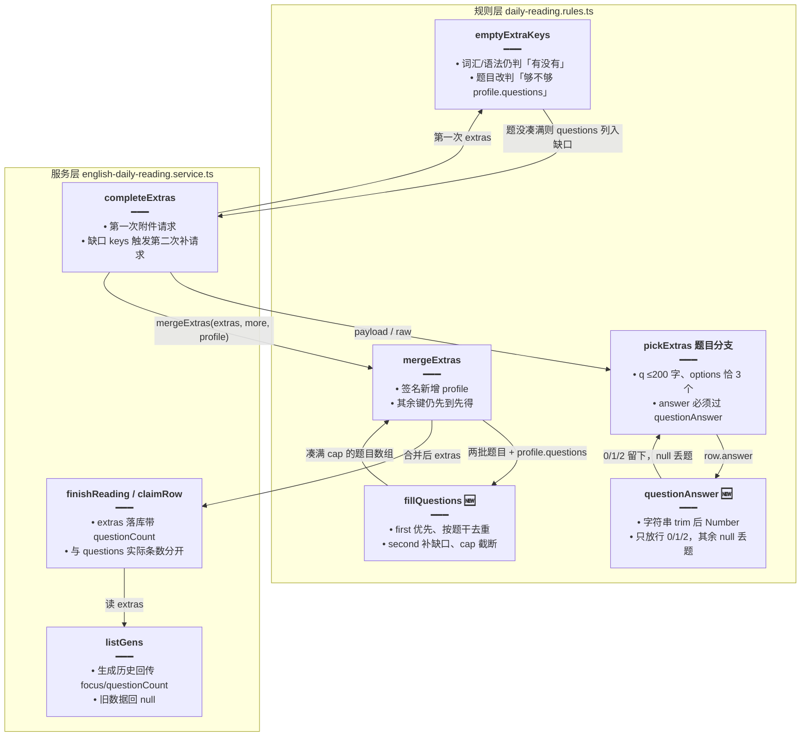
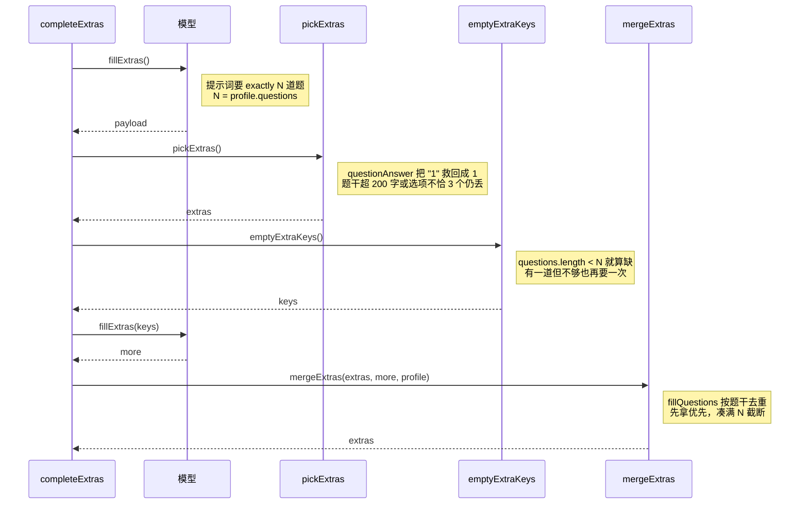

# 每日阅读题目凑满

> 文档角色：本篇是「每日阅读」题目凑满专题，覆盖后端理解题按设定条数补齐的完整链路——`emptyExtraKeys` 题目判据由「有没有」改为「够不够」、新增 `fillQuestions` 在附件合并时按题干去重凑满 `profile.questions`、新增 `questionAnswer` 容错模型写成字符串的 `answer`、`ReadingExtras` 落库 `questionCount` 记录设定题数，以及生成历史列表回传 `focus`/`questionCount` 与前端 `DailyReadingGen` 类型同步。
> 姊妹篇：补请求与 429 退避见 [每日阅读生成加固](./每日阅读生成加固.md)；语法说明结构化见 [每日阅读语法说明结构化](./每日阅读语法说明结构化.md)；题数档位的随机抽取见 [每日阅读随机档位](./每日阅读随机档位.md)；SSE 协议见 [每日阅读流式生成](./每日阅读流式生成.md)；详情页分栏见 [每日阅读界面重构](./每日阅读界面重构.md)；调度注册见 [每日阅读生成调度](./每日阅读生成调度.md)；定时入队整点见 [每日阅读自定义入队时间](./每日阅读自定义入队时间.md)；篇目删除见 [每日阅读篇目删除](./每日阅读篇目删除.md)；前端整体结构见 [每日阅读前端](./每日阅读前端.md)；`focus`/`questionCount` 在 store 与流式面板的展示见 [每日阅读生成元信息](./每日阅读生成元信息.md)。

## 一、要解决什么问题

1. **设定 3 题只出 1 题**：模型常少给题。旧 `emptyExtraKeys` 的题目分支是 `!extras.questions?.length`——「有一道就算有」，第一次请求只出 1 道合格题时不再触发补请求；旧 `mergeExtras` 又是整块二选一（`first.questions?.length ? first.questions : second.questions`），即便补请求给了 3 道，也会被第一次的 1 道整块顶掉。
2. **`answer` 写成字符串时整题被丢**：模型常把 `answer` 写成 `"1"`，旧校验 `answer !== 0 && answer !== 1 && answer !== 2` 对字符串全不等，题干、选项明明合格的题也被整道丢掉，题更难凑满。
3. **没凑满时分不出「设定」与「实际」**：extras 里只有 `questions` 数组（实际条数），落库后看不出这次本来要几道；生成历史列表也只回 level/length，界面无法表达「设定 3 题、实得 1 题」。

## 二、核心思路

1. **题数判据改成「够不够」**：`emptyExtraKeys` 题目分支由 `!extras.questions?.length` 改为 `(extras.questions?.length ?? 0) < profile.questions`——没凑满设定条数就把 `questions` 列入缺口，复用既有补请求链路再要一轮（补请求机制见 [每日阅读生成加固](./每日阅读生成加固.md)，本篇不展开）。
2. **合并时补齐，而非整块二选一**：新增 `fillQuestions(first, second, cap)`——第一次的题优先留下，第二次的题只补缺口，按题干 `q` 去重，凑满 `cap`（即 `profile.questions`）截断；`mergeExtras` 签名加 `profile`，题目走 `fillQuestions`，词汇、语法、词释仍「先到先得」。
3. **`answer` 字符串容错**：新增 `questionAnswer(raw)`——字符串先 `trim` 再 `Number`，只放行 `0/1/2`，其余返回 `null` 丢题。模型的高频小毛病（数字写成字符串）被救回，离谱输出（`"A"`、3、1-based 下标）仍丢。
4. **`questionCount` 与 `questions` 分家**：`ReadingExtras` 新增 `questionCount?: 0 | 2 | 3`，记录「这次设定要几道」；`claimRow` 插 pending 行时预写，`finishReading` 返回值末尾再挂上，done 落库时随 extras 整体入库。题没凑满时界面仍能显示设定值。
5. **生成历史回传 `focus`/`questionCount`**：`listGens` 每行补上这两个字段（`?? null` 兜底），前端 `DailyReadingGen` 类型同步新增，并把 `level/length` 的类型来源从 `Profile` 换成 `Extras`——`Extras` 已 `Exclude` 掉 `'random'`，落库档不会是 random。
6. **取舍：为何 merge 时补齐而非重新生成**：缺口已由 `emptyExtraKeys` 精确到「题目还差几道」，`fillExtras(keys)` 的补请求只要缺口键；为差的一两道题重新生成整篇或整份附件，代价大且结果不可控。merge 时补齐只在已拿到的两次结果之间调配，零额外请求。
7. **取舍：为何先到先得**：第一次请求的题已过 `pickExtras` 校验与 `shuffleOptions` 打乱，是直接产物；补请求产物的定位是「补缺」，不是「翻案」——先留下的优先，保证已合格条目不被后到的覆盖，与词汇、语法的合并策略保持一致。
8. **取舍：为何 `answer` 字符串容错而非直接丢**：`"1"` 与 `1` 的信息量完全一样，丢题只会让凑不满更频繁；而 `0/1/2` 之外的值（`"A"`、`"正确答案是B"`）无法可靠映射到选项下标，容错它们反而会指错答案，所以仍丢。

## 三、实现链路



**读图要点**：凑满的三个关口各管一段——`questionAnswer` 管住单题准入（字符串 answer 不再整题丢）、`emptyExtraKeys` 管住要不要再要一次（不够就补）、`fillQuestions` 管住合并（两次结果拼到设定条数）；`questionCount` 不参与任何判据，只是随行落库的「设定值」。



**读图要点**：补请求最多一轮——第二轮仍凑不满时 `fillQuestions` 只能拼出实际拿到的题，`questionCount` 仍如实记录设定值，不会出现「显示凑满、实际缺题」的假象。

## 四、代码对比

### 4.1 后端 `ReadingExtras.questionCount`

**对比范围**：`apps/backend/src/services/english-learning/daily-reading.rules.ts` 中 `ReadingExtras` 类型声明（改动前约 L76–L87，改动后约 L111–L124）；同一块里 `grammarNotes` 的类型变化属语法结构化改动，本篇只标位置。

来源：`apps/backend/src/services/english-learning/daily-reading.rules.ts` **改动前** 约 L76–L87（`ReadingExtras`）

```ts
// 附件集合类型：正文合格后由模型补出的学习块，逐键可选；基线没有题数设定字段。
export type ReadingExtras = {
	// 本篇难度档，来自生成时钉死的 profile。
	level: ReadingLevel;
	// 篇幅档，与 level 一样随正文落库。
	length: ReadingLength;
	// 学习侧重点：只阅读 / 词汇 / 语法 / 两者都要。
	focus: ReadingFocus;
	// 词汇表：词 + 中文释义，逐条校验词在正文里。
	glossary?: { word: string; zh: string }[];
	/** 按句列出正文里的词，zh 是该词在这一句里的意思。 */
	// wordGloss 结构本篇不涉及，保持原样。
	wordGloss?: { en: string; words: { w: string; zh: string }[] }[];
	// 旧版语法说明：纯字符串数组（结构化改动见姊妹篇，本篇只标位置）。
	grammarNotes?: string[];
	// 理解题：题干 + 3 个选项 + 正确下标；只有实际条数，没有设定条数。
	questions?: { q: string; options: string[]; answer: number }[];
	/** 这次联网取材用到的条目，详情全部展示。 */
	// 联网来源列表本篇不涉及，保持原样。
	sources?: { title: string; url: string }[];
};
```

来源：`apps/backend/src/services/english-learning/daily-reading.rules.ts` **改动后** 约 L111–L124（`ReadingExtras`）

```ts
// 附件集合类型：新增 questionCount 记录设定题数，其余键位不变。
export type ReadingExtras = {
	// 难度档保持不变。
	level: ReadingLevel;
	// 篇幅档保持不变。
	length: ReadingLength;
	// 侧重点保持不变。
	focus: ReadingFocus;
	/** 这次设置要几道理解题。和 questions 数组分开，条数没凑满时仍显示设定。 */
	// 新增设定题数：来自 profile.questions，与 questions 数组（实际条数）分开落库。
	questionCount?: 0 | 2 | 3;
	// 词汇表保持不变。
	glossary?: { word: string; zh: string }[];
	/** 按句列出正文里的词，zh 是该词在这一句里的意思。 */
	// wordGloss 保持不变。
	wordGloss?: { en: string; words: { w: string; zh: string }[] }[];
	// 语法说明改为 GrammarNote 数组属语法结构化改动（见姊妹篇），本篇只标位置。
	grammarNotes?: GrammarNote[];
	// 理解题数组保持不变：存的仍是实际凑到的题。
	questions?: { q: string; options: string[]; answer: number }[];
	/** 这次联网取材用到的条目，详情全部展示。 */
	// 来源列表保持不变。
	sources?: { title: string; url: string }[];
};
```

**变更摘要**：新增可选字段 `questionCount?: 0 | 2 | 3`，与 `questions` 数组各司其职——`questions` 是实际凑到的题，`questionCount` 是这次设定要的题数；类型上限定 `0 | 2 | 3` 三个合法档位，与 `profile.questions` 的取值域对齐。

### 4.2 `pickExtras` 题目分支与 `questionAnswer`

**对比范围**：`pickExtras` 中 `profile.questions > 0` 的题目分支（改动前约 L749–L772，改动后约 L803–L826）；`questionAnswer` 为纯新增（改动后约 L906–L911）。

来源：`apps/backend/src/services/english-learning/daily-reading.rules.ts` **改动前** 约 L749–L772（`pickExtras` 题目分支）

```ts
	// 设置里要了题且模型给了数组，才进入题目校验。
	if (profile.questions > 0 && Array.isArray(o.questions)) {
		// 合格题的收集容器，元素类型与 extras.questions 一致。
		const questions: NonNullable<ReadingExtras['questions']> = [];
		// 逐条过滤模型给的题。
		for (const item of o.questions) {
			// 非对象元素直接跳过。
			if (!item || typeof item !== 'object') continue;
			// 放宽成键值对，逐字段取值。
			const row = item as Record<string, unknown>;
			// 题干必须是字符串，去零宽；取不到按空串处理。
			const q = typeof row.q === 'string' ? stripZw(row.q) : '';
			// 选项必须是字符串数组，滤掉非字符串与空串。
			const options = Array.isArray(row.options)
				// 是数组才进入过滤。
				? row.options.filter(
						// 类型谓词：只留下非空字符串选项。
						(opt): opt is string => typeof opt === 'string' && !!stripZw(opt),
					)
				// 不是数组按空数组处理。
				: [];
			// 直接拿原始 answer，类型不限。
			const answer = row.answer;
			// 题干为空、题干超 200 字、选项不恰 3 个，都丢题。
			if (!q || q.length > 200 || options.length !== 3) continue;
			// answer 必须是数字 0/1/2：模型写成 "1" 时全不等，整题被丢。
			if (answer !== 0 && answer !== 1 && answer !== 2) continue;
			// 打乱选项顺序，answer 跟随原正确项；模型常把正确项放在中间。
			const placed = shuffleOptions(
				// 选项去零宽并截到 80 字符。
				options.map((opt) => stripZw(opt).slice(0, 80)),
				// 传入正确项下标，打乱后仍指向原正确项。
				answer,
			);
			// 收进合格题。
			questions.push({ q, ...placed });
		}
		// 至少有一道才挂 questions 键，并截到设定条数。
		if (questions.length > 0) {
			// 截断到 profile.questions：模型多给的部分不收。
			extras.questions = questions.slice(0, profile.questions);
		}
	}
```

来源：`apps/backend/src/services/english-learning/daily-reading.rules.ts` **改动后** 约 L803–L826（`pickExtras` 题目分支）

```ts
	// 设置里要了题且模型给了数组，才进入题目校验，与基线一致。
	if (profile.questions > 0 && Array.isArray(o.questions)) {
		// 合格题的收集容器，与基线一致。
		const questions: NonNullable<ReadingExtras['questions']> = [];
		// 逐条过滤模型给的题，与基线一致。
		for (const item of o.questions) {
			// 非对象元素直接跳过，与基线一致。
			if (!item || typeof item !== 'object') continue;
			// 放宽成键值对，与基线一致。
			const row = item as Record<string, unknown>;
			// 题干必须是字符串并去零宽，与基线一致。
			const q = typeof row.q === 'string' ? stripZw(row.q) : '';
			// 选项必须是字符串数组，滤掉非字符串与空串，与基线一致。
			const options = Array.isArray(row.options)
				// 是数组才进入过滤。
				? row.options.filter(
						// 类型谓词：只留下非空字符串选项。
						(opt): opt is string => typeof opt === 'string' && !!stripZw(opt),
					)
				// 不是数组按空数组处理。
				: [];
			// answer 先过容错：字符串数字转成 number，取不到合法值时是 null。
			const answer = questionAnswer(row.answer);
			// 题干空、超 200 字、选项不恰 3 个、answer 非法，都丢题；answer 校验并进同一行。
			if (!q || q.length > 200 || options.length !== 3 || answer == null)
				// 命中任一条件即丢当前题。
				continue;
			// 打乱选项顺序，answer 跟随原正确项，与基线一致。
			const placed = shuffleOptions(
				// 选项去零宽并截到 80 字符。
				options.map((opt) => stripZw(opt).slice(0, 80)),
				// 传入容错后的数字下标。
				answer,
			);
			// 收进合格题，与基线一致。
			questions.push({ q, ...placed });
		}
		// 至少有一道才挂 questions 键，并截到设定条数，与基线一致。
		if (questions.length > 0) {
			// 截断到 profile.questions：模型多给的部分不收。
			extras.questions = questions.slice(0, profile.questions);
		}
	}
```

来源：`apps/backend/src/services/english-learning/daily-reading.rules.ts` **改动后（纯新增）** 约 L906–L911（`questionAnswer`）

```ts
/** 答案常被模型写成字符串。只接受 0、1、2。 */
// answer 容错入口：把模型的 raw 值归一成 0/1/2 或 null。
function questionAnswer(raw: unknown): 0 | 1 | 2 | null {
	// 字符串先 trim 再转数字："1" 救回成 1，"A" 转成 NaN；非字符串原样进入下一步。
	const n = typeof raw === 'string' ? Number(raw.trim()) : raw;
	// 只接受 0/1/2 三个合法下标，其余（NaN、3、布尔值）都不放行。
	if (n === 0 || n === 1 || n === 2) return n;
	// 不合法返回 null，由调用方丢题。
	return null;
}
```

**变更摘要**：`answer` 的校验从「两行裸比较」收成一行 `questionAnswer` 调用——字符串数字（`"0"/"1"/"2"`）被救回，题面合格却因 answer 形态被丢的题大幅减少；`salvageExtras` 截断抢救路径内部同样走 `pickExtras`，容错对正常与抢救两条路径同时生效。

### 4.3 `fillQuestions` 与 `mergeExtras`

**对比范围**：`mergeExtras` 完整函数（改动前约 L806–L834，改动后约 L928–L956）；`fillQuestions` 为纯新增（改动后约 L913–L926）。

来源：`apps/backend/src/services/english-learning/daily-reading.rules.ts` **改动前** 约 L806–L834（`mergeExtras`）

```ts
/** 同一类两次都有时留下先拿到的，避免补请求盖掉已合格的条目。 */
// 附件合并：词汇、语法、题目、词释四类全部「先到先得」整块二选一。
export function mergeExtras(
	// 第一次附件请求产出的 extras。
	first: ReadingExtras,
	// 第二次补请求产出的 extras。
	second: ReadingExtras,
// 返回合并后的 extras；基线不需要 profile，因为题目也是整块二选一。
): ReadingExtras {
	// 三档元信息以第一次为准。
	const extras: ReadingExtras = {
		// 难度档取第一次的。
		level: first.level,
		// 篇幅档取第一次的。
		length: first.length,
		// 侧重点取第一次的。
		focus: first.focus,
	};
	// 词汇表先到先得：第一次非空就用第一次的。
	const glossary = first.glossary?.length ? first.glossary : second.glossary;
	// 语法说明先到先得。
	const grammarNotes = first.grammarNotes?.length
		// 第一次非空用第一次的。
		? first.grammarNotes
		// 否则用第二次的。
		: second.grammarNotes;
	// 题目同样整块二选一：第一次只凑到 1 道时，第二次的 3 道也顶不上来。
	const questions = first.questions?.length
		// 第一次有题就整块留下。
		? first.questions
		// 第一次没题才用第二次的。
		: second.questions;
	// 词释先到先得。
	const wordGloss = first.wordGloss?.length
		// 第一次非空用第一次的。
		? first.wordGloss
		// 否则用第二次的。
		: second.wordGloss;
	// 词汇表非空才挂键。
	if (glossary?.length) extras.glossary = glossary;
	// 语法非空才挂键。
	if (grammarNotes?.length) extras.grammarNotes = grammarNotes;
	// 题目非空才挂键。
	if (questions?.length) extras.questions = questions;
	// 词释非空才挂键。
	if (wordGloss?.length) extras.wordGloss = wordGloss;
	// 返回合并结果。
	return extras;
}
```

来源：`apps/backend/src/services/english-learning/daily-reading.rules.ts` **改动后** 约 L913–L956（`fillQuestions` 纯新增 + `mergeExtras`）

```ts
/** 题目按题干去重，凑满设定条数为止。先留下的优先。 */
// 题目合并专用：first 的题在前，second 的题只补缺口，最多凑满 cap 道。
function fillQuestions(
	// 第一次请求留下的合格题，可能为 undefined。
	first: ReadingExtras['questions'],
	// 第二次补请求留下的合格题，可能为 undefined。
	second: ReadingExtras['questions'],
	// 设定条数上限，来自 profile.questions。
	cap: number,
// 返回非空数组类型，方便 mergeExtras 直接挂键。
): NonNullable<ReadingExtras['questions']> {
	// 先收下第一次的全部题；first 缺省从空数组开始。
	const out = [...(first ?? [])];
	// 再看第二次的题，逐道补缺口。
	for (const item of second ?? []) {
		// 已凑满 cap 就停，不多收。
		if (out.length >= cap) break;
		// 按题干原文去重：同一道题两次都给时只留第一次的。
		if (out.some((row) => row.q === item.q)) continue;
		// 不重复且没凑满，收进来补缺。
		out.push(item);
	}
	// 截到 cap：first 本身就超设定时也不多留。
	return out.slice(0, cap);
}

/** 同一类两次都有时留下先拿到的。题目不足时用后一次补满。 */
// 附件合并：新增 profile 参数，只为了给题目一个「凑满」目标。
export function mergeExtras(
	// 第一次附件请求产出的 extras。
	first: ReadingExtras,
	// 第二次补请求产出的 extras。
	second: ReadingExtras,
	// 本次生成的钉死档位，题目按 profile.questions 凑满。
	profile: ReadingProfile,
// 返回合并后的 extras。
): ReadingExtras {
	// 三档元信息以第一次为准，与基线一致。
	const extras: ReadingExtras = {
		// 难度档取第一次的。
		level: first.level,
		// 篇幅档取第一次的。
		length: first.length,
		// 侧重点取第一次的。
		focus: first.focus,
	};
	// 词汇表仍先到先得，与基线一致。
	const glossary = first.glossary?.length ? first.glossary : second.glossary;
	// 语法说明仍先到先得，与基线一致。
	const grammarNotes = first.grammarNotes?.length
		// 第一次非空用第一次的。
		? first.grammarNotes
		// 否则用第二次的。
		: second.grammarNotes;
	// 题目改为「凑满」：两次的题合在一起按题干去重，截到设定条数。
	const questions = fillQuestions(
		// 第一次的题优先留下。
		first.questions,
		// 第二次的题补缺口。
		second.questions,
		// 凑满目标就是设定条数。
		profile.questions,
	);
	// 词释仍先到先得，与基线一致。
	const wordGloss = first.wordGloss?.length
		// 第一次非空用第一次的。
		? first.wordGloss
		// 否则用第二次的。
		: second.wordGloss;
	// 词汇表非空才挂键，与基线一致。
	if (glossary?.length) extras.glossary = glossary;
	// 语法非空才挂键，与基线一致。
	if (grammarNotes?.length) extras.grammarNotes = grammarNotes;
	// 题目非空才挂键，与基线一致；凑不满时挂实际条数。
	if (questions?.length) extras.questions = questions;
	// 词释非空才挂键，与基线一致。
	if (wordGloss?.length) extras.wordGloss = wordGloss;
	// 返回合并结果。
	return extras;
}
```

**变更摘要**：`mergeExtras` 签名加 `profile`；题目合并从整块二选一换成 `fillQuestions` 的「先到优先 + 按题干去重 + cap 截断」三段式；`glossary`/`grammarNotes`/`wordGloss` 三个键的合并策略原样保留——凑满是题目独有的需求，其余键没有「条数设定」概念。

### 4.4 `emptyExtraKeys` 题目判据

**对比范围**：`emptyExtraKeys` 完整函数（改动前约 L794–L805，改动后约 L894–L904）。

来源：`apps/backend/src/services/english-learning/daily-reading.rules.ts` **改动前** 约 L794–L805（`emptyExtraKeys`）

```ts
/** 某一类一个都没有才需要再要。已有若干条就不补。 */
// 判缺口：列出这次要了却还空着的附件键，空了就触发补请求。
export function emptyExtraKeys(
	// 第一次附件请求产出的 extras。
	extras: ReadingExtras,
	// 本次生成的钉死档位，决定哪些键是「这次要的」。
	profile: ReadingProfile,
// 返回还空着的附件键列表。
): ReadingExtraKey[] {
	// 只在「这次要的键」里挑空的，没要的键不补。
	return requestedExtraKeys(profile).filter((key) => {
		// 词汇表：一条都没有才算空。
		if (key === 'glossary') return !extras.glossary?.length;
		// 语法说明：一条都没有才算空。
		if (key === 'grammarNotes') return !extras.grammarNotes?.length;
		// 题目：有一道就算有——设定 3 题只出 1 题时不再补。
		return !extras.questions?.length;
	});
}
```

来源：`apps/backend/src/services/english-learning/daily-reading.rules.ts` **改动后** 约 L894–L904（`emptyExtraKeys`）

```ts
/** 词汇和语法一个都没有才再要。题目没凑满设定条数也再要。 */
// 判缺口：词汇/语法判据不变，题目从「有没有」改成「够不够」。
export function emptyExtraKeys(
	// 第一次附件请求产出的 extras。
	extras: ReadingExtras,
	// 本次生成的钉死档位，决定哪些键是「这次要的」、题要几道。
	profile: ReadingProfile,
// 返回还缺着的附件键列表。
): ReadingExtraKey[] {
	// 只在「这次要的键」里挑缺的，没要的键不补，与基线一致。
	return requestedExtraKeys(profile).filter((key) => {
		// 词汇表：一条都没有才算空，与基线一致。
		if (key === 'glossary') return !extras.glossary?.length;
		// 语法说明：一条都没有才算空，与基线一致。
		if (key === 'grammarNotes') return !extras.grammarNotes?.length;
		// 题目：实际条数小于设定条数就算缺——没凑满就再要一次。
		return (extras.questions?.length ?? 0) < profile.questions;
	});
}
```

**变更摘要**：题目分支一行之差——从「数组非空」改为「数组长度 < 设定条数」；词汇与语法维持「有没有」判据，因为这两类没有设定条数，有内容即合格。

### 4.5 `claimRow` 落库 `questionCount`

**对比范围**：`apps/backend/src/services/english-learning/english-daily-reading.service.ts` 中 `claimRow` 的 `this.repo.insert` 尾部（改动前约 L1200–L1214，改动后约 L1218–L1240）；insert 的行字段前后一致，用 `// ...（未改动）` 对称省略。

来源：`apps/backend/src/services/english-learning/english-daily-reading.service.ts` **改动前** 约 L1200–L1214（`claimRow` 落库 extras）

```ts
		// 插这次 runId 的 pending 行。
		await this.repo.insert({
			// ...（未改动：id、publishDate、slot、userId、status 等行字段与改动后一致）
			// 本次主题。
			theme,
			// 附件集合：基线只落三档元信息，没有设定题数字段。
			extras: {
				// 难度档。
				level: profile.level,
				// 篇幅档。
				length: profile.length,
				// 侧重点。
				focus: profile.focus,
			},
		});
		// 返回本次主题给调用方。
		return theme;
	}
```

来源：`apps/backend/src/services/english-learning/english-daily-reading.service.ts` **改动后** 约 L1218–L1240（`claimRow` 落库 extras）

```ts
		// 插这次 runId 的 pending 行。
		await this.repo.insert({
			// ...（未改动：id、publishDate、slot、userId、status 等行字段与基线一致）
			// 本次主题。
			theme,
			// 附件集合：三档之外新增设定题数，pending 阶段就让行带上「这次要几道」。
			extras: {
				// 难度档。
				level: profile.level,
				// 篇幅档。
				length: profile.length,
				// 侧重点。
				focus: profile.focus,
				// 设定题数：与之后 questions 数组的实际条数分开记录。
				questionCount: profile.questions,
			},
		});
		// 返回本次主题给调用方。
		return theme;
	}
```

**变更摘要**：pending 行预写 `questionCount`——生成还没结束，行上就能读到「这次设定要几道」；生成中断（stopped/paused）时行上留有 `questionCount` 而没有 `questions`，属预期状态。

### 4.6 `finishReading` 返回值挂 `questionCount`

**对比范围**：`finishReading` 方法尾部（改动前约 L1470–L1472，改动后约 L1498–L1501）。该返回值是定时与手动两条 done 落库路径共用的 extras 来源。

来源：`apps/backend/src/services/english-learning/english-daily-reading.service.ts` **改动前** 约 L1470–L1472（`finishReading` 尾部）

```ts
		// 词释请求产出的 wordGloss。
		const gloss = glossExtras.wordGloss;
		// 有词释就并进附件，没有就原样返回；基线返回值不带设定题数。
		return gloss?.length ? { ...attached, wordGloss: gloss } : attached;
	}
```

来源：`apps/backend/src/services/english-learning/english-daily-reading.service.ts` **改动后** 约 L1498–L1501（`finishReading` 尾部）

```ts
		// 词释请求产出的 wordGloss，与基线一致。
		const gloss = glossExtras.wordGloss;
		// 有词释就并进附件，没有就原样，与基线一致。
		const extras = gloss?.length ? { ...attached, wordGloss: gloss } : attached;
		// 返回值末尾挂上设定题数：done 落库与详情回显都从这里拿。
		return { ...extras, questionCount: profile.questions };
	}
```

**变更摘要**：词释合并的结果先落一个局部变量，返回时再展开挂上 `questionCount`；无论是 `completeExtras` 正常产出、补请求合并产出，还是异常兜底返回的 `extras`，走到这里都会被统一盖上设定题数。

### 4.7 `completeExtras` 调 `mergeExtras` 传 `profile`

**对比范围**：`completeExtras` 中第二次补请求产物的合并调用（改动前约 L1520–L1525，改动后约 L1550–L1554）。

来源：`apps/backend/src/services/english-learning/english-daily-reading.service.ts` **改动前** 约 L1520–L1525（`completeExtras` 合并调用）

```ts
			// 第二次补请求的产物：JSON 完整走 pickExtras 校验，截断走 salvageExtras 抢救。
			const more =
				// 请求成功且有解析结果走正常校验。
				second.ok && second.payload
					// 正常路径：完整 payload 逐键校验。
					? pickExtras(second.payload, bodyEn, profile)
					// 截断路径：只救已闭合的条目，再走同一套校验。
					: salvageExtras(second.raw, bodyEn, profile);
			// 基线合并不传 profile：题目只能整块二选一，没有凑满目标可传。
			return mergeExtras(extras, more);
```

来源：`apps/backend/src/services/english-learning/english-daily-reading.service.ts` **改动后** 约 L1550–L1554（`completeExtras` 合并调用）

```ts
			// 第二次补请求的产物：JSON 完整走 pickExtras 校验，截断走 salvageExtras 抢救，与基线一致。
			const more =
				// 请求成功且有解析结果走正常校验。
				second.ok && second.payload
					// 正常路径：完整 payload 逐键校验。
					? pickExtras(second.payload, bodyEn, profile)
					// 截断路径：只救已闭合的条目，再走同一套校验。
					: salvageExtras(second.raw, bodyEn, profile);
			// 合并时传入 profile：fillQuestions 拿 profile.questions 作凑满目标。
			return mergeExtras(extras, more, profile);
```

**变更摘要**：唯一调用点同步新签名；`profile` 在此刻是生成开始时钉死的具体档位（随机档已被 `resolveProfile` 抽成具体值，见 [每日阅读随机档位](./每日阅读随机档位.md)），所以 `fillQuestions` 拿到的 `cap` 一定是 `0 | 2 | 3`，不会是 `'random'`。

### 4.8 `listGens` 回传 `focus`/`questionCount`

**对比范围**：`listGens` 的行映射块（改动前约 L858–L871，改动后约 L859–L874）。

来源：`apps/backend/src/services/english-learning/english-daily-reading.service.ts` **改动前** 约 L858–L871（`listGens` 行映射）

```ts
		// 逐行映射成返回给前端的生成历史项。
		return rows.map((row) => {
			// 按 id 取这篇的 extras；查不到就是 undefined。
			const extras = extrasById.get(row.id);
			// 组装单行历史。
			return {
				// 生成 id。
				id: row.id,
				// 正文快照。
				text: row.text,
				// token 用量。
				tokens: row.tokens,
				// 耗时毫秒。
				elapsed: row.elapsedMs,
				// 开始时间戳。
				startedAt: row.startedAt.getTime(),
				// 终态。
				status: row.status,
				// 难度档：extras 缺失时回 null。
				level: extras?.level ?? null,
				// 篇幅档：extras 缺失时回 null。
				length: extras?.length ?? null,
			};
		});
	}
```

来源：`apps/backend/src/services/english-learning/english-daily-reading.service.ts` **改动后** 约 L859–L874（`listGens` 行映射）

```ts
		// 逐行映射成返回给前端的生成历史项，与基线一致。
		return rows.map((row) => {
			// 按 id 取这篇的 extras；查不到就是 undefined，与基线一致。
			const extras = extrasById.get(row.id);
			// 组装单行历史。
			return {
				// 生成 id。
				id: row.id,
				// 正文快照。
				text: row.text,
				// token 用量。
				tokens: row.tokens,
				// 耗时毫秒。
				elapsed: row.elapsedMs,
				// 开始时间戳。
				startedAt: row.startedAt.getTime(),
				// 终态。
				status: row.status,
				// 难度档：extras 缺失时回 null，与基线一致。
				level: extras?.level ?? null,
				// 篇幅档：extras 缺失时回 null，与基线一致。
				length: extras?.length ?? null,
				// 新增侧重点：历史列表要展示「这次是什么侧重」。
				focus: extras?.focus ?? null,
				// 新增设定题数：题没凑满时也能显示设定值；旧数据没有该字段时回 null。
				questionCount: extras?.questionCount ?? null,
			};
		});
	}
```

**变更摘要**：与既有 `level/length` 并列新增两个字段，同样 `?? null` 兜底；数据源是篇目行的 `extras`，不碰 gens 表结构，旧数据自然回 `null`。

### 4.9 前端 `DailyReadingGen` 类型

**对比范围**：`apps/frontend/src/service/index.ts` 中 `DailyReadingGen` 类型声明（改动前约 L2103–L2114，改动后约 L2108–L2119）。

来源：`apps/frontend/src/service/index.ts` **改动前** 约 L2103–L2114（`DailyReadingGen`）

```ts
// 生成历史单行：基线只带 level/length 两个档位。
export type DailyReadingGen = {
	// 生成 id。
	id: string;
	// 正文快照。
	text: string;
	// token 用量。
	tokens: number;
	// 耗时毫秒。
	elapsed: number;
	// 开始时间戳。
	startedAt: number;
	// 终态。
	status: 'done' | 'stopped' | 'error' | 'paused';
	// 难度档：类型取自 Profile，随机档位引入后这里会漏进 'random'。
	level: EnglishDailyReadingProfile['level'] | null;
	// 篇幅档：同样取自 Profile。
	length: EnglishDailyReadingProfile['length'] | null;
};
```

来源：`apps/frontend/src/service/index.ts` **改动后** 约 L2108–L2119（`DailyReadingGen`）

```ts
// 生成历史单行：新增 focus/questionCount，档位类型来源从 Profile 换成 Extras。
export type DailyReadingGen = {
	// 生成 id。
	id: string;
	// 正文快照。
	text: string;
	// token 用量。
	tokens: number;
	// 耗时毫秒。
	elapsed: number;
	// 开始时间戳。
	startedAt: number;
	// 终态。
	status: 'done' | 'stopped' | 'error' | 'paused';
	// 难度档：改取 Extras——Extras 已 Exclude 掉 'random'，落库档不会是 random。
	level: EnglishDailyReadingExtras['level'] | null;
	// 篇幅档：同样改取 Extras，排除 random。
	length: EnglishDailyReadingExtras['length'] | null;
	// 新增侧重点：与 extras.focus 对齐，旧数据为 null。
	focus: EnglishDailyReadingExtras['focus'] | null;
	// 新增设定题数：0/2/3 三种合法值，旧数据为 null。
	questionCount: 0 | 2 | 3 | null;
};
```

**变更摘要**：`level/length` 的类型来源由 `EnglishDailyReadingProfile` 改为 `EnglishDailyReadingExtras`——`Profile` 的档位联合含 `'random'`（设置可记随机），`Extras` 的三个档位已 `Exclude<..., 'random'>`（落库永远是抽完的具体档），历史行不可能显示 random，类型上直接杜绝；`questionCount` 不引用 `Extras`（前端 `EnglishDailyReadingExtras` 暂未声明该字段），直接写字面量联合 `0 | 2 | 3 | null`。

## 五、行为变化

1. **设定 0 题时不补也不挂键**：`profile.questions` 为 0 时 `requestedExtraKeys` 不含 `questions`，`emptyExtraKeys` 不会查题目缺口，补请求也不会再要题；`fillQuestions` 的 `cap` 为 0 时 `slice(0, 0)` 得空数组，`questions` 键不挂。整链路对 0 题完全静默，与基线一致。
2. **旧数据无 `questionCount` 回显为 `null`**：历史篇目 extras 里没有该字段，`listGens` 用 `?? null` 兜底，前端类型允许 `null`；界面拿到 `null` 不显示设定题数，不报错。
3. **题没凑满时 `questionCount` 仍显示设定值**：`questionCount` 记的是 `profile.questions`（设定），不是 `questions.length`（实际）——设定 3 题实得 1 题时 `questionCount` 仍是 3，界面能如实表达「要 3 道、只出 1 道」，不会把缺题伪装成凑满。
4. **`answer` 字符串被救回的题照常打乱**：`questionAnswer` 归一后仍走原 `shuffleOptions`，救回的题与数字 `answer` 的题在选项乱序上无差别；`salvageExtras` 抢救路径内部也走 `pickExtras`，容错同样生效。
5. **补请求仍最多一轮**：第一次 0 道、第二次只给 1 道时，最终 `questions` 就是 1 道——不会再要第三轮，缺题靠 `questionCount` 如实暴露。
6. **前端展示层消费属另一篇**：store 缓存、`StreamMeta` 徽标、`StreamPane` 题目区如何展示 `focus`/`questionCount`/`questions`，见 [每日阅读生成元信息](./每日阅读生成元信息.md)，本篇不展开。

## 六、风险与回归清单

1. **补请求只有一轮**：`fillQuestions` 只在「第一次 + 第二次」之间凑；两轮都没凑满时最终仍缺题。回归点：设定 3 题连生成 5 篇，统计 `questions.length` 分布，确认缺题率可接受。
2. **去重键是题干原文**：模型补请求时把同一道题换个措辞，`q` 不同就会两题并存（内容近似）。回归点：抽查补请求前后的题干重合度，确认近义重复题少见。
3. **`questionAnswer` 只收 0/1/2**：模型给 `"A"/"B"/"C"` 或 1-based 的 1/2/3 都会丢题——1-based 无法与 0-based 可靠区分，丢比错位安全。回归点：观察丢题日志中 `answer` 的形态分布，确认没有大规模 1-based 输出。
4. **`mergeExtras` 签名加参**：所有调用方必须传 `profile`；当前仅 `completeExtras` 一处调用。回归点：全局搜索 `mergeExtras` 确认没有漏改的调用方，`tsc` 编译通过即兜底。
5. **`questionCount` ≠ 实际条数**：展示层若拿 `questionCount` 当实际题数渲染固定数量的卡槽，凑不满时会露空槽。回归点：题目区必须以 `questions.length` 为准渲染，`questionCount` 只作「设定」角标（展示约束见 [每日阅读生成元信息](./每日阅读生成元信息.md)）。
6. **`questionCount` 随 pending 行先落库**：`claimRow` 在生成开始时就写入设定值；生成中断（stopped/paused）时行上留有 `questionCount` 但没有 `questions`，属预期——详情按「题区无数据」处理即可。

若与仓库最新源码不一致，以源码为准。
