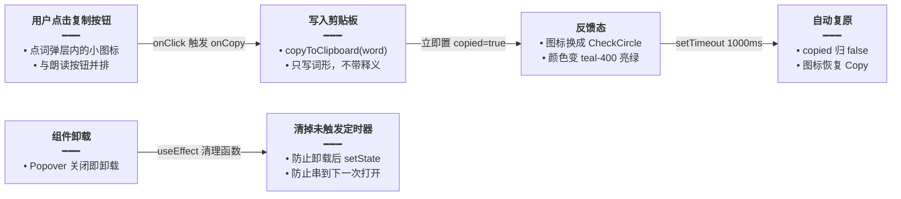

# 点词弹层复制按钮

相关文档：[每日阅读前端](每日阅读前端.md)、[句内词标注缓存与批量标注](句内词标注缓存与批量标注.md)、[每日阅读界面重构](每日阅读界面重构.md)、[英语学习单词UI重构](英语学习单词UI重构.md)、[点词悬浮指针化](点词悬浮指针化.md)

> **后继更新（2026-11-03）**：点词按钮的悬浮高亮已从 CSS `:hover` 改为指针事件驱动（`hoverKey` 状态 + 整句 `onPointerLeave` 兜底），ScrollArea / 两端对齐正文里不再粘住；弹层打开态（`open`）仍压过悬浮态。详见 [点词悬浮指针化.md](./点词悬浮指针化.md)。

## 1. 背景与目标

每日阅读详情页的正文支持「点词」：点击句子里被标注的单词，弹出 Popover 小卡片，显示词形、朗读按钮和中文释义。用户查完词后如果想把这个词粘到别处（比如自己的生词整理、搜索框），只能手动选中再复制，而 Popover 内的文本选择体验并不好。

本次改动给点词弹层里的 `WordLine` 组件加一个**可选的复制按钮**：点一下把单词写入剪贴板，图标立刻变成对勾反馈「已复制」，1 秒后自动复原。改动要点：

- 复制能力是 `WordLine` 的可选属性（`copy?: boolean`），默认不开启，不影响共用一个组件的文末单词列表；
- 反馈态用「图标切换 + 颜色变亮」表达，不弹 toast，避免打断阅读；
- 定时器在组件卸载时清理，防止 Popover 关闭后回调打到已卸载组件；
- 复用既有 `copyToClipboard` 工具与既有 `common.copy` / `common.copied` 文案，不新增任何 i18n 词条。

## 2. 改动范围

| 文件 | 改动 | 说明 |
| --- | --- | --- |
| `apps/frontend/src/views/englishLearning/dailyReading/components/GlossSentence.tsx` | 修改 | `WordLine` 新增 `copy` 属性与复制按钮；点词弹层处传入 `copy` |

`WordLine` 同时被两处使用：点词弹层（`GlossSentence` 内）和文末单词列表（`Detail.tsx`）。本次只有点词弹层传入 `copy`，文末单词列表不传、界面与行为完全不变。

## 3. 实现思路

纯前端单文件改动，没有跨模块数据流。交互链路只有「点按钮 → 写剪贴板 → 亮对勾 → 1 秒后复原」一段：



两个细节决定这段逻辑的形状：

1. **为什么用 `useRef` 存定时器而不是裸 `setTimeout`**：Popover 一关 `WordLine` 就卸载，如果 1 秒定时器还没触发，回调里的 `setCopied(false)` 会打到已卸载组件上（React 会告警）。把定时器句柄放进 `useRef`，卸载时在 `useEffect` 清理函数里 `clearTimeout` 掉即可。同时连续快速点两次复制时，先清旧定时器再开新的，保证「1 秒后复原」从最后一次点击算起。
2. **为什么 `copy` 默认 `false`**：`WordLine` 是共用组件，文末单词列表也在用。把复制做成可选属性、默认关闭，未传 `copy` 的调用方零感知，也避免文末列表里每个词都多一个按钮造成视觉噪音。

## 4. 代码实现

### 4.1 导入新增

> 来源：`apps/frontend/src/views/englishLearning/dailyReading/components/GlossSentence.tsx`（改动前，约 L1-L4）

```tsx
// UI 基础组件：按钮与 Popover 三件套
import { Button, Popover, PopoverContent, PopoverTrigger } from '@ui/index';
// 图标：方形停止、喇叭朗读
import { Square, Volume2 } from 'lucide-react';
// className 条件拼接工具
import { cn } from '@/lib/utils';
```

> 来源：`apps/frontend/src/views/englishLearning/dailyReading/components/GlossSentence.tsx`（改动后，L1-L6）

```tsx
// UI 基础组件：按钮与 Popover 三件套
import { Button, Popover, PopoverContent, PopoverTrigger } from '@ui/index';
// 图标：新增对勾（已复制反馈）与复制
import { CheckCircle, Copy, Square, Volume2 } from 'lucide-react';
// React hooks：copied 状态、定时器句柄、卸载清理
import { useEffect, useRef, useState } from 'react';
// i18n：aria-label 用既有 common.copy / common.copied
import { useI18n } from '@/hooks';
// className 条件拼接工具
import { cn } from '@/lib/utils';
// 既有剪贴板工具：内部走 navigator.clipboard 与降级路径
import { copyToClipboard } from '@/utils/clipboard';
```

### 4.2 WordLine 属性扩展

> 来源：`apps/frontend/src/views/englishLearning/dailyReading/components/GlossSentence.tsx`（改动前，约 L7-L18）

```tsx
/** 正文点词和文末单词列表共用这一套：词、朗读、释义。 */
// 共用行组件：词形 + 朗读按钮 + 中文释义
export function WordLine({
	// 词形
	word,
	// 中文释义
	zh,
	// 是否正在朗读本词
	playing,
	// 点击朗读/停止的回调
	onPlay,
	// 朗读按钮的无障碍文案
	playLabel,
	// 停止按钮的无障碍文案
	stopLabel,
}: {
	// 词形文本：行内展示、朗读与复制的目标
	word: string;
	// 中文释义文本
	zh: string;
	// 朗读状态：驱动按钮图标与无障碍文案切换
	playing: boolean;
	// 点击朗读/停止时的回调签名
	onPlay: () => void;
	// 朗读态的无障碍文案
	playLabel: string;
	// 停止态的无障碍文案
	stopLabel: string;
}) {
```

> 来源：`apps/frontend/src/views/englishLearning/dailyReading/components/GlossSentence.tsx`（改动后，L8-L25）

```tsx
/** 正文点词和文末单词列表共用这一套：词、朗读、释义。 */
// 共用行组件：词形 + 朗读按钮 + （可选）复制按钮 + 中文释义
export function WordLine({
	// 词形
	word,
	// 中文释义
	zh,
	// 是否正在朗读本词
	playing,
	// 点击朗读/停止的回调
	onPlay,
	// 朗读按钮的无障碍文案
	playLabel,
	// 停止按钮的无障碍文案
	stopLabel,
	// 可选：是否显示复制按钮；默认 false，不影响文末单词列表
	copy = false,
}: {
	// 词形文本：行内展示、朗读与复制的目标
	word: string;
	// 中文释义文本
	zh: string;
	// 朗读状态：驱动按钮图标与无障碍文案切换
	playing: boolean;
	// 点击朗读/停止时的回调签名
	onPlay: () => void;
	// 朗读态的无障碍文案
	playLabel: string;
	// 停止态的无障碍文案
	stopLabel: string;
	// 可选属性，未传时不渲染复制按钮
	copy?: boolean;
}) {
```

### 4.3 copied 状态与 onCopy

> 来源：`apps/frontend/src/views/englishLearning/dailyReading/components/GlossSentence.tsx`（改动后新增段，L26-L41；改动前无此段，组件体内直接 return JSX）

```tsx
	// i18n 翻译函数，供 aria-label 取词
	const { t } = useI18n();
	// 是否处于「已复制」反馈态
	const [copied, setCopied] = useState(false);
	// 复原定时器句柄：用 ref 存，卸载时可清理
	const timerRef = useRef<ReturnType<typeof setTimeout> | null>(null);

	// 卸载清理：Popover 关闭即卸载本组件，清掉还没触发的复原定时器，
	// 避免 setCopied 打到已卸载组件
	useEffect(() => {
		// 返回清理函数：组件卸载时执行
		return () => {
			// 有未触发定时器才清
			if (timerRef.current) clearTimeout(timerRef.current);
		};
	}, []);

	// 点击复制：写剪贴板 → 亮反馈 → 1 秒后复原
	const onCopy = () => {
		// 只复制词形；失败静默（剪贴板权限拒绝时不打扰阅读）
		void copyToClipboard(word);
		// 立刻进入反馈态
		setCopied(true);
		// 连续点两次时先作废上一个定时器，复原计时从最后一次点击算起
		if (timerRef.current) clearTimeout(timerRef.current);
		// 1 秒后退出反馈态
		timerRef.current = setTimeout(() => setCopied(false), 1000);
	};
```

### 4.4 复制按钮渲染

> 来源：`apps/frontend/src/views/englishLearning/dailyReading/components/GlossSentence.tsx`（改动前，朗读按钮后即 `</div>` 收尾，约 L33-L43）

```tsx
				{/* 朗读/停止按钮：图标随 playing 切换 */}
				<Button
					// 显式声明为普通按钮，避免在表单中误提交
					type="button"
					// 幽灵变体：无底色，贴合弹层内联排版
					variant="ghost"
					// 小号尺寸，与词形行高匹配
					size="sm"
					// 合并基础样式与播放态颜色
					className={cn(
						// 固定 24px 方形、禁止收缩、去掉内边距与阴影
						'size-6 shrink-0 rounded-md p-0 shadow-none',
						// 去掉聚焦态边框与光圈，保持弹层视觉干净
						'focus-visible:border-transparent focus-visible:ring-0',
						// 播放中亮青色；常态弱色、悬停变青
						playing ? 'text-teal-500' : 'text-textcolor/55 hover:text-teal-400',
					)}
					// 无障碍文案随播放态在「停止/朗读」间切换
					aria-label={playing ? stopLabel : playLabel}
					// 点击触发朗读或停止
					onClick={onPlay}
				>
					{/* 播放中显示实心方块（停止），否则显示喇叭 */}
					{playing ? (
						// 实心方块表示停止；fill-current 让填充色跟随文字色
						<Square className="size-3.5 fill-current" aria-hidden />
					) : (
						// 喇叭图标表示可朗读
						<Volume2 className="size-3.5" aria-hidden />
					)}
				{/* 朗读按钮结束 */}
				</Button>
```

> 来源：`apps/frontend/src/views/englishLearning/dailyReading/components/GlossSentence.tsx`（改动后，朗读按钮之后追加复制按钮，L64-L84）

```tsx
				{/* 复制按钮：仅 copy=true 时渲染，与朗读按钮同款幽灵样式 */}
				{copy ? (
					// 复制按钮本体：与朗读按钮并排的幽灵小按钮
					<Button
						// 显式声明为普通按钮，避免在表单中误提交
						type="button"
						// 幽灵变体：无底色，与朗读按钮视觉一致
						variant="ghost"
						// 小号尺寸，与朗读按钮同规格
						size="sm"
						// 合并基础样式与反馈态颜色
						className={cn(
							// 固定 24px 方形、禁止收缩、去掉内边距与阴影
							'size-6 shrink-0 rounded-md p-0 shadow-none',
							// 去掉聚焦态边框与光圈
							'focus-visible:border-transparent focus-visible:ring-0',
							// 反馈态用亮绿；常态弱色、悬停加深
							copied ? 'text-teal-400' : 'text-textcolor/55 hover:text-textcolor',
						)}
						// 无障碍文案复用既有词条：common.copy / common.copied
						aria-label={copied ? t('common.copied') : t('common.copy')}
						// 点击触发复制流程：写剪贴板并进入反馈态
						onClick={onCopy}
					>
						{/* 反馈态显示对勾，常态显示复制图标 */}
						{copied ? (
							// 对勾图标：复制成功的反馈
							<CheckCircle className="size-3.5" aria-hidden />
						) : (
							// 复制图标：默认常态
							<Copy className="size-3.5" aria-hidden />
						)}
					{/* 复制按钮结束 */}
					</Button>
					// 未传 copy 时不渲染任何内容，布局与改动前一致
				) : null}
```

### 4.5 点词弹层传入 copy

> 来源：`apps/frontend/src/views/englishLearning/dailyReading/components/GlossSentence.tsx`（改动前，`GlossSentence` 内 Popover 内容区，约 L124-L131）

```tsx
						{/* 弹层内容：词、朗读、释义 */}
						<WordLine
							// 传入当前点击词的词形
							word={gloss.w}
							// 传入中文释义
							zh={gloss.zh}
							// 传入该词的朗读状态
							playing={playing}
							// 朗读回调绑定当前词形
							onPlay={() => onPlay(gloss.w)}
							// 透传朗读态无障碍文案
							playLabel={playLabel}
							// 透传停止态无障碍文案
							stopLabel={stopLabel}
							// 无子元素，自闭合；改动前属性到此为止
						/>
```

> 来源：`apps/frontend/src/views/englishLearning/dailyReading/components/GlossSentence.tsx`（改动后，L159-L167）

```tsx
						{/* 弹层内容：词、朗读、复制、释义 */}
						<WordLine
							// 传入当前点击词的词形
							word={gloss.w}
							// 传入中文释义
							zh={gloss.zh}
							// 传入该词的朗读状态
							playing={playing}
							// 朗读回调绑定当前词形
							onPlay={() => onPlay(gloss.w)}
							// 透传朗读态无障碍文案
							playLabel={playLabel}
							// 透传停止态无障碍文案
							stopLabel={stopLabel}
							// 开启复制按钮；文末单词列表（Detail.tsx）不传，不受影响
							copy
							// 无子元素，自闭合
						/>
```

### 4.6 复用的既有工具与词条（未改动）

复制按钮依赖的两处既有设施本次没有改动，仅列出位置供查阅：

> 来源：`apps/frontend/src/utils/clipboard.ts`（既有代码，未改动，约 L379-L381）

```tsx
// 剪贴板写入入口：内部优先 navigator.clipboard，失败时走 textarea 降级
export const copyToClipboard = async (text: string): Promise<void> => {
	// 委托给内部 writeClipText，统一降级逻辑
	await writeClipText(text);
};
```

> 来源：`apps/frontend/src/i18n/locales/zh-CN/common.ts`（既有代码，未改动，约 L7）

```ts
// 复制反馈文案：复制按钮的 aria-label 在反馈态使用
	'common.copied': '已复制',
```

## 5. 行为变化

| 场景 | 改动前 | 改动后 |
| --- | --- | --- |
| 正文点词弹层 | 只有词、朗读按钮、释义 | 多一个复制按钮，点击复制词形并对勾反馈 1 秒 |
| 文末单词列表 | 词、朗读、释义 | 不变（未传 `copy`，不渲染复制按钮） |
| 剪贴板内容 | —— | 仅词形（`word`），不含释义 |
| i18n 词条 | —— | 无新增，复用 `common.copy` / `common.copied` |
| 无障碍 | —— | 复制按钮带 `aria-label`，反馈态切换为「已复制」 |

## 6. 兼容说明

- `copy` 为可选属性且默认 `false`，所有既有调用方不传时渲染结果与改动前完全一致；
- `copyToClipboard` 与两条 `common.*` 词条均为既有设施，旧版本前端代码不依赖本次改动；
- 复制失败（如剪贴板权限被拒）时界面只表现为对勾反馈，不报错、不弹窗，阅读流不被打断。

## 7. 风险与回归测试点

1. 点词弹层点复制按钮：图标变对勾并变亮绿，1 秒后复原；粘贴板内容是单词本身。
2. 1 秒内连续点两次：复原计时从第二次点击算起，反馈态不提前退出。
3. 点复制后立刻关掉 Popover（1 秒内）：控制台无「setState on unmounted component」类告警。
4. 文末单词列表：每行仍只有词、朗读、释义，没有复制按钮。
5. 朗读与复制并存：点复制不影响朗读状态，两者图标各自独立切换。
6. 键盘可达性：Tab 聚焦复制按钮时 `aria-label` 读「复制」，复制后读「已复制」。

---

本文基于当前仓库源码整理；若与仓库最新源码不一致，以源码为准。
