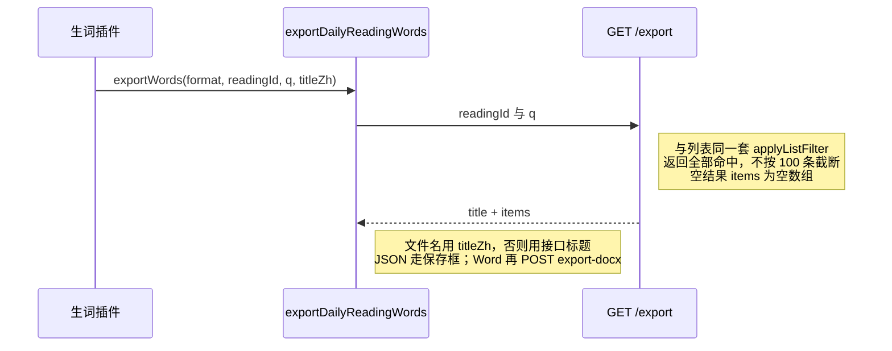

# 生词按当前筛选导出

> **文档角色**：已落地实现（2026-11-16）。
>
> **延伸阅读**：[生词接入解析.md](./生词接入解析.md)、[单词库导出.md](./单词库导出.md)

## 1. 背景与目标

生词页需要和单词库一样导出 JSON 与 Word。第一次做成「每次导出该用户全部生词」，和页面上正在看的篇目、搜索对不上。现在导出跟列表用同一组条件：选中的篇目和已提交的搜索词。选中某一篇时，文件名用这篇的中文标题。

不复用词库 JSON 导出：那个路径会丢掉没有音标的行，生词正好没有音标。

## 2. 改动范围

- `apps/backend/src/services/english-learning/reading-word-export.ts`（新文件）
- `apps/backend/src/services/english-learning/reading-word-export.spec.ts`（新文件）
- `apps/backend/src/services/english-learning/english-daily-reading-word.service.ts`
- `apps/backend/src/services/english-learning/english-daily-reading-word.controller.ts`
- `apps/frontend/src/service/index.ts`
- `apps/frontend/src/views/englishLearning/utils/exportReadingWords.ts`（新文件）
- 插件仓 `micro-apps/dnhyxc-ai-plugins/src/views/daily-reading-words/index.tsx` 的 `runExport`（把 `readingId`、`q`、`titleZh` 交给命令）

## 3. 实现思路

列表已经按篇目 id（出现在 `sources` 里）和关键词（单词或中文，`LIKE`，转义 `%_\`）筛选，但一次只返回 100 条。导出要的是同一条件的全部行，不是当前滚出来的那一页。两个条件都空，就是「全部篇目」加空搜索，导出整表，和网格上看到的范围一致。

搜索以回车提交的 `q` 为准，输入框里没提交的草稿不进文件。

JSON 与 Word 都先拉筛选后的条目。没有行时只提示，不弹保存框。Word 仍截到 `ENGLISH_VOCAB_GENERATION_MAX`（12000）。文件名优先用选中篇目的 `titleZh`，没有中文标题或当前是全部篇目时用「每日阅读生词」。



## 4. 关键代码对比与注释

### 4.1 导出行（纯新增）

**改动前**：无此模块。

**改动后** · `apps/backend/src/services/english-learning/reading-word-export.ts`（当前，约 L1–L45）

```typescript
// 来源句的类型与生词表 JSON 列一致
import type { ReadingWordSource } from './entity/english-daily-reading-word.entity';

// 接口和 Word 正文标题。文件名可以另用篇目中文名，不改这一字段
export const READING_EXPORT_TITLE = '每日阅读生词';

// 与词库导出字段对齐，这样同一套 Word 模板能直接吃
export type ReadingWordExportItem = {
	// 词面，保持用户收集时的写法
	word: string;
	// 生词没有音标，留空串，不能省略字段
	ipa: string;
	// 生词没有词性
	pos: string;
	// 生词没有分词
	segmentation: string;
	// 卡片上的中文
	translationZh: string;
	// 最近一次非空原句
	example: string;
};

// 多篇来源里取收集时间最新的非空句子，导出例句才跟最近阅读一致
export function latestReadingSentence(
	// 行上的 sources；旧数据可能是 null
	sources: ReadingWordSource[] | null | undefined,
): string {
	// 目前选中的句子
	let sentence = '';
	// 该句的收集时间，用来和后面的来源比新旧
	let at = '';
	for (const source of sources ?? []) {
		// 空白句子不能当例句
		const text = source.sentence?.trim() ?? '';
		if (!text) continue;
		// 还没有句子，或这一条更新，就换上
		if (!sentence || source.collectedAt > at) {
			sentence = text;
			at = source.collectedAt ?? '';
		}
	}
	return sentence;
}

// 词库 JSON 导出会丢掉没有音标的行，所以生词单独映射，空音标也保留
export function readingExportItem(row: {
	word: string;
	zh?: string | null;
	sources?: ReadingWordSource[] | null;
}): ReadingWordExportItem {
	return {
		word: row.word,
		ipa: '',
		pos: '',
		segmentation: '',
		// 没写中文就导出空串，不把 null 写进文件
		translationZh: row.zh ?? '',
		example: latestReadingSentence(row.sources),
	};
}
```

### 4.2 列表与导出共用筛选

**对比范围**：`EnglishDailyReadingWordService.list` 的筛选段，以及新增的 `applyListFilter`。`list` 后半的游标分页未改，两侧用同一处省略。

**改动前** · `apps/backend/src/services/english-learning/english-daily-reading-word.service.ts`（基线，约 L159–L174）

```typescript
// 生词网格：篇目和搜索写在 list 里面，导出当时还没有
async list(
	userId: number,
	query: { readingId?: string; q?: string; cursor?: string },
) {
	// 空白篇目 id 当成「全部篇目」
	const readingId = query.readingId?.trim() ?? '';
	// 空白搜索不当条件
	const q = query.q?.trim() ?? '';
	const qb = this.words
		.createQueryBuilder('w')
		.where('w.userId = :userId', { userId });
	// 篇目存在 sources 数组里，不能用普通列等值
	if (readingId) qb.andWhere(this.readingMatch(), { readingId });
	if (q) {
		// 单词或中文命中即可；转义通配符，避免用户输入 % 变成全表
		qb.andWhere('(w.word LIKE :like OR w.zh LIKE :like)', {
			like: `%${q.replace(/[\\%_]/g, (char) => `\\${char}`)}%`,
		});
	}
	// ... 游标、每页 100、nextCursor 未改
}
```

**改动后** · 同文件（当前，约 L159–L168 与 L293–L305）

```typescript
// 网格和导出必须用同一套条件，避免搜到 3 个词却导出整表
async list(
	userId: number,
	query: { readingId?: string; q?: string; cursor?: string },
) {
	const qb = this.words
		.createQueryBuilder('w')
		.where('w.userId = :userId', { userId });
	// 筛选抽出去，exportItems 才能原样复用
	this.applyListFilter(qb, query);
	// ... 游标、每页 100、nextCursor 未改
}

// 篇目与搜索。导出调用时不带 cursor，所以能一次取出全部命中
private applyListFilter(
	qb: ReturnType<Repository<EnglishDailyReadingWord>['createQueryBuilder']>,
	query: { readingId?: string; q?: string },
) {
	const readingId = query.readingId?.trim() ?? '';
	const q = query.q?.trim() ?? '';
	// 篇目存在 sources 数组里，不能用普通列等值
	if (readingId) qb.andWhere(this.readingMatch(), { readingId });
	if (q) {
		// 单词或中文命中即可
		qb.andWhere('(w.word LIKE :like OR w.zh LIKE :like)', {
			// 转义通配符，避免用户输入 % 变成全表
			like: `%${q.replace(/[\\%_]/g, (char) => `\\${char}`)}%`,
		});
	}
}
```

`exportItems` 用同一过滤器，按 `updatedAt`、`id` 倒序取全部行，再映射成 `readingExportItem`。`exportDocxBuffer` 在此结果上截到 12000 条；一条都没有则 400「无可导出词条」。`GET export` 空结果返回 `items: []`，让前端自己提示，不把空文件当成失败。

### 4.3 前端文件名与空结果（纯新增）

**改动后** · `apps/frontend/src/views/englishLearning/utils/exportReadingWords.ts`（当前，约 L12–L71）

```typescript
// 插件命令的参数不固定：旧调用可能只传 'json' | 'docx'
function exportArg(arg: unknown): {
	format: unknown;
	readingId: string;
	q: string;
	titleZh: string;
} {
	// 只传格式时没有筛选，等于导出当前「全部篇目」
	if (typeof arg === 'string') {
		return { format: arg, readingId: '', q: '', titleZh: '' };
	}
	if (!arg || typeof arg !== 'object') {
		return { format: arg, readingId: '', q: '', titleZh: '' };
	}
	const row = arg as {
		format?: unknown;
		readingId?: unknown;
		q?: unknown;
		titleZh?: unknown;
	};
	return {
		// 格式缺失时保留原值，后面会因不是 json/docx 直接返回
		format: typeof row.format === 'string' ? row.format : arg,
		readingId: typeof row.readingId === 'string' ? row.readingId : '',
		q: typeof row.q === 'string' ? row.q : '',
		titleZh: typeof row.titleZh === 'string' ? row.titleZh : '',
	};
}

// 先按筛选拉 JSON。Word 再带同一组条件下载，避免两次筛选不一致
export async function exportDailyReadingWords(
	arg: unknown,
	t: Translate,
): Promise<void> {
	const { format, readingId, q, titleZh } = exportArg(arg);
	if (format !== 'json' && format !== 'docx') return;
	const query = { readingId, q };
	const res = await getEnglishDailyReadingWordExport(query);
	// 选中篇目有中文名就用它做文件名；全部篇目或没有中文名则退回「每日阅读生词」
	const title =
		titleZh.trim() || res.data?.title?.trim() || '每日阅读生词';
	const items = res.data?.items ?? [];
	if (items.length === 0) {
		Toast({
			type: 'error',
			title: t('englishLearning.vocab.exportEmpty'),
		});
		return;
	}
	if (format === 'json') {
		await saveFileWithPicker({
			content: JSON.stringify({ title, items }, null, 2),
			file_name: `${safeExportBaseName(title, 'daily-reading-words')}.json`,
		});
		return;
	}
	await downloadEnglishDailyReadingWordsDocx(exportDocxFileName(title), query);
	// 桌面端保存框自己会提示，网页端补一条成功
	if (!isTauriRuntime()) {
		Toast({
			type: 'success',
			title: t('englishLearning.vocab.exportDocxSuccess'),
		});
	}
}
```

插件在点导出时读取当前 `readingId`、已提交的 `q`，以及选中篇目或地址栏钉住的 `titleZh`，放进 `exportWords` 的参数。

## 5. 兼容性与影响

- 词库导出不走这条链路。
- 导入提示词仍是该用户生词全表（最多 2000），不跟当前搜索收窄。
- 只传格式字符串的旧调用仍导出全部生词。

## 6. 回归建议

- 选一篇再导出，文件里只有该篇出现过的词，文件名是中文标题。
- 搜索提交后再导出，只含命中的词；未回车的草稿不影响。
- 全部篇目且搜索为空时，仍是全部生词，文件名为「每日阅读生词」。
- 没有命中时只有提示，不出现保存框。

## 7. 相关源码路径

| 说明 | 路径 |
| --- | --- |
| 导出行映射 | `apps/backend/src/services/english-learning/reading-word-export.ts` |
| 筛选与取数 | `apps/backend/src/services/english-learning/english-daily-reading-word.service.ts` |
| HTTP | `apps/backend/src/services/english-learning/english-daily-reading-word.controller.ts` |
| 保存文件 | `apps/frontend/src/views/englishLearning/utils/exportReadingWords.ts` |

若与仓库最新源码不一致，以源码为准。
