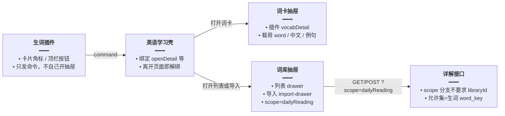

# 生词页接入单词解析

> **文档角色**：已落地实现（2026-11-16）。规划稿仍在 [ideas/english/生词接入单词解析.md](../ideas/english/生词接入单词解析.md)。
>
> **延伸阅读**：[生词按条件导出.md](./生词按条件导出.md)、[生词解析叠层.md](./生词解析叠层.md)、[单词详解列表.md](./单词详解列表.md)、[手动导入单词详解.md](./手动导入单词详解.md)

## 1. 背景与目标

生词页已经能收集单词，但不能打开词库里现成的单词解析、解析列表和手动导入。目标是不新做一套解析界面：生词插件通过篇目扩展点的命令，打开词库上已启用的三个插件；列表和导入用 `scope: 'dailyReading'`，允许的词从「某一本词库」换成「当前用户收集过的生词」。

## 2. 改动范围

- `apps/frontend/src/federation/points/catalog.ts`
- `apps/frontend/src/views/englishLearning/Layout.tsx`
- `apps/frontend/src/views/englishLearning/dailyReading/Words.tsx`
- `apps/backend/src/services/english-learning/english-learning.controller.ts`
- `apps/backend/src/services/english-learning/vocab-detail.service.ts`
- 插件仓 `micro-apps/dnhyxc-ai-plugins/src/views/daily-reading-words/index.tsx`（卡片角标、列表与导入按钮；本仓 diff 不含该文件）

播放按钮颜色从 `teal-600` 收到 `teal-500` 的几处样式改动与本功能无关，本文不收录。

## 3. 实现思路

生词插件拿不到主站的抽屉组件，只能 `command(名字)`。名字必须先写进篇目点的 `commands`，否则调用直接抛 `UNKNOWN_POINT_COMMAND`。实现绑在英语学习壳上，离开该壳就解绑。

列表和导入仍是词库插件，不复制一份。请求带 `scope=dailyReading` 时：

- 不再要求 `libraryId`，也不做词库归属校验。
- 允许集合是该用户 `english_daily_reading_word.word_key`。
- 列表是这些词和已有详解（手动、重新生成、全站缓存）的交集，Redis 键与词库列表分开，标签为 `src:dailyReading`。
- 导入提示词最多取最近 2000 条生词；不在生词里的词仍计入「不在生词里」，不写入。

词库原路径不带 `scope`，行为不变。



未选「复用词库插件、只换允许集」，而不是给生词再做一套解析页：界面、缓存和导入校验都已经在词库侧，换数据源比复制页面小。

## 4. 关键代码对比与注释

### 4.1 篇目点命令目录

**对比范围**：`hostPoints` 中 `POINT.dailyReadingArticle` 这一项。其余点未改。

**改动前** · `apps/frontend/src/federation/points/catalog.ts`（基线，约 L125–L132）

```typescript
// 每日阅读篇目点：生词插件的 surface 就挂在这里
[POINT.dailyReadingArticle]: {
	// 与键相同，命令查找用这个 id
	id: POINT.dailyReadingArticle,
	// 篇目点不画槽，按钮在插件自己的页面上
	slots: [],
	// 不向插件下发页面上下文
	contextKeys: [],
	// 没有要回写到外壳的信号
	signals: [],
	// 当时只有跳篇和朗读，解析入口还没登记
	commands: ['openReading', 'play', 'stop'],
},
```

**改动后** · `apps/frontend/src/federation/points/catalog.ts`（当前，约 L125–L141）

```typescript
// 每日阅读篇目点：生词插件的 surface 就挂在这里
[POINT.dailyReadingArticle]: {
	// 与键相同，命令查找用这个 id
	id: POINT.dailyReadingArticle,
	// 篇目点不画槽，按钮在插件自己的页面上
	slots: [],
	// 不向插件下发页面上下文
	contextKeys: [],
	// 没有要回写到外壳的信号
	signals: [],
	// 多出来的五个名字不写进目录，插件一调就会抛 UNKNOWN_POINT_COMMAND
	commands: [
		// 点来源标题回到那一篇
		'openReading',
		// 朗读单词或例句
		'play',
		// 停掉当前朗读
		'stop',
		// 三个解析插件是否启用，用来决定按钮显不显示
		'detailEntries',
		// 打开单词解析抽屉
		'openDetail',
		// 打开解析列表，范围是生词
		'openDetailList',
		// 打开导入抽屉，范围同样是生词
		'openDetailImport',
		// 按当前筛选导出 JSON 或 Word
		'exportWords',
	],
},
```

**变更摘要**：目录从 3 个命令扩到 8 个。绑定仍在 `Layout.tsx` 的 effect 里，离开英语学习时全部解绑。

### 4.2 列表接口按 scope 分流

**对比范围**：`EnglishLearningController.vocabDetailList` 全方法。导入列表、删除、写入和提示词是同一分支，见变更摘要。

**改动前** · `apps/backend/src/services/english-learning/english-learning.controller.ts`（基线，约 L1191–L1208）

```typescript
// 路由声明：当时没有 scope，生词页无法复用这条接口
@Get('vocab-detail/list')
async vocabDetailList(
	// 登录用户在守卫之后挂在 req.user
	@Req() req: AuthedRequest,
	// 词库页上下文里的库 id
	@Query('libraryId') libraryId?: string,
	// 上一页最后一条的游标，首页不传
	@Query('cursor') cursor?: string,
) {
	// 未登录不能看别人的详解
	const userId = req.user?.userId;
	// 没有用户 id 直接 401
	if (userId == null) throw new UnauthorizedException('未授权');
	// 生词页没有 libraryId，会在这里 400
	if (typeof libraryId !== 'string' || !libraryId.trim()) {
		throw new BadRequestException('libraryId');
	}
	// 空串不当游标，避免服务层把空串解析成非法位置
	return this.vocabDetailService.listForLibrary(
		userId,
		libraryId.trim(),
		typeof cursor === 'string' && cursor.length > 0 ? cursor : undefined,
	);
}
```

**改动后** · `apps/backend/src/services/english-learning/english-learning.controller.ts`（当前，约 L1191–L1213）

```typescript
// 详解列表：词库仍要 libraryId；生词页改走 scope，不再假装有一本库
@Get('vocab-detail/list')
async vocabDetailList(
	// 登录用户在守卫之后挂在 req.user
	@Req() req: AuthedRequest,
	// 词库路径才用；生词路径忽略它
	@Query('libraryId') libraryId?: string,
	// 上一页最后一条的游标，首页不传
	@Query('cursor') cursor?: string,
	// dailyReading 表示允许集是当前用户的生词，不是某一本词库
	@Query('scope') scope?: string,
) {
	// 未登录不能看别人的详解
	const userId = req.user?.userId;
	// 没有用户 id 直接 401
	if (userId == null) throw new UnauthorizedException('未授权');
	// 空串不当游标，避免服务层把空串解析成非法位置
	const pageCursor =
		typeof cursor === 'string' && cursor.length > 0 ? cursor : undefined;
	// 生词列表不校验 libraryId，避免生词页为了过校验去造一个假库
	if (scope === 'dailyReading') {
		return this.vocabDetailService.listForDailyReading(userId, pageCursor);
	}
	// 词库路径保持原样：没库 id 就 400
	if (typeof libraryId !== 'string' || !libraryId.trim()) {
		throw new BadRequestException('libraryId');
	}
	// 只查这一本库与已有详解的交集
	return this.vocabDetailService.listForLibrary(
		userId,
		libraryId.trim(),
		pageCursor,
	);
}
```

**变更摘要**：`GET vocab-detail/import`、`DELETE vocab-detail/import`、`POST vocab-detail/import`、`GET vocab-detail/prompt` 同样先看 `scope === 'dailyReading'`。导入允许集是 `word_key`，不在集合里的词仍计入跳过，不落 `english_vocab_detail_manual` 以外的新表。

### 4.3 生词详解列表（纯新增）

**改动前**：无此方法。列表只会 `listForLibrary`。

**改动后** · `apps/backend/src/services/english-learning/vocab-detail.service.ts`（当前，约 L522–L569）

```typescript
// 生词 word_key 与已有详解的交集。不读 libraryId，避免和词库缓存串键
async listForDailyReading(
	// 只看这个用户收集过的词
	userId: number,
	// 与词库列表相同的游标；首页为空
	cursor?: string,
): Promise<VocabDetailListPage> {
	// 游标格式不对会在这里抛，不把脏游标送进 Redis
	const parsed = readListCursor(cursor);
	// Redis 不可用时退回当场算交集，页面仍能翻，只是没有缓存
	const client = await this.lockClient();
	if (!client) {
		return pageMergedDetails(
			await this.buildDailyReadingDetailRows(userId),
			parsed,
		);
	}
	// 全站详解代际变了，词库和生词两套列表都要重建
	const epoch = String((await client.get(LIST_EPOCH_KEY)) ?? '0');
	// 生词列表用独立 ready 键，刷新词库列表不会误伤这里
	const ready = await client.get(readingReadyKey(userId));
	if (ready === epoch) {
		try {
			// 命中缓存时只续期，不重算交集
			await this.touchReadingKeys(client, userId);
			return await this.pageListZset(
				client,
				readingZsetKey(userId),
				readingHashKey(userId),
				parsed,
			);
		} catch (e) {
			// 分页读坏了就丢掉 ready，下一跳重建，避免一直返回半截
			this.logger.warn(
				`daily reading detail list page failed: ${
					e instanceof Error ? e.message.slice(0, 200) : String(e)
				}`,
			);
			await client.del(readingReadyKey(userId));
		}
	}
	// 未命中：word_key 与手动 / 重生成 / 全站缓存求交
	const rows = await this.buildReadingListOnce(userId);
	// 写入带 src:dailyReading 标签的 zset，和 lib:{libraryId} 分开
	await this.writeTagList(
		client,
		readingZsetKey(userId),
		readingHashKey(userId),
		readingReadyKey(userId),
		rows,
		epoch,
	);
	await this.touchReadingKeys(client, userId);
	return this.pageListZset(
		client,
		readingZsetKey(userId),
		readingHashKey(userId),
		parsed,
	);
}
```

新详解写入、`patchLemmaForUser` 和全站缓存生成之后会 `dropDailyReadingList`，只删该用户的 ready 键，不改词库那一套。

## 5. 兼容性与影响

- 不带 `scope` 的词库列表、导入、提示词与改前一致。
- 生词插件未启用，或三个解析插件未启用时，对应按钮不出现；命令未绑定会抛 `POINT_COMMAND_UNBOUND`。
- 离开英语学习会关掉布局上的抽屉。生词页自己挂的列表抽屉在页面卸载时，仅当载荷 `scope === 'dailyReading'` 才关闭，避免顺手关掉词库页的列表。

## 6. 回归建议

- 词库页打开解析列表、从列表进详情、导入本库 JSON，确认仍要 `libraryId`。
- 生词页启用三个插件后：卡片角标、列表、导入都能开；未启用时按钮消失。
- 导入一份不在生词里的词，应计入跳过，不能写入。

## 7. 相关源码路径

| 说明 | 路径 |
| --- | --- |
| 命令目录 | `apps/frontend/src/federation/points/catalog.ts` |
| 命令绑定 | `apps/frontend/src/views/englishLearning/Layout.tsx` |
| 生词页挂列表抽屉 | `apps/frontend/src/views/englishLearning/dailyReading/Words.tsx` |
| scope 分流 | `apps/backend/src/services/english-learning/english-learning.controller.ts` |
| 生词交集与缓存 | `apps/backend/src/services/english-learning/vocab-detail.service.ts` |

若与仓库最新源码不一致，以源码为准。
