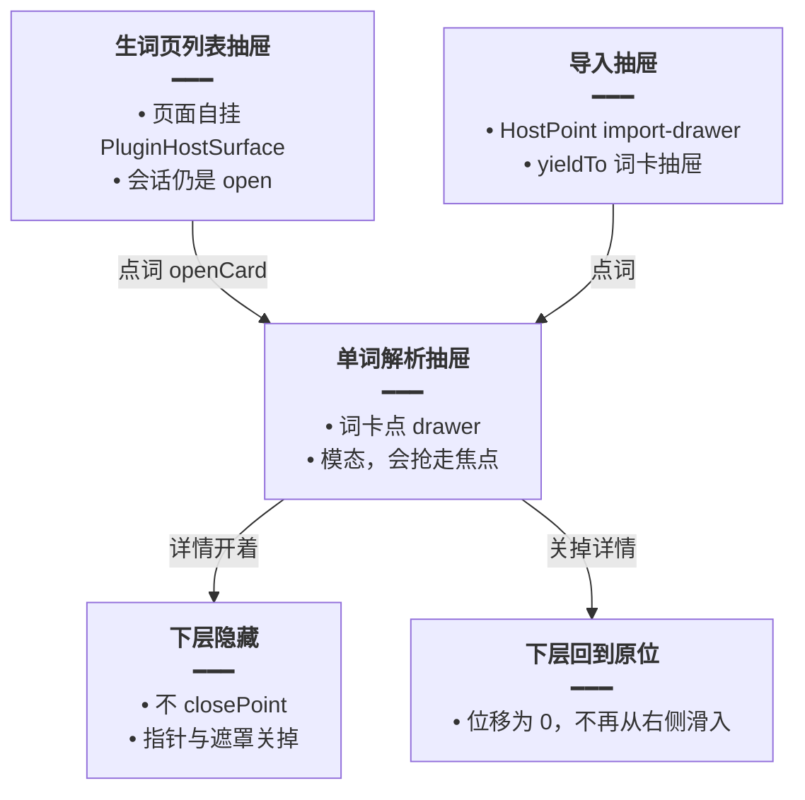

# 生词页解析抽屉只隐藏不关闭

> **文档角色**：已落地实现（2026-11-16）。
>
> **延伸阅读**：[生词接入解析.md](./生词接入解析.md)、[详解抽屉瞬时让位.md](./详解抽屉瞬时让位.md)

## 1. 背景与目标

在生词页从单词解析列表点进详情时，列表抽屉被关掉了。关掉详情之后，列表和详情都不在。导入抽屉同样会被详情打开时的焦点移走关掉。

词汇库的做法是：详情盖上来时，底下的列表和导入保持打开，只是看不见、点不到；关掉详情后回到原位，不重新滑入。生词页要对齐这个行为。

离开生词页时，插件卸载还会调用已经解绑的 `stop`，抛出 `POINT_COMMAND_UNBOUND` 并把路由打进错误页。这次一并收口。

## 2. 改动范围

- `apps/frontend/src/views/englishLearning/dailyReading/Words.tsx`
- `apps/frontend/src/federation/host/HostPoint.tsx`
- `apps/frontend/src/federation/host/PluginHostSurface.tsx`
- `apps/frontend/src/components/design/Drawer/index.tsx`
- 插件仓 `micro-apps/dnhyxc-ai-plugins/src/views/daily-reading-words/index.tsx` 卸载时的 `stop`

## 3. 实现思路

生词页的解析列表不是布局上的 `HostPoint`，而是页面自己画的 `PluginHostSurface`。词库页在详情打开时把这层标成收起（透明度 0、不接收指针），并拒绝这次关闭。生词页原来没有这层判断，模态的详情抽屉一拿到焦点，列表的 `onOpenChange(false)` 就会 `closePoint`。

关闭事件可能发生在 React 还没把「详情已打开」写进渲染结果之前，所以不能只看上一次渲染的布尔值。列表用函数在事件当刻读词卡槽；导入抽屉读 `yieldTo` 指向的词卡槽。两者都拦住点击外部和焦点被抢走。

`stop` 的绑定在英语学习壳卸载时拆掉，插件清理可能跑在拆掉之后。朗读已经由壳在路由变化时停下，这次调用失败可以忽略。



## 4. 关键代码对比与注释

### 4.1 生词页列表在详情打开时不关

**对比范围**：`DailyReadingWordsPage` 里决定列表是否收起的状态，以及抽屉上的关闭拦截。组件其余 JSX 用省略，两侧切口相同。

**改动前** · `apps/frontend/src/views/englishLearning/dailyReading/Words.tsx`（基线，全文件）

```tsx
// 生词页当时只挂插件页，没有词库抽屉，详情无从盖住列表
import { PluginHostPage } from '@/federation';

export default function DailyReadingWordsPage() {
	return (
		<PluginHostPage
			// 生词插件 id，页面内容由插件自己画
			pluginId="dailyReadingWords"
			// 占满英语学习壳里的页面区
			pageShell
			// 高度交给壳，避免列表自己再长出滚动条
			className="h-full min-h-0"
		/>
	);
}
```

**改动后** · 同文件（当前，全文件）

```tsx
// 收起样式要用 CSS 变量，React 默认类型里没有这项
import {
	// 收起后的进入位移写在 CSS 变量上，默认样式类型没有这项
	type CSSProperties,
	// 锁滚动、同步槽位、离开页面时关闭抽屉
	useEffect,
	// 列表插件 id 与「回来时不再滑入」
	useState,
	// 词卡抽屉变化时重渲染，不能只在点击时读一次
	useSyncExternalStore,
} from 'react';
// 列表抽屉挂在词库点上，开关和宽度都走联邦会话
import {
	// 用户真正关掉列表时清会话
	closePoint,
	// 生词插件页
	PluginHostPage,
	// 词库列表抽屉的宿主表面
	PluginHostSurface,
	// 词库点与词卡点
	POINT,
	// 与词库抽屉同一宽度
	pointDrawerWidth,
	// 事件当刻读槽，不等这次渲染
	readSlot,
	// 槽位变化时通知页面
	subscribeSlot,
} from '@/federation';

// 只关自己打开的生词范围抽屉，避免离开页面时关掉词库页的列表
function readingScope(slot: string): boolean {
	return readSlot(POINT.vocabLibrary, slot).payload?.scope === 'dailyReading';
}

// 详情是否正盖在列表上。事件当刻读槽，不看上一帧的 React 状态
function detailCoveringList(): boolean {
	const card = readSlot(POINT.vocabCard, 'drawer');
	// covered 为真表示列表自己盖住了词卡，那时列表应保持可见
	return card.open && !card.covered;
}

export default function DailyReadingWordsPage() {
	// 当前打开的是列表插件 id；null 表示抽屉关着
	const [openPluginId, setOpenPluginId] = useState<string | null>(null);
	// 详情关掉后列表还在 open，不能再从右侧滑入一次
	const [listStill, setListStill] = useState(false);
	// 订阅词卡抽屉，详情开关变化时重渲染收起样式
	const detail = useSyncExternalStore(
		(listener) => subscribeSlot(POINT.vocabCard, 'drawer', listener),
		() => readSlot(POINT.vocabCard, 'drawer'),
		() => readSlot(POINT.vocabCard, 'drawer'),
	);
	// 与 detailCoveringList 同一条件，供渲染用
	const detailOpen = detail.open && !detail.covered;
	// 列表开着且详情露在上面，才把列表藏起来
	const tucked = Boolean(openPluginId && detailOpen);

	useEffect(() => {
		// 一旦收起过，回来时位移写成 0
		if (tucked) setListStill(true);
		// 只在「被详情盖住」这一拍记下，避免每次渲染都写
	}, [tucked]);

	useEffect(() => {
		// 抽屉关着不改 body，避免影响词库页
		if (!openPluginId) return;
		const prev = document.body.style.overflow;
		// 非模态抽屉不会自己锁滚动，页面和抽屉会一起滚
		document.body.style.overflow = 'hidden';
		return () => {
			document.body.style.overflow = prev;
		};
		// 列表关掉就恢复，不把锁留到词库页
	}, [openPluginId]);

	useEffect(() => {
		const sync = () => {
			const slot = readSlot(POINT.vocabLibrary, 'drawer');
			// 只认生词范围的打开，词库页打开的列表不要画到生词页上
			setOpenPluginId(
				slot.open && slot.payload?.scope === 'dailyReading'
					? slot.pluginId
					: null,
			);
		};
		sync();
		return subscribeSlot(POINT.vocabLibrary, 'drawer', sync);
		// 挂上就订一次，插件 id 变化走订阅，不靠重跑 effect
	}, []);

	useEffect(() => {
		return () => {
			// 只关生词自己打开的列表，词库页的列表会话留着
			if (readingScope('drawer')) closePoint(POINT.vocabLibrary, 'drawer');
			if (readingScope('import-drawer')) {
				closePoint(POINT.vocabLibrary, 'import-drawer');
			}
		};
		// 页面卸载才关，不跟列表开关重跑
	}, []);

	// 插件页和列表抽屉叠在同一页，列表不是布局上的 HostPoint
	return (
		<>
			<PluginHostPage
				pluginId="dailyReadingWords"
				pageShell
				className="h-full min-h-0"
			/>
			<PluginHostSurface
				surface={POINT.vocabLibrary}
				part="drawer"
				openPluginId={openPluginId}
				onOpenPluginIdChange={(id) => {
					if (!id) {
						// 详情还开着就当这次关闭没发生
						if (detailCoveringList()) return;
						setListStill(false);
						closePoint(POINT.vocabLibrary, 'drawer');
					}
				}}
				filterPlugins={(list) =>
					// 这个表面只渲染解析列表，避免词库其它抽屉插件被挂进来
					list.filter((plugin) => plugin.id === 'vocabDetailList')
				}
				chromeStyle={
					tucked
						? {
								// 藏起来的同一帧不能再播进入动画
								animation: 'none',
								transition: 'none',
								// 看不见，但会话仍是打开
								opacity: 0,
								visibility: 'hidden',
							}
						: listStill
							? ({
									// 收回来时位移为 0，避免从右侧再滑入一次
									'--tw-enter-translate-x': '0px',
									opacity: 1,
									transition: 'none',
								} as CSSProperties)
							: undefined
				}
				drawerBodyClassName="overflow-hidden p-0"
				drawerWidth={pointDrawerWidth}
				drawerModal={false}
				drawerPlainOverlay
				drawerOverlayClassName={
					tucked ? 'pointer-events-none opacity-0' : undefined
				}
				drawerPreventDismiss={detailCoveringList}
				drawerClassName={tucked ? 'pointer-events-none' : undefined}
				onDrawerInteractOutside={(event) => {
					if (detailCoveringList()) event.preventDefault();
				}}
			/>
		</>
	);
}
```

**变更摘要**：基线只有插件页。现在同一页再挂解析列表抽屉；详情盖住时不 `closePoint`，并用透明度藏起来。

`tucked` 为真时面板 `opacity: 0`、`visibility: hidden`。`listStill` 在收起过后把进入位移写成 0。

### 4.2 导入抽屉在事件当刻再读词卡槽

**对比范围**：`HostPoint` 里判断「要不要让位」的几行，以及传给 `Drawer` 的外部点击 / 关闭。函数其余部分未改，两侧省略。

**改动前** · `apps/frontend/src/federation/host/HostPoint.tsx`（基线，约 L92 与抽屉回调）

```typescript
// 只看本次渲染时的 yielded。焦点被抢走若发生在重渲染之前，导入会被当成用户关闭
const yielded = Boolean(yieldTo && upper.open && !upper.covered);
// ...
onInteractOutside={(event) => {
	if (yielded) event.preventDefault();
}}
onOpenChange={(next) => {
	if (!next) {
		if (yielded) return;
		// ... 清门户声明并 closePoint
	}
}}
```

**改动后** · 同文件（当前，约 L92–L102、约 L270–L282）

```typescript
// 渲染用的让位标记，驱动透明和 pointer-events
const yielded = Boolean(yieldTo && upper.open && !upper.covered);
// 关闭回调可能闭包着旧的 yielded，所以再读一次槽
const upperOpen = () => {
	if (!yieldTo) return false;
	const live = readSlot(yieldTo.point, yieldTo.slot);
	return live.open && !live.covered;
};
// 详情开着就拦住这次交互。没有 event 时只表示「不要关」
const keepUnderDetail = (event?: Event) => {
	if (!yielded && !upperOpen()) return false;
	event?.preventDefault();
	return true;
};
// ...
onInteractOutside={keepUnderDetail}
onFocusOutside={keepUnderDetail}
onOpenChange={(next) => {
	if (!next) {
		if (keepUnderDetail()) return;
		// ... 清门户声明并 closePoint
	}
}}
```

`Drawer` 增加 `onFocusOutside`，原样交给 Sheet。只拦点击外部不够：模态详情打开时抢走的是焦点。

`PluginHostSurface` 的 `drawerPreventDismiss` 改为 `boolean | (() => boolean)`，在 `onOpenChange(false)` 时调用。生词页传入 `detailCoveringList`，避免用上一帧的布尔值放行关闭。

### 4.3 卸载时 stop 已解绑（插件）

**改动前** · 插件 `src/views/daily-reading-words/index.tsx`

```typescript
useEffect(() => {
	return () => {
		playRun.current += 1;
		// 壳已经解绑时，这里抛 POINT_COMMAND_UNBOUND，路由错误页接住
		point?.command('stop', undefined);
	};
}, [point]);
```

**改动后**

```typescript
useEffect(() => {
	return () => {
		playRun.current += 1;
		// 离开英语学习时命令已解绑，朗读由壳的路由 effect 停下
		try {
			point?.command('stop', undefined);
		} catch {
			/* unbound */
		}
	};
}, [point]);
```

## 5. 兼容性与影响

- 词库页列表本来就会在详情打开时收起，`drawerPreventDismiss` 仍可传布尔值。
- 从生词卡片角标打开详情不带「先开着的列表」时，没有下层要藏。
- 用户自己点列表关闭，且详情没开，仍然 `closePoint`。

## 6. 回归建议

- 生词页打开解析列表，点一个词：列表看不见但会话还在；关掉详情后列表回到原位，不从右侧再滑入。
- 导入抽屉里点一个已导入的词，同样隐藏；关掉详情后导入还在。
- 从生词页离开英语学习，不再出现 `POINT_COMMAND_UNBOUND` 错误页。
- 词库页从列表进详情、再关闭，仍回到列表。

## 7. 相关源码路径

| 说明 | 路径 |
| --- | --- |
| 生词页收起列表 | `apps/frontend/src/views/englishLearning/dailyReading/Words.tsx` |
| 导入让位 | `apps/frontend/src/federation/host/HostPoint.tsx` |
| 关闭拦截可传函数 | `apps/frontend/src/federation/host/PluginHostSurface.tsx` |
| 焦点离开 | `apps/frontend/src/components/design/Drawer/index.tsx` |

若与仓库最新源码不一致，以源码为准。
