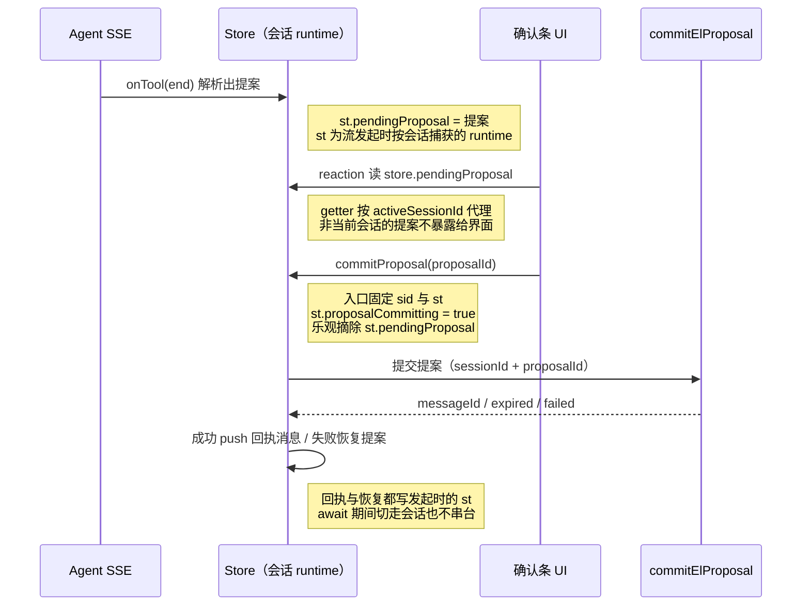

# 确认条按会话隔离（pendingProposal per-session）

延伸阅读：

- [英语Agent领域工具.md](./英语Agent领域工具.md)——`el_*` 工具与提案确认链路
- [筛选卡续答与整类收藏.md](./筛选卡续答与整类收藏.md)——整类收藏提案是确认条的主要来源

## 1. 背景与目标

英语 Agent 的收藏 / 错题确认条（`pendingProposal`，来自 `el_*` 工具输出的 `ui.confirm_proposal`）原先挂在 `EnglishAgentStore` 的**全局实例字段**上：全应用同一时刻只有一份待确认提案、一个提交中标记。多会话并存时产生两类串扰：

1. **确认条串台**：A 会话流式中解析出提案写入全局字段后，用户切到 B 会话，界面上仍显示 A 的确认条；在 B 会话点确认，提交的是 A 的提案。
2. **提交中互相阻塞**：`proposalCommitting` 全局唯一，A 会话提交中会连带禁用 B 会话确认条的按钮。

本轮把 `pendingProposal` / `proposalCommitting` 下沉到每个会话的 `EnglishSessionRuntime`：切走会话后界面只读当前会话的确认条；确认回执与失败恢复都落在发起时的会话上。

## 2. 改动范围

- `apps/frontend/src/store/englishAgent.ts`：新增 `ElPendingProposal` 导出类型；`EnglishSessionRuntime` 增加两个确认条字段；新增 `blankSessionRuntime()` 工厂；删除 store 全局字段、改为 getter 代理读当前会话 runtime；`ensureSessionState` 收敛到工厂；`clearPendingProposal` / `commitProposal` / SSE `onTool` 改为操作会话级 state。
- `apps/frontend/src/views/englishLearning/agent/useEnglishAgentSignals.ts`：import 追加 `ElPendingProposal` 类型；`useEnglishAgentPendingProposal` 返回类型由内联结构改为该导出类型。

## 3. 实现思路

核心决策：

1. **状态归属下移**：确认条是「某次会话里某条助手消息附带工具输出」的产物，天然属于会话。`EnglishSessionRuntime` 增加 `pendingProposal` / `proposalCommitting` 两字段，默认值集中在新增的 `blankSessionRuntime()` 工厂（顺带收敛了 `ensureSessionState` 里两处重复的内联字面量，今后 runtime 再加字段只改工厂一处）。
2. **对外读取路径不变**：store 保留同名 `pendingProposal` / `proposalCommitting`，但从字段改为 getter，按 `activeSessionId` 代理读当前展示会话的 runtime。getter 经 `makeAutoObservable` 成为 MobX computed，`useEnglishAgentSignals` 的 `reaction` 订阅照常触发，确认条组件与 hook 签名零改动。替代方案是让每个消费方自己按 sessionId 读 `stateBySession`，那会把「当前展示会话」这层语义散到各组件；getter 代理把它收敛在 store 一处。
3. **提交全程锚定发起会话**：`commitProposal` 入口先取 `sid` 并 `ensureSessionState(sid)` 固定到局部变量 `st`，随后守卫、摘条、HTTP 提交、回执 push、失败恢复、复位提交中标记全部读写这个 `st`。`await` 期间用户切走会话也不影响：回执消息必然追加到发起会话的消息列表，失败恢复的也是发起会话的确认条。
4. **SSE 写入归属流发起会话**：`onTool` 回调里的 `st` 本来就是 `sendMessage` 发起流时按会话捕获的 runtime（用于消息 patch 与工具足迹），提案解析结果从写全局字段改为写这个 `st`，一行之差即完成归属修正。

### 3.1 store 结构对比（改前全局字段 vs 改后 per-session）

```mermaid
flowchart TB
  subgraph Legend["图例"]
    L1["矩形：状态持有位置<br/>🆕：本轮新增或大改<br/>虚线：getter 代理读取"]
  end
  subgraph Before["改动前：全局字段"]
    StoreB["<b>EnglishAgentStore</b><br/>━━━<br/>• pendingProposal 全局唯一一份<br/>• proposalCommitting 全局唯一一份"]
    SessB["<b>stateBySession[sid]</b><br/>━━━<br/>• messages / isSending / toolTrail 等<br/>• 无确认条字段"]
    UIB["<b>确认条 UI</b><br/>━━━<br/>• useEnglishAgentPendingProposal<br/>• 读全局字段"]
    UIB -- "直接读全局字段<br/>切会话后仍看到旧提案" --> StoreB
    StoreB -. "确认条与会话无关<br/>任何会话都读同一份" .-> SessB
  end
  subgraph After["改动后：per-session runtime 🆕"]
    StoreA["<b>EnglishAgentStore</b><br/>━━━<br/>• get pendingProposal() 🆕<br/>• get proposalCommitting() 🆕<br/>• 按 activeSessionId 代理"]
    SessA["<b>stateBySession[sid] 🆕</b><br/>━━━<br/>• pendingProposal / proposalCommitting<br/>• blankSessionRuntime() 默认 null / false"]
    UIA["<b>确认条 UI</b><br/>━━━<br/>• hook 签名不变<br/>• 返回类型改用 ElPendingProposal"]
    UIA -- "仍读 store.pendingProposal<br/>调用方零改动" --> StoreA
    StoreA -. "getter 按 activeSessionId<br/>只暴露当前会话 runtime" .-> SessA
  end
```



**读图要点**：本轮只改状态持有位置与读取代理，不改 UI 消费方式；改前「全局一份」导致跨会话串台，改后每个会话 runtime 各持一份，getter 决定界面只能看到当前展示会话的确认条。

### 3.2 确认链路时序（改动后）



**读图要点**：提案的「写入 — 展示 — 提交 — 回执」全链路都挂在同一个会话 runtime 上；getter 是唯一切面，负责把「当前展示会话」的提案挑给界面。

## 4. 关键实现（改动前 / 改动后对比 + 注释）

### 4.1 `ElPendingProposal` 类型、`EnglishSessionRuntime` 扩展与 `blankSessionRuntime()` 工厂

**对比范围**：`apps/frontend/src/store/englishAgent.ts` 中 `EnglishSessionRuntime` 类型定义，及本轮在其上方新增的 `ElPendingProposal` 与 `blankSessionRuntime()`。

**改动前** · `apps/frontend/src/store/englishAgent.ts`（基线 `git show HEAD`，约 L166–L173）

```typescript
// 基线的单会话运行态：只覆盖消息/发送/加载/流句柄/工具足迹，确认条不在会话级
/** 单会话运行态（消息、发送、流式句柄、已调用的 Skill / 工具） */
export type EnglishSessionRuntime = {
	// 该会话的消息列表，切会话时整包替换展示
	messages: Message[];
	// 该会话是否有发送/流式在进行，驱动输入框禁用与流式标记
	isSending: boolean;
	// 该会话历史消息是否正在拉取，驱动骨架屏
	isHistoryLoading: boolean;
	// 该会话 SSE 的中止句柄；停止按钮按会话取
	abortStream: (() => void) | null;
	// 该会话已调用的 Skill / 工具 chip 列表，渲染工具足迹条
	toolTrail: AgentToolChip[];
};
```

**改动后** · `apps/frontend/src/store/englishAgent.ts`（当前源码，约 L166–L196）

```typescript
// 新增导出类型：提案结构从 store 字段的内联类型抽成具名类型，供 signals hook 复用，单一事实源
/** 待确认提案（来自 el_* 工具 ui.confirm_proposal） */
export type ElPendingProposal = {
	// 服务端提案 id，点确认时随 commitElProposal 回传
	proposalId: string;
	// 确认条上展示的文案（如「收藏 12 个单词」）
	label: string;
	// 发起提案的 el_* 工具名，仅作展示/埋点用途，可空
	tool?: string;
};

// 类型注释同步补「确认条」，声明确认条已归入会话级运行态
/** 单会话运行态（消息、发送、流式句柄、已调用的 Skill / 工具、确认条） */
export type EnglishSessionRuntime = {
	// 该会话的消息列表，切会话时整包替换展示
	messages: Message[];
	// 该会话是否有发送/流式在进行，驱动输入框禁用与流式标记
	isSending: boolean;
	// 该会话历史消息是否正在拉取，驱动骨架屏
	isHistoryLoading: boolean;
	// 该会话 SSE 的中止句柄；停止按钮按会话取
	abortStream: (() => void) | null;
	// 该会话已调用的 Skill / 工具 chip 列表，渲染工具足迹条
	toolTrail: AgentToolChip[];
	// 见下行源码注释；本轮从 store 全局下沉到会话级，切走后界面不再展示其它会话的确认条
	/** 只属于本会话；切走后界面读当前会话，不展示其它会话的确认条 */
	pendingProposal: ElPendingProposal | null;
	// 见下行源码注释；同样按会话隔离，A 会话提交中不挡 B 会话的确认按钮
	/** 本会话确认条提交中，避免连点 */
	proposalCommitting: boolean;
};

// 新增工厂：集中给出 runtime 默认值，把 ensureSessionState 两处内联字面量收敛到一处，runtime 再加字段只改这里
function blankSessionRuntime(): EnglishSessionRuntime {
	// 返回全新空白运行态；每次调用新建对象，避免多会话共享同一引用互相污染
	return {
		// 消息列表默认空数组
		messages: [],
		// 发送态默认空闲
		isSending: false,
		// 历史加载态默认空闲
		isHistoryLoading: false,
		// 尚无 SSE 句柄
		abortStream: null,
		// 工具足迹默认空
		toolTrail: [],
		// 新会话默认无待确认提案
		pendingProposal: null,
		// 新会话默认不在提交中
		proposalCommitting: false,
	};
}
```

**变更摘要**：新增 `ElPendingProposal` 导出类型作为提案结构的单一事实源；`EnglishSessionRuntime` 增加 `pendingProposal` / `proposalCommitting` 两字段；新增 `blankSessionRuntime()` 工厂统一默认值。

### 4.2 store 全局字段删除与 getter 代理

**对比范围**：`apps/frontend/src/store/englishAgent.ts` 中 `EnglishAgentStore` 的字段区与 getter 区（类体很大，两侧对称摘录，未改成员用 `// ...` 省略）。

**改动前** · `apps/frontend/src/store/englishAgent.ts`（基线，约 L196–L201，类字段区摘录）

```typescript
// 基线摘录：确认条相关是 store 全局实例字段（此处只摘录字段区，其余成员略）
export class EnglishAgentStore {
	// 上方 activeSessionId / stateBySession / streamingSessionId 等字段与现版一致，未改动，略
	// ...
	// 见下行源码注释；全局唯一一份，A 会话产生的提案切到 B 会话仍挂在界面上
	/** M2：待确认的领域提案（来自 el_* 工具 ui.confirm_proposal） */
	pendingProposal: { proposalId: string; label: string; tool?: string } | null =
		// 上一行类型折行后的默认值：初始无待确认提案
		null;
	// 见下行源码注释；全局唯一提交中标记，A 会话提交中会连带禁用 B 会话的确认按钮
	/** 确认条 HTTP 提交中，避免连点 */
	proposalCommitting = false;
	// 下方 domainMutationTick 等后续字段与现版一致，未改动，略
	// ...
}
```

**改动后** · `apps/frontend/src/store/englishAgent.ts`（当前源码，约 L277–L288，getter 区摘录）

```typescript
// 现版摘录：字段区那两行已删除，此处改为同名 getter 代理读当前会话 runtime（其余成员略）
export class EnglishAgentStore {
	// 上方字段区中 pendingProposal / proposalCommitting 两行已删除，其余字段与基线一致，略
	// ...
	// 新增 getter：对外保留同名读取入口，UI hook 与组件零改动；makeAutoObservable 使其成为 computed，reaction 订阅照常
	/** 当前展示会话的确认条；其它会话的提案留在各自 runtime 上 */
	get pendingProposal(): ElPendingProposal | null {
		// 取当前展示会话 id，作为读取 runtime 的键
		const sid = this.activeSessionId;
		// 无展示会话（未选人时）视为无确认条
		if (!sid) return null;
		// 读该会话 runtime 上的提案；会话还没建 runtime 时兜底 null
		return this.stateBySession[sid]?.pendingProposal ?? null;
	}

	// 新增 getter：提交中标记同样代理到当前会话，A 会话提交中不再影响 B 会话按钮态
	get proposalCommitting(): boolean {
		// 取当前展示会话 id，作为读取 runtime 的键
		const sid = this.activeSessionId;
		// 无展示会话时视为不在提交中
		if (!sid) return false;
		// 读该会话 runtime 的提交中标记；无 runtime 兜底 false
		return Boolean(this.stateBySession[sid]?.proposalCommitting);
	}
	// 下方 isEnglishSessionSwitcherLocked 等成员与基线一致，未改动，略
	// ...
}
```

**变更摘要**：`pendingProposal` / `proposalCommitting` 由可写字段变为只读 getter，读取语义从「全局一份」变为「当前展示会话一份」；外部读取方代码不变，但不再存在外部写入入口（写入全部收口到 store 内部方法）。

### 4.3 `ensureSessionState` 收敛到 `blankSessionRuntime()`

**对比范围**：`apps/frontend/src/store/englishAgent.ts` 中 `ensureSessionState` 全函数。

**改动前** · `apps/frontend/src/store/englishAgent.ts`（基线，约 L273–L294）

```typescript
// 基线：按会话取 runtime，没有就建；空 id 返回一次性临时 runtime 供防御性读写
ensureSessionState(sid: string): EnglishSessionRuntime {
	// 入参去空白，防空字符串键污染 stateBySession
	const id = (sid ?? '').trim();
	// 空 id 走旁支：返回一次性空 runtime（不挂到 stateBySession）
	if (!id) {
		// 返回内联字面量空 runtime；基线的 runtime 还没有确认条字段，无需给出
		return {
			// 消息列表空
			messages: [],
			// 发送态空闲
			isSending: false,
			// 历史加载态空闲
			isHistoryLoading: false,
			// 无流句柄
			abortStream: null,
			// 工具足迹空
			toolTrail: [],
		};
	}
	// 该会话尚无 runtime 时就地创建
	if (!this.stateBySession[id]) {
		// 同样内联字面量；与上面旁支是第二处重复，新增字段要改两处（本轮收敛为工厂）
		this.stateBySession[id] = {
			// 消息列表空
			messages: [],
			// 发送态空闲
			isSending: false,
			// 历史加载态空闲
			isHistoryLoading: false,
			// 无流句柄
			abortStream: null,
			// 工具足迹空
			toolTrail: [],
		};
	}
	// 返回该会话的 runtime（上面已保证存在）
	return this.stateBySession[id]!;
}
```

**改动后** · `apps/frontend/src/store/englishAgent.ts`（当前源码，约 L306–L313）

```typescript
// 现版：两处内联字面量收敛为 blankSessionRuntime()，确认条默认值由工厂统一给出
ensureSessionState(sid: string): EnglishSessionRuntime {
	// 入参去空白，防空字符串键污染 stateBySession
	const id = (sid ?? '').trim();
	// 空 id 旁支改走工厂：返回的一次性 runtime 同样带齐确认条两个新字段
	if (!id) return blankSessionRuntime();
	// 该会话尚无 runtime 时就地创建
	if (!this.stateBySession[id]) {
		// 建厂 runtime 并挂到会话键上；pendingProposal / proposalCommitting 由工厂给默认值
		this.stateBySession[id] = blankSessionRuntime();
	}
	// 返回该会话的 runtime（上面已保证存在）
	return this.stateBySession[id]!;
}
```

**变更摘要**：逻辑不变，两处字面量替换为工厂调用；新字段默认值只在 `blankSessionRuntime()` 维护。

### 4.4 `clearPendingProposal` 与 `commitProposal` 会话级化

**对比范围**：`apps/frontend/src/store/englishAgent.ts` 中 `clearPendingProposal` 与 `commitProposal` 两个完整方法。

**改动前** · `apps/frontend/src/store/englishAgent.ts`（基线，约 L623–L685）

```typescript
// 基线：直接清全局字段；任何会话触发的清空都会抹掉全局唯一的确认条
clearPendingProposal(): void {
	// 全局置空，不区分提案属于哪个会话
	this.pendingProposal = null;
}

// 见下行源码注释；全程读写全局字段，回执落点才临时按 sid 取 runtime
/** 点确认：直提交提案，只追加助手回执 */
async commitProposal(proposalId: string): Promise<void> {
	// 读全局待确认提案；若用户切过会话，读到的可能是别的会话留下的提案
	const pending = this.pendingProposal;
	// 取当前展示会话 id 作为提交参数
	const sid = this.activeSessionId;
	// 守卫：无会话 / 无提案 / 提案 id 不匹配 / 全局提交中，一律拒绝
	if (
		// 未选中会话不能提交
		!sid ||
		// 没有待确认提案
		!pending ||
		// 防过期按钮重复点击：提案 id 必须与传入一致
		pending.proposalId !== proposalId ||
		// 全局提交中标记：A 会话提交中会挡住所有会话的确认按钮
		this.proposalCommitting
	) {
		// 命中守卫直接返回，不发请求
		return;
	}
	// 全局置提交中，禁用确认按钮
	this.proposalCommitting = true;
	// 乐观摘条：先清掉全局确认条，失败再恢复
	this.pendingProposal = null;
	// 进入提交主流程
	try {
		// 调后端提交接口，带当前会话 id 与界面语言
		const res = await commitElProposal({
			// 提交归属会话
			sessionId: sid,
			// 待提交提案 id
			proposalId,
			// 回执文案语言跟随界面
			lang: getActiveLocale(),
		});
		// HTTP 成功但业务失败（无 messageId）走失败分支
		if (!res.success || !res.data?.messageId) {
			// 取业务错误码，区分提案过期与其它失败
			const code = (res.data as { code?: string } | undefined)?.code;
			// 非过期失败才恢复确认条；过期提案恢复出来也无法再提交
			if (code !== 'expired') {
				// MobX 严格模式下异步回调里改状态须包 action
				runInAction(() => {
					// 把摘掉的提案挂回全局字段；若此时用户已在别的会话，确认条会出现在错误会话上
					this.pendingProposal = pending;
				});
			}
			// 弹失败提示，文案按错误码区分过期 / 一般失败
			Toast({
				// 警示级别提示
				type: 'warning',
				// 按错误码取 i18n 文案
				title: translateSync(
					// 判断是否为过期错误码
					code === 'expired'
						// 过期文案
						? 'englishLearning.proposal.expired'
						// 一般失败文案
						: 'englishLearning.proposal.failed',
				),
			});
			// 失败路径到此结束
			return;
		}
		// 成功：取响应数据
		const data = res.data;
		// 由响应数据拼回执文案（成功 N 条 / 失败 M 条 / 截断提示）
		const content = proposalReceiptText(data);
		// action 内追加回执消息
		runInAction(() => {
			// 基线到这里才按 sid 取会话 runtime：回执消息追加到发起时捕获的会话
			const st = this.ensureSessionState(sid);
			// 追加一条助手回执消息，让用户看到提交结果
			st.messages.push({
				// 用服务端 messageId 作 chatId，便于去重
				chatId: data.messageId,
				// 助手角色气泡
				role: 'assistant',
				// 回执文案
				content,
				// 发送时间取当前时刻
				timestamp: new Date(),
			});
			// 记录领域写变更，驱动左侧列表 / 侧栏刷新
			this.noteDomainMutation(data.domain);
		});
	// 网络异常路径
	} catch {
		// action 内尝试恢复确认条
		runInAction(() => {
			// 仅当全局确认条仍为空才恢复，避免覆盖更新后的状态
			if (!this.pendingProposal) this.pendingProposal = pending;
		});
	// 无论成败都要复位提交中标记
	} finally {
		// action 内复位
		runInAction(() => {
			// 复位全局提交中标记，允许下一次确认
			this.proposalCommitting = false;
		});
	}
}
```

**改动后** · `apps/frontend/src/store/englishAgent.ts`（当前源码，约 L642–L707）

```typescript
// 现版：清的是当前展示会话 runtime 上的提案，不再碰全局
clearPendingProposal(): void {
	// 取当前展示会话 id
	const sid = this.activeSessionId;
	// 无展示会话时没有可清的对象
	if (!sid) return;
	// 直读该会话 runtime；不调用 ensureSessionState，避免为「清空」凭空建 runtime
	const st = this.stateBySession[sid];
	// runtime 存在才清；提案本就只属于发起会话
	if (st) st.pendingProposal = null;
}

// 见下行源码注释；入口固定发起会话的 runtime，回执与失败恢复都落在该会话上
/** 点确认：直提交提案，只追加助手回执；回执与失败恢复都落在发起时的会话上 */
async commitProposal(proposalId: string): Promise<void> {
	// 先取当前展示会话 id；整个提交期间以它为归属，await 期间切走会话也不影响下面的 st
	const sid = this.activeSessionId;
	// 无展示会话直接拒绝
	if (!sid) return;
	// 取发起会话的 runtime 并固定到局部变量 st：后续守卫、摘条、回执、恢复全部读写它
	const st = this.ensureSessionState(sid);
	// 从会话级 runtime 读待确认提案，不会读到其它会话的提案
	const pending = st.pendingProposal;
	// 守卫：无提案 / 提案 id 不匹配 / 本会话提交中，一律拒绝
	if (
		// 没有待确认提案
		!pending ||
		// 防过期按钮重复点击：提案 id 必须与传入一致
		pending.proposalId !== proposalId ||
		// 本会话提交中标记：只挡本会话连点，不影响其它会话
		st.proposalCommitting
	) {
		// 命中守卫直接返回，不发请求
		return;
	}
	// 本会话置提交中，禁用本会话确认按钮
	st.proposalCommitting = true;
	// 乐观摘条：先清掉本会话确认条，失败再恢复
	st.pendingProposal = null;
	// 进入提交主流程
	try {
		// 调后端提交接口，带发起会话 id 与界面语言
		const res = await commitElProposal({
			// 提交归属会话
			sessionId: sid,
			// 待提交提案 id
			proposalId,
			// 回执文案语言跟随界面
			lang: getActiveLocale(),
		});
		// HTTP 成功但业务失败（无 messageId）走失败分支
		if (!res.success || !res.data?.messageId) {
			// 取业务错误码，区分提案过期与其它失败
			const code = (res.data as { code?: string } | undefined)?.code;
			// 非过期失败才恢复确认条；过期提案恢复出来也无法再提交
			if (code !== 'expired') {
				// MobX 严格模式下异步回调里改状态须包 action
				runInAction(() => {
					// 把摘掉的提案挂回发起会话的 runtime；用户即使在别的会话，恢复的也是原会话的确认条
					st.pendingProposal = pending;
				});
			}
			// 弹失败提示，文案按错误码区分过期 / 一般失败
			Toast({
				// 警示级别提示
				type: 'warning',
				// 按错误码取 i18n 文案
				title: translateSync(
					// 判断是否为过期错误码
					code === 'expired'
						// 过期文案
						? 'englishLearning.proposal.expired'
						// 一般失败文案
						: 'englishLearning.proposal.failed',
				),
			});
			// 失败路径到此结束
			return;
		}
		// 成功：取响应数据
		const data = res.data;
		// 由响应数据拼回执文案（成功 N 条 / 失败 M 条 / 截断提示）
		const content = proposalReceiptText(data);
		// action 内追加回执消息
		runInAction(() => {
			// 基线在此重新 ensureSessionState(sid)；现版直接复用顶部固定的 st，回执必然落回发起会话
			st.messages.push({
				// 用服务端 messageId 作 chatId，便于去重
				chatId: data.messageId,
				// 助手角色气泡
				role: 'assistant',
				// 回执文案
				content,
				// 发送时间取当前时刻
				timestamp: new Date(),
			});
			// 记录领域写变更，驱动左侧列表 / 侧栏刷新
			this.noteDomainMutation(data.domain);
		});
	// 网络异常路径
	} catch {
		// action 内尝试恢复确认条
		runInAction(() => {
			// 仅当本会话确认条仍为空才恢复，避免覆盖更新后的状态
			if (!st.pendingProposal) st.pendingProposal = pending;
		});
	// 无论成败都要复位提交中标记
	} finally {
		// action 内复位
		runInAction(() => {
			// 复位本会话提交中标记，允许下一次确认
			st.proposalCommitting = false;
		});
	}
}
```

**变更摘要**：`commitProposal` 入口即固定 `sid` 与 `st`，守卫、摘条、恢复、回执 push、复位全部落到发起会话的 runtime；基线在成功分支里才取 `st` 的写法被提前到入口；`clearPendingProposal` 改为只清当前展示会话。

### 4.5 SSE `onTool` 提案写入会话 runtime

**对比范围**：`apps/frontend/src/store/englishAgent.ts` 中 `sendMessage` 内 `streamAgentSse` 选项的 `onTool` 回调（两侧对称摘录同一回调；`st` 均为流发起时按会话捕获的 runtime）。

**改动前** · `apps/frontend/src/store/englishAgent.ts`（基线，约 L896–L913）

```typescript
// 基线：SSE 工具事件回调；st 是 sendMessage 发起流时按会话捕获的 runtime
onTool: (ev) => {
	// 工具事件更新走 action，保证 MobX 严格模式合规
	runInAction(() => {
		// 工具开始阶段：登记工具足迹 chip
		if (ev.phase === 'start') {
			// 取工具名并去空白
			const name = ev.name?.trim();
			// 登记 chip（同 key 去重由 rememberToolChip 保证）
			rememberToolChip(st, {
				// 类型为工具
				kind: 'tool',
				// 用工具名作去重 key；无名工具共用 unknown
				key: name ? `tool:${name}` : 'tool:unknown',
				// 展示名优先查内置中文标签表，查不到用原名，无名显示「检索中」
				label: name
					// 查 EL_TOOL_LABELS 中文标签，兜底原名
					? (EnglishAgentStore.EL_TOOL_LABELS[name] ?? name)
					// 无名工具的兜底文案
					: '检索中',
			});
		}
		// 工具结束且有输出时，尝试解析确认提案
		if (ev.phase === 'end' && ev.output != null) {
			// 从工具输出解析 confirm_proposal 提案（含字符串 JSON 与 content 包装容错）
			const proposal = parseElConfirmProposal(ev.output, ev.name);
			// 解析成功写全局字段：若用户在流式中途切走会话，确认条会出现在新会话上
			if (proposal) this.pendingProposal = proposal;
		}
	});
},
```

**改动后** · `apps/frontend/src/store/englishAgent.ts`（当前源码，约 L918–L935）

```typescript
// 现版：结构不变，唯一差异是提案写入 st 而非全局字段
onTool: (ev) => {
	// 工具事件更新走 action，保证 MobX 严格模式合规
	runInAction(() => {
		// 工具开始阶段：登记工具足迹 chip
		if (ev.phase === 'start') {
			// 取工具名并去空白
			const name = ev.name?.trim();
			// 登记 chip（同 key 去重由 rememberToolChip 保证）
			rememberToolChip(st, {
				// 类型为工具
				kind: 'tool',
				// 用工具名作去重 key；无名工具共用 unknown
				key: name ? `tool:${name}` : 'tool:unknown',
				// 展示名优先查内置中文标签表，查不到用原名，无名显示「检索中」
				label: name
					// 查 EL_TOOL_LABELS 中文标签，兜底原名
					? (EnglishAgentStore.EL_TOOL_LABELS[name] ?? name)
					// 无名工具的兜底文案
					: '检索中',
			});
		}
		// 工具结束且有输出时，尝试解析确认提案
		if (ev.phase === 'end' && ev.output != null) {
			// 从工具输出解析 confirm_proposal 提案（含字符串 JSON 与 content 包装容错）
			const proposal = parseElConfirmProposal(ev.output, ev.name);
			// 解析成功写到流发起时捕获的 st：提案归原会话所有；界面因 getter 只读当前会话而不会串台
			if (proposal) st.pendingProposal = proposal;
		}
	});
},
```

**变更摘要**：仅一行实质变化——`this.pendingProposal = proposal` 改为 `st.pendingProposal = proposal`；`st` 在流发起时已按会话捕获，用户切走会话后提案仍归原会话。

### 4.6 `useEnglishAgentPendingProposal` 返回类型复用导出类型

**对比范围**：`apps/frontend/src/views/englishLearning/agent/useEnglishAgentSignals.ts` 顶部 import 块与 `useEnglishAgentPendingProposal` 整个 hook。

**改动前** · `apps/frontend/src/views/englishLearning/agent/useEnglishAgentSignals.ts`（基线，约 L4 与 L70–L76）

```typescript
// 基线 import：只引入 store 单例与 AgentToolChip 类型
import englishAgentStore, { type AgentToolChip } from '@/store/englishAgent';
```

```typescript
// 基线 hook：返回类型在本地内联展开，与 store 字段类型两处重复维护
export function useEnglishAgentPendingProposal(): {
	// 提案 id
	proposalId: string;
	// 确认条文案
	label: string;
	// 发起工具名，可空
	tool?: string;
// 内联联合类型收尾：可能无提案
} | null {
	// 经通用订阅桥接 store.pendingProposal 的 MobX reaction
	return useEnglishAgentFlag(readPendingProposal);
}
```

**改动后** · `apps/frontend/src/views/englishLearning/agent/useEnglishAgentSignals.ts`（当前源码，约 L4–L7 与 L73–L75）

```typescript
// 现版 import：追加引入本轮抽出的 ElPendingProposal 类型
import englishAgentStore, {
	// 工具足迹 chip 类型（原有）
	type AgentToolChip,
	// 待确认提案类型（本轮新增导出），让 hook 返回类型与 store 单一事实源对齐
	type ElPendingProposal,
// 多行 import 的收尾行：来源模块为英语 Agent store
} from '@/store/englishAgent';
```

```typescript
// 现版 hook：返回类型改用导出类型，提案结构演进时只改 store 一处
export function useEnglishAgentPendingProposal(): ElPendingProposal | null {
	// 订阅桥不变；store 侧已改 getter 代理当前会话，本 hook 无感知
	return useEnglishAgentFlag(readPendingProposal);
}
```

**变更摘要**：hook 签名由本地内联类型改为引用 `ElPendingProposal`，消除两处类型重复；`readPendingProposal` 读取器不变。

## 5. 行为变化与兼容性

用户可见的变化：

- 切走会话后不再看到别的会话的确认条；切回原会话，未处理的确认条仍在（runtime 随 `stateBySession` 存活）。
- 在 A 会话点确认后立刻切到 B 会话：回执消息出现在 A 会话的消息列表，B 会话不受影响。
- A 会话确认条提交中只禁用 A 会话的按钮，B 会话可正常确认。
- 提交失败（非 expired）恢复的确认条挂在发起会话上；expired 仍不恢复（与基线一致）。

兼容性保证：

- `store.pendingProposal` / `store.proposalCommitting` 读取路径与类型不变（字段改 getter），`useEnglishAgentPendingProposal` / `useEnglishAgentProposalCommitting` 等 hook 签名不变，确认条组件零改动。
- 写入入口全部收口在 store 内部（SSE `onTool`、`commitProposal`、`clearPendingProposal`），不存在绕过 getter 的外部写入。
- 历史消息回放不携带确认条状态：runtime 是内存态，刷新 / 重新进入会话后确认条不重建，行为与基线一致（基线全局字段同样是内存态）。

## 6. 测试与回归建议

- A 会话触发整类收藏提案出现确认条 → 切到 B 会话，确认条不显示 → 切回 A，确认条仍在。
- A 会话点确认后立刻切到 B：A 的消息列表追加回执，B 无回执、无确认条。
- 提交期间断网：恢复出来的确认条在 A 会话；B 会话不出现。
- A、B 两会话各有提案：A 提交中不影响 B 的确认按钮；B 可独立提交。
- 提案过期（后端返回 `code=expired`）：确认条不恢复，提示过期文案（回归基线行为）。
- 无会话（`activeSessionId` 为空）时确认条不渲染、提交直接拒绝。

## 7. 相关文档与代码索引

| 说明 | 路径 |
|------|------|
| 本轮主改：store 按会话隔离 | `apps/frontend/src/store/englishAgent.ts` |
| hook 返回类型对齐 | `apps/frontend/src/views/englishLearning/agent/useEnglishAgentSignals.ts` |
| 提案确认链路总览 | [英语Agent领域工具.md](./英语Agent领域工具.md) |
| 整类收藏提案来源 | [筛选卡续答与整类收藏.md](./筛选卡续答与整类收藏.md) |
| 确认条验收项 | [英语Agent测试验收.md](./英语Agent测试验收.md) |

---

（若与仓库最新源码不一致，以源码为准）
