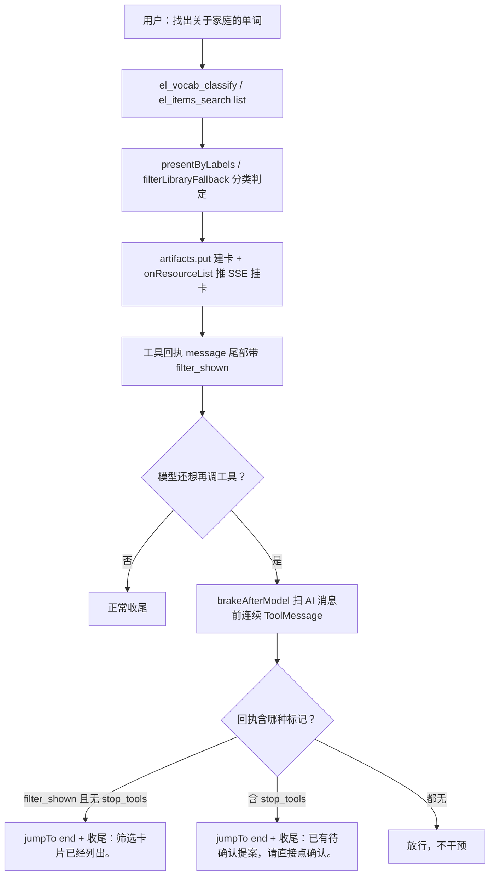
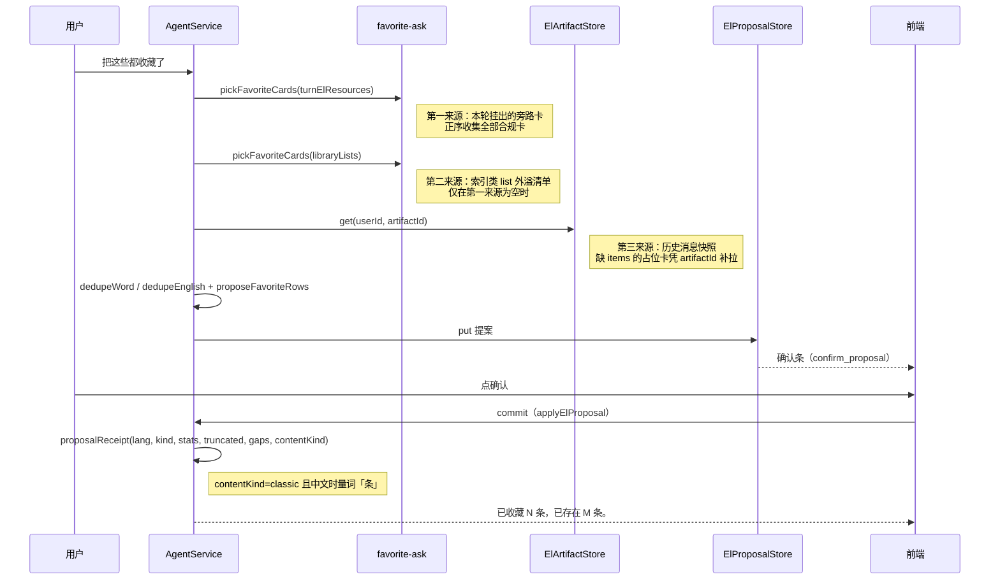

# 筛选卡续答与整类收藏

> 延伸阅读：[词句分类列出.md](./词句分类列出.md)（分类出卡主流程）、[Agent大结果旁路展示.md](./Agent大结果旁路展示.md)（旁路卡片与 SSE 协议）、[整库问法稳定出卡.md](./整库问法稳定出卡.md)（整库挂卡三板斧与兜底）。
>
> 后继更新（2026-11-01）：[英语Agent意图帧](./英语Agent意图帧.md)——`shouldFilterContinue` 加第 6 参 `frame`，续问「那本库再筛家庭」以帧为准；[关于类收藏筛选卡](./关于类收藏筛选卡.md)——`favoriteSet` 关于类只留 `filtered` 筛选卡、`ensureFavoriteFilterCards` 时序提到选卡前，本文的 `favoriteSet` / `dropFullLibraryCards` 代码块对应改前版本。

## 1. 背景与目标

本篇覆盖英语 Agent 三个同批落地的改进，它们共享同一条「筛选卡」数据链路：

1. **筛选卡挂出后不再被误当提案拦截收尾**。分类出卡（`el_vocab_classify` / `el_items_search list` 的筛选分支）挂卡后，工具回执尾部带 `filter_shown` 标记；此前 `brakeAfterModel` 只认 `stop_tools`，模型继续调工具时不会被刹车、可能复述清单，而一旦命中提案刹车，收尾句又固定是「已有待确认提案」，与筛选场景不符。改动后刹车同时识别 `filter_shown`，命中即跳图尾，收尾话术改为「筛选卡片已经列出。」。
2. **筛选卡角标修复**。筛选卡的 `items` 已是分类命中子集，但前端 `isLiveLibrary` 只看 `source/libraryId/contentKind`，会把筛选卡当整库卡按 `libraryId` 再拉整库尾部，角标（分类条数）与列表内容（整库）对不上。改动后负载与 SSE 透传新增 `filtered` 字段，前端遇 `filtered=true` 不再走整库直连。
3. **整类收藏一次提案**。此前 `pickFavoriteCard` 只取最后一张合规卡，多卡场景（多库、多轮挂出）只能收一张；语句收藏回执量词固定「个」。改动后新增 `pickFavoriteCards` 正序收集全部合规卡，收尾按「本轮挂出的卡 → 外溢清单 → 历史快照补拉」三级来源取卡；`proposalReceipt` 新增 `contentKind` 参数，中文语句收藏量词用「条」；系统提示词同步补充两条 classify 工具说明与语句整类收藏规则。

另有一项配套修正：图步上限 `agentStreamRecursionLimit` 由「一轮 2 步」改为「一轮 5 步」估算（24×2+16=64 → 24×5+16=136），因为分类任务一轮实际含摘要 `before_model`、模型、两道 `after_model` 与工具共 5 个图节点，旧估算易触 `GRAPH_RECURSION_LIMIT`。

## 2. 改动范围

| 文件 | 改动点 |
|------|--------|
| `apps/backend/src/services/agent/agent-middleware.ts` | 图步上限 ×2→×5；新增 `FILTER_SHOWN_MARK`；`brakeAfterModel` 识别 `filter_shown` 并按场景区分收尾话术 |
| `apps/backend/src/services/agent/agent.prompt.ts` | 工具地图新增 `el_vocab_classify` / `el_classic_classify` 两行；`el_favorites` 行补语句整类收藏两句规则 |
| `apps/backend/src/services/agent/tools/english/spill.ts` | `ElListSurface` 扩 5 字段；新增 `PriorLibraryCard` 类型；新增 `shouldFilterContinue`；`inventoryFallback` 跳过 `fromPrior` 卡 |
| `apps/backend/src/services/agent/tools/english/artifact.store.ts` | `ElResourceListPayload` 新增 `filtered` / `categoryLabels` / `fromPrior`；新增分类命中缓存 `getCategoryKeys` / `setCategoryKeys`（30 天 TTL） |
| `apps/backend/src/services/agent/tools/english/domain-tools.ts` | 分类出卡三个分支的工具回执 `message` 尾部写入 `filter_shown` 标记 |
| `apps/backend/src/services/agent/tools/english/favorite-ask.ts` | 新增 `pickFavoriteCards` 多卡收集；`pickFavoriteCard` 改为委托实现 |
| `apps/backend/src/services/agent/tools/english/apply-proposal.ts` | `proposalReceipt` 新增第 6 参 `contentKind`，中文语句收藏量词「条」 |
| `apps/backend/src/services/agent/agent.service.ts` | 收尾整类收藏三级取卡（`pickFavoriteCards` 多卡 + 历史快照 `elArtifactStore.get` 补拉）；`proposalReceipt` 调用点透传 `payload.contentKind` |
| `apps/frontend/src/types/chat.ts` | `ElResourceBlock` 新增 `filtered?: boolean` |
| `apps/frontend/src/utils/agentSse.ts` | `elResourceList` 帧解析透传 `filtered` |
| `apps/frontend/src/components/design/Assistant/ResourceListBlock.tsx` | `isLiveLibrary` 对 `filtered` 卡返回 false；`rowOf` 新增 `ipa`/`pos` 提取；`ListRow` 英文行拼接音标词性；三处高度/间距微调 |

## 3. 实现思路

### 3.1 筛选卡挂出后放行收尾

分类出卡的回执由领域工具写入 `filter_shown` 标记，刹车中间件在模型还想继续调工具时扫连续工具回执，按标记决定「不干预 / 提案收尾 / 筛选收尾」三种走向。



**图例**：矩形为处理节点，菱形为判定节点，实线标签为流转条件。

**读图要点**：

- `filter_shown` 由 `domain-tools.ts` 在分类出卡的命中 / 失败 / 空结果、共享 job、新卡挂出共五个回执点统一写入（见 §4.2）。
- 刹车的语义是「卡已挂出，禁止模型再 search / el_present 或复述清单」，不是「拦截用户续答」；用户下一轮提问不受任何影响。
- 两个标记同时命中时按提案处理（`filterShown && !stop` 才用筛选话术），因为提案需要用户点确认，优先级更高。

### 3.2 整类收藏一次提案

用户说「把这些都收藏了」时，收尾阶段按三级来源收集全部合规卡，拍平去重后挂一条确认条；用户确认后由 `proposalReceipt` 按内容种类生成回执。



**图例**：实线箭头为调用，虚线箭头为返回，Note 为关键说明。

**读图要点**：

- 三级来源按序短路：任一来源收到卡就不再往下找（历史来源内部仍逐条消息收全）。
- 多卡只收同一种类：以最后一张卡的 `contentKind` 为准过滤，避免词卡句卡混进一条提案。
- `openProposalId` 守卫：本轮已挂确认条就不再补挂，与 §3.1 的刹车互不冲突。

## 4. 关键实现

### 4.1 图步上限按一轮 5 步计（`agentStreamRecursionLimit`）

分类任务一轮实际走摘要 `before_model`、模型、两道 `after_model`（quietRound + brake）、工具共 5 个图节点；旧版按 2 步估，24 轮空转保险丝配 64 步上限容易先触 `GRAPH_RECURSION_LIMIT`，收束话术都走不到。

改动前：

> 来源：`git show HEAD:apps/backend/src/services/agent/agent-middleware.ts`（约 L57–L63）——改动前

```ts
/** Agent.streamEvents 的图步上限（默认 LangGraph 为 25，工具往返易触顶） */
export function agentStreamRecursionLimit(
	// 领域档位；非英语学习统一给 40
	profile?: 'default' | 'english_learning',
// 返回图步数上限
): number {
	// 非英语学习保持默认 40 步
	if (profile !== 'english_learning') return 40;
	// 一轮工具按模型节点 + 工具节点两步计。多出的 16 步留给收束后的正文
	return ENGLISH_QUIET_ROUNDS * 2 + 16;
}
```

改动后：

> 来源：`apps/backend/src/services/agent/agent-middleware.ts`（当前版本，约 L56–L63）——改动后

```ts
/** Agent.streamEvents 的图步上限（默认 LangGraph 为 25，工具往返易触顶） */
export function agentStreamRecursionLimit(
	// 领域档位；非英语学习统一给 40
	profile?: 'default' | 'english_learning',
// 返回图步数上限
): number {
	// 非英语学习保持默认 40 步
	if (profile !== 'english_learning') return 40;
	// 一轮含摘要、模型、两道 after_model 和工具。多出的 16 步留给收束后的正文
	return ENGLISH_QUIET_ROUNDS * 5 + 16;
}
```

变更摘要：仅注释与乘数变化（×2 → ×5），上限从 64 提到 136；`ENGLISH_QUIET_ROUNDS`（24）未动。

### 4.2 刹车识别 `filter_shown`（`FILTER_SHOWN_MARK` + `brakeAfterModel`）

标记常量，改动前只有 `STOP_TOOLS_MARK`：

> 来源：`git show HEAD:apps/backend/src/services/agent/agent-middleware.ts`（约 L104）——改动前

```ts
// 同轮第二次提案的 stop_tools 回执标记
const STOP_TOOLS_MARK = '"code":"stop_tools"';
```

> 来源：`apps/backend/src/services/agent/agent-middleware.ts`（当前版本，约 L104–L105）——改动后

```ts
// 同轮第二次提案的 stop_tools 回执标记
const STOP_TOOLS_MARK = '"code":"stop_tools"';
// 分类出卡回执尾部标记：命中时收尾话术按筛选场景处理
const FILTER_SHOWN_MARK = 'filter_shown';
```

`brakeAfterModel` 改动前完整符号：

> 来源：`git show HEAD:apps/backend/src/services/agent/agent-middleware.ts`（约 L117–L160）——改动前

```ts
/** 同轮第二次提案返回 stop_tools 后，若模型还要调工具，直接结束并留下确认句 */
function brakeAfterModel(): AgentMiddleware {
	// 注册中间件
	return createMiddleware({
		// 中间件名，日志与调试用
		name: 'ElStopToolsBrake',
		// afterModel：每次模型产出后跑
		afterModel: {
			// 声明允许跳图尾
			canJumpTo: ['end'],
			// 钩子主体
			hook: (state) => {
				// 全部消息；空则按空数组走
				const messages = state.messages ?? [];
				// 最后一条 AI 消息的下标，先记 -1
				let aiIndex = -1;
				// 从尾往前找
				for (let i = messages.length - 1; i >= 0; i -= 1) {
					// 命中最后一条 AI 消息
					if (AIMessage.isInstance(messages[i])) {
						// 记下标
						aiIndex = i;
						// 找到即停
						break;
					}
				}
				// 没有 AI 消息不处理
				if (aiIndex < 0) return;
				// 取出该消息
				const ai = messages[aiIndex];
				// 没有工具调用就不需要刹车
				if (!AIMessage.isInstance(ai) || !ai.tool_calls?.length) return;
				// stop：本轮回执里有没有 stop_tools
				let stop = false;
				// 从 AI 消息前一条起，往前扫连续的工具回执
				for (let i = aiIndex - 1; i >= 0; i -= 1) {
					// 当前行
					const row = messages[i];
					// 连续的 ToolMessage 才算本轮；断了就停
					if (!ToolMessage.isInstance(row)) break;
					// 回执文本含 stop_tools 标记则记 stop
					if (messageText(row).includes(STOP_TOOLS_MARK)) stop = true;
				}
				// 没命中 stop 不刹车（改动前唯一放行口）
				if (!stop) return;
				// 把这次未执行的工具调用逐个补 error 回执闭合，避免悬挂调用
				const closed = ai.tool_calls.map(
					// 每个未执行调用补一条同 id 的 error ToolMessage
					(call) =>
						// 构造回执
						new ToolMessage({
							// 给模型看的话术：别再调工具
							content: '已停止。请让用户点确认，不要再调用工具。',
							// 对齐原调用 id，LangGraph 才能闭合
							tool_call_id: call.id ?? '',
							// 保留工具名
							name: call.name,
							// 标 error：未真正执行
							status: 'error',
						}),
				);
				// 返回跳图尾指令 + 要追加的消息
				return {
					// 跳到图尾，本轮不再给模型机会
					jumpTo: 'end' as const,
					// 追加：先闭合回执再收尾句
					messages: [
						// 展开全部闭合回执
						...closed,
						// 固定提案收尾句
						new AIMessage('已有待确认提案，请直接点确认。'),
					],
				};
			},
		},
	});
}
```

改动后完整符号：

> 来源：`apps/backend/src/services/agent/agent-middleware.ts`（当前版本，约 L117–L168）——改动后

```ts
/** 同轮第二次提案返回 stop_tools 后，若模型还要调工具，直接结束并留下确认句 */
function brakeAfterModel(): AgentMiddleware {
	// 注册中间件
	return createMiddleware({
		// 中间件名，日志与调试用
		name: 'ElStopToolsBrake',
		// afterModel：每次模型产出后跑
		afterModel: {
			// 声明允许跳图尾
			canJumpTo: ['end'],
			// 钩子主体
			hook: (state) => {
				// 全部消息；空则按空数组走
				const messages = state.messages ?? [];
				// 最后一条 AI 消息的下标，先记 -1
				let aiIndex = -1;
				// 从尾往前找
				for (let i = messages.length - 1; i >= 0; i -= 1) {
					// 命中最后一条 AI 消息
					if (AIMessage.isInstance(messages[i])) {
						// 记下标
						aiIndex = i;
						// 找到即停
						break;
					}
				}
				// 没有 AI 消息不处理
				if (aiIndex < 0) return;
				// 取出该消息
				const ai = messages[aiIndex];
				// 没有工具调用就不需要刹车
				if (!AIMessage.isInstance(ai) || !ai.tool_calls?.length) return;
				// stop：本轮回执里有没有 stop_tools
				let stop = false;
				// filterShown：本轮回执里有没有分类出卡标记
				let filterShown = false;
				// 从 AI 消息前一条起，往前扫连续的工具回执
				for (let i = aiIndex - 1; i >= 0; i -= 1) {
					// 当前行
					const row = messages[i];
					// 连续的 ToolMessage 才算本轮；断了就停
					if (!ToolMessage.isInstance(row)) break;
					// 回执文本只取一次，两个标记共用
					const text = messageText(row);
					// 含 stop_tools 记 stop
					if (text.includes(STOP_TOOLS_MARK)) stop = true;
					// 含 filter_shown 记 filterShown
					if (text.includes(FILTER_SHOWN_MARK)) filterShown = true;
				}
				// 两个标记都没命中才放行（改动点）
				if (!stop && !filterShown) return;
				// 把这次未执行的工具调用逐个补 error 回执闭合，避免悬挂调用
				const closed = ai.tool_calls.map(
					// 每个未执行调用补一条同 id 的 error ToolMessage
					(call) =>
						// 构造回执
						new ToolMessage({
							// 给模型看的话术：别再调工具
							content: '已停止。请让用户点确认，不要再调用工具。',
							// 对齐原调用 id，LangGraph 才能闭合
							tool_call_id: call.id ?? '',
							// 保留工具名
							name: call.name,
							// 标 error：未真正执行
							status: 'error',
						}),
				);
				// 返回跳图尾指令 + 要追加的消息
				return {
					// 跳到图尾，本轮不再给模型机会
					jumpTo: 'end' as const,
					// 追加：先闭合回执再收尾句
					messages: [
						// 展开全部闭合回执
						...closed,
						// 收尾话术按场景区分
						new AIMessage(
							// 只命中筛选卡、没有提案刹车时走筛选话术
							filterShown && !stop
								// 筛选场景：告知卡已列出
								? '筛选卡片已经列出。'
								// 提案场景（含两者同命中，提案优先）
								: '已有待确认提案，请直接点确认。',
						),
					],
				};
			},
		},
	});
}
```

变更摘要：新增 `filterShown` 扫描；放行条件 `!stop` → `!stop && !filterShown`；收尾句由固定文案改为按标记二选一。

`filter_shown` 标记的写入处在 `domain-tools.ts` 分类出卡分支。`presentByLabels` 直通分支：

> 来源：`apps/backend/src/services/agent/tools/english/domain-tools.ts`（当前版本，约 L1334–L1348）——改动后（标记为本批新增）

```ts
// 从用户原话切出类别名；能切出类别就走共享分类挂卡
const labels = categoryLabels(deps.surface.userText);
// 有类别名才进分类分支
if (labels.length) {
	// 逐类别判定并挂卡，内部复用本轮 categoryJobs 与分类缓存
	const listed = await presentByLabels(filterKind, [
		// 只传当前这一本库（id + 标题兜底）
		{ id: libraryId, title: known?.title ?? libraryId },
	// 类别名数组；合调用闭合
	], labels);
	// 回执按命中/失败/空结果给三种措辞，统一在尾部写 filter_shown
	return elOk(
		// data：库 id 与命中条数
		{ libraryId, totalCount: listed.items.length },
		// 信封第二参：message
		{
			// 三分支措辞
			message: listed.items.length
				// 有命中：禁止再 search 或 el_present
				? '卡片已列出。禁止再 search 或 el_present。filter_shown'
				// 无命中时再看是否有批失败
				: listed.failed
					// 失败分支措辞，仍带标记
					? '有批未能判断。禁止再 search。filter_shown'
					// 空结果措辞，也带标记
					: '没有可展示的行。禁止再 search。filter_shown',
		},
	);
}
```

新卡挂出分支（缓存建卡 + SSE 推卡 + 回执带标记）：

> 来源：`apps/backend/src/services/agent/tools/english/domain-tools.ts`（当前版本，约 L1381–L1393）——改动后（标记为本批新增）

```ts
// 分类草稿入缓存拿 artifactId
const artifactId = await deps.artifacts.put(deps.userId, draft);
// 拼上 artifactId 得到完整负载
const payload = { ...draft, artifactId };
// 标记本轮已出卡，后续不再重复挂
deps.surface.presented = true;
// 记录该库已挂过，防同一 id 第二张卡
deps.surface.shownLibraryIds.add(libraryId);
// 记住这张卡，供「收藏这些」等后续口令取用
rememberQuoteCard(payload);
// 通过 SSE 推给前端挂卡
deps.onResourceList?.(payload);
// 工具回执：data 给程序看，message 给模型看
return elOk(
	// data：卡 id 与条数
	{ artifactId, totalCount: payload.totalCount },
	// 信封第二参：message
	{
		// message 尾部带 filter_shown 标记；刹车中间件凭它改用筛选收尾话术
		message: '卡片已列出。禁止再 search 或 el_present。filter_shown',
	},
);
```

共享 job（`alreadyShown`）与分类失败两个回执点同样以 `filter_shown` 收尾，措辞分别为「卡片已列出。禁止再 search 或 el_present。」与「没有可展示的行。禁止再 search。」，源码同文件约 L1366–L1379，不再重复摘录。

### 4.3 会话面扩字段（`PriorLibraryCard` / `ElListSurface`）

新增 `PriorLibraryCard` 类型，承载「上一轮助手消息里的库卡标题」，只用于沿用判定、不参与整库挂卡：

> 来源：`apps/backend/src/services/agent/tools/english/spill.ts`（当前版本，约 L41–L44）——改动后（纯新增）

```ts
// 上一轮助手消息里的库卡标题；只用于沿用，不参与整库挂卡
export type PriorLibraryCard = {
	// 卡标题，用来和目录标题对齐
	title: string;
	// 词/句种类，沿用判定用
	contentKind?: 'vocab' | 'classic';
};
```

`ElListSurface` 改动前（7 字段）：

> 来源：`git show HEAD:apps/backend/src/services/agent/tools/english/spill.ts`（约 L39–L51）——改动前

```ts
// 本轮 Agent 的会话面：跨工具共享的临时状态
export type ElListSurface = {
	// 本轮用户原话
	userText: string;
	/** 索引类 list 外溢的全量，默认不推卡片 */
	libraryLists: ElResourceListPayload[];
	// 本轮是否已挂出卡
	presented: boolean;
	/** 本轮已经挂出的库或 artifact，同一 id 不再挂第二张 */
	shownLibraryIds: Set<string>;
	/** 库名清单，用来和原话做包含匹配 */
	catalog: { id: string; title: string }[];
	// 目录种类（词/句）
	catalogKind?: 'vocab' | 'classic';
	/** 本轮已挂出的确认条。收尾补收藏时用来避免再挂一条。 */
	openProposalId?: string | null;
};
```

改动后（12 字段，新增 5 个）：

> 来源：`apps/backend/src/services/agent/tools/english/spill.ts`（当前版本，约 L46–L74）——改动后

```ts
// 本轮 Agent 的会话面：跨工具共享的临时状态
export type ElListSurface = {
	// 本轮用户原话
	userText: string;
	/** 整库筛选用的类别句。纯收藏口令不放这里。 */
	quoteCategoryText?: string;
	/** 当前句之前的用户原话，近的在后。 */
	priorUserTexts: string[];
	/** 上一张助手消息里的库卡标题。只用于沿用，不参与整库挂卡。 */
	priorLibraryCards: PriorLibraryCard[];
	/** 带类别名的历史分类卡。只按库和类别查找，不参与整卡收藏。 */
	labeledCards: ElResourceListPayload[];
	/** 索引类 list 外溢的全量，默认不推卡片 */
	libraryLists: ElResourceListPayload[];
	// 本轮是否已挂出卡
	presented: boolean;
	/** 本轮已经挂出的库或 artifact，同一 id 不再挂第二张 */
	shownLibraryIds: Set<string>;
	/** 库名清单，用来和原话做包含匹配 */
	catalog: { id: string; title: string }[];
	// 目录种类（词/句）
	catalogKind?: 'vocab' | 'classic';
	/** 本轮已挂出的确认条。收尾补收藏时用来避免再挂一条。 */
	openProposalId?: string | null;
	/**
	 * 本轮每个库正在进行或已经结束的分类。
	 * 键是 kind:libraryId 或 kind:libraryId:类别。先写入再等待，同键后来者共用这一次，失败也不删除。
	 */
	categoryJobs: Map<
		// 键：kind:libraryId 或 kind:libraryId:类别
		string,
		// 值：分类任务 Promise；null 表示失败
		Promise<Omit<ElResourceListPayload, 'artifactId'> | null>
	>;
};
```

变更摘要：新增 `quoteCategoryText`（整库筛选类别句）、`priorUserTexts` / `priorLibraryCards`（沿用上一本的依据）、`labeledCards`（历史分类卡复用）、`categoryJobs`（同键分类任务共享，防并发重复判定）。

### 4.4 `shouldFilterContinue`：模型停手后的服务端续查判定

纯新增函数。模型在筛选句后没有出卡就停手时，服务端用它判断要不要补一次分类：已出卡、非「关于」类问法直接不续；当前句恰好点名一本库就用它；没点名时沿用上一轮那一本（`inheritedLibrary`，同属本文件，本篇不展开）。

> 来源：`apps/backend/src/services/agent/tools/english/spill.ts`（当前版本，约 L471–L488）——改动后（纯新增）

```ts
/** 筛选句在模型停手后是否还要由服务端拉词。已出卡、非整句「关于」返回 null。当前句不是恰好一本时，沿用上一本。 */
export function shouldFilterContinue(
	// 本轮用户原话
	userText: string,
	// 库名目录
	catalog: { id: string; title: string }[],
	// 本轮是否已出卡
	presented: boolean,
	// 上一轮上下文：原话序列 + 库卡标题 + 库名后缀正则
	prior?: {
		// 上一句及更早的用户原话，近的在后
		userTexts: string[];
		// 上一轮助手消息里的库卡标题
		cards: { title: string }[];
		// 库名后缀正则（词汇库 / 语句库）
		mark?: RegExp;
	},
// 命中的那一本库；不续查返回 null
): { id: string; title: string } | null {
	// 已出卡就不再续查
	if (presented) return null;
	// 非「关于」类筛选句不续查
	if (!isCategoryAsk(userText)) return null;
	// 当前句按目录整段包含匹配
	const hits = matchLibraries(userText, catalog);
	// 恰好一本：直接用
	if (hits.length === 1) return hits[0];
	// 多本命中或没有上一轮上下文：不猜
	if (hits.length > 1 || !prior) return null;
	// 当前句没点名：沿用上一轮那一本
	return inheritedLibrary(prior.userTexts, prior.cards, catalog, prior.mark);
}
```

### 4.5 旁路负载扩字段（`ElResourceListPayload`）

改动前（8 字段）：

> 来源：`git show HEAD:apps/backend/src/services/agent/tools/english/artifact.store.ts`（约 L16–L28）——改动前

```ts
/** 旁路清单：SSE、消息快照、GET 补拉共用 */
export type ElResourceListPayload = {
	// 缓存键 id
	artifactId: string;
	// 卡标题
	title: string;
	// 来源域
	source: ElResourceSource;
	// 词/句种类
	contentKind?: 'vocab' | 'classic';
	// 所属库 id
	libraryId?: string;
	// 总条数
	totalCount: number;
	// 是否被裁剪
	truncated: boolean;
	/** 全量行；SSE 超阈时省略，由 GET 补拉 */
	items?: unknown[];
};
```

改动后（11 字段，新增 3 个）：

> 来源：`apps/backend/src/services/agent/tools/english/artifact.store.ts`（当前版本，约 L16–L33）——改动后

```ts
/** 旁路清单：SSE、消息快照、GET 补拉共用 */
export type ElResourceListPayload = {
	// 缓存键 id
	artifactId: string;
	// 卡标题
	title: string;
	// 来源域
	source: ElResourceSource;
	// 词/句种类
	contentKind?: 'vocab' | 'classic';
	// 所属库 id
	libraryId?: string;
	// 总条数
	totalCount: number;
	// 是否被裁剪
	truncated: boolean;
	/** 分类命中。为真时 items 已是这一类，收藏不再整库筛选 */
	filtered?: boolean;
	/** 这张卡是哪些类别判出来的。同一库同一类别再问时直接复用 items */
	categoryLabels?: string[];
	/** 上一轮带入的卡。本轮整库兜底不再挂出 */
	fromPrior?: boolean;
	/** 全量行；SSE 超阈时省略，由 GET 补拉 */
	items?: unknown[];
};
```

变更摘要：三个字段均可选，旧缓存与旧快照无此字段，行为不变。`filtered` 是 §3.1 角标修复的判定依据；`categoryLabels` 支撑同库同类别复用；`fromPrior` 供 §4.6 兜底跳过。同文件另新增分类命中缓存 `getCategoryKeys` / `setCategoryKeys`（键形如 `el_cat:kind:libraryId:label:revision`，TTL 30 天），属分类缓存配套，本篇不展开。

### 4.6 整库兜底跳过带入卡（`inventoryFallback`）

改动前：

> 来源：`git show HEAD:apps/backend/src/services/agent/tools/english/spill.ts`（约 L357–L391）——改动前

```ts
// 整库问法里还没挂出的每一份清单各补一张。同一 id 用最后一次。筛选和讲解不补。restash：裁过尾的行必须另存 artifact
export function inventoryFallback(
	// 用户原话
	userText: string,
	// 索引类 list 外溢的全量清单
	libraryLists: ElResourceListPayload[],
	// 本轮已挂出的库 / artifact id 集
	shownIds: ReadonlySet<string>,
// 返回：待挂卡 + 是否需要另存 artifact
): { payload: ElResourceListPayload; restash: boolean }[] {
	// 非整库问法不补卡
	if (listIntent(userText) !== 'inventory') return [];
	// 按 id 去重，同一 id 后出现的覆盖先出现的
	const byId = new Map<string, ElResourceListPayload>();
	// 逐份清单过筛
	for (const row of libraryLists) {
		// 兜底键：库 id 优先，否则 artifactId
		const id = row.libraryId ?? row.artifactId;
		// 已挂过的不重复挂
		if (shownIds.has(id)) continue;
		// 记入去重表
		byId.set(id, row);
	}
	// 去重后逐份判定是否裁剪
	return [...byId.values()].map((row) => {
		// 资源库整库卡（词/句）直接挂全量，不算截断
		if (
			// 来源是资源库
			row.source === 'library' &&
			// 带库 id
			row.libraryId &&
			// 词或句种类
			(row.contentKind === 'vocab' || row.contentKind === 'classic')
		) {
			// 原样挂出，truncated 复位
			return { payload: { ...row, truncated: false }, restash: false };
		}
		// 其它来源按字符预算裁剪
		const items = row.items ?? [];
		// 按标题 + 行计算可容纳条数
		const fit = fitItemsByChars({ title: row.title }, items);
		// 没裁断直接挂
		if (!fit.truncated) return { payload: row, restash: false };
		// 裁过的要另存 artifact，并改标题注明已列出条数
		return {
			// 需要另存
			restash: true,
			// 裁剪后的负载
			payload: {
				// 继承原字段
				...row,
				// 只留可容纳的行
				items: fit.items,
				// 标截断
				truncated: true,
				// 标题注明已列出 / 总条数
				title: `${row.title}（已列出 ${fit.items.length} / ${row.totalCount}）`,
			},
		};
	});
}
```

改动后（仅循环体首行新增一跳）：

> 来源：`apps/backend/src/services/agent/tools/english/spill.ts`（当前版本，约 L782–L816）——改动后

```ts
// 整库问法里还没挂出的每一份清单各补一张。同一 id 用最后一次。筛选和讲解不补。restash：裁过尾的行必须另存 artifact
export function inventoryFallback(
	// 用户原话
	userText: string,
	// 索引类 list 外溢的全量清单
	libraryLists: ElResourceListPayload[],
	// 本轮已挂出的库 / artifact id 集
	shownIds: ReadonlySet<string>,
// 返回：待挂卡 + 是否需要另存 artifact
): { payload: ElResourceListPayload; restash: boolean }[] {
	// 非整库问法不补卡
	if (listIntent(userText) !== 'inventory') return [];
	// 按 id 去重，同一 id 后出现的覆盖先出现的
	const byId = new Map<string, ElResourceListPayload>();
	// 逐份清单过筛
	for (const row of libraryLists) {
		// 上一轮带入的卡本轮不再挂出（本次新增）
		if (row.fromPrior) continue;
		// 兜底键：库 id 优先，否则 artifactId
		const id = row.libraryId ?? row.artifactId;
		// 已挂过的不重复挂
		if (shownIds.has(id)) continue;
		// 记入去重表
		byId.set(id, row);
	}
	// 去重后逐份判定是否裁剪
	return [...byId.values()].map((row) => {
		// 资源库整库卡（词/句）直接挂全量，不算截断
		if (
			// 来源是资源库
			row.source === 'library' &&
			// 带库 id
			row.libraryId &&
			// 词或句种类
			(row.contentKind === 'vocab' || row.contentKind === 'classic')
		) {
			// 原样挂出，truncated 复位
			return { payload: { ...row, truncated: false }, restash: false };
		}
		// 其它来源按字符预算裁剪
		const items = row.items ?? [];
		// 按标题 + 行计算可容纳条数
		const fit = fitItemsByChars({ title: row.title }, items);
		// 没裁断直接挂
		if (!fit.truncated) return { payload: row, restash: false };
		// 裁过的要另存 artifact，并改标题注明已列出条数
		return {
			// 需要另存
			restash: true,
			// 裁剪后的负载
			payload: {
				// 继承原字段
				...row,
				// 只留可容纳的行
				items: fit.items,
				// 标截断
				truncated: true,
				// 标题注明已列出 / 总条数
				title: `${row.title}（已列出 ${fit.items.length} / ${row.totalCount}）`,
			},
		};
	});
}
```

变更摘要：仅新增 `if (row.fromPrior) continue;` 一行——上一轮带入的卡只用于沿用判定（§4.4），整库兜底不再把它当新卡挂出，避免同一库换轮重复出卡。

### 4.7 多卡收集与三级取卡（`pickFavoriteCards` + 收尾链路）

改动前只有单卡版 `pickFavoriteCard`，倒序找到第一张合规卡即返回：

> 来源：`git show HEAD:apps/backend/src/services/agent/tools/english/favorite-ask.ts`（约 L49–L61）——改动前

```ts
// 从后往前找第一张合规卡：后挂出的优先
export function pickFavoriteCard<T extends CardRow>(
	// 收藏口令（含种类过滤）
	ask: FavoriteAsk,
	// 候选卡列表
	lists: T[],
// 命中的卡；没有返回 null
): T | null {
	// 倒序扫，后挂的优先
	for (let i = lists.length - 1; i >= 0; i -= 1) {
		// 当前卡
		const card = lists[i];
		// 不合规（无行 / 超 40 上限 / 非词句类）跳过
		if (!cardOk(card)) continue;
		// 点名种类时按 contentKind 过滤
		if (ask.kind !== 'card' && ask.kind !== card.contentKind) continue;
		// 第一张合规卡即返回
		return card;
	}
	// 全部不合规
	return null;
}
```

改动后：新增 `pickFavoriteCards` 正序收全，`pickFavoriteCard` 委托它取末位，语义与旧版一致：

> 来源：`apps/backend/src/services/agent/tools/english/favorite-ask.ts`（当前版本，约 L49–L68）——改动后

```ts
// 正序收集全部合规卡：整类收藏可能跨多张卡（多库、多轮挂出）
export function pickFavoriteCards<T extends CardRow>(
	// 收藏口令（含种类过滤）
	ask: FavoriteAsk,
	// 候选卡列表
	lists: T[],
// 全部合规卡，按原顺序
): T[] {
	// 收集结果
	const cards: T[] = [];
	// 正序遍历，保持挂出顺序
	for (const card of lists) {
		// 不合规（无行 / 超 40 上限 / 非词句类）跳过
		if (!cardOk(card)) continue;
		// 点名种类时按 contentKind 过滤
		if (ask.kind !== 'card' && ask.kind !== card.contentKind) continue;
		// 合规即收
		cards.push(card);
	}
	// 返回全集（可能为空）
	return cards;
}

// 单卡场景保留原语义：取最后一张
export function pickFavoriteCard<T extends CardRow>(
	// 收藏口令（含种类过滤）
	ask: FavoriteAsk,
	// 候选卡列表
	lists: T[],
// 最后一张合规卡；没有返回 null
): T | null {
	// 先走多卡收集
	const cards = pickFavoriteCards(ask, lists);
	// 取末位，等价旧版「倒序找第一张」
	return cards.at(-1) ?? null;
}
```

收尾三级取卡链路（`agent.service.ts`）。第一来源本轮挂出的卡、第二来源外溢清单、第三来源历史快照（缺 `items` 的占位卡凭 `artifactId` 回 `ElArtifactStore` 补拉）：

> 来源：`apps/backend/src/services/agent/agent.service.ts`（当前版本，约 L1598–L1655）——改动后

```ts
// 收尾补整类收藏：仅英语学习模式、且本轮还没挂确认条时才进
if (dto.assistMode === 'english_learning' && !elSurface.openProposalId) {
	// 兜底：补收藏失败不阻断主流程
	try {
		// 识别用户原话是不是收藏口令（含种类）
		const ask = favoriteAsk(dto.content);
		// 第一来源：本轮挂出的旁路卡；多卡一次收全
		let cards = ask ? pickFavoriteCards(ask, turnElResources) : [];
		// 第一来源为空再看第二来源
		if (ask && !cards.length) {
			// 第二来源：索引类 list 外溢的全量清单
			cards = pickFavoriteCards(ask, elSurface.libraryLists);
		}
		// 仍空则回看历史消息里的卡快照
		if (ask && !cards.length) {
			// 取本会话全部消息（升序）
			const history =
				// 按业务会话 id 升序取历史
				await this.englishTableMemory.listMessagesAsc(businessSessionId);
			// 只看当前分支上的助手消息下标
			const indexes = quoteThreadAssistantIndexes(
				// 全量历史
				history,
				// 当前助手消息 id（分支锚点）
				assistantMessageId,
				// true：含当前这条
				true,
			);
			// 逐条助手消息找卡
			for (const i of indexes) {
				// 当前消息行
				const row = history[i];
				// 快照里的旁路卡数组
				const saved = row.elResources ?? [];
				// 快照带 items 的直接收
				const found = pickFavoriteCards(ask, saved);
				// 收到即并入并看下一条
				if (found.length) {
					// 并入结果
					cards.push(...found);
					// 继续下一条助手消息
					continue;
				}
				// 快照被 SSE 省略 items 的占位卡，从后往前找第一张
				const stub = [...saved]
					// 倒序：后挂出的优先
					.reverse()
					// 占位特征：有 artifactId 但没 items
					.find((item) => item.artifactId && !item.items?.length);
				// 没有占位卡就换下一条消息
				if (!stub?.artifactId) continue;
				// 凭 artifactId 回缓存补拉全量
				const stored = await this.elArtifactStore.get(
					// 属主
					userId,
					// 占位卡的 artifactId
					stub.artifactId,
				);
				// 缓存过期或不属主则放弃
				if (!stored) continue;
				// 补回的是单卡，用单卡接口收
				const restored = pickFavoriteCard(ask, [stored]);
				// 合规才收
				if (restored) cards.push(restored);
			}
		}
		// 以最后一张卡的种类为准，词卡句卡不混收
		const kind = cards.at(-1)?.contentKind;
		// 只留同种类的卡
		const same = cards.filter((card) => card.contentKind === kind);
		// 有口令、有卡、种类明确才进提案
		if (ask && same.length && (kind === 'vocab' || kind === 'classic')) {
			// 多卡 items 拍平成一份行集
			const raw = same.flatMap((card) =>
				// 缺 items 的卡当空集
				(card.items ?? []).filter(
					// 类型守卫：只留对象行
					(row): row is Record<string, unknown> =>
						// 排除 null、数组与非对象
						!!row && typeof row === 'object' && !Array.isArray(row),
				),
			);
			// 语句按英文句去重、单词按词面去重
			const rows = kind === 'classic' ? dedupeEnglish(raw) : dedupeWord(raw);
			// 去掉已收藏后挂确认条
			const proposed = await proposeFavoriteRows(
				// 收藏查重服务
				this.englishLearningService,
				// 提案存储
				this.elProposalStore,
				// 属主
				userId,
				// 种类
				kind,
				// 去重后的行
				rows,
			);
			// ...（取 proposalId、写入 elSurface.openProposalId；与本次改动无关，略）
		}
	// ...（catch 记录告警；与本次改动无关，略）
	}
}
```

变更摘要：`pickFavoriteCard(ask, turnElResources)` 单卡收集改为 `pickFavoriteCards` 多卡收集并扩展为三级来源；种类归并以最后一张卡为准；拍平、去重、提案逻辑不变。

### 4.8 回执量词按 `contentKind`（`proposalReceipt`）

签名新增第 6 参。改动前：

> 来源：`git show HEAD:apps/backend/src/services/agent/tools/english/apply-proposal.ts`（约 L130–L137）——改动前

```ts
// 确认回执。措辞与前端 englishLearning.proposal.* 一致，刷新后仍是这句话
export function proposalReceipt(
	// 界面语言
	lang: 'zh-CN' | 'en-US',
	// 提案种类
	kind: ElProposalKind,
	// 写入统计
	stats: ApplyStats,
	// 是否截断
	truncated: boolean,
	// 缺口原因（cap / list / judge）
	gaps?: Array<'cap' | 'list' | 'judge'>,
// 返回回执文案
): string {
```

改动后：

> 来源：`apps/backend/src/services/agent/tools/english/apply-proposal.ts`（当前版本，约 L130–L137）——改动后

```ts
// 确认回执。措辞与前端 englishLearning.proposal.* 一致，刷新后仍是这句话
export function proposalReceipt(
	// 界面语言
	lang: 'zh-CN' | 'en-US',
	// 提案种类
	kind: ElProposalKind,
	// 写入统计
	stats: ApplyStats,
	// 是否截断
	truncated: boolean,
	// 缺口原因（cap / list / judge）
	gaps?: Array<'cap' | 'list' | 'judge'>,
	// 词/句种类：中文语句收藏量词用「条」
	contentKind?: 'vocab' | 'classic',
// 返回回执文案
): string {
```

`favorite_add` 分支，改动前中文量词固定「个」：

> 来源：`git show HEAD:apps/backend/src/services/agent/tools/english/apply-proposal.ts`（约 L156–L160）——改动前

```ts
// 收藏新增分支（favorite_add）：改动前中文量词一律「个」
	} else {
		// 中英两种措辞
		text = en
			// 英文不用量词
			? `Saved ${stats.created}. Already in favorites: ${stats.existed}.`
			// 中文固定「个」，语句也读作「个」，不自然
			: `已收藏 ${stats.created} 个，已存在 ${stats.existed} 个。`;
	}
```

改动后按 `contentKind` 分量词：

> 来源：`apps/backend/src/services/agent/tools/english/apply-proposal.ts`（当前版本，约 L158–L163）——改动后

```ts
// 收藏新增分支（favorite_add）：中文按 contentKind 分量词
	} else {
		// 中文且语句收藏时量词用「条」，其余仍「个」；英文不用量词
		const unit = !en && contentKind === 'classic' && kind === 'favorite_add' ? '条' : '个';
		// 中英两种措辞
		text = en
			// 英文措辞不变
			? `Saved ${stats.created}. Already in favorites: ${stats.existed}.`
			// 中文按 unit 拼量词
			: `已收藏 ${stats.created} ${unit}，已存在 ${stats.existed} ${unit}。`;
	}
```

调用点透传 `payload.contentKind`：

> 来源：`apps/backend/src/services/agent/agent.service.ts`（当前版本，约 L756–L763）——改动后

```ts
// 生成回执文案：把 payload 上的 contentKind 一并传入，语句收藏才能说「条」
const content = proposalReceipt(
	// 界面语言
	lang,
	// 提案种类
	payload.kind,
	// 写入统计
	stats,
	// 是否截断
	Boolean(payload.truncated),
	// 缺口原因
	payload.gaps,
	// 词/句种类：决定中文量词
	payload.contentKind,
);
```

### 4.9 系统提示词补 classify 与整类收藏规则（`agent.prompt.ts`）

`ENGLISH_LEARNING_SYSTEM_APPEND` 第 7 条工具地图新增两行（改动前不存在）：

> 来源：`apps/backend/src/services/agent/agent.prompt.ts`（当前版本，`ENGLISH_LEARNING_SYSTEM_APPEND` 模板字符串内）——改动后（字符串片段）

```ts
// 工具地图新增：词汇分类列出工具；回执含「卡片已列出」时禁止复述、禁止再 el_present
   - el_vocab_classify：从词汇库按用户原话的类别分类并列出。用户要分类、筛选或列出某一类单词时调用。参数为 {}。不要传 libraryId。语法和翻译不要调用。回执写「卡片已列出」时只说库名和条数，禁止逐条复述，禁止再 el_present。分类结果以卡片条数为准，不要另写句子或单词清单，不要声称这一类已经在上一张其他类别的卡里。
// 工具地图新增：语句分类列出工具；明确不要调 el_vocab_classify
   - el_classic_classify：从语句库按用户原话的类别分类并列出。用户要分类、筛选或列出某一类语句时调用。参数为 {}。不要传 libraryId。不要调用 el_vocab_classify。语法和翻译不要调用。回执写「卡片已列出」时只说库名和条数，禁止逐条复述，禁止再 el_present。分类结果以卡片条数为准，不要另写句子清单，不要声称这一类已经在上一张其他类别的卡里。
```

`el_favorites` 行改动前（节选尾部，用 … 表示与改动后相同的头尾）：

> 来源：`git show HEAD:apps/backend/src/services/agent/agent.prompt.ts`（`el_favorites` 行）——改动前（字符串片段）

```ts
// 改动前 el_favorites 行：整类收藏只要求「只传 artifactId」，没有语句整类的专门约束
   - el_favorites：… 整类全部收藏：先 el_items_search list，再 propose_add 只传该 artifactId，不要传 items，不要翻 nextOffset 凑词，同一轮不要再 propose_add。多个词一次 propose_remove …
```

改动后同位置补两句语句整类规则：

> 来源：`apps/backend/src/services/agent/agent.prompt.ts`（当前版本，`el_favorites` 行）——改动后（字符串片段）

```ts
// 改动后 el_favorites 行：中间补「语句整类一次提案」与「条数以卡片为准」两句
   - el_favorites：… 整类全部收藏：先 el_items_search list，再 propose_add 只传该 artifactId，不要传 items，不要翻 nextOffset 凑词，同一轮不要再 propose_add。语句整类不要传少量 items 再许诺确认后继续；有语句卡时一次提案即可。点了类别名时不要自己列句子，条数以卡片为准。多个词一次 propose_remove …
```

变更摘要：提示词纯追加，不删改既有规则；目的是让模型在分类出卡后不再自行列清单、在语句整类收藏时不再先传少量 `items` 再许诺「确认后继续」。

### 4.10 前端块类型加 `filtered`（`ElResourceBlock`）

改动前：

> 来源：`git show HEAD:apps/frontend/src/types/chat.ts`（约 L78–L95）——改动前

```ts
/** 英语 Agent 外溢清单（SSE / 消息快照） */
export interface ElResourceBlock {
	// 缓存键 id
	artifactId: string;
	// 卡标题
	title: string;
	// 来源域
	source:
		// 资源库
		| 'library'
		// 收藏
		| 'favorites'
		// 错题
		| 'mistakes'
		// 每日记词
		| 'memo'
		// 每日阅读
		| 'reading'
		// 词包
		| 'pack'
		// 学习笔记
		| 'notes'
		// 其它
		| 'other';
	// 词/句种类
	contentKind?: 'vocab' | 'classic';
	// 所属库 id
	libraryId?: string;
	// 总条数
	totalCount: number;
	// 是否被裁剪
	truncated: boolean;
	// 内联行；超阈省略由 GET 补拉
	items?: unknown[];
}
```

改动后（`libraryId` 后新增 `filtered`）：

> 来源：`apps/frontend/src/types/chat.ts`（当前版本，约 L78–L98）——改动后

```ts
/** 英语 Agent 外溢清单（SSE / 消息快照） */
export interface ElResourceBlock {
	// 缓存键 id
	artifactId: string;
	// 卡标题
	title: string;
	// 来源域
	source:
		// 资源库
		| 'library'
		// 收藏
		| 'favorites'
		// 错题
		| 'mistakes'
		// 每日记词
		| 'memo'
		// 每日阅读
		| 'reading'
		// 词包
		| 'pack'
		// 学习笔记
		| 'notes'
		// 其它
		| 'other';
	// 词/句种类
	contentKind?: 'vocab' | 'classic';
	// 所属库 id
	libraryId?: string;
	/** 为真时 items 已是分类命中，不能按 libraryId 再拉整库 */
	filtered?: boolean;
	// 总条数
	totalCount: number;
	// 是否被裁剪
	truncated: boolean;
	// 内联行；超阈省略由 GET 补拉
	items?: unknown[];
}
```

### 4.11 SSE 透传 `filtered`（`agentSse.ts`）

`elResourceList` 帧解析，改动前（无 `filtered` 行，其余与改动后相同）：

> 来源：`git show HEAD:apps/frontend/src/utils/agentSse.ts`（约 L229–L262）——改动前

```ts
// 帧类型守卫：elResourceList 必须带 artifactId 与 title
if (
	// 帧类型
	parsed.type === 'elResourceList' &&
	// artifactId 必须是字符串
	typeof parsed.artifactId === 'string' &&
	// title 必须是字符串
	typeof parsed.title === 'string'
) {
	// 组装成 ElResourceBlock 推给卡片层
	onElResourceList?.({
		// 缓存键 id
		artifactId: parsed.artifactId,
		// 卡标题
		title: parsed.title,
		// 来源域白名单收敛，不认识的一律 other
		source:
			// 资源库
			parsed.source === 'library' ||
			// 收藏
			parsed.source === 'favorites' ||
			// 错题
			parsed.source === 'mistakes' ||
			// 每日记词
			parsed.source === 'memo' ||
			// 每日阅读
			parsed.source === 'reading' ||
			// 词包
			parsed.source === 'pack' ||
			// 学习笔记
			parsed.source === 'notes'
				// 在白名单内则透传
				? parsed.source
				// 不认识的一律 other
				: 'other',
		// 词/句种类：非两种之一则留空
		contentKind:
			// 词汇
			parsed.contentKind === 'vocab' ||
			// 语句
			parsed.contentKind === 'classic'
				// 命中则透传
				? parsed.contentKind
				// 否则留空
				: undefined,
		// 所属库 id：非字符串留空
		libraryId:
			// 字符串才取
			typeof parsed.libraryId === 'string'
				// 透传
				? parsed.libraryId
				// 否则留空
				: undefined,
		// 总条数：非数字按 0
		totalCount:
			// 数字才取，否则 0
			typeof parsed.totalCount === 'number' ? parsed.totalCount : 0,
		// 截断标记：严格 true
		truncated: parsed.truncated === true,
		// 内联行：非数组留空（由 GET 补拉）
		items: Array.isArray(parsed.items) ? parsed.items : undefined,
	});
	// 本帧已消费，继续下一行
	continue;
}
```

改动后（`libraryId` 后新增一行透传）：

> 来源：`apps/frontend/src/utils/agentSse.ts`（当前版本，约 L229–L263）——改动后

```ts
// 帧类型守卫：elResourceList 必须带 artifactId 与 title
if (
	// 帧类型
	parsed.type === 'elResourceList' &&
	// artifactId 必须是字符串
	typeof parsed.artifactId === 'string' &&
	// title 必须是字符串
	typeof parsed.title === 'string'
) {
	// 组装成 ElResourceBlock 推给卡片层
	onElResourceList?.({
		// 缓存键 id
		artifactId: parsed.artifactId,
		// 卡标题
		title: parsed.title,
		// 来源域白名单收敛，不认识的一律 other
		source:
			// 资源库
			parsed.source === 'library' ||
			// 收藏
			parsed.source === 'favorites' ||
			// 错题
			parsed.source === 'mistakes' ||
			// 每日记词
			parsed.source === 'memo' ||
			// 每日阅读
			parsed.source === 'reading' ||
			// 词包
			parsed.source === 'pack' ||
			// 学习笔记
			parsed.source === 'notes'
				// 在白名单内则透传
				? parsed.source
				// 不认识的一律 other
				: 'other',
		// 词/句种类：非两种之一则留空
		contentKind:
			// 词汇
			parsed.contentKind === 'vocab' ||
			// 语句
			parsed.contentKind === 'classic'
				// 命中则透传
				? parsed.contentKind
				// 否则留空
				: undefined,
		// 所属库 id：非字符串留空
		libraryId:
			// 字符串才取
			typeof parsed.libraryId === 'string'
				// 透传
				? parsed.libraryId
				// 否则留空
				: undefined,
		// 筛选卡标记：严格等于 true 才置真（本次新增）
		filtered: parsed.filtered === true,
		// 总条数：非数字按 0
		totalCount:
			// 数字才取，否则 0
			typeof parsed.totalCount === 'number' ? parsed.totalCount : 0,
		// 截断标记：严格 true
		truncated: parsed.truncated === true,
		// 内联行：非数组留空（由 GET 补拉）
		items: Array.isArray(parsed.items) ? parsed.items : undefined,
	});
	// 本帧已消费，继续下一行
	continue;
}
```

变更摘要：仅新增 `filtered: parsed.filtered === true,` 一行；严格等值判定，旧后端不下发该字段时得到 `false`，行为与改动前一致。

### 4.12 筛选卡不走整库直连 + 行内音标词性（`ResourceListBlock.tsx`）

`isLiveLibrary` 改动前：筛选卡会被误判为整库卡，按 `libraryId` 拉整库尾部，角标却显示分类条数：

> 来源：`git show HEAD:apps/frontend/src/components/design/Assistant/ResourceListBlock.tsx`（约 L17–L23）——改动前

```tsx
// 整库卡判定：是库、有库 id、且是词/句种类，才按 libraryId 直连分页
function isLiveLibrary(block: ElResourceBlock): boolean {
	// 三个条件同时成立才是整库卡
	return (
		// 来源是资源库
		block.source === 'library' &&
		// 带库 id
		Boolean(block.libraryId) &&
		// 词或句种类
		(block.contentKind === 'vocab' || block.contentKind === 'classic')
	);
}
```

改动后：`filtered` 卡直接判定非整库，列表渲染块内 `items`，角标与内容一致：

> 来源：`apps/frontend/src/components/design/Assistant/ResourceListBlock.tsx`（当前版本，约 L17–L23）——改动后

```tsx
// 整库卡判定：筛选卡不算（行已在 items 里）
function isLiveLibrary(block: ElResourceBlock): boolean {
	// 筛选卡的行在 items 里。再按库 id 拉，会把整库尾部画出来，角标却仍是分类条数
	if (block.filtered) return false;
	// 词/句种类才支持直连
	const libraryKind =
		// 种类必须是 vocab 或 classic
		block.contentKind === 'vocab' || block.contentKind === 'classic';
	// 是库、有库 id、且是词/句种类，才按 libraryId 直连分页
	return block.source === 'library' && Boolean(block.libraryId) && libraryKind;
}
```

`rowOf` 改动前（只抽中英两个字段）：

> 来源：`git show HEAD:apps/frontend/src/components/design/Assistant/ResourceListBlock.tsx`（约 L55–L73）——改动前

```tsx
// 从一行数据里抽出显示用的中英字段
function rowOf(item: unknown): { en: string; zh?: string } {
	// 非对象行当字符串兜底
	if (!item || typeof item !== 'object') {
		// 直接字符串化
		return { en: String(item ?? '') };
	}
	// 转记录便于取字段
	const o = item as Record<string, unknown>;
	// 字符串工具：非字符串给空串
	const text = (v: unknown) => (typeof v === 'string' ? v.trim() : '');
	// 英文行：按字段优先级取
	const en =
		// 语句字段优先
		text(o.english) ||
		// 单词字段
		text(o.word) ||
		// 标题
		text(o.title) ||
		// 英文标题
		text(o.titleEn) ||
		// 主题
		text(o.topic) ||
		// 通用文本
		text(o.text) ||
		// 都没有则序列化截断兜底
		JSON.stringify(o).slice(0, 180);
	// 中文行：多字段兜底
	const zh =
		// 依次尝试 translationZh / zh / meaning / titleZh
		text(o.translationZh) || text(o.zh) || text(o.meaning) || text(o.titleZh);
	// 有中文才带 zh
	return zh ? { en, zh } : { en };
}
```

改动后（返回类型与提取各加 `ipa` / `pos`）：

> 来源：`apps/frontend/src/components/design/Assistant/ResourceListBlock.tsx`（当前版本，约 L55–L79）——改动后

```tsx
// 从一行数据里抽出显示字段：中英之外带音标与词性
function rowOf(item: unknown): {
	// 英文行
	en: string;
	// 中文行
	zh?: string;
	// 音标（可选）
	ipa?: string;
	// 词性（可选）
	pos?: string;
} {
	// 非对象行当字符串兜底
	if (!item || typeof item !== 'object') {
		// 直接字符串化
		return { en: String(item ?? '') };
	}
	// 转记录便于取字段
	const o = item as Record<string, unknown>;
	// 字符串工具：非字符串给空串
	const text = (v: unknown) => (typeof v === 'string' ? v.trim() : '');
	// 英文行：按字段优先级取
	const en =
		// 语句字段优先
		text(o.english) ||
		// 单词字段
		text(o.word) ||
		// 标题
		text(o.title) ||
		// 英文标题
		text(o.titleEn) ||
		// 主题
		text(o.topic) ||
		// 通用文本
		text(o.text) ||
		// 都没有则序列化截断兜底
		JSON.stringify(o).slice(0, 180);
	// 中文行：多字段兜底
	const zh =
		// 依次尝试 translationZh / zh / meaning / titleZh
		text(o.translationZh) || text(o.zh) || text(o.meaning) || text(o.titleZh);
	// 音标原样取出
	const ipa = text(o.ipa);
	// 词性原样取出
	const pos = text(o.pos);
	// 四个字段一起回；无中文则不带 zh
	return zh ? { en, zh, ipa, pos } : { en, ipa, pos };
}
```

`ListRow` 英文行，改动前只渲染词面：

> 来源：`git show HEAD:apps/frontend/src/components/design/Assistant/ResourceListBlock.tsx`（约 L105）——改动前

```tsx
// 英文行：只有词面 / 句子本身
<span className="block">{row.en}</span>
```

改动后拼接音标与词性：

> 来源：`apps/frontend/src/components/design/Assistant/ResourceListBlock.tsx`（当前版本，约 L112–L118）——改动后

```tsx
// 英文行：词面后拼音标与词性
<span className="block">
	{/* 词面或英文句 */}
	{row.en}
	{/* 音标：有才拼；无斜杠时补成 /ipa/ */}
	{row.ipa
		// 有音标：中点拼接；已带 / 则不重复补
		? ` ·${row.ipa.startsWith('/') ? row.ipa : `/${row.ipa}/`}`
		// 无音标：空串不占位
		: ''}
	{/* 词性：有才拼，中点连接 */}
	{row.pos ? ` ·${row.pos}` : ''}
	{/* 英文行闭合 */}
</span>
```

另有三处纯样式微调（无逻辑变化）：标题栏去掉 `mb-1` 与下方列表贴齐；整库卡滚动区 `h-80` → `h-79`；非整库卡滚动区 `max-h-80` → `max-h-79`。摘录如下：

> 来源：`apps/frontend/src/components/design/Assistant/ResourceListBlock.tsx`（当前版本，约 L305、L371、L406–L407）——改动后

```tsx
// 标题栏：去掉改动前的 mb-1 外边距，与下方列表贴齐
<div className="flex items-center gap-3 border-b border-theme/10 px-2 pt-2 pb-2">
```

```tsx
// 整库卡滚动区高度：改动前 h-80，本批改为 h-79
className="h-79"
```

```tsx
// 非整库卡滚动区：容器与视口由 max-h-80 改为 max-h-79
className="max-h-79"
// 视口同高
viewportClassName="max-h-79"
```

## 5. 行为变化与兼容性

**行为变化**

| 场景 | 改动前 | 改动后 |
|------|--------|--------|
| 筛选出卡后模型继续调工具 | 不刹车（无 `stop_tools`），模型可能复述清单或反复 search | 命中 `filter_shown` 即跳图尾，收尾「筛选卡片已经列出。」 |
| 提案与筛选标记同轮同现 | 收尾固定「已有待确认提案，请直接点确认。」 | 提案优先，话术不变；仅筛选时用「筛选卡片已经列出。」 |
| 英语 Agent 图步上限 | 24×2+16 = 64，分类轮易触顶 | 24×5+16 = 136，按一轮 5 图节点估算 |
| 筛选卡前端渲染 | 按 `libraryId` 拉整库，角标（分类条数）与内容（整库）不一致 | `filtered=true` 渲染块内 `items`，角标与内容一致 |
| 整类收藏取卡 | 只收最后一张合规卡 | 正序收全多卡，三级来源（本轮 → 外溢 → 历史快照补拉） |
| 语句收藏回执 | 「已收藏 N 个」 | 「已收藏 N 条」（`contentKind=classic` 且中文） |
| 整库兜底 | 上一轮带入的卡可能重复挂出 | `fromPrior` 卡跳过 |
| 清单行显示 | 英文行只有词面 | 词面后拼 ` ·/ipa/`、` ·pos` |

**兼容性**

- `ElResourceListPayload.filtered` / `categoryLabels` / `fromPrior`、`ElResourceBlock.filtered` 均为可选字段，旧缓存、旧消息快照、旧 SSE 帧无此字段时行为与改动前一致（前端 `parsed.filtered === true` 得 `false`）。
- `pickFavoriteCard` 保留导出并委托 `pickFavoriteCards(...).at(-1)`，与旧版「倒序找第一张」语义等价，既有单卡调用方不受影响。
- `proposalReceipt` 第 6 参可选；旧调用方不传时中文量词仍「个」。
- `brakeAfterModel` 对 `stop_tools` 的判定与提案收尾话术完全不变；`filter_shown` 只出现在本批新回执里，旧链路不会误命中。
- 提示词为纯追加，未删改既有规则。

## 6. 测试与回归建议

1. **筛选收尾**：问「找出词汇库中关于家庭的单词」→ 出卡；构造模型继续调工具的场景 → 应被刹车且收尾为「筛选卡片已经列出。」，全文无逐条复述。
2. **提案不回归**：同轮第二次 `propose_add` 返回 `stop_tools` 后再调工具 → 收尾仍为「已有待确认提案，请直接点确认。」。
3. **角标一致**：筛选卡角标条数 = 卡片内实际行数；滚动到底不出现整库尾部内容。
4. **整类收藏多卡**：连续两轮各挂一张词卡后说「把关于家庭和问候的单词都收藏了」→ 一条确认条含两张卡的行；语句库同样路径回执应为「已收藏 N 条」。
5. **快照补拉**：挂卡后刷新页面（历史快照无 `items`）再说「收藏这些」→ 能凭 `artifactId` 补拉成功挂提案；artifact 超 30 分钟过期后应安静放弃、不报错。
6. **整库兜底不重复**：先问「关于 X 的词」出卡，再问「列出全部单词」→ 整库卡正常挂出，且上一轮带入卡不重复出现。
7. **沿用上一本**：先点名某库出卡，再问「关于问候的呢」（未点库名）→ `shouldFilterContinue` 沿用上一本续查，不多库乱猜。
8. **图步上限**：长筛选链路（多类别、多库）不再触发 `GRAPH_RECURSION_LIMIT`；空转 24 轮后 quietRound 收束话术仍可到达。

## 7. 相关文档与代码索引

- 姊妹篇：[词句分类列出.md](./词句分类列出.md)（分类出卡主流程，前向链接）、[Agent大结果旁路展示.md](./Agent大结果旁路展示.md)、[整库问法稳定出卡.md](./整库问法稳定出卡.md)。
- 规划稿（ideas）：[../ideas/english/库内筛选不中断.md](../ideas/english/库内筛选不中断.md)、[../ideas/english/整类词一次收藏.md](../ideas/english/整类词一次收藏.md)、[../ideas/english/语句整类一次收藏.md](../ideas/english/语句整类一次收藏.md)、[../ideas/english/收藏提案直确认.md](../ideas/english/收藏提案直确认.md)、[../ideas/english/大批收藏稳落库.md](../ideas/english/大批收藏稳落库.md)、[../ideas/english/关于类一次出卡.md](../ideas/english/关于类一次出卡.md)。
- 后端代码：`agent-middleware.ts`（刹车与图步上限）、`agent.prompt.ts`（工具地图）、`tools/english/spill.ts`（会话面 / `shouldFilterContinue` / `inventoryFallback` / `inheritedLibrary`）、`tools/english/artifact.store.ts`（负载字段与分类缓存）、`tools/english/domain-tools.ts`（`filter_shown` 回执）、`tools/english/favorite-ask.ts`（多卡收集）、`tools/english/apply-proposal.ts`（回执量词）、`agent.service.ts`（三级取卡与回执调用点）。
- 前端代码：`types/chat.ts`（`ElResourceBlock`）、`utils/agentSse.ts`（SSE 透传）、`components/design/Assistant/ResourceListBlock.tsx`（直连判定与行渲染）。

若与仓库最新源码不一致，以源码为准。
